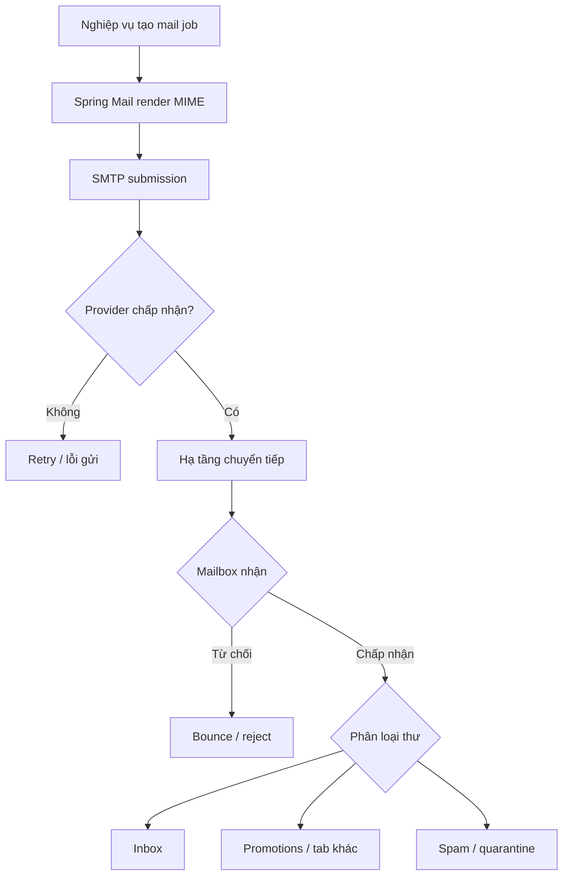

# Nội dung, liên kết và hình ảnh ảnh hưởng deliverability trong Spring Framework Mail

Một email được `JavaMailSender.send(...)` gửi thành công chưa chắc đã đến hộp thư đến (Inbox). SMTP server phía gửi có thể chấp nhận thông điệp, hệ thống phía nhận có thể tiếp nhận rồi chuyển thư sang Spam, Promotions, Quarantine, hoặc từ chối ở một bước sau đó. **Deliverability** là khả năng email được hệ thống nhận chấp nhận và chuyển tới đúng nơi người nhận có thể sử dụng; khi phân tích sâu, cần phân biệt rõ khả năng giao thư với khả năng vào Inbox.

Nhiều yếu tố ảnh hưởng đến deliverability: danh tiếng domain/IP, xác thực SPF–DKIM–DMARC, danh sách người nhận, tần suất gửi, bounce/complaint, cấu hình SMTP, chính sách của nhà cung cấp và **chính nội dung thư**. Trong nhóm nội dung, ba phần đáng chú ý là:

1. **Nội dung:** Subject, preheader, lời mở đầu, text/plain, HTML, tính nhất quán và mức độ liên quan tới người nhận.
2. **Liên kết:** Domain đích, cách hiển thị URL, redirect, tracking, chứng chỉ TLS, độ an toàn của trang đến và nguy cơ giả mạo.
3. **Hình ảnh:** Sự phụ thuộc vào remote image, image-only email, ảnh inline CID, kích thước, alt text, privacy và trải nghiệm trên các mail client.

Không có công thức cố định như “tỷ lệ ảnh/văn bản 40/60” hay “tránh đúng mười từ khóa spam” có thể bảo đảm email vào Inbox. Mailbox provider đánh giá nhiều tín hiệu cùng lúc, có thể thay đổi thuật toán, và có sự khác biệt giữa từng domain nhận. Mục tiêu của ứng dụng là tạo **email rõ ràng, hữu ích, an toàn, nhất quán với danh tính người gửi và phù hợp với kỳ vọng người nhận**, rồi đo kết quả bằng dữ liệu thực tế.

Trong Spring Framework Mail, `MimeMessageHelper` hỗ trợ tạo bản text/plain và text/html, thêm ảnh inline hoặc attachment. Thư viện giúp tạo cấu trúc MIME hợp lệ; tuy nhiên, chất lượng nội dung và uy tín liên kết phải do ứng dụng, template và quy trình vận hành kiểm soát.

## 1. Hiểu đúng các mốc của quá trình gửi

Hãy tách các khái niệm vốn dễ bị dùng lẫn lộn:

| Khái niệm | Ý nghĩa | Có chứng minh thư vào Inbox? |
|---|---|---|
| `ENQUEUED` | Ứng dụng đã ghi nhận yêu cầu gửi | Không |
| `PROCESSING` | Worker đang tạo hoặc gửi thư | Không |
| `SUBMITTED` | SMTP submission server chấp nhận message | Không |
| `DELIVERED` | Hệ thống/provider có bằng chứng thư được server nhận tiếp nhận | Không nhất thiết |
| `INBOX_PLACEMENT` | Thư thực sự được xếp vào Inbox | Là kết quả cần kiểm tra riêng |
| `BOUNCED` | Thư bị từ chối/hoàn trả | Không |
| `COMPLAINED` | Người nhận báo cáo thư là spam | Dấu hiệu bất lợi |
| `OPENED` | Có tín hiệu tải ảnh/pixel hoặc tương tác | Không bảo đảm người đọc đã xem |
| `CLICKED` | Có tín hiệu mở liên kết | Không phải bằng chứng tuyệt đối về con người vì link scanner |

Ví dụ luồng gửi:



Một lần `send()` thành công là dấu hiệu cần thiết cho nhiều luồng gửi, nhưng không đủ để kết luận deliverability tốt. Nếu ứng dụng muốn đo kết quả sau submission, phải tích hợp sự kiện từ provider/gateway hoặc hệ thống monitoring mail, đồng thời hiểu giới hạn của từng loại metric.

### Deliverability và nội dung liên quan nhau thế nào?

Một email có nội dung hợp lệ về cú pháp vẫn có thể bị đánh giá không phù hợp khi:

- Domain trong URL không liên quan đến thương hiệu gửi.
- Người nhận không biết tại sao mình nhận thư.
- Email tự nhận từ doanh nghiệp A nhưng link dẫn qua domain lạ.
- Nội dung chỉ là một hình ảnh lớn, không có thông tin đọc được khi ảnh bị chặn.
- Thư chứa quá nhiều liên kết, redirect hoặc nội dung quảng cáo không được mong đợi.
- Chủ đề hứa một điều nhưng body/link lại dẫn đến hành động khác.
- Thư khuyến mại gửi tới danh sách không có consent hoặc tiếp tục gửi sau khi người dùng hủy đăng ký.

Những tín hiệu này không nhất thiết dẫn tới quyết định giống nhau ở mọi provider. Nên đánh giá chúng dưới góc độ **tin cậy, an toàn, khả năng truy cập và trải nghiệm người nhận**, thay vì cố gắng đánh lừa bộ lọc.

## 2. Nội dung phải phù hợp với mục đích của email

Đầu tiên, xác định rõ email là **transactional** hay **marketing/bulk**.

| Loại | Ví dụ | Người nhận kỳ vọng |
|---|---|---|
| Transactional | OTP, đặt lại mật khẩu, xác nhận đơn hàng, hóa đơn | Có liên quan đến thao tác hoặc quan hệ đã tồn tại |
| Service notification | Thay đổi lịch hẹn, cập nhật trạng thái vận chuyển | Thông tin cụ thể và đúng thời điểm |
| Marketing | Khuyến mại, newsletter, chiến dịch ra mắt | Được gửi theo sự đồng ý/quyền liên hệ hợp lệ |
| Bulk operational | Báo cáo định kỳ, thông báo hệ thống tới nhiều tài khoản | Tần suất và nội dung dự đoán được |

Một mail xác nhận đơn hàng nên đi thẳng vào thông tin đơn hàng và bước tiếp theo. Đừng biến mọi email giao dịch thành một chiến dịch quảng cáo dài, vì điều đó làm giảm tính rõ ràng và có thể khiến người dùng bỏ qua thông tin quan trọng.

### 2.1. Subject trung thực và nhất quán

Subject tốt thường cho người nhận biết thư liên quan tới việc gì:

```text
Xác nhận đơn hàng #A-1042

Yêu cầu đặt lại mật khẩu tài khoản Example

Lịch hẹn ngày 15/11 của bạn đã được cập nhật
```

Subject nên tránh tạo cảm giác khẩn cấp giả, mạo danh bên khác hoặc gây nhầm lẫn:

```text
KHẨN CẤP!!! BẠN PHẢI MỞ NGAY!!!

Bạn đã nhận tiền!!! Bấm vào đây!!!

Trả lời email của CEO (khi người gửi không phải CEO)
```

Không phải chữ in hoa hoặc dấu chấm than tự động khiến thư vào Spam. Vấn đề lớn hơn là nội dung có đáng tin và có phù hợp kỳ vọng hay không. Một Subject gây hiểu nhầm có thể làm người nhận phản hồi tiêu cực, làm hại danh tiếng về lâu dài.

**Không đưa secret vào Subject:** OTP, reset token, mã truy cập, dữ liệu tài chính nhạy cảm hoặc thông tin riêng tư không nên nằm trong subject vì subject thường hiện trên màn hình khóa, notification, bản xem trước và hệ thống log.

### 2.2. Preheader khớp nội dung

Preheader là phần chữ được nhiều mail client dùng làm đoạn xem trước bên cạnh Subject. Có thể đặt một đoạn đầu email ngắn, ví dụ:

```text
Subject: Xác nhận đơn hàng #A-1042
Preheader: Chúng tôi đã nhận đơn và sẽ thông báo khi giao hàng.
```

Nếu template HTML có preheader ẩn để tối ưu preview, nội dung này phải nhất quán với body; không dùng preheader ẩn để “nhồi” từ khóa hoặc tạo thông điệp khác với nội dung chính. Mail client có thể bỏ qua preheader hoặc lấy text khác làm preview.

### 2.3. Người nhận phải nhận biết vì sao có email

Với email marketing, nên thể hiện thương hiệu, lý do nhận, thông tin liên hệ và cách từ chối nhận khi phù hợp với chính sách và luật áp dụng. Với transactional, nên mô tả sự kiện gốc:

> Chúng tôi gửi email này vì bạn vừa yêu cầu thay đổi mật khẩu cho tài khoản Example. Nếu không thực hiện yêu cầu, bạn có thể bỏ qua thư và kiểm tra bảo mật tài khoản.

Một nội dung quá chung chung như “Bạn có thông báo quan trọng, bấm vào link sau” dễ gây nghi ngờ hơn một thông báo nêu chính xác mục đích, thời điểm và hành động mong đợi.

### 2.4. Cá nhân hóa phải đúng và có giới hạn

Hiển thị mã đơn, tên sản phẩm hoặc tên người nhận có thể tăng tính liên quan, nhưng phải cân nhắc:

- Dữ liệu cá nhân có thực sự cần thiết trong email hay không.
- Giá trị từ database/CRM đã được xác thực và escape đúng ngữ cảnh chưa.
- Người dùng có thể thay đổi tên hiển thị thành chuỗi HTML hoặc link độc hại không.
- Thông tin nào có thể xuất hiện trên màn hình khóa hoặc trong email bị chuyển tiếp.
- Nếu dữ liệu bị thiếu, template có cách fallback hợp lý hay không.

Không chèn mã xác thực hoặc thông tin nhạy cảm vào link tracking của bên thứ ba chỉ để cá nhân hóa.

## 3. Text/plain và text/html nên cùng truyền đạt một thông điệp

Một email HTML có thể trông đẹp trên desktop, nhưng người nhận cũng có thể:

- Sử dụng client chỉ hiển thị text/plain.
- Chặn HTML hoặc remote image vì chính sách doanh nghiệp.
- Dùng chế độ trợ năng/screen reader.
- Nhận mail qua gateway chuyển đổi nội dung.
- Có kết nối chậm hoặc device nhỏ.

Vì vậy, nên cung cấp **bản văn bản thuần hữu ích** cùng bản HTML trong `multipart/alternative` khi email được định dạng HTML.

### 3.1. Ví dụ hai bản của cùng email

**Plain text:**

```text
Xin chào An,

Chúng tôi đã nhận đơn hàng A-1042.

Xem trạng thái tại:
https://account.example.org/orders/A-1042

Nếu bạn không thực hiện đơn hàng này, hãy liên hệ
https://support.example.org/help

Đội ngũ Example
```

**HTML:**

```html
<!doctype html>
<html lang="vi">
  <head>
    <meta charset="UTF-8">
    <title>Xác nhận đơn hàng</title>
  </head>
  <body>
    <h1>Đã nhận đơn hàng A-1042</h1>
    <p>Xin chào An,</p>
    <p>Chúng tôi đã nhận đơn hàng của bạn.</p>
    <p>
      <a href="https://account.example.org/orders/A-1042">
        Xem trạng thái đơn hàng
      </a>
    </p>
    <p>
      Cần hỗ trợ?
      <a href="https://support.example.org/help">
        Trung tâm hỗ trợ
      </a>
    </p>
    <p>Đội ngũ Example</p>
  </body>
</html>
```

Hai phiên bản diễn đạt cùng sự kiện và cùng địa chỉ đích. Không nên tạo một bản text/plain hoàn toàn khác bản HTML, ví dụ plain text dẫn về một website lạ còn HTML dẫn tới website chính thức. Sự khác biệt lớn không có lý do có thể gây nhầm lẫn cho người nhận và hệ thống xử lý.

### 3.2. Dùng MimeMessageHelper.setText(plainText, htmlText)

```java
MimeMessage message = mailSender.createMimeMessage();

MimeMessageHelper helper = new MimeMessageHelper(
        message,
        MimeMessageHelper.MULTIPART_MODE_MIXED_RELATED,
        "UTF-8");

helper.setFrom("notifications@example.org");
helper.setTo("customer@example.net");
helper.setSubject("Xác nhận đơn hàng A-1042");

helper.setText(plainText, htmlText);
mailSender.send(message);
```

`setText(plainText, htmlText)` giúp Spring Mail/Jakarta Mail xây dựng MIME alternative đúng cấu trúc. Với mail đơn giản chỉ có plain text, có thể dùng `SimpleMailMessage`; với HTML và resource, dùng `MimeMessage`/`MimeMessageHelper`.

**Không tự ghép MIME boundary, Content-Transfer-Encoding và CRLF bằng String.** Một thông điệp sai MIME có thể hiển thị lỗi hoặc bị gateway từ chối; thư viện mail xử lý encoding, boundary và các chi tiết transport tốt hơn tự nối chuỗi.

### 3.3. Nội dung thật phải có ngoài ảnh

Một body kiểu:

```html

```

có thể không truyền đạt được gì nếu ảnh bị chặn. Thay vào đó, đặt nội dung chính bằng HTML text thật:

```html
<h1>Đơn hàng của bạn đã được xác nhận</h1>
<p>Mã đơn hàng: A-1042</p>
<p>
  <a href="https://account.example.org/orders/A-1042">
    Xem chi tiết đơn hàng
  </a>
</p>

```

Ảnh giúp nhận diện hoặc minh họa, nhưng nội dung quan trọng vẫn có thể đọc mà không tải ảnh.

## 4. Cấu trúc HTML email rõ ràng và tương thích

HTML email không giống một trang web đầy đủ. Nhiều mail client bỏ qua hoặc hạn chế JavaScript, CSS phức tạp, form, iframe, remote font và một số thẻ HTML.

Hướng tiếp cận tốt:

- Sử dụng HTML đơn giản, có cấu trúc, văn bản dễ đọc.
- Chỉ đặt một hành động chính nổi bật khi phù hợp.
- Dùng tiêu đề và đoạn văn mô tả trực tiếp mục đích.
- Dùng CSS inline khi cần tương thích với nhiều client.
- Đặt kích thước hợp lý cho hình ảnh và layout responsive.
- Không phụ thuộc JavaScript để hiện nội dung hoặc nút.
- Không nhúng form yêu cầu mật khẩu/OTP trực tiếp trong email.
- Kiểm soát link, image source và HTML được render từ template.

### 4.1. Nút CTA phải là link thực

Ví dụ email HTML:

```html
<a
  href="https://account.example.org/orders/A-1042"
  style="display:inline-block;padding:12px 18px;
         background:#1459a8;color:#fff;
         text-decoration:none;border-radius:4px">
  Xem đơn hàng
</a>
```

Đây là một liên kết thật được trình bày giống nút. Nếu CSS bị bỏ qua, người nhận vẫn nhìn thấy text và URL đích qua link. Không tạo CTA chỉ bằng ảnh hoặc JavaScript.

### 4.2. Không nhồi nội dung ẩn để “vượt spam”

Một số kỹ thuật cố gắng chèn nhiều text màu trắng, kích thước cực nhỏ hoặc block ẩn chứa từ khóa nhằm đánh lừa bộ lọc. Những kỹ thuật đó có thể làm nội dung không đáng tin, không thân thiện trợ năng và gây ra hiệu ứng ngược.

Nếu dùng preheader ẩn để hỗ trợ preview, hãy giữ nó ngắn, trung thực và liên quan tới nội dung chính. Không sử dụng HTML ẩn để cố tạo tín hiệu khác với những gì người nhận thực sự thấy.

### 4.3. Kích thước HTML và độ phức tạp

Email có HTML quá lớn có thể làm chậm tải, bị client cắt bớt nội dung hoặc tăng rủi ro hiển thị sai. Một số mail client có ngưỡng clipping riêng và các ngưỡng này có thể thay đổi.

Nên:

- Tránh nhúng CSS framework hoặc hàng nghìn dòng markup không cần thiết.
- Bỏ phần template thừa, comment dài và ảnh base64 lớn.
- Đặt footer/unsubscribe quan trọng ở vị trí dễ tìm.
- Giữ nội dung chính xuất hiện sớm, đặc biệt trên điện thoại.
- Kiểm tra raw message size, không chỉ số ký tự HTML.

Đừng xem một ngưỡng kích thước được truyền miệng là quy tắc chung cho mọi provider. Kiểm tra trên những client mà người dùng của sản phẩm thực sự sử dụng.

## 5. Liên kết: tín hiệu lớn về độ tin cậy

Các hệ thống nhận thường phân tích URL và domain được nhắc đến trong email. Một mail có `From` hợp lệ nhưng chứa link đến các host lạ, domain mới không liên quan hoặc trang có nội dung độc hại có thể bị đánh giá rủi ro.

### 5.1. Dùng domain rõ ràng, được tổ chức kiểm soát

Ví dụ:

```text
From: notifications@example.org

Xem đơn hàng:
https://account.example.org/orders/A-1042

Hỗ trợ:
https://support.example.org/help
```

Người nhận nhìn thấy mối liên hệ hợp lý giữa domain gửi và domain của liên kết. Đường dẫn hiển thị đủ cụ thể để họ hiểu link dẫn đến đâu.

Không bắt buộc mọi link phải nằm trên **cùng một hostname** với `From`; doanh nghiệp có thể dùng nhiều subdomain hoặc nhà cung cấp bên ngoài. Quan trọng là lý do và mối quan hệ giữa các domain phải rõ ràng, đáng tin, và không dẫn người nhận qua các host bất ngờ.

### 5.2. Tránh URL shortener không rõ nguồn

Ví dụ làm giảm tính minh bạch:

```text
Nhấp vào: https://short.example.invalid/a8X2k
```

Một short link có thể giấu đích thật, làm người nhận khó xác minh và có thể khiến hệ thống bảo mật cần kiểm tra nhiều redirect. Không phải mọi shortener đều bị chặn; vấn đề là **quyền kiểm soát, danh tiếng và tính minh bạch của chuỗi chuyển hướng**.

Nếu cần link ngắn, ưu tiên một host do tổ chức kiểm soát, với redirect cố định và quản lý được. Hạn chế các chuỗi chuyển hướng dài không cần thiết.

### 5.3. Anchor text phải khớp URL thực

Anti-pattern:

```html
<a href="https://unrelated.example.invalid/session">
  https://account.example.org/login
</a>
```

Người đọc thấy một domain nhưng khi nhấp lại đến domain khác. Đây là mẫu thường bị lợi dụng trong phishing.

Tốt hơn:

```html
<a href="https://account.example.org/login">
  Đăng nhập vào Example
</a>
```

Nếu hiển thị URL như văn bản thì URL đó nên đúng với đích liên kết. Khi dùng CTA “Đăng nhập”, đảm bảo trang đến thực sự là trang đăng nhập chính thức của sản phẩm.

### 5.4. Tránh quá nhiều link không cần thiết

Nhiều liên kết không có liên quan làm người nhận khó biết hành động chính. Một email giao dịch thường không cần thêm hàng chục đường dẫn marketing.

Không có giới hạn số link chuẩn chung bảo đảm deliverability. Hãy chọn theo nội dung:

- Một CTA chính cho nhiệm vụ cụ thể.
- Một link hỗ trợ/trợ giúp khi cần.
- Link quản lý tùy chọn hoặc hủy đăng ký cho loại thư phù hợp.
- Footer pháp lý/đơn vị gửi theo chính sách.

Nếu bản HTML có link, bản text/plain nên chứa URL tương ứng khi link quan trọng cho nhiệm vụ.

## 6. Các redirect và tracking link

Email marketing đôi khi sử dụng đường dẫn tracking:

```text
Email CTA
    -> click.example.org/t/opaque-id
    -> account.example.org/orders/A-1042
```

Tracking có thể hỗ trợ đo chiến dịch, nhưng cũng làm tăng một lớp chuyển hướng và các rủi ro bảo mật, riêng tư hoặc uy tín domain. Một số mail client và security gateway có thể kiểm tra, viết lại hoặc tự truy cập đường dẫn.

### 6.1. Những nguyên tắc cho tracking domain

- Sử dụng host thuộc tổ chức hoặc provider uy tín được cấu hình đúng.
- Giữ TLS hoạt động và chứng chỉ hợp lệ.
- Tránh redirect qua nhiều tầng hoặc đổi đích bất ngờ.
- Không để tracking endpoint trở thành **open redirect** cho URL do người dùng chỉ định.
- Không chứa email/OTP/reset token dạng plaintext trong tracking query.
- Định nghĩa retention cho click events và xin phép/cho phép từ chối theo chính sách quyền riêng tư.
- Không dùng click tracking để thay đổi đích sau khi người dùng đã xác nhận một hành động nhạy cảm.

### 6.2. Open redirect ảnh hưởng uy tín

Ví dụ không nên triển khai:

```text
https://click.example.org/redirect?url=https://arbitrary-host.invalid
```

Nếu endpoint chuyển hướng đến bất kỳ URL nào theo query parameter, kẻ xấu có thể lợi dụng domain uy tín của tổ chức làm bước trung gian dẫn đến nội dung lừa đảo. Điều này vừa gây nguy cơ phishing vừa ảnh hưởng niềm tin đối với các link gửi qua email.

Thiết kế thay thế: liên kết một **opaque identifier** tới một đích đã được tạo và phê duyệt phía server; kiểm tra đích trước khi lưu và kiểm soát những thay đổi đích sau đó.

### 6.3. Không dùng click tracking làm thước đo duy nhất

Một hệ thống bảo vệ email có thể tự mở link để quét an toàn trước khi người nhận nhấp; một số client cũng làm prefetch. Vì vậy, sự kiện click ghi nhận không nhất thiết đồng nghĩa một người đã chủ động tương tác.

Nếu đang đo conversion, nên dựa trên sự kiện nghiệp vụ ở website/application (ví dụ người dùng đã đăng nhập và hoàn tất thao tác), không chỉ dựa vào đếm HTTP GET của redirect endpoint.

## 7. Kiểm tra URL trong code trước khi render vào email

URL được đưa vào template cần có quy tắc nguồn gốc và destination. Với các link tài khoản, xác nhận hoặc đơn hàng, tốt nhất server tự tạo URL từ base URL đã cấu hình:

```java
URI orderUrl = UriComponentsBuilder
        .fromUriString("https://account.example.org")
        .pathSegment("orders", order.getPublicCode())
        .build()
        .encode()
        .toUri();
```

`UriComponentsBuilder` là tiện ích của Spring Web. Trong ứng dụng thật, base URL nên lấy từ cấu hình theo môi trường hoặc tenant đã được xác minh, không lấy thẳng từ HTTP `Host` header hoặc một query parameter do người dùng kiểm soát.

### 7.1. Một allowlist URL cho link do hệ thống sử dụng

Khi thật sự phải nhận URL từ một nguồn khác, có thể giới hạn scheme/host theo danh sách cho phép:

```java
package com.example.mail.security;

import java.net.IDN;
import java.net.URI;
import java.util.Locale;
import java.util.Set;

public final class MailLinkPolicy {

    private static final Set<String> ALLOWED_HOSTS = Set.of(
            "account.example.org",
            "support.example.org");

    private MailLinkPolicy() {
    }

    public static URI requireApprovedHttpsUrl(String raw) {
        URI uri = URI.create(raw);
        String host = uri.getHost();

        if (!"https".equalsIgnoreCase(uri.getScheme())
                || host == null
                || uri.getUserInfo() != null
                || uri.getFragment() != null) {
            throw new IllegalArgumentException("Unapproved mail URL");
        }

        String asciiHost = IDN.toASCII(host)
                .toLowerCase(Locale.ROOT);

        if (!ALLOWED_HOSTS.contains(asciiHost)
                || (uri.getPort() != -1 && uri.getPort() != 443)) {
            throw new IllegalArgumentException("Unapproved mail URL");
        }

        return uri;
    }
}
```

Đây là một policy bảo thủ cho link trong email và một tập hostname xác định. Nó không phải bộ kiểm tra URL tổng quát để truy cập network, cũng không tự kiểm soát redirect ở server đích.

Các điểm cần chú ý:

- **So sánh host đã parse**, không dùng `raw.contains("example.org")`.
- `evil-example.org` không phải là `example.org`.
- Không cho phép scheme `javascript:`, `data:` hoặc `file:`.
- Kiểm tra userinfo (`user:password@host`), port và những cú pháp lạ nếu không cần.
- Với hostname quốc tế hóa, áp dụng xử lý IDN và kiểm tra tên đã được phê duyệt.
- Có thể cần kiểm tra thêm path/route nếu sản phẩm chỉ cho phép một số đích.
- Xử lý ký tự đặc biệt bằng URI builder/HTML attribute escaping khi render.

Nếu hệ thống lấy nội dung từ một domain bên ngoài, allowlist phải được duy trì có chủ đích và cập nhật khi provider thay đổi. Không thay allowlist bằng một điều kiện “hostname kết thúc bằng chuỗi nào đó” nếu điều đó vô tình cho phép host không kiểm soát.

### 7.2. Khác biệt giữa URL hiển thị và HTML attribute

Trong HTML:

```html
<a href="https://account.example.org/orders?sort=desc&amp;page=2">
  Xem đơn hàng
</a>
```

Dấu `&` trong attribute cần được escape thành `&amp;` để HTML hợp lệ. Điều đó khác với URL encoding (ví dụ mã hóa một path segment). URL building, HTML escaping và header validation là ba bước khác nhau.

Để giảm sai sót, dùng template engine như Thymeleaf có chế độ escape theo ngữ cảnh, không ghép raw user input vào `href`. Sau escaping vẫn cần kiểm tra URL đích được phép, bởi escaping HTML không loại bỏ được một URL sai chính sách.

## 8. Link chứa token: bảo mật trước, tracking sau

Email kích hoạt tài khoản, reset password hoặc xác thực một lần thường chứa đường dẫn có token. Các link này có thêm yêu cầu bảo mật:

- Token phải khó đoán, có thời hạn và giới hạn số lần sử dụng theo chính sách.
- Không đưa token vào Subject hoặc log.
- Không để link token đi qua redirect/tracking của bên thứ ba không được kiểm soát.
- Không gắn thêm dữ liệu cá nhân không cần thiết vào URL.
- Không đưa token cho các script, hình ảnh hoặc dịch vụ analytics bên ngoài trên trang đến.
- Trang đến phải xử lý referrer, cache và lịch sử truy cập thích hợp.
- Xử lý việc mail link scanner tự mở URL trước người dùng.

### 8.1. GET không nên tự hoàn tất hành động nhạy cảm

Một số security scanner có thể mở link để kiểm tra an toàn. Nếu chỉ một HTTP GET tới URL reset đã tự đổi mật khẩu, thay địa chỉ email hoặc xác nhận giao dịch, hành động có thể xảy ra ngoài ý định người dùng.

Với tác vụ nhạy cảm, trang GET nên hiển thị trạng thái/biểu mẫu phù hợp, còn thao tác thay đổi trạng thái cần thêm hành động có chủ ý, kiểm soát CSRF/authentication và token validation theo nghiệp vụ.

### 8.2. Tránh làm lộ token qua tracking

Ví dụ không nên:

```text
https://click.thirdparty.invalid/track?
  user=user@example.net&
  resetToken=TOP_SECRET&
  redirect=https://account.example.org/reset
```

Ngay cả khi link cuối cùng về đúng website, token và email đã có thể bị lộ cho tracking provider, access logs, referrer hoặc browser history. Với reset link, ưu tiên direct URL tới domain chính thức được kiểm soát.

## 9. Hình ảnh trong email: lợi ích và rủi ro

Hình ảnh giúp nhận diện thương hiệu và trực quan hóa nội dung, nhưng không phải mọi mail client đều tự tải ảnh. Remote images có thể bị chặn bởi privacy setting, network policy hoặc security gateway.

Các rủi ro phổ biến:

- Email chỉ có ảnh nên nội dung trống khi client chặn image.
- Image host hoạt động chậm, hết hạn TLS hoặc bị chặn.
- Ảnh rất lớn làm email nặng hoặc layout bị tràn.
- URL ảnh dùng host khác thường, không liên quan đến thương hiệu.
- Link bấm trên ảnh dẫn tới trang khác với kỳ vọng.
- Ảnh chứa text nhỏ và quan trọng nhưng không có alt text.
- Tracking pixel làm phép đo opens sai lệch hoặc gây vấn đề quyền riêng tư.
- Attachment/inline image khiến MIME phức tạp và tăng dung lượng.

### 9.1. Không dùng email chỉ có một banner

Ví dụ khó sử dụng:

```html

```

Toàn bộ nội dung “Đơn hàng đã được xác nhận, xem ở đây” nằm bên trong bitmap. Khi hình ảnh không tải, người nhận có thể không đọc được gì.

Thay thế:

```html
<h1>Đơn hàng đã được xác nhận</h1>
<p>Chúng tôi sẽ thông báo khi đơn hàng được bàn giao.</p>
<p>
  <a href="https://account.example.org/orders/A-1042">
    Xem trạng thái đơn hàng
  </a>
</p>

```

Ảnh bây giờ là thành phần hỗ trợ; nội dung và CTA vẫn tồn tại dưới dạng text/link thật.

### 9.2. Alt text và kích thước

Ví dụ:

```html

```

- `alt` giúp người dùng hiểu nội dung hình khi ảnh bị chặn hoặc khi dùng công nghệ trợ năng.
- Với ảnh chỉ để trang trí, `alt=""` có thể phù hợp.
- `width` và `height` giúp mail client xác định vùng bố cục, dù mức hỗ trợ CSS/attribute khác nhau.
- Không đặt nội dung pháp lý, hạn sử dụng OTP hoặc thông tin thanh toán **chỉ trong ảnh**.
- Không dùng alt text như nơi “nhồi từ khóa” vô nghĩa.

### 9.3. Chọn định dạng ảnh

PNG/JPEG được hỗ trợ rộng rãi trong nhiều email client. GIF động có thể chỉ hiển thị khung đầu tiên ở một số client. SVG, WebP, CSS background image và định dạng mới cần được kiểm tra theo đối tượng thiết bị/client thực tế.

Không có một định dạng duy nhất tối ưu cho mọi tình huống. Đối với logo đơn giản, ưu tiên kích thước nhỏ và độ sắc nét; đối với ảnh chụp, nén hợp lý. Hãy cân bằng chất lượng hình với tổng dung lượng tải.

## 10. Remote images, CID và attachment khác nhau thế nào?

Trong email HTML, có ba cách phổ biến để cung cấp hình:

| Cách | Ví dụ | Ưu điểm | Lưu ý |
|---|---|---|---|
| Remote HTTPS | `` | MIME nhỏ, tài nguyên có thể cache | Client có thể chặn, host phải sẵn sàng |
| Inline CID | `` | Tài nguyên đi cùng MIME message | Tăng kích thước email, tương thích khác nhau |
| Attachment | `logo.png` đính kèm | Người nhận có thể tải file | Thường hiển thị như file, không tự chèn vào body |

### 10.1. Remote images

Ảnh được tải từ một HTTPS URL khi client hoặc image proxy quyết định lấy tài nguyên. Một số provider dùng image proxy hoặc cache nên:

- Log truy cập image server không phản ánh chính xác từng lượt xem.
- IP/user agent có thể là proxy, không phải thiết bị thật.
- Ảnh có thể được cache và không gọi lại origin mỗi lần mở.
- Email có thể được mở mà không phát sinh request ảnh.
- Việc block image có thể làm tracking không nhận được sự kiện.

Hosting ảnh nên ổn định, có TLS hợp lệ, đường dẫn bền vững và không yêu cầu login/cookie để tải phần hình không nhạy cảm. Nếu URL ảnh hết hạn ngay sau khi gửi, người nhận mở lại email sau vài ngày có thể thấy ảnh hỏng.

### 10.2. Inline CID

HTML tham chiếu tài nguyên bằng Content-ID:

```html

```

Java/Spring:

```java
helper.setText(plainText, htmlText);

helper.addInline(
        "brand-logo",
        new ClassPathResource("mail/images/logo.png"),
        "image/png");
```

Gọi `setText(...)` trước `addInline(...)` theo hướng dẫn dùng `MimeMessageHelper` để bảo đảm phần inline được gắn đúng quan hệ MIME. Content-ID trong HTML (`cid:brand-logo`) phải khớp ID được truyền vào `addInline`.

**CID không bảo đảm deliverability tốt hơn ảnh HTTPS.** Nó chỉ thay đổi cách đóng gói tài nguyên. Một số client có thể hiển thị ảnh inline như attachment; email có nhiều ảnh CID có thể lớn hơn đáng kể.

### 10.3. Data URI và base64 trong HTML

Ví dụ:

```html

```

Data URI thường có mức hỗ trợ không đồng đều giữa các mail client và làm HTML phình to. Không nên coi nó là giải pháp mặc định để vượt việc remote image bị chặn. Nếu cần đính kèm ảnh, dùng `addInline` hoặc remote HTTPS tùy nhu cầu.

### 10.4. File attachment

File đính kèm có thể tăng giá trị email, nhưng cũng tăng kích thước MIME và nguy cơ bị policy của mail gateway chặn. Đặc biệt lưu ý:

- File thực thi, macro hoặc định dạng nguy hiểm có thể bị chặn.
- Một số gateway có giới hạn attachment size và MIME type.
- Tên file bất thường hoặc chứa ký tự điều khiển có thể gây lỗi.
- Attachment cần được quét và xác thực định dạng theo policy.
- Base64 encoding có thể làm byte truyền trên wire lớn hơn file gốc.

Với file lớn, có thể gửi link tải từ một trang HTTPS đã xác thực thay vì gửi attachment, nếu phù hợp bảo mật và yêu cầu lưu trữ. Nhưng link tải phải bền vững đủ lâu và không chuyển người dùng qua domain đáng ngờ.

## 11. Ví dụ email có plain text, HTML và ảnh CID bằng Spring Mail

Ví dụ sau gửi một email xác nhận đơn hàng với hai phiên bản nội dung và logo inline. Các DTO và địa chỉ dùng để minh họa; không gửi dữ liệu bí mật vào log.

```java
package com.example.mail;

import jakarta.mail.MessagingException;
import jakarta.mail.internet.MimeMessage;
import java.nio.charset.StandardCharsets;
import java.util.Objects;
import org.springframework.core.io.ClassPathResource;
import org.springframework.mail.javamail.JavaMailSender;
import org.springframework.mail.javamail.MimeMessageHelper;
import org.springframework.stereotype.Service;

@Service
public class OrderConfirmationMailService {

    private final JavaMailSender mailSender;

    public OrderConfirmationMailService(JavaMailSender mailSender) {
        this.mailSender = mailSender;
    }

    public void send(OrderMailData data) throws MessagingException {
        Objects.requireNonNull(data, "data");

        String publicCode = safePublicOrderCode(data.orderCode());
        String orderUrl = "https://account.example.org/orders/"
                + publicCode;

        String plain = """
                Đơn hàng %s đã được ghi nhận.

                Xem trạng thái:
                %s

                Cần hỗ trợ:
                https://support.example.org/help

                Đội ngũ Example
                """.formatted(publicCode, orderUrl);

        String html = """
                <!doctype html>
                <html lang="vi">
                  <body style="font-family:Arial,sans-serif;
                               line-height:1.5;color:#222;">
                    <p>
                      
                    </p>
                    <h1>Đơn hàng đã được ghi nhận</h1>
                    <p>Mã đơn hàng: <strong>%s</strong></p>
                    <p>
                      <a href="%s">Xem trạng thái đơn hàng</a>
                    </p>
                    <p>
                      Cần hỗ trợ?
                      <a href="https://support.example.org/help">
                        Trung tâm hỗ trợ
                      </a>
                    </p>
                  </body>
                </html>
                """.formatted(publicCode, orderUrl);

        MimeMessage message = mailSender.createMimeMessage();
        MimeMessageHelper helper = new MimeMessageHelper(
                message,
                MimeMessageHelper.MULTIPART_MODE_MIXED_RELATED,
                StandardCharsets.UTF_8.name());

        helper.setFrom("notifications@example.org");
        helper.setTo(data.recipientEmail());
        helper.setSubject("Xác nhận đơn hàng " + publicCode);
        helper.setText(plain, html);
        helper.addInline(
                "brand-logo",
                new ClassPathResource("mail/images/logo.png"),
                "image/png");

        mailSender.send(message);
    }

    private String safePublicOrderCode(String value) {
        if (value == null || !value.matches("[A-Za-z0-9-]{1,40}")) {
            throw new IllegalArgumentException(
                    "Invalid public order code");
        }
        return value;
    }
}
```

Ở đây, `OrderMailData` là một DTO do ứng dụng định nghĩa, có `orderCode()` và `recipientEmail()`. Trong production, recipient phải được lấy từ nguồn có quyền phù hợp, parse/kiểm tra bằng `InternetAddress` và áp dụng hạn chế gửi; example không thay thế các bước đó.

**Vì sao mẫu này có lợi về chất lượng email?**

- Subject mô tả đúng sự kiện.
- Bản plain text và HTML có cùng mục đích và cùng link.
- CTA dùng domain có quan hệ rõ với thương hiệu gửi.
- Logo chỉ là phần hỗ trợ; nội dung chính vẫn là text.
- Ảnh CID được đính vào MIME qua `MimeMessageHelper`.
- Mã đơn được giới hạn thành tập ký tự an toàn trước khi đưa vào Subject, URL và HTML.
- Charset UTF-8 giúp truyền tiếng Việt chính xác.
- Không có URL shortener hoặc tracking chứa dữ liệu nhạy cảm.

Nếu dữ liệu động có thể chứa ký tự HTML/URL đặc biệt, không chỉ kiểm tra bằng regex minh họa trên; cần dùng template engine có escaping và URI builder cho từng ngữ cảnh. Ví dụ dùng một mã public chỉ gồm chữ số/chữ Latin/dấu gạch ngang nên giá trị an toàn để minh họa trong HTML/URL, nhưng quy tắc này không dùng được nguyên xi cho tên khách hàng hay mô tả sản phẩm.

### 11.1. Cấu hình SMTP đi kèm

Ví dụ Spring Boot:

```yaml
spring:
  mail:
    host: ${SMTP_HOST}
    port: 587
    username: ${SMTP_USERNAME}
    password: ${SMTP_PASSWORD}
    properties:
      "[mail.smtp.auth]": true
      "[mail.smtp.starttls.enable]": true
      "[mail.smtp.starttls.required]": true
      "[mail.smtp.connectiontimeout]": 5000
      "[mail.smtp.timeout]": 5000
      "[mail.smtp.writetimeout]": 5000
```

STARTTLS và SMTP AUTH bảo vệ kết nối/đăng nhập theo chính sách provider, nhưng không thay thế danh tiếng domain hoặc chất lượng nội dung. Không hard-code password và không bật protocol debug chứa dữ liệu nhạy cảm trong production.

### 11.2. Khi nào cần template engine?

Nếu email có nhiều biến động (đơn hàng nhiều dòng, locale, HTML phức tạp), nên tách render:

```java
String plainText = plainTextRenderer.render(
        "order-confirmation.txt", safeModel);

String htmlText = thymeleafTemplateEngine.process(
        "mail/order-confirmation", context);

helper.setText(plainText, htmlText);
```

`plainTextRenderer`, `safeModel` và `context` do ứng dụng cung cấp. Chọn cơ chế escape theo ngữ cảnh của template engine; không tự ghép dữ liệu người dùng trực tiếp vào attribute `href` hoặc HTML markup. Render thành công không chứng minh URL an toàn; link vẫn phải được kiểm soát theo domain policy.

## 12. Nội dung và link nhất quán với danh tính người gửi

Deliverability không chỉ phụ thuộc vào chuỗi HTML. Một email từ `notifications@example.org` nên phù hợp với:

- Sender domain mà tổ chức sở hữu hoặc được ủy quyền.
- Domain được xác minh ở SMTP/email service provider.
- Envelope sender/bounce domain theo cấu hình của provider.
- Chữ ký DKIM và chính sách DMARC khi áp dụng.
- Các domain link trong email.
- Tên hiển thị và thương hiệu trong header/body.

### SPF, DKIM và DMARC đóng vai trò gì?

| Cơ chế | Phạm vi | Liên hệ với nội dung/link |
|---|---|---|
| SPF | Kiểm tra server gửi có được phép cho envelope domain/HELO liên quan | Không xác thực đích URL |
| DKIM | Xác thực chữ ký trên một số header/body | Chứng minh nội dung được ký không bị thay đổi theo phạm vi chữ ký; không chứng minh URL đáng tin |
| DMARC | Chính sách xử lý dựa trên alignment của From với SPF/DKIM | Hỗ trợ nhận diện domain gửi; không sửa link độc hại |
| SMTP AUTH/TLS | Đăng nhập và bảo vệ transport | Không bảo đảm Inbox placement |

Một email có SPF/DKIM/DMARC hợp lệ vẫn có thể bị xếp Spam nếu danh sách nhận kém, người nhận phàn nàn, nội dung gây nghi ngờ hoặc danh tiếng chưa tốt.

Ngược lại, một nội dung rất đẹp nhưng sender chưa xác thực đúng cũng có thể gặp vấn đề deliverability. Phải xem nội dung và hạ tầng như những phần bổ sung cho nhau.

### Link domain khác sender domain có bị cấm?

Không có quy tắc chung rằng tất cả link phải trùng hostname với From. Ví dụ một doanh nghiệp dùng `example.org` cho gửi mail và `shop.example.org` cho đơn hàng là bình thường. Đôi khi link trỏ đến trang hướng dẫn chính thức trên domain khác.

Hãy đánh giá theo từng link: có được phê duyệt không, thương hiệu có giải thích rõ không, chuyển hướng ra sao, có HTTPS và bảo vệ trang đến không, và người nhận có thể nhận biết trang đó là hợp pháp không.

## 13. Footer, thông tin liên hệ và unsubscribe

Email không nên khiến người nhận khó hiểu mình đã đăng ký nhận gì hoặc không thể dừng các thư không mong muốn.

Với marketing/bulk, tùy quy định pháp lý, chính sách provider và loại thông điệp, cần:

- Xác định danh tính tổ chức gửi một cách rõ ràng.
- Cung cấp thông tin liên hệ/địa chỉ phù hợp.
- Có cơ chế hủy đăng ký dễ tiếp cận.
- Tôn trọng unsubscribe và suppression list trong các lần gửi tiếp theo.
- Không chuyển người đã unsubscribed trở lại danh sách vì import/sync thiếu kiểm soát.

Với transactional, các nghĩa vụ có thể khác. Không gộp email reset password hoặc hóa đơn bắt buộc với marketing chỉ để tránh quản lý consent. Nên phân loại thư tại tầng business/job trước khi chọn template và header.

### 13.1. List-Unsubscribe và one-click

Một số mailbox provider và tiêu chuẩn bulk email sử dụng `List-Unsubscribe` và cơ chế one-click unsubscribe, ví dụ theo RFC 8058, ngoài link hủy đăng ký hiển thị trong body.

Điều quan trọng là các header này phải phản ánh **endpoint hủy đăng ký hoạt động thật**, an toàn và phù hợp chính sách. Không chỉ thêm một header để “đạt điểm deliverability” khi server không thể xử lý request.

Với loại mail yêu cầu one-click:

- Endpoint phải xác định đúng subscription cần hủy mà không yêu cầu mở một luồng quá phức tạp.
- Request phải an toàn trước việc lạm dụng và replay theo thiết kế token/idempotency.
- Một lần hủy thành công phải được tôn trọng trước lần gửi tiếp theo.
- Không tự đặt `List-Unsubscribe-Post` nếu chưa triển khai đúng semantics và kiểm tra hệ thống nhận.
- Cần xem yêu cầu hiện hành của các mailbox provider và luật áp dụng theo khu vực.

Không giả định mỗi email transactional đều cần nút unsubscribe. Đồng thời, đừng cố gọi mọi email là transactional để né chính sách áp dụng cho marketing.

### 13.2. Tối ưu cho niềm tin người nhận

Một footer phù hợp có thể gồm tên tổ chức, link hỗ trợ chính thức và lý do nhận thư. Với marketing, cung cấp cách quản lý tùy chọn nhận mail. Những thông tin này giúp người nhận phân biệt thư hợp pháp với phishing và giảm khả năng họ chọn “Report spam” chỉ vì không biết cách dừng thư.

## 14. Tần suất gửi, danh sách nhận và nội dung liên quan nhau

Ngay cả template tốt cũng có thể deliverability kém nếu gửi quá thường xuyên hoặc gửi không đúng đối tượng.

Những yếu tố cần quản lý:

1. Người nhận có quyền/đã đồng ý nhận loại email đó không?
2. Email address có được cập nhật và kiểm tra theo quy trình không?
3. Có suppression list cho hard bounce, complaint và unsubscribe không?
4. Có giới hạn theo người dùng, tenant, mail type và provider quota không?
5. Lịch gửi có phù hợp timezone, mức độ khẩn cấp và loại thông điệp không?
6. Có tách email khẩn cấp (OTP) khỏi bulk campaign để tránh backlog không?

**Không mua hoặc sử dụng danh sách email không có cơ sở hợp lệ.** List hygiene và consent thường quan trọng hơn việc thử các từ khóa Subject để “né spam”.

### Tách transactional và marketing

```text
Business events
   |
   +--> transactional-mail
   |      OTP, invoices, order confirmations
   |
   +--> marketing-mail
          newsletters, campaigns, promotions
```

Có thể dùng sender identity, queue, template và rate limit riêng nếu khối lượng và chính sách cho phép. Sự tách biệt giúp email thiết yếu không bị chậm vì chiến dịch marketing và giúp quan sát complaint/bounce theo loại.

Không cần tự động tạo nhiều domain gửi chỉ để phân tán danh tiếng hoặc lách chính sách. Kiến trúc sender identity phải minh bạch, thuộc tổ chức và được xác minh.

## 15. Tác động của attachment và external resource

Một email chứa file PDF đính kèm, ảnh và nhiều link thường có dung lượng lớn hơn một email text đơn giản. Dung lượng tăng ảnh hưởng:

- Thời gian kết nối/gửi qua SMTP.
- Quota và giới hạn kích thước message.
- Khả năng gateway quét và chấp nhận file.
- Trải nghiệm tải trên điện thoại.
- Chi phí lưu/truyền.

### 15.1. Kích thước MIME không bằng kích thước file gốc

Attachment nhị phân thường cần transfer encoding như base64. Điều này có overhead; ngoài file gốc còn có MIME headers, boundaries và nội dung HTML/text.

Do đó, nếu provider giới hạn `maximum message size`, không kiểm tra chỉ bằng `Files.size(pdfPath)`. Cần giới hạn tổng attachment size phù hợp và tính đến overhead khi lập chính sách.

### 15.2. Khi nào gửi link thay cho attachment?

Ví dụ báo cáo 30 MB có thể phù hợp để lưu trên một hệ thống tài liệu an toàn và gửi link:

```text
Báo cáo của bạn đã sẵn sàng.

Đăng nhập và tải:
https://account.example.org/reports/4cf...
```

Nhưng link phải có kiểm soát truy cập và thời hạn phù hợp. Không gửi một signed URL có thời hạn quá ngắn khiến người nhận bấm sau vài giờ đã không dùng được. Nếu token nằm trong URL, phải tránh vô tình làm lộ qua analytics, referrer hoặc log.

Với hóa đơn/pháp lý, việc gửi file hay link có thể chịu quy định riêng; không đổi phương thức giao chứng từ chỉ vì muốn giảm dung lượng email mà chưa xem yêu cầu nghiệp vụ.

### 15.3. Sử dụng ClassPathResource, ByteArrayResource

Spring Mail cho phép:

```java
helper.addAttachment(
        "invoice.pdf",
        new ByteArrayResource(pdfBytes),
        "application/pdf");
```

Không chuyển `byte[]` của PDF thành `String` rồi nhúng vào raw MIME. Jakarta Mail xử lý transfer encoding, nhưng ứng dụng vẫn phải kiểm tra file type, kích thước, filename và nội dung được phép gửi.

## 16. Trải nghiệm mobile và khả năng tiếp cận

Nhiều người đọc email trên điện thoại. Một template có desktop layout đẹp nhưng bị cắt trên màn hình nhỏ có thể làm CTA khó bấm hoặc đẩy thông tin quan trọng xuống rất sâu.

Một số nguyên tắc:

- Dùng layout có thể co trên màn hình nhỏ, hạn chế chiều rộng cố định quá lớn.
- Giữ đoạn đầu ngắn và nêu mục đích ngay.
- CTA dễ đọc và đủ vùng nhấn.
- Không đặt liên kết quan trọng lên một ảnh làm duy nhất vùng tương tác.
- Giữ tương phản chữ/nền đủ rõ.
- Dùng alt text đúng chức năng, tránh text được “vẽ” bằng ảnh.
- Cung cấp bản text/plain.
- Dùng tiêu đề có thứ bậc rõ ràng, tránh một chuỗi ký tự in hoa dài.
- Không phụ thuộc CSS/remote font để nội dung chính xuất hiện.

### Hình ảnh nền có thể bị bỏ qua

Một số email client không hỗ trợ background-image hoặc CSS nhất định. Nếu đặt text trắng lên ảnh nền tối, khi ảnh nền bị chặn có thể còn text trắng trên nền trắng.

Ví dụ không an toàn về khả năng hiển thị:

```html
<div style="background-image:url('https://assets.example.org/dark.png');
            color:white">
  Mã đơn hàng A-1042
</div>
```

Thiết kế an toàn hơn có màu nền dự phòng và bảo đảm text vẫn đọc được khi ảnh không tải:

```html
<div style="background-color:#16365c;color:#ffffff;
            padding:20px">
  Mã đơn hàng A-1042
</div>
```

Tương thích CSS khác nhau giữa client, vì vậy cần thử trên các client mục tiêu, không suy luận dựa trên rendering của trình duyệt.

## 17. Cách đọc số liệu deliverability

Nên xây chuỗi metrics theo từng giai đoạn, không chỉ đo “số email gửi thành công”:

| Metric | Ý nghĩa | Giới hạn |
|---|---|---|
| Jobs enqueued | Nhu cầu gửi | Chưa gửi SMTP |
| SMTP accepted/submitted | Submission được chấp nhận | Chưa biết mailbox placement |
| Hard bounce | Từ chối vĩnh viễn theo provider | Phải xác định nguyên nhân cụ thể |
| Soft bounce/deferred | Từ chối/tạm hoãn | Có thể cần retry theo chính sách |
| Delivery events | Provider ghi nhận đã giao | Không nhất thiết là Inbox |
| Complaint rate | Người dùng đánh dấu spam | Phụ thuộc provider/reporting |
| Unsubscribe rate | Người dùng muốn dừng nhận marketing | Không tự nói lên toàn bộ chất lượng |
| Open proxy/pixel events | Hình ảnh/pixel được tải | Có thể bị privacy proxy hoặc bot làm sai |
| Click events | Link được truy cập | Link scanners có thể tự click |
| Conversion/action | Hành động thực tế trong sản phẩm | Cần định nghĩa sự kiện nghiệp vụ |
| Inbox placement tests | Kiểm thử vị trí nhận ở một nhóm mailbox | Không đại diện tuyệt đối cho toàn bộ danh sách |

### 17.1. Không tin tuyệt đối open rate

Open pixel thường là ảnh nhỏ được tải khi client mở email. Một số hệ thống bảo vệ quyền riêng tư và image proxy có thể tải trước hoặc cache ảnh; một số người đọc thư nhưng không tải ảnh. Vì vậy:

```text
image request != chắc chắn có một lượt đọc thật
```

Open rate có thể dùng như một tín hiệu giới hạn trong bối cảnh phù hợp, nhưng không nên là số duy nhất để ra quyết định về nội dung hoặc đánh giá deliverability.

### 17.2. Tương tự, click cũng có bot

Một click tracking endpoint nhận request HTTP có thể do security scanner tự kiểm tra URL. Với link xác nhận quan trọng, server phải xác thực người dùng hoặc token và yêu cầu hành động có chủ ý nếu cần, không dựa trên GET của email link.

### 17.3. Bounce và complaint phải đi vào suppression

Khi provider báo hard bounce/complaint, hệ thống cần cập nhật trạng thái người nhận theo chính sách. Tiếp tục gửi lặp lại vào địa chỉ không hợp lệ hoặc tới người liên tục báo spam có thể gây tác động xấu đến danh tiếng gửi.

Đừng xóa dữ liệu lịch sử cần thiết để điều tra, nhưng phải giới hạn quyền truy cập và retention cho dữ liệu recipient, provider event và reason.

## 18. Đo theo loại mail và thay đổi template

Để biết nội dung/link/ảnh có liên quan đến thay đổi kết quả hay không, nên theo dõi theo **template version** và nhóm mail phù hợp.

Ví dụ:

```text
mailType = ORDER_CONFIRMATION
templateVersion = 2026-11-a
senderIdentity = transactional-primary

enqueued = ...
submitted = ...
hardBounce = ...
complaint = ...
medianSubmissionLatency = ...
```

Đối chiếu trước/sau một thay đổi nội dung cần cân nhắc các yếu tố gây nhiễu:

- Danh sách người nhận có thay đổi không?
- Sender domain hoặc SMTP IP/provider có thay đổi không?
- Tốc độ gửi/khối lượng gửi có khác không?
- Có sự cố DNS, TLS hay queue backlog không?
- Khung thời gian, mùa vụ và nhóm nhận có tương đồng không?
- Có thay đổi tracking domain hoặc link redirect không?

Không kết luận “một từ trong Subject gây Spam” chỉ vì đổi Subject trùng thời điểm bounce tăng. Bounce, spam classification, inbox placement và complaint phản ánh những cơ chế khác nhau.

### Phân nhóm thử nghiệm có kiểm soát

Nếu doanh nghiệp có cơ sở gửi phù hợp và lượng dữ liệu đủ, có thể A/B test:

- Subject rõ nghĩa theo hai cách diễn đạt.
- Vị trí CTA.
- Phiên bản HTML có/không có ảnh trang trí.
- Link trực tiếp so với link tracking hợp pháp.
- Bản plain text đầy đủ và cách format.

Không làm A/B test bằng việc gửi thư không được mong đợi hoặc giả mạo thông tin để tăng lượt mở. Mục tiêu là cải thiện trải nghiệm và hiệu quả thực, không “đánh bại” bộ lọc.

## 19. Kiểm thử trên mail client và mailbox provider

Trước khi phát hành một template, có thể gửi thử tới một tập mailbox được phép dùng trong test:

| Nhóm kiểm thử | Cần quan sát |
|---|---|
| Plain text client | Thông tin và link vẫn đầy đủ |
| HTML client desktop | Layout, CSS, logo, CTA và footer |
| Mobile | Độ rộng, kích cỡ chữ, link dễ bấm |
| Images blocked | Không mất nội dung chính |
| CID images | Content-ID khớp, không hiện attachment thừa |
| Dark mode | Độ tương phản và hình ảnh |
| Screen reader | Alt text, thứ tự đọc, heading |
| Gmail/Outlook/Apple Mail và các client mục tiêu | Khác biệt rendering, clipping, resource loading |
| Mailbox nhận do doanh nghiệp kiểm soát | Received headers, MIME và kết quả lọc |
| Link scanner | Không tự hoàn tất thao tác nhạy cảm |

### 19.1. SMTP sink chỉ kiểm tra một phần

Mailpit hoặc mail test sink có thể giúp:

- Xem MIME source.
- Kiểm tra plain và HTML.
- Kiểm tra attachment/inline images.
- Xác nhận message được ứng dụng tạo đúng.

Nhưng một SMTP sink nội bộ **không mô phỏng đầy đủ hệ thống lọc Spam của Gmail/Outlook hoặc danh tiếng domain/IP**. Nó là bước kiểm thử chức năng, không phải bằng chứng deliverability ở production.

### 19.2. Nhìn raw source để hiểu MIME

Khi một client hiển thị HTML kém, kiểm tra:

- `Content-Type: multipart/alternative` có plain và HTML đúng thứ tự không?
- Charset UTF-8 được khai báo/encode phù hợp chưa?
- `multipart/related` có CID resource tương ứng không?
- `Content-Disposition` có làm logo hiện như attachment không?
- Có ảnh remote bị chặn hoặc URL trả 403/404 không?
- Có HTML quá lớn hoặc CSS client không hỗ trợ không?

Khi phân tích source có dữ liệu thật, bảo vệ recipient, OTP, token và attachment. Không đưa raw email vào log tập trung hoặc ticket công khai.

## 20. Triển khai mẫu: tách kiểm soát link, render và gửi mail

Một kiến trúc giúp tách trách nhiệm:

```text
Domain/Application Service
    |
    +--> Xác thực nghiệp vụ, recipient và mail type
    |
    v
Mail Job / Event (ID + template version)
    |
    v
Mail Content Service
    +--> Lấy template đã duyệt
    +--> Chuẩn hóa input và escaping
    +--> Tạo URL từ base URL tin cậy
    +--> Tạo text/plain và HTML nhất quán
    |
    v
Spring Mail Sender
    +--> MimeMessageHelper
    +--> Charset / multipart / CID / attachment
    |
    v
SMTP Provider
    |
    v
Event Handling / Monitoring
    +--> Submission, bounce, complaint
    +--> Retry/suppression và template diagnostics
```

### 20.1. Không để controller tự dựng raw Subject và URL

Một service kiểu:

```java
public void sendAnyEmail(
        String recipient,
        String subject,
        String html,
        String link) {
    // ...
}
```

nếu được mở trực tiếp cho client sẽ làm khó kiểm soát content, spam và bảo mật. Thay vào đó, API nhận một ý định nghiệp vụ, ví dụ `orderId`, rồi application service kiểm tra quyền và chọn template.

### 20.2. Template được version hóa

Lưu một `templateVersion` trong mail job hoặc event metadata giúp truy vết:

- Email gửi bằng phiên bản nội dung nào?
- Link tracking/domain có thay đổi ở phiên bản đó không?
- Có ảnh mới làm tăng kích thước message không?
- Có lỗi rendering chỉ xảy ra ở một locale không?
- Sau khi rollback template, backlog retry còn dùng bản nào?

Khi retry một job cũ, quyết định có render lại bằng phiên bản mới hay giữ snapshot phải dựa trên yêu cầu nghiệp vụ. Ví dụ OTP nên luôn gắn với challenge/token còn hiệu lực; hóa đơn có thể phải giữ nội dung theo thời điểm phát hành.

### 20.3. Logging không cần nội dung riêng tư

Ví dụ:

```java
log.info(
        "mail submitted jobId={} kind={} templateVersion={}",
        job.id(),
        job.kind().name(),
        job.templateVersion());
```

Không in raw MIME, Subject có dữ liệu riêng tư, URL token, recipient, HTML body hoặc attachment bytes. Đối với deliverability, các số liệu tổng hợp như `mailType`, `provider`, `outcome` và `templateVersion` thường hữu ích hơn log đầy đủ từng thư.

## 21. Chẩn đoán khi thư bị xếp Spam hoặc không vào Inbox

Không có một lỗi exception chung mang tên “Spam” trong `JavaMailSender`. Nếu SMTP chấp nhận message, việc phân loại sau đó thường nằm ngoài phạm vi gửi của ứng dụng.

Một quy trình chẩn đoán hợp lý:

### Bước 1 — Xác định đang lỗi ở đâu

**SMTP reject:** xem nhóm lỗi transport, mã 4xx/5xx, auth/TLS/quota và chính sách retry.

**Delivery/bounce:** xem provider events, recipient status, suppression list và bounce reason.

**Delivered nhưng vào Spam/tab khác:** xem sender reputation, auth alignment, danh sách nhận, complaint, template, link và hình ảnh.

**Mail chưa được tạo hoặc còn trong queue:** xem queue depth, job state, retries và deadline; không gán lỗi cho spam filter trước khi email thật sự được gửi.

### Bước 2 — Kiểm tra danh tính gửi

- Domain From có thuộc tổ chức không?
- SPF/DKIM/DMARC có cấu hình và alignment phù hợp không?
- Domain/IP gửi có đang gặp sự cố danh tiếng không?
- Provider có đang báo throttle, bounce hoặc policy rejection không?
- Có thay đổi đột ngột về khối lượng gửi, sender identity hoặc danh sách nhận không?

### Bước 3 — Kiểm tra nội dung, link và ảnh

- Subject có đúng mục đích, có gây hiểu nhầm không?
- Người nhận có biết lý do nhận email không?
- Bản plain text có cùng nội dung với HTML không?
- Domain trong link có hợp lệ, liên quan đến thương hiệu không?
- Có open redirect, shortener hoặc tracking chain đáng nghi không?
- Link có HTTPS và trang đích còn hoạt động không?
- Email có phụ thuộc quá nhiều vào ảnh không?
- Remote image có bị lỗi hoặc redirect sang host khác không?
- Có attachment quá lớn hoặc định dạng bị gateway chặn không?
- Có unsubscribe phù hợp với mail marketing và chính sách hiện hành không?

### Bước 4 — So sánh theo template/nhóm nhận

Nếu chỉ một template bị ảnh hưởng, kiểm tra link, HTML và danh sách người nhận đặc thù của nó. Nếu nhiều template cùng bị ảnh hưởng, khả năng vấn đề thuộc sender reputation, auth, provider hoặc sự thay đổi trong chính sách gửi có thể cao hơn.

### Bước 5 — Khắc phục có chủ đích

Không sửa bằng cách liên tục thay domain/địa chỉ gửi hoặc dùng nội dung gây hiểu nhầm để né bộ lọc. Ưu tiên sửa nguyên nhân:

- Làm sạch danh sách nhận và tôn trọng unsubscribe.
- Sửa URL/link tracking, loại open redirect và domain không được phép.
- Cung cấp plain text và HTML dễ đọc khi ảnh bị chặn.
- Giảm nội dung quảng cáo không liên quan trong transactional mail.
- Sửa lỗi auth/alignment của domain.
- Điều chỉnh rate limit/queue khi có backlog hoặc throttle.
- Theo dõi hiệu quả bằng metrics và phản hồi từ người nhận.

## 22. Những hiểu lầm phổ biến

| Hiểu lầm | Điều cần nhớ |
|---|---|
| “Dùng Spring Mail thì chắc chắn vào Inbox” | Spring Mail tạo và submit email; mailbox provider quyết định phân loại |
| “SMTP 250 nghĩa là delivered vào Inbox” | 250 ở một bước SMTP là sự chấp nhận ở bước đó, không phải inbox placement |
| “Thêm plain text là đủ để không bị Spam” | Plain text tăng tương thích; deliverability phụ thuộc nhiều tín hiệu |
| “Chỉ cần tránh từ FREE/SALE” | Không có danh sách từ cấm phổ quát; ngữ cảnh và danh tiếng quan trọng |
| “Email phải có đúng 60% chữ, 40% ảnh” | Không có tỷ lệ thần kỳ áp dụng chung |
| “CID image luôn tốt hơn remote image” | CID có trade-off về dung lượng và tương thích |
| “Remote image request nghĩa là người nhận đã đọc” | Proxy/prefetch và block image làm chỉ số không đáng tin tuyệt đối |
| “DKIM ký rồi thì mọi URL đều an toàn” | DKIM xác thực chữ ký, không chứng minh link không độc hại |
| “Tracking URL không có vấn đề vì chỉ redirect” | Redirect có thể che đích, gây privacy/security/reputation risk |
| “Nhiều CTA hơn thì tỷ lệ click luôn cao hơn” | Quá nhiều hành động có thể làm người nhận bối rối |
| “Email marketing không cần unsubscribe nếu Subject hay” | Consent/unsubscribe phụ thuộc chính sách và quy định, không phụ thuộc Subject |
| “Mailpit chứng minh deliverability production” | Mailpit kiểm thử MIME và SMTP flow, không mô phỏng toàn bộ reputation/filter |
| “Tăng số lần retry sẽ chữa lỗi Spam” | Retry không thay đổi nguyên nhân inbox placement; gửi lặp có thể gây hại |
| “Một domain mới sẽ tự giải quyết mọi vấn đề” | Domain mới còn cần xác thực, uy tín và lịch sử gửi phù hợp |

## 23. Checklist thiết kế email có khả năng giao nhận tốt

Khi xây một template mới, có thể dùng checklist thực hành sau:

### Nội dung và ngữ nghĩa

- [ ] Xác định đúng loại thư transactional/marketing.
- [ ] Subject mô tả trung thực sự kiện hoặc mục đích.
- [ ] Nội dung chính xuất hiện sớm và đọc được khi chặn ảnh.
- [ ] Preheader, plain text và HTML nhất quán.
- [ ] Không đưa token/secret hoặc dữ liệu quá nhạy cảm vào Subject.
- [ ] Template có escaping theo ngữ cảnh cho dữ liệu động.
- [ ] Có thông tin hỗ trợ hoặc unsubscribe theo chính sách.

### Liên kết

- [ ] URL chính được tạo từ base URL cấu hình tin cậy.
- [ ] Host và scheme được parse và kiểm tra theo policy.
- [ ] Không có open redirect hoặc chuỗi tracking không cần thiết.
- [ ] Anchor text/CTA phản ánh đúng trang đích.
- [ ] Không đưa OTP, password hoặc thông tin cá nhân vào link tracking.
- [ ] Trang đến hoạt động, HTTPS hợp lệ và không yêu cầu thao tác đáng ngờ.
- [ ] Link scanner không thể tự kích hoạt hành động nhạy cảm.

### Hình ảnh và MIME

- [ ] Không dùng image-only email cho nội dung chính.
- [ ] Có alt text phù hợp và kích thước hiển thị hợp lý.
- [ ] Ảnh remote có host HTTPS ổn định, không phụ thuộc URL quá ngắn hạn.
- [ ] Nếu dùng CID, `cid:...` khớp Content-ID và có multipart mode phù hợp.
- [ ] Plain text và HTML được gửi bằng `MimeMessageHelper` thay vì raw MIME.
- [ ] Attachment chỉ có khi cần, được giới hạn dung lượng và kiểm soát loại file.
- [ ] Không nhúng ảnh base64 lớn vào HTML theo mặc định.

### Vận hành và đo lường

- [ ] Sender domain được xác minh và cấu hình auth/alignment phù hợp.
- [ ] Mailing list có consent/suppression và rate limit phù hợp.
- [ ] Ghi riêng submission, bounce, complaint và job retry.
- [ ] Không coi opens/clicks là bằng chứng tuyệt đối.
- [ ] Lưu template version và thay đổi link domain để điều tra.
- [ ] Có test trên các client/mailbox quan trọng.
- [ ] Không ghi raw MIME, token hoặc recipient nhạy cảm vào log.

## 24. Câu hỏi thường gặp

**Deliverability có phải là SMTP gửi thành công không?** Không. SMTP submission thành công chỉ chứng minh server ở bước đó chấp nhận message. Delivery và inbox placement diễn ra ở các bước tiếp theo.

**Nội dung HTML có làm email vào Spam nhiều hơn plain text không?** Không có quy tắc chung như vậy. HTML hợp lệ, rõ ràng và có plain-text alternative thường giúp tương thích hơn. Nội dung thiếu tin cậy, link đáng ngờ hoặc danh sách nhận kém có thể gây vấn đề dù dùng text hay HTML.

**Có cần đặt tỷ lệ text/image cố định không?** Không. Hãy bảo đảm thông tin chính đọc được khi ảnh không tải, ảnh có chức năng rõ ràng, dung lượng phù hợp và nội dung nhất quán.

**Nên dùng ảnh remote hay CID?** Remote HTTPS giúp MIME nhỏ hơn nhưng phụ thuộc client/network; CID gắn ảnh vào message nhưng tăng dung lượng và có khác biệt hiển thị. Chọn theo đối tượng và chức năng, không phải một “mẹo tăng Inbox”.

**Ảnh remote bị chặn có nghĩa email bị đánh Spam không?** Không nhất thiết. Mail client có thể chặn remote image để bảo vệ quyền riêng tư dù email nằm trong Inbox.

**Có nên dùng tracking pixel để đo mở email không?** Chỉ khi phù hợp chính sách quyền riêng tư và mục đích đo lường. Kết quả có thể bị méo bởi image proxy, prefetch và block image.

**Tại sao click tracking có thể ảnh hưởng uy tín?** Nó có thể che đích, thêm redirect, liên quan đến domain chưa đáng tin hoặc bị lạm dụng thành open redirect. Cần kiểm soát host, đích và dữ liệu tracking.

**Cần làm gì nếu link bị security scanner tự mở?** Thiết kế landing page không tự thực hiện hành động nhạy cảm chỉ bằng GET. Yêu cầu xác thực/confirmation bổ sung khi cần.

**Có thể dùng domain rút gọn bên thứ ba không?** Có thể trong một số trường hợp, nhưng dễ làm đích ít minh bạch và khó kiểm soát reputation/redirect. Với email giao dịch quan trọng, direct link hoặc domain tổ chức kiểm soát thường dễ tạo niềm tin hơn.

**Dùng HTTPS có bảo đảm link an toàn không?** Không. HTTPS bảo vệ kết nối tới host nhưng không chứng minh host thuộc thương hiệu hoặc nội dung không độc hại. Cần parse host và áp allowlist.

**Nên đưa logo vào mỗi email không?** Tùy nhu cầu nhận diện thương hiệu; logo không thay thế nội dung chính. Nếu dùng, hãy có alt text và không tạo email quá nặng.

**Có thể gửi một email chỉ gồm ảnh không?** Về mặt kỹ thuật có thể, nhưng người nhận sẽ khó hiểu nội dung nếu ảnh bị chặn và trải nghiệm trợ năng kém. Không nên cho các thông báo quan trọng.

**Có nên đưa HTML form đăng nhập vào email không?** Không. Nhiều client chặn form/script; người dùng cũng khó phân biệt với phishing. Nên dẫn đến trang HTTPS chính thức, minh bạch và có kiểm soát xác thực.

**Nếu mail bị Spam, tăng retry có giúp không?** Không trực tiếp. Retry giải quyết lỗi gửi tạm thời, không thay đổi classification sau khi mailbox provider đã nhận mail. Phải xem danh tiếng, danh sách nhận, nội dung và link.

**Có cần SPF, DKIM và DMARC nếu nội dung đã tốt?** Có thể cần theo chính sách sender/provider, và chúng là một phần quan trọng của tính xác thực email. Nội dung tốt không thay thế cấu hình domain và ngược lại.

**Mọi email marketing có bắt buộc List-Unsubscribe-Post không?** Yêu cầu phụ thuộc quy mô gửi, loại thư, mailbox provider, tiêu chuẩn áp dụng và thời điểm hiện hành. Cần kiểm tra yêu cầu thực tế, không thêm header giả khi endpoint chưa hỗ trợ.

**Nên đo open rate hay inbox placement?** Dùng nhiều số liệu. Open rate có sai lệch từ privacy proxy; inbox placement cần phương pháp đo riêng và cũng không đại diện tuyệt đối. Bounce, complaint, conversion và phản hồi người dùng bổ sung bức tranh.

**Mailpit có giúp biết Gmail/Outlook xếp Spam không?** Không. Nó giúp kiểm tra email được dựng/gửi đúng trong môi trường test, nhưng không mô phỏng toàn bộ chính sách của mailbox provider.

**Có nên gửi PDF dung lượng lớn kèm email không?** Chỉ khi cần và trong giới hạn provider. Với file lớn, link tải có xác thực có thể phù hợp hơn, nhưng phải bảo vệ quyền truy cập và thời hạn link.

**Có thể dùng một template cho OTP và marketing không?** Nên tách về mục đích, thông điệp, danh sách nhận, rate limit và trạng thái consent. Email bảo mật cần tối ưu độ rõ ràng và thời gian; bulk marketing có cơ chế unsubscribe/suppression riêng.

## 25. Tài liệu kỹ thuật liên quan

- **Spring Framework Mail:** `JavaMailSender` và `MimeMessageHelper`, đặc biệt `setText(plainText, htmlText)`, `addInline(...)` và `addAttachment(...)`.
- **Jakarta Mail / Angus Mail:** `MimeMessage`, `MimeMultipart`, Content-Type/charset và Content-Transfer-Encoding.
- **RFC 2045–2049 — MIME:** cấu trúc phần MIME và transfer encoding.
- **RFC 2392 — Content-ID and Message-ID URLs:** URL `cid:` cho tài nguyên inline.
- **RFC 5322 — Internet Message Format:** Subject, From, To và cú pháp message.
- **RFC 6376 — DKIM:** chữ ký xác thực email.
- **RFC 7208 — SPF:** ủy quyền máy chủ gửi.
- **RFC 7489 — DMARC:** alignment và chính sách xác thực domain.
- **RFC 8058 — One-Click Unsubscribe:** cơ chế hủy đăng ký một bước trong ngữ cảnh phù hợp.
- **Spring Web — UriComponentsBuilder:** tạo URL có kiểm soát và encode component.
- **Micrometer / Spring Boot Actuator:** metric về job, submission, latency và lỗi gửi.
- **Tài liệu provider/mailbox đang sử dụng:** yêu cầu gửi bulk, authentication, unsubscribe, bounce/complaint và dashboard deliverability theo phiên bản hiện hành.

---

**Ghi nhớ:** không có một Subject, tỷ lệ ảnh/văn bản hoặc đoạn HTML nào tự bảo đảm Inbox placement. Trong Spring Framework Mail, hãy tạo thư với **plain text và HTML nhất quán**, Subject trung thực, link có đích rõ và HTTPS, hình ảnh chỉ đóng vai trò hỗ trợ và có fallback, MIME hợp lệ qua `MimeMessageHelper`. Kết hợp các quyết định nội dung với **sender authentication, danh sách nhận hợp lệ, suppression, rate limiting và observability**. Đo riêng submission, delivery, complaint và inbox placement; dùng dữ liệu thực tế để cải thiện chất lượng thư thay vì cố né bộ lọc.
