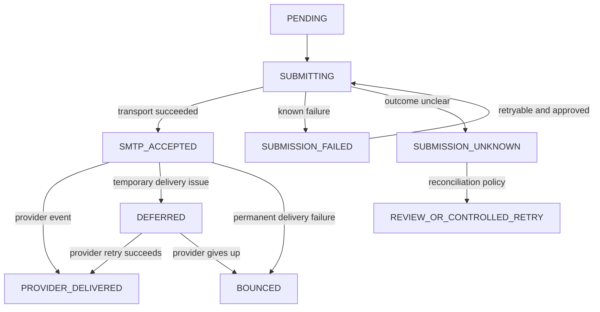

# Không suy ra delivery chỉ từ việc send trả thành công

Trong **Spring Framework Mail**, ứng dụng thường gửi email bằng `JavaMailSender.send(...)`. Nếu phương thức trả về bình thường, developer dễ ghi log “email delivered”, đặt trạng thái `DELIVERED` trong database hoặc trả cho người dùng thông báo “Thư đã đến hộp thư”. **Đây là một kết luận không đúng với những gì lời gọi `send` thực sự xác nhận.**

Khi một `JavaMailSender` dựa trên SMTP gửi message thành công, kết quả thông thường có nghĩa là **bước chuyển message cho máy chủ SMTP mà ứng dụng đang kết nối đã hoàn tất theo giao thức**. Máy chủ đó có thể là relay nội bộ, mail submission server hoặc dịch vụ email bên thứ ba. Nó còn có thể phải chuyển thư qua các máy chủ khác, gặp lỗi tạm thời, bị từ chối ở phía người nhận hoặc bị lọc vào thư mục spam. Ngay cả khi một nhà cung cấp báo “delivered”, sự kiện đó có thể chỉ phản ánh **máy chủ nhận ở phía đích đã chấp nhận SMTP**, chứ không chứng minh người dùng nhìn thấy thư trong inbox.

Nguyên tắc nền tảng là:

> **Submit thành công không đồng nghĩa delivery; delivery không đồng nghĩa inbox; inbox không đồng nghĩa người nhận đã đọc.**

Bài học này làm rõ từng mốc trong hành trình email, ngữ nghĩa của `JavaMailSender.send`, cách tổ chức trạng thái và log, theo dõi bounce/deferral qua nhà cung cấp, xử lý retry không chắc chắn và kiểm thử để ứng dụng không phát ra thông báo thành công sai.

## 1. Tách các giai đoạn trong hành trình của một email

Một luồng gửi email có thể gồm:

```text
Spring application
    |
    | Build MimeMessage
    v
JavaMailSender.send(...)
    |
    | SMTP submission
    v
SMTP relay / Email service provider
    |
    | Queue, routing, policy checks, retries
    v
Recipient mail exchange (MX) / Receiving server
    |
    | Spam filtering, mailbox policy, local delivery
    v
Recipient mailbox
    |
    | Inbox / spam / quarantine / rules
    v
Recipient mail client
    |
    | Display / interaction (may not be observable)
    v
Recipient reads or acts
```

Những giai đoạn trên không nhất thiết xuất hiện thành các bước riêng trong mọi hạ tầng. Ví dụ một provider có thể làm nhiều việc trong cùng dịch vụ, hoặc server đích chuyển nội bộ qua các bộ lọc khác.

Tuy nhiên, ranh giới quan trọng vẫn là: **ứng dụng chỉ trực tiếp quan sát được giao tiếp với next-hop SMTP hoặc API nhận gửi mà nó gọi**. Các sự kiện xảy ra về sau cần nguồn dữ liệu bổ sung.

### Các từ ngữ thường bị nhầm

| Khái niệm | Có thể xác nhận điều gì? | Chưa xác nhận điều gì? |
|---|---|---|
| `CREATED` | Ứng dụng đã tạo yêu cầu gửi. | Chưa gửi qua network. |
| `QUEUED` | Yêu cầu đã được đưa vào hàng đợi; cần biết queue có bền vững hay không. | SMTP chưa chắc được gọi. |
| `SUBMITTING` | Worker đang thử chuyển thư đến SMTP/provider. | Chưa có kết quả từ nơi nhận. |
| `SMTP_ACCEPTED` | Next-hop SMTP đã chấp nhận message theo kết quả transport. | Chưa chắc server đích nhận. |
| `PROVIDER_ACCEPTED` | API/provider đã nhận yêu cầu theo contract của nó. | Chưa chắc provider đã gửi ra ngoài. |
| `DEFERRED` | Có sự cố tạm thời và hệ thống gửi có thể thử lại. | Chưa phải giao thư thành công hoặc thất bại vĩnh viễn. |
| `DELIVERED_BY_PROVIDER` | Provider báo hoàn thành mốc delivery mà họ định nghĩa. | Thường không chứng minh thư ở inbox hay được đọc. |
| `BOUNCED` | Có báo cáo phát thư thất bại. | Không luôn cho biết mọi attempt đều chưa được phía đích thấy. |
| `OPEN_TRACKED` | Một cơ chế tracking ghi nhận tín hiệu liên quan việc tải nội dung. | Không chắc có người thực sự mở/đọc. |
| `READ_CONFIRMED` | Có bằng chứng xác nhận đọc từ cơ chế riêng nếu được hỗ trợ và tin cậy. | Không phải kết quả mặc định của SMTP. |

Để tránh hiểu sai, hãy mô tả trạng thái theo **nguồn chứng cứ**, chẳng hạn `SMTP_ACCEPTED`, `PROVIDER_DELIVERED`, `BOUNCED` thay vì một biến `sent=true` bao trùm mọi bước.

## 2. JavaMailSender.send() thực sự làm gì?

`JavaMailSender` là API của Spring để gửi message. Với implementation phổ biến `JavaMailSenderImpl`, Spring sử dụng Jakarta Mail để thực hiện việc chuyển message qua transport đã cấu hình, thường là SMTP.

Ví dụ:

```java
MimeMessage message = mailSender.createMimeMessage();

MimeMessageHelper helper =
        new MimeMessageHelper(message, false, "UTF-8");

helper.setFrom("orders@example.org");
helper.setTo("customer@example.net");
helper.setSubject("Xác nhận đơn hàng");
helper.setText("Đơn hàng của bạn đã được ghi nhận.");

mailSender.send(message);
```

Nếu `send(message)` trả về mà không ném exception, **ứng dụng có thể ghi nhận lần submit SMTP thành công theo contract của sender**. Không được tự suy ra rằng:

- Thư đã đến MX của domain người nhận.
- Mailbox người nhận tồn tại và còn dung lượng.
- Thư không nằm trong spam hoặc quarantine.
- Người nhận chưa chuyển thư đi nơi khác.
- Nội dung HTML/ảnh inline đã render được.
- Người nhận đã mở hoặc đọc email.
- Một webhook delivery về sau chắc chắn sẽ xuất hiện.

### Ý nghĩa của “thành công” phụ thuộc transport

`JavaMailSender` là interface. Một bản mock, test double hoặc implementation tùy chỉnh có thể không gọi SMTP thật. Với `JavaMailSenderImpl` kết nối SMTP, “thành công” gắn với kết quả mà SMTP transport trả về. Nếu dùng dịch vụ gửi mail qua HTTP API riêng, việc chấp nhận request có thể được biểu diễn thành provider job ID nhưng vẫn chỉ là giai đoạn submission.

Vì vậy, khi thiết kế status, nên lưu rõ **transport/provider** đã được gọi và **ngữ nghĩa phản hồi** của nó.

### Không có email receipt mặc định

`JavaMailSender.send` không trả về đối tượng `DeliveryReceipt` chứa trạng thái inbox hoặc người đọc. API trả về `void`. Nếu không xảy ra exception, code biết phương thức đã hoàn tất; phần lớn thông tin delivery đến về sau từ kênh khác.

Mẫu sai:

```java
mailSender.send(message);

orderRepository.markEmailDelivered(orderId);
```

Mẫu diễn đạt chính xác hơn:

```java
mailSender.send(message);

mailSubmissionRepository.markSmtpAccepted(notificationId);
```

Tên method `markSmtpAccepted` cho thấy đây là mốc submit, không phải xác nhận giao tới mailbox.

## 3. Phản hồi SMTP 250 nằm ở đâu trong quá trình gửi?

Với SMTP submission, client có thể đi qua:

```text
Client                  SMTP submission server
   |---- EHLO ----------------->|
   |<--- 250 capabilities ------|
   |---- STARTTLS (if used) --->|
   |<--- TLS negotiation -------|
   |---- AUTH (if required) --->|
   |<--- auth result -----------|
   |---- MAIL FROM ------------>|
   |<--- 250 accepted ----------|
   |---- RCPT TO -------------->|
   |<--- 250 accepted ----------|
   |---- DATA ----------------->|
   |<--- 354 continue ----------|
   |---- MIME message + "." --->|
   |<--- 250 queued/accepted ---|
```

Đây là luồng minh họa. Server có thể đưa ra các phản hồi khác nhau và có thể có nhiều lệnh `RCPT TO`.

**Điểm phân biệt:** phản hồi `250` cho `MAIL FROM` hoặc `RCPT TO` không tự chứng minh nội dung message đã được SMTP server chấp nhận. Sau lệnh `DATA`, phản hồi thành công cuối cùng của server mới là một dấu mốc quan trọng để xác định submission của message.

Ngay cả phản hồi sau `DATA` như:

```text
250 2.0.0 Queued as ABC123
```

chỉ nói rằng server **đã chấp nhận để xử lý/đưa vào queue theo cơ chế của nó**. Server vẫn có thể thử chuyển tiếp, thất bại, phát bounce hoặc áp dụng chính sách lọc sau đó.

Không tự động diễn giải chuỗi “Queued as ABC123” thành `DELIVERED`. Mã queue nội bộ không nhất thiết là provider message ID có thể tra cứu, và nó có thể khác với MIME `Message-ID`.

### Các nhóm phản hồi SMTP

| Mã SMTP | Ý nghĩa sơ bộ | Cách diễn giải khi theo dõi |
|---|---|---|
| `2xx` | Thao tác SMTP tương ứng được chấp nhận. | Phải biết thao tác nào và server nào đã trả về. |
| `4xx` | Từ chối hoặc lỗi tạm thời. | Có thể retry theo chính sách, nhưng không được retry vô hạn. |
| `5xx` | Từ chối hoặc lỗi vĩnh viễn trong ngữ cảnh phản hồi. | Cần phân loại và thường không retry như lỗi tạm thời. |

Mã mở rộng như `4.2.2` hoặc `5.1.1` có thể gợi ý lý do mailbox đầy hoặc địa chỉ không tồn tại, nhưng phải đọc theo chuẩn và tài liệu nhà cung cấp. Không mọi server đều cung cấp mã mở rộng nhất quán.

## 4. Vì sao SMTP chấp nhận rồi vẫn không giao được?

Có nhiều đường đi từ `SMTP_ACCEPTED` tới kết quả thất bại hoặc không rõ.

### 4.1. Server relay chưa chuyển đến nơi nhận

Ứng dụng gửi tới SMTP relay A. A trả lời thành công và đặt message vào queue. Khi A kết nối tới MX B, B có thể:

- Tạm thời không khả dụng.
- Trả `4xx` do quá tải/rate limit.
- Từ chối địa chỉ người nhận.
- Từ chối do chính sách domain hoặc reputation.
- Không chấp nhận message vì kích thước hoặc nội dung.

A có thể retry trong một khoảng thời gian, sau đó gửi bounce nếu không thành công. Ứng dụng không nhìn thấy những sự kiện này trong lời gọi `send` ban đầu.

### 4.2. Mailbox không còn hợp lệ

Một số server chấp nhận message trước khi thực hiện kiểm tra mailbox cuối cùng. Sau đó hệ thống nội bộ có thể phát hiện hộp thư không tồn tại, bị đóng hoặc vượt quota.

Điều này giải thích vì sao “SMTP accepted” không phải bằng chứng địa chỉ đang hoạt động.

### 4.3. Lọc spam hoặc quarantine

Server người nhận có thể chấp nhận email nhưng chuyển tới thư mục spam, quarantine hoặc áp dụng bộ lọc theo chính sách. Một provider có thể ghi nhận `DELIVERED` khi server đích chấp nhận message, dù email không nằm trong inbox.

Vì vậy, điều tra “khách hàng không thấy thư” cần xem cả inbox, spam, quarantine, rule chuyển tiếp và chính sách domain; không chỉ nhìn vào bảng trạng thái gửi.

### 4.4. Forwarding và routing nội bộ

Mailbox có thể chuyển tiếp sang địa chỉ khác. Hệ thống ban đầu báo delivery thành công nhưng forwarding tiếp theo gặp lỗi. Thư cũng có thể được lưu ở mailbox khác theo alias hoặc rule.

### 4.5. Chính sách nội dung và xác thực domain

Sender reputation, SPF, DKIM và DMARC có thể ảnh hưởng cách hệ thống đích xử lý email. Một SMTP relay có thể nhận message từ ứng dụng nhưng thư bị chặn hoặc đánh dấu spam ở bước sau.

Cần hiểu đúng:

- **SPF** giúp xác thực máy chủ được phép gửi cho domain trong SMTP envelope theo quy tắc của SPF.
- **DKIM** dùng chữ ký để kiểm tra một số header/body và xác nhận domain ký.
- **DMARC** kết hợp alignment với SPF/DKIM và chính sách công bố của domain.
- Các cơ chế trên hỗ trợ xác thực và deliverability, **không bảo đảm mọi email sẽ vào inbox**.

Không nên sửa nội dung Subject hoặc retry liên tục chỉ vì một email “không thấy” khi chưa có dữ liệu từ provider và hệ thống nhận.

## 5. Phân biệt accepted, delivered, inboxed và read

Bốn mốc này cần được giữ tách biệt.

```text
APPLICATION_SUBMITTED
       |
       v
SMTP_ACCEPTED
       |
       v
RECIPIENT_SERVER_ACCEPTED
       |
       v
MAILBOX_PROCESSED
       |
       +-- Inbox
       +-- Spam
       +-- Quarantine
       +-- Forward/Rule
       |
       v
USER_DISPLAYED / USER_READ
```

Trong thực tế, hệ thống gửi thường **không có quyền quan sát** trực tiếp những nhánh cuối cùng.

### Khi provider báo “delivered”

Một số dịch vụ email định nghĩa sự kiện delivered là mail server của recipient đã chấp nhận message. Mốc này mạnh hơn việc **provider đã nhận yêu cầu gửi từ ứng dụng**, nhưng vẫn chưa chứng minh email ở inbox hoặc được đọc.

Nên giữ nguyên định nghĩa từ provider trong tài liệu tích hợp và trong tên status nội bộ, ví dụ `RECIPIENT_SERVER_ACCEPTED` hoặc `PROVIDER_DELIVERED`.

### Open tracking không đáng tin cậy để xác nhận đọc

Open pixel hoặc cơ chế tải ảnh có thể bị ảnh hưởng bởi:

- Client chặn ảnh từ xa.
- Mail privacy protection tự tải ảnh.
- Proxy/cache và scanner tự tải nội dung.
- Người dùng xem preview hoặc chỉ đọc plain text.
- Khác biệt trong thiết bị và ứng dụng.

Một sự kiện “opened” không chắc người nhận thực sự đọc; không có “opened” cũng không chứng minh email chưa được đọc. Không dùng open tracking làm điều kiện duy nhất để xác nhận thông báo pháp lý hoặc thay đổi trạng thái bảo mật.

## 6. Delivery Status Notification và bounce đến sau thời điểm send

SMTP có cơ chế báo trạng thái giao thư như DSN (*Delivery Status Notification*), và nhà cung cấp email có thể phát sự kiện bounce/deferred qua webhook hoặc event stream.

Ví dụ:

```text
10:00:00 JavaMailSender.send() returns
         -> SMTP_ACCEPTED

10:03:12 Recipient MX temporarily refuses
         -> DEFERRED

10:13:40 Provider retries and MX accepts
         -> PROVIDER_DELIVERED
```

Một trường hợp khác:

```text
10:00:00 JavaMailSender.send() returns
         -> SMTP_ACCEPTED

10:04:00 Recipient address rejected downstream
         -> HARD_BOUNCE
```

Cả hai luồng đều có `send` thành công lúc 10:00. Kết quả cuối cùng khác nhau vì delivery xảy ra sau submission.

### DSN không phải phản hồi đồng bộ của send

DSN có thể được gửi tới envelope sender/return path theo chính sách của hệ thống thư. Nó không nhất thiết xuất hiện dưới dạng exception từ lời gọi `JavaMailSender.send` ban đầu.

Một số provider tiếp nhận bounce rồi cung cấp qua webhook hoặc dashboard. Nếu hệ thống cần biết bounce, phải tích hợp kênh tương ứng; không thể chỉ gọi `send` rồi chờ boolean.

### MDN và read receipt cũng không phải bằng chứng tuyệt đối

MDN (*Message Disposition Notification*) như read receipt phụ thuộc mail client, chính sách và hành vi người nhận. Người dùng có thể từ chối gửi receipt; client có thể không hỗ trợ; receipt cũng không bảo đảm họ đã hiểu nội dung.

Không nhầm DSN (trạng thái vận chuyển/phân phát) với MDN (tín hiệu xử lý/hiển thị từ client).

## 7. Một email gửi nhiều người nhận không có một kết quả delivery duy nhất

Nếu message có nhiều người nhận:

```java
helper.setTo(new String[] {
        "alice@example.net",
        "bob@example.org"
});
```

các địa chỉ có thể được xử lý khác nhau. Máy chủ có thể chấp nhận một recipient và từ chối recipient khác, hoặc các hệ thống downstream mang lại kết quả delivery khác nhau.

Một mô hình trạng thái đơn giản:

```text
MIME message M-1
    |
    +-- recipient Alice
    |     SMTP accepted -> provider delivered
    |
    +-- recipient Bob
          SMTP accepted -> bounced later
```

Nếu chỉ đặt `message.status=DELIVERED` khi thấy một sự kiện delivered, ứng dụng có thể báo sai cho Bob.

### Lưu trạng thái theo recipient

Đối với hệ thống cần theo dõi delivery chính xác, nên lưu mỗi **logical notification × recipient** như một bản ghi riêng, hoặc có bảng kết quả con theo recipient.

| Trường | Ví dụ |
|---|---|
| `notificationId` | `notif-145` |
| `recipientRef` | `customer-145` |
| `submissionStatus` | `SMTP_ACCEPTED` |
| `providerDeliveryStatus` | `BOUNCED` |
| `lastEventAt` | Thời điểm sự kiện gần nhất theo nguồn |
| `attemptCount` | Số lần thử submit |

Nếu email có To/Cc/Bcc, cần bảo vệ riêng tư. Gửi hàng loạt theo một MIME message có thể làm lộ địa chỉ giữa những người ở To/Cc. Với thư giao dịch có personalization và tracking per-recipient, thường dễ kiểm soát hơn khi tạo message riêng theo recipient.

### Partial success khi SMTP gửi nhiều recipient

Jakarta Mail/SMTP có các hành vi liên quan gửi một phần, phụ thuộc transport và cấu hình. Một lỗi tổng thể không nhất thiết chứng minh **mọi recipient** đều bị từ chối. `MailSendException` và nguyên nhân Jakarta Mail có thể cung cấp thông tin về message/địa chỉ được xử lý, nhưng không được suy diễn chỉ từ một exception class.

Phải kiểm tra ngữ nghĩa transport/provider và dữ liệu phản hồi cụ thể. Với notification quan trọng, tách recipient giúp đơn giản hóa việc retry và cập nhật trạng thái.

## 8. Không gộp lỗi SMTP với bounce phát sinh sau đó

Hai trường hợp dưới đây có thể cùng xuất hiện trong báo cáo “không đến nơi”, nhưng khác bản chất.

**Từ chối ở submission time:**

```text
Application -> SMTP server
              |
              +--> Rejects submission now
Application receives MailException
```

**Thất bại delivery sau khi submit thành công:**

```text
Application -> SMTP server
              |
              +--> Accepts message
Application send() returns
              |
              v
       Provider relays downstream
              |
              +--> Delivery fails later
              |
              v
         Bounce/DSN/webhook
```

Một số lỗi tạm thời ở submission stage có thể được retry bởi ứng dụng. Bounce sau accepted thường được quản lý bởi nhà cung cấp hoặc một workflow khác; cần áp dụng chính sách retry phù hợp cho từng loại.

Không nên gọi lại `send` ngay khi nhận một hard bounce, vì địa chỉ có thể không hợp lệ hoặc đã bị suppression. Ngược lại, deferred event có thể có nghĩa provider **đang tự retry**; nếu ứng dụng cũng gửi lại ngay, người nhận có nguy cơ nhận bản trùng.

## 9. Thiết kế trạng thái theo bằng chứng, không theo suy đoán

Một state machine minh họa:



Các tên trạng thái là ví dụ, không phải enum của Spring Mail. Một hệ thống thực tế có thể phân loại chi tiết hơn như:

- `BLOCKED_BY_POLICY`
- `SUPPRESSED`
- `COMPLAINED`
- `EXPIRED`
- `UNKNOWN_DELIVERY`
- `ACCEPTED_BY_PROVIDER_API`

### Tách hai chiều trạng thái

Một model rõ ràng thường tách:

1. **Submission status:** kết quả ứng dụng chuyển message tới SMTP/provider.
2. **Delivery status:** sự kiện về hành trình phía sau, nếu có.

Ví dụ record:

```json
{
  "notificationId": "notif-145",
  "submissionStatus": "SMTP_ACCEPTED",
  "deliveryStatus": "UNKNOWN",
  "lastSubmissionAt": "2026-11-12T08:30:00Z",
  "lastProviderEventAt": null
}
```

Sau webhook:

```json
{
  "notificationId": "notif-145",
  "submissionStatus": "SMTP_ACCEPTED",
  "deliveryStatus": "PROVIDER_DELIVERED",
  "lastSubmissionAt": "2026-11-12T08:30:00Z",
  "lastProviderEventAt": "2026-11-12T08:31:12Z"
}
```

`UNKNOWN` là trạng thái có ý nghĩa: hệ thống **không có đủ bằng chứng** để kết luận delivered hoặc failed.

### Không ép mọi email thành delivered/failed

Nếu provider không cung cấp webhook hoặc dữ liệu callback đã hết retention, ứng dụng có thể chỉ biết `SMTP_ACCEPTED`. Đó là giới hạn quan sát hợp lệ. Ghi “delivery unknown” chính xác hơn việc tự suy ra delivered sau một khoảng thời gian.

## 10. Ví dụ Java: trả kết quả đúng ngữ nghĩa từ JavaMailSender

Một service nên đặt tên rõ ràng cho outcome của thao tác gửi.

```java
public record MailSubmissionResult(
        String notificationId,
        SubmissionStatus status,
        String errorCode
) {
    public enum SubmissionStatus {
        SMTP_ACCEPTED,
        FAILED,
        UNKNOWN
    }

    public static MailSubmissionResult accepted(String id) {
        return new MailSubmissionResult(
                id, SubmissionStatus.SMTP_ACCEPTED, null
        );
    }

    public static MailSubmissionResult failed(
            String id, String errorCode
    ) {
        return new MailSubmissionResult(
                id, SubmissionStatus.FAILED, errorCode
        );
    }
}
```

Service gửi:

```java
import jakarta.mail.MessagingException;
import jakarta.mail.internet.MimeMessage;
import org.springframework.mail.MailAuthenticationException;
import org.springframework.mail.MailException;
import org.springframework.mail.javamail.JavaMailSender;
import org.springframework.mail.javamail.MimeMessageHelper;
import org.springframework.stereotype.Service;

@Service
public class MailSubmissionService {

    private final JavaMailSender mailSender;
    private final SubmissionRepository submissionRepository;

    public MailSubmissionService(
            JavaMailSender mailSender,
            SubmissionRepository submissionRepository
    ) {
        this.mailSender = mailSender;
        this.submissionRepository = submissionRepository;
    }

    public MailSubmissionResult submit(
            String notificationId,
            String recipient
    ) throws MessagingException {

        MimeMessage message = mailSender.createMimeMessage();
        MimeMessageHelper helper =
                new MimeMessageHelper(message, false, "UTF-8");

        helper.setFrom("orders@example.org");
        helper.setTo(recipient);
        helper.setSubject("Xác nhận đơn hàng");
        helper.setText("Đơn hàng của bạn đã được xác nhận.");

        submissionRepository.markSubmitting(notificationId);

        try {
            mailSender.send(message);

            submissionRepository.markSmtpAccepted(notificationId);

            return MailSubmissionResult.accepted(notificationId);
        } catch (MailAuthenticationException exception) {
            submissionRepository.markKnownFailure(
                    notificationId,
                    "SMTP_AUTH_FAILED"
            );
            return MailSubmissionResult.failed(
                    notificationId,
                    "SMTP_AUTH_FAILED"
            );
        } catch (MailException exception) {
            submissionRepository.markNeedsClassification(
                    notificationId,
                    exception.getClass().getSimpleName()
            );
            throw exception;
        }
    }
}
```

`SubmissionRepository` là abstraction minh họa của ứng dụng. Mã này cố ý **không có thao tác `markDelivered(...)`** sau `send`.

Một điểm quan trọng: việc ghi database sau khi `send` thành công vẫn có thể thất bại. Khi đó SMTP có thể đã nhận thư nhưng record vẫn ở `SUBMITTING`. Một triển khai production cần transactional outbox, attempt record và chính sách reconciliation để xử lý khoảng hở này; không nên coi code minh họa là bảo đảm exactly-once.

### Bắt MailException không đồng nghĩa biết chắc thư chưa được nhận

Lỗi xác thực xảy ra trước submission thông thường là thất bại đã biết. Nhưng timeout hoặc mất kết nối ở thời điểm cuối sau `DATA` có thể dẫn tới **kết quả không chắc chắn**.

Do đó nhánh bắt `MailException` ở trên cố ý chuyển sang bước phân loại thay vì gắn mọi lỗi thành `FAILED_NOT_SENT`. Cách phân loại có thể dựa vào loại exception, cause chain, SMTP response, thời điểm lỗi và dữ liệu provider nếu có.

## 11. Cần lưu gì cho mỗi lần thử gửi?

Một bản ghi attempt giúp giải thích điều gì đã xảy ra.

| Trường | Mục đích |
|---|---|
| `notificationId` | Thư logic được yêu cầu gửi. |
| `attemptId` | Định danh lần thử SMTP cụ thể. |
| `correlationId` | Liên kết với request/event gốc. |
| `recipientRef` | Người nhận logic, tránh log raw PII nếu không cần. |
| `smtpRoute` | Host/provider/credential route đã sử dụng. |
| `startedAt`, `finishedAt` | Đo độ trễ và chẩn đoán timeout. |
| `submissionOutcome` | Accepted, failed hoặc unknown. |
| `smtpReplyCategory` | 2xx/4xx/5xx nếu thu được đúng ngữ cảnh. |
| `errorCategory` | Authentication/network/policy/content/unknown. |
| `mimeMessageId` | Header Message-ID nếu có. |
| `providerMessageId` | ID provider trả về, nếu transport/integration cung cấp. |
| `providerEventId` | ID sự kiện delivery/bounce phục vụ deduplication. |

Đừng tự đặt `providerMessageId` bằng `notificationId` hoặc bằng mã queue từ một phản hồi SMTP khi provider không công bố chúng tương đương.

### Phân biệt Message-ID và provider ID

Email MIME có thể chứa header:

```text
Message-ID: <f2b93e1a.mailer@example.org>
```

Header này có thể giúp tra cứu hoặc thread email, nhưng:

- Nó không phải correlation ID của HTTP request.
- Nó không mặc định là ID job của SMTP provider.
- Không phải mọi webhook đều trả nó.
- Việc thiết lập Message-ID không bắt buộc server đích chống thư trùng.
- Một số hệ thống trung gian có thể thay đổi thông tin/định danh ở các lớp khác.

Nếu cần ghép sự kiện webhook, dùng mapping được provider hỗ trợ hoặc lưu ID thực tế mà provider trả về, khi có.

## 12. Theo dõi delivery bằng webhook hoặc event stream của provider

Nhiều dịch vụ gửi email có callback cho các sự kiện như:

- Accepted/processed.
- Deferred.
- Delivered.
- Bounced.
- Blocked hoặc dropped.
- Spam complaint.
- Unsubscribed/suppressed.
- Open/click tracking, nếu được bật và phù hợp chính sách.

Tên sự kiện, trường dữ liệu và cách hiểu **khác nhau theo provider**. Trước khi viết bộ cập nhật trạng thái, phải đọc contract của provider và xác định từng event thực sự chứng minh điều gì.

Một luồng:

```text
Application mail request
    notificationId=notif-145
           |
           v
Submission via SMTP / provider API
           |
           +--> application stores SMTP_ACCEPTED
           |
           v
Provider processes message
           |
           +--> providerMessageId=provider-7a3
           |
           v
Provider webhook arrives later
    event=delivered
    providerMessageId=provider-7a3
           |
           v
Verify signature and event authenticity
           |
           v
Lookup notification/recipient
           |
           v
Persist delivery evidence
```

Không nhất thiết mỗi API SMTP hỗ trợ trả provider ID ngay cho ứng dụng. Nếu gửi thuần SMTP mà chỉ nhận phản hồi thành công, có thể cần một cơ chế provider-specific để lấy mapping hoặc một định danh khác đã được tích hợp theo contract.

### Ví dụ xử lý sự kiện ở tầng nghiệp vụ

```java
public void handleVerifiedProviderEvent(
        ProviderMailEvent event
) {
    DeliveryRecord record = deliveryRepository
            .findByProviderMessageIdAndRecipient(
                    event.providerMessageId(),
                    event.recipientRef()
            )
            .orElseThrow();

    if (deliveryRepository.eventAlreadyApplied(
            event.providerEventId()
    )) {
        return;
    }

    deliveryRepository.applyProviderEvidence(
            record.notificationId(),
            event
    );
}
```

Các kiểu `ProviderMailEvent`, `DeliveryRecord` và repository là model minh họa. **Việc xác thực chữ ký webhook phải diễn ra trước khi gọi method này**; hàm tên `handleVerified...` nhấn mạnh tiền điều kiện đó.

Một triển khai thực tế cần áp dụng deduplication và cập nhật trạng thái trong transaction phù hợp, với unique constraint hoặc cơ chế atomic để tránh hai consumer xử lý cùng event đồng thời.

## 13. Webhook có thể trùng, trễ hoặc đến sai thứ tự

Không nên giả định các event provider luôn đến theo thứ tự đẹp:

```text
processed -> delivered -> opened
```

Thực tế có thể:

- Provider retry cùng webhook vì ứng dụng trả lỗi HTTP.
- Network làm event cũ đến sau event mới.
- Có nhiều event cho một recipient/message.
- Có event của attempt trước xuất hiện sau khi ứng dụng đã retry attempt mới.
- Provider ngừng cung cấp event sau thời gian retention.
- Một email được deferred nhiều lần trước khi delivered hoặc bounced.

### Không dùng “last event wins” một cách mù quáng

Ví dụ:

```text
12:00 Provider reports DELIVERED
12:01 An older DEFERRED event arrives late
```

Nếu luôn lấy sự kiện đến sau cùng để ghi đè status, hệ thống có thể đổi `PROVIDER_DELIVERED` về `DEFERRED` sai.

Cần:

1. Lưu provider event ID và timestamp do provider cung cấp.
2. Áp dụng quy tắc chuyển trạng thái hợp lệ.
3. Phân biệt thời gian sự kiện xảy ra với thời gian ứng dụng nhận.
4. Giữ lịch sử event thay vì chỉ một trường status.
5. Gắn event với đúng notification, recipient và attempt/provider ID.
6. Quy định cách xử lý event bất thường mà không âm thầm làm mất bằng chứng.

### Không phải mọi trạng thái đều tuyến tính

Một số provider có thể ghi nhận delivery rồi sau đó nhận tín hiệu bounce hoặc complaint liên quan. Không nên thiết kế enum chỉ có một chuỗi tuyến tính cứng nếu contract provider cho phép các sự kiện khác thời điểm hoặc khác loại.

Một giải pháp thực tế là lưu **event history** và xây một **derived status** theo chính sách nghiệp vụ, thay vì làm mất sự kiện cũ.

## 14. Bảo vệ webhook và độ tin cậy của dữ liệu delivery

Một request webhook tự xưng “delivered” không đủ để cập nhật trạng thái email. Nó có thể bị gửi giả hoặc bị replay.

Cần kiểm tra:

- Chữ ký/HMAC hoặc cơ chế xác thực chính thức của provider.
- Timestamp, thời hạn chấp nhận và quy tắc replay nếu contract hỗ trợ.
- Nguồn/cấu hình tenant hoặc webhook endpoint đúng.
- Schema và giới hạn kích thước payload.
- Recipient/provider message ID có tồn tại trong hệ thống.
- Event ID đã được áp dụng trước đó chưa.
- Quyền cập nhật record theo provider/route.

Không dùng correlation ID làm bí mật xác thực webhook. Correlation ID chỉ phục vụ tra cứu và có thể được tiết lộ qua log hoặc header.

### Xử lý khi webhook không đến

Không có webhook delivered sau một khoảng thời gian **không chứng minh thư bị thất bại**. Có thể provider không phát event, callback lỗi, sự kiện đến muộn hoặc không có cơ chế tracking.

Nên có trạng thái `DELIVERY_UNKNOWN` hoặc cơ chế reconciliation qua API/dashboard provider nếu được hỗ trợ. Thời hạn chờ phải gắn với khả năng provider, không tùy tiện suy ra “3 phút chưa có event nghĩa là không gửi”.

## 15. Retry: tại sao timeout không đồng nghĩa chưa gửi?

Một lỗi khó nhất trong gửi email là kết quả không chắc chắn:

```text
Application                    SMTP relay
    |---- DATA / MIME content ---->|
    |                               |
    |                         Accepts message
    |<--- connection lost ----------X
    |
    v
MailException / timeout
```

Ứng dụng có thể không nhận được phản hồi thành công cuối, dù relay đã nhận message. Nếu lập tức retry, relay có thể nhận thêm bản thứ hai.

### Phân loại outcome

| Outcome | Ý nghĩa | Hướng xử lý |
|---|---|---|
| `ACCEPTED` | Có bằng chứng bước submission thành công. | Chờ/reconcile delivery event, không submit lại chỉ vì chưa có webhook. |
| `KNOWN_NOT_ACCEPTED` | Có bằng chứng server từ chối trước khi nhận message. | Retry hoặc sửa lỗi theo mã và chính sách. |
| `UNKNOWN` | Không biết chắc server đã chấp nhận hay chưa. | Reconcile nếu có thể; controlled retry với rủi ro trùng. |

Không thể đạt exactly-once email chỉ bằng một vòng lặp retry. SMTP và database không tham gia một transaction phân tán duy nhất. Khi ứng dụng hoặc worker chết sau SMTP acceptance nhưng trước khi commit trạng thái, một worker khác có thể gửi lại.

### Idempotency có ích ở phạm vi nào?

Một `idempotencyKey` ở tầng nghiệp vụ có thể giúp **không tạo nhiều notification logic** cho cùng sự kiện. Ví dụ unique key cho `orderId + notificationType + recipientRef`.

Nhưng nó không bảo đảm SMTP server loại bỏ bản trùng từ hai attempt của cùng notification. Cần quản lý attempt, retry và thông báo tới người nhận sao cho việc trùng thư không tạo hậu quả nghiệp vụ.

**Không nhúng token một lần hoặc thông tin nhạy cảm vào correlation ID để cố chống trùng.**

## 16. Submission trong request và gửi bất đồng bộ là hai loại “thành công” khác nhau

Một HTTP endpoint có thể trả kết quả trước khi SMTP được gọi.

Ví dụ:

```text
POST /orders
  |
  +--> Database commit
  |
  +--> Insert mail outbox(PENDING)
  |
  +--> HTTP 201 Created
           |
           v
      Worker later calls JavaMailSender.send()
```

Ở đây `201 Created` là kết quả tạo đơn hàng, không phải SMTP accepted và càng không phải delivery. Nếu API chỉ nhận yêu cầu gửi rồi đưa vào queue, có thể trả `202 Accepted` với notification ID và trạng thái `QUEUED`.

### Đặt tên theo nơi công việc đang ở

| Kết quả | Cách diễn đạt phù hợp |
|---|---|
| Yêu cầu đã lưu trong outbox | “Yêu cầu gửi email đã được ghi nhận.” |
| Worker chưa chạy | “Email đang chờ gửi.” |
| SMTP đã chấp nhận | “Email đã được chuyển tới máy chủ gửi thư.” |
| Provider báo delivered | “Nhà cung cấp báo máy chủ đích đã nhận email.” |
| Có bounce | “Không thể phân phát email tới địa chỉ này.” |
| Không có tracking sau submission | “Đã gửi qua SMTP; chưa có xác nhận phân phát.” |

Tránh trả “Đã gửi đến hộp thư của bạn” khi ứng dụng chỉ biết queue insert hoặc SMTP accept.

### @Async không làm delivery chắc chắn hơn

`@Async` chỉ chuyển thao tác gửi sang thread khác. Nó không tạo event delivered, không bảo đảm job sống sót khi process chết và không thay đổi ngữ nghĩa kết quả SMTP.

Nếu cần gửi đáng tin cậy, hãy lưu yêu cầu trong queue/outbox bền vững và có worker theo dõi trạng thái.

## 17. Mô hình outbox và delivery event store

Một thiết kế dễ giải thích dùng ba nhóm dữ liệu:

```text
mail_notification
  - logical notification + recipient + business context

mail_submission_attempt
  - each SMTP/API attempt and submission outcome

mail_delivery_event
  - provider events and evidence received later
```

Ví dụ bảng minh họa:

```sql
CREATE TABLE mail_notification (
    id                 VARCHAR(64) PRIMARY KEY,
    correlation_id     VARCHAR(64) NOT NULL,
    recipient_ref      VARCHAR(128) NOT NULL,
    notification_type  VARCHAR(80) NOT NULL,
    submission_status  VARCHAR(40) NOT NULL,
    delivery_status    VARCHAR(40) NOT NULL,
    created_at         TIMESTAMP NOT NULL
);

CREATE TABLE mail_submission_attempt (
    id                VARCHAR(64) PRIMARY KEY,
    notification_id   VARCHAR(64) NOT NULL,
    smtp_route        VARCHAR(80) NOT NULL,
    result_status     VARCHAR(40) NOT NULL,
    mime_message_id   VARCHAR(255),
    provider_message_id VARCHAR(255),
    attempted_at      TIMESTAMP NOT NULL
);

CREATE TABLE mail_delivery_event (
    id                 VARCHAR(64) PRIMARY KEY,
    notification_id    VARCHAR(64) NOT NULL,
    provider_event_id  VARCHAR(255),
    provider_event_type VARCHAR(80) NOT NULL,
    provider_event_at  TIMESTAMP,
    received_at        TIMESTAMP NOT NULL
);
```

Đây là schema minh họa để hiểu mối quan hệ, chưa bao gồm đầy đủ foreign key, index, unique constraint, lease, retry schedule, retention hay data classification. Với hệ thống có nhiều provider và recipient, cần mở rộng khóa mapping thích hợp.

### Đừng xóa lịch sử khi status thay đổi

Nếu chỉ giữ trạng thái cuối `DELIVERED`, bạn có thể không biết thư đã bị defer ba lần trước đó. Nếu chỉ giữ `BOUNCED`, có thể không thấy các attempt gửi trùng trước khi nhận bounce.

Lưu event history giúp phân biệt:

- Provider chậm xử lý.
- Địa chỉ người nhận không hợp lệ.
- Vấn đề policy/reputation.
- Webhook bị gửi trùng hoặc trễ.
- Worker retry quá sớm.
- Việc gửi bị gián đoạn khi shutdown.

## 18. Chỉ số deliverability phải có định nghĩa và mẫu số rõ

Không nên tạo một dashboard “delivery rate 100%” bằng cách đếm số lần `JavaMailSender.send` không ném exception. Chỉ số đó phản ánh **submission success**, không phải delivery rate.

Các metric có thể tách:

| Chỉ số | Tử số | Mẫu số đề xuất | Lưu ý |
|---|---|---|---|
| Submission acceptance rate | Attempt được SMTP/provider chấp nhận | Attempt đã thử gửi | Không đo inbox. |
| Bounce rate | Message/recipient có bounce theo định nghĩa | Số notification đã submit hoặc provider accepted | Cần định nghĩa cửa sổ quan sát. |
| Provider-reported delivery rate | Notification có delivered event | Notification đã đủ thời gian theo dõi và có tracking | Thiếu event không phải failed tự động. |
| Deferral rate | Message/attempt có deferred | Số submission được provider xử lý | Provider có thể phát nhiều deferred event cho một message. |
| Complaint rate | Recipient có spam complaint event | Định nghĩa dựa trên provider policy | Chỉ phản ánh event được báo. |
| Time to provider delivery | Thời gian giữa submission và delivered event | Những notification có đủ hai timestamp | Phải tính đến event lag. |

Không dùng `correlationId`, `notificationId` hoặc raw recipient làm label metric: cardinality sẽ rất cao và có thể làm tăng chi phí hoặc rò rỉ dữ liệu.

### Cẩn thận với mẫu dữ liệu chưa đủ thời gian

Một email mới submit 10 giây trước có thể chưa có webhook. Nếu đưa ngay vào mẫu số “đã submit” rồi tính như failed, delivery rate sẽ bị thấp giả tạo.

Hãy xác định **observation window** và phân biệt:

- Đã đủ thời gian để đánh giá theo SLO.
- Chưa đủ thời gian để kết luận.
- Có delivery event.
- Có bounce/permanent failure event.
- Không có dữ liệu.

Các khoảng thời gian cụ thể phụ thuộc loại email, provider, độ trễ callback và mục tiêu vận hành, không có một mốc Spring Mail mặc định.

## 19. Logging có cấu trúc qua từng giai đoạn

Một chuỗi log tốt:

```text
event=MAIL_QUEUED
correlationId=corr-204
notificationId=notif-204

event=MAIL_ATTEMPT_STARTED
correlationId=corr-204
notificationId=notif-204
attemptId=attempt-204-1
smtpRoute=primary

event=MAIL_SMTP_ACCEPTED
correlationId=corr-204
notificationId=notif-204
attemptId=attempt-204-1
durationMs=618

event=MAIL_PROVIDER_DELIVERED
correlationId=corr-204
notificationId=notif-204
providerMessageId=provider-7df
eventLagSeconds=12
```

Trường `MAIL_PROVIDER_DELIVERED` chỉ được ghi khi **đã nhận và xác thực bằng chứng từ provider**, không phải ở ngay sau `send`.

Nếu nhận bounce:

```text
event=MAIL_PROVIDER_BOUNCED
correlationId=corr-204
notificationId=notif-204
providerMessageId=provider-7df
bounceCategory=permanent
```

### Không log dữ liệu bí mật

Mail log có thể chứa PII: địa chỉ nhận, subject, body, mã xác minh, token reset password, attachment. Nên log notification ID, route, event type, trạng thái và error category; hạn chế raw recipient và payload.

Nếu cần đối chiếu với một recipient, dùng recipient reference nội bộ hoặc cách che/mã hóa được chính sách cho phép.

## 20. Phân loại lỗi theo nơi phát sinh

Khi người dùng nói “Tôi không nhận được email”, cần phân loại trước khi xử lý.

| Tầng | Dấu hiệu | Nguồn kiểm tra |
|---|---|---|
| Business/event | Không có notification record | Domain event, outbox insertion, application log |
| Queue/worker | Record `PENDING` lâu hoặc worker không chạy | Queue lag, consumer health, lease |
| Template/MIME | Message chuẩn bị lỗi | `MessagingException`, renderer log |
| SMTP authentication | `MailAuthenticationException` | Cause chain, provider AUTH policy |
| SMTP submission | `MailSendException`, timeout, 4xx/5xx | Attempt record, SMTP response |
| Provider processing | Deferred, dropped, suppressed | Provider dashboard/event API |
| Recipient server | Bounce hoặc server reject | DSN/provider delivery event |
| Mailbox/client | Spam/quarantine/forwarding | Recipient admin hoặc người nhận kiểm tra |
| Human interaction | Người nhận chưa thấy/đọc | Không suy ra từ `send` hoặc open pixel |

Thứ tự điều tra nên đi theo những mốc có dữ liệu, không giả định lỗi luôn nằm ở SMTP.

### Ví dụ: Send trả thành công nhưng người nhận báo không có thư

1. Tìm notification ID qua business event/correlation ID.
2. Xác nhận attempt đã `SMTP_ACCEPTED`.
3. Tra provider message ID hoặc dashboard theo dữ liệu có sẵn.
4. Tìm sự kiện delivered, deferred, bounced, blocked hoặc suppressed.
5. Nếu provider báo recipient server accepted, đề nghị kiểm tra spam/quarantine/mailbox policy, đồng thời tránh khẳng định đã vào inbox.
6. Nếu không có event, ghi `DELIVERY_UNKNOWN` hoặc dùng reconciliation endpoint được provider hỗ trợ.
7. Nếu gửi lại, cân nhắc nguy cơ trùng và chính sách resend thay vì retry mù.

## 21. Kiểm thử: SMTP test server không chứng minh deliverability

Có thể dùng Mailpit, GreenMail hoặc SMTP test server tương đương để kiểm tra ứng dụng đã gửi MIME message đúng và server test nhận được.

Ví dụ test ý tưởng:

```java
@Test
void successfulSmtpSubmissionDoesNotMarkDelivered()
        throws Exception {

    MimeMessage message = mailSender.createMimeMessage();

    MimeMessageHelper helper =
            new MimeMessageHelper(message, false, "UTF-8");

    helper.setFrom("test@example.org");
    helper.setTo("recipient@example.net");
    helper.setSubject("Test");
    helper.setText("Hello");

    mailSender.send(message);

    // Kết quả đúng ở tầng submission:
    assertThat(submissionStatus)
            .isEqualTo(SubmissionStatus.SMTP_ACCEPTED);

    // Không có event delivery từ provider:
    assertThat(deliveryStatus)
            .isEqualTo(DeliveryStatus.UNKNOWN);
}
```

`submissionStatus` và `deliveryStatus` là các giá trị giả định được ứng dụng ghi nhận trong test fixture. Test thực tế cần đọc từ repository/service tương ứng, không suy ra từ biến chưa được thiết lập.

### Những case cần test

| Tình huống | Kỳ vọng |
|---|---|
| SMTP test server chấp nhận message | Submission = accepted, delivery = unknown. |
| SMTP từ chối trước khi nhận message | Không ghi `SMTP_ACCEPTED`. |
| Có timeout ở giai đoạn không rõ kết quả | Attempt = unknown/requires reconciliation. |
| Provider webhook delivered hợp lệ | Cập nhật delivery evidence của notification đúng. |
| Provider webhook bounce | Ghi bounce, không giữ kết luận delivered giả. |
| Webhook không có chữ ký hợp lệ | Từ chối, không cập nhật trạng thái. |
| Webhook gửi lặp | Deduplicate, không tạo nhiều sự kiện hiệu lực. |
| Deferred đến sau delivered do out-of-order | Không ghi đè trạng thái sai. |
| Hai recipient có trạng thái khác nhau | Mỗi recipient có trạng thái độc lập. |
| Process chết sau SMTP accepted trước DB commit | Job giữ trạng thái không chắc chắn; recovery có kiểm soát. |
| Provider không gửi webhook | Delivery remains unknown, không tự suy ra success/failure. |

### Mô phỏng deferred và bounce

Một SMTP test server có thể phản hồi lỗi ngay ở submission, nhưng điều đó **không tương đương** một bounce sinh ra sau khi relay đã chấp nhận thư. Để kiểm thử logic delivery, có thể mô phỏng provider events riêng và gửi vào handler đã xác thực theo test fixture.

Hai loại test cần được phân biệt:

1. **SMTP transport integration test:** ứng dụng kết nối, xác thực và submit message.
2. **Delivery event integration test:** ứng dụng nhận, xác thực, deduplicate và xử lý sự kiện phát sinh về sau.

## 22. Thiết kế UX và API tránh thông báo sai

Một lỗi deliverability có thể bắt đầu từ cách dùng từ trong response.

### Những câu dễ gây hiểu lầm

```text
"Email delivered successfully!"
"Thư đã đến hộp thư của bạn."
"Người nhận đã nhận được email."
```

Nếu kết quả duy nhất là `JavaMailSender.send` trả về, các câu trên nói quá mức bằng chứng.

### Cách diễn đạt chính xác hơn

Khi mail đã được queue:

```text
"Yêu cầu gửi email đã được ghi nhận."
```

Khi SMTP submit thành công:

```text
"Email đã được chuyển tới máy chủ gửi thư."
```

Khi có provider delivery event:

```text
"Nhà cung cấp báo máy chủ đích đã chấp nhận email."
```

Khi không có bằng chứng:

```text
"Email đã được gửi qua SMTP; chưa có xác nhận phân phát."
```

Cách diễn đạt nên cân bằng giữa chính xác và dễ hiểu cho người dùng. Ví dụ ở màn hình đặt lại mật khẩu, để tránh lộ tài khoản có tồn tại hay không, giao diện có thể cố ý đưa ra thông báo trung tính như “Nếu tài khoản hợp lệ, chúng tôi sẽ gửi hướng dẫn qua email”. Điều đó không thay đổi việc backend phải ghi trạng thái gửi chính xác.

### HTTP response và trạng thái email

Đừng sử dụng `200 OK` hoặc `202 Accepted` để suy ra delivery. Chúng chỉ phản ánh hợp đồng HTTP endpoint:

- `200 OK`: thao tác HTTP đã xử lý theo contract.
- `202 Accepted`: server chấp nhận yêu cầu xử lý, có thể chưa hoàn tất.
- `201 Created`: tài nguyên/đơn hàng được tạo.

Nếu API cho phép tra cứu trạng thái, có thể trả notification ID và endpoint trạng thái dùng terminology minh bạch.

## 23. Những tình huống cần đặc biệt thận trọng

### Email OTP và reset password

Các email này cần latency thấp, nhưng việc `send` thành công vẫn không bảo đảm người dùng nhận được mã. Cần rate limit, thời hạn token, giao diện resend an toàn, idempotency và tránh tiết lộ trạng thái tài khoản.

Không “xác nhận người dùng đã nhận OTP” chỉ vì SMTP accepted. Người dùng phải chứng minh quyền sở hữu bằng việc cung cấp mã hoặc tương tác xác minh phù hợp.

### Hóa đơn và email giao dịch

Việc hóa đơn đã được tạo, email đã submit và người nhận đã tải hóa đơn là ba sự kiện khác nhau. Với nghĩa vụ kế toán/pháp lý, cần lưu chứng từ theo hệ thống nghiệp vụ; không dùng `send` thành công thay cho bằng chứng giao nhận theo quy định.

### Email marketing và suppression

Một provider có thể chấp nhận request rồi drop/suppress theo danh sách unsubscribe, bounce hoặc complaint. Ứng dụng cần phân biệt `PROVIDER_ACCEPTED` và `SUPPRESSED`, không tính suppression như delivered.

Nếu có tín hiệu unsubscribed/complaint, phải áp dụng chính sách gửi phù hợp thay vì retry.

### Gửi nhiều email cùng lúc

Khi dùng `mailSender.send(messages)` với nhiều message, có thể xảy ra kết quả hỗn hợp. Cần theo dõi message/recipient riêng và kiểm tra thông tin lỗi mà `MailSendException` hoặc transport cung cấp. Một lệnh batch không có nghĩa tất cả recipient đều có delivery status giống nhau.

## 24. Quy trình triển khai trong ứng dụng hiện có

Nếu hệ thống đang có một cột `sent` kiểu boolean và code đánh dấu true ngay sau `send`, có thể nâng cấp theo từng bước:

1. **Đổi ngữ nghĩa:** xác định `sent=true` hiện tại có nghĩa SMTP submission accepted, không phải delivered.
2. **Đặt tên lại:** dùng `submissionStatus` hoặc `smtpAcceptedAt` thay vì `deliveredAt` nếu chỉ có kết quả `send`.
3. **Thêm notification ID:** mỗi email logic/recipient có định danh ổn định.
4. **Thêm attempt log:** lưu route, thời gian, lỗi và kết quả theo lần thử.
5. **Kết nối provider events:** nếu provider hỗ trợ và nghiệp vụ cần tracking.
6. **Lưu event history:** tránh mất deferral/bounce hoặc duplicate webhook.
7. **Thêm delivery state:** `UNKNOWN`, `PROVIDER_DELIVERED`, `BOUNCED`, `DEFERRED`...
8. **Cập nhật dashboard:** tách submission acceptance rate và provider delivery rate.
9. **Cập nhật UI/API:** không tuyên bố đã đến inbox khi chỉ submit thành công.
10. **Viết test:** xác nhận `send` thành công không tự động tạo `DELIVERED`.

### Không chuyển đổi lịch sử thiếu bằng chứng thành delivered

Nếu các bản ghi cũ chỉ có `sent=true`, bạn không thể biết email đó đã đến nơi hay chưa. Khi migrate, có thể ánh xạ thành `SMTP_ACCEPTED_LEGACY` hoặc `DELIVERY_UNKNOWN` với nguồn dữ liệu rõ ràng.

Không nên backfill `deliveredAt=sentAt` cho các email cũ khi không có sự kiện delivery thật. Làm như vậy sẽ làm sai dashboard và gây khó khăn khi điều tra.

## 25. Checklist kỹ thuật và vận hành

| Câu hỏi | Kỳ vọng |
|---|---|
| Code có gọi `markDelivered` ngay sau `JavaMailSender.send`? | Không. |
| Trạng thái submission và delivery được phân biệt? | Có. |
| Notification/recipient có ID riêng để theo dõi? | Có khi cần per-recipient tracking. |
| Retry có attempt ID riêng và giữ logical notification ID? | Có. |
| Timeout không rõ kết quả được biểu diễn `UNKNOWN`? | Có. |
| Có kênh DSN/provider event khi nghiệp vụ cần tracking delivery? | Có hoặc tài liệu nêu rõ giới hạn. |
| Provider delivered được diễn giải đúng contract? | Có, không đồng nhất với inbox/read. |
| Webhook được xác thực, deduplicate và chịu được out-of-order? | Có. |
| Không có webhook không bị tự suy ra failed/delivered? | Có. |
| Mỗi recipient có thể có kết quả khác nhau? | Có. |
| Dashboard tách submission rate và delivery rate? | Có. |
| Log có correlation ID, notification ID, attempt ID phù hợp? | Có. |
| Không log full email/token/credential? | Có. |
| UI/API dùng từ ngữ phản ánh đúng bằng chứng? | Có. |
| Test SMTP và test delivery event tách nhau? | Có. |

## 26. Ghi nhớ

- `JavaMailSender.send(...)` trả về thành công thường chỉ có nghĩa **SMTP transport/submission của ứng dụng đã hoàn tất thành công**; nó không xác nhận thư vào inbox.
- Phản hồi SMTP `250` phải được hiểu theo server và lệnh tương ứng. `250` sau `DATA` thể hiện server nhận xử lý message, không chứng minh delivery cuối.
- Email có thể được defer, bounce, suppress, đưa vào spam/quarantine hoặc gặp vấn đề forwarding sau khi được SMTP chấp nhận.
- `PROVIDER_DELIVERED` thường là bằng chứng từ provider ở mốc họ định nghĩa, không đồng nghĩa người nhận đã đọc.
- Không có sự kiện mở thư không chứng minh chưa đọc; open tracking cũng không phải chứng cứ đọc tin cậy.
- DSN, bounce, provider webhook và delivery event có thể đến **sau** lời gọi gửi ban đầu.
- Trạng thái nên tách **submission** và **delivery**, đồng thời cho phép **unknown** khi không có bằng chứng.
- Với nhiều người nhận, cần theo dõi per-recipient; một kết quả delivery không đại diện cho mọi người.
- Mỗi SMTP retry cần attempt ID; timeout sau `DATA` có thể tạo kết quả không chắc chắn và nguy cơ gửi trùng.
- Webhook phải được xác thực, deduplicate, chịu được event trễ/sai thứ tự và map về đúng notification.
- Dashboard nên đo submission acceptance rate và provider-reported delivery rate riêng, với mẫu số/cửa sổ quan sát rõ.
- Trong API/UI/log, dùng “đã chuyển tới máy chủ gửi thư” khi chỉ biết SMTP accepted; không ghi “đã đến hộp thư”.

**Kết luận:** `send` thành công là một tín hiệu quan trọng nhưng chỉ ở **giai đoạn submission**. Để biết email có được chuyển tới hệ thống người nhận hay không, ứng dụng cần thêm bằng chứng từ DSN, nhà cung cấp hoặc hệ thống nhận; để biết người dùng thật sự thấy và đọc thư còn cần cơ chế khác, vốn thường không đáng tin tuyệt đối. Thiết kế deliverability tốt không phải là tuyên bố đã giao thành công sớm hơn, mà là **ghi đúng những gì đã biết, giữ trạng thái không biết khi thiếu bằng chứng và theo dõi từng bước có thể kiểm chứng**.
