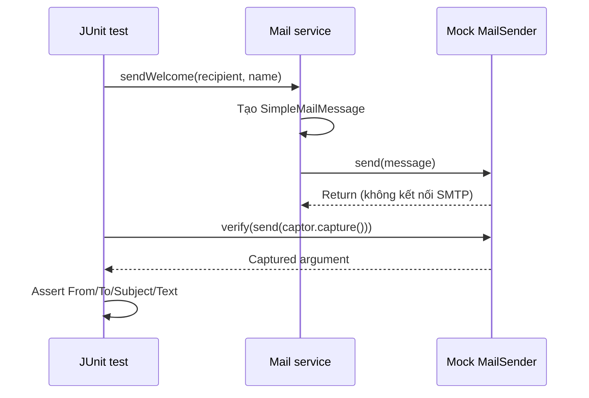

# ArgumentCaptor để kiểm tra message đã tạo

Trong Spring Framework Mail, một service gửi email thường có hai trách nhiệm: **tạo đúng message** và **gọi thành phần gửi message**. Ví dụ, khi tài khoản được tạo, service cần đặt đúng người nhận, tên người gửi, subject và nội dung; khi phát hành hóa đơn, service còn phải tạo MIME multipart chứa bản plain text, HTML và tệp đính kèm. Trong unit test, điều cần biết thường không phải SMTP server đã giao thư hay chưa, mà là **service đã chuẩn bị đối tượng email nào để chuyển cho `MailSender` hoặc `JavaMailSender`**.

Mockito cung cấp `ArgumentCaptor<T>` để lấy tham số thực tế được truyền vào lời gọi của mock. Sau khi chạy service, test có thể dùng `verify(...)` với `captor.capture()`, sau đó đọc `captor.getValue()` để kiểm tra các trường bên trong message.

Bài này hướng dẫn cách dùng `ArgumentCaptor` với `SimpleMailMessage`, `MimeMessage` và `MimeMessagePreparator`; cách chuẩn bị `MimeMessage` thật trong bộ nhớ nhưng mock SMTP transport; cách kiểm tra To/Cc/Bcc, From, Reply-To, subject Unicode, plain text, HTML, attachment và inline resource; cách xử lý overload/varargs; cùng các bẫy kiểm thử thường gặp. Ví dụ dùng Java 21, JUnit Jupiter, Mockito, Spring Framework 6.x / Spring Boot 3.x và Jakarta Mail.

> **Mục tiêu của ArgumentCaptor:** xác minh nội dung và cấu trúc email mà ứng dụng xây dựng ở ranh giới gửi. Đây là **unit test**, không phải kiểm thử SMTP server, mailbox delivery hay việc email có vào Inbox.

## 1. ArgumentCaptor giải quyết vấn đề nào?

Giả sử service có:

```java
public void sendWelcome(String recipient, String displayName) {
    SimpleMailMessage message = new SimpleMailMessage();
    message.setFrom("notifications@example.test");
    message.setTo(recipient);
    message.setSubject("Chào mừng bạn");
    message.setText("Xin chào " + displayName + "!");

    mailSender.send(message);
}
```

Một test đơn giản chỉ kiểm tra:

```java
verify(mailSender).send(any(SimpleMailMessage.class));
```

Test này cho biết **có một đối tượng `SimpleMailMessage` được gửi vào mock**, nhưng không cho biết nó chứa địa chỉ, subject hay body đúng hay sai. Một service gửi email nhầm người vẫn có thể làm test pass.

Với `ArgumentCaptor`:

```java
ArgumentCaptor<SimpleMailMessage> captor =
        ArgumentCaptor.forClass(SimpleMailMessage.class);

verify(mailSender).send(captor.capture());

SimpleMailMessage captured = captor.getValue();
assertEquals("notifications@example.test", captured.getFrom());
assertArrayEquals(
        new String[]{"customer@example.test"},
        captured.getTo());
assertEquals("Chào mừng bạn", captured.getSubject());
assertEquals("Xin chào Linh!", captured.getText());
```

Đây là test của **đầu ra thực tế** tại biên `mailSender.send(...)`. Nó phát hiện những bug như sai recipient, thiếu subject, dùng nhầm template hoặc gửi dữ liệu cá nhân không phù hợp.

### 1.1. Mô hình thao tác



Mockito ghi nhận lời gọi và tham số. `capture()` **không tự gửi email**, không đổi nội dung message và không tạo SMTP connection. Nó là công cụ kiểm tra hành vi tại biên mock.

## 2. Những class cần phân biệt trong Spring Mail

| Loại | Dùng cho | Dữ liệu có thể kiểm tra |
|---|---|---|
| `MailSender` | API gửi email văn bản đơn giản | `SimpleMailMessage` |
| `SimpleMailMessage` | From, To/Cc/Bcc, Reply-To, subject, text, sent date | Giá trị plain-text và các field trực tiếp |
| `JavaMailSender` | Gửi MIME email và kế thừa khả năng plain mail | `MimeMessage`, `MimeMessagePreparator`, `SimpleMailMessage` |
| `MimeMessage` | Message theo Jakarta Mail, nhiều header/part | Recipients, subject, MIME type, multipart/body/attachment |
| `MimeMessageHelper` | Helper để tạo/cập nhật `MimeMessage` | Không phải argument bắt buộc của `send`; kiểm tra kết quả là `MimeMessage` |
| `MimeMessagePreparator` | Callback chuẩn bị message trước khi gửi | Capture callback và chạy trên một `MimeMessage` test |

Hai nhóm test có khác biệt:

- **Simple mail:** mock `MailSender`, capture `SimpleMailMessage`; assert các getter không cần Jakarta Mail Session.
- **MIME mail:** mock `JavaMailSender`, stub `createMimeMessage()` để trả message thật trong bộ nhớ, capture `MimeMessage` được truyền vào `send(...)`; assert thông tin MIME bằng Jakarta Mail API.

Đừng capture `MimeMessageHelper` nếu service chỉ dùng helper để set các field rồi gọi `sender.send(mimeMessage)`. Helper là công cụ tạo; **message cuối cùng** mới là đối tượng đi qua ranh giới gửi.

## 3. Phụ thuộc test: JUnit 5 và Mockito

Nếu dùng Gradle và Spring Boot, các dependency thường gồm:

```groovy
dependencies {
    implementation 'org.springframework.boot:spring-boot-starter-mail'
    testImplementation 'org.springframework.boot:spring-boot-starter-test'
}

tasks.named('test') {
    useJUnitPlatform()
}
```

Các phiên bản thường được Spring Boot BOM quản lý nếu dự án dùng Spring Boot dependency management. `spring-boot-starter-test` thường mang JUnit Jupiter, Mockito và các công cụ test liên quan.

Một unit test chỉ cần Mockito có thể chạy **không khởi động Spring ApplicationContext**. Điều này giúp test nhanh, cô lập chức năng tạo message và không phụ thuộc biến môi trường SMTP.

Các import chính:

```java
import static org.junit.jupiter.api.Assertions.*;
import static org.mockito.Mockito.*;

import org.junit.jupiter.api.Test;
import org.mockito.ArgumentCaptor;
import org.springframework.mail.MailSender;
import org.springframework.mail.SimpleMailMessage;
```

Trong các phần sau, ví dụ sẽ nêu các import bổ sung khi dùng Jakarta Mail.

## 4. Ví dụ hoàn chỉnh: capture SimpleMailMessage

### 4.1. Service cần kiểm thử

```java
package com.example.mail;

import org.springframework.mail.MailSender;
import org.springframework.mail.SimpleMailMessage;

public final class WelcomeMailService {

    private final MailSender sender;
    private final String from;

    public WelcomeMailService(MailSender sender, String from) {
        this.sender = sender;
        this.from = from;
    }

    public void sendWelcome(String recipient, String displayName) {
        if (recipient == null || recipient.isBlank()) {
            throw new IllegalArgumentException("recipient required");
        }

        String name = displayName == null
                ? "bạn"
                : displayName.trim();

        SimpleMailMessage message = new SimpleMailMessage();
        message.setFrom(from);
        message.setTo(recipient);
        message.setSubject("Chào mừng bạn");
        message.setText("Xin chào " + name + "!");

        sender.send(message);
    }
}
```

Đây là service tối giản cho unit test; production còn cần kiểm tra format recipient, chính sách quyền gửi, escaping/template phù hợp và tránh ghi thông tin nhạy cảm. Tên `example.test` là miền thử nghiệm.

### 4.2. JUnit test dùng ArgumentCaptor

```java
package com.example.mail;

import static org.junit.jupiter.api.Assertions.assertArrayEquals;
import static org.junit.jupiter.api.Assertions.assertEquals;
import static org.mockito.Mockito.mock;
import static org.mockito.Mockito.verify;

import org.junit.jupiter.api.Test;
import org.mockito.ArgumentCaptor;
import org.springframework.mail.MailSender;
import org.springframework.mail.SimpleMailMessage;

class WelcomeMailServiceTest {

    @Test
    void sendsExpectedWelcomeMessage() {
        MailSender sender = mock(MailSender.class);
        WelcomeMailService service = new WelcomeMailService(
                sender, "notifications@example.test");

        service.sendWelcome("customer@example.test", "Linh");

        ArgumentCaptor<SimpleMailMessage> captor =
                ArgumentCaptor.forClass(SimpleMailMessage.class);

        verify(sender).send(captor.capture());

        SimpleMailMessage actual = captor.getValue();
        assertEquals("notifications@example.test", actual.getFrom());
        assertArrayEquals(
                new String[]{"customer@example.test"},
                actual.getTo());
        assertEquals("Chào mừng bạn", actual.getSubject());
        assertEquals("Xin chào Linh!", actual.getText());
    }
}
```

Không cần chạy mail relay. Mock `MailSender` ghi nhận lời gọi nhưng không thực hiện transport. Test tập trung vào giá trị mà service **chủ động kiểm soát**.

### 4.3. Kiểm tra Reply-To, Cc và Bcc

Nếu service có:

```java
message.setReplyTo("support@example.test");
message.setCc("audit@example.test");
message.setBcc("archive@example.test");
```

test có thể thêm:

```java
assertEquals("support@example.test", actual.getReplyTo());
assertArrayEquals(
        new String[]{"audit@example.test"}, actual.getCc());
assertArrayEquals(
        new String[]{"archive@example.test"}, actual.getBcc());
```

Các getter `getTo()`, `getCc()`, `getBcc()` trả về array hoặc có thể `null` nếu không thiết lập. Vì vậy, nếu quy tắc nghiệp vụ **không được có Cc/Bcc**, hãy assert rõ:

```java
assertNull(actual.getCc());
assertNull(actual.getBcc());
```

Điều này đặc biệt quan trọng với email cá nhân hóa: gửi người khác ở Cc có thể làm lộ địa chỉ hoặc thông tin riêng.

### 4.4. Vì sao assertArrayEquals thay vì assertEquals?

Các field recipient của `SimpleMailMessage` dùng `String[]`. Java array có equality theo reference khi gọi `equals(...)`; do đó:

```java
assertArrayEquals(
        new String[]{"a@example.test", "b@example.test"},
        actual.getTo());
```

đúng ý nghĩa “các phần tử bằng nhau”, còn `assertEquals(new String[]{...}, actual.getTo())` thường không phải assertion mong muốn. Nếu thứ tự recipient không là business requirement, có thể chuyển thành `Set` để assert tập giá trị, đồng thời kiểm tra duplicate riêng.

## 5. Capture và verify: thứ tự và số lần gọi

`ArgumentCaptor` thường được dùng trong **verification phase** sau khi code dưới test đã gọi mock:

```java
service.sendWelcome("a@example.test", "An");

ArgumentCaptor<SimpleMailMessage> captor =
        ArgumentCaptor.forClass(SimpleMailMessage.class);

verify(sender).send(captor.capture());
SimpleMailMessage message = captor.getValue();
```

`verify(sender)` mặc định kiểm tra **đúng một lần** cho lời gọi khớp với argument. Nếu service phải tạo hai email, dùng `times(2)` và `getAllValues()`.

### 5.1. Capture hai lần gọi

```java
service.sendWelcome("a@example.test", "An");
service.sendWelcome("b@example.test", "Bình");

ArgumentCaptor<SimpleMailMessage> captor =
        ArgumentCaptor.forClass(SimpleMailMessage.class);

verify(sender, times(2)).send(captor.capture());

List<SimpleMailMessage> messages = captor.getAllValues();
assertEquals(2, messages.size());
assertArrayEquals(
        new String[]{"a@example.test"}, messages.get(0).getTo());
assertArrayEquals(
        new String[]{"b@example.test"}, messages.get(1).getTo());
```

Trong ví dụ này, `List` cần import `java.util.List`. `getAllValues()` trả những argument được capture theo các invocation phù hợp. Nếu không quan trọng thứ tự, so sánh theo recipient/key thay vì gắn test vào thứ tự triển khai nội bộ.

### 5.2. Verify không có lời gọi khi dữ liệu sai

```java
@Test
void invalidRecipientDoesNotSend() {
    MailSender sender = mock(MailSender.class);
    WelcomeMailService service = new WelcomeMailService(
            sender, "notifications@example.test");

    assertThrows(
            IllegalArgumentException.class,
            () -> service.sendWelcome("", "An"));

    verifyNoInteractions(sender);
}
```

Test này bảo vệ điều kiện “từ chối trước khi gửi”. Không cần tạo ArgumentCaptor nếu **không được phép có message nào**.

### 5.3. Captor lưu reference, không tự snapshot nội dung

Mockito capture tham chiếu tới object đã được truyền qua mock. Nếu service tiếp tục sửa cùng một `SimpleMailMessage` sau khi gọi `send(...)`, test đọc `getValue()` về sau có thể thấy trạng thái đã bị sửa, **không nhất thiết là snapshot tại thời điểm send**.

Ví dụ code lỗi:

```java
sender.send(message);
message.setSubject("Một subject khác sau send");
```

Về thiết kế, message nên được xem là dữ liệu đã hoàn thiện trước ranh giới gửi và không bị sửa sau đó. Nếu mục tiêu test thật sự cần snapshot tại thời điểm invocation, có thể dùng `doAnswer(...)` trong một stub để copy các trường ngay lúc mock được gọi. Nhưng đừng tăng độ phức tạp khi service không có hành vi mutate sau send.

## 6. Khi chuyển sang MimeMessage, điều gì thay đổi?

`SimpleMailMessage` chỉ hỗ trợ nội dung văn bản đơn giản. Email có HTML, text alternative, attachment hoặc inline image thường dùng `MimeMessage` với `MimeMessageHelper`.

Ví dụ:

```java
MimeMessage message = javaMailSender.createMimeMessage();
MimeMessageHelper helper =
        new MimeMessageHelper(message, true, "UTF-8");

helper.setFrom("billing@example.test");
helper.setTo("customer@example.test");
helper.setSubject("Hóa đơn đã sẵn sàng");
helper.setText(
        "Hóa đơn đã sẵn sàng. Đăng nhập để xem.",
        "<p>Hóa đơn đã sẵn sàng.</p>");

javaMailSender.send(message);
```

Để test, ta muốn capture `MimeMessage` khi gọi `send(message)` và dùng Jakarta Mail API để kiểm tra cấu trúc.

**Khác biệt quan trọng:** mock `JavaMailSender` mặc định trả `null` từ `createMimeMessage()`. Nếu service dùng kết quả này để tạo `MimeMessageHelper`, test sẽ hỏng trước khi tới `send`. Vì vậy, cần **stub factory** cho `createMimeMessage()` để trả về một `MimeMessage` thật nhưng chỉ tồn tại trong bộ nhớ.

## 7. Tạo MimeMessage thật trong test mà không gửi SMTP

Jakarta Mail cho phép tạo message với một `Session` cục bộ:

```java
import java.util.Properties;

import jakarta.mail.Session;
import jakarta.mail.internet.MimeMessage;

Session session = Session.getInstance(new Properties());
MimeMessage message = new MimeMessage(session);
```

Tạo `Session` và `MimeMessage` như vậy **không kết nối SMTP server**. Chỉ khi một transport thật được gọi để gửi thì mới có network I/O.

Cấu hình Mockito:

```java
JavaMailSender sender = mock(JavaMailSender.class);
Session session = Session.getInstance(new Properties());

when(sender.createMimeMessage())
        .thenAnswer(invocation -> new MimeMessage(session));
```

Dùng `thenAnswer(...)` thay cho `thenReturn(oneMessage)` nếu service có thể tạo nhiều thư: mỗi lần gọi factory nhận một instance mới, tránh test vô tình trộn nội dung giữa các message.

Mock `send(MimeMessage)` mặc định là một no-op, vì method trả `void`. Test sẽ quan sát message mà không gửi SMTP.

## 8. Ví dụ hoàn chỉnh: service tạo MIME có attachment

### 8.1. Command và service

Ví dụ sau dùng PDF bytes từ một nguồn fixture đáng tin để làm rõ cách tạo MIME. Trong production, attachment phải được kiểm tra kích thước, quyền truy cập, content type và khả năng mở lại stream.

```java
package com.example.mail;

public record InvoiceMailCommand(
        String recipient,
        String invoiceNumber,
        byte[] pdfBytes
) {}
```

```java
package com.example.mail;

import jakarta.mail.MessagingException;
import jakarta.mail.internet.MimeMessage;
import org.springframework.core.io.ByteArrayResource;
import org.springframework.mail.javamail.JavaMailSender;
import org.springframework.mail.javamail.MimeMessageHelper;

public final class InvoiceMailService {

    private final JavaMailSender sender;

    public InvoiceMailService(JavaMailSender sender) {
        this.sender = sender;
    }

    public void sendInvoice(InvoiceMailCommand command)
            throws MessagingException {

        if (command.recipient() == null
                || command.recipient().isBlank()) {
            throw new IllegalArgumentException("recipient required");
        }
        if (command.pdfBytes() == null
                || command.pdfBytes().length == 0) {
            throw new IllegalArgumentException("pdf required");
        }

        MimeMessage message = sender.createMimeMessage();
        MimeMessageHelper helper =
                new MimeMessageHelper(message, true, "UTF-8");

        helper.setFrom("billing@example.test");
        helper.setReplyTo("support@example.test");
        helper.setTo(command.recipient());
        helper.setSubject("Hóa đơn " + command.invoiceNumber());

        helper.setText(
                "Hóa đơn " + command.invoiceNumber()
                        + " đã được phát hành.",
                "<html><body><p>Hóa đơn "
                        + command.invoiceNumber()
                        + " đã được phát hành.</p></body></html>");

        helper.addAttachment(
                "invoice.pdf",
                new ByteArrayResource(command.pdfBytes().clone()),
                "application/pdf");

        sender.send(message);
    }
}
```

Với `MimeMessageHelper(message, true, "UTF-8")`, helper có thể tạo multipart MIME phục vụ text/HTML/attachment. `ByteArrayResource` cấp được stream mới từ byte array khi Jakarta Mail đọc attachment. Đối với file lớn trong production, ưu tiên nguồn stream mở lại được và tránh tải toàn bộ file vào heap nếu không cần.

### 8.2. Test capture MimeMessage

```java
package com.example.mail;

import static org.junit.jupiter.api.Assertions.*;
import static org.mockito.Mockito.*;

import java.util.Properties;

import jakarta.mail.Message;
import jakarta.mail.Session;
import jakarta.mail.internet.InternetAddress;
import jakarta.mail.internet.MimeMessage;

import org.junit.jupiter.api.Test;
import org.mockito.ArgumentCaptor;
import org.springframework.mail.javamail.JavaMailSender;

class InvoiceMailServiceTest {

    @Test
    void buildsExpectedInvoiceMessage() throws Exception {
        JavaMailSender sender = mock(JavaMailSender.class);
        Session session = Session.getInstance(new Properties());

        when(sender.createMimeMessage())
                .thenAnswer(invocation -> new MimeMessage(session));

        byte[] pdfFixture = new byte[]{
                0x25, 0x50, 0x44, 0x46, 0x2D, 0x31, 0x2E, 0x37
        };
        InvoiceMailService service = new InvoiceMailService(sender);

        service.sendInvoice(new InvoiceMailCommand(
                "customer@example.test", "INV-2026-42", pdfFixture));

        ArgumentCaptor<MimeMessage> captor =
                ArgumentCaptor.forClass(MimeMessage.class);
        verify(sender).send(captor.capture());

        MimeMessage actual = captor.getValue();

        assertEquals("Hóa đơn INV-2026-42", actual.getSubject());
        assertEquals(
                "billing@example.test",
                ((InternetAddress) actual.getFrom()[0]).getAddress());
        assertEquals(
                "support@example.test",
                ((InternetAddress) actual.getReplyTo()[0]).getAddress());
        assertEquals(
                "customer@example.test",
                ((InternetAddress) actual.getRecipients(
                        Message.RecipientType.TO)[0]).getAddress());
    }
}
```

Fixture trên chỉ chứa các byte đầu mô phỏng tên kiểu PDF để test **luồng MIME metadata**, không phải một tài liệu PDF hợp lệ hoàn chỉnh. Nếu cần test định dạng file PDF thực sự, dùng fixture PDF thật được phép sử dụng; mục tiêu của `ArgumentCaptor` ở đây là xem service đã đính kèm byte array đúng với tên/content type mong muốn.

### 8.3. Subject Unicode và địa chỉ

`MimeMessage.getSubject()` thường trả chuỗi đã decode theo API Jakarta Mail; vì vậy có thể assert Unicode tiếng Việt:

```java
assertEquals("Hóa đơn INV-2026-42", actual.getSubject());
```

Không nên assert byte header raw cụ thể nếu mục tiêu chỉ là subject hiển thị. MIME header có thể được encode hoặc folded theo thư viện. Với địa chỉ, `InternetAddress.getAddress()` giúp lấy mailbox thay vì so sánh chuỗi có thể bao gồm display name.

### 8.4. Kiểm tra không lộ Cc/Bcc

```java
assertNull(actual.getRecipients(Message.RecipientType.CC));
assertNull(actual.getRecipients(Message.RecipientType.BCC));
```

Hai assertion này giúp phát hiện service vô tình đưa thêm recipient. Nếu business requirement cần Bcc để archive, hãy assert đúng địa chỉ được phép và làm rõ privacy policy.

## 9. Đọc MIME body: không giả định getContent() luôn là String

Với `SimpleMailMessage`, `getText()` là chuỗi. Nhưng với `MimeMessage` multipart, `actual.getContent()` thường là một `Multipart`, không phải body string trực tiếp.

Ví dụ sai:

```java
String text = (String) capturedMimeMessage.getContent();
```

Nếu message là `multipart/mixed` hoặc `multipart/alternative`, cast có thể gây `ClassCastException`. Hãy kiểm tra MIME structure theo API `jakarta.mail.Part` và `Multipart`.

### 9.1. Hàm đi qua cấu trúc multipart đệ quy

Một helper test có thể lấy các leaf `Part` bất kể text/html nằm trong multipart lồng nhau:

```java
package com.example.mail.test;

import java.io.IOException;
import java.util.ArrayList;
import java.util.List;

import jakarta.mail.MessagingException;
import jakarta.mail.Multipart;
import jakarta.mail.Part;

public final class MimeTestParts {

    private MimeTestParts() {}

    public static List<Part> leaves(Part root)
            throws MessagingException, IOException {
        List<Part> result = new ArrayList<>();
        visit(root, result);
        return result;
    }

    private static void visit(Part part, List<Part> result)
            throws MessagingException, IOException {
        Object content = part.getContent();
        if (content instanceof Multipart multipart) {
            for (int i = 0; i < multipart.getCount(); i++) {
                visit(multipart.getBodyPart(i), result);
            }
        } else {
            result.add(part);
        }
    }
}
```

Helper này xử lý multipart thông thường do `MimeMessageHelper` tạo. Đối với MIME phức tạp hơn (chẳng hạn `message/rfc822` đính kèm một email khác), cần bổ sung logic phân tích `Message` lồng nhau hoặc nhận dạng attachment riêng. Không dùng helper đơn giản này để tuyên bố đã kiểm tra mọi dạng MIME có thể tồn tại.

### 9.2. Assert plain text và HTML

```java
List<Part> leaves = MimeTestParts.leaves(actual);

Part plainPart = leaves.stream()
        .filter(p -> isBodyText(p, "text/plain"))
        .findFirst()
        .orElseThrow();

Part htmlPart = leaves.stream()
        .filter(p -> isBodyText(p, "text/html"))
        .findFirst()
        .orElseThrow();

String plain = (String) plainPart.getContent();
String html = (String) htmlPart.getContent();

assertTrue(plain.contains("Hóa đơn INV-2026-42"));
assertTrue(html.contains("<p>Hóa đơn INV-2026-42"));
```

Vì `Part.isMimeType(...)` và `getFileName()` có thể ném checked `MessagingException`, hàm `isBodyText` giúp lambda dễ đọc:

```java
private static boolean isBodyText(Part part, String mimeType) {
    try {
        return part.getFileName() == null
                && part.isMimeType(mimeType);
    } catch (MessagingException ex) {
        throw new AssertionError("Cannot inspect MIME part", ex);
    }
}
```

Code trên cần các import `java.util.List` và `jakarta.mail.Part`, `jakarta.mail.MessagingException` cùng static JUnit assertions. Dùng `isMimeType("text/html")` thay vì so sánh tuyệt đối `getContentType()` với `"text/html"`, vì Content-Type có thể kèm `charset=UTF-8` hoặc các parameter khác.

### 9.3. Không ép so sánh CRLF hoặc HTML serialization

Đối với text/plain, hệ thống vận chuyển MIME có thể chuẩn hóa line ending hoặc encoding. Nếu nội dung nghiệp vụ là quan trọng, assert câu/đoạn bắt buộc; nếu muốn so sánh chính xác, hãy normalize theo quy tắc đã được định nghĩa. Với HTML, test thường nên khẳng định nội dung template, link và escaping quan trọng hơn chi tiết whitespace.

Không xóa mọi whitespace một cách tùy tiện nếu email sử dụng preformatted text hoặc các đoạn có ý nghĩa.

## 10. Capture attachment trong MimeMessage

Khi service đã gọi:

```java
helper.addAttachment(
        "invoice.pdf",
        new ByteArrayResource(pdfBytes),
        "application/pdf");
```

Test có thể tìm leaf part có tên file đó:

```java
List<Part> leaves = MimeTestParts.leaves(actual);

Part attachment = null;
for (Part part : leaves) {
    if ("invoice.pdf".equals(part.getFileName())) {
        attachment = part;
        break;
    }
}

assertNotNull(attachment);
assertEquals(Part.ATTACHMENT, attachment.getDisposition());
assertTrue(attachment.isMimeType("application/pdf"));
assertArrayEquals(
        pdfFixture,
        attachment.getInputStream().readAllBytes());
```

Đoạn này có thể đặt trong method test `throws Exception` như ví dụ trước. Test không chỉ kiểm tra có lời gọi `addAttachment(...)` trong code sản phẩm; nó kiểm tra **MIME structure đã được dựng**.

### 10.1. Tên file là metadata, không phải đường dẫn

Giá trị `getFileName()` trong MIME part có thể được decode theo Jakarta Mail và cấu hình MIME. Test nên so sánh tên hiển thị hợp lệ, ví dụ `invoice.pdf`, không dùng một đường dẫn storage nội bộ làm filename.

Nếu tên file Unicode, hãy kiểm tra tên sau khi decode và xác nhận encoding theo cấu hình. Đừng gắn test đơn vị vào một chuỗi raw header `Content-Disposition` có thể được encode/fold khác nhau theo implementation.

### 10.2. Đọc stream trong test và giải phóng tài nguyên

Khi kiểm tra file content, nên đóng input stream:

```java
byte[] actualBytes;
try (var in = attachment.getInputStream()) {
    actualBytes = in.readAllBytes();
}
assertArrayEquals(pdfFixture, actualBytes);
```

Trong test nhỏ với `ByteArrayResource`, `readAllBytes()` tiện lợi. Với file lớn, test không nên tải nhiều MB vào heap chỉ để assert MIME; có thể dùng hash/streaming comparison hoặc fixture nhỏ. Để kiểm tra hiệu năng/streaming của provider, cần integration test riêng.

### 10.3. Multipart nested structure

Khi đặt cả plain text, HTML và attachment, helper có thể tạo cây:

```text
MimeMessage
  multipart/mixed
    multipart/related
      multipart/alternative
        text/plain
        text/html
    application/pdf (attachment)
```

Cấu trúc chính xác có thể thay đổi theo mode của `MimeMessageHelper` và các inline/attachment đã thêm. Vì vậy, nếu mục đích chỉ là xác nhận email chứa cả hai body part và PDF, duyệt leaf parts thường bền vững hơn việc assert phần tử `multipart.getBodyPart(0)` luôn là text.

Nếu sản phẩm có yêu cầu cụ thể về nesting để tương thích email client, hãy viết một integration test MIME riêng cho cấu trúc đó; đừng áp đặt thứ tự nội bộ không cần thiết vào mọi unit test.

## 11. Kiểm tra inline image hoặc Content-ID

Với thư HTML có ảnh inline, service có thể gọi:

```java
helper.setText(
        "Xin chào, đây là thông báo của bạn.",
        "<html><body><p>Xin chào!</p>"
        + "</body></html>");

helper.addInline(
        "brand-logo",
        new ByteArrayResource(imageBytes),
        "image/png");
```

Quy tắc thường dùng là thiết lập HTML body bằng `setText(...)` trước khi thêm inline resource để helper tạo MIME structure có thể tham chiếu đúng CID. Test nên xác minh hai điểm: HTML có `cid:brand-logo` và trong multipart có một part inline có Content-ID tương ứng.

Ví dụ:

```java
List<Part> parts = MimeTestParts.leaves(captured);

Part image = null;
for (Part part : parts) {
    String[] ids = part.getHeader("Content-ID");
    if (ids != null && ids.length > 0
            && ids[0].contains("brand-logo")) {
        image = part;
        break;
    }
}

assertNotNull(image);
assertEquals(Part.INLINE, image.getDisposition());
assertTrue(image.isMimeType("image/png"));
```

Trong unit test này, `captured` là `MimeMessage` lấy từ ArgumentCaptor. Header `Content-ID` thường được bao bởi dấu ngoặc nhọn góc trong wire format (ví dụ `<brand-logo>`); test có thể so sánh ID theo quy tắc normalize của dự án thay vì gắn cứng vào một cách render raw header.

Trên một số client, inline image có thể bị ẩn hoặc tải theo chính sách riêng. Unit test kiểm tra MIME relationship chứ không bảo đảm ảnh sẽ hiển thị trên mọi ứng dụng email.

### 11.1. Attachment và inline không phải một

Part attachment thường có `Content-Disposition: attachment`; inline resource có thể có `Content-Disposition: inline` và Content-ID. Nếu logo bị thêm như attachment, email client có thể hiển thị file đính kèm thay vì ảnh bên trong HTML. Assertion về disposition và Content-ID giúp phát hiện lỗi cấu trúc.

## 12. Captor khi service dùng MimeMessagePreparator

`JavaMailSender` hỗ trợ một cách dùng khác:

```java
javaMailSender.send(mimeMessage -> {
    MimeMessageHelper helper =
            new MimeMessageHelper(mimeMessage, "UTF-8");
    helper.setTo("customer@example.test");
    helper.setSubject("Chào mừng bạn");
    helper.setText("Xin chào từ Spring Mail.");
});
```

Đối số truyền vào `send(...)` lúc này là một **`MimeMessagePreparator` callback**, không phải `MimeMessage` đã dựng sẵn. Nếu dùng mock `JavaMailSender` thuần, Mockito ghi nhận callback nhưng **không tự gọi nó** để tạo message.

Do đó, test kiểu:

```java
ArgumentCaptor<MimeMessage> mimeCaptor =
        ArgumentCaptor.forClass(MimeMessage.class);
verify(sender).send(mimeCaptor.capture());
```

không khớp invocation khi service gọi overload `send(MimeMessagePreparator)`. Cần capture đúng kiểu callback.

### 12.1. Service dùng callback

```java
package com.example.mail;

import org.springframework.mail.javamail.JavaMailSender;
import org.springframework.mail.javamail.MimeMessageHelper;

public final class ReminderMailService {

    private final JavaMailSender sender;

    public ReminderMailService(JavaMailSender sender) {
        this.sender = sender;
    }

    public void remind(String recipient, String taskName) {
        sender.send(mimeMessage -> {
            MimeMessageHelper helper =
                    new MimeMessageHelper(mimeMessage, "UTF-8");
            helper.setFrom("reminders@example.test");
            helper.setTo(recipient);
            helper.setSubject("Nhắc việc: " + taskName);
            helper.setText(
                    "Bạn có công việc cần hoàn thành: " + taskName);
        });
    }
}
```

### 12.2. Capture callback rồi thực thi trên MimeMessage test

```java
import static org.junit.jupiter.api.Assertions.assertEquals;
import static org.mockito.Mockito.*;

import java.util.Properties;

import jakarta.mail.Message;
import jakarta.mail.Session;
import jakarta.mail.internet.InternetAddress;
import jakarta.mail.internet.MimeMessage;

import org.junit.jupiter.api.Test;
import org.mockito.ArgumentCaptor;
import org.springframework.mail.javamail.JavaMailSender;
import org.springframework.mail.javamail.MimeMessagePreparator;

class ReminderMailServiceTest {

    @Test
    void preparatorProducesExpectedMessage() throws Exception {
        JavaMailSender sender = mock(JavaMailSender.class);
        ReminderMailService service = new ReminderMailService(sender);

        service.remind("customer@example.test", "Nộp báo cáo");

        ArgumentCaptor<MimeMessagePreparator> captor =
                ArgumentCaptor.forClass(
                        MimeMessagePreparator.class);

        verify(sender).send(captor.capture());

        MimeMessage testMessage = new MimeMessage(
                Session.getInstance(new Properties()));

        // Mock send không tự gọi callback, nên test gọi tường minh.
        captor.getValue().prepare(testMessage);

        assertEquals(
                "Nhắc việc: Nộp báo cáo",
                testMessage.getSubject());
        assertEquals(
                "customer@example.test",
                ((InternetAddress) testMessage.getRecipients(
                        Message.RecipientType.TO)[0]).getAddress());
        assertEquals(
                "Bạn có công việc cần hoàn thành: Nộp báo cáo",
                testMessage.getContent());
    }
}
```

Ưu điểm của cách này là test trực tiếp kết quả callback chuẩn bị message mà không cần SMTP hoặc khởi động Spring context. Đặt tên test theo hành vi **preparator tạo message hợp lệ**, không nói rằng mock đã thực hiện transport.

### 12.3. Một lựa chọn khác: doAnswer để chạy callback

Khi code test hoặc fixture cần mô phỏng chính xác hơn hành vi của sender ở mức preparation, có thể stub overload callback bằng `doAnswer(...)`:

```java
List<MimeMessage> prepared = new ArrayList<>();
Session session = Session.getInstance(new Properties());

doAnswer(invocation -> {
    MimeMessagePreparator preparator =
            invocation.getArgument(0);
    MimeMessage message = new MimeMessage(session);
    preparator.prepare(message);
    prepared.add(message);
    return null;
}).when(sender).send(any(MimeMessagePreparator.class));

service.remind("customer@example.test", "Nộp báo cáo");

assertEquals(1, prepared.size());
assertEquals("Nhắc việc: Nộp báo cáo",
        prepared.get(0).getSubject());
```

Cần các import `java.util.List`, `ArrayList`, `jakarta.mail.Session`, `MimeMessage` và `Properties`. Vì callback được mock thực thi ngay trong stub, exception khi chuẩn bị message cũng có thể đi qua đường gọi service. Cách này hợp lý cho fixture có nhiều test, nhưng với một test đơn giản, capture callback rồi gọi `prepare(...)` thường rõ ràng hơn.

Không tự động thực thi preparator **hai lần** nếu callback có side effect; điều đó có thể tạo khác biệt so với production. Và đừng nhầm callback test với SMTP transaction thật.

## 13. Overload của JavaMailSender và lỗi chọn nhầm phương thức

`JavaMailSender` có nhiều overload của `send(...)`. Các chữ ký liên quan gồm:

```java
void send(SimpleMailMessage simpleMessage);
void send(SimpleMailMessage... simpleMessages);

void send(MimeMessage mimeMessage);
void send(MimeMessage... mimeMessages);

void send(MimeMessagePreparator mimeMessagePreparator);
void send(MimeMessagePreparator... mimeMessagePreparators);
```

Không phải một phương thức tổng quát `send(Object)`. Mockito xác định invocation theo **signature và đối số**. Khi type captor không khớp overload thực tế, `verify` sẽ báo không có lời gọi mong đợi.

### 13.1. Capture đúng kiểu cho một SimpleMailMessage

```java
ArgumentCaptor<SimpleMailMessage> c =
        ArgumentCaptor.forClass(SimpleMailMessage.class);
verify(sender).send(c.capture());
```

### 13.2. Capture đúng kiểu cho một MimeMessage

```java
ArgumentCaptor<MimeMessage> c =
        ArgumentCaptor.forClass(MimeMessage.class);
verify(sender).send(c.capture());
```

### 13.3. Capture đúng kiểu cho một MimeMessagePreparator

```java
ArgumentCaptor<MimeMessagePreparator> c =
        ArgumentCaptor.forClass(MimeMessagePreparator.class);
verify(sender).send(c.capture());
```

Static type của `capture()` giúp Java chọn overload. Trong một method có nhiều loại invocation, hãy capture từng loại riêng, thay vì dùng `ArgumentCaptor<Object>` rồi tìm cách cast.

### 13.4. Khi service dùng send(SimpleMailMessage...)

Ví dụ:

```java
SimpleMailMessage one = new SimpleMailMessage();
SimpleMailMessage two = new SimpleMailMessage();
// ... set thông tin ...
sender.send(new SimpleMailMessage[]{one, two});
```

Đây là overload array/varargs. Một cách test cụ thể:

```java
ArgumentCaptor<SimpleMailMessage[]> batchCaptor =
        ArgumentCaptor.forClass(SimpleMailMessage[].class);

verify(sender).send(batchCaptor.capture());

SimpleMailMessage[] messages = batchCaptor.getValue();
assertEquals(2, messages.length);
```

Sự khác biệt cần nắm:

- **Hai lần gọi** `send(one)` rồi `send(two)`: dùng `verify(sender, times(2))` và `getAllValues()`.
- **Một lần gọi** `send(new SimpleMailMessage[]{one, two})`: capture **array** rồi assert các phần tử.

Mockito hiện đại có xử lý varargs theo type; hành vi của matcher/captor phụ thuộc overload/kiểu tham số đang được compile. Nếu verification gây nhầm lẫn, nhìn lại lời gọi thực tế và xác định đây là một invocation với array hay nhiều invocation với một message.

### 13.5. Capture mảng MimeMessage

Tương tự:

```java
ArgumentCaptor<MimeMessage[]> batchCaptor =
        ArgumentCaptor.forClass(MimeMessage[].class);

verify(sender).send(batchCaptor.capture());
MimeMessage[] messages = batchCaptor.getValue();
```

Nếu batch có nhiều recipient hoặc message có trạng thái khác nhau, assert từng message theo notification ID/recipient, không chỉ kiểm tra mảng khác null.

## 14. Sử dụng @Captor và MockitoExtension

Thay vì tạo captor trong mỗi test, Mockito hỗ trợ annotation `@Captor`. Ví dụ:

```java
import static org.junit.jupiter.api.Assertions.*;
import static org.mockito.Mockito.*;

import org.junit.jupiter.api.Test;
import org.junit.jupiter.api.extension.ExtendWith;
import org.mockito.ArgumentCaptor;
import org.mockito.Captor;
import org.mockito.Mock;
import org.mockito.junit.jupiter.MockitoExtension;
import org.springframework.mail.MailSender;
import org.springframework.mail.SimpleMailMessage;

@ExtendWith(MockitoExtension.class)
class WelcomeMailServiceWithExtensionTest {

    @Mock
    MailSender sender;

    @Captor
    ArgumentCaptor<SimpleMailMessage> messageCaptor;

    @Test
    void capturesMessage() {
        WelcomeMailService service = new WelcomeMailService(
                sender, "notifications@example.test");

        service.sendWelcome("customer@example.test", "Linh");

        verify(sender).send(messageCaptor.capture());

        assertEquals(
                "Chào mừng bạn",
                messageCaptor.getValue().getSubject());
    }
}
```

`MockitoExtension` khởi tạo `@Mock` và `@Captor` cho JUnit Jupiter. Trong unit test này không cần `@SpringBootTest`, không cần `@MockBean` và không cần ApplicationContext vì service được construct trực tiếp.

Khi dùng một captor field cho nhiều test, MockitoExtension tạo context mocks/captors tương ứng với từng test lifecycle. Tuy nhiên, không nên phụ thuộc trạng thái capture của test khác hoặc cố điều khiển thứ tự test; mỗi test phải độc lập.

## 15. ArgumentCaptor khác argThat và ArgumentMatcher

Có nhiều cách assert tham số mock:

```java
verify(sender).send(argThat(message ->
        "Chào mừng bạn".equals(message.getSubject())));
```

`argThat(...)` phù hợp với điều kiện ngắn, khi cần biết invocation có argument khớp hay không. `ArgumentCaptor` phù hợp khi cần kiểm tra **nhiều field cùng một message**, dùng assertion message rõ ràng hoặc phân tích MIME có cấu trúc.

| Cách | Ưu điểm | Hạn chế |
|---|---|---|
| `any(SimpleMailMessage.class)` | Rất gọn | Không kiểm tra nội dung |
| `eq(expected)` | Hợp lý cho value object có equality rõ | MIME mutable object hiếm khi có equality theo ý nghĩa nội dung |
| `argThat(predicate)` | Gọn cho một số điều kiện | Lambda dài có thể khó đọc; stack trace khó chỉ rõ field sai |
| `ArgumentCaptor` | Lấy đối tượng để dùng nhiều JUnit assertions | Cần một bước verify và một biến captor |
| Fake/recording sender | Chủ động ghi lại message, hỗ trợ stateful test | Cần viết và bảo trì test double |

Ví dụ captor có thông báo assertion cụ thể:

```java
SimpleMailMessage message = captor.getValue();

assertEquals("notifications@example.test", message.getFrom());
assertArrayEquals(
        new String[]{"customer@example.test"}, message.getTo());
assertEquals("Chào mừng bạn", message.getSubject());
assertTrue(message.getText().contains("Linh"));
```

Khi subject sai, test chỉ rõ failure tại `assertEquals` liên quan subject, thường dễ điều tra hơn một matcher phức tạp trả `false`.

### 15.1. Khi nào không dùng captor?

Nếu chỉ cần xác minh “không gửi email khi input invalid”, `verifyNoInteractions(sender)` hoặc `never()` rõ ràng hơn. Nếu chỉ cần kiểm tra số lượng invocation, `verify(sender, times(n)).send(any(...))` là đủ. Tránh capture mọi thứ khi test không có assertion về argument.

### 15.2. Không dùng captor chủ yếu để stubbing

Một anti-pattern:

```java
// Không nên dùng capture để điều khiển stub mặc định.
doNothing().when(sender).send(captor.capture());
```

Captor được thiết kế chủ yếu cho **verification**, sau khi invocation đã xảy ra. Để stub hành vi, dùng matcher như `any(MimeMessage.class)` hoặc `doAnswer(...)`; để assert tham số, dùng captor sau khi chạy service. Cách này giữ test rõ ràng giữa arrange, act và assert.

## 16. Kiểm tra trường hợp lỗi transport bằng mock

Một unit test nên xác nhận service xử lý exception theo policy mà không cần SMTP thật. Ví dụ:

```java
JavaMailSender sender = mock(JavaMailSender.class);
Session session = Session.getInstance(new Properties());
when(sender.createMimeMessage())
        .thenAnswer(inv -> new MimeMessage(session));

doThrow(new MailSendException("Simulated SMTP rejection"))
        .when(sender).send(any(MimeMessage.class));

InvoiceMailService service = new InvoiceMailService(sender);

MailSendException failure = assertThrows(
        MailSendException.class,
        () -> service.sendInvoice(validInvoiceCommand()));

ArgumentCaptor<MimeMessage> captor =
        ArgumentCaptor.forClass(MimeMessage.class);
verify(sender).send(captor.capture());
assertEquals("Hóa đơn INV-2026-42",
        captor.getValue().getSubject());
```

Trong test trên, `validInvoiceCommand()` là fixture do dự án định nghĩa; `MailSendException` import từ `org.springframework.mail`. Việc mock ném exception không chứng minh relay thật sẽ trả code cụ thể. Unit test kiểm tra message đã được chuẩn bị và service propagates/mapping lỗi như mong đợi. Phân loại SMTP 4xx/5xx hoặc timeout thực tế cần test riêng với test server/fault injection thích hợp.

### 16.1. Test lỗi validation xảy ra trước createMimeMessage()

```java
@Test
void invalidInvoiceDoesNotConstructOrSendMime() {
    JavaMailSender sender = mock(JavaMailSender.class);
    InvoiceMailService service = new InvoiceMailService(sender);

    InvoiceMailCommand invalid =
            new InvoiceMailCommand("", "INV-1", new byte[]{1});

    assertThrows(IllegalArgumentException.class,
            () -> service.sendInvoice(invalid));

    verifyNoInteractions(sender);
}
```

Đây là điều kiện hữu ích: service validate recipient **trước** khi yêu cầu factory tạo MIME. Nếu validation nằm sau `createMimeMessage()`, assertion `verifyNoInteractions(sender)` sẽ fail, giúp phát hiện sai thứ tự.

### 16.2. Test không thêm attachment khi dữ liệu không đạt

Nếu service từ chối attachment quá lớn/không hợp lệ, có thể assert không có lời gọi `sender.send(...)`. Nếu service đã tạo message trước rồi mới validate, test nên nêu rõ expected behavior; đừng ngầm chấp nhận một MIME message bị dựng dở như kết quả hợp lệ.

### 16.3. Không coi exception giả lập là kiểm thử retry end-to-end

`doThrow(new MailSendException(...))` chỉ giúp kiểm tra một nhánh. Retry thường nằm ở outbox dispatcher với attempt count, backoff, lease và trạng thái riêng. Khi cần test retry, capture message ở từng attempt và kiểm tra correlation/notification ID theo policy; không làm cho `InvoiceMailService` vừa render vừa sở hữu toàn bộ state machine nếu kiến trúc đã tách trách nhiệm.

## 17. Tổ chức fixture và helper để test đọc dễ

Khi nhiều service đều gửi MIME email, có thể tạo một lớp test utility riêng:

```java
package com.example.mail.test;

import java.util.Properties;

import jakarta.mail.Session;
import jakarta.mail.internet.MimeMessage;

import org.springframework.mail.javamail.JavaMailSender;

import static org.mockito.Mockito.*;

public final class MockMailSenderFixture {

    private MockMailSenderFixture() {}

    public static JavaMailSender senderWithRealMimeFactory() {
        JavaMailSender sender = mock(JavaMailSender.class);
        Session session = Session.getInstance(new Properties());
        when(sender.createMimeMessage())
                .thenAnswer(inv -> new MimeMessage(session));
        return sender;
    }
}
```

Test chính:

```java
JavaMailSender sender =
        MockMailSenderFixture.senderWithRealMimeFactory();
InvoiceMailService service = new InvoiceMailService(sender);

service.sendInvoice(command);

ArgumentCaptor<MimeMessage> captor =
        ArgumentCaptor.forClass(MimeMessage.class);
verify(sender).send(captor.capture());

MimeMessage actual = captor.getValue();
// Assert đúng thuộc tính nghiệp vụ của email.
```

Fixture nên trả về một sender độc lập cho mỗi test, không lưu singleton mock dùng chung cho toàn suite. Việc tách utility như `MimeTestParts.leaves(...)` giúp tránh nhân bản code đọc multipart; tuy nhiên, helper test quá “thông minh” cũng có thể che cấu trúc email sai. Nên assert rõ các điều kiện quan trọng ở từng test.

### 17.1. Nên kiểm tra bao nhiêu field?

Tập trung vào business contract của email:

- Người nhận đúng và không có recipient ngoài ý muốn.
- Sender phù hợp loại thông báo.
- Subject đúng template và Unicode.
- Plain text/HTML có dữ liệu nghiệp vụ cần thiết.
- Link dẫn tới domain được phép và mã hóa/escaping đúng.
- Attachment đúng tên, content type và nội dung cần thiết.
- Inline resource có CID trùng với HTML.

Không cần khẳng định mọi header auto-generated, thứ tự boundary hoặc giá trị `Message-ID` ngẫu nhiên nếu chúng không nằm trong yêu cầu nghiệp vụ.

## 18. Đừng gắn test vào MIME bytes không ổn định

Một `MimeMessage` có thể được biểu diễn bằng nhiều MIME boundary, header folding, transfer encoding và line ending khác nhau mà vẫn có cùng ý nghĩa. Thư viện có thể tạo hoặc cập nhật `Date`, `Message-ID` và các header khi gọi `saveChanges()` hoặc serialize để gửi.

Vì vậy, test kiểu:

```java
ByteArrayOutputStream out = new ByteArrayOutputStream();
captured.writeTo(out);
assertEquals(expectedRawMimeString, out.toString("UTF-8"));
```

thường dễ vỡ. Một thay đổi phiên bản Jakarta Mail có thể thay MIME boundary/header formatting mà không làm hỏng nội dung email.

### 18.1. Khi nào cần serialize?

Serialization hữu ích khi cần kiểm tra tính hợp lệ wire-format hoặc header đã được encode/fold đúng. Nhưng đó là test chuyên biệt. Khi chỉ muốn biết subject/recipient/body/attachment, đọc bằng getter, `getContent()` và `Part.isMimeType(...)` thường phù hợp hơn.

Nếu serialize, hãy tránh assert toàn bộ chuỗi exact; parse lại thành MIME message hoặc kiểm tra các phần có ý nghĩa. Và đừng dump raw MIME vào stdout CI khi fixture chứa dữ liệu giống thông tin thật.

### 18.2. saveChanges() có cần thiết không?

Đọc subject và các part mà `MimeMessageHelper` đã thiết lập thường không yêu cầu gọi `saveChanges()` chỉ để test nội dung. Nhưng nếu test cần kiểm tra một số header được tạo trong quá trình chuẩn bị/serialize, có thể gọi:

```java
captured.saveChanges();
```

Đây là thao tác hoàn tất message trong bộ nhớ, không gửi SMTP. Lưu ý nó có thể thêm/update header như Date hoặc Message-ID; không viết test phụ thuộc vào một giá trị ngẫu nhiên cố định.

## 19. Test UTF-8 và HTML escaping

Spring Mail thường dùng UTF-8 để gửi nội dung tiếng Việt. Một test có thể bảo vệ cả subject và body:

```java
assertEquals("Xác nhận đăng ký thành công", captured.getSubject());

Part html = findHtmlBodyPart(captured);
String body = (String) html.getContent();
assertTrue(body.contains("Cảm ơn bạn đã đăng ký"));
```

`findHtmlBodyPart(...)` có thể được triển khai bằng `MimeTestParts.leaves(...)` như phần trước.

### 19.1. Escaping theo ngữ cảnh

Nếu tên người dùng có ký tự như:

```text
Linh <script>alert('x')</script>
```

và tên đó được đưa vào HTML template, cần được escaping đúng; text trong HTML không được biến thành markup thực thi. Test có thể kiểm tra HTML output đã được escape:

```java
assertTrue(htmlBody.contains("&lt;script&gt;"));
assertFalse(htmlBody.contains("<script>"));
```

Không nên lấy đoạn ví dụ này làm cơ chế sanitize HTML chung: escaping phụ thuộc ngữ cảnh của template engine (text node, attribute, URL). Nếu dùng Thymeleaf, `th:text` thường phù hợp cho text node; tránh `th:utext` với dữ liệu không tin cậy.

### 19.2. Không nhầm escape của plain text với HTML

Plain text có thể chứa dấu `<` và `>` như ký tự thông thường; HTML cần escape khi đưa chúng vào nội dung cấu trúc. Một test không nên ép plain text phải chứa `&lt;` chỉ vì HTML có escaping. Assert từng bản theo format và ngữ nghĩa đúng của nó.

## 20. Kiểm tra liên kết và dữ liệu nhạy cảm

Email reset mật khẩu, xác minh tài khoản hoặc thông báo hóa đơn thường chứa URL nhạy cảm. Unit test nên xác nhận:

- Scheme và host lấy từ cấu hình đáng tin cậy, không phụ thuộc Host header chưa xác thực.
- Link dẫn tới đúng tài nguyên hoặc flow.
- Token một lần (nếu có) không vô tình xuất hiện trong subject hoặc header không phù hợp.
- Không gửi toàn bộ entity/user object thô trong body.
- Recipient thuộc người được phép nhận thông báo.

Ví dụ với hóa đơn:

```java
String htmlBody = (String) htmlPart.getContent();
assertTrue(htmlBody.contains("https://app.example.test/invoices/"));
assertFalse(htmlBody.contains("http://internal-service:8080/"));
```

Nếu token được tạo ngẫu nhiên, đừng assert một giá trị token cố định trừ khi test đã stub token generator. Có thể test link prefix/structure, expiry policy ở service riêng và xác nhận token không bị log.

### 20.1. Không đưa dữ liệu thật vào fixture

Đừng dùng địa chỉ email của khách hàng thực, nội dung hóa đơn thực, token thật hoặc PDF thật có thông tin riêng trong unit test. `ArgumentCaptor` làm message dễ đọc trong test; nếu assertion fail hoặc IDE in object, dữ liệu đó có thể đi vào CI logs/artifacts.

## 21. Kiểm tra gửi mail bất đồng bộ và event listener

Nếu service gửi mail chạy bằng `@Async` hoặc được kích hoạt sau một event, test cần xác định ranh giới:

- Unit test lớp **composer/sender** bằng cách gọi trực tiếp và capture message.
- Unit test lớp **orchestrator** bằng cách xác nhận nó giao command/job đúng cho service kế tiếp.
- Integration test Spring context nếu cần kiểm tra `@Async` proxy, `@TransactionalEventListener(AFTER_COMMIT)` hoặc transaction boundary.

### 21.1. Tránh verify quá sớm

Ví dụ một phương thức bất đồng bộ trả future:

```java
CompletableFuture<Void> result =
        asyncMailService.sendAsync(command);

result.get(5, TimeUnit.SECONDS);

ArgumentCaptor<MimeMessage> captor =
        ArgumentCaptor.forClass(MimeMessage.class);
verify(sender).send(captor.capture());
```

Phần này giả định service thật sự trả future kết thúc **sau** lời gọi gửi và test gọi qua Spring proxy thích hợp. Trong unit test gọi trực tiếp instance mà không có proxy, annotation `@Async` có thể không tạo ra bất đồng bộ; vì vậy phải hiểu test đang kiểm tra lớp nào.

Không ưu tiên `Thread.sleep(...)` để chờ task rồi verify: dễ flake theo tốc độ máy CI. Dùng future/completion signal hoặc synchronization test được kiểm soát. Mockito có `timeout(...)` cho một số tình huống, nhưng nếu business contract có future, chờ future thường rõ ràng hơn.

### 21.2. Không kiểm thử SMTP delivery bằng ArgumentCaptor

Captor chỉ thấy message đi vào mock. Một fake sender không chứng minh:

- TLS handshake thành công với provider thật.
- SMTP credentials được provider chấp nhận.
- Relay không rate limit/không từ chối địa chỉ.
- Email được giao downstream.
- Email nằm trong Inbox hay Spam.

Khi cần những bảo đảm khác, dùng integration test với SMTP sandbox như Mailpit/GreenMail hoặc smoke test provider được phép và có kiểm soát. Các test đó phục vụ lớp transport/deliverability, **không phải chức năng chính của `ArgumentCaptor`**.

## 22. Những lỗi thường gặp

**Chỉ `verify(sender).send(any(...))` rồi coi như đã test nội dung.** Lời gọi có thể được thực hiện với subject/recipient sai. Dùng captor để assert field.

**Quên stub `createMimeMessage()`.** Mockito mock trả null; `MimeMessageHelper` có thể lỗi trước khi gửi. Trả một `MimeMessage` thật với `Session` in-memory.

**Capture nhầm overload.** Service gọi `send(MimeMessagePreparator)` nhưng test capture `MimeMessage`, hoặc service gọi varargs array nhưng test kiểm tra một message. Xem signature thực tế.

**Dùng `getValue()` sau nhiều invocation rồi bỏ qua các message khác.** Nếu gửi nhiều message, dùng `getAllValues()` hoặc capture array đúng kiểu và kiểm tra từng phần tử.

**Cast `MimeMessage.getContent()` sang String khi có multipart.** Với HTML/attachment, content thường là `Multipart`. Duyệt `Part` để tìm text/html/attachment.

**So sánh tuyệt đối Content-Type với "text/html".** Header có thể gồm charset/parameter. Dùng `Part.isMimeType("text/html")`.

**So sánh toàn bộ raw MIME string.** Header order, boundary, encoding và auto-generated values có thể khác mà message vẫn hợp lệ.

**Kiểm tra attachment chỉ bằng `getFileName()`.** Nên kiểm tra thêm MIME type, disposition và dữ liệu khi phù hợp.

**Nhầm inline với attachment.** Inline part cần CID khớp tham chiếu `cid:` trong HTML và disposition phù hợp.

**Chỉ nhìn recipient To.** Bcc/Cc không mong muốn có thể gây lộ dữ liệu; assert chúng vắng mặt khi policy yêu cầu.

**Dùng `@Async` nhưng verify trước khi task hoàn tất.** Có thể tạo test flake. Chờ future hoặc completion signal.

**Đọc captor sau khi cùng object bị mutate.** Captor giữ reference, không tự snapshot tại thời điểm call. Hoàn thiện message trước khi gửi; nếu cần snapshot, dùng test double riêng.

**Ghi toàn bộ MIME message vào assertion error/log.** Có thể rò rỉ token/địa chỉ/nội dung; dùng fixture giả, assertion theo field và log đã redaction.

**Cho rằng unit test pass nghĩa email đến Inbox.** Captor xác minh đối tượng đã tạo, không xác minh SMTP relay hoặc mailbox provider.

## 23. Bài thực hành

### Phần A — Welcome mail

Viết `WelcomeMailService` dùng `SimpleMailMessage`. Capture object khi gọi `MailSender.send(...)`, assert From, To, Subject và Text bằng JUnit.

### Phần B — Người nhận Cc/Bcc

Tạo thư thông báo cá nhân không được phép có Cc/Bcc. Thêm assertion `getCc()==null` và `getBcc()==null`. Cố tình thêm một Cc không mong muốn trong service để thấy test phát hiện lỗi.

### Phần C — Nhiều lần gửi

Gửi hai thông báo bằng hai lời gọi `send(message)`. Sử dụng `times(2)` và `getAllValues()`. Sau đó đổi service sang một lần gọi `send(messageArray)` và sửa test để capture array.

### Phần D — MIME Unicode

Stub `JavaMailSender.createMimeMessage()` bằng message từ `Session.getInstance(new Properties())`. Gửi subject/body tiếng Việt, capture `MimeMessage` và assert chuỗi đã decode.

### Phần E — Multipart/alternative

Dùng `MimeMessageHelper.setText(plain, html)`. Viết helper đệ quy duyệt `Multipart`, tìm `text/plain` và `text/html` rồi kiểm tra nội dung tương ứng.

### Phần F — Attachment

Đính kèm một fixture byte nhỏ tên `invoice.pdf` với `application/pdf`. Capture MIME part, assert filename, content type, disposition và bytes. Kiểm tra input stream được đóng.

### Phần G — Inline logo

Thêm HTML có `cid:brand-logo` và ảnh inline. Capture MIME, kiểm tra `Content-ID` khớp và part được đánh dấu inline.

### Phần H — MimeMessagePreparator

Đổi service sang `sender.send(preparator)`. Capture `MimeMessagePreparator`, tự tạo `MimeMessage` in-memory, gọi `prepare(...)` rồi assert subject/recipient/body.

### Phần I — Lỗi validation

Gọi service với recipient rỗng hoặc attachment không đạt policy. Assert exception và `verifyNoInteractions(sender)` để bảo đảm từ chối trước khi tạo/gửi message.

### Phần J — Lỗi transport giả lập

Dùng `doThrow(new MailSendException(...))` trên `send(MimeMessage)`. Kiểm tra service propagates/đổi lỗi theo contract; xác minh message đã được dựng đúng trước lời gọi gửi.

### Phần K — Test dữ liệu nhạy cảm

Cho HTML input chứa tên có ký tự `<` và `>` hoặc URL token giả. Xác nhận escaping đúng ở HTML, token không nằm trong subject và recipient đúng người. Không dùng dữ liệu thật.

### Phần L — Ranh giới unit/integration

Chạy cùng service với mock sender để kiểm tra MIME; sau đó dùng SMTP sandbox trong một integration test riêng. So sánh câu hỏi mà mỗi loại test trả lời: “message đúng chưa?” khác với “SMTP server có nhận chưa?”.

## 24. Checklist thực hành với ArgumentCaptor

Khi viết một unit test Spring Mail, hãy xác định:

- Service gọi `MailSender` hay `JavaMailSender`?
- Nó dùng `SimpleMailMessage`, `MimeMessage` hay `MimeMessagePreparator`?
- Captor đã đúng generic type và đúng overload `send(...)` chưa?
- Nếu service gọi `createMimeMessage()`, mock đã trả một MIME message thật chưa?
- Test có chạy code xây message trước khi verify không?
- Nếu nhiều invocation, đã kiểm tra tất cả argument cần thiết chưa?
- From, Reply-To, To, Cc/Bcc có đúng chính sách không?
- Subject Unicode có được assert bằng decoded getter không?
- Body là text/plain, HTML hay multipart lồng nhau?
- Test đã dùng `isMimeType(...)` thay vì so sánh Content-Type raw chưa?
- Attachment có đúng tên, type, disposition và content không?
- Inline resource có đúng CID và tham chiếu từ HTML không?
- Có assert không gửi khi validation/authorization fail không?
- Có đang nhầm kết quả SMTP mock với delivery thật không?
- Test có phụ thuộc boundary, Message-ID hoặc header auto-generated không?
- Với `@Async`, đã chờ completion trước verify chưa?
- Fixture/assertion có tránh PII, token và credential thật không?

## 25. Kết luận

`ArgumentCaptor` là công cụ rất phù hợp để kiểm tra **message được service Spring Mail tạo ra trước khi gửi**. Với email văn bản đơn giản, capture `SimpleMailMessage` rồi assert các getter From/To/Subject/Text. Với email HTML và attachment, mock `JavaMailSender` nhưng để `createMimeMessage()` trả một `MimeMessage` thật trong bộ nhớ; capture đối tượng truyền vào `send(...)` và đọc các MIME parts bằng Jakarta Mail. Nếu service dùng `MimeMessagePreparator`, capture callback rồi thực thi nó trên message test để kiểm tra kết quả.

Unit test tốt tập trung vào **hợp đồng nghiệp vụ**: người nhận đúng, header chính xác, subject/body nhất quán, không lộ Cc/Bcc, attachment/inline đúng cấu trúc và không gửi khi dữ liệu sai. Tránh test quá chặt vào MIME boundary, encoding raw hoặc header ngẫu nhiên. Kết quả của captor không nói email đã được relay chấp nhận hay vào Inbox; những câu hỏi đó cần kiểm thử transport/deliverability ở lớp khác.

Khi sử dụng đúng, ArgumentCaptor giúp phát hiện lỗi tạo email sớm, cho phép kiểm tra nội dung phức tạp mà **không gửi một email thật nào**, và giữ unit test nhanh, độc lập với SMTP provider.

