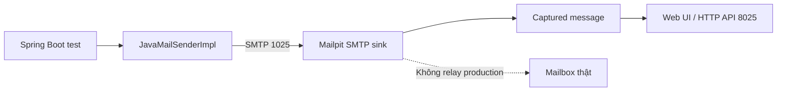

# Cấu hình sender dành riêng cho test trong Spring Framework Mail

Trong ứng dụng Spring, lớp gửi email thường sử dụng `JavaMailSender` để tạo và submit thông điệp qua SMTP. Khi chạy kiểm thử, đặc biệt là integration test, **không được vô tình dùng cùng SMTP server, mật khẩu, danh sách người nhận hoặc cấu hình gửi thật của môi trường production**. Chỉ một test case tạo tài khoản hoặc đặt đơn hàng cũng có thể phát sinh email xác nhận, OTP hoặc hóa đơn; nếu cấu hình mail trỏ nhầm tới provider thật, test có thể gửi thư đến khách hàng, tiêu tốn quota và làm sai số liệu vận hành.

Vì vậy, nên có **sender dành riêng cho test**: một triển khai `JavaMailSender` được kiểm soát trong môi trường kiểm thử, hoặc một `JavaMailSenderImpl` thật nhưng trỏ tới SMTP server giả (SMTP sink) như Mailpit/GreenMail. Mục tiêu là kiểm thử đúng hành vi, có thể lặp lại và không tạo tác động bên ngoài.

Trong chương *Kiểm thử tích hợp* của Spring Framework Mail, bài này giải thích cách chọn mức độ kiểm thử, cấu hình Spring Boot test profile, ghi đè bean bằng `@TestConfiguration`/`@Primary`, dùng Mockito khi không cần network, dùng Mailpit với Testcontainers và `@DynamicPropertySource` khi cần xác minh giao thức SMTP, kiểm tra MIME và recipient, cùng những lỗi cấu hình thường gặp.

**Nguyên tắc:** test không được gửi email tới người dùng thật. Nếu bài kiểm thử cần kiểm tra hành trình submit SMTP, hãy đưa thư tới một SMTP sink thuộc phạm vi kiểm thử, không phải đến nhà cung cấp email production.

## 1. Sender dành riêng cho test giải quyết vấn đề gì?

Hãy xét một ứng dụng có service:

```java
@Service
public class RegistrationService {

    private final RegistrationRepository repository;
    private final RegistrationMailService mailService;

    @Transactional
    public void register(RegisterCommand command) {
        Registration saved =
                repository.save(Registration.from(command));
        mailService.sendWelcome(saved.getEmail());
    }
}
```

Nếu integration test gọi `register(...)` trong một Spring context có cấu hình `spring.mail.host` và `spring.mail.password` của môi trường thật, lời gọi `sendWelcome(...)` có thể gửi thư ra bên ngoài. Ngay cả khi test database bị rollback, **SMTP là side effect nằm ngoài database transaction** và không tự động rollback email.

Một sender riêng cho test giúp:

- Ngăn gửi tới SMTP account/provider thật.
- Kiểm tra service có gọi gửi email với dữ liệu dự kiến.
- Xác minh `MimeMessage`, recipient, Subject, charset, HTML và attachment.
- Mô phỏng lỗi xác thực, timeout hoặc exception mà không phụ thuộc mạng.
- Kiểm thử retry, queue worker và event listener sau commit.
- Chạy lại trên máy lập trình viên và CI mà không cần cấp SMTP credentials production.
- Làm rõ ranh giới giữa unit test, integration test với Spring context và integration test SMTP thực.

### Phạm vi của sender test

Một sender test không có nhiệm vụ “bắt chước Gmail hoàn hảo”. Mock chỉ chứng minh code gọi đúng API; SMTP sink có thể nhận và lưu message để kiểm tra MIME/transport. Cả hai **không tự chứng minh deliverability, Inbox placement, SPF/DKIM/DMARC hoặc phản hồi của mailbox provider thực tế**.

## 2. Các chiến lược kiểm thử sender

Có bốn chiến lược phổ biến:

| Chiến lược | Cơ chế | Phù hợp với | Giới hạn |
|---|---|---|---|
| Mockito mock `JavaMailSender` | Không kết nối SMTP | Kiểm tra lời gọi và nhánh xử lý lỗi | Không kiểm chứng SMTP protocol |
| Recording/Fake sender | Lưu các message trong memory | Kiểm tra MIME ở tầng ứng dụng | Cần tự viết và duy trì fake |
| SMTP sink trong JVM | Server SMTP thử nghiệm như GreenMail | Kiểm tra submission thật, headers, MIME | Không mô phỏng đầy đủ Internet mail |
| SMTP sink container | Mailpit với Testcontainers | Kiểm thử Spring context, SMTP, capture qua API/UI | Cần môi trường có Docker/container runtime |

Đừng dùng toàn bộ integration test chỉ để kiểm tra một method đã gọi `JavaMailSender.send`. Ngược lại, nếu yêu cầu là xác nhận TLS, giao thức SMTP, port, recipient và MIME được gửi tới server thử nghiệm, mock đơn thuần sẽ bỏ qua phần lớn hành vi cần kiểm tra.

### 2.1. Chọn theo câu hỏi cần trả lời

| Câu hỏi kiểm thử | Cách tiếp cận phù hợp |
|---|---|
| Service có phát lệnh gửi khi đơn hàng hợp lệ không? | Mock sender/gateway |
| Có gửi khi transaction rollback không? | Spring integration test + mock gateway và điều khiển transaction |
| Subject/To/HTML/attachment có được dựng đúng không? | Recording sender hoặc SMTP sink |
| `JavaMailSenderImpl` có kết nối và submit được không? | SMTP sink thực |
| Retry sau SMTP timeout có đúng không? | Stub/mock lỗi hoặc SMTP test server hỗ trợ điều khiển |
| Email có vào Gmail Inbox không? | Không thể khẳng định bằng test sender; cần kiểm thử deliverability riêng |

## 3. Kiến trúc tách business logic khỏi SMTP adapter

Một thiết kế thuận lợi cho test là không để business service gọi trực tiếp API SMTP ở mọi nơi:

```text
RegistrationService / OrderService
            |
            v
   MailNotificationService
            |
            v
        MailGateway
       /          \
      /            \
Production         Test adapter
JavaMailSender      Mock / Fake / SMTP sink
```

Ví dụ một interface ở tầng ứng dụng:

```java
package com.example.mail;

public interface MailGateway {
    void send(OrderConfirmationMail mail);
}
```

Adapter production:

```java
package com.example.mail;

import jakarta.mail.MessagingException;
import jakarta.mail.internet.MimeMessage;
import org.springframework.mail.javamail.JavaMailSender;
import org.springframework.mail.javamail.MimeMessageHelper;
import org.springframework.stereotype.Component;

@Component
public class SpringMailGateway implements MailGateway {

    private final JavaMailSender sender;

    public SpringMailGateway(JavaMailSender sender) {
        this.sender = sender;
    }

    @Override
    public void send(OrderConfirmationMail mail) {
        try {
            MimeMessage message = sender.createMimeMessage();
            MimeMessageHelper helper = new MimeMessageHelper(
                    message, false, "UTF-8");
            helper.setFrom("no-reply@example.org");
            helper.setTo(mail.recipient());
            helper.setSubject(
                    "Xác nhận đơn hàng " + mail.orderNumber());
            helper.setText(mail.plainText(), false);
            sender.send(message);
        } catch (MessagingException ex) {
            throw new IllegalStateException(
                    "Unable to construct confirmation email", ex);
        }
    }
}
```

`OrderConfirmationMail` là DTO do ứng dụng định nghĩa, gồm `recipient()`, `orderNumber()` và `plainText()`. Adapter tập trung vào phần định dạng/gửi mail, còn application service quyết định *khi nào* gửi.

Khi test business rule, có thể mock `MailGateway`. Khi test adapter, dùng `JavaMailSender` fake hoặc SMTP sink. Cách tách này tránh việc mọi test nghiệp vụ phải khởi động SMTP server giả.

**Không nên thay sender production bằng một fake trong source chính chỉ vì có test.** Fake/test configuration cần nằm ở test source set hoặc module test được kiểm soát.

## 4. Spring Boot test profile: application-test.yml

Một cách dễ hiểu để tách cấu hình là tạo file `src/test/resources/application-test.yml` và dùng `@ActiveProfiles("test")`.

Ví dụ:

```yaml
# src/test/resources/application-test.yml
spring:
  mail:
    host: 127.0.0.1
    port: 1025
    protocol: smtp
    test-connection: false
    username: ""
    password: ""
    properties:
      "[mail.smtp.auth]": false
      "[mail.smtp.starttls.enable]": false
      "[mail.smtp.ssl.enable]": false
      "[mail.smtp.connectiontimeout]": 2000
      "[mail.smtp.timeout]": 2000
      "[mail.smtp.writetimeout]": 2000
      "[mail.debug]": false
      "[mail.debug.auth]": false
```

Trong ví dụ, port 1025 là cổng SMTP phổ biến của Mailpit khi chạy trong môi trường kiểm thử. Nếu dùng container và mapping port động, giá trị này sẽ được ghi đè bằng `@DynamicPropertySource` ở bước sau.

Không dùng cùng một file YAML để chứa cả mật khẩu production và cấu hình test rồi chỉ dựa vào một flag bật/tắt mơ hồ. Mọi secret thực cần được quản lý ngoài source; test không được nhận chúng qua môi trường chạy CI.

### 4.1. Kích hoạt profile

```java
@SpringBootTest
@ActiveProfiles("test")
class RegistrationMailIntegrationTest {
    // Các test sử dụng application-test.yml.
}
```

`@ActiveProfiles` thuộc Spring Test và kích hoạt profile trong context của test. Không cần người chạy nhớ truyền `-Dspring.profiles.active=test` trên command line cho từng test.

### 4.2. Chú ý thứ tự ghi đè cấu hình

Test có thể nhận cấu hình từ nhiều nguồn như:

- `application.yml` chung.
- `application-test.yml` khi test profile active.
- `@TestPropertySource`, `@SpringBootTest(properties = ...)`.
- `@DynamicPropertySource` do container cung cấp.
- Environment variables, JVM system properties, test runner và nguồn cấu hình khác.

Nếu cấu hình động của Testcontainers cung cấp `spring.mail.host` và `spring.mail.port`, các giá trị đó phải được dùng thay cho địa chỉ mặc định trong test profile. Không chỉ nhìn vào YAML rồi kết luận chắc chắn test đang dùng host nào; phải hiểu property source nào đã có hiệu lực.

### 4.3. Vì sao không dùng localhost:25?

Cổng 25 thường được dùng cho SMTP relay/server-to-server và có thể cần quyền hoặc cấu hình đặc biệt. Trong môi trường developer/CI, port 1025 là một cổng thử nghiệm tiện lợi, không cần đặc quyền; nó không phải cổng SMTP tiêu chuẩn cho production.

Không cho rằng mọi máy đều có Mailpit chạy sẵn ở `127.0.0.1:1025`. Test chỉ nên chạy khi đã khởi tạo SMTP sink hoặc cố tình dùng mock. Nếu server không chạy, `JavaMailSenderImpl` sẽ báo lỗi kết nối — đó là tín hiệu cần sửa test setup, không phải lý do để fallback sang SMTP production.

### 4.4. Lưu ý bảo vệ profile test

`application-test.yml` có thể nằm ở `src/test/resources` để không đóng gói vào application artifact production, nhưng chỉ dựa vào vị trí file chưa đủ nếu pipeline build có quy tắc copy đặc biệt. Phải kiểm soát artifact, profile activation và deployment.

Không thêm flag kiểu `allowRealMailInTests=true` rồi bật mặc định. Test phải an toàn khi chạy bởi người mới hoặc CI, ngay cả khi họ chưa biết môi trường đang có những biến cấu hình nào.

## 5. Bean JavaMailSender dành riêng cho test bằng @TestConfiguration

Khi cần kiểm soát chính xác sender, có thể định nghĩa cấu hình test riêng. `@TestConfiguration` hỗ trợ khai báo bean dùng khi chạy test, còn `@Import` đưa nó vào Spring context của test.

Ví dụ bên dưới tạo `JavaMailSenderImpl` trỏ tới SMTP sink từ các property test:

```java
package com.example.mail;

import java.nio.charset.StandardCharsets;
import java.util.Properties;
import org.springframework.beans.factory.annotation.Value;
import org.springframework.context.annotation.Bean;
import org.springframework.context.annotation.Primary;
import org.springframework.boot.test.context.TestConfiguration;
import org.springframework.mail.javamail.JavaMailSender;
import org.springframework.mail.javamail.JavaMailSenderImpl;

@TestConfiguration(proxyBeanMethods = false)
public class LocalSmtpSenderTestConfiguration {

    @Bean
    @Primary
    public JavaMailSender localTestMailSender(
            @Value("${test.smtp.host}") String host,
            @Value("${test.smtp.port}") int port) {

        JavaMailSenderImpl sender = new JavaMailSenderImpl();
        sender.setHost(host);
        sender.setPort(port);
        sender.setProtocol("smtp");
        sender.setDefaultEncoding(
                StandardCharsets.UTF_8.name());

        Properties properties = sender.getJavaMailProperties();
        properties.put("mail.smtp.auth", "false");
        properties.put("mail.smtp.starttls.enable", "false");
        properties.put("mail.smtp.ssl.enable", "false");
        properties.put("mail.smtp.connectiontimeout", "2000");
        properties.put("mail.smtp.timeout", "2000");
        properties.put("mail.smtp.writetimeout", "2000");
        properties.put("mail.debug", "false");

        return sender;
    }
}
```

Một integration test có thể import:

```java
@SpringBootTest(properties = {
        "test.smtp.host=127.0.0.1",
        "test.smtp.port=1025"
})
@ActiveProfiles("test")
@Import(LocalSmtpSenderTestConfiguration.class)
class OrderMailIntegrationTest {

    @Autowired
    private OrderMailService orderMailService;

    // SMTP sink phải chạy ở 127.0.0.1:1025.
}
```

`@Primary` làm bean test được ưu tiên khi nhiều bean cùng kiểu và dependency injection không dùng qualifier cụ thể. Nhưng nó **không bảo đảm** mọi thành phần đều sử dụng bean test nếu code dùng `new JavaMailSenderImpl()`, inject theo `@Qualifier` trỏ vào bean khác hoặc cấu hình gọi trực tiếp tới sender production.

Chỉ khai báo `LocalSmtpSenderTestConfiguration` trong test source set hoặc module test. Nếu import nó trong application chính, bạn có thể vô tình khiến môi trường thật sử dụng fake SMTP.

### 5.1. Khi nào dùng @Primary, khi nào thay bean?

- `@Primary` phù hợp khi có nhiều bean `JavaMailSender` và các service inject theo kiểu, không có qualifier.
- Nếu application có bean tên `mailSender` và nhiều consumer dùng `@Qualifier("mailSender")`, một bean test tên khác dù `@Primary` cũng không thay thế injection được chỉ định bởi qualifier.
- Nếu cần ghi đè đúng bean, ưu tiên cơ chế bean override dành cho testing theo phiên bản Spring/Boot, hoặc cấu trúc lại production configuration cho phép chọn sender test rõ ràng.
- Nếu chỉ cần mock một adapter `MailGateway`, thay adapter tại boundary có thể đơn giản hơn việc ghi đè mọi bean JavaMailSender.

Đừng bật bean definition overriding toàn cục chỉ để che lỗi tên bean trùng nhau; việc ghi đè phải minh bạch và có phạm vi test.

## 6. Mockito: sender test không kết nối SMTP

Với service test chỉ cần xác minh lời gọi, Mockito có thể tạo mock `JavaMailSender`. Do `MimeMessageHelper` cần một `MimeMessage` thực, phải cấu hình `createMimeMessage()` của mock trả về đối tượng hợp lệ.

Ví dụ một test không phụ thuộc version-specific bean annotation:

```java
package com.example.mail;

import jakarta.mail.Session;
import jakarta.mail.internet.MimeMessage;
import java.util.Properties;
import org.mockito.Mockito;
import org.springframework.boot.test.context.TestConfiguration;
import org.springframework.context.annotation.Bean;
import org.springframework.context.annotation.Primary;
import org.springframework.mail.javamail.JavaMailSender;

@TestConfiguration(proxyBeanMethods = false)
public class MockMailSenderTestConfiguration {

    @Bean
    @Primary
    JavaMailSender mockMailSender() {
        JavaMailSender sender = Mockito.mock(JavaMailSender.class);

        Mockito.when(sender.createMimeMessage())
                .thenAnswer(invocation ->
                        new MimeMessage(Session.getInstance(
                                new Properties())));

        // sender.send(...) là void và mặc định không làm gì.
        return sender;
    }
}
```

Trong test:

```java
@SpringBootTest
@ActiveProfiles("test")
@Import(MockMailSenderTestConfiguration.class)
class OrderMailServiceTest {

    @Autowired
    private OrderMailService orderMailService;

    @Autowired
    private JavaMailSender sender;

    @Test
    void sendsConfirmationWithExpectedSubject()
            throws Exception {

        orderMailService.sendConfirmation(testOrder());

        ArgumentCaptor<MimeMessage> captor =
                ArgumentCaptor.forClass(MimeMessage.class);
        verify(sender).send(captor.capture());

        MimeMessage message = captor.getValue();
        assertEquals(
                "Xác nhận đơn hàng A-1042",
                message.getSubject());
    }
}
```

Trong ví dụ, `OrderMailService`/`testOrder()` là thành phần của dự án. Import các lớp JUnit, Mockito và Jakarta Mail tương ứng. `Mockito.verify(...)` chứng minh code có gọi `send(MimeMessage)`, không chứng minh server SMTP nhận message.

**Chú ý overload:** `JavaMailSender` có nhiều phương thức `send` và `send(MimeMessage[])`. Nếu code gọi một overload khác, assertion phải phù hợp. Có thể dùng `ArgumentCaptor` và `verify` để kiểm tra đúng signature cần thiết.

### 6.1. @MockitoBean và @MockBean theo phiên bản

Trên Spring Framework 6.2+ (bao gồm các thế hệ Spring Boot tương ứng), Spring Test cung cấp `@MockitoBean` để ghi đè bean bằng Mockito mock. Một ví dụ:

```java
@SpringBootTest
@ActiveProfiles("test")
class PasswordResetServiceTest {

    @MockitoBean
    JavaMailSender mailSender;

    @BeforeEach
    void prepare() {
        when(mailSender.createMimeMessage())
                .thenAnswer(invocation -> new MimeMessage(
                        Session.getInstance(new Properties())));
    }

    // Test logic gửi mail ở đây.
}
```

Spring Boot đời cũ hơn có `@MockBean` thuộc package Spring Boot Test; API này đã được đánh dấu deprecated ở các thế hệ Boot mới để chuyển sang `@MockitoBean`. Cần chọn annotation phù hợp với version và dependency của dự án, không sao chép hai annotation vào cùng test.

Sử dụng `@MockitoBean` giúp code ngắn hơn, nhưng vẫn cần đảm bảo `createMimeMessage()` trả một `MimeMessage` thực nếu code gọi API tạo MIME.

### 6.2. Không nên mock mọi lớp rồi gọi là integration test SMTP

Nếu `JavaMailSender` là Mockito mock, test không xác nhận:

- TCP connection đến SMTP sink.
- SMTP `MAIL FROM`, `RCPT TO` và `DATA`.
- MIME được serialize thế nào khi truyền.
- SMTP response code hoặc server-side rejection.
- Timeout/TLS/auth của cấu hình `JavaMailSenderImpl`.

Mock sender phù hợp với **logic của service/bean wiring**, không đủ cho kiểm thử transport thực. Để kiểm tra những phần đó, sử dụng một SMTP sink.

## 7. Fake sender và việc ghi nhận message trong bộ nhớ

Ngoài Mockito, có thể tạo một fake sender lưu lại message để assert. Fake có lợi nếu nhiều test cần:

- Ghi danh sách thư được yêu cầu gửi.
- Xem Subject, recipient và nội dung MIME sau khi dựng.
- Mô phỏng SMTP fail theo kịch bản.
- Tránh phụ thuộc Docker cho test nhỏ.

Không nhất thiết phải tự triển khai tất cả phương thức của `JavaMailSender`. Một cách gọn là **kế thừa `JavaMailSenderImpl` và override những overload cần thiết** trong test fixture; tuy nhiên phải cân nhắc code có thể gọi overload khác và không được vô tình rơi xuống implementation thật.

Ví dụ chỉ cho đường gửi `MimeMessage` của một service:

```java
package com.example.mail.testing;

import jakarta.mail.internet.MimeMessage;
import java.util.List;
import java.util.concurrent.CopyOnWriteArrayList;
import org.springframework.mail.javamail.JavaMailSenderImpl;

public final class RecordingMailSender extends JavaMailSenderImpl {

    private final List<MimeMessage> messages =
            new CopyOnWriteArrayList<>();

    @Override
    public void send(MimeMessage message) {
        messages.add(message);
    }

    @Override
    public void send(MimeMessage... messages) {
        for (MimeMessage message : messages) {
            this.messages.add(message);
        }
    }

    public List<MimeMessage> sentMessages() {
        return List.copyOf(messages);
    }

    public void clear() {
        messages.clear();
    }
}
```

Fake trên minh họa việc ghi nhận lời gọi và **chỉ hỗ trợ các overload đã override**. `JavaMailSenderImpl` còn có overload `send(SimpleMailMessage...)` và `send(MimeMessagePreparator...)`; nếu production code có thể sử dụng chúng, phải override/handle đầy đủ hoặc dùng Mockito/adapter phù hợp để tránh gửi ra network thật. Trước khi dùng trong test suite, hãy đảm bảo không còn đường nào gọi implementation SMTP của lớp cha.

### 7.1. Thread safety và isolation

`CopyOnWriteArrayList` an toàn cho thao tác thêm/đọc từ nhiều thread, nhưng không tự bảo đảm test độc lập nếu Spring cache dùng chung context qua nhiều test. Dọn messages trước mỗi test hoặc tạo context/fake riêng khi phù hợp. Với `@Async`, phải đợi worker hoàn tất trước khi assert.

Không sử dụng danh sách fake in-memory như một hệ thống queue bền vững; nó chỉ là test fixture và biến mất khi JVM kết thúc.

## 8. Dùng Mailpit làm SMTP sink

Mailpit là một SMTP server dành cho thử nghiệm: ứng dụng gửi email qua SMTP tới nó, còn Mailpit giữ lại message để xem trong web UI/API thay vì chuyển đến mailbox thật.

Mô hình:



Tính phù hợp của Mailpit:

- Kiểm thử kết nối SMTP từ JavaMailSender.
- Xem Subject, sender, recipient và MIME source.
- Kiểm tra plain text/HTML và attachment.
- Quan sát lỗi dựng MIME, encoding hoặc message quá phức tạp.
- Chạy local/CI không cần credentials thật.

Mailpit không mô phỏng đầy đủ mailbox policies của Gmail/Outlook và không chứng minh một email sẽ vào Inbox ngoài Internet.

### 8.1. Chạy Mailpit thủ công trên máy phát triển

Ví dụ khi có Docker:

```bash
docker run --rm --name mailpit-test \
  -p 127.0.0.1:1025:1025 \
  -p 127.0.0.1:8025:8025 \
  axllent/mailpit:latest
```

Port `1025` dành cho SMTP; port `8025` dành cho HTTP UI/API. Lệnh trên bind vào loopback để giảm khả năng vô tình mở SMTP sink cho mạng khác; nếu dùng Docker trên một nền tảng khác, cú pháp mapping cần điều chỉnh.

Ở browser, giao diện thường truy cập tại `http://127.0.0.1:8025`. Với CI hoặc team project, pin một image tag/digest đã thử nghiệm thay vì dùng `latest` để tránh test thay đổi theo image mới.

### 8.2. Dùng profile test khi SMTP sink chạy local

```java
@SpringBootTest
@ActiveProfiles("test")
class MailSubmissionTest {

    @Autowired
    private JavaMailSender mailSender;

    @Test
    void submitsMessageToLocalMailpit() throws Exception {
        MimeMessage message = mailSender.createMimeMessage();
        MimeMessageHelper helper = new MimeMessageHelper(
                message, false, "UTF-8");

        helper.setFrom("no-reply@example.org");
        helper.setTo("recipient@example.invalid");
        helper.setSubject("Kiểm thử SMTP giả lập");
        helper.setText("Nội dung thử nghiệm", false);

        mailSender.send(message);
    }
}
```

Kết quả mong đợi là Mailpit capture thư, không gửi đến `recipient@example.invalid` ngoài Internet. Test này **chỉ thực sự an toàn nếu `spring.mail.host/port` đang trỏ tới Mailpit**, vì vậy việc cô lập cấu hình và môi trường là điều kiện tiên quyết.

Địa chỉ `example.invalid` được dùng cho test để tránh gửi tới người nhận thật; nhưng **địa chỉ giả không thay thế được sender isolation** nếu SMTP server production vẫn được dùng.

## 9. Tích hợp Mailpit bằng Testcontainers

Một integration test tự quản lý SMTP sink sẽ dễ chạy lại hơn test yêu cầu developer mở một Docker container bằng tay. Testcontainers có thể khởi động Mailpit, map port ngẫu nhiên và cung cấp host/port cho Spring qua `@DynamicPropertySource`.

### 9.1. Test dependencies

Với Gradle và Spring Boot dependency management:

```groovy
dependencies {
    implementation 'org.springframework.boot:spring-boot-starter-mail'

    testImplementation 'org.springframework.boot:spring-boot-starter-test'
    testImplementation 'org.testcontainers:junit-jupiter'
}
```

`spring-boot-starter-test` thường bao gồm JUnit/Mockito cần thiết. Phiên bản Testcontainers cần tương thích Spring Boot/JDK và dependency management thực tế của dự án. CI phải có Docker/container runtime được cho phép.

### 9.2. Container và dynamic properties

```java
package com.example.mail;

import org.junit.jupiter.api.Test;
import org.springframework.beans.factory.annotation.Autowired;
import org.springframework.boot.test.context.SpringBootTest;
import org.springframework.test.context.ActiveProfiles;
import org.springframework.test.context.DynamicPropertyRegistry;
import org.springframework.test.context.DynamicPropertySource;
import org.testcontainers.containers.GenericContainer;
import org.testcontainers.junit.jupiter.Container;
import org.testcontainers.junit.jupiter.Testcontainers;

@Testcontainers
@SpringBootTest
@ActiveProfiles("test")
class MailpitSmtpIntegrationTest {

    @Container
    static final GenericContainer<?> mailpit =
            new GenericContainer<>("axllent/mailpit:latest")
                    .withExposedPorts(1025, 8025);

    @DynamicPropertySource
    static void configureSmtp(DynamicPropertyRegistry registry) {
        registry.add("spring.mail.host", mailpit::getHost);
        registry.add("spring.mail.port",
                () -> mailpit.getMappedPort(1025));
    }

    @Autowired
    JavaMailSender mailSender;

    @Test
    void sendsMailToTestContainer() throws Exception {
        MimeMessage message = mailSender.createMimeMessage();
        MimeMessageHelper helper = new MimeMessageHelper(
                message, false, "UTF-8");

        helper.setFrom("no-reply@example.org");
        helper.setTo("test-user@example.invalid");
        helper.setSubject("Mailpit test");
        helper.setText("Hello from Spring Mail", false);

        mailSender.send(message);
    }
}
```

Các import của `JavaMailSender`, `MimeMessage` và `MimeMessageHelper` được minh họa ở mục trước. Khi container đã khởi động, Testcontainers cung cấp host và mapped SMTP port thực tế. Test không giả định host port luôn là 1025, nên giảm xung đột giữa các tiến trình và runner CI.

`@DynamicPropertySource` cần là static method trong ví dụ này; property supplier chỉ nên được dùng khi container đã được Testcontainers quản lý/khởi động. Với các test class có context cache và container lifecycle khác nhau, phải chú ý context reuse để không giữ host/port cũ sau khi container dừng.

**Lưu ý cấu hình:** test profile ở mục 4 đã đặt `mail.smtp.auth=false`, `mail.smtp.starttls.enable=false` và credentials trống. Nếu không dùng profile đó, Spring có thể lấy cấu hình TLS/auth từ các property source khác và không tương thích với SMTP sink, hoặc nguy hiểm hơn là dùng credentials production.

### 9.3. Vì sao test-connection cần cân nhắc?

`spring.mail.test-connection=true` có thể khiến Spring Boot kiểm tra kết nối ngay khi application context khởi động. Điều này hữu ích khi muốn xác minh cấu hình, nhưng gây lỗi khó hiểu nếu SMTP sink chưa sẵn sàng hoặc chỉ test business logic có mock sender.

Với đa số test dùng Mailpit/Testcontainers, đặt `test-connection=false` trong profile rồi chủ động gọi `mailSender.testConnection()` trong test phù hợp nếu cần.

Đừng bật test connection bằng cách trỏ tới SMTP production chỉ để “đảm bảo mạng hoạt động”; nó làm test phụ thuộc hệ thống thật, credentials và rate limits.

## 10. Xác minh message đã được Mailpit capture

Test gửi thành công mà chỉ kết thúc sau `mailSender.send(message)` chưa kiểm tra được nội dung ở phía SMTP sink. Có thể dùng API của Mailpit để lấy danh sách message hoặc xem source.

Các phiên bản Mailpit thường cung cấp API dưới đường dẫn `/api/v1/messages`. Ví dụ HTTP:

```text
GET http://127.0.0.1:8025/api/v1/messages
```

Với Testcontainers, HTTP port phải lấy từ `mailpit.getMappedPort(8025)`, **không dùng port 1025 của SMTP**.

### 10.1. Đọc captured messages bằng HTTP client

Một ví dụ Java 17+ minh họa:

```java
import com.fasterxml.jackson.databind.JsonNode;
import com.fasterxml.jackson.databind.ObjectMapper;
import java.net.URI;
import java.net.http.HttpClient;
import java.net.http.HttpRequest;
import java.net.http.HttpResponse;

private JsonNode fetchMailpitMessages() throws Exception {
    String baseUrl = "http://" + mailpit.getHost() + ":"
            + mailpit.getMappedPort(8025);

    HttpRequest request = HttpRequest.newBuilder()
            .uri(URI.create(baseUrl + "/api/v1/messages"))
            .GET()
            .build();

    HttpResponse<String> response = HttpClient.newHttpClient().send(
            request, HttpResponse.BodyHandlers.ofString());

    assertEquals(200, response.statusCode());
    return new ObjectMapper().readTree(response.body());
}
```

Trong test:

```java
JsonNode result = fetchMailpitMessages();
assertTrue(result.path("messages").isArray());

boolean subjectFound = false;
for (JsonNode item : result.path("messages")) {
    if ("Mailpit test".equals(item.path("Subject").asText())) {
        subjectFound = true;
    }
}
assertTrue(subjectFound);
```

Ở đây, `mailpit` là static Testcontainers field từ mục 9. Cách viết phụ thuộc JSON contract của phiên bản Mailpit đang chạy: nếu endpoint hoặc field khác trong version được pin, điều chỉnh client theo API thực tế của version đó. Khi gửi mail bất đồng bộ, cần chờ có điều kiện thay vì lập tức assert kết quả.

### 10.2. Không chỉ assert số lượng email

Nếu kiểm thử gửi email xác nhận, những trường có thể đáng kiểm tra là:

- `From` có thuộc sender identity của test không?
- `To` có là recipient giả dự kiến không?
- Subject đúng template và không chứa token/PII ngoài ý muốn?
- Body có đủ nội dung đơn hàng hoặc link chính thức của môi trường test?
- UTF-8 hiển thị tiếng Việt đúng?
- Mail chứa `text/plain` và `text/html` đúng cấu trúc khi cần?
- Ảnh CID và attachment có tồn tại/đặt content type đúng?
- Có người nhận `Cc/Bcc` ngoài dự kiến không?

Tùy API Mailpit, có thể cần truy xuất chi tiết từng message hoặc MIME raw source. Không parse raw SMTP text bằng một regex đơn giản nếu thư có multipart/encoding; dùng Jakarta Mail parser khi cần kiểm tra cấu trúc.

### 10.3. Phân biệt SMTP envelope và MIME headers

MIME `To/Cc/Bcc` là các header của thông điệp; SMTP `RCPT TO` là danh sách nhận ở tầng transport. Đặc biệt, nhiều mail transport loại bỏ `Bcc` header khỏi bản gửi nhưng vẫn dùng recipient thuộc Bcc trong SMTP envelope.

Nếu test cần xác minh “thư thật sự được gửi đến những recipient nào”, kiểm tra danh sách envelope recipients do SMTP sink capture, không chỉ xem raw headers của message. Điều này quan trọng với các bài toán chống gửi nhầm và kiểm tra Bcc.

## 11. GreenMail hoặc SMTP test server chạy trong JVM

Nếu CI không có Docker hoặc muốn test SMTP transport ngay trong JVM, có thể sử dụng một server SMTP thử nghiệm như GreenMail. Nó có thể khởi động một SMTP listener trên port dành cho test, ghi nhận messages và cho test kiểm tra nội dung.

Một cấu trúc sử dụng:

```text
JUnit 5 / Spring test
    |
    +--> start GreenMail SMTP server (test lifecycle)
    |
    +--> inject host + bound port vào JavaMailSenderImpl
    |
    +--> gọi application mail service
    |
    +--> đọc captured messages từ GreenMail
    |
    +--> stop server sau test
```

Nếu dùng GreenMail, chọn artifact tương thích với hệ Jakarta Mail của Spring hiện đại và quản lý vòng đời server bằng JUnit extension hoặc test fixture. Không trộn API của bản `javax.mail` cũ với `jakarta.mail` mới.

### In-process không có nghĩa mock

Một SMTP sink chạy trong JVM vẫn nhận lệnh SMTP qua network socket của chính tiến trình. `JavaMailSenderImpl` thật có thể gửi vào nó để xác minh:

- Kết nối host/port.
- Dựng message thành MIME bytes.
- Envelope sender và recipient theo transport.
- Thành công/thất bại submission ở tầng SMTP.

Mock `JavaMailSender` không làm được các phần này.

### Quản lý port động

Không gắn cố định port test nếu nhiều JVM hoặc test suite chạy song song. Nên chọn port khả dụng do test server cung cấp và đưa bound port vào Spring configuration. Nếu bắt buộc dùng port cố định, test cần có cơ chế bảo đảm không xung đột và chạy tuần tự phù hợp.

### GreenMail có thể kiểm thử những gì?

Một server thử nghiệm có thể hỗ trợ kiểm tra recipient, Subject, MIME part và phản hồi server. Nhưng không phải mọi hành vi SMTP production đều được mô phỏng: throttling, chống spam, limit theo tài khoản và các chính sách mailbox provider có thể khác đáng kể.

## 12. Kiểm tra MIME mà không cần gửi qua SMTP

Đôi khi câu hỏi chỉ là “Email dựng ra có đúng Subject, HTML, charset và attachment không?”. Khi đó có thể tạo `MimeMessage` bằng `Session` trong memory, kiểm tra thông điệp sau khi `saveChanges()` mà không cần chạy SMTP sink.

Ví dụ:

```java
import jakarta.mail.Message;
import jakarta.mail.Session;
import jakarta.mail.internet.MimeMessage;
import java.util.Properties;
import org.springframework.mail.javamail.MimeMessageHelper;

Session session = Session.getInstance(new Properties());
MimeMessage message = new MimeMessage(session);

MimeMessageHelper helper = new MimeMessageHelper(
        message,
        MimeMessageHelper.MULTIPART_MODE_MIXED_RELATED,
        "UTF-8");
helper.setFrom("no-reply@example.org");
helper.setTo("alice@example.invalid");
helper.setSubject("Xác nhận đăng ký");
helper.setText("Xin chào Alice", "<p>Xin chào Alice</p>");

message.saveChanges();

assertEquals("Xác nhận đăng ký", message.getSubject());
assertEquals(
        "alice@example.invalid",
        ((InternetAddress) message.getRecipients(
                Message.RecipientType.TO)[0]).getAddress());
assertTrue(message.isMimeType("multipart/*"));
```

`message.isMimeType("multipart/*")` chỉ xác nhận type ở cấp ngoài; nếu cần chắc chắn `multipart/alternative` và các body part tồn tại, phải duyệt cây MIME. Với `MIXED_RELATED`, multipart có thể lồng nhiều lớp nên không được giả định body text luôn nằm ngay phần tử đầu tiên ở top level.

### 12.1. Duyệt MIME tree

Một helper minh họa để thu thập text từ các part:

```java
import jakarta.mail.BodyPart;
import jakarta.mail.Multipart;
import jakarta.mail.Part;
import java.util.ArrayList;
import java.util.List;

static void collectTextParts(
        Part part,
        List<String> plain,
        List<String> html) throws Exception {

    if (part.isMimeType("text/plain")) {
        plain.add((String) part.getContent());
        return;
    }
    if (part.isMimeType("text/html")) {
        html.add((String) part.getContent());
        return;
    }
    Object content = part.getContent();
    if (content instanceof Multipart multipart) {
        for (int index = 0;
                index < multipart.getCount(); index++) {
            BodyPart child = multipart.getBodyPart(index);
            collectTextParts(child, plain, html);
        }
    }
}
```

Sử dụng:

```java
List<String> plain = new ArrayList<>();
List<String> html = new ArrayList<>();

collectTextParts(message, plain, html);

assertTrue(plain.stream().anyMatch(
        text -> text.contains("Xin chào Alice")));
assertTrue(html.stream().anyMatch(
        text -> text.contains("<p>Xin chào Alice</p>")));
```

Trong thực tế, có thể cần xử lý `message/rfc822` lồng nhau, streaming attachment và phần text được encode phức tạp. Helper trên chỉ phục vụ việc kiểm tra những MIME parts do template test dự kiến tạo, không phải một MIME parser hoàn chỉnh.

### 12.2. Kiểm tra Content-ID cho ảnh inline

Với email HTML tham chiếu:

```html

```

Spring:

```java
helper.setText(plainText, htmlText);
helper.addInline(
        "brand-logo",
        new ClassPathResource("mail/images/logo.png"),
        "image/png");
```

Trong test, kiểm tra `cid:brand-logo` xuất hiện trong HTML và MIME part inline có `Content-ID` tương ứng, nội dung không rỗng và Content-Type là `image/png`. `MimeMessageHelper` khuyến nghị gọi `setText` trước `addInline` để cấu trúc related parts được tạo đúng.

### 12.3. Không log raw MIME khi test thất bại

Trong test có dữ liệu giả, in MIME raw có thể tạm giúp chẩn đoán. Tuy nhiên, cùng utility có thể bị copy sang production hoặc chạy bằng dữ liệu thật. Hãy giới hạn diagnostic output và không in secret/token/email của người dùng. Có thể log path fixture, số phần, Content-Type và mã lỗi đã chuẩn hóa.

## 13. Kiểm thử timeout, lỗi SMTP và chính sách retry

Một sender dành riêng cho test không nhất thiết luôn trả success. Các nhánh quan trọng của mail pipeline gồm:

- Kết nối SMTP thất bại.
- Lỗi xác thực.
- Provider từ chối message.
- Timeout sau khi gửi.
- Tác vụ bị executor từ chối.
- Lỗi dựng MIME/template.
- Retry khi còn hạn và bỏ job đã hết deadline.
- Ghi nhận trạng thái `SUBMITTED`, `RETRY_WAIT` hoặc `FAILED_PERMANENT` đúng cách.

### 13.1. Dùng Mockito để mô phỏng lỗi

Nếu service gọi `JavaMailSender.send(MimeMessage)`:

```java
@Test
void schedulesRetryWhenMailSubmissionFails() {
    when(sender.createMimeMessage())
            .thenAnswer(invocation ->
                    new MimeMessage(
                            Session.getInstance(new Properties())));

    doThrow(new MailSendException("simulated SMTP failure"))
            .when(sender)
            .send(any(MimeMessage.class));

    assertThrows(MailException.class,
            () -> mailService.sendConfirmation(testOrder()));

    // Trong bài kiểm thử job worker, kiểm tra trạng thái
    // RETRY_WAIT và nextAttemptAt theo chính sách thật.
}
```

`MailSendException`, `MailException` thuộc Spring Mail. Đoạn này chỉ là khung để kiểm tra một đường exception; nếu service bọc lỗi bằng exception nghiệp vụ, assertion phải theo contract của service.

Không mock exception bằng giá trị có password, OTP hoặc raw message. Tránh `log.error(ex.getMessage())` nếu có dữ liệu provider nằm trong nested cause.

### 13.2. SMTP sink có thể kiểm tra lỗi nào?

Mailpit mặc định thường nhận và lưu thư để quan sát; nó không tự tái hiện đầy đủ mọi loại lỗi của SMTP production. Để kiểm thử response code cụ thể, latency hoặc AUTH/TLS failure, cần một test server/stub có thể cấu hình phản hồi hoặc một transport adapter mock có khả năng inject fault.

Phân chia thử nghiệm:

| Lỗi cần mô phỏng | Chiến lược |
|---|---|
| Không kết nối được | Chỉ vào địa chỉ/port không có listener trong test được cô lập, đặt timeout ngắn |
| SMTP 4xx/5xx cụ thể | Server SMTP stub có khả năng điều khiển response |
| SMTP AUTH failure | Test server có AUTH hoặc mock phân loại lỗi |
| MailSendException | Mockito tại sender boundary |
| Lỗi format MIME | Đưa dữ liệu invalid vào formatter/service |
| Executor rejection | Bounded executor test với pool và queue rất nhỏ |
| Retry hết hạn | Inject `Clock` và kiểm tra `expiresAt` |

Không dùng SMTP production để cố ý gây AUTH failure hoặc rate limit trong test. Điều đó có thể khóa account, tạo cảnh báo và ảnh hưởng dịch vụ thật.

### 13.3. Test retry không đồng nghĩa test gửi trùng

Nếu provider đã chấp nhận message nhưng ứng dụng mất ACK hoặc crash trước khi ghi trạng thái, retry có thể gửi trùng. Sender test có thể mô phỏng nhánh lỗi, nhưng không tự tạo exactly-once delivery. Với mail quan trọng, kiểm tra idempotency key/job lease/outbox và chính sách xử lý trạng thái không chắc chắn.

## 14. Kiểm thử @Async và các listener sau commit

Trong ứng dụng Spring Mail, việc gửi thường xảy ra sau một sự kiện nghiệp vụ:

```java
@TransactionalEventListener(
        phase = TransactionPhase.AFTER_COMMIT)
public void handle(OrderPlacedEvent event) {
    asyncMailService.sendConfirmation(event.orderId());
}
```

Nếu test dùng `@Transactional` ở cấp method/class, Spring Test thường rollback transaction sau mỗi test. Khi đó listener `AFTER_COMMIT` **không chạy**, khiến test tưởng logic mail bị lỗi.

### 14.1. Test AFTER_COMMIT có chủ đích

Ví dụ có Spring TestContext và mock mail gateway:

```java
@SpringBootTest
@ActiveProfiles("test")
@Transactional
class OrderAfterCommitMailTest {

    @Autowired
    OrderService orderService;

    @MockitoBean
    MailGateway mailGateway;

    @Test
    void sendsOnlyAfterSuccessfulCommit() {
        orderService.placeOrder(testCommand());

        verify(mailGateway, never()).send(any());

        TestTransaction.flagForCommit();
        TestTransaction.end();

        verify(mailGateway).send(any());
    }
}
```

Ví dụ giả định listener gọi gateway **đồng bộ**. Với `@Async`, sau commit cần đợi kết quả bằng Awaitility hoặc một đồng bộ hóa test rõ ràng. Các import phụ thuộc version Spring/JUnit/Mockito. `@MockitoBean` áp dụng cho Spring Framework 6.2+; nếu dự án dùng phiên bản cũ hơn, dùng cơ chế override tương ứng.

### 14.2. Khi có @Async, chờ theo điều kiện

Ví dụ sử dụng Awaitility (nếu dự án có dependency test):

```java
await()
        .atMost(Duration.ofSeconds(5))
        .untilAsserted(() ->
                verify(mailGateway).send(any()));
```

Không dùng `Thread.sleep(1000)` rồi đoán rằng email chắc đã gửi. Trên CI, scheduler, CPU và network có thể chậm hơn máy cá nhân; test sẽ flaky. Hãy chờ trạng thái cụ thể có timeout hữu hạn.

Nếu mock trả về success lập tức, test chỉ chứng minh async listener đã gọi gateway; nếu muốn kiểm tra transport thật, thay gateway bằng SMTP sink và chờ Mailpit capture message.

### 14.3. Không lan transaction gốc sang worker async

Transaction imperative của Spring thường gắn với thread. `@Async` chạy ở worker thread, không tự thừa kế transaction database của request. Nếu mail job cần truy vấn database, tầng worker phải tạo transaction read-only hoặc transaction mới phù hợp. Test cần xác nhận hành vi này thay vì giả định transaction test bao bọc cả worker.

### 14.4. Kiểm thử rollback

Tương tự, với test transaction được rollback:

```java
orderService.placeOrder(testCommand());
TestTransaction.flagForRollback();
TestTransaction.end();

verify(mailGateway, never()).send(any());
```

Đây là ví dụ rút gọn, dùng trong test đã có transaction active. Nếu listener là async, cần bảo đảm test không còn tác vụ từ case khác đang chạy khi thực hiện assertion. Cách tốt nhất là tách biệt context/queue, dùng job ID và trạng thái test cụ thể.

## 15. Test isolation: tránh thư từ test khác làm sai kết quả

Một SMTP sink dùng chung cho nhiều test có thể lưu lại messages cũ. Nếu test chỉ assert “có ít nhất một thư”, nó có thể pass nhờ thư của test trước.

Các kỹ thuật cô lập:

1. Dùng một container/server riêng theo test class hoặc suite với quy tắc rõ ràng.
2. Xóa messages trước mỗi test nếu API hỗ trợ và không có test chạy song song cùng server.
3. Tạo mail job ID hoặc Subject test marker duy nhất, rồi truy vấn message thuộc case đó.
4. Đợi đúng message cần kiểm tra, không chỉ đợi tổng count tăng.
5. Không dùng địa chỉ recipient thật hoặc một SMTP inbox chia sẻ bởi nhiều runner.
6. Reset mocks, fake sender và bộ đếm trạng thái giữa các case.
7. Nếu test chạy parallel, không xóa toàn bộ inbox của một SMTP sink đang được case khác sử dụng.

### 15.1. Dùng ID riêng cho mỗi test

Ví dụ:

```java
String marker = UUID.randomUUID().toString();
String expectedSubject = "Test order " + marker;

mailService.sendTestMessage(
        "receiver@example.invalid",
        expectedSubject);

// Poll Mailpit, chọn message có Subject == expectedSubject.
```

ID ở đây là test fixture, không chứa dữ liệu người dùng. Nếu cần kiểm tra business mail thật, tốt hơn dùng unique order ID thuộc test database để truy vết thay vì cho test tự đặt Subject tùy ý.

### 15.2. Dọn dữ liệu ở hai nơi

Một end-to-end test có thể có:

- Database chứa mail job/outbox.
- Message broker hoặc local executor queue.
- SMTP sink chứa captured messages.
- Test log/tracing.

Xóa database records không xóa thư đã capture trong Mailpit. Ngược lại, xóa Mailpit inbox không làm job trong outbox biến mất. Hãy dọn từng thành phần theo lifecycle và trách nhiệm, tránh để worker từ test cũ gửi thêm sau khi test mới bắt đầu.

### 15.3. Cẩn trọng với shared Spring context

Spring TestContext cache có thể tái sử dụng application context giữa các test class để tăng tốc. Nếu singleton fake lưu messages hoặc executor có tác vụ chưa hoàn tất, trạng thái có thể rò sang case khác.

`@DirtiesContext` có thể buộc tạo context mới khi thực sự cần, nhưng dùng tràn lan khiến test chậm. Ưu tiên fixture reset và isolation rõ ràng trước; dùng `@DirtiesContext` cho những case thay đổi bean/configuration hoặc state không thể reset an toàn.

### 15.4. Container reuse không tự giải quyết isolation

Testcontainers có tùy chọn tái sử dụng container trong một số môi trường. Việc này giúp tốc độ nhưng có thể giữ messages giữa lần chạy. Với test cần tính độc lập cao, ưu tiên lifecycle tự động rõ ràng; nếu dùng reuse, định nghĩa cách reset dữ liệu và tránh các test chạy đồng thời gây can thiệp.

## 16. Ngăn test vô tình gửi mail thật

Đây là yêu cầu quan trọng hơn cả việc test có pass hay không.

### 16.1. Không cấp SMTP credentials production cho test runner

CI test job không cần biết `SMTP_PASSWORD` production. Nếu pipeline đang inject toàn bộ secrets vào mọi stage, cần tách scope secret theo môi trường và loại job.

Với SMTP sink local:

```yaml
spring:
  mail:
    username: ""
    password: ""
    properties:
      "[mail.smtp.auth]": false
```

Giá trị này phù hợp với Mailpit mặc định. Nếu server test có authentication, dùng **test credentials riêng**, không dùng mật khẩu thật.

### 16.2. Fail closed nếu test host không hợp lệ

Một guardrail có thể kiểm tra sender được inject đang trỏ vào SMTP endpoint do test fixture cung cấp. Ví dụ trong integration test:

```java
@Autowired
JavaMailSender mailSender;

@Test
void senderUsesLocalSmtpSink() {
    assertInstanceOf(JavaMailSenderImpl.class, mailSender);

    JavaMailSenderImpl impl = (JavaMailSenderImpl) mailSender;
    assertEquals(mailpit.getHost(), impl.getHost());
    assertEquals(mailpit.getMappedPort(1025), impl.getPort());
    assertNull(impl.getUsername());
    assertNull(impl.getPassword());
}
```

Test này dự kiến dùng cấu hình động từ Mailpit/Testcontainers và sender auto-configured không chứa credentials. Với `application-test.yml` có giá trị `username: ""`, getter có thể trả chuỗi rỗng thay vì `null`; khi đó assertion nên kiểm tra `null || isBlank()`. Quan trọng nhất là **không chứa credentials thật**.

Một assertion trong test không ngăn được các constructor/component khởi chạy sớm gửi email trước khi test method chạy. Với hệ thống có startup jobs, nên bảo đảm môi trường không có quyền network đến SMTP production và test profile đã được áp dụng ngay từ khi context tạo.

### 16.3. Giới hạn outbound network

Một lớp bảo vệ tốt là cấu hình CI/container sao cho test chỉ truy cập SMTP sink hoặc các dependency được phép. Nếu application code bị cấu hình nhầm tới email provider thật, kết nối sẽ bị chặn thay vì gửi được.

Đối với các integration test cần truy cập dịch vụ bên ngoài có chủ đích, nên dùng mock/proxy/sandbox và allowlist network riêng. Không dựa vào việc “địa chỉ recipient là example.invalid” nếu test vẫn có SMTP credentials thật.

### 16.4. Phân biệt sandbox provider và provider thật

Một số provider có môi trường sandbox hoặc địa chỉ thử nghiệm riêng. Có thể dùng chúng cho các kiểm thử được phê duyệt, nhưng phải:

- Dùng credentials sandbox riêng.
- Giới hạn recipient/destination.
- Không mặc định gửi thật khi sandbox lỗi.
- Không truyền dữ liệu khách hàng thật vào sandbox nếu không được phép.
- Không nhầm kết quả sandbox với khả năng vào Inbox của môi trường production.

## 17. Cấu hình nhiều sender: production, transactional và test

Ứng dụng có thể có nhiều `JavaMailSender` theo mục đích:

```text
JavaMailSender
  ├── transactionalSender
  ├── marketingSender
  └── testSender (chỉ trong test context)
```

Khi có `@Qualifier` ở production service:

```java
public OrderMailService(
        @Qualifier("transactionalSender") JavaMailSender sender) {
    this.sender = sender;
}
```

Một bean test `@Primary` tên `testSender` **không nhất thiết ghi đè** qualifier `transactionalSender`. Cần bảo đảm cấu hình test thay đúng sender được consumer sử dụng.

Một số cách tiếp cận:

- Thiết kế `MailGateway` theo từng mục đích và override gateway tại boundary.
- Dùng profile/conditional configuration để production sender chỉ được tạo ngoài test, và test sender được tạo ở test.
- Dùng cơ chế bean override của Spring Test đúng bean name/qualifier.
- Tạo test configuration tương thích tên bean mà service inject, không bật override ẩn.

### Ví dụ profile rõ ràng

Trong production configuration có chủ đích:

```java
@Configuration
@Profile("!test")
class ProductionMailConfiguration {

    @Bean("transactionalSender")
    JavaMailSender transactionalSender(...) {
        // Cấu hình SMTP thật; lược bỏ.
    }
}
```

Trong test:

```java
@TestConfiguration
class TransactionalSenderTestConfig {

    @Bean("transactionalSender")
    JavaMailSender transactionalSenderForTest(...) {
        // Trả sender trỏ tới SMTP sink.
    }
}
```

Đây là mô hình lựa chọn bean theo môi trường, không phải một cấu hình hoàn chỉnh có thể copy vào mọi ứng dụng. Với Spring Boot auto-configuration, cần tránh khai báo trùng bean name hoặc tạo nhầm cả sender production và sender test.

Không nên dùng `@Profile("test")` trên class ở production source nếu điều đó có thể làm fake được deploy và kích hoạt ở môi trường thật ngoài ý muốn. Giữ test fixture trong test source set vẫn là ranh giới an toàn.

## 18. Kiểm thử container và cấu hình trên CI

Một pipeline có thể chạy:

```text
Source checkout
   |
   v
Unit tests / mocks
   |
   v
Spring integration tests
   |
   +--> Testcontainers Mailpit
   +--> Test database / broker
   +--> @DynamicPropertySource
   |
   v
Report assertions + test results
   |
   v
Stop containers / cleanup
```

### Các yêu cầu vận hành

- CI runner có Docker/container runtime tương thích.
- Image test được pin vào tag/digest đã kiểm thử.
- Test không truy cập SMTP production và không có production credentials.
- Mapped ports do container runtime cấp, không hard-code trên host.
- Test có timeout hữu hạn và chờ readiness khi khởi tạo server.
- Parallel tests không dùng chung inbox/DB state không kiểm soát.
- Test artifacts/logs không chứa OTP, password hay toàn bộ thư khách hàng.
- Container và tài nguyên được dọn theo test lifecycle.

Nếu CI không cho phép Docker, có thể dùng một SMTP server thử nghiệm chạy trong JVM hoặc chuyển những test không phụ thuộc transport sang Mockito/recording sender. Không thay bằng “tạm gửi qua SMTP production” để né yêu cầu container runtime.

### Chú ý thời gian chờ khởi động

Khi Mailpit vừa khởi động, SMTP và HTTP API có thể chưa sẵn sàng tại đúng thời điểm test thử kết nối. Testcontainers có waiting strategy hoặc cơ chế kiểm tra readiness; nên áp dụng nếu image/runner có độ trễ khởi động.

Không sửa flaky test bằng cách đặt `Thread.sleep(30000)` trong mọi lần chạy. Sử dụng readiness probe/polling đúng endpoint và timeout hợp lý.

## 19. Cấu hình timeout, TLS và SMTP AUTH trong môi trường test

Cấu hình sender test phải tương ứng với khả năng thực của SMTP sink. Nhiều Mailpit setup mặc định dùng SMTP không yêu cầu AUTH/TLS trên cổng local 1025. Ngược lại, production thường dùng port 587 với STARTTLS hoặc port 465 với implicit TLS và authentication.

### 19.1. Không dùng test sender không TLS để chứng minh TLS production

Nếu test với:

```yaml
spring:
  mail:
    properties:
      "[mail.smtp.auth]": false
      "[mail.smtp.starttls.enable]": false
```

thì test đó **không xác minh** certificate trust, hostname verification, TLS negotiation hoặc SMTP AUTH của production.

Nên tách hai mục tiêu:

1. Test tạo email/giao thức submit cơ bản: SMTP sink local không cần auth/TLS.
2. Test security configuration: SMTP test server được cấu hình TLS/AUTH với certificate và account dành riêng cho test, hoặc một sandbox provider có kiểm soát.

Không tắt TLS trong code production chỉ để làm integration test dễ chạy. Nếu test yêu cầu cấu hình security tương đồng production, phải có một test server hỗ trợ các tính năng đó.

### 19.2. Timeout hữu hạn giúp test có tín hiệu rõ

Nếu SMTP sink không mở port, test có thể kẹt lâu nếu timeout không được cấu hình rõ. Với sender dựa trên Jakarta Mail:

```yaml
spring:
  mail:
    properties:
      "[mail.smtp.connectiontimeout]": 2000
      "[mail.smtp.timeout]": 2000
      "[mail.smtp.writetimeout]": 2000
```

Các giá trị là mili giây và chỉ để minh họa test. Nên chọn theo CI và loại lỗi cần mô phỏng. Timeout quá thấp có thể gây flaky tests, đặc biệt khi container khởi động hoặc máy CI chịu tải; timeout quá cao khiến suite khó chẩn đoán khi thiếu SMTP sink.

### 19.3. Đừng để fallback sang production SMTP

Một thiết kế nguy hiểm là:

```java
try {
    sendWithLocalSmtp(message);
} catch (Exception ex) {
    sendWithProductionSmtp(message); // Không làm trong test.
}
```

Trong test, thiếu SMTP sink phải là **test failure**. Không tự fallback sang một host khác hoặc gọi API mail provider production.

Nếu một ứng dụng có failover SMTP production, cần cấu hình test để toàn bộ danh sách provider/fallback cũng trỏ đến fake/sandbox hoặc bị vô hiệu hóa trong test context.

## 20. Kiểm thử retry, outbox và job worker với sender test

Nhiều ứng dụng không gọi `JavaMailSender.send(...)` trực tiếp trong HTTP transaction. Thay vào đó:

```text
Business transaction
   |
   +--> INSERT order
   +--> INSERT mail_job / outbox
   |
   v
  COMMIT
   |
   v
Background worker
   |
   +--> Claim mail job
   +--> Render MIME
   +--> JavaMailSender.send(...)
   +--> Mark SUBMITTED / RETRY_WAIT / FAILED
```

Đối với kiến trúc này, sender dành riêng cho test có thể được đặt ở **worker boundary**, trong khi database/outbox vẫn dùng implementation thật của test database.

### 20.1. Test idempotency ở job store

Một kịch bản quan trọng:

1. Publish cùng business event hai lần.
2. Transactional outbox giữ đúng một ý định gửi trong scope idempotency.
3. Worker claim một job có trạng thái hợp lệ.
4. Sender test ghi nhận một submission attempt.
5. Job được đánh dấu `SUBMITTED`.

Đừng chỉ assert email được gửi một lần rồi coi đó là exactly-once guarantee toàn hệ thống. Nếu worker crash sau khi SMTP chấp nhận nhưng trước khi DB update, retry có thể gửi lại. Test sender có thể mô phỏng trường hợp đó để xác nhận chính sách phục hồi của ứng dụng.

### 20.2. Test deadline của email

Với email OTP hoặc link reset:

- Tạo job với `expiresAt` trong quá khứ và xác nhận worker không gọi sender.
- Tạo job còn hạn và xác nhận worker gửi.
- Làm retry backoff vượt deadline và xác nhận không tạo lần gửi mới.
- Tạo OTP mới, vô hiệu job cũ và xác nhận không gửi mã đã thu hồi.

Inject `Clock` hoặc test clock thay vì chờ đồng hồ thật. Một sender test no-network giúp xác minh đúng số lần gọi khi chuyển trạng thái.

### 20.3. Test khi ứng dụng khởi động lại

Với outbox/database queue, có thể:

1. Tạo job chưa gửi và commit vào test database.
2. Dừng worker hoặc context ở bước kiểm thử được kiểm soát.
3. Khởi động một worker/context mới có sender test tương đương.
4. Xác nhận job được claim và submit.

Nếu job chỉ tồn tại trong `@Async` executor memory, không nên kỳ vọng nó được phục hồi sau restart. Sender test không thay đổi tính chất bền vững của queue.

## 21. Những lỗi thường gặp khi cấu hình sender dành riêng cho test

| Triệu chứng | Nguyên nhân khả dĩ | Cách xử lý |
|---|---|---|
| Test vẫn gửi tới SMTP production | Profile không active, property bị ghi đè hoặc consumer dùng bean khác | Kiểm tra effective host/port và bean wiring; chặn outbound network |
| `NoSuchBeanDefinitionException` cho JavaMailSender | Thiếu starter/config hoặc auto-configuration không tạo bean | Kiểm tra dependency và test configuration |
| `NoUniqueBeanDefinitionException` | Có nhiều sender mà không có qualifier/primary | Chọn bean rõ ràng hoặc dùng `@Primary` phù hợp |
| Mock sender gây `NullPointerException` khi tạo MIME | `createMimeMessage()` của mock trả null | Stub trả `new MimeMessage(Session.getInstance(...))` |
| `@Primary` test không được chọn | Service inject bằng `@Qualifier` hoặc tự tạo sender | Override đúng bean hoặc tách gateway |
| Kết nối tới `127.0.0.1:1025` bị từ chối | Chưa chạy Mailpit hoặc port khác | Khởi động SMTP sink, dùng dynamic mapped port |
| Cấu hình container dùng port 1025 trên host | Nhầm container port với mapped port | Dùng `getMappedPort(1025)` |
| Mailpit HTTP UI mở nhưng SMTP không gửi | Nhầm 8025 với SMTP port, auth/TLS mismatch | Dùng SMTP 1025; kiểm tra test profile |
| Context fail khi startup | `spring.mail.test-connection=true` nhưng sink chưa sẵn | Tắt startup check hoặc đồng bộ lifecycle |
| Test pass dù không có email mới | Mailpit giữ thư từ case trước | Cô lập container, clear state hoặc lọc unique ID |
| Test thỉnh thoảng fail với @Async | Assert trước khi worker hoàn tất | Await condition với timeout hữu hạn |
| AFTER_COMMIT listener không chạy | Test `@Transactional` rollback mặc định | Commit chủ đích bằng `TestTransaction` hoặc test boundary riêng |
| Mockito sender báo success nhưng SMTP thật lỗi | Mock không kiểm tra network/encoding | Bổ sung test SMTP sink |
| MIME part không ở vị trí mong đợi | Cấu trúc multipart lồng nhau | Duyệt MIME tree, không giả định index |
| Plain text và HTML không xuất hiện cùng lúc | Helper không bật multipart mode phù hợp | Dùng `setText(plain, html)` với MIME multipart |
| Test gửi email hai lần | Retry/worker còn chạy, test isolation lỗi | Dọn job/queue, kiểm soát async và unique IDs |
| Testcontainers không chạy trên CI | Không có Docker hoặc quyền container | Cấp runtime phù hợp hoặc dùng in-process SMTP sink |
| Port test xung đột | Host port hard-coded, nhiều runner song song | Sử dụng mapped port động |
| Test dùng mật khẩu thật | Secrets được inject rộng hoặc kế thừa env | Cô lập CI secrets và cấu hình sender |
| CI bị chậm vì quá nhiều container | Mỗi test tạo server riêng không cần thiết | Phân nhóm test, cache context và chọn mức test hợp lý |

### 21.1. Khi thấy MailAuthenticationException trong test

Kiểm tra cấu hình `mail.smtp.auth` và credentials test. Nếu SMTP sink không bật AUTH, đừng gửi username/password thật. Nếu kiểm thử xác thực, dùng server test có AUTH riêng và kiểm tra lỗi theo mã/exception đã chuẩn hóa; không log password.

### 21.2. Khi gặp javax.mail và jakarta.mail không tương thích

Spring Framework thế hệ mới sử dụng Jakarta Mail (`jakarta.mail.*`). Một số thư viện hoặc đoạn code cũ còn dùng `javax.mail.*`. Hai hệ package này không thay thế trực tiếp cho nhau.

Hãy chọn thư viện SMTP sink/parser và version tương thích với stack Spring thực tế, không trộn `MimeMessage` của hai hệ vào cùng test. Nếu dự án dùng Spring Framework 5.x, cần dùng đúng biến thể API javax; với Spring Framework 6.x, dùng Jakarta.

### 21.3. Khi test thiếu nội dung tiếng Việt

Kiểm tra sender và helper dùng UTF-8:

```java
MimeMessageHelper helper = new MimeMessageHelper(
        message, true, "UTF-8");
helper.setSubject("Xác nhận đơn hàng");
helper.setText("Nội dung tiếng Việt", false);
```

Đồng thời xác nhận test đọc MIME content bằng API giải mã charset phù hợp, không lấy raw encoded bytes rồi so sánh trực tiếp với chuỗi Unicode.

## 22. Tình huống thực hành: test có SMTP sink và dữ liệu giả

Giả sử ứng dụng cần gửi email xác nhận đơn hàng sau commit. Một suite hợp lý có thể gồm:

### Nhóm A — Unit test của business service

Mock `MailGateway`:

- Khi order hợp lệ và commit thành công, publish đúng ý định gửi.
- Khi điều kiện nghiệp vụ không hợp lệ, không gửi.
- Khi retry được yêu cầu, giữ đúng idempotency key.

Không cần Mailpit, không cần SMTP host.

### Nhóm B — Integration test sender adapter

Dùng `JavaMailSenderImpl` thật trỏ tới Mailpit:

- Gửi MIME thành công.
- Message capture có đúng From/To/Subject.
- UTF-8/HTML/plain text được biểu diễn đúng.
- Attachment/inline resource có content type và filename đúng.

Không dùng credentials thật.

### Nhóm C — Integration test của worker/outbox

Dùng test database + Mailpit hoặc recording sender:

- Job đã commit được worker lấy.
- Job hết hạn không được gửi.
- Nếu SMTP throw, job chuyển sang retry/error state đúng.
- Nếu worker crash/lease hết hạn, job được phục hồi theo chính sách.
- Nếu cùng business event publish lặp, không tạo job trùng vô cớ.

### Nhóm D — Kiểm thử hạ tầng gửi độc lập

Nếu muốn xác nhận production TLS, SMTP AUTH, provider limit hoặc deliverability, tổ chức một hệ thống kiểm thử có môi trường/bí mật thử riêng, có kiểm soát và giám sát. Không lồng kiểm thử này vào mọi `@SpringBootTest` chạy trong CI cơ bản.

### Kết quả kỳ vọng

Một suite tốt không chỉ xanh; nó còn giúp người bảo trì trả lời: “Bài test này chứng minh business logic, cấu trúc MIME hay SMTP transport?”. Câu trả lời rõ ràng giúp giảm việc mock quá sâu hoặc dùng server thật không cần thiết.

## 23. Checklist cấu hình sender test

### Trước khi chạy

- [ ] Có phân biệt test no-network và test SMTP sink.
- [ ] `@ActiveProfiles("test")` hoặc cấu hình test context tương đương được kích hoạt.
- [ ] Không inject SMTP credentials production vào CI.
- [ ] Nếu dùng Mailpit, SMTP host/port lấy từ test fixture hoặc Testcontainers.
- [ ] Nếu dùng `@TestConfiguration`, chỉ import trong test và xác nhận bean nào được inject.
- [ ] Nếu dùng `@Primary`, kiểm tra các `@Qualifier` trong consumer.
- [ ] Nếu dùng Mockito, stub `createMimeMessage()` trả đối tượng hợp lệ.
- [ ] Không có fallback sang email provider thật.
- [ ] Startup/background jobs được cô lập trong test.
- [ ] Timeout kết nối không làm test treo vô thời hạn.

### Trong lúc test

- [ ] Dùng recipient thuộc domain giả và payload không có secret thật.
- [ ] Kiểm tra đúng người nhận, Subject, MIME parts và charset khi cần.
- [ ] Với async, đợi điều kiện cụ thể thay vì sleep cố định.
- [ ] Với AFTER_COMMIT, điều khiển transaction commit/rollback có chủ đích.
- [ ] Không chỉ đếm số message có sẵn nếu inbox có thể chứa dữ liệu cũ.
- [ ] Các exception/response test không chứa password hoặc nội dung cá nhân.
- [ ] Không in raw MIME vào log tập trung.

### Sau khi test

- [ ] SMTP sink/container được stop theo lifecycle, trừ khi có chính sách reuse cụ thể.
- [ ] Fake/mock state được reset nếu Spring context được tái sử dụng.
- [ ] Outbox/jobs và queue test không rò sang case khác.
- [ ] Test report không chứa raw body/attachment có dữ liệu nhạy cảm.
- [ ] Không có event thực được gửi tới production provider.

## 24. Câu hỏi thường gặp

**Cấu hình sender riêng cho test là gì?** Là sử dụng `JavaMailSender` mock/fake hoặc `JavaMailSenderImpl` trỏ tới SMTP server thử nghiệm, tách khỏi credentials và host production.

**Có thể chỉ dùng `@ActiveProfiles("test")` không?** Có thể nếu mọi property và bean được tách đúng, nhưng bản thân annotation không chặn trường hợp property từ nguồn khác ghi đè hoặc consumer dùng bean SMTP production. Nên có guardrail ở cấu hình/CI network.

**Khi nào cần `@TestConfiguration`?** Khi test cần khai báo sender/gateway có hành vi riêng, ghi đè injection hoặc tùy chỉnh cấu hình hơn mức property profile cung cấp.

**`@Primary` có thay được bean dùng `@Qualifier` không?** Không chắc. Qualifier chỉ định bean theo tiêu chí riêng; cần override đúng bean hoặc thay wiring ở boundary.

**Nếu mock `JavaMailSender` thì còn cần SMTP sink không?** Không cho test chỉ kiểm business logic. Nhưng nếu muốn xác minh transport, MIME được gửi hoặc SMTP response, cần server thử nghiệm.

**Vì sao mock `createMimeMessage()` thường bị lỗi?** Mockito trả `null` cho object method nếu không stub; `MimeMessageHelper` cần `MimeMessage` hợp lệ nên code có thể ném `NullPointerException`.

**Dùng `@MockitoBean` hay `@MockBean`?** Theo phiên bản Spring Framework/Boot. Spring Framework 6.2+ có `@MockitoBean`; Spring Boot đời cũ có `@MockBean`. Không dùng annotation không có trong dependency của dự án.

**Mailpit có gửi email thật không?** Mailpit hoạt động như SMTP sink để capture message trong môi trường test. Phải xác nhận setup không được cấu hình như một relay ra ngoài và application thật sự trỏ vào nó.

**Port 1025 và 8025 khác nhau thế nào?** Trong Mailpit mặc định, 1025 dành cho SMTP; 8025 dành cho HTTP UI/API. Với Testcontainers, host port được map động.

**Có cần Docker để kiểm tra Spring Mail không?** Không. Mock/recording sender và SMTP server chạy trong JVM là những lựa chọn không cần Docker; Testcontainers phù hợp khi muốn test container hóa có tính tái lập.

**Có nên dùng SMTP provider thật để kiểm thử MIME không?** Không cần. SMTP sink hoặc kiểm tra `MimeMessage` trong memory đủ cho nhiều yêu cầu. Provider thật chỉ dành cho bài test hạ tầng/sandbox được phê duyệt.

**Dùng Mailpit có bảo đảm email sẽ vào Inbox production không?** Không. Mailpit kiểm tra ứng dụng gửi và cấu trúc message, không mô phỏng đầy đủ mail reputation, SPF/DKIM/DMARC hoặc spam filtering.

**Tại sao test AFTER_COMMIT không chạy dù có event?** Spring Test thường rollback các test `@Transactional` sau khi kết thúc. Listener ở phase `AFTER_COMMIT` chỉ chạy khi commit thật; dùng `TestTransaction` hoặc cấu trúc transaction phù hợp.

**Test async nên dùng sleep bao lâu?** Không có thời gian ngủ cố định luôn đúng. Dùng polling/await condition có timeout hữu hạn và gắn với ID/event cụ thể.

**Nếu có nhiều sender trong ứng dụng thì sao?** Kiểm tra name/qualifier/primary. Mỗi sender được dùng trong test phải trỏ tới SMTP sink hoặc được thay bằng fake; không chỉ ghi đè một sender trong khi các sender khác vẫn thật.

**Có thể test timeout qua Mailpit không?** Có thể mô phỏng lỗi kết nối nếu sink không chạy, nhưng để mô phỏng response code/timing cụ thể, nên dùng server stub có điều khiển hoặc mock adapter. Không cố tình gây lỗi ở production provider.

**Một email được capture có nghĩa là test hoàn tất?** Chỉ cho thấy submission đã tới SMTP sink. Test còn có thể cần assert Subject, recipient, MIME content và trạng thái job trong database.

**Có nên dọn Mailpit inbox sau mỗi test?** Có thể nếu test chạy tuần tự và API hỗ trợ. Với parallel tests, tránh xóa chung; dùng container độc lập hoặc lọc theo unique test ID.

**Có nên bật `spring.mail.test-connection=true` cho mọi test?** Không nhất thiết. Nó có thể gây context startup failure khi sink chưa sẵn. Chỉ bật khi mục tiêu test thực sự là kết nối SMTP và lifecycle được đồng bộ.

**Tại sao không thể dùng rollback để hoàn tác email?** SMTP là side effect ngoài database transaction; rollback dữ liệu không thu hồi email đã submit. Sender test vẫn cần mô phỏng thứ tự nghiệp vụ đúng.

**Ghi `SUBMITTED` có nghĩa người nhận đã có email không?** Không. Nó thường chỉ là trạng thái SMTP server chấp nhận submission. Delivery và Inbox placement là các bước riêng.

**Nếu CI không có Docker thì nên làm gì?** Dùng Mockito/fake cho logic và một SMTP sink trong JVM như GreenMail cho transport test, hoặc cấu hình runner container có kiểm soát. Không chuyển sang dùng SMTP production.

**Nên lưu raw MIME vào artifact test khi fail không?** Chỉ dùng dữ liệu giả và đảm bảo quyền truy cập/retention. Tránh để token, credential, địa chỉ hoặc nội dung khách hàng thật vào test logs.

## 25. Tài liệu kỹ thuật liên quan

- **Spring Framework Mail:** `JavaMailSender`, `JavaMailSenderImpl`, `MimeMessageHelper`, `SimpleMailMessage` và `MailException`.
- **Spring Boot Testing:** `@SpringBootTest`, `@TestConfiguration`, `@Import`, `@ActiveProfiles` và property precedence.
- **Spring Test Bean Overriding:** `@MockitoBean` (Spring Framework 6.2+) và những cơ chế tương ứng ở bản cũ.
- **Spring Test Transaction Management:** `@Transactional` trong test, `TestTransaction`, commit/rollback.
- **Spring Framework Task Execution:** `@Async`, executor, thread boundaries và chờ async completion.
- **Testcontainers Java:** `GenericContainer`, `@Container`, `@Testcontainers` và `@DynamicPropertySource`.
- **Mailpit:** SMTP sink, web UI, HTTP API và message capture.
- **GreenMail:** SMTP test server và JUnit fixture tương thích javax/jakarta mail stack.
- **Jakarta Mail:** `MimeMessage`, `Session`, `Multipart`, `BodyPart` và SMTP semantics.
- **Mockito và JUnit 5:** argument captor, mock stubbing, test fixtures và các assertion.
- **OWASP / test security practices:** tách secret, tránh external side effects và kiểm soát dữ liệu nhạy cảm trong test.

---

**Ghi nhớ:** sender dành riêng cho test phải bảo đảm **không gửi email thật**, đồng thời cung cấp mức kiểm chứng phù hợp. Dùng **Mockito hoặc recording gateway** khi cần test logic và lời gọi; dùng **JavaMailSenderImpl trỏ tới Mailpit/GreenMail** khi cần kiểm tra MIME và SMTP submission; dùng **`@ActiveProfiles("test")`, `@TestConfiguration`, `@Primary` và `@DynamicPropertySource`** để cô lập cấu hình. Với các luồng `@Async`, transaction listener và outbox, kiểm soát completion, retry và test isolation. Không cấp credentials production cho test, không fallback sang provider thật và không nhầm kết quả SMTP sink với deliverability bên ngoài.
