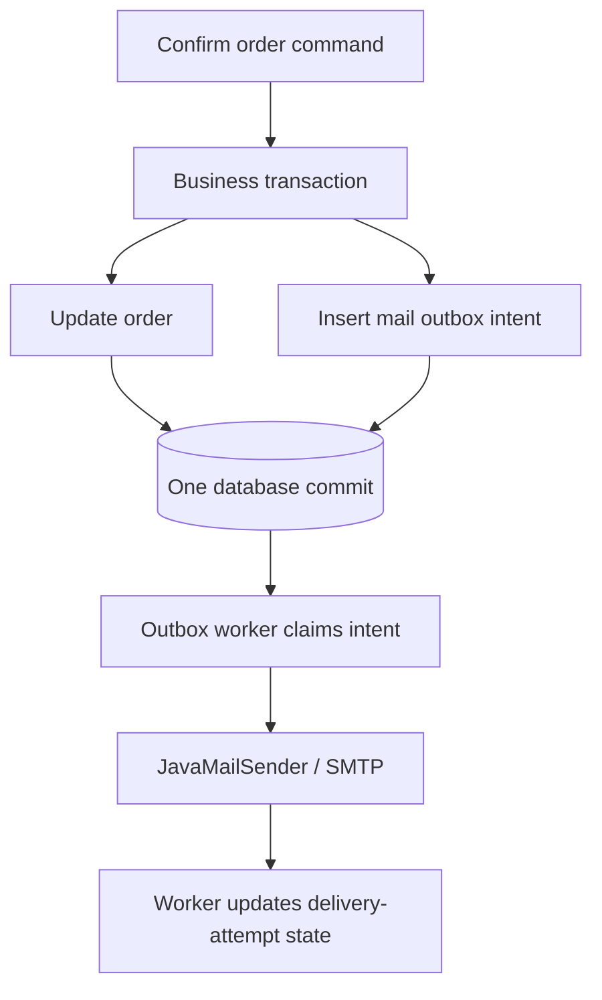

# Kiểm thử transaction với outbox

Một ứng dụng Spring Boot dùng `JavaMailSender` để gửi email xác nhận sau khi đơn hàng được thanh toán. Yêu cầu có vẻ đơn giản: cập nhật đơn hàng, tạo email, rồi gửi đi. Nhưng nếu database commit thành công mà ứng dụng chết trước khi gọi SMTP, email sẽ bị mất. Nếu gọi SMTP trước rồi database rollback, khách hàng lại có thể nhận email xác nhận cho một đơn hàng chưa được xác nhận.

**Transactional Outbox** giải quyết một phần quan trọng của bài toán: trong **cùng một database transaction**, hệ thống ghi trạng thái nghiệp vụ và một bản ghi bền vững thể hiện **ý định gửi email** (notification intent). Một worker riêng đọc outbox và thực hiện gửi sau commit. Muốn tin kiến trúc này, chúng ta cần **kiểm thử tích hợp transaction bằng database thật**, không chỉ mock repository rồi `verify(save)`.

Bài học **“Kiểm thử transaction với outbox”** thuộc chương **Kiểm thử tích hợp** của module **Spring Framework Mail**. Trọng tâm là chứng minh những ràng buộc quan trọng: cả hai bản ghi cùng commit, cả hai cùng rollback, event xử lý lặp không tạo intent trùng, worker không đọc dữ liệu chưa commit, và lỗi gửi SMTP không làm sai trạng thái business. Bài cũng làm rõ điều outbox **không thể** bảo đảm: exactly-once delivery qua SMTP.

## 1. Vì sao transaction là phần quan trọng nhất của outbox?

Giả sử một use case `confirmOrder` cần:

1. Đổi trạng thái đơn hàng từ `NEW` sang `CONFIRMED`.
2. Ghi yêu cầu gửi email xác nhận vào bảng `mail_outbox`.
3. Commit.
4. Sau đó worker đọc outbox, dựng `MimeMessage` và gọi `JavaMailSender.send(...)`.

Kết quả mong muốn:

| Kết quả transaction | Trạng thái đơn hàng | Bản ghi outbox |
|---|---|---|
| Commit thành công | `CONFIRMED` | Có notification intent tương ứng |
| Rollback vì lỗi nghiệp vụ | Giữ trạng thái trước đó | Không có notification intent mới |
| Rollback vì lỗi insert outbox | Giữ trạng thái trước đó | Không có intent được commit |
| Event trùng được xử lý lại | Không xác nhận đơn hàng lần thứ hai | Không tạo notification intent thứ hai |

Nếu hai thay đổi dùng cùng transaction manager và cùng database resource, database có thể đảm bảo atomicity: **hoặc cả hai cùng commit, hoặc không có thay đổi nào được commit**.

### 1.1. Điều gì xảy ra khi không dùng outbox?

Cách nguy hiểm:

```java
@Transactional
public void confirmOrder(UUID orderId) {
    orderRepository.markConfirmed(orderId);
    javaMailSender.send(buildMessage(orderId));
}
```

Một số cửa sổ lỗi:

- SMTP nhận message, sau đó transaction DB rollback: email đã gửi nhưng trạng thái nghiệp vụ không tồn tại.
- Database giữ lock trong lúc network call chờ lâu.
- SMTP timeout làm transaction chậm hoặc thất bại.
- SMTP nhận message nhưng ứng dụng không nhận được phản hồi: không thể kết luận đã gửi hay chưa.

Một cách cũng có lỗ hổng:

```java
@Transactional
public void confirmOrder(UUID orderId) {
    orderRepository.markConfirmed(orderId);
}

public void afterConfirmation(UUID orderId) {
    javaMailSender.send(buildMessage(orderId));
}
```

Nếu process chết giữa DB commit và `afterConfirmation`, yêu cầu gửi không được lưu ở đâu. Transactional outbox thay lời gọi gửi trực tiếp bằng việc **ghi intent trong transaction**.

### 1.2. Phân biệt hai transaction



Transaction của bước xác nhận **không bao trùm** SMTP network I/O sau này. Worker có transaction riêng để claim row, ghi trạng thái hoặc lịch retry. Không cố kéo một database transaction xuyên qua cuộc gọi SMTP: SMTP server không tham gia transaction đó.

## 2. Hợp đồng nào cần được kiểm thử bằng integration test?

Một bộ integration test tốt nên chứng minh các hợp đồng, không chỉ xác nhận các method được gọi:

| Hợp đồng | Bằng chứng cần kiểm tra |
|---|---|
| **Atomic commit** | Gọi use case thành công; query database thấy cả business state và outbox row |
| **Atomic rollback** | Gây lỗi sau khi ghi cả hai; query từ transaction khác thấy không thay đổi |
| **Rollback khi outbox insert thất bại** | Nếu không ghi được outbox, thay đổi business cũng không được commit |
| **Một intent duy nhất** | Gọi lại cùng business command/event; unique key và trạng thái bảo vệ |
| **Không thấy uncommitted intent** | Worker/connection khác không được đọc row chưa commit theo isolation phù hợp |
| **Worker chỉ gửi row đã commit** | Không có SMTP attempt trước khi intent commit |
| **Lịch retry bền vững** | Lỗi transport cập nhật cùng row, lịch retry tồn tại qua restart |
| **Concurrency an toàn** | Hai transaction/worker đồng thời không tạo duplicate intent hoặc claim cùng row |
| **Không đồng nhất submit với deliver** | `JavaMailSender.send` thành công chỉ đánh dấu submission, không tự khẳng định Inbox |

### 2.1. Ba phạm vi kiểm thử

- **Unit test:** logic chọn template/recipient, tạo idempotency key, retry policy; có thể mock port/repository.
- **Integration test database:** transaction, unique constraint, rollback, row locking, SQL isolation, migration và Spring transaction wiring.
- **Integration test SMTP/adapter:** dựng MIME, giao tiếp với SMTP catcher, xử lý response và exception.

Không nên cố kiểm chứng cả database atomicity lẫn email vào Inbox trong cùng một test. Những phép kiểm chứng đó có hệ thống phụ thuộc và ý nghĩa thành công khác nhau.

### 2.2. Điều gì là bằng chứng transaction thật?

Test kiểu sau **chưa đủ**:

```java
verify(orderRepository).save(any());
verify(mailOutboxRepository).save(any());
```

Nó xác nhận hai method được gọi, nhưng không chứng minh chúng tham gia cùng database transaction. Ngay cả nếu repository thật được gọi, nếu test chưa kiểm tra **commit/rollback từ một transaction quan sát độc lập**, ta có thể bỏ qua lỗi cấu hình transaction manager hoặc propagation.

## 3. Đặt ví dụ: xác nhận đơn hàng và ghi mail outbox

Giả sử hệ thống có hai bảng PostgreSQL:

- `purchase_order` lưu trạng thái đơn hàng.
- `mail_outbox` lưu notification intent gửi xác nhận.

Một intent tương ứng với một lần chuyển đơn hàng sang `CONFIRMED` cho mục đích `ORDER_CONFIRMATION`.

### 3.1. Schema minh họa

```sql
CREATE TABLE purchase_order (
    id UUID PRIMARY KEY,
    status VARCHAR(30) NOT NULL,
    CONSTRAINT ck_order_status
        CHECK (status IN ('NEW', 'CONFIRMED', 'CANCELLED'))
);

CREATE TABLE mail_outbox (
    id UUID PRIMARY KEY,
    aggregate_id UUID NOT NULL
        REFERENCES purchase_order(id),
    event_id UUID NOT NULL,
    idempotency_key VARCHAR(240) NOT NULL,
    recipient_address VARCHAR(320) NOT NULL,
    subject VARCHAR(300) NOT NULL,
    body_text TEXT NOT NULL,
    status VARCHAR(30) NOT NULL,
    attempts INTEGER NOT NULL DEFAULT 0,
    created_at TIMESTAMPTZ NOT NULL,
    next_attempt_at TIMESTAMPTZ,
    last_error_code VARCHAR(100),
    claim_token UUID,
    lease_until TIMESTAMPTZ,
    submitted_at TIMESTAMPTZ,
    CONSTRAINT uq_mail_outbox_idempotency
        UNIQUE (idempotency_key),
    CONSTRAINT ck_mail_outbox_status
        CHECK (status IN (
            'PENDING', 'PROCESSING', 'RETRY_WAIT',
            'SUBMITTED', 'UNKNOWN', 'FAILED_PERMANENT'
        ))
);

CREATE INDEX idx_mail_outbox_due
    ON mail_outbox (status, next_attempt_at, created_at);
```

Đây là schema giảng dạy. Production có thể thêm tenant, notification type, recipient identity, payload JSON/version, provider reference và bảng lịch sử attempts.

Điều kiện quan trọng:

1. Cả `purchase_order` và `mail_outbox` nằm trong **cùng database transaction** của ví dụ.
2. `idempotency_key` có **unique constraint thật trong database**.
3. Worker chỉ chọn row `PENDING` hoặc `RETRY_WAIT` đã đến hạn.
4. Dữ liệu outbox đủ để xử lý sau khi HTTP request/service kết thúc; không phụ thuộc một object Java còn sống trong bộ nhớ.

### 3.2. Idempotency key chọn theo business meaning

Ví dụ dùng:

```text
order-confirmation:<order-id>
```

Nếu mỗi đơn hàng chỉ có một email xác nhận được tạo khi chuyển trạng thái, key theo order ID và purpose là hợp lý. Nếu một event có nhiều recipient hoặc nhiều loại notification hợp lệ, key cần phân biệt thêm recipient/purpose/channel theo đúng quy tắc nghiệp vụ.

Đừng tạo key từ `UUID.randomUUID()` trong mỗi lần retry: như vậy database không nhận diện được duplicate intent.

### 3.3. Event ID và idempotency key không nhất thiết giống nhau

`event_id` nhận diện event nguồn; `idempotency_key` nhận diện **hiệu ứng cần thực hiện một lần trong phạm vi nghiệp vụ**. Một event có thể tạo nhiều notification hợp lệ. Ngược lại, business command bị retry có thể phát sinh lại event nếu đầu vào không được bảo vệ.

Ví dụ đơn hàng chỉ được confirm một lần nên key theo order ID giúp bảo vệ cả trường hợp command bị gửi lại với event ID mới, miễn là transition trạng thái cũng được kiểm soát.

## 4. Repository dùng JDBC: giữ các thao tác trong transaction của caller

Để thấy ranh giới transaction rõ, tạo một writer repository dùng `JdbcTemplate` nhưng **không tự mở một transaction độc lập**:

```java
package com.example.mailoutbox;

import java.sql.Timestamp;
import java.time.Instant;
import java.util.UUID;

import org.springframework.jdbc.core.JdbcTemplate;
import org.springframework.stereotype.Repository;

@Repository
public class OrderConfirmationWriter {

    private final JdbcTemplate jdbc;

    public OrderConfirmationWriter(JdbcTemplate jdbc) {
        this.jdbc = jdbc;
    }

    public boolean markConfirmedAndEnqueue(
            UUID orderId,
            UUID eventId,
            String recipient,
            Instant now) {

        int changed = jdbc.update(
                """
                UPDATE purchase_order
                SET status = 'CONFIRMED'
                WHERE id = ? AND status = 'NEW'
                """,
                orderId);

        if (changed == 0) {
            return false;
        }

        String key = "order-confirmation:" + orderId;

        jdbc.update(
                """
                INSERT INTO mail_outbox (
                    id, aggregate_id, event_id,
                    idempotency_key, recipient_address,
                    subject, body_text, status,
                    attempts, created_at
                )
                VALUES (
                    ?, ?, ?,
                    ?, ?,
                    ?, ?, 'PENDING',
                    0, ?
                )
                """,
                UUID.randomUUID(),
                orderId,
                eventId,
                key,
                recipient,
                "Xác nhận đơn hàng " + orderId,
                "Đơn hàng " + orderId
                        + " đã được xác nhận.",
                Timestamp.from(now));

        return true;
    }
}
```

Trong code trên:

- `UPDATE ... WHERE status = 'NEW'` cho phép chuyển trạng thái có điều kiện.
- Nếu chưa chuyển được vì đơn đã xác nhận hoặc không tồn tại, ví dụ trả `false` và không tạo intent mới; production có thể phân biệt not-found/duplicate.
- Nếu `INSERT` outbox thất bại và **caller đang trong transaction**, toàn bộ transaction phải rollback.
- `JdbcTemplate` dùng transaction-bound connection do Spring quản lý khi cùng `DataSource` và transaction manager được cấu hình phù hợp.
- `recipient` nên lấy từ dữ liệu nghiệp vụ đã được xác minh; ví dụ tập trung vào transaction nên chưa triển khai đầy đủ validation và privacy policy.

### 4.1. Vì sao chưa đặt @Transactional ở writer?

Writer chỉ thể hiện hai thao tác SQL. Transaction boundary thuộc application use case. Điều này còn cho phép integration test gọi writer **trong một TransactionTemplate** để cố ý ném lỗi trước commit, rồi chứng minh cả hai thao tác rollback.

Không có nghĩa đặt `@Transactional` ở repository luôn sai; điểm cần chứng minh là các thao tác phải chia sẻ **đúng một transaction**, không có propagation bất ngờ làm một phần commit riêng.

## 5. Application service có @Transactional

Service là nơi bắt đầu transaction nghiệp vụ:

```java
package com.example.mailoutbox;

import java.time.Clock;
import java.util.UUID;

import org.springframework.stereotype.Service;
import org.springframework.transaction.annotation.Transactional;

@Service
public class ConfirmOrderService {

    private final OrderConfirmationWriter writer;
    private final Clock clock;

    public ConfirmOrderService(
            OrderConfirmationWriter writer,
            Clock clock) {
        this.writer = writer;
        this.clock = clock;
    }

    @Transactional
    public boolean confirm(
            UUID orderId,
            UUID eventId,
            String recipient) {

        if (recipient == null || recipient.isBlank()) {
            throw new IllegalArgumentException(
                    "Recipient is required");
        }

        return writer.markConfirmedAndEnqueue(
                orderId,
                eventId,
                recipient,
                clock.instant());
    }
}
```

Để ứng dụng có `Clock` bean:

```java
@Configuration
public class ClockConfiguration {

    @Bean
    Clock clock() {
        return Clock.systemUTC();
    }
}
```

Imports tương ứng là `java.time.Clock`, `org.springframework.context.annotation.Bean` và `Configuration`.

Ở Spring Boot có một `DataSource` và transaction manager phù hợp, `@Transactional` thường tạo transaction khi một bean khác gọi service **qua Spring proxy**. JDBC calls bên trong writer tham gia transaction đó.

**Đừng nhầm gọi phương thức trực tiếp trên object `new ConfirmOrderService(...)` với gọi bean thông qua Spring container.** Object tự tạo không được transaction proxy quản lý, trừ khi người dùng chủ động có cơ chế quản lý khác.

### 5.1. Chú ý self-invocation

Nếu code trong cùng class gọi:

```java
public void process(UUID id) {
    this.confirm(id, eventId, recipient);
}
```

thì lời gọi nội bộ `this.confirm(...)` thường **không đi qua proxy của Spring** trong mô hình proxy-based transaction management, khiến annotation trên `confirm` không được áp dụng như kỳ vọng. Có thể giải quyết bằng cách đặt use case transaction trên bean được gọi từ bean khác hoặc dùng `TransactionTemplate` rõ ràng.

Đây là loại bug mà integration test đúng ranh giới bean/proxy có thể phát hiện.

## 6. Cấu hình PostgreSQL thật cho integration test

### 6.1. Vì sao dùng Testcontainers?

Với transactional outbox, các hành vi quan trọng phụ thuộc database thật:

- Ràng buộc `UNIQUE` và xử lý conflict.
- Transaction isolation và row locking.
- Cú pháp `INSERT ... ON CONFLICT`.
- `FOR UPDATE SKIP LOCKED` khi worker claim.
- Exception/rollback semantics của JDBC/JPA.
- Mức độ cạnh tranh giữa nhiều connection.

H2 có thể hữu ích cho test nhanh của repository đơn giản, nhưng không nên mặc định H2 tái tạo chính xác PostgreSQL transaction và concurrency semantics. Khi production dùng PostgreSQL, hãy dùng **PostgreSQL Testcontainers** cho những integration test có mục đích chứng minh transaction/locking.

### 6.2. Các dependency thường dùng

Ví dụ Gradle cho Spring Boot và PostgreSQL:

```groovy
dependencies {
    implementation 'org.springframework.boot:spring-boot-starter-jdbc'
    implementation 'org.springframework.boot:spring-boot-starter-mail'

    runtimeOnly 'org.postgresql:postgresql'

    testImplementation 'org.springframework.boot:spring-boot-starter-test'
    testImplementation 'org.testcontainers:junit-jupiter'
    testImplementation 'org.testcontainers:postgresql'
}
```

Nếu dự án dùng Spring Boot hỗ trợ Testcontainers Service Connections, có thể thêm `spring-boot-testcontainers` và `@ServiceConnection`; các ví dụ dưới đây dùng `@DynamicPropertySource` để thấy cách JDBC URL được cấp cho Spring.

Các dependency/version cần được quản lý nhất quán qua Spring Boot BOM/build config của dự án. Đây là tài liệu hướng dẫn, không yêu cầu chạy Gradle trong bước viết bài.

### 6.3. Mở PostgreSQLContainer

```java
import org.junit.jupiter.api.Test;
import org.springframework.beans.factory.annotation.Autowired;
import org.springframework.boot.test.context.SpringBootTest;
import org.springframework.test.context.DynamicPropertyRegistry;
import org.springframework.test.context.DynamicPropertySource;
import org.testcontainers.containers.PostgreSQLContainer;
import org.testcontainers.junit.jupiter.Container;
import org.testcontainers.junit.jupiter.Testcontainers;

@Testcontainers
@SpringBootTest
class OutboxTransactionIT {

    @Container
    static final PostgreSQLContainer<?> postgres =
            new PostgreSQLContainer<>("postgres:16-alpine");

    @DynamicPropertySource
    static void datasourceProperties(
            DynamicPropertyRegistry registry) {

        registry.add(
                "spring.datasource.url",
                postgres::getJdbcUrl);

        registry.add(
                "spring.datasource.username",
                postgres::getUsername);

        registry.add(
                "spring.datasource.password",
                postgres::getPassword);
    }

    @Autowired
    ConfirmOrderService service;

    @Autowired
    OrderConfirmationWriter writer;

    @Autowired
    JdbcTemplate jdbc;

    @Autowired
    PlatformTransactionManager transactionManager;
}
```

Các import khác cho test cần `java.util.UUID`, `org.springframework.jdbc.core.JdbcTemplate`, `org.springframework.transaction.PlatformTransactionManager`, `TransactionTemplate` và AssertJ.

Ví dụ giả định **migrations đã tạo đúng schema `purchase_order`/`mail_outbox`** trước khi chạy test (chẳng hạn Flyway test profile). Nếu dự án không dùng migration trong test, có thể chạy schema SQL minh họa ở phần 3 bằng `@Sql`/init script có kiểm soát.

### 6.4. Không bật @Transactional trên class test này

Đây là lưu ý rất quan trọng:

```java
@SpringBootTest
@Transactional // Không dùng mặc định cho bộ kiểm chứng commit/rollback này.
class OutboxTransactionIT {
    // ...
}
```

Trong nhiều Spring integration tests, `@Transactional` đặt trên test method/class làm Spring Test mở transaction cho test và **tự rollback khi test kết thúc**. Khi đó:

- `@Transactional` ở service có thể tham gia transaction do test mở, thay vì tự commit.
- Assertion đọc bằng cùng connection có thể thấy row **chưa commit**.
- `@TransactionalEventListener(phase = AFTER_COMMIT)` có thể chưa chạy trong test vì chưa có commit.
- Test “xanh” nhưng không chứng minh production transaction commit đúng lúc.

Muốn kiểm tra atomic commit/rollback, **đừng để transaction của test che đi transaction của service**. Hãy để service thực sự commit hoặc dùng `TransactionTemplate` chủ động bắt đầu/kết thúc transaction.

## 7. Tạo dữ liệu test độc lập

Mỗi test nên có `orderId` riêng để tránh nhiễu trạng thái. Ví dụ helper:

```java
private UUID insertNewOrder() {
    UUID id = UUID.randomUUID();

    jdbc.update(
            """
            INSERT INTO purchase_order (id, status)
            VALUES (?, 'NEW')
            """,
            id);

    return id;
}

private String orderStatus(UUID orderId) {
    return jdbc.queryForObject(
            "SELECT status FROM purchase_order WHERE id = ?",
            String.class,
            orderId);
}

private int outboxCount(UUID orderId) {
    Integer count = jdbc.queryForObject(
            """
            SELECT COUNT(*)
            FROM mail_outbox
            WHERE aggregate_id = ?
            """,
            Integer.class,
            orderId);

    return count == null ? 0 : count;
}
```

Trong các ví dụ test:

- Lệnh `insertNewOrder()` được thực hiện ngoài transaction test, nên có thể commit qua JDBC autocommit theo cấu hình thông thường.
- Mỗi test dùng UUID mới, vì vậy không cần `DELETE FROM mail_outbox` trên toàn database trước từng test.
- Dữ liệu còn tồn tại trong container của test class; khi cần isolation mạnh hơn, dùng transaction/setup/cleanup riêng có kiểm soát hoặc lifecycle container thích hợp.

**Đừng xóa toàn bộ bảng test cùng lúc khi chạy tests song song**, vì có thể xóa dữ liệu của test khác đang hoạt động.

## 8. Test 1: commit phải lưu cả đơn hàng và outbox

Một integration test chính:

```java
@Test
void commitPersistsBusinessStateAndOutboxTogether() {
    UUID orderId = insertNewOrder();
    UUID eventId = UUID.randomUUID();

    boolean changed = service.confirm(
            orderId,
            eventId,
            "customer@example.net");

    assertThat(changed).isTrue();
    assertThat(orderStatus(orderId))
            .isEqualTo("CONFIRMED");

    assertThat(outboxCount(orderId))
            .isEqualTo(1);

    Map<String, Object> row = jdbc.queryForMap(
            """
            SELECT idempotency_key,
                   recipient_address,
                   status,
                   attempts
            FROM mail_outbox
            WHERE aggregate_id = ?
            """,
            orderId);

    assertThat(row.get("idempotency_key"))
            .isEqualTo("order-confirmation:" + orderId);
    assertThat(row.get("recipient_address"))
            .isEqualTo("customer@example.net");
    assertThat(row.get("status"))
            .isEqualTo("PENDING");
    assertThat(((Number) row.get("attempts")).intValue())
            .isZero();
}
```

Cần import `java.util.Map` và AssertJ assertions.

### 8.1. Vì sao đây là kiểm chứng commit?

Test **không** có `@Transactional`. Lời gọi `service.confirm(...)` đi qua Spring bean proxy; transaction kết thúc khi service return. Các câu `jdbc.queryForObject(...)`/`queryForMap(...)` sau đó quan sát trạng thái đã commit qua cơ chế kết nối của Spring/JDBC.

Nếu service cập nhật order nhưng quên insert outbox, test fail. Nếu insert outbox nhưng quên đổi order status, test fail. Nếu transaction bị rollback, cả hai assertion có thể phát hiện.

### 8.2. Kiểm tra số row và nội dung

Chỉ đếm một row là chưa đủ nếu row gắn sai aggregate, recipient hoặc purpose. Tùy contract nghiệp vụ, nên kiểm tra thêm:

- `event_id` đã lưu đúng.
- `idempotency_key` và notification type.
- Recipient snapshot/địa chỉ.
- Body/template data hoặc schema version.
- Trạng thái khởi đầu `PENDING`.
- `attempts=0` và `next_attempt_at` theo yêu cầu.

Test nên kiểm tra những trường mà worker cần để gửi lại sau process restart, không khóa chặt timestamp/UUID ngẫu nhiên nếu không thuộc contract.

## 9. Test 2: lỗi sau khi ghi outbox phải rollback cả hai

Đây là test quan trọng nhất để chứng minh atomicity. Chúng ta chủ động bắt đầu một transaction, thực hiện đúng writer, rồi ném exception **sau khi cả hai thao tác SQL đã chạy** nhưng **trước commit**.

```java
@Test
void rollbackRemovesBothOrderChangeAndOutboxIntent() {
    UUID orderId = insertNewOrder();
    UUID eventId = UUID.randomUUID();

    TransactionTemplate tx =
            new TransactionTemplate(transactionManager);

    assertThatThrownBy(() ->
            tx.executeWithoutResult(status -> {
                writer.markConfirmedAndEnqueue(
                        orderId,
                        eventId,
                        "customer@example.net",
                        Instant.parse("2026-11-12T08:00:00Z"));

                // Giả lập lỗi xảy ra sau khi ghi cả hai.
                throw new IllegalStateException(
                        "SIMULATED_FAILURE_AFTER_OUTBOX");
            }))
            .isInstanceOf(IllegalStateException.class)
            .hasMessage("SIMULATED_FAILURE_AFTER_OUTBOX");

    assertThat(orderStatus(orderId))
            .isEqualTo("NEW");

    assertThat(outboxCount(orderId))
            .isZero();
}
```

### 9.1. Điều test này chứng minh

`TransactionTemplate` mở transaction và dùng transaction manager thực. `OrderConfirmationWriter` dùng cùng `DataSource`/connection được Spring liên kết với transaction. Exception unchecked làm template rollback. Sau khi transaction kết thúc, test đọc lại database và thấy:

- Đơn hàng vẫn `NEW`.
- Không có outbox row.

Như vậy, việc ghi intent không bị “lộ” thành một commit riêng khi business transaction rollback.

### 9.2. Điều test này không chứng minh một mình

Vì test chủ động mở transaction bằng `TransactionTemplate`, nó chứng minh writer có thể **tham gia một transaction** và hai thay đổi rollback cùng nhau. Nó **không đủ một mình** để chứng minh annotation `@Transactional` trên service được Spring proxy kích hoạt.

Kết hợp với test commit ở phần 8, hoặc một test gọi service trực tiếp qua proxy và kiểm tra kết quả sau return. Nếu service có propagation sai như `REQUIRES_NEW`, test rollback với outer transaction thường phát hiện vì inner transaction commit độc lập.

### 9.3. Không bắt exception ở trong transaction rồi tiếp tục commit

Sai:

```java
tx.executeWithoutResult(status -> {
    try {
        writer.markConfirmedAndEnqueue(
                orderId, eventId, recipient, clock.instant());
        throw new IllegalStateException("failure");
    } catch (Exception ex) {
        // Nuốt lỗi, không setRollbackOnly!
    }
});
```

Nếu exception bị nuốt và transaction không bị đánh dấu rollback-only, Spring có thể cố commit. Khi cần xử lý exception trong closure mà vẫn muốn rollback, phải gọi `status.setRollbackOnly()` hoặc để lỗi phù hợp thoát ra khỏi transaction boundary.

## 10. Test 3: lỗi insert outbox làm rollback business change

Một tình huống nguy hiểm: đổi trạng thái đơn hàng thành công nhưng SQL insert outbox thất bại vì constraint, database unavailable hoặc dữ liệu không hợp lệ. Khi đó **đơn hàng không được commit ở trạng thái confirmed** nếu mail intent là điều kiện bắt buộc của use case.

### 10.1. Mô phỏng lỗi thật ở database

Một cách là cấp một `recipient_address` dài hơn giới hạn `VARCHAR(320)`, khiến PostgreSQL từ chối insert. Trong ví dụ service hiện chỉ kiểm tra `isBlank()` chứ chưa kiểm độ dài. Test này minh họa failure ở **database boundary**, không phải khuyến nghị bỏ validation production.

```java
@Test
void databaseInsertFailureRollsBackOrderUpdate() {
    UUID orderId = insertNewOrder();
    String tooLongRecipient = "x".repeat(400);

    assertThatThrownBy(() ->
            service.confirm(
                    orderId,
                    UUID.randomUUID(),
                    tooLongRecipient))
            .isInstanceOf(DataAccessException.class);

    assertThat(orderStatus(orderId))
            .isEqualTo("NEW");

    assertThat(outboxCount(orderId))
            .isZero();
}
```

Cần import `org.springframework.dao.DataAccessException`. Trong JDBC/PostgreSQL, một giá trị vượt `VARCHAR(320)` thường dẫn tới exception được Spring dịch sang họ `DataAccessException`. Không cần khóa test vào message/SQLState cụ thể nếu contract chỉ quan tâm rollback.

### 10.2. Vì sao không chỉ dùng doThrow trên repository?

Nếu mock repository ném `RuntimeException`, bạn có thể chứng minh service quyết định ném lỗi, nhưng **không** chứng minh database đã rollback SQL trước đó. Với test tích hợp transaction, hãy để lỗi thật xảy ra tại JDBC/database và đọc lại trạng thái đã commit.

### 10.3. Nếu nghiệp vụ cho phép confirm dù không gửi mail?

Khi đó thiết kế/hợp đồng sẽ khác. Ví dụ ứng dụng coi email chỉ là best-effort và không cần transactional outbox; việc không có intent có thể là lựa chọn có chủ đích.

Nhưng nếu kiến trúc đã chọn transactional outbox để bảo đảm “đơn hàng confirmed ⇒ tồn tại notification intent”, thì test cần cố định invariant này. Không đánh dấu `COMPLETED` cho một transaction đã commit business state nhưng mất outbox intent.

## 11. Test 4: xử lý command/event lặp không tạo thêm intent

Trong hệ thống phân tán, client HTTP có thể retry, broker có thể redeliver event hoặc job có thể chạy lại sau crash. Để ngăn tạo notification request trùng, cần idempotency ở đúng phạm vi.

### 11.1. Test chuyển trạng thái có điều kiện

```java
@Test
void repeatedConfirmCreatesOneIntent() {
    UUID orderId = insertNewOrder();

    boolean first = service.confirm(
            orderId,
            UUID.randomUUID(),
            "customer@example.net");

    boolean second = service.confirm(
            orderId,
            UUID.randomUUID(),
            "customer@example.net");

    assertThat(first).isTrue();
    assertThat(second).isFalse();

    assertThat(orderStatus(orderId))
            .isEqualTo("CONFIRMED");

    assertThat(outboxCount(orderId))
            .isEqualTo(1);
}
```

Lần thứ hai `UPDATE ... WHERE status = 'NEW'` không còn row phù hợp, vì vậy writer không tạo outbox nữa. Đây là **idempotency ở cấp transition nghiệp vụ**.

### 11.2. Test unique constraint thực

Ngay cả khi application check trước, hai transaction đồng thời vẫn có thể cùng nghĩ một idempotency key chưa tồn tại. Đặt `UNIQUE(idempotency_key)` ở database.

Nếu repository có phương thức insert-if-absent (độc lập với update order), PostgreSQL có thể dùng:

```sql
INSERT INTO mail_outbox (
    id, aggregate_id, event_id,
    idempotency_key, recipient_address,
    subject, body_text, status,
    attempts, created_at
)
VALUES (
    :id, :orderId, :eventId,
    :key, :recipient,
    :subject, :bodyText,
    'PENDING', 0, CURRENT_TIMESTAMP
)
ON CONFLICT (idempotency_key) DO NOTHING;
```

Khi hai transaction insert cùng key:

- Một transaction có thể tạo row mới.
- Transaction còn lại không tạo row thứ hai.
- Cơ chế unique index quyết định dưới concurrency.

Nếu dùng JPA thuần với `save()` và bắt unique violation **bên trong cùng transaction**, cần cẩn trọng: transaction có thể đã bị đánh dấu rollback-only hoặc persistence context không còn an toàn để tiếp tục. Đối với insert-if-absent có kết quả rõ ràng, native SQL/PostgreSQL `ON CONFLICT` hoặc một abstraction tương đương thường phù hợp.

### 11.3. Một event có thể tạo nhiều email hợp lệ

Nếu event `InvoiceIssued` cần gửi cho khách hàng và bộ phận kế toán, unique key chỉ gồm event ID có thể làm mất một email hợp lệ.

Key phải phù hợp contract, ví dụ:

```text
<event-id>:CUSTOMER_INVOICE:EMAIL:<customer-id>
<event-id>:FINANCE_COPY:EMAIL:<finance-team-id>
```

Test phải xác nhận duplicate cùng purpose/recipient bị chặn, **nhưng hai purpose khác nhau vẫn tạo hai intent hợp lệ**.

## 12. Test 5: concurrency giữa hai transaction xác nhận

Test một luồng có thể xanh dù có race condition khi hai request đồng thời xác nhận cùng đơn hàng.

### 12.1. Mục tiêu

Cho hai request cùng gọi `service.confirm(orderId, ...)` gần như đồng thời. Sau khi cả hai kết thúc:

- Đơn hàng ở `CONFIRMED`.
- Có đúng một outbox row cho mục đích xác nhận.
- Không có hai email intent trùng.
- Không có exception bất ngờ làm mất transaction được phép thành công.

### 12.2. Ví dụ với hai threads

```java
@Test
void concurrentConfirmationsProduceOneOutboxIntent()
        throws Exception {

    UUID orderId = insertNewOrder();

    ExecutorService executor =
            Executors.newFixedThreadPool(2);

    CountDownLatch ready = new CountDownLatch(2);
    CountDownLatch start = new CountDownLatch(1);

    try {
        Callable<Boolean> command = () -> {
            ready.countDown();
            if (!start.await(5, TimeUnit.SECONDS)) {
                throw new IllegalStateException(
                        "Start latch timed out");
            }

            return service.confirm(
                    orderId,
                    UUID.randomUUID(),
                    "customer@example.net");
        };

        Future<Boolean> first =
                executor.submit(command);
        Future<Boolean> second =
                executor.submit(command);

        assertThat(ready.await(5, TimeUnit.SECONDS))
                .isTrue();
        start.countDown();

        boolean a = first.get(10, TimeUnit.SECONDS);
        boolean b = second.get(10, TimeUnit.SECONDS);

        assertThat(a != b).isTrue();
        assertThat(orderStatus(orderId))
                .isEqualTo("CONFIRMED");
        assertThat(outboxCount(orderId))
                .isEqualTo(1);
    } finally {
        start.countDown();
        executor.shutdownNow();
    }
}
```

Imports cần `java.util.concurrent.*` và `UUID`. Các timeout là giới hạn test minh họa, có thể điều chỉnh theo CI. Hai command gọi **cùng Spring service bean** ở hai thread khác nhau, mỗi lời gọi đi qua proxy và dùng transaction/connection riêng.

### 12.3. Test đồng thời có thể khó ổn định

`CountDownLatch` cho phép hai thread bắt đầu gần nhau nhưng **không bảo đảm** chúng đồng thời đi vào cùng SQL instruction. Với PostgreSQL, `UPDATE ... WHERE status = 'NEW'` trên cùng row sẽ dùng row-level concurrency control; transaction thứ hai có thể đợi transaction thứ nhất commit rồi cập nhật 0 row.

Muốn kiểm tra interleaving cụ thể như “hai transaction cùng thấy key chưa tồn tại”, cần test có barrier **đặt ở đúng bước repository**, hoặc chạy insert concurrently trực tiếp qua hai transaction JDBC. Không kết luận “đã chứng minh mọi race” chỉ từ một lần chạy test latch.

### 12.4. Concurrency test không nên bị bao bởi test transaction

Mỗi thread phải tự đi qua transaction boundary. Nếu test method `@Transactional`, transaction được bind theo thread và **không tự lan sang worker threads**; test có thể nhìn thấy dữ liệu/commit rất khác với điều người viết nghĩ.

Đó là thêm một lý do giữ integration test concurrency **không có `@Transactional` ở test method**.

## 13. Test 6: worker không được thấy outbox row chưa commit

Transactional outbox chỉ có ý nghĩa nếu worker xử lý **intent đã commit**, không xử lý dữ liệu tạm thời thuộc transaction có thể rollback.

Ở isolation thông thường như PostgreSQL `READ COMMITTED`, transaction khác không thấy row chưa được commit.

### 13.1. Ý tưởng test với hai connection

```text
Transaction A                     Transaction B (worker)
-------------                     ----------------------
BEGIN
UPDATE order -> CONFIRMED
INSERT mail_outbox N-1
                                  SELECT ready outbox rows
                                  --> N-1 chưa nhìn thấy
ROLLBACK
                                  SELECT ready outbox rows
                                  --> N-1 vẫn không tồn tại
```

Với commit:

```text
Transaction A                     Transaction B
-------------                     -------------
BEGIN
UPDATE + INSERT N-1
                                  SELECT N-1 --> không thấy
COMMIT
                                  SELECT N-1 --> thấy
```

Test có thể dùng hai Spring-managed transaction/connection, các latch để tạm dừng A trước commit và một transaction khác B để query. Không dùng cùng JDBC connection cho cả A và B nếu muốn chứng minh isolation.

### 13.2. Không dùng READ UNCOMMITTED để “đọc sớm hơn”

Không nên thiết kế worker đọc uncommitted outbox chỉ để giảm latency. Nếu nó đọc intent từ transaction cuối cùng rollback, worker có thể gửi email cho một sự kiện nghiệp vụ chưa tồn tại.

Trong PostgreSQL, `READ UNCOMMITTED` thực tế hoạt động như `READ COMMITTED`; ở database khác chi tiết có thể khác. Kiểm thử phải dựa trên isolation semantics của database production.

### 13.3. Dùng idempotency và trạng thái row sau commit

Ngay cả khi worker chỉ đọc row đã commit, còn cần:

- `status='PENDING'` hoặc `RETRY_WAIT` đã đến hạn.
- Transaction claim ngắn, an toàn dưới concurrency.
- Tránh hai worker cùng gửi một row.
- Ghi trạng thái theo claim token/lease.
- Không retry sai khi submission outcome uncertain.

Không coi visibility sau commit là toàn bộ hợp đồng worker.

## 14. Test 7: cùng transaction manager và cùng resource

`@Transactional` không tự biến hai database khác nhau thành một transaction atomic.

Ví dụ:

```text
Business state -> PostgreSQL A
Mail outbox    -> PostgreSQL B
```

Nếu mỗi database có transaction manager độc lập, một annotation `@Transactional` dùng manager A có thể không bao phủ operation trên B. Tình huống thất bại:

1. A commit business state.
2. Insert vào B thất bại.
3. Hệ thống không có notification intent.

### 14.1. Kiểm tra trong test/wiring

Với kiến trúc dùng một database, cần xác nhận:

- `OrderConfirmationWriter` dùng `JdbcTemplate` kết nối tới đúng `DataSource`.
- `@Transactional` chọn đúng `PlatformTransactionManager`.
- Transaction propagation không tạo commit riêng.
- Schema/migration đúng database môi trường production.
- Không tự mở `DriverManager.getConnection(...)` hay connection không tham gia Spring transaction.

Test rollback ở phần 9 là một cách bắt lỗi quan trọng: nếu writer mở connection khác autocommit, outbox row có thể vẫn tồn tại dù business transaction rollback.

### 14.2. Nếu thật sự cần nhiều resource

Khi business state và mail queue/outbox ở hai hệ thống độc lập, atomicity không còn được bảo đảm chỉ bằng local `@Transactional`. Có thể cần thay đổi kiến trúc để outbox nằm cùng database với aggregate, hoặc dùng pattern khác có thiết kế nhất quán riêng.

Không đưa ra khẳng định “transactional outbox atomic” nếu outbox nằm ở một queue/broker độc lập và không tham gia cùng transaction.

## 15. Test 8: Transaction propagation làm rò commit

### 15.1. Rủi ro REQUIRES_NEW

Giả sử writer outbox dùng:

```java
@Transactional(
    propagation = Propagation.REQUIRES_NEW)
public void saveOutboxIntent(...) {
    // insert outbox
}
```

Nếu business transaction ngoài sau đó rollback, inner transaction có thể **đã commit outbox**. Kết quả:

```text
Outer business TX:
    UPDATE order
       |
       +-- Inner REQUIRES_NEW:
       |       INSERT outbox
       |       COMMIT
       |
       +-- Throw exception
       v
    ROLLBACK order

Final state: order NEW, nhưng outbox đã có intent.
```

Đây là vi phạm atomicity nếu mục tiêu là “business và outbox cùng commit hoặc cùng rollback”.

### 15.2. Integration test phải bắt được

Khi có lỗi sau lời gọi writer, test nên query sau rollback và phát hiện outbox row **không được phép tồn tại**. Nếu row vẫn tồn tại, có thể do `REQUIRES_NEW`, transaction manager khác, connection autocommit hoặc thao tác viết ngoài ranh giới transaction.

### 15.3. REQUIRED vs MANDATORY

`Propagation.REQUIRED` tham gia transaction hiện tại hoặc mở một transaction mới nếu chưa có. Trong một số thiết kế, repository outbox có thể dùng `MANDATORY` để yêu cầu caller đã mở transaction, từ đó ngăn một lời gọi trực tiếp chạy ngoài transaction:

```java
@Transactional(propagation = Propagation.MANDATORY)
public void insertOutbox(...) {
    // ...
}
```

`MANDATORY` không tự bảo đảm hai resource dùng chung transaction manager nếu wiring sai. Nó là một biện pháp thể hiện hợp đồng transaction boundary, không phải thay thế integration test.

### 15.4. Checked exception và rollback rules

Trong mô hình transaction Spring truyền thống, rollback mặc định thường áp dụng cho `RuntimeException` và `Error`; checked exceptions có thể không dẫn tới rollback nếu không cấu hình phù hợp.

Nếu use case ném checked exception sau khi ghi intent và business state, cần quyết định:

```java
@Transactional(rollbackFor = Exception.class)
public void confirm(...) throws SomeCheckedException {
    // ...
}
```

Không thêm `rollbackFor = Exception.class` một cách vô thức cho mọi service; cần phù hợp chính sách nghiệp vụ. Nhưng integration test phải xác minh **đúng các loại exception thực tế** có thể khiến transaction cần rollback.

## 16. @TransactionalEventListener AFTER_COMMIT không giống transactional outbox

Một cách thường thấy:

```java
@TransactionalEventListener(
        phase = TransactionPhase.AFTER_COMMIT)
public void onOrderConfirmed(OrderConfirmed event) {
    javaMailSender.send(...);
}
```

Cách này hữu ích cho những phản ứng sau commit, nhưng **không thay thế outbox bền vững**:

- Nếu process chết sau commit nhưng trước khi listener chạy, notification có thể bị mất.
- Nếu listener gửi SMTP rồi exception xảy ra, database business transaction đã commit; không thể rollback SMTP.
- Nếu listener tự insert outbox sau commit bằng transaction riêng, vẫn có khoảng trống crash giữa business commit và outbox insert.

### 16.1. Test AFTER_COMMIT phải thật sự commit

Test class có `@Transactional` và rollback mặc định có thể khiến listener `AFTER_COMMIT` không được chạy, dẫn đến test sai hoặc bị người viết “fix” bằng cách đổi phase.

Nếu cần test listener:

1. Chủ động commit bằng transaction thực.
2. Quan sát callback sau khi transaction hoàn tất.
3. Phân biệt notification durable với callback in-memory.
4. Không kết luận callback đã chạy thì hệ thống không thể mất email do crash.

### 16.2. Dùng event trong transaction để tạo outbox

Một event handler đồng bộ tham gia cùng transaction có thể ghi outbox trong transaction đó, **nếu** transaction boundary thực sự được chia sẻ và ràng buộc DB đúng. Điều cần test vẫn là business state + outbox commit/rollback cùng nhau, không phải tên annotation event listener.

## 17. Test 9: worker claim row không giữ transaction khi gọi SMTP

Sau khi intent commit, worker cần claim row an toàn. Một pattern PostgreSQL:

```sql
SELECT id
FROM mail_outbox
WHERE status IN ('PENDING', 'RETRY_WAIT')
  AND (next_attempt_at IS NULL
       OR next_attempt_at <= CURRENT_TIMESTAMP)
ORDER BY created_at
LIMIT 10
FOR UPDATE SKIP LOCKED;
```

Worker cần:

1. Mở transaction ngắn để select/claim.
2. Chuyển row sang `PROCESSING`, lưu `claim_token` và `lease_until`.
3. Commit transaction claim.
4. Gọi SMTP **ngoài transaction claim**.
5. Mở transaction ngắn mới để ghi kết quả attempt.
6. Dùng claim token khi update để worker cũ không ghi đè trạng thái mới.

### 17.1. Vì sao không giữ DB transaction xuyên SMTP call?

Nếu `JavaMailSender.send` mất 30 giây, giữ transaction/row lock suốt thời gian đó có thể:

- Chặn worker khác.
- Tăng contention.
- Chiếm connection pool.
- Làm transaction timeout.
- Khi rollback, không thu hồi được email đã được SMTP server chấp nhận.

**Không kiểm thử bằng cách khẳng định “SMTP send và DB update rollback cùng nhau”**: SMTP không tham gia local SQL transaction.

### 17.2. Test claim concurrency

Một integration test có thể tạo hai `PENDING` row rồi khởi động hai worker cùng claim. Assert:

- Một row chỉ thuộc về một claim hợp lệ tại một thời điểm.
- Worker khác có thể claim row khác.
- Row đã chuyển `PROCESSING` không bị claim lại trước lease expiry.
- Update bằng claim token cũ trả 0 row sau khi worker khác đã claim.

Kiểm thử với database production-compatible; mock repository không chứng minh `SKIP LOCKED`/row lock thật.

### 17.3. Test worker không gửi trước commit

Một cách kiểm tra kiến trúc:

- Trong transaction xác nhận đơn hàng, dùng mock mail port được inject vào worker.
- Chưa có worker dispatch thì mail port **không được gọi**.
- Sau khi transaction commit, worker có thể claim intent và gọi port một lần.

Nên tách `ConfirmOrderService` khỏi worker rõ ràng; nếu service tự gọi `JavaMailSender` trong transaction, test contract có thể phát hiện sai ranh giới bằng cách verify mail port không được gọi ở giai đoạn ghi intent.

## 18. Test 10: lỗi SMTP không rollback trạng thái business đã commit

Outbox có hai giai đoạn độc lập:

1. Business transaction tạo `CONFIRMED + PENDING`.
2. Worker attempt gửi email sau đó.

Nếu SMTP báo lỗi tạm thời, **không nên** rollback đơn hàng đã confirmed. Worker chuyển outbox row sang `RETRY_WAIT`, đặt `next_attempt_at` và tăng attempt count theo retry policy.

Ví dụ trạng thái:

```text
T0: Business TX committed
    purchase_order = CONFIRMED
    mail_outbox    = PENDING, attempts=0

T1: Worker attempt #1
    SMTP 451 temporary failure

T2: Worker result TX committed
    purchase_order = CONFIRMED
    mail_outbox    = RETRY_WAIT, attempts=1
    next_attempt_at = T3
```

### 18.1. Integration test với fake mail port

Giả sử worker phụ thuộc `MailDeliveryPort` của application, test có thể cung cấp fake adapter ném lỗi tạm thời:

```java
public interface MailDeliveryPort {
    void submitOnce(OutgoingEmail email);
}

public record OutgoingEmail(
        String recipient,
        String subject,
        String bodyText) {
}
```

Dùng fake ở integration test để không gửi email thật, nhưng database repository và transaction của worker phải là **thật**. Test:

1. Confirm order bằng service thật, bảo đảm commit.
2. Cấu hình fake port ném lỗi temporary.
3. Gọi worker một lần trên row đã claim.
4. Đọc database đã commit.
5. Assert order vẫn `CONFIRMED`.
6. Assert outbox `RETRY_WAIT`, attempts tăng và `next_attempt_at` được đặt.
7. Gọi lại worker khi chưa đến hạn và assert không gửi attempt thứ hai.

### 18.2. Vì sao fake port không làm giảm giá trị transaction test?

Mục tiêu của test ở đây là **transaction quanh outbox state**. Gửi SMTP thật không giúp chứng minh database transaction commit/rollback; nó lại tạo phụ thuộc mạng và có thể gây lỗi không xác định.

Đối với SMTP adapter, dùng test riêng với SMTP catcher. Đây là cách chia integration tests theo ranh giới để kết quả có ý nghĩa rõ ràng.

## 19. Test 11: crash window sau SMTP acceptance

Đây là giới hạn then chốt của transactional outbox.

Tình huống:

```text
1. Outbox row N-1 đã commit.
2. Worker claim N-1.
3. Worker gọi SMTP.
4. SMTP server nhận DATA và trả 250.
5. Worker/host crash trước khi commit status=SUBMITTED.
6. Worker recovery nhìn thấy row chưa SUBMITTED.
7. Retry có thể gửi cùng email lần hai.
```

**Outbox bảo đảm không mất notification intent trong business transaction; không tự bảo đảm email chỉ được SMTP server chấp nhận một lần.**

### 19.1. Test giả lập để chứng minh giới hạn

Với fake provider ghi nhận requests:

1. Tạo outbox N-1.
2. Fake provider ghi nhận submission.
3. Cố ý ném exception sau khi fake provider ghi nhận nhưng trước DB status update.
4. Assert outbox vẫn `PROCESSING` hoặc `UNKNOWN`/trạng thái recovery theo thiết kế.
5. Cho lease hết hạn/recover.
6. Nếu worker retry không có provider idempotency, fake có thể ghi nhận lần thứ hai.
7. Test xác minh ứng dụng xử lý rủi ro theo policy, không tuyên bố exactly-once.

### 19.2. Provider idempotency có thể giúp gì?

Một số mail providers qua HTTP API có hỗ trợ idempotency key cho endpoint gửi. Nếu contract có, worker truyền **cùng key** cho mọi retry của cùng notification. Provider có thể trả lại cùng kết quả thay vì tạo submission mới, tùy thời hạn và quy định của họ.

SMTP thuần và header `Message-ID` không có cam kết chung rằng server sẽ deduplicate requests. Một message ID ổn định giúp trace, không phải exactly-once guarantee.

### 19.3. Trạng thái UNKNOWN

Khi mất kết nối sau khi gửi DATA mà chưa nhận final response, ứng dụng có thể không biết server đã chấp nhận hay chưa. Một state `UNKNOWN` hoặc `SUBMISSION_UNCERTAIN` cho phép:

- Đối chiếu provider nếu có API/log.
- Chặn retry tự động theo policy an toàn.
- Chấp nhận rủi ro duplicate có chủ đích khi thông báo cực kỳ quan trọng.
- Ghi lại quyết định vận hành.

Integration test cần xác nhận **chính sách ứng dụng**, không cố chứng minh một bảo đảm SMTP không có.

## 20. Test 12: event redelivery và Inbox/Outbox pattern

Nếu event đến từ Kafka/RabbitMQ, cùng message có thể được giao lại vì consumer crash trước ACK. Một bảng inbox giúp xử lý idempotently:

```sql
CREATE TABLE processed_event (
    consumer_name VARCHAR(120) NOT NULL,
    event_id UUID NOT NULL,
    processed_at TIMESTAMPTZ NOT NULL,
    PRIMARY KEY (consumer_name, event_id)
);
```

Trong consumer transaction:

```text
BEGIN
  INSERT processed_event if absent
  IF inserted:
      INSERT mail_outbox if absent
COMMIT
ACK broker
```

### 20.1. Test duplicate delivery

Gọi consumer hai lần với cùng event ID, dùng **repository thực**:

- Lần đầu insert inbox + outbox.
- Lần hai nhận diện duplicate inbox record.
- Chỉ một notification intent được commit.

### 20.2. Test rollback khi consumer lỗi

Gây lỗi sau inbox insert nhưng trước outbox commit. Assert:

- Không có inbox record được commit.
- Không có outbox record được commit.
- Event có thể được giao lại và xử lý thành công sau đó.

Nếu inbox commit trước nhưng outbox insert thất bại ở transaction khác, consumer có thể đánh dấu đã xử lý event nhưng không bao giờ tạo email. Vì vậy **inbox và outbox cũng cần chung transaction** khi dùng pattern này.

### 20.3. ACK sau commit

Nếu consumer ACK broker trước DB commit rồi process chết, event có thể mất mà chưa tạo outbox. Test mô phỏng ACK ordering thường cần integration test với broker/test consumer harness, nhưng database test vẫn chứng minh phần atomicity của inbox/outbox.

## 21. Test rollback với JPA: flush, persistence context và bẫy đọc cùng EntityManager

Nếu dự án dùng Spring Data JPA thay JDBC, cần hiểu persistence context và flush timing.

### 21.1. save() không đồng nghĩa SQL đã được commit

`repository.save(entity)` có thể chỉ đưa entity vào persistence context. SQL insert/update có thể được flush khi query hoặc commit, tùy strategy. Nếu muốn mô phỏng lỗi constraint **trước khi transaction kết thúc**, có thể dùng `saveAndFlush(...)` hoặc `EntityManager.flush()` trong test phù hợp.

Nhưng `flush()` **không phải commit**: SQL có thể đã được gửi tới database nhưng vẫn nằm trong transaction chưa commit.

### 21.2. Đọc bằng cùng EntityManager có thể đánh lừa

Trong test class có `@Transactional`:

```java
orderRepository.save(order);
assertThat(orderRepository.findById(id)).isPresent();
```

Assertion có thể đọc entity từ first-level cache của persistence context, không chứng minh row đã commit và nhìn thấy được ở transaction khác.

Để kiểm tra commit/rollback:

- Không mặc định bọc test trong transaction.
- Để service transaction kết thúc.
- Đọc từ một transaction/connection mới.
- Khi cần, `flush`/`clear` để tránh cache, nhưng đừng coi chúng thay thế commit boundary.

### 21.3. Unique constraint với JPA

Khi hai transaction insert cùng idempotency key, unique constraint có thể được kiểm tra lúc flush/commit. Một test chỉ gọi `save()` rồi không commit có thể bỏ sót lỗi thực tế.

Với transactional outbox dùng JPA:

- Test unique key qua database thật.
- Cho transaction kết thúc.
- Không nuốt exception rồi tiếp tục dùng persistence context đã lỗi.
- Nếu insert-if-absent là đường đi phổ biến, xem xét native upsert/JDBC theo database.

## 22. Tính ổn định của integration test trong CI

Một bộ transaction test tốt cần tái hiện được trên máy phát triển và CI.

### 22.1. Không dùng Thread.sleep để chờ commit

Sai:

```java
service.confirm(...);
Thread.sleep(500);
assertThat(outboxCount(orderId)).isEqualTo(1);
```

Nếu `confirm` là phương thức đồng bộ `@Transactional` được gọi qua Spring proxy, transaction đã kết thúc khi method return. Không cần chờ vô lý.

Nếu kiến trúc dùng async worker, nên dùng signal/await có điều kiện từ nguồn trạng thái thật và timeout rõ ràng. `Thread.sleep` cố định có thể thất bại trên CI chậm hoặc bỏ qua race trên máy nhanh.

### 22.2. Dùng Clock cố định cho retry time

Nếu test khẳng định `next_attempt_at`, inject `Clock.fixed(...)` vào retry/worker logic hoặc dùng policy trả thời điểm cố định. Không so sánh chính xác với `Instant.now()` gọi ở hai điểm khác nhau.

### 22.3. Không chia sẻ dữ liệu giữa test methods không chủ đích

- Dùng UUID riêng cho mỗi order/notification.
- Dùng unique key riêng theo test.
- Không dựa vào thứ tự thực thi test.
- Không xóa bảng toàn cục khi tests chạy song song.
- Quản lý Testcontainers lifecycle và migrations một cách nhất quán.

### 22.4. Không mock DataSource hoặc transaction manager trong DB integration test

Nếu thay `DataSource`, `PlatformTransactionManager` hoặc `JdbcTemplate` bằng mock, test không còn kiểm tra transaction thật. Mock mail port là hợp lý khi mục tiêu là database atomicity; mock database không phù hợp.

### 22.5. Version và migration

Một integration test dùng schema khác production có thể bỏ qua bug:

- Thiếu `UNIQUE(idempotency_key)`.
- Cột `status` không có constraint.
- `ON CONFLICT` không được hỗ trợ.
- Index due-queue không tương thích.
- Transaction manager/DataSource khác cấu hình thật.

Nên chạy migration tương thích production trên test database. Không lặng lẽ dùng `hibernate.hbm2ddl.auto=create` ở integration test nếu production dùng Flyway/Liquibase và muốn chứng minh schema thực sự.

## 23. Quan sát kết quả transaction và gửi mail

Đối với outbox, log/metrics giúp phân biệt:

- Một **business transaction** đã commit.
- Một **notification intent** được ghi bền vững.
- Một **worker attempt** đã diễn ra.
- SMTP/provider đã **chấp nhận submission**.
- Message cuối cùng được **delivery/bounce** theo sự kiện provider.

Thông tin nên theo dõi:

| Trường/metric | Ý nghĩa |
|---|---|
| `orderId` / aggregate ID | Nguồn business intent |
| `eventId` | Event nguồn |
| `notificationId` | Một yêu cầu gửi logic |
| `idempotencyKey` | Phạm vi chống trùng |
| `outbox_status` | PENDING/PROCESSING/RETRY_WAIT/SUBMITTED... |
| `attempts` | Số send attempts |
| `nextAttemptAt` | Lịch retry |
| `claimToken` / worker ID | Điều tra concurrency |
| `providerMessageId` | Đối chiếu submission/delivery |
| `oldest_pending_age` | Cảnh báo queue lag |
| `unknown_submission_count` | Theo dõi các attempt chưa rõ kết quả |

Không log body email, attachment bytes, credential hoặc recipient address làm metric labels. Dùng low-cardinality labels như provider key, notification type, status và error category.

### 23.1. Cảnh báo ý nghĩa hơn “số lần send() lỗi”

Ví dụ:

- Business commits xảy ra nhưng outbox intent bị thiếu: **vi phạm invariant nghiêm trọng**.
- `PENDING`/`RETRY_WAIT` tăng và oldest age vượt SLA.
- Nhiều `UNKNOWN` sau provider outage.
- Worker lease hết hạn thường xuyên.
- Outbox rows cùng idempotency purpose xuất hiện trùng do schema thiếu constraint.

Cảnh báo nên phản ánh ảnh hưởng nghiệp vụ; không làm mọi SMTP temporary failure đơn lẻ thành sự cố khẩn cấp.

## 24. Ma trận integration test cần có

| Test case | Tác động dự kiến | Bằng chứng |
|---|---|---|
| Commit happy path | Confirm order + insert PENDING outbox | Query DB sau return có cả hai |
| Fail sau outbox insert | Rollback toàn transaction | Order vẫn NEW; outbox không có |
| Insert outbox vi phạm constraint | Rollback update order | Không có commit một nửa |
| Gọi lại command | Không thêm intent | Count = 1; key ổn định |
| Hai concurrent confirms | Chỉ một transition/intent | Hai transaction kết thúc; count = 1 |
| Concurrent insert cùng key | Unique index chặn duplicate | DB chỉ có một row |
| Worker đọc trước commit | Không thấy intent tạm | Query từ connection khác |
| Worker claim đồng thời | Một owner hợp lệ mỗi row | Claim/lease state có kiểm tra |
| Retry temporary SMTP failure | Business không rollback; outbox chờ | Confirmed + RETRY_WAIT |
| Submission uncertain | Không đánh dấu delivered bừa | UNKNOWN/reconciliation |
| Inbox redelivery | Inbox + outbox atomically deduplicate | Count nhất quán sau duplicate |
| JPA flush/commit | Constraint lỗi đúng lúc | Test đi qua commit boundary |
| @TransactionalEventListener AFTER_COMMIT | Callback chỉ chạy sau commit | Không nhầm với durable outbox |
| REQUIRES_NEW sai chỗ | Outer rollback không được để lại intent | Test phát hiện row rò commit |
| Restart/recovery | Pending row còn sau worker restart | Query DB sau tạo worker mới |

Ma trận là gợi ý phạm vi kiểm chứng cho hệ thống hoàn chỉnh. Các case có thể được chia thành nhiều test classes theo transaction repository, worker dispatch và SMTP adapter.

## 25. Những sai lầm thường gặp

### 25.1. Đặt @Transactional trên mọi integration test rồi khẳng định đã kiểm commit

Test transaction có thể tự rollback, khiến service không commit. Hãy chủ động kiểm tra boundary thực bằng cách không bao test trong transaction hoặc dùng `TransactionTemplate`.

### 25.2. Chỉ verify(repository.save)

Mock không chứng minh hai SQL statements cùng commit/rollback. Dùng database thật và query sau transaction.

### 25.3. Dùng H2 nhưng production dùng PostgreSQL locking/ON CONFLICT

H2 có thể khác về concurrency và SQL. Dùng PostgreSQL Testcontainers cho test cần chứng minh những ngữ nghĩa này.

### 25.4. Nghĩ saveAndFlush là commit

`flush` gửi SQL nhưng không kết thúc transaction. Cần phân biệt visibility và durability sau commit.

### 25.5. Outbox dùng REQUIRES_NEW bên trong business transaction

Có thể commit intent dù outer business rollback. Test rollback sau outbox insert phải phát hiện.

### 25.6. Ghi outbox ở AFTER_COMMIT rồi gọi là atomic

Có crash window giữa commit và callback/insert khác transaction. Ghi outbox **trong cùng transaction** khi yêu cầu atomicity.

### 25.7. Test rollback mà nuốt exception

Nếu không ném lỗi ra ngoài hoặc đánh dấu rollback-only, transaction có thể commit. Đảm bảo failure injection thực sự khiến rollback.

### 25.8. Cùng event nhưng key random mỗi lần

Unique index không ngăn được duplicate nếu key khác nhau. Chọn idempotency key ổn định theo business identity/purpose.

### 25.9. Đọc DB trong cùng persistence context rồi khẳng định đã commit

JPA first-level cache và transaction của test có thể che trạng thái thật. Đọc sau boundary từ connection/transaction mới.

### 25.10. Hai worker claim một row rồi cùng gửi SMTP

Unique constraint chỉ bảo vệ tạo intent, không bảo vệ claim. Dùng row lock, lease và fencing token.

### 25.11. Giữ transaction database trong lúc gửi SMTP

Kéo dài lock và không tạo được atomicity với SMTP. Claim và update status trong transactions ngắn, send ở ngoài.

### 25.12. Cho rằng outbox bảo đảm exactly-once delivery

Crash sau SMTP acceptance nhưng trước DB status commit vẫn có thể gây retry trùng. Test giới hạn này thay vì quảng cáo bảo đảm không tồn tại.

### 25.13. @Transactional self-invocation

Lời gọi nội bộ qua `this` có thể bỏ qua Spring proxy, khiến transaction không được tạo như dự kiến.

### 25.14. Không test lỗi insert outbox

Happy path có thể xanh dù outbox repository dùng connection autocommit/transaction manager khác. Gây lỗi DB thật để kiểm rollback.

### 25.15. Dùng @MockBean/@MockitoBean cho database trong transaction integration test

Khi repository mock, transaction test mất ý nghĩa. Chỉ fake những external effects như SMTP.

### 25.16. Test async bằng Thread.sleep

Sleep cố định gây flaky. Tách logic đồng bộ hoặc đợi một điều kiện trạng thái bền vững với timeout rõ.

### 25.17. Xóa toàn bộ outbox giữa các test chạy song song

Có thể xóa dữ liệu của test khác. Dùng UUID riêng/isolated database hoặc cleanup có phạm vi.

### 25.18. Bỏ qua mailbox event semantics

`JavaMailSender.send()` thành công không đồng nghĩa delivered/Inbox. Outbox status cần phân biệt submission và delivery.

## 26. Bài tập thực hành

### Bài 1 — Commit atomicity

Dùng PostgreSQL Testcontainers và Spring service `@Transactional` cập nhật `purchase_order`, insert `mail_outbox`. Viết test không có `@Transactional` ở test method và query DB sau khi service return.

### Bài 2 — Rollback sau insert

Dùng `TransactionTemplate` gọi writer rồi ném `IllegalStateException`. Xác minh order vẫn NEW và outbox không có row. Giải thích tại sao test này khác test chỉ mock repository.

### Bài 3 — Constraint failure

Cho insert outbox vi phạm một constraint thật ở PostgreSQL sau khi update business state. Chứng minh cả transaction rollback.

### Bài 4 — Lỗi REQUIRES_NEW

Cố ý tạo outbox writer chạy `REQUIRES_NEW`. Chạy rollback test và quan sát lỗi invariant. Sau đó sửa propagation để hai write cùng transaction.

### Bài 5 — Test-level @Transactional

Viết hai phiên bản test: có và không có `@Transactional` ở test class. Giải thích vì sao test method đọc được outbox row nhưng transaction có thể chưa commit trong phiên bản thứ nhất.

### Bài 6 — JPA flush

Nếu dùng JPA, thực hiện `saveAndFlush` rồi rollback. Phân biệt “SQL đã được gửi tới DB” với “row đã được commit”.

### Bài 7 — Duplicate event

Cùng một event ID được consumer xử lý hai lần. Dùng unique key và `insertIfAbsent` để bảo đảm chỉ có một outbox intent được commit.

### Bài 8 — Concurrent confirms

Chạy hai transaction đồng thời xác nhận cùng order ID. Dùng latch và PostgreSQL thật, xác nhận một transition và một intent. Phân tích giới hạn của test chỉ dùng start latch.

### Bài 9 — Visibility

Mở transaction A ghi outbox chưa commit; transaction B đọc bảng. Xác nhận B không thấy row, sau commit thì thấy; sau rollback thì không thấy. Dùng hai connections khác nhau.

### Bài 10 — Inbox/Outbox atomicity

Một consumer ghi `processed_event` và `mail_outbox`. Gây exception sau inbox insert, trước commit, rồi kiểm cả hai rollback. Mô phỏng redelivery và xác nhận lần sau xử lý được.

### Bài 11 — Worker claim

Thiết kế repository `claimDue` dùng `FOR UPDATE SKIP LOCKED`, lease và claim token. Viết integration test với hai worker đồng thời.

### Bài 12 — Fake SMTP failure

Giữ DB thật nhưng fake mail port ném temporary failure. Xác nhận order CONFIRMED vẫn giữ nguyên, outbox chuyển RETRY_WAIT và lịch retry được commit.

### Bài 13 — Crash sau submission

Fake provider ghi nhận message rồi giả lập worker crash trước DB update. Mô tả vì sao outbox không bảo đảm exactly-once và thiết kế policy UNKNOWN/reconciliation.

### Bài 14 — @TransactionalEventListener

So sánh dùng listener AFTER_COMMIT để gửi trực tiếp với ghi outbox trong transaction. Nêu crash window và cách test commit thực thay vì rollback mặc định của Spring Test.

### Bài 15 — Spring transaction manager

Giả lập outbox repository dùng `DataSource` khác hoặc connection autocommit. Chạy rollback test và xác định bằng chứng phá atomicity.

### Bài 16 — Thiết kế test matrix

Lập test matrix cho thông báo thanh toán có recipient snapshot, email template version, unique key, retry và bounce. Chỉ ra test nào cần DB, test nào cần SMTP catcher, test nào cần ESP provider events.

## 27. Ghi nhớ và tài liệu tham khảo

Khi **kiểm thử transaction với outbox** trong Spring Framework Mail:

1. **Transactional outbox ghi business state và notification intent trong cùng database transaction**, không gọi SMTP trong transaction đó.
2. Integration test phải quan sát kết quả **sau commit/rollback thật**, không chỉ verify hai method repository đã được gọi.
3. **Tránh @Transactional trên test method/class** khi mục tiêu là kiểm chứng service commit hoặc callback AFTER_COMMIT; Spring Test có thể tự rollback khi test kết thúc.
4. Dùng **TransactionTemplate** để cố ý gây lỗi sau khi writer đã ghi hai bảng, rồi kiểm chứng cùng rollback.
5. Test cả **outbox insert failure** do constraint thật để phát hiện business state bị commit một nửa.
6. Dùng PostgreSQL Testcontainers nếu production dùng PostgreSQL và test cần unique constraint, `ON CONFLICT`, isolation hay row locks.
7. **Unique constraint ở database** là hàng rào chống duplicate intent dưới concurrency; SELECT trước INSERT một mình không đủ.
8. Kiểm thử **business transition idempotency** và **event-to-notification idempotency** theo business key thực.
9. Kiểm tra transaction manager, DataSource, propagation và self-invocation vì sai wiring có thể làm mất atomicity.
10. **Không dùng REQUIRES_NEW cho outbox insert** nếu nó phải rollback cùng business transaction.
11. **AFTER_COMMIT listener không tự thay thế outbox bền vững**; crash window vẫn tồn tại.
12. Worker chỉ xử lý **committed outbox rows**, claim bằng transaction ngắn và gửi SMTP ngoài DB transaction.
13. SMTP temporary failure không rollback business transaction đã commit; worker cập nhật trạng thái retry của cùng notification.
14. Outbox bảo đảm intent bền vững và retry được, **không tự bảo đảm exactly-once SMTP submission hoặc delivery**.
15. Dùng fake mail port trong DB integration tests, SMTP catcher trong adapter integration tests và provider events cho deliverability.
16. Tách test theo ranh giới, dùng IDs/Clock xác định, tránh `Thread.sleep` và dữ liệu test dùng chung không chủ đích.

Tài liệu nên tham khảo:

- **Spring Framework Reference — Transaction Management:** `@Transactional`, rollback rules, transaction propagation và transaction proxies.
- **Spring Framework Testing — Test-managed Transactions:** `@Transactional` trong tests, rollback mặc định, `@Commit` và `@Rollback`.
- **Spring Framework API — TransactionTemplate / PlatformTransactionManager:** điều khiển transaction trong integration tests.
- **Spring Framework Reference — Transaction-bound Events:** `@TransactionalEventListener` và các phases `BEFORE_COMMIT`, `AFTER_COMMIT`, `AFTER_ROLLBACK`, `AFTER_COMPLETION`.
- **Spring JDBC — JdbcTemplate:** repository tham gia Spring-managed transaction khi dùng đúng DataSource.
- **Spring Data JPA / Hibernate:** persistence context, flush, commit và unique constraint exceptions.
- **Testcontainers PostgreSQL documentation:** chạy PostgreSQL database thật trong integration test.
- **PostgreSQL documentation — Transactions, MVCC, INSERT ON CONFLICT, SELECT FOR UPDATE SKIP LOCKED:** isolation, concurrency, uniqueness và claim queue.
- **Transactional Outbox pattern:** ghi intent cùng business transaction rồi dispatch bất đồng bộ.
- **Idempotent Consumer / Inbox pattern:** xử lý redelivery không tạo notification duplicate.
- **Spring Framework Mail — JavaMailSender:** submission email, exception handling và giới hạn việc gọi send đồng bộ.
- **Jakarta Mail / SMTP protocol documentation:** phân biệt submission accepted, temporary rejection và outcome unknown.

**Kiểm thử transaction với outbox không chỉ là xác nhận một hàng đã được INSERT.** Bằng chứng quan trọng nhất là khi business transaction commit thì intent tồn tại bền vững, khi transaction rollback thì intent biến mất cùng thay đổi nghiệp vụ, và khi có retry/concurrency thì vẫn chỉ tạo đúng yêu cầu logic. Hãy dùng database thật và transaction boundary rõ ràng; sau đó kiểm thử SMTP/worker theo tầng riêng để giữ hệ thống nhất quán mà không nhầm transactional outbox với bảo đảm exactly-once delivery.
