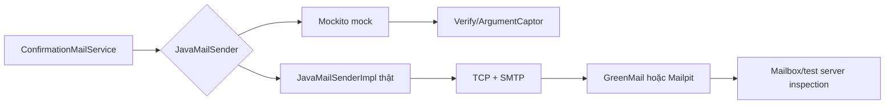
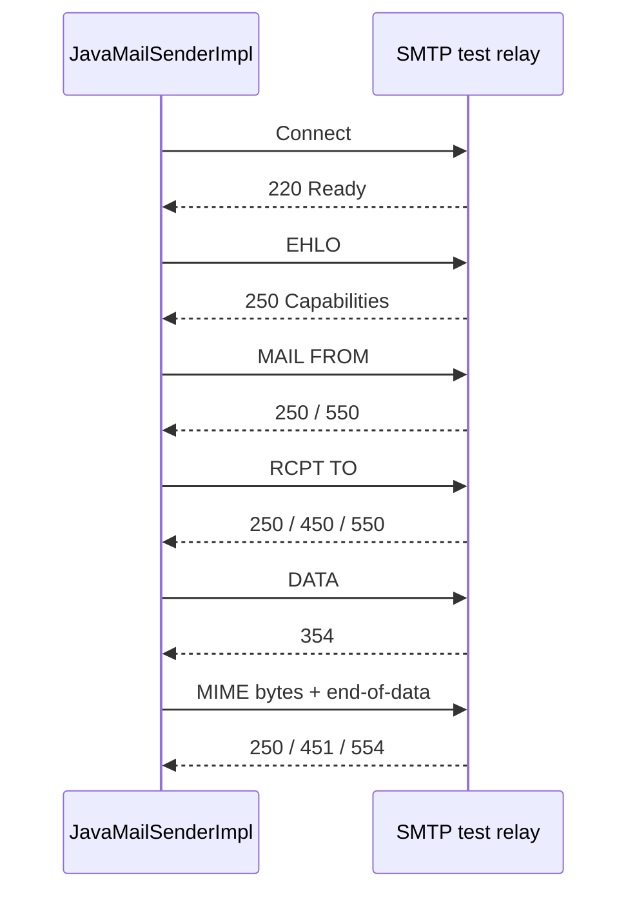
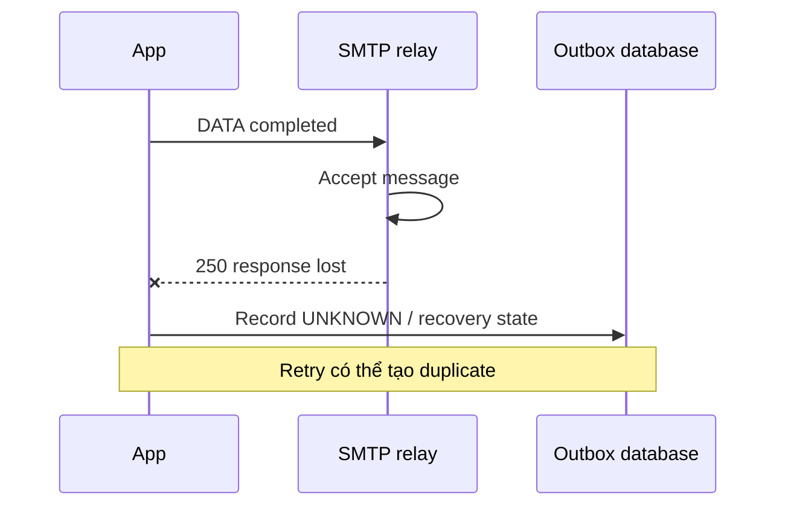

# Kiểm tra khác biệt giữa JavaMail mock và server thực

Một unit test của Spring Framework Mail có thể chạy rất nhanh: mock `JavaMailSender` bằng Mockito, gọi service, rồi dùng `verify(...)` hoặc `ArgumentCaptor` để kiểm tra người nhận, subject, body và attachment. Test ấy hữu ích, nhưng dễ tạo cảm giác sai rằng “chức năng gửi mail đã chạy thành công”. Thực tế, một mock thường **không mở socket, không thực hiện SMTP handshake, không xác thực tài khoản và không truyền MIME message tới bất kỳ relay nào**.

Khi thay mock bằng `JavaMailSenderImpl` kết nối tới một SMTP test server thực, hệ thống phải vượt qua thêm những ranh giới: cấu hình host/port, kết nối TCP, banner/EHLO, STARTTLS hoặc implicit TLS nếu được yêu cầu, AUTH, `MAIL FROM`, `RCPT TO`, `DATA`, encoding MIME, phản hồi relay và xử lý lỗi mạng. Một lỗi bị bỏ qua hoàn toàn trong mock test có thể xuất hiện ngay trong integration test.

**Mục tiêu của bài này là kiểm tra khác biệt giữa JavaMail mock và server thực**, từ đó xây dựng chiến lược test nhiều lớp: unit test kiểm tra logic tạo message, integration test với SMTP server trong môi trường kiểm soát kiểm tra hành vi vận chuyển, và smoke test có giới hạn khi cần xác minh cấu hình của một provider thật. Ví dụ sử dụng Java 21, JUnit Jupiter, Mockito, Spring Framework 6.x / Spring Boot 3.x, Jakarta Mail và GreenMail/Mailpit.

Điểm quan trọng: “server thực” trong integration test ở đây là **SMTP server chạy thật trong tiến trình hoặc container, tiếp nhận các command qua TCP**, không nhất thiết là mail provider production. Một sandbox có thể chứng minh email được relay nhận tại môi trường test, nhưng **không thể tự chứng minh inbox placement, reputation hay deliverability cuối cùng**.

## 1. Phân biệt ba câu hỏi kiểm thử

Khi nói “test gửi email thành công”, cần xác định câu hỏi nào thực sự được trả lời:

1. **Tạo message đúng chưa?** Email có To, From, Subject, plain text, HTML, attachment, encoding và nội dung nghiệp vụ chính xác không?
2. **Vận chuyển SMTP có hoạt động không?** Client có kết nối được relay, thỏa TLS/AUTH, gửi envelope, truyền DATA và nhận phản hồi chấp nhận không?
3. **Thư tới đúng nơi và người nhận có thấy không?** Provider đã giao tới mailbox, thư vào Inbox/Spam, có bounce hay complaint không?

Không loại test nào mặc nhiên trả lời được cả ba câu.

| Cách test | Tạo MIME | TCP/SMTP | TLS/AUTH | Relay nhận thư | Inbox/deliverability |
|---|---:|---:|---:|---:|---:|
| Mock `JavaMailSender` thuần | Có, nếu service tạo và test cho factory trả message thật | Không | Không | Không | Không |
| Unit test `MimeMessage` với Jakarta Mail `Session` in-memory | Có | Không | Không | Không | Không |
| `JavaMailSenderImpl` + GreenMail/Mailpit | Có | Có | Tùy cấu hình server test | Có thể kiểm tra trên server test | Không |
| Provider staging/sandbox thật | Có | Có | Có theo provider | Có thể xác nhận provider accepted | Không mặc định |
| End-to-end với mailbox test hợp lệ | Có | Có | Có | Có, tùy luồng | Có thể quan sát ở mẫu mailbox test, không bảo đảm mọi người nhận |

Một cách triển khai hiệu quả là dùng **nhiều unit test rẻ và chính xác** cho template/message, **ít integration test có ý nghĩa** cho transport, và **smoke test rất hạn chế** cho provider thật khi thật sự cần.

## 2. Cùng một service nhưng hai kiểu test rất khác nhau

Giả sử ứng dụng có nghiệp vụ gửi email xác nhận:

```java
package com.example.mail;

import jakarta.mail.MessagingException;
import jakarta.mail.internet.MimeMessage;
import org.springframework.mail.javamail.JavaMailSender;
import org.springframework.mail.javamail.MimeMessageHelper;

public final class ConfirmationMailService {

    private final JavaMailSender sender;
    private final String fromAddress;

    public ConfirmationMailService(
            JavaMailSender sender, String fromAddress) {
        this.sender = sender;
        this.fromAddress = fromAddress;
    }

    public void sendConfirmation(
            String recipient, String confirmationCode)
            throws MessagingException {

        if (recipient == null || recipient.isBlank()) {
            throw new IllegalArgumentException("Recipient is required");
        }
        if (confirmationCode == null || confirmationCode.isBlank()) {
            throw new IllegalArgumentException("Code is required");
        }

        MimeMessage message = sender.createMimeMessage();
        MimeMessageHelper helper =
                new MimeMessageHelper(message, false, "UTF-8");

        helper.setFrom(fromAddress);
        helper.setTo(recipient);
        helper.setSubject("Xác nhận tài khoản");
        helper.setText(
                "Mã xác nhận: " + confirmationCode,
                "<html><body><p>Mã xác nhận: <strong>"
                + confirmationCode
                + "</strong></p></body></html>");

        sender.send(message);
    }
}
```

Service này dùng `MimeMessageHelper` để tạo nội dung plain text và HTML. Trong sản phẩm thật, confirmation code là dữ liệu nhạy cảm: phải có TTL, giới hạn thử, không ghi mã vào log, không ghép thẳng input chưa escape vào HTML. Đoạn code đơn giản hóa để minh họa ranh giới test; các ví dụ test dùng mã giả.

Nếu inject một Mockito mock, `sender.send(message)` mặc định **không làm gì**. Nếu inject một `JavaMailSenderImpl` được cấu hình với SMTP test server, lời gọi đó thực hiện giao thức mạng thật.



## 3. Mock JavaMailSender thật sự làm gì?

Mockito tạo một test double có cùng interface với `JavaMailSender`. Khi chưa stub:

- Một phương thức `void` như `send(MimeMessage)` thường là no-op.
- Phương thức trả object như `createMimeMessage()` mặc định trả `null`.
- Không kiểm tra DNS, socket, SMTP banner, AUTH, TLS hoặc relay policy.
- Không tự serialize nội dung thành SMTP DATA.
- Không tự kiểm tra recipient có được relay chấp nhận hay không.

Vì vậy, service dùng `sender.createMimeMessage()` cần stub factory. Ta nên trả về `MimeMessage` **thật trong bộ nhớ**, để vẫn kiểm tra được cách service dựng MIME.

### 3.1. Ví dụ unit test với Mockito

```java
package com.example.mail;

import static org.junit.jupiter.api.Assertions.assertEquals;
import static org.mockito.Mockito.*;

import java.util.Properties;

import jakarta.mail.Message;
import jakarta.mail.Session;
import jakarta.mail.internet.InternetAddress;
import jakarta.mail.internet.MimeMessage;

import org.junit.jupiter.api.Test;
import org.mockito.ArgumentCaptor;
import org.springframework.mail.javamail.JavaMailSender;

class ConfirmationMailServiceUnitTest {

    @Test
    void buildsMessageWithExpectedRecipientAndSubject()
            throws Exception {

        JavaMailSender sender = mock(JavaMailSender.class);
        Session session = Session.getInstance(new Properties());
        when(sender.createMimeMessage())
                .thenAnswer(invocation -> new MimeMessage(session));

        ConfirmationMailService service = new ConfirmationMailService(
                sender, "no-reply@example.test");

        service.sendConfirmation(
                "student@example.test", "TEST-ONLY-123");

        ArgumentCaptor<MimeMessage> captor =
                ArgumentCaptor.forClass(MimeMessage.class);
        verify(sender).send(captor.capture());

        MimeMessage actual = captor.getValue();
        assertEquals("Xác nhận tài khoản", actual.getSubject());
        assertEquals(
                "student@example.test",
                ((InternetAddress) actual.getRecipients(
                        Message.RecipientType.TO)[0]).getAddress());
    }
}
```

Test này xác nhận service gọi `send(...)` bằng một message có dữ liệu đúng. Nó **không** xác nhận relay chấp nhận nội dung sau DATA. Mã `TEST-ONLY-123` là fixture giả; không dùng mã xác minh thật trong unit test.

### 3.2. Vì sao cần Mockito verify?

Nếu service tạo `MimeMessage` đúng nhưng quên gọi `sender.send(message)`, assertion trên object riêng lẻ vẫn có thể pass. `verify(sender).send(captor.capture())` giúp chứng minh service đã vượt qua **ranh giới gọi sender**.

Tuy nhiên, verify chỉ chứng minh **phương thức Java được gọi**, không phải lời gọi SMTP đã được thực hiện. Sự khác biệt này là mục tiêu chính của chương.

### 3.3. Khi nào unit test là đủ?

Unit test phù hợp để kiểm tra:

- Subject, From/Reply-To, To/Cc/Bcc theo policy.
- Template rendering, Unicode và HTML escaping.
- MIME alternative/plain/html và attachment do service tạo.
- Không gọi sender khi validation/authorization thất bại.
- Mapping business command thành thông tin email.
- Xử lý exception giả lập để kiểm tra logic retry/error mapping.

Không cần khởi động SMTP server chỉ để biết chuỗi subject có đúng hay không. Integration test cho cùng assertion đơn giản có thể làm suite chậm và dễ lỗi do hạ tầng.

## 4. Một mock có thể che khuất những lỗi nào?

| Khả năng lỗi | Unit test với mock có thể phát hiện? | SMTP integration test có thể phát hiện? |
|---|---|---|
| Tên người nhận bị ghép sai | Có nếu assert recipient | Có thể phát hiện từ envelope hoặc mailbox test |
| Subject/HTML render sai | Có | Có, nếu kiểm tra message ở server |
| `spring.mail.host` sai | Không, mock không dùng cấu hình | Có, nếu test dùng sender/config thật |
| Port bị firewall chặn | Không | Có nếu môi trường test phản ánh đường mạng đó |
| Không gửi EHLO/STARTTLS đúng cấu hình | Không | Có với server hỗ trợ/từ chối thích hợp |
| SMTP AUTH sai | Không trừ khi stub exception | Có nếu test server yêu cầu AUTH |
| Envelope `MAIL FROM` bị từ chối | Không | Có với server cấu hình policy tương ứng |
| `RCPT TO` bị từ chối | Không | Có với test server chủ động reject |
| MIME serialization/transfer encoding lỗi | Không nếu chỉ assert getter | Có khả năng phát hiện khi server nhận message |
| Timeout, connection reset | Không trừ khi stub exception | Có với fault injection/network test |
| Lỗi stream attachment lúc transport serialize | Có thể bị bỏ qua nếu không đọc stream | Có nếu transport phải đọc source khi gửi |
| SMTP relay trả accepted sau DATA | Không | Có thể xác minh |
| Bounce downstream, spam folder, final inbox | Không | Không được bảo đảm bởi SMTP sandbox |

Cột “có thể” là quan trọng: một GreenMail server mặc định dễ chấp nhận mọi recipient và không yêu cầu TLS/AUTH, nên nó **không tự kiểm tra mọi loại lỗi**. Muốn xác nhận negative path phải cấu hình server hoặc dựng test fixture có khả năng trả đúng phản hồi và mô phỏng đúng pha lỗi.

## 5. Kiểm thử với JavaMailSenderImpl thật nhưng không cần gửi Internet

`JavaMailSenderImpl` là implementation SMTP của Spring. Nó tạo `MimeMessage` từ Jakarta Mail và thực hiện transport khi gọi `send(...)`.

```java
JavaMailSenderImpl sender = new JavaMailSenderImpl();
sender.setHost("127.0.0.1");
sender.setPort(3025);
sender.setProtocol("smtp");
sender.setDefaultEncoding("UTF-8");

Properties props = sender.getJavaMailProperties();
props.put("mail.smtp.auth", "false");
props.put("mail.smtp.starttls.enable", "false");
props.put("mail.smtp.connectiontimeout", "3000");
props.put("mail.smtp.timeout", "5000");
props.put("mail.smtp.writetimeout", "5000");
```

Đoạn code chỉ cấu hình client. Để integration test thành công, **phải có SMTP server test đang lắng nghe** ở host/port tương ứng. Không dùng địa chỉ SMTP production trong test có khả năng gửi email thật, và không hardcode mật khẩu gửi thư của doanh nghiệp.

Một điểm thú vị: tạo `JavaMailSenderImpl` không có nghĩa kết nối được mở ngay. Kết nối SMTP thường xảy ra khi `send(...)`, hoặc khi gọi một API kết nối/kiểm tra tương ứng. Vì thế, test chỉ khởi tạo bean không thể chứng minh transport hoạt động.

### 5.1. Tách cấu hình SMTP test và production

Một ứng dụng nên dùng cấu hình riêng:

```yaml
# application-test.yml — ví dụ test localhost
spring:
  mail:
    host: 127.0.0.1
    port: 3025
    properties:
      "[mail.smtp.auth]": "false"
      "[mail.smtp.starttls.enable]": "false"
      "[mail.smtp.connectiontimeout]": "3000"
      "[mail.smtp.timeout]": "5000"
      "[mail.smtp.writetimeout]": "5000"
```

Không đưa cấu hình `auth=false`, `starttls=false` này vào production chỉ để test dễ pass. Đây là cấu hình dành cho **SMTP server không yêu cầu bảo mật trên loopback**. Server thật thường cần TLS, AUTH và các policy riêng.

## 6. Hai lựa chọn SMTP server cho integration test

### 6.1. GreenMail — SMTP server chạy trong JVM test

GreenMail là một thư viện SMTP/IMAP/POP3 server dùng trong test. Với phiên bản tương thích Jakarta Mail, nó có thể khởi động một SMTP server trong cùng JVM, nhận message và cung cấp API kiểm tra message đã nhận.

Điểm mạnh:

- Không cần Docker cho bài test đơn giản.
- Có thể khởi động/dừng theo JUnit lifecycle.
- Có API lấy email đã nhận để assert From, To, Subject và MIME.
- Có thể tổ chức một số kiểm thử AUTH/TLS hoặc hành vi server phù hợp cấu hình.

Cần lưu ý: GreenMail có các dòng phiên bản tương thích `javax.mail` và `jakarta.mail` khác nhau. Với Spring Framework 6/Spring Boot 3, chọn phiên bản GreenMail hỗ trợ **Jakarta Mail**, nếu không sẽ gặp lỗi type mismatch khi cố đọc `jakarta.mail.internet.MimeMessage`.

### 6.2. Mailpit — SMTP server và giao diện kiểm tra thư

Mailpit có thể chạy bằng Docker, tiếp nhận thư qua SMTP và cung cấp giao diện web/API để xem nội dung:

```bash
docker run --rm --name mailpit ^
  -p 1025:1025 -p 8025:8025 ^
  axllent/mailpit
```

Ví dụ trên dùng ký tự tiếp dòng `^` của Windows `cmd.exe`; khi dùng PowerShell hoặc Bash, hãy viết lệnh trên một dòng để tránh sai cú pháp:

```text
docker run --rm --name mailpit -p 1025:1025 -p 8025:8025 axllent/mailpit
```

Thường SMTP lắng nghe ở `localhost:1025` và giao diện web ở `http://localhost:8025` theo các cổng đã map. Chỉ dùng ở môi trường test, giới hạn exposure của port; trong CI nên pin image version/digest đã được kiểm chứng thay vì phụ thuộc tag mặc định.

Mailpit giúp quan sát email đã được server test chấp nhận, nhưng không mô phỏng đầy đủ spam filtering, reputation, DNS domain auth hoặc mọi policy SMTP của provider production. Một integration test dùng Mailpit và assertion HTTP API nên dựa trên contract của phiên bản đã pin.

## 7. Integration test hoàn chỉnh với GreenMail

Ví dụ dưới đây sử dụng GreenMail chạy SMTP thật trên loopback, còn `ConfirmationMailService` là service nghiệp vụ đã định nghĩa. Bài test không mock `JavaMailSender`; nó tạo `JavaMailSenderImpl` kết nối bằng TCP tới server test.

### 7.1. Gradle dependency minh họa

```groovy
dependencies {
    implementation 'org.springframework.boot:spring-boot-starter-mail'
    testImplementation 'org.springframework.boot:spring-boot-starter-test'
    testImplementation 'com.icegreen:greenmail:YOUR_JAKARTA_COMPATIBLE_VERSION'
}
```

Giá trị `YOUR_JAKARTA_COMPATIBLE_VERSION` là placeholder cần thay bằng phiên bản tương thích với dự án và được pin trong dependency management. Không sao chép nguyên placeholder rồi chạy Gradle. Các đoạn code bên dưới dùng các API quen thuộc của GreenMail; nếu phiên bản được chọn thay đổi API hoặc namespace, cập nhật theo tài liệu thư viện đã khóa phiên bản.

### 7.2. Khởi động GreenMail và JavaMailSenderImpl

```java
package com.example.mail;

import static org.junit.jupiter.api.Assertions.*;

import java.util.Properties;

import com.icegreen.greenmail.util.GreenMail;
import com.icegreen.greenmail.util.ServerSetup;
import jakarta.mail.Message;
import jakarta.mail.internet.InternetAddress;
import jakarta.mail.internet.MimeMessage;

import org.junit.jupiter.api.AfterEach;
import org.junit.jupiter.api.BeforeEach;
import org.junit.jupiter.api.Test;
import org.springframework.mail.javamail.JavaMailSenderImpl;

class ConfirmationMailServiceSmtpIT {

    private GreenMail greenMail;
    private ConfirmationMailService service;

    @BeforeEach
    void startSmtpServer() {
        ServerSetup setup = new ServerSetup(
                0, "127.0.0.1", ServerSetup.PROTOCOL_SMTP);
        greenMail = new GreenMail(setup);
        greenMail.start();

        JavaMailSenderImpl sender = new JavaMailSenderImpl();
        sender.setHost("127.0.0.1");
        sender.setPort(greenMail.getSmtp().getPort());
        sender.setProtocol("smtp");
        sender.setDefaultEncoding("UTF-8");

        Properties props = sender.getJavaMailProperties();
        props.put("mail.smtp.auth", "false");
        props.put("mail.smtp.starttls.enable", "false");
        props.put("mail.smtp.connectiontimeout", "3000");
        props.put("mail.smtp.timeout", "5000");
        props.put("mail.smtp.writetimeout", "5000");

        service = new ConfirmationMailService(
                sender, "no-reply@example.test");
    }

    @AfterEach
    void stopSmtpServer() {
        if (greenMail != null) {
            greenMail.stop();
        }
    }

    @Test
    void smtpServerReceivesExpectedMessage() throws Exception {
        service.sendConfirmation(
                "student@example.test", "TEST-ONLY-123");

        assertTrue(greenMail.waitForIncomingEmail(5000, 1));

        MimeMessage[] received = greenMail.getReceivedMessages();
        assertEquals(1, received.length);

        MimeMessage actual = received[0];
        assertEquals("Xác nhận tài khoản", actual.getSubject());
        assertEquals(
                "no-reply@example.test",
                ((InternetAddress) actual.getFrom()[0]).getAddress());
        assertEquals(
                "student@example.test",
                ((InternetAddress) actual.getRecipients(
                        Message.RecipientType.TO)[0]).getAddress());
    }
}
```

Ở ví dụ này, `ServerSetup(0, ...)` yêu cầu cổng động và `greenMail.getSmtp().getPort()` lấy cổng mà server test dùng. Cách cấp cổng và các API helper có thể phụ thuộc phiên bản GreenMail; hãy dùng phiên bản đã chọn phù hợp với Jakarta Mail trong dự án.

**Điểm khác mock:** test thật sự mở TCP, thực hiện SMTP command và server test đã nhận message vào kho thư của nó. Test này phát hiện các lỗi ở ranh giới SMTP mà `verify(sender).send(any(...))` không thể phát hiện.

### 7.3. Vì sao dùng cổng động?

Nếu mọi test cố sử dụng cổng cố định `3025`, hai job chạy song song trên CI có thể tranh nhau bind port, khiến một test fail ngẫu nhiên. Cổng động giúp các phiên test độc lập hơn, giảm phụ thuộc vào port trống trên máy.

Hãy bảo đảm sender lấy đúng cổng sau khi server khởi động. Không tự đoán port trong integration test; một cấu hình sai port chính là thứ test có thể phát hiện, nhưng không nên khiến suite thiếu ổn định ngoài chủ đích.

## 8. Test cả nội dung MIME mà SMTP server nhận được

Unit test capture `MimeMessage` trước `sender.send(...)`, còn integration test đọc một message mà server đã lưu sau khi nhận qua SMTP. Hai đối tượng có thể có cùng nội dung nghiệp vụ, nhưng đường đi của chúng khác nhau:

```text
Unit test:
  Service -> MimeMessage in-memory -> mock.send(message)
  Không serialize/giao thức nếu test không chủ động yêu cầu.

SMTP integration test:
  Service -> MimeMessage -> JavaMailSenderImpl
          -> MIME serialization -> SMTP DATA
          -> Test SMTP server -> received MimeMessage
```

Quá trình serialization có thể làm phát sinh các chi tiết mà test chỉ đọc getter không để ý:

- Encoded-word header cho subject hoặc display name Unicode.
- Content-Type và `charset` cho từng MIME part.
- `Content-Transfer-Encoding`, CRLF và boundary multipart.
- Attachment stream được mở/đọc khi transport viết nội dung.
- Header `Date`, `Message-ID` và các header được hoàn tất khi `saveChanges()`.
- Sự khác biệt giữa recipient trong SMTP envelope và recipient được thể hiện trong MIME header.

Tuy nhiên, không nên assert tất cả header raw theo từng byte. MIME có thể hợp lệ với boundary, encoding và header folding khác nhau.

### 8.1. Kiểm tra plain text và HTML trên message đã nhận

Với `MimeMessageHelper.setText(plain, html)`, server nhận một multipart message. Có thể duyệt các `Part` đệ quy:

```java
import java.io.IOException;
import java.util.ArrayList;
import java.util.List;

import jakarta.mail.MessagingException;
import jakarta.mail.Multipart;
import jakarta.mail.Part;

public final class MimePartTestHelper {

    private MimePartTestHelper() {}

    public static List<Part> leafParts(Part root)
            throws MessagingException, IOException {
        List<Part> result = new ArrayList<>();
        visit(root, result);
        return result;
    }

    private static void visit(Part node, List<Part> result)
            throws MessagingException, IOException {
        Object content = node.getContent();

        if (content instanceof Multipart multipart) {
            for (int i = 0; i < multipart.getCount(); i++) {
                visit(multipart.getBodyPart(i), result);
            }
        } else {
            result.add(node);
        }
    }
}
```

Đây là helper minh họa cho cấu trúc multipart thông thường. Nó chưa đệ quy vào một `message/rfc822` attachment chứa message lồng nhau. Nếu bài test có cấu trúc MIME phức tạp, mở rộng helper theo đúng content type.

Sử dụng:

```java
MimeMessage received = greenMail.getReceivedMessages()[0];
List<Part> leaves = MimePartTestHelper.leafParts(received);

Part plain = null;
Part html = null;

for (Part part : leaves) {
    if (part.isMimeType("text/plain")) {
        plain = part;
    }
    if (part.isMimeType("text/html")) {
        html = part;
    }
}

assertNotNull(plain);
assertNotNull(html);
assertTrue(((String) plain.getContent())
        .contains("Mã xác nhận: TEST-ONLY-123"));
assertTrue(((String) html.getContent())
        .contains("<strong>TEST-ONLY-123</strong>"));
```

Test kiểm tra nội dung **sau khi test SMTP server nhận**, khác với chỉ kiểm tra `MimeMessage` trước transport. Ưu tiên `Part.isMimeType("text/html")` thay vì so sánh `getContentType()` tuyệt đối với `"text/html"`, vì header có thể thêm `charset=UTF-8` hoặc parameter.

### 8.2. Charset tiếng Việt

Chủ đề và body tiếng Việt cần được hiển thị chính xác:

```java
assertEquals("Xác nhận tài khoản", received.getSubject());
```

Jakarta Mail API giải mã subject cho `getSubject()`. Nếu muốn kiểm tra raw header encoding, hãy tạo test chuyên biệt và hiểu MIME header có thể được folded theo nhiều cách hợp lệ. Unit/integration test thông thường nên assert chuỗi đã decode mà người dùng dự kiến thấy.

Tương tự, body có thể mang quoted-printable hoặc base64 transfer encoding trên dây nhưng khi gọi `part.getContent()` thư viện có thể trả nội dung đã được decode. Không assert MIME bytes raw cho một yêu cầu nghiệp vụ đơn giản.

## 9. Attachment: khác biệt lớn giữa getter test và transport thật

Trong unit test, một service có thể gọi `MimeMessageHelper.addAttachment(...)` với `InputStreamSource`. Helper tạo một MIME part tham chiếu nguồn dữ liệu; test chỉ capture message và assert filename. Nhưng trong SMTP integration test, Jakarta Mail **phải đọc nguồn attachment khi serialize message**.

Nếu nguồn chỉ cho phép đọc một lần, stream đã bị đóng hoặc không còn tồn tại khi gửi, lỗi có thể xuất hiện lúc transport serialize dù test mock vẫn pass.

### 9.1. Tạo attachment bằng nguồn có thể đọc lại

```java
byte[] pdfBytes = fakePdfFixture();

MimeMessage message = sender.createMimeMessage();
MimeMessageHelper helper =
        new MimeMessageHelper(message, true, "UTF-8");

helper.setFrom("billing@example.test");
helper.setTo("student@example.test");
helper.setSubject("Biên nhận");
helper.setText("Biên nhận được đính kèm.");
helper.addAttachment(
        "receipt.pdf",
        new ByteArrayResource(pdfBytes),
        "application/pdf");

sender.send(message);
```

`ByteArrayResource` cho phép mở stream từ mảng byte mỗi khi cần, nên phù hợp fixture nhỏ. Với file thật, `FileSystemResource` cũng có thể cấp stream mới khi file còn tồn tại. Với nguồn object storage, cần thiết kế supplier mở một stream mới ở mỗi lượt đọc và bảo đảm nguồn tồn tại trong suốt vòng đời attempt/retry.

### 9.2. Test attachment sau khi SMTP server nhận

```java
MimeMessage received = greenMail.getReceivedMessages()[0];
Part attachment = null;

for (Part part : MimePartTestHelper.leafParts(received)) {
    if ("receipt.pdf".equals(part.getFileName())) {
        attachment = part;
        break;
    }
}

assertNotNull(attachment);
assertTrue(attachment.isMimeType("application/pdf"));
assertEquals(Part.ATTACHMENT, attachment.getDisposition());

byte[] actualBytes;
try (var input = attachment.getInputStream()) {
    actualBytes = input.readAllBytes();
}

assertArrayEquals(pdfBytes, actualBytes);
```

Ở đây test không chỉ biết helper đã gắn “một part tên receipt.pdf”; nó thấy **server nhận được bytes sau SMTP DATA**. Điều đó làm lộ một nhóm lỗi mà test chỉ dùng `ArgumentCaptor` và không mở attachment stream có thể bỏ qua.

### 9.3. Thử lỗi nguồn attachment khi gửi

Một test negative có thể sử dụng nguồn chỉ cho phép stream bị mở trong một khoảng thời gian hoặc tạo exception khi đọc. Mục tiêu là xác nhận exception xuất hiện ở bước preparation/serialization phù hợp và được phân loại đúng.

Không nên test bằng cách giữ một `InputStream` mở từ trước rồi giả định JavaMail sẽ đóng/mở lại chính xác theo ý muốn. Hãy định nghĩa rõ ownership và khả năng repeatable của `InputStreamSource`. Đối với attachment lớn, dùng fixture nhỏ cho unit test; nếu cần đo streaming/heap usage, tổ chức integration/performance test riêng.

## 10. Envelope recipients khác MIME headers

Mock test thường nhìn:

```java
message.getRecipients(Message.RecipientType.TO);
```

Nhưng SMTP transport giao tiếp bằng `RCPT TO`. Recipient trong envelope có thể khác header vì Bcc, resend, API/provider policy hoặc cách chuẩn bị message.

### 10.1. Bcc là một ví dụ dễ hiểu

Một email có:

```java
helper.setTo("main@example.test");
helper.setBcc("audit@example.test");
```

Một test unit có thể xác nhận Bcc được cấu hình. Nhưng khi gửi SMTP, `audit@example.test` có thể xuất hiện trong lệnh envelope `RCPT TO` dù **không được hiển thị cho các người nhận khác** trong message headers theo semantics Bcc mong muốn.

Test cần phân biệt:

1. Người nhận Bcc thực sự có được gửi tới trong SMTP envelope không?
2. Bcc có bị rò rỉ trong nội dung/header mà recipient khác nhìn thấy không?

Một SMTP test server hỗ trợ quan sát envelope hoặc lưu từng mailbox có thể giúp kiểm tra mục tiêu (1). Với mục tiêu (2), kiểm tra bản message được giao đến mailbox test; đừng mặc nhiên suy luận từ một `MimeMessage` trước khi transport xử lý.

### 10.2. Nhiều recipient và partial success

SMTP relay có thể chấp nhận một số `RCPT TO` và từ chối số khác:

```text
C: MAIL FROM:<billing@example.test>
S: 250 Sender OK
C: RCPT TO:<a@example.test>
S: 250 Recipient accepted
C: RCPT TO:<b@example.test>
S: 550 Recipient rejected
```

Với một Mockito mock trả `void`, test không thấy các phản hồi này. Với server test, cần **cấu hình có chủ đích** để một recipient bị từ chối; một sandbox mặc định chấp nhận tất cả không chứng minh đường xử lý partial success.

Ứng dụng nên xác định granularity: một job cho mỗi recipient thường giúp retry chính xác hơn. Nếu một MIME message có nhiều recipient, cần hiểu behavior của Jakarta Mail SMTP provider, chẳng hạn xử lý recipient hợp lệ/không hợp lệ và cấu hình `mail.smtp.sendpartial` nếu dự án dùng. Không khẳng định mọi recipient đều fail hoặc đều pass chỉ dựa trên một exception cấp message.

## 11. AUTH: mock không kiểm chứng credentials

Giả sử cấu hình:

```yaml
spring:
  mail:
    host: smtp.provider.example
    port: 587
    username: ${SMTP_USERNAME}
    password: ${SMTP_PASSWORD}
    properties:
      "[mail.smtp.auth]": "true"
      "[mail.smtp.starttls.enable]": "true"
```

Mock `JavaMailSender` không sử dụng host, username hoặc password nếu không được stub thủ công. Test vẫn pass ngay cả khi:

- Không cấu hình password trong environment.
- Username sai.
- Provider yêu cầu authentication khác.
- Tài khoản SMTP bị khóa hoặc không được phép dùng domain From.
- STARTTLS chưa được thực hiện nhưng server yêu cầu trước AUTH.

### 11.1. Test có yêu cầu AUTH

Với server test hỗ trợ AUTH, hãy cấu hình nó yêu cầu đăng nhập, sau đó kiểm tra hai trường hợp:

- Credentials test hợp lệ: server chấp nhận và thư được lưu.
- Credentials sai: phía client nhận exception tương ứng, không có thư được ghi nhận là gửi thành công.

Thư viện test server có thể khác nhau về việc AUTH bắt buộc theo user hay theo protocol mode. **Chỉ gọi API tạo user mailbox chưa chắc đã khiến mọi phiên SMTP phải authenticate**; cần bật chính sách yêu cầu AUTH của server test theo tài liệu phiên bản đang dùng.

Không sử dụng secret production trong test. Nếu thử provider thật, cần tài khoản test riêng, hạn chế hạn mức và không log AUTH payload.

### 11.2. Điều cần assert

Test tiêu cực có thể kiểm tra:

- Exception được chuyển thành lỗi application phù hợp (ví dụ một nhánh `MailAuthenticationException` nếu `JavaMailSenderImpl` gói lỗi theo loại đó).
- Không chuyển outbox sang SENT.
- Không retry vô hạn với credential sai.
- Log chỉ chứa error category, không chứa password.

Đừng assert toàn bộ exception message từ provider bằng một chuỗi cố định. Message có thể thay đổi theo phiên bản server/test library, trong khi loại lỗi và quyết định nghiệp vụ giữ nguyên.

## 12. TLS: một server local không TLS chưa đủ kiểm chứng production

GreenMail/Mailpit cấu hình SMTP plaintext trên loopback có thể rất hữu ích cho integration test logic, nhưng nó **không kiểm tra**:

- Certificate chain có hợp lệ với truststore production không?
- Hostname có khớp chứng chỉ không?
- STARTTLS có được yêu cầu hay chỉ opportunistic?
- Client có hỗ trợ phiên bản TLS/cipher mà provider dùng không?
- Cổng submission có implicit TLS hay STARTTLS?

Một số tình huống:

| Cấu hình | Hành vi mong đợi |
|---|---|
| Client yêu cầu STARTTLS; server không hỗ trợ STARTTLS | Lỗi, không âm thầm gửi plaintext nếu thật sự `required=true` |
| Client bật STARTTLS nhưng `required=false`; server không hỗ trợ | Có thể gửi plaintext nếu policy cho phép; cần tránh trong production nhạy cảm |
| Client dùng implicit TLS tới port plaintext | Handshake/protocol mismatch |
| Certificate không được trust | TLS handshake failure |
| Hostname khác certificate | Validation failure nếu xác minh danh tính server đúng cấu hình |

### 12.1. Cấu hình timeout và STARTTLS

```java
Properties properties = sender.getJavaMailProperties();
properties.put("mail.smtp.auth", "true");
properties.put("mail.smtp.starttls.enable", "true");
properties.put("mail.smtp.starttls.required", "true");
properties.put("mail.smtp.connectiontimeout", "3000");
properties.put("mail.smtp.timeout", "5000");
properties.put("mail.smtp.writetimeout", "5000");
```

Chỉ dùng bộ property này khi test SMTP server **được cấu hình tương ứng** và có credentials test hợp lệ. Với implicit TLS, provider có thể dùng `mail.smtp.ssl.enable` và một cổng khác; không nên coi hai mode tương đương.

Không “sửa” lỗi test TLS bằng cách tắt kiểm tra certificate trong production. Dùng certificate test/truststore test phù hợp, hoặc phân lớp: unit/integration SMTP plaintext để kiểm tra logic và một nhóm test TLS riêng để xác nhận security transport.

### 12.2. Tại sao cần test đường TLS riêng?

Nếu ứng dụng dùng mock và một GreenMail plaintext test, hai test có thể pass trong khi production gặp `SSLHandshakeException`. Một suite có ý nghĩa cần ghi rõ test nào bao phủ TLS, test nào chỉ bao phủ message construction/SMTP commands.

Test TLS dùng certificate tự ký nên tạo truststore/hostname test một cách có kiểm soát. Đừng cấu hình “trust all” rồi tuyên bố đã kiểm tra certificate validation.

## 13. Response code và lỗi SMTP mà mock không nhìn thấy

Một phiên SMTP có các pha:



Đây là các ví dụ mã có thể trả ở một số pha; không phải transcript cố định. Có server trả lỗi sớm, có server yêu cầu AUTH/TLS, có server từ chối sau khi phân tích toàn bộ content.

Một số khác biệt:

| Pha | Lỗi giả lập | Ý nghĩa cho ứng dụng |
|---|---|---|
| Connect | Connection refused/timeout | Không có phiên SMTP đủ để nhận thư |
| EHLO | Server đóng connection hoặc lỗi capability | Cấu hình/khả năng SMTP chưa phù hợp |
| STARTTLS | 454/handshake failure | Bảo mật transport không được thiết lập |
| AUTH | 535 | Xác thực bị từ chối; thường cần sửa cấu hình |
| MAIL FROM | 550 5.7.1 | Sender không được phép |
| RCPT TO | 550 5.1.1 | Recipient không hợp lệ/không tồn tại theo phản hồi |
| RCPT TO | 451 4.x.x | Thất bại tạm thời, có thể retry theo policy |
| DATA | 552/554 sau body | Có thể do size/content/policy |
| Sau DATA | Response bị mất | Outcome có thể không xác định |

Unit test có thể dùng `doThrow(...)` để kiểm tra một nhánh khi có lỗi, nhưng không chứng minh lỗi đó thực sự xuất hiện ở pha SMTP đúng như code đang giả định. Khi cần xác minh client/server tương tác thật, dùng test relay điều khiển được phản hồi.

### 13.1. Không phải lỗi SMTP nào cũng là MailSendException giống nhau

Spring Mail có các exception như:

- `MailAuthenticationException` khi xác thực lỗi.
- `MailSendException` khi gửi một hoặc nhiều message không thành công.
- `MailParseException` cho một số lỗi parse địa chỉ/message.
- `MailPreparationException` khi chuẩn bị message thất bại.

Provider Jakarta Mail có thể kèm `MessagingException`, `SendFailedException` hoặc các subclass cụ thể trong cause/next-exception chain. Kết quả exact phụ thuộc đường gọi, provider và phiên bản. Integration test nên kiểm tra loại lỗi/hành động của **application contract**, không gắn cứng vào toàn bộ chuỗi stack trace.

### 13.2. Không coi lỗi tạm thời là gửi thất bại vĩnh viễn

Khi relay trả 4xx rõ ràng, service có thể cần retry/backoff. Nhưng với 5xx, retry nguyên message không giới hạn có thể vô ích hoặc tạo lạm dụng. Nếu lỗi AUTH/TLS toàn hệ thống, nên xử lý như vấn đề hạ tầng/cấu hình hơn là retry từng recipient liên tục.

## 14. Timeout và trạng thái “không chắc đã gửi”

Đây là một giới hạn không thể mô phỏng đúng bằng mock trả lỗi tổng quát nếu không thiết kế scenario riêng.

Giả sử:

1. Client đã gửi MIME DATA đầy đủ.
2. SMTP relay nhận và chấp nhận message.
3. Client mất connection trước khi nhận `250` cuối hoặc trước khi cập nhật outbox thành SENT.
4. Ứng dụng không biết chắc message có được chấp nhận không.
5. Retry có thể làm recipient nhận hai email.



Một mock `doThrow(new MailSendException("timeout"))` kiểm tra được nhánh xử lý exception, nhưng không chứng minh **đúng cửa sổ lỗi** nơi server đã nhận mà client mất phản hồi. Fault injection/server script mới có thể tái hiện pha đó một cách xác định.

### 14.1. Không ép test trả lời điều không thể biết

Nếu phía client mất phản hồi cuối sau DATA, kết quả chính xác có thể là `UNKNOWN`, không phải chắc chắn `NOT_SENT`. Integration test của tình huống này nên kiểm tra policy:

- Ghi rõ pha gần nhất có bằng chứng.
- Giữ notification/attempt ID.
- Không tuyên bố exactly-once delivery.
- Quyết định retry có cảnh báo duplicate hoặc reconciliation nếu provider hỗ trợ.

Không cần cố làm một assertion “server phải có hoặc không có message” thành quy tắc chung cho mọi timeout. Server có thể đã nhận trong khi ứng dụng không có bằng chứng để biết.

## 15. Vì sao mock thường che lỗi trước hay sau transaction?

Một service có thể:

```java
@Transactional
public void completeOrder(Long id) {
    Order order = orders.findById(id).orElseThrow();
    order.complete();
    sender.send(buildOrderEmail(order));
}
```

Mock sender trả về ngay; unit test dễ pass. Trong production, SMTP có thể chậm, giữ transaction database mở; email có thể được relay chấp nhận rồi database commit thất bại. Vì SMTP không tham gia DB transaction, rollback **không thu hồi email**.

Integration test SMTP có thể giúp thấy độ trễ mạng và lỗi transport, nhưng muốn kiểm tra ranh giới commit cần một integration test **database transaction + mail event/outbox** riêng:

1. Khi business transaction rollback, không có intent gửi được commit.
2. Khi commit, outbox row tồn tại bền vững.
3. Worker claim, gửi SMTP ngoài transaction claim và ghi outcome trong transaction riêng.
4. Khi SMTP accepted nhưng DB ack thất bại, trạng thái xử lý phải thể hiện nguy cơ duplicate.

Chỉ gắn `@Async` không giải quyết atomicity hoặc độ bền. Một SMTP sandbox chứng minh transport được gọi, không bảo đảm event không mất khi process crash sau commit.

## 16. Tích hợp SMTP test server vào Spring Boot

Một integration test của ứng dụng Spring Boot nên kiểm tra **bean và cấu hình thật** được autoconfigure, không thay bằng mock khi mục tiêu là xác thực transport.

Với unit test:

```java
JavaMailSender sender = mock(JavaMailSender.class);
ConfirmationMailService service =
        new ConfirmationMailService(sender, "no-reply@example.test");
```

Với integration test:

```text
Spring Boot ApplicationContext
  -> @ConfigurationProperties / spring.mail
  -> JavaMailSenderImpl
  -> SMTP server test chạy thật
  -> Message được test server nhận
```

Một số lỗi chỉ xuất hiện khi tạo context thật:

- Sai tên property trong `application-test.yml`.
- Bean `JavaMailSender` tùy biến không nhận cấu hình dự định.
- Service inject nhầm sender khi có nhiều bean/provider.
- Credential/host được cấp từ profile khác.
- Feature flag dẫn service sang luồng gửi khác.
- Cấu hình timeout/TLS/AUTH không được áp dụng.

Nếu một `@SpringBootTest` dùng `@MockBean` hoặc `@MockitoBean` để thay thế `JavaMailSender`, test đó **không còn kiểm chứng SMTP transport** dù ApplicationContext đã khởi động. Nó có thể hữu ích như test orchestration, nhưng cần đặt tên và kỳ vọng đúng.

### 16.1. DynamicPropertySource cho SMTP port động

Khi SMTP server chạy container với cổng map động, cấu hình Spring Boot phải nhận host/port sau khi container sẵn sàng. `@DynamicPropertySource` là cách phổ biến:

```java
@DynamicPropertySource
static void registerSmtpProperties(DynamicPropertyRegistry registry) {
    registry.add("spring.mail.host", smtp::getHost);
    registry.add("spring.mail.port",
            () -> smtp.getMappedPort(1025));
    registry.add("spring.mail.properties.mail.smtp.auth",
            () -> "false");
    registry.add("spring.mail.properties.mail.smtp.starttls.enable",
            () -> "false");
}
```

Ở đây `smtp` là một container đã khai báo trong test. Việc đăng ký property bằng supplier giúp Spring đọc đúng mapped port thay vì dùng cổng mặc định trong môi trường chạy CI.

### 16.2. @SpringBootTest với Mailpit + Testcontainers

Một ví dụ integration test dạng cấu trúc:

```java
import static org.junit.jupiter.api.Assertions.assertTrue;
import static org.awaitility.Awaitility.await;

import java.net.URI;
import java.net.http.HttpClient;
import java.net.http.HttpRequest;
import java.net.http.HttpResponse;
import java.time.Duration;

import org.junit.jupiter.api.Test;
import org.springframework.beans.factory.annotation.Autowired;
import org.springframework.boot.test.context.SpringBootTest;
import org.springframework.boot.test.context.TestConfiguration;
import org.springframework.context.annotation.Bean;
import org.springframework.context.annotation.Import;
import org.springframework.mail.javamail.JavaMailSender;
import org.springframework.test.context.DynamicPropertyRegistry;
import org.springframework.test.context.DynamicPropertySource;

import org.testcontainers.containers.GenericContainer;
import org.testcontainers.junit.jupiter.Container;
import org.testcontainers.junit.jupiter.Testcontainers;
import org.testcontainers.utility.DockerImageName;

@Testcontainers
@SpringBootTest
@Import(MailpitSmtpIT.TestMailConfiguration.class)
class MailpitSmtpIT {

    @Container
    static final GenericContainer<?> smtp = new GenericContainer<>(
            DockerImageName.parse("axllent/mailpit:latest"))
            .withExposedPorts(1025, 8025);

    @DynamicPropertySource
    static void configureMail(DynamicPropertyRegistry registry) {
        registry.add("spring.mail.host", smtp::getHost);
        registry.add("spring.mail.port",
                () -> smtp.getMappedPort(1025));
        registry.add("spring.mail.properties.mail.smtp.auth",
                () -> "false");
        registry.add("spring.mail.properties.mail.smtp.starttls.enable",
                () -> "false");
    }

    @TestConfiguration(proxyBeanMethods = false)
    static class TestMailConfiguration {

        @Bean
        ConfirmationMailService confirmationMailService(
                JavaMailSender sender) {
            return new ConfirmationMailService(
                    sender, "no-reply@example.test");
        }
    }

    @Autowired
    ConfirmationMailService service;

    @Test
    void mailpitReceivesConfirmation() throws Exception {
        service.sendConfirmation(
                "student@example.test", "TEST-ONLY-123");

        await().atMost(Duration.ofSeconds(10)).untilAsserted(() ->
                assertTrue(
                        mailpitMessages().contains("student@example.test")));
    }

    private static String mailpitMessages() throws Exception {
        String url = "http://" + smtp.getHost() + ":"
                + smtp.getMappedPort(8025) + "/api/v1/messages";

        HttpRequest request = HttpRequest.newBuilder(
                URI.create(url)).GET().build();
        return HttpClient.newHttpClient().send(
                request, HttpResponse.BodyHandlers.ofString()).body();
    }
}
```

Đoạn code minh họa dùng Mailpit API `GET /api/v1/messages` để kiểm tra hộp thư của sandbox; schema/endpoint cần được xác nhận với **phiên bản Mailpit được pin**. `axllent/mailpit:latest` được viết cho ví dụ dễ đọc nhưng **không nên dùng tag latest trong CI lâu dài**: pin image tag/digest đã kiểm chứng, có cơ chế cập nhật định kỳ. Khi dùng một application class thật, `@SpringBootTest` cần tìm được Spring Boot configuration của dự án; `@Import` bổ sung service fixture nếu service không phải bean ứng dụng.

Các dependency test cần có gồm Spring Boot starter test, Testcontainers JUnit Jupiter, Testcontainers core và Awaitility (nếu BOM/starter test hiện tại chưa kéo vào). Có thể thêm theo dependency management:

```groovy
dependencies {
    testImplementation 'org.springframework.boot:spring-boot-starter-test'
    testImplementation 'org.testcontainers:junit-jupiter'
    testImplementation 'org.awaitility:awaitility'
}
```

Đoạn test chỉ xác nhận người nhận test xuất hiện trong API của Mailpit, không chứng minh MIME body đúng nếu không đọc thêm raw message; khi cần, query message ID rồi xem raw MIME theo API phiên bản đã pin. Môi trường chạy cần Docker/container runtime, network policy phù hợp và khả năng pull image.

### 16.3. Bản thân Docker không làm test thành provider end-to-end

Một container Mailpit tiếp nhận SMTP thật, nhưng chỉ mô phỏng một relay tối giản. Nó không kiểm tra:

- DNS SPF/DKIM/DMARC của domain thật.
- IP/domain reputation.
- Filtering của Gmail/Outlook hoặc mailbox doanh nghiệp.
- Provider-specific quota và rate limit.
- Bounce sau downstream relay.

Việc test nhìn thấy message trong Mailpit chứng minh đường **app → SMTP sandbox** hoạt động, không chứng minh đường **app → provider production → mailbox nhận**.

## 17. Khi nào dùng GreenMail, Mailpit hay một SMTP fake có script?

| Tiêu chí | GreenMail in-process | Mailpit container | Scriptable SMTP test server |
|---|---|---|---|
| Cài đặt local | Dependency test | Cần Docker/process ngoài | Tùy thư viện |
| Assert message đã nhận | API GreenMail | UI/HTTP API | Tùy implementation |
| Test Spring configuration | Được nếu dùng real sender | Được | Được |
| Test SMTP accepted bình thường | Được | Được | Được |
| Mô phỏng AUTH/TLS | Tùy tính năng/cấu hình GreenMail | Tùy cấu hình phiên bản | Dựng kịch bản theo nhu cầu |
| Chủ động trả 451/550 tại từng command | Cần kiểm tra server có hỗ trợ | Không mặc định bảo đảm | Phù hợp nếu có scripting |
| Cắt kết nối sau DATA | Cần fault injection riêng | Không mặc định bảo đảm | Phù hợp |
| Kiểm tra Inbox/Spam thật | Không | Không | Không |

Chọn công cụ theo **failure mode cần chứng minh**. Không nhất thiết một SMTP test server phải hỗ trợ mọi tính năng. Với SMTP DATA accepted, GreenMail/Mailpit đủ hữu ích; với giao thức bất thường và phản hồi đặc thù, một server có thể lập kịch bản giúp test ổn định hơn.

## 18. Test lỗi kết nối ở tầng thật

Một ví dụ tối thiểu:

```java
JavaMailSenderImpl sender = new JavaMailSenderImpl();
sender.setHost("127.0.0.1");
sender.setPort(portThatIsNotListening);
sender.getJavaMailProperties().put(
        "mail.smtp.connectiontimeout", "1000");

ConfirmationMailService service =
        new ConfirmationMailService(
                sender, "no-reply@example.test");

assertThrows(
        MailException.class,
        () -> service.sendConfirmation(
                "student@example.test", "TEST-ONLY-123"));
```

`portThatIsNotListening` là cổng test đã được fixture kiểm soát và xác nhận không có listener; không nên chọn ngẫu nhiên một port rồi dựa vào giả định “chắc chắn trống”, vì chạy song song có thể khiến test flaky.

Ví dụ trên cần import `org.springframework.mail.MailException` và static JUnit assertion. Với sender thật, `createMimeMessage()` vẫn tạo được đối tượng; lỗi chỉ xuất hiện ở bước kết nối khi gọi `send(...)`. Với mock, test tương đương có thể pass dù port sai bởi mock không sử dụng socket.

### 18.1. Không test timeout bằng sleep vô hạn

Integration test mạng cần deadline rõ ràng ở:

- Client connection/read/write timeout.
- Thời gian chờ test server lưu email.
- Thời gian kết thúc một test case.
- Container readiness/startup timeout nếu dùng Docker.

Nếu không đặt timeout, một mạng/relay test bị treo có thể giữ cả CI pipeline rất lâu. Ngược lại, timeout quá ngắn so với khả năng máy CI sẽ tạo failure giả. Cần cân bằng dựa trên môi trường kiểm thử.

### 18.2. Phân biệt connection refused và authentication failure

Một lỗi connect có thể có `ConnectException` hoặc socket timeout trong cause chain. AUTH failure có thể dẫn tới `MailAuthenticationException` và nested Jakarta Mail exception. Đừng thiết kế một unit test dùng `doThrow(new MailSendException(...))` rồi khẳng định nó đã kiểm tra đường connect hoặc AUTH thực tế.

## 19. Test SMTP reply bị từ chối

Một server test có thể được lập kịch bản từ chối lệnh:

```text
CLIENT: EHLO app.example.test
SERVER: 250 Capabilities
CLIENT: MAIL FROM:<no-reply@example.test>
SERVER: 250 Sender OK
CLIENT: RCPT TO:<student@example.test>
SERVER: 550 5.1.1 User unknown
```

Trong integration test, kiểm tra:

1. Sender không báo kết quả như một message đã gửi thành công.
2. Application nhận và phân loại error category phù hợp.
3. Không mark outbox `SENT` nếu recipient chắc chắn bị từ chối.
4. Không retry vĩnh viễn chỉ bằng cách gửi lại cùng recipient.
5. Log/trạng thái không tiết lộ địa chỉ hoặc nội dung nhạy cảm ngoài policy.

Ví dụ khác:

```text
CLIENT: RCPT TO:<student@example.test>
SERVER: 451 4.3.0 Temporary failure
```

Ở trường hợp này, ứng dụng có thể lên lịch retry/backoff nếu policy cho phép. Cần kiểm thử outcome nghiệp vụ thay vì assert exact một chuỗi exception vốn phụ thuộc SMTP provider implementation.

### 19.1. Sau DATA bị từ chối

```text
CLIENT: DATA
SERVER: 354 End data
CLIENT: [MIME bytes + terminator]
SERVER: 554 5.7.1 Message rejected by policy
```

Điểm này khác với `RCPT TO` rejection. Relay đã đọc nội dung rồi mới quyết định từ chối. Test phải đánh dấu failure đúng bước và không coi 354 là acceptance.

### 19.2. Có thể server chấp nhận mọi recipient không?

Có. Nhiều SMTP sandbox chấp nhận bất kỳ địa chỉ nào và lưu thư mà không quan tâm mailbox có tồn tại thật không. Vì thế, việc GreenMail/Mailpit nhận `student@example.test` **không** chứng minh provider production sẽ chấp nhận recipient đó. Khi cần test provider-specific validation, dùng kịch bản chủ động reject hoặc một provider sandbox có quy tắc tương ứng.

## 20. Bộ test nhiều tầng trong một dự án Spring Mail

Một chiến lược có thể tổ chức:

```text
src/test/java/
  .../mail/
    ConfirmationMailServiceUnitTest.java
    MimeComposerUnitTest.java
    MailFailurePolicyUnitTest.java
    ConfirmationMailServiceSmtpIT.java
    MailpitSmtpIT.java
    MailOutboxIntegrationTest.java
    MailProviderSmokeTest.java      (chạy riêng, opt-in)
```

### 20.1. Unit tests — chạy thường xuyên

Kiểm tra logic nhỏ, không cần network:

- Validation và authorization.
- Template input/output và escaping.
- Subject, recipient, From, Reply-To.
- MIME multipart/attachment với nguồn test.
- Mapping exception giả lập sang outcome.
- Retry decision, idempotency key.

### 20.2. SMTP integration tests — môi trường cô lập

Khởi động SMTP test server trên loopback/container:

- Sender thật kết nối tới đúng host/port.
- MIME được serialize và server nhận message.
- Plain/HTML/attachment bytes còn đúng.
- Unicode header/body decode chính xác.
- Sender dùng cấu hình auth/TLS/timeout khi bài test có server thích hợp.
- Khi server từ chối ở pha cụ thể, ứng dụng ghi outcome phù hợp.
- Không gửi nhầm tới Internet.

### 20.3. Database/outbox integration tests

Chạy database test thật hoặc tương đương:

- Business row và outbox row commit/rollback nguyên tử.
- Worker claim một job một lần khi có nhiều worker.
- Attempt tăng, lease token được kiểm tra.
- SMTP accepted cập nhật SENT.
- SMTP failure lên lịch retry/dead letter đúng policy.
- Crash/timeout có trạng thái UNKNOWN và replay policy phù hợp.

### 20.4. Provider smoke tests — chạy có chủ đích

Nếu dự án cần kiểm tra provider thật sau thay đổi cấu hình:

- Chỉ chạy trên tài khoản và domain đã được cấp phép.
- Gửi tới mailbox test được kiểm soát, không dùng danh sách khách hàng.
- Giới hạn số lượng thư, rate và thời gian.
- Không log credentials/token.
- Xác nhận SPF/DKIM/DMARC, accepted và provider events nếu có.
- Không dựa vào một mailbox seed để khẳng định Inbox placement cho mọi recipient.

Smoke test dùng provider thật có chi phí, rate limit, mạng và chính sách thay đổi; không nên mặc định chạy nó ở mọi lần unit test của developer.

## 21. False positives: bài test pass nhưng hành vi thật sai

### 21.1. Mock sender nên không phát hiện cấu hình sai

```java
JavaMailSender sender = mock(JavaMailSender.class);
service.sendConfirmation(...);
verify(sender).send(any(MimeMessage.class));
```

Lời gọi luôn được mock ghi nhận dù `spring.mail.host` của production không tồn tại. Đó không phải bug của Mockito mà là **giới hạn được thiết kế** của unit test.

### 21.2. Mock createMimeMessage trả object dùng chung

Nếu test viết:

```java
when(sender.createMimeMessage()).thenReturn(sharedMessage);
```

và service tạo nhiều email, chúng có thể sửa **cùng object**. Điều đó có thể che lỗi hoặc tạo lỗi giả. Nên dùng `thenAnswer(inv -> new MimeMessage(session))` để mỗi lần tạo một instance.

### 21.3. Chỉ kiểm tra message trước khi serialize

Một attachment resource có filename/content type hợp lệ nhưng `getInputStream()` lỗi khi transport đọc. Test chỉ assert filename có thể pass. SMTP integration test đọc bytes tại server giúp phát hiện.

### 21.4. Sandbox cho phép mọi thứ

GreenMail/Mailpit không cấu hình policy có thể chấp nhận mọi sender, recipient và message. Kết quả pass không chứng minh AUTH/TLS/domain policies của provider thật được đáp ứng.

### 21.5. Test đang inject mock thay vì real sender

`@SpringBootTest` không có nghĩa integration SMTP nếu `JavaMailSender` được thay bằng mock. Kiểm tra dependency injection và bean test configuration đúng mục đích.

### 21.6. Test xác nhận “send() không ném lỗi” nhưng không đọc server

Một server giả hoặc transport wrapper có thể nuốt exception/không gửi. Nên xác minh **message được SMTP server test nhận** chứ không chỉ assert lời gọi trả về bình thường.

### 21.7. SMTP accepted bị hiểu thành Inbox delivered

Khi SMTP sandbox nhận email, test chỉ kết luận đến relay test. Nó không kiểm tra spam filtering/downstream deliverability. Không đặt tên test kiểu `deliversToCustomerInbox()` khi chỉ assert GreenMail có một message.

## 22. False negatives và flaky tests: test fail nhưng sản phẩm không sai

Những nguyên nhân thường gặp:

- Cổng tĩnh đang bị một test hoặc tiến trình khác sử dụng.
- SMTP test server chưa sẵn sàng khi sender kết nối.
- CI không chạy Docker hoặc bị hạn chế pull image.
- Mailbox của test trước chưa được dọn.
- Test kỳ vọng đúng một message nhưng job khác đang gửi cùng server.
- Assert raw MIME boundary hoặc header Message-ID không ổn định.
- Dùng `Thread.sleep(...)` với thời gian cứng trong môi trường CI chậm.
- TLS test dùng certificate hết hạn hoặc sai hostname.
- Test dùng provider production gặp rate limit ngoài khả năng điều khiển.
- Clock/timezone khác khiến assertion Date/TTL thất bại.

### 22.1. Isolation giữa test cases

Mỗi test nên có mailbox/test storage độc lập hoặc reset đúng cách trước khi chạy. Với GreenMail, khởi động/dừng theo test hoặc reset state được hỗ trợ. Với Mailpit dùng chung container, có thể dùng recipient/notification ID riêng và API cleanup có kiểm soát.

Không xóa toàn bộ mailbox của SMTP sandbox đang được test suite khác sử dụng nếu không đảm bảo ownership. Parallel tests nên có server/namespace riêng hoặc cơ chế phân tách rõ ràng.

### 22.2. Bounded wait thay vì sleep cố định

Integration test thường có độ trễ xử lý. Sử dụng helper chờ có timeout, ví dụ `greenMail.waitForIncomingEmail(5000, 1)`, hoặc polling có timeout cho API Mailpit. Tránh `Thread.sleep(200)` rồi đọc mailbox: CI chậm có thể khiến test flaky dù ứng dụng đúng.

### 22.3. Cổng động và readiness

Nếu dùng Testcontainers, đợi container báo readiness trước khi gọi SMTP; Testcontainers có wait strategies phù hợp. Với server in-process, khởi động hoàn chỉnh rồi mới lấy port. Không dùng port 25 hoặc một SMTP host production chỉ vì test không chạy được trên localhost.

### 22.4. Cleanup tài nguyên

Đóng/stop test server sau mỗi test hoặc suite. Quản lý file attachment fixture và stream bằng try-with-resources. Nếu suite dùng Testcontainers, để lifecycle của JUnit/Testcontainers quản lý container hoặc cấu hình reuse có chủ đích; không giữ zombie process khi test kết thúc.

## 23. SimpleMailMessage: unit test và đường chuyển thành MIME ở transport

`MailSender.send(SimpleMailMessage)` là API gửi thư văn bản đơn giản. Unit test dễ capture `SimpleMailMessage`:

```java
MailSender sender = mock(MailSender.class);

SimpleMailMessage message = new SimpleMailMessage();
message.setFrom("system@example.test");
message.setTo("student@example.test");
message.setSubject("Nhắc lịch học");
message.setText("Buổi học bắt đầu lúc 09:00.");

sender.send(message);

ArgumentCaptor<SimpleMailMessage> captor =
        ArgumentCaptor.forClass(SimpleMailMessage.class);
verify(sender).send(captor.capture());
assertEquals("Nhắc lịch học",
        captor.getValue().getSubject());
```

Nhưng `JavaMailSenderImpl` có thể nhận `SimpleMailMessage` thông qua API kế thừa rồi tạo message MIME cần thiết để vận chuyển. Một integration test dùng sender thật có thể kiểm tra email văn bản sau khi server nhận:

```java
JavaMailSenderImpl sender = configuredSenderForGreenMail();

SimpleMailMessage simple = new SimpleMailMessage();
simple.setFrom("system@example.test");
simple.setTo("student@example.test");
simple.setSubject("Nhắc lịch học");
simple.setText("Buổi học bắt đầu lúc 09:00.");

sender.send(simple);

assertTrue(greenMail.waitForIncomingEmail(5000, 1));
MimeMessage received = greenMail.getReceivedMessages()[0];
assertEquals("Nhắc lịch học", received.getSubject());
assertEquals(
        "Buổi học bắt đầu lúc 09:00.",
        received.getContent());
```

`configuredSenderForGreenMail()` là fixture do test định nghĩa như phần setup GreenMail. Đoạn này cho thấy **SimpleMailMessage ở API không có nghĩa protocol gửi một chuỗi thô không phải MIME**. Sender thật chuyển thành representation phù hợp để gửi SMTP; cần kiểm tra charset/encoding nếu nội dung Unicode quan trọng.

Test nên giữ mục tiêu rõ ràng: xác nhận message đã được relay test nhận với subject/body hợp lệ, không cần assert mọi header auto-generated.

## 24. MimeMessagePreparator: khác biệt còn lớn hơn với mock

Spring cho phép:

```java
sender.send(mime -> {
    MimeMessageHelper helper =
            new MimeMessageHelper(mime, "UTF-8");
    helper.setFrom("no-reply@example.test");
    helper.setTo("student@example.test");
    helper.setSubject("Kích hoạt tài khoản");
    helper.setText("Tài khoản của bạn đã sẵn sàng.");
});
```

Ở đây đối số của `send(...)` là **`MimeMessagePreparator`**, một callback tạo nội dung. Với sender thật, `JavaMailSenderImpl` thực thi callback trên `MimeMessage` rồi gửi. Với Mockito mock `JavaMailSender` không được stub, `send(preparator)` mặc định là no-op: **callback có thể không hề chạy**.

Đây là một false positive nghiêm trọng:

```java
JavaMailSender sender = mock(JavaMailSender.class);

service.sendPreparedConfirmation("student@example.test");

verify(sender).send(any(MimeMessagePreparator.class));
```

Test pass dù nội dung trong callback có thể tạo recipient sai hoặc ném exception khi thực thi. Vì vậy, unit test dùng preparator phải **capture callback và gọi nó trên message trong bộ nhớ**, hoặc cấu hình mock với `doAnswer` để mô phỏng bước preparation.

### 24.1. Capture preparator để test nội dung

```java
ArgumentCaptor<MimeMessagePreparator> captor =
        ArgumentCaptor.forClass(MimeMessagePreparator.class);

verify(sender).send(captor.capture());

MimeMessage message = new MimeMessage(
        Session.getInstance(new Properties()));

captor.getValue().prepare(message);

assertEquals("Kích hoạt tài khoản",
        message.getSubject());
```

Trong SMTP integration test dùng `JavaMailSenderImpl` thật, callback được sender thực thi và server nhận message. Đó là lý do nên có ít nhất một test transport cho luồng preparator nếu ứng dụng phụ thuộc cách gọi này.

### 24.2. Đừng lẫn chữ ký overload

`JavaMailSender` có các overload với `SimpleMailMessage`, `MimeMessage` và `MimeMessagePreparator`, bao gồm dạng varargs. Một invocation `send(new MimeMessage[]{a, b})` là một lần gọi overload array, không phải hai lần `send(a)` và `send(b)`. Khi unit test dùng Mockito, hãy capture đúng kiểu và hiểu số invocation; integration test kiểm tra số email server thực sự đã nhận.

## 25. Kiểm tra trạng thái job và SMTP outcome tách biệt

Khi ứng dụng dùng queue/outbox, có ít nhất hai loại kết quả:

- **Kết quả xử lý notification:** QUEUED, SENDING, SENT, FAILED, DEAD_LETTER...
- **Kết quả một SMTP attempt:** not started, connection failed, rejected, accepted hoặc outcome unknown.

Một test mock có thể giả lập `send(...)` trả thành công và kiểm tra trạng thái SENT trong database fake. Nhưng nếu không có test server, nó không chứng minh protocol đã chạy. Một test SMTP có thể chứng minh server accepted nhưng chưa chắc database đã commit trạng thái SENT nếu service cập nhật thất bại.

### 25.1. Trường hợp accepted rồi ghi trạng thái thất bại

```text
Worker claim outbox row -> SENDING
JavaMailSenderImpl -> SMTP server receives DATA
SMTP responds 250 Accepted
Worker -> database UPDATE status=SENT
Database update fails
```

Một test có fault injection database sẽ kiểm tra ứng dụng **không gọi lại SMTP ngay chỉ vì DB ack failure**. Có khả năng relay đã nhận và retry sau lease expiry tạo duplicate.

Đây là test của **phối hợp transaction và side effect**, vượt ngoài phạm vi đơn vị của một mail composer. Nhưng nó quan trọng khi hệ thống yêu cầu gửi đáng tin cậy.

### 25.2. At-least-once và giới hạn exactly-once

Transactional outbox ghi **ý định gửi** cùng transaction nghiệp vụ, giúp phục hồi sau crash. Nó không làm SMTP trở thành resource rollback được và không loại bỏ cửa sổ relay accepted nhưng DB chưa ghi SENT.

Vì vậy:

- Mock giúp assert logic idempotency/retry có chủ đích.
- SMTP server test giúp xác nhận transport thật.
- Database integration test giúp xác nhận claim, lease, transition.
- Không test nào tự bảo đảm exactly-once email delivery trên Internet.

## 26. Xác nhận “server thực” đang được test, không phải provider production

Trước khi chạy integration test có transport thật, hãy đặt ranh giới an toàn:

1. **Host là loopback hoặc container host test** được cấu hình/kiểm soát, không phải SMTP production.
2. **Port là cổng test động hoặc được map rõ**, không dùng cổng provider của doanh nghiệp khi test thông thường.
3. **Recipient là địa chỉ giả/tài khoản test**, không gửi tới người dùng thật.
4. **Credentials là test-only**, nếu server test yêu cầu AUTH.
5. **Không bật raw SMTP protocol debug chứa AUTH/data** trừ quy trình điều tra riêng.
6. **Network policy không cho test lạc sang Internet** nếu có thể; nhất là khi config test bị thiếu.
7. **Fixture là dữ liệu giả**, kể cả attachment/OTP/invoice.

### 26.1. Ngăn fallback sang SMTP thật

Một rủi ro là test dùng sai profile rồi tự động load:

```yaml
spring:
  mail:
    host: smtp.production.example
```

Nếu sender thật được inject và test gọi `send(...)`, đó có thể là một email thật. Để phòng tránh:

- Dùng profile test tách biệt.
- Bắt buộc host/port được inject từ SMTP container/server test.
- Kiểm tra fail-fast nếu host không thuộc allowlist test.
- Cấp SMTP credentials test riêng hoặc không cấp secret production cho CI.
- Không dùng generic fallback host/port với môi trường tích hợp.

### 26.2. Quản lý dữ liệu và log

Test được capture email body, subject, attachment và SMTP transcript có thể khiến dữ liệu đó xuất hiện trong CI artifacts. Dùng fixture không chứa PII/token thật; không in raw MIME khi assertion fail. Khi cần debug, lưu thông tin minimal như phase, reply code, notification ID và message count.

## 27. Ma trận test đề xuất theo rủi ro

| Kịch bản | Mock unit | SMTP test server | DB/outbox integration | Provider test |
|---|---:|---:|---:|---:|
| From/To/subject đúng | Có | Có thể kiểm chứng sau transfer | Không cần | Không cần |
| Text/HTML escaping | Có | Có thể xem MIME sau transfer | Không cần | Không cần |
| Attachment stream đọc thành công khi gửi | Có thể chủ động đọc | **Rất hữu ích** | Không cần | Không thường xuyên |
| MIME encoding tiếng Việt | Có | **Rất hữu ích** | Không cần | Thỉnh thoảng |
| Host/port thật | Không | **Có** | Không | Có khi cấu hình đổi |
| SMTP AUTH | Stub branch | Test server AUTH bật | Không | Cần nếu provider-specific |
| TLS certificate/hostname | Không | Test TLS có certificate đúng | Không | Cần theo môi trường |
| RCPT rejected/temporary failure | Stub lỗi | Server scripted | Kiểm tra retry outcome | Tùy nhu cầu |
| Partial recipient success | Mock theo policy | Server scripted | State per recipient | Tùy nhu cầu |
| Timeout sau DATA/outcome UNKNOWN | Stub policy | Fault injection | **Có** | Không nên gây lỗi lên provider thật |
| Enqueue cùng business transaction | Không | Không | **Có** | Không |
| Worker lease/idempotency/retry | Unit policy | SMTP fake hữu ích | **Có** | Không |
| Provider rate limit/accepted response | Không | Không đủ nếu sandbox đơn giản | Có thể simulate | Test giới hạn, chỉ khi cần |
| Bounce downstream | Stub event | Sandbox không bảo đảm | Event processing | Provider webhook sandbox |
| Inbox placement và reputation | Không | Không | Không | Quan sát mailbox test hợp lệ, có giới hạn |

Không nhất thiết xây một test cho mọi ô trong bảng. Hãy chọn **đúng lớp test với rủi ro cụ thể** và tránh nhân bản cùng một assertion ở mọi tầng khiến suite khó bảo trì.

## 28. Bài thực hành theo từng bước

### Phần A — Tạo unit test bằng Mockito

Viết `ConfirmationMailService` dùng `JavaMailSender`. Stub `createMimeMessage()` bằng `MimeMessage` in-memory và capture đối số `send(...)`. Assert From, To, subject Unicode và plain/HTML body. Chỉ ra những gì test không quan sát được.

### Phần B — Chạy SMTP server test

Khởi động GreenMail in-process hoặc Mailpit trong container. Dùng `JavaMailSenderImpl` với host/port của server test. Gửi cùng notification; kiểm tra server nhận chính xác một message với subject/recipient.

### Phần C — So sánh message trước và sau transport

Ở unit test, capture message trước khi gửi; ở integration test, đọc message server nhận. Kiểm tra decoded subject/body giống nhau nhưng raw MIME có thể khác boundary, line wrapping và transfer encoding.

### Phần D — Unicode

Gửi subject tiếng Việt, tên hiển thị Unicode và body có dấu. Assert `getSubject()`/`getContent()` từ server nhận. Không assert raw encoded-word header nếu không có yêu cầu đặc biệt.

### Phần E — Attachment repeatability

Gửi một attachment từ `ByteArrayResource` và xác nhận bytes server nhận. Sau đó tạo nguồn stream không còn đọc được ở thời điểm serialization; xem mock test nào pass và integration test nào phát hiện lỗi.

### Phần F — AUTH test

Cấu hình SMTP test server yêu cầu AUTH (nếu implementation hỗ trợ). Gửi với credential hợp lệ rồi credential sai. Test exception và đảm bảo không log password. Không dùng tài khoản thật.

### Phần G — STARTTLS

Tạo một server test không quảng bá STARTTLS. Đặt `mail.smtp.starttls.required=true` và quan sát lỗi khi gửi. Nếu muốn test TLS thành công, dùng certificate test và truststore đúng; không bypass hostname validation.

### Phần H — RCPT rejection

Với SMTP server có scripting, trả `550 5.1.1` cho một recipient. Xác nhận application phân loại permanent failure và không đánh dấu SENT. Thử `451` để kiểm tra retry/backoff.

### Phần I — Timeout sau DATA

Giả lập relay chấp nhận nội dung nhưng đóng connection hoặc làm mất response cuối. Xác nhận application đánh dấu outcome UNKNOWN và không tuyên bố “chắc chắn chưa gửi”. Thảo luận nguy cơ duplicate khi retry.

### Phần J — Batch và partial success

Gửi một message tới hai recipient, cấu hình test server nhận một địa chỉ và từ chối địa chỉ còn lại. Quan sát Jakarta Mail transport và đối chiếu trạng thái per recipient theo policy đã chọn.

### Phần K — Spring Boot configuration

Chạy `@SpringBootTest` với `@DynamicPropertySource` trỏ tới SMTP test container. Đảm bảo service nhận `JavaMailSenderImpl` thật chứ không phải mock; xác nhận message ở Mailpit API hoặc GreenMail.

### Phần L — Outbox với transaction

Viết một integration test database để kiểm tra ghi business state và mail outbox trong cùng transaction. Khi rollback, không có outbox row. Khi commit, worker gửi tới SMTP test server và cập nhật SENT.

### Phần M — Tách test provider thật

Thiết kế một smoke test chạy thủ công/opt-in, chỉ sử dụng account và mailbox test. Ghi nhận Accepted/provider message ID, không đưa secret vào CI log và không coi test thành công là bảo đảm Inbox trên mọi provider.

## 29. Checklist trước khi kết luận test gửi mail hoàn tất

- Test này đang kiểm tra **message construction**, **SMTP protocol** hay **downstream delivery**?
- `JavaMailSender` trong test là Mockito mock hay `JavaMailSenderImpl` thật?
- Nếu mock, `createMimeMessage()` đã được stub để trả message thật chưa?
- Nếu dùng `MimeMessagePreparator`, callback có thực sự được thực thi không?
- Có kiểm tra recipient, subject, body, MIME structure/attachment theo business contract không?
- Nếu cần transport, SMTP test server có thực sự đang chạy không?
- Host/port có được lấy từ đúng instance test không?
- Test có nguy cơ rơi về SMTP production do sai profile không?
- Test có mở socket, trao đổi SMTP và đọc message ở server không?
- Server test có yêu cầu AUTH/TLS hay đang chấp nhận plaintext/anonymous?
- Nếu mục tiêu là AUTH/TLS, đã tạo scenario tương ứng chưa?
- Timeout có được cấu hình ở connect/read/write không?
- Có cần kiểm tra response từ chối ở MAIL, RCPT hoặc DATA không?
- Một server chấp nhận mọi recipient có đang che đi failure path không?
- MIME được đọc sau transport có đúng Unicode, text/HTML và attachment bytes không?
- Có kiểm tra sender envelope khác header From khi cần không?
- Test có dùng cổng động, readiness và bounded wait để tránh flaky không?
- Server/mailbox có được reset theo ownership từng test không?
- Có kiểm tra trường hợp accepted nhưng ghi outbox SENT thất bại không?
- Có phân biệt retryable, permanent và UNKNOWN outcome không?
- Unit test có tránh assert raw MIME boundary và Message-ID ngẫu nhiên không?
- Test có sử dụng fixture giả, không log password/token/PII không?
- Kết luận test có giới hạn đúng: SMTP accepted **không** là Inbox delivered không?

## 30. Tổng kết

**Mockito mock của `JavaMailSender` giúp kiểm tra logic chuẩn bị email, không kiểm tra mạng hoặc SMTP.** Nó cho phép assert chính xác To/From/Subject, body, attachment và xử lý exception giả lập, nhưng không tự mở socket, thực hiện TLS/AUTH hoặc để relay quyết định có chấp nhận message hay không. Với `MimeMessagePreparator`, mock mặc định thậm chí không chạy callback nếu test không tự capture/thực thi hoặc stub `doAnswer(...)`.

**SMTP integration test với `JavaMailSenderImpl` và server test như GreenMail/Mailpit đưa thông điệp qua ranh giới transport thật.** Nó phát hiện lỗi host/port, cấu hình, MIME serialization, attachment stream, và các hành vi SMTP mà mock bỏ qua; khi có kịch bản tương ứng, nó còn kiểm tra AUTH, TLS, recipient rejection, timeout và partial success.

Thiết kế tốt không cố thay thế unit test bằng integration test hay ngược lại. Dùng unit test nhiều và nhanh để bảo vệ business contract, SMTP integration test cô lập để bảo vệ đường transport, database/outbox integration test để bảo vệ transaction/retry/idempotency, và provider smoke test chỉ khi cần, có giới hạn an toàn.

Cuối cùng, **test server nhận một email không đồng nghĩa người nhận thực đã thấy email trong Inbox**. Đó là giới hạn tự nhiên của một SMTP sandbox. Phát biểu chính xác những gì từng loại test đã chứng minh là cách tránh false positive, giảm flaky test và giúp hệ thống Spring Framework Mail đáng tin cậy hơn khi triển khai thật.


