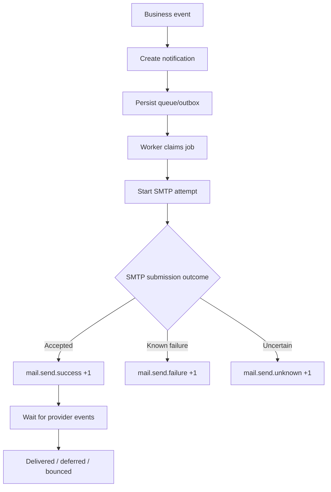

# Metric số message tạo, gửi, thành công và thất bại

Trong ứng dụng **Spring Framework Mail**, việc gọi `JavaMailSender.send(...)` là một bước trong chuỗi xử lý email. Khi số lượng email tăng, log đơn lẻ không đủ để biết hệ thống đang tạo bao nhiêu thông báo, đã thử gửi bao nhiêu lần, gửi qua SMTP thành công bao nhiêu lần, thất bại ở đâu và có tồn đọng trong hàng đợi hay không.

**Metric** là các phép đo dạng số theo thời gian, thường được thu thập qua Micrometer, Spring Boot Actuator và hệ thống quan sát như Prometheus/Grafana. Bốn nhóm metric căn bản gồm:

1. **Message được tạo** — ứng dụng đã ghi nhận bao nhiêu yêu cầu email logic.
2. **Message được gửi/thử gửi** — đã có bao nhiêu lần gọi SMTP hoặc provider API.
3. **Lần gửi thành công** — SMTP/provider đã chấp nhận submission bao nhiêu lần.
4. **Lần gửi thất bại** — có bao nhiêu attempt bị từ chối hoặc lỗi đã được xác định.

Khi thiết kế, phải phân biệt **logical notification**, **SMTP attempt**, **người nhận** và **delivery event**. Một email có thể được thử gửi nhiều lần; một lời gọi gửi thành công cũng **không chứng minh thư đã tới inbox**. Nếu trộn các khái niệm đó, dashboard có thể báo tỷ lệ thành công cao trong khi người nhận không nhận được thư, hoặc tỷ lệ lỗi bị thổi phồng chỉ vì retry.

Bài học trình bày cách đặt tên và định nghĩa metric, tạo counter/timer/gauge bằng Micrometer, gắn đo đạc vào Spring Mail, xử lý retry và queue/outbox, xây dashboard/alert, tránh cardinality cao và kiểm thử tính nhất quán của phép đo.

## 1. Metric giúp trả lời những câu hỏi vận hành nào?

Một hệ thống gửi mail cần trả lời được các câu hỏi ở nhiều cấp độ:

- Trong 15 phút gần đây, bao nhiêu yêu cầu email mới được tạo?
- Bao nhiêu lần worker đã thử gửi qua SMTP?
- Trong số những attempt đó, bao nhiêu lần SMTP đã chấp nhận?
- Bao nhiêu attempt bị từ chối vì authentication, timeout, quota hoặc chính sách?
- Có bao nhiêu message vẫn nằm trong outbox và đã chờ bao lâu?
- Lỗi chỉ xảy ra ở một SMTP route hay tất cả route?
- Khi ứng dụng được triển khai lại, lưu lượng gửi có bị gián đoạn không?
- Sau khi credential SMTP được sửa, backlog có giảm dần không?
- Một đợt retry có làm tăng số lần gửi nhưng không tăng số message được tạo không?
- Có bao nhiêu email được nhà cung cấp xác nhận phân phát hoặc báo bounce về sau?

Các câu hỏi này không thể trả lời đúng bằng một counter tên chung `mail.sent` mà không có định nghĩa. Cần đặt **ngữ nghĩa** trước khi chọn tên metric.

### Một chuỗi sự kiện minh họa

```text
Order confirmed
       |
       v
Create logical mail notification
       |        +1 message created
       v
Persist outbox record
       |
       v
Worker claims record
       |
       v
SMTP attempt #1
       |        +1 send attempt
       v
Temporary failure
       |        +1 failed attempt
       v
Retry scheduled
       |
       v
SMTP attempt #2
       |        +1 send attempt
       v
SMTP accepts message
       |        +1 send success
       v
Provider later reports delivery
                +1 provider delivery event
```

Trong ví dụ này:

- **1** message logic được tạo.
- **2** lần thử gửi.
- **1** lần gửi thành công ở tầng SMTP.
- **1** lần thử thất bại.
- Có thể có **1** sự kiện provider-reported delivery đến sau.

Nếu chỉ đếm số lần gọi `send` rồi gắn nhãn “số email”, dashboard sẽ thể hiện **2 email** dù về mặt nghiệp vụ chỉ có **1 thông báo**.

## 2. Xác định đơn vị đếm trước khi tạo Counter

Nên phân biệt các thực thể sau:

| Thực thể | Ý nghĩa | Một ID phù hợp |
|---|---|---|
| **Logical notification** | Một ý định gửi nội dung cụ thể cho một người nhận | `notificationId` |
| **Recipient** | Đích nhận của notification | `recipientRef` |
| **Submission attempt** | Một lần thử chuyển message tới SMTP/provider | `attemptId` |
| **MIME message** | Cấu trúc thư cụ thể được dựng bằng Jakarta Mail | Header `Message-ID` nếu có |
| **Provider event** | Sự kiện xử lý/phân phát sau submission | `providerEventId` |

Một event nghiệp vụ có thể tạo nhiều notification. Ví dụ `ORDER_CONFIRMED` có thể tạo thư cho khách hàng và người bán. Hai thư này nên có hai `notificationId` khác nhau, dù dùng chung `correlationId`.

### Quy ước đếm theo recipient

Đối với email giao dịch cần thống kê rõ ràng, một quy ước thực tế là **mỗi thông báo logic hướng tới một recipient được tính là một message tạo**.

Ví dụ:

```text
Domain event: ORDER_CONFIRMED
      |
      +--> Customer email -> notification A -> created +1
      |
      +--> Seller email   -> notification B -> created +1
```

Tổng `created=2`. Không nên coi một sự kiện nghiệp vụ luôn tương đương một message.

Nếu ứng dụng gửi một MIME message chứa nhiều recipient trong `To/Cc/Bcc`, việc đếm cần được xác định riêng. Một lần gọi transport có thể tạo kết quả khác nhau cho các recipient. Để thống kê per-recipient nhất quán, thường dễ quản lý hơn khi tạo notification riêng cho từng người nhận; nếu chọn gửi theo batch, cần thêm metric kết quả riêng theo recipient.

## 3. Định nghĩa rõ bốn counter cốt lõi

Một hệ thống có thể chọn bộ tên Micrometer dạng dấu chấm:

| Tên Micrometer | Tên thường thấy khi Prometheus export | Điều kiện tăng |
|---|---|---|
| `mail.message.created` | `mail_message_created_total` | Một yêu cầu mail logic đã được tạo/ghi nhận theo contract. |
| `mail.send.attempt` | `mail_send_attempt_total` | Bắt đầu một lần submit qua SMTP/provider. |
| `mail.send.success` | `mail_send_success_total` | Lần submit được transport báo thành công. |
| `mail.send.failure` | `mail_send_failure_total` | Lần submit có thất bại **được xác định** theo chính sách phân loại. |

Tên metric chỉ là đề xuất; nên tuân theo quy ước naming của tổ chức và tránh đăng ký hai tên cho cùng một phép đo. Prometheus exporter thường chuẩn hóa dấu chấm thành dấu gạch dưới và thêm hậu tố counter `_total`; tên chính xác cần quan sát ở endpoint thực tế của phiên bản Micrometer/registry đang dùng.

**Quan trọng:** Định nghĩa `created` là khi tạo một **logical notification** được chấp nhận trong hệ thống; không phải cứ gọi `new MimeMessage()` là tăng created. Một notification có thể render nhiều lần khi retry; nếu đếm theo đối tượng MIME, số message được tạo sẽ tăng sai.

### “Gửi” ở đây phải được hiểu là attempt

`mail.send.attempt` đếm **mỗi lần ứng dụng thực sự bắt đầu thao tác gửi**. Nó không có nghĩa tất cả thư đó đã được SMTP chấp nhận.

Nếu muốn hiển thị trên dashboard tiếng Việt, dùng tên “Số lần thử gửi” hoặc “SMTP submission attempts” thay vì chỉ ghi “Đã gửi”.

`mail.send.success` đếm **attempt được SMTP/provider chấp nhận**, không phải xác nhận giao vào inbox. Đối với provider API, cần định nghĩa success dựa trên contract trả về của API (ví dụ request accepted/queued), không gộp với webhook delivered.

### Khi nào tăng failure?

`mail.send.failure` nên tăng khi kết quả attempt là thất bại đã xác định, ví dụ:

- SMTP từ chối xác thực trước khi nhận message.
- Server trả response từ chối rõ ràng ở giai đoạn gửi.
- Lớp transport trả một lỗi đã được phân loại thành `KNOWN_REJECTED`.

Không nên tự động coi **mọi** `MailException` là bằng chứng thư chắc chắn chưa được nhận. Timeout hoặc mất kết nối sau khi truyền DATA có thể khiến kết quả **không xác định**.

Vì vậy, nên có thêm:

| Tên Micrometer | Ý nghĩa |
|---|---|
| `mail.send.unknown` | Attempt không rõ SMTP/provider đã chấp nhận hay chưa. |
| `mail.render.failure` | Lỗi render subject/body hoặc chuẩn bị nội dung trước attempt. |
| `mail.message.rejected` | Yêu cầu tạo notification bị từ chối do validation/policy, nếu cần quan sát. |

Việc bổ sung `unknown` tránh gắn sai nhãn “thất bại” cho những attempt có thể đã gửi thành công.

## 4. Counter khác Gauge và Timer như thế nào?

Micrometer cung cấp nhiều loại meter. Chọn đúng loại giúp số liệu có ý nghĩa khi theo dõi theo thời gian.

| Loại meter | Ví dụ | Cách sử dụng |
|---|---|---|
| **Counter** | Số message created, attempts, successes, failures | Tăng theo sự kiện; đọc bằng rate/increase trên một khoảng thời gian. |
| **Gauge** | Số job PENDING hiện tại, số attempt đang chạy | Biểu diễn giá trị tại thời điểm scrape. |
| **Timer** | Thời gian một SMTP attempt | Thu số lần, tổng thời gian và tùy cấu hình histogram. |
| **DistributionSummary** | Kích thước MIME message/attachment | Quan sát phân phối giá trị số không phải thời gian. |
| **LongTaskTimer** | Số/thời gian tác vụ kéo dài còn chạy | Dùng khi cần theo dõi tác vụ đang kéo dài qua nhiều scrape. |

Không dùng Gauge để đếm tổng số thư đã gửi từ khi khởi động nếu mục tiêu là đo throughput theo khoảng thời gian. Counter phù hợp hơn vì hệ thống quan sát có thể tính tăng trưởng/rate và xử lý counter reset.

Ngược lại, số mail đang chờ gửi `PENDING` là giá trị có thể tăng hoặc giảm nên nên dùng Gauge, không phải Counter. Hai metric `mail.message.created` và `mail.outbox.pending` bổ sung nhau nhưng không thể thay thế nhau.

## 5. Thiết kế vòng đời metric cho email

Một workflow có nhiều điểm đo:



Tại các giai đoạn:

- Khi notification được tạo: tăng `mail.message.created` **một lần theo logical notification**.
- Khi worker bắt đầu thử gửi: tăng `mail.send.attempt`.
- Khi transport trả thành công: tăng `mail.send.success`.
- Khi xác định rõ attempt thất bại: tăng `mail.send.failure`.
- Nếu kết quả không rõ do mất phản hồi: tăng `mail.send.unknown`.
- Khi nhận webhook đã xác thực: tăng **metric delivery riêng**.

Chú ý rằng các counter là phép đo quan sát, **không phải sổ cái nghiệp vụ**. Chúng có thể bị mất nếu process dừng giữa việc commit database và tăng counter, hoặc bị lặp nếu event được xử lý lại. Để tính chính xác số logical notification theo lịch sử, cần truy vấn record bền vững hoặc hệ thống analytics có cơ chế deduplication.

## 6. Chuẩn bị Spring Boot Actuator và Micrometer

Với dự án Spring Boot dùng Gradle, thông thường cần actuator và Prometheus registry:

```gradle
dependencies {
    implementation 'org.springframework.boot:spring-boot-starter-mail'
    implementation 'org.springframework.boot:spring-boot-starter-actuator'
    runtimeOnly 'io.micrometer:micrometer-registry-prometheus'
}
```

Nếu dùng Maven, khai báo các dependency tương ứng theo dependency management của phiên bản Spring Boot đang dùng.

Micrometer cung cấp API như `MeterRegistry`, `Counter`, `Timer` và `Gauge`. Spring Boot Actuator có thể tự tích hợp registry để xuất metric ra endpoint cho hệ thống giám sát.

Ví dụ cấu hình:

```yaml
management:
  endpoints:
    web:
      exposure:
        include: health,info,prometheus
  metrics:
    tags:
      application: notification-service
    distribution:
      percentiles-histogram:
        mail.smtp.attempt.duration: true
```

Cấu hình này minh họa việc cho phép xuất metric Prometheus và bật histogram cho một timer. Tên property, endpoint và khả năng registry có thể thay đổi giữa các phiên bản; nên đối chiếu phiên bản Spring Boot/Micrometer đang sử dụng.

### Không để metric endpoint công khai không kiểm soát

`/actuator/prometheus` có thể lộ tên service, SMTP route, lỗi và tình trạng vận hành. Khi triển khai:

- Chỉ cho hệ thống giám sát được truy cập qua mạng/authorization phù hợp.
- Không public toàn bộ actuator endpoint ra Internet.
- Không đưa credential, địa chỉ recipient hoặc dữ liệu nghiệp vụ nhạy cảm vào metric tags.
- Có quyền và chính sách retention trên monitoring backend.
- Đảm bảo scrape có tính sẵn sàng khi replica được rollout.

Không cần bật SMTP protocol debug để đo số lần gửi; debug có thể chứa thông tin nhạy cảm và không phù hợp làm nguồn metric chính.

## 7. Tạo lớp MailMetricsRecorder dùng Micrometer

Nên tập trung đo đạc trong một component nhỏ thay vì copy `Counter.builder(...)` vào mọi service.

```java
import io.micrometer.core.instrument.Counter;
import io.micrometer.core.instrument.MeterRegistry;
import io.micrometer.core.instrument.Timer;
import org.springframework.stereotype.Component;

@Component
public class MailMetricsRecorder {

    private final MeterRegistry registry;

    public MailMetricsRecorder(MeterRegistry registry) {
        this.registry = registry;
    }

    public void messageCreated(String type) {
        Counter.builder("mail.message.created")
                .description("Created logical mail notifications")
                .tag("type", type)
                .register(registry)
                .increment();
    }

    public void attemptStarted(String route, String type) {
        Counter.builder("mail.send.attempt")
                .tags("route", route, "type", type)
                .register(registry)
                .increment();
    }

    public void attemptAccepted(String route, String type) {
        Counter.builder("mail.send.success")
                .tags("route", route, "type", type)
                .register(registry)
                .increment();
    }

    public void attemptKnownFailure(
            String route,
            String type,
            String errorCategory
    ) {
        Counter.builder("mail.send.failure")
                .tags(
                        "route", route,
                        "type", type,
                        "error", errorCategory
                )
                .register(registry)
                .increment();
    }

    public void attemptUnknown(String route, String type) {
        Counter.builder("mail.send.unknown")
                .tags("route", route, "type", type)
                .register(registry)
                .increment();
    }

    public void recordAttemptDuration(
            String route,
            long elapsedNanos
    ) {
        Timer.builder("mail.smtp.attempt.duration")
                .tag("route", route)
                .register(registry)
                .record(
                        elapsedNanos,
                        java.util.concurrent.TimeUnit.NANOSECONDS
                );
    }
}
```

Lớp này giữ đúng ý nghĩa của từng metric; các nơi gọi không cần biết chi tiết API Micrometer.

**Cảnh báo:** `type`, `route` và `errorCategory` phải đến từ danh mục giá trị có giới hạn, ví dụ enum hoặc map chuẩn hóa. Không truyền tùy ý từ HTTP request, raw SMTP message hoặc tên exception không được chuẩn hóa. Nếu có nhiều tag value tùy ý, số lượng time series có thể tăng không kiểm soát.

### Vì sao không khởi tạo counter mới liên tục bằng new?

`Counter.builder(...).register(registry)` với tên/tag giống nhau thường trả về meter đã đăng ký; đây không phải cách tăng một object mới cho mỗi lần gửi. Dù vậy, với những metric được gọi nhiều, có thể cache handle cho các tổ hợp tag cố định để giảm overhead.

Đừng cache theo `notificationId`, vì như vậy bạn sẽ tạo meter riêng cho từng email và gây cardinality cao.

## 8. Gắn metric vào điểm gửi SMTP

Ví dụ gateway gửi qua `JavaMailSender`:

```java
import jakarta.mail.internet.MimeMessage;
import org.springframework.mail.MailAuthenticationException;
import org.springframework.mail.MailException;
import org.springframework.mail.javamail.JavaMailSender;
import org.springframework.stereotype.Service;

@Service
public class InstrumentedSmtpGateway {

    private final JavaMailSender mailSender;
    private final MailMetricsRecorder metrics;

    public InstrumentedSmtpGateway(
            JavaMailSender mailSender,
            MailMetricsRecorder metrics
    ) {
        this.mailSender = mailSender;
        this.metrics = metrics;
    }

    public void submit(
            MimeMessage message,
            String approvedRoute,
            String notificationType
    ) {
        long started = System.nanoTime();

        metrics.attemptStarted(
                approvedRoute,
                notificationType
        );

        try {
            mailSender.send(message);

            // Thành công ở tầng SMTP submission,
            // không có nghĩa email đã vào inbox.
            metrics.attemptAccepted(
                    approvedRoute,
                    notificationType
            );
        } catch (MailAuthenticationException exception) {
            // Lỗi AUTH trước bước gửi message là known failure.
            metrics.attemptKnownFailure(
                    approvedRoute,
                    notificationType,
                    "authentication"
            );
            throw exception;
        } catch (MailException exception) {
            // Chưa đủ bằng chứng phân loại như một rejection
            // chắc chắn. Theo dõi dưới nhóm unknown.
            metrics.attemptUnknown(
                    approvedRoute,
                    notificationType
            );
            throw exception;
        } finally {
            metrics.recordAttemptDuration(
                    approvedRoute,
                    System.nanoTime() - started
            );
        }
    }
}
```

Ví dụ này **cố ý thận trọng**: những `MailException` chưa được phân loại được ghi `unknown`, không tự kết luận “SMTP chắc chắn chưa nhận”. Trong hệ thống thật, cần một lớp classifier đọc cause, response code, giai đoạn xảy ra lỗi và ngữ nghĩa transport/provider để phân biệt `KNOWN_REJECTED` với `UNKNOWN`.

### Không double-count cùng một attempt

Một attempt nên có:

```text
attemptStarted +1
        |
        +-- success +1
        OR
        +-- failure +1
        OR
        +-- unknown +1
```

Các nhóm kết quả phải **loại trừ nhau** cho cùng attempt, nếu không báo cáo tổng sẽ phình lên.

Không tăng `mail.send.failure` ở cả gateway và caller catch cùng exception. Nên chọn **một điểm sở hữu metric** — thường là gateway/worker nơi outcome được xác định — rồi các lớp trên chỉ ghi log hoặc cập nhật nghiệp vụ.

### Nếu lỗi xảy ra trước khi gọi send?

Lỗi validation, template render hoặc dựng `MimeMessage` trước khi bắt đầu attempt không nên tăng `mail.send.attempt`. Có thể đo riêng:

```text
mail.render.failure{reason="template_missing"}
mail.render.failure{reason="invalid_input"}
mail.mime.build.failure{reason="invalid_attachment"}
```

Điều này giúp phân biệt lỗi dữ liệu nội bộ với lỗi SMTP provider.

## 9. Chuẩn hóa loại lỗi thay vì dùng raw exception message

Những exception liên quan gửi mail gồm `MailAuthenticationException`, `MailSendException`, lỗi network/TLS và từ chối SMTP. Tuy nhiên, một tên exception không đủ để biết một attempt có thể retry hay không.

Một taxonomy metric nên ngắn gọn, ví dụ:

| `error` tag | Ví dụ | Gợi ý xử lý |
|---|---|---|
| `authentication` | Credential/cơ chế AUTH bị từ chối | Kiểm tra secret, policy, token; tránh retry mù. |
| `connection` | Không kết nối được SMTP host | Kiểm tra DNS, firewall, availability. |
| `tls` | Handshake hoặc chứng chỉ TLS lỗi | Kiểm tra transport và TLS config. |
| `recipient_rejected` | Server từ chối recipient đã xác định | Kiểm tra địa chỉ/policy. |
| `rate_limited` | Provider báo throttling | Retry theo backoff, giới hạn concurrency. |
| `message_rejected` | Message bị từ chối về nội dung/size/policy | Kiểm tra nguyên nhân cụ thể. |
| `unclassified` | Chưa xác định được lỗi | Điều tra qua log/attempt record. |

Đừng đưa `exception.getMessage()` trực tiếp làm tag. Message có thể chứa hostname, email, status text thay đổi theo request hoặc dữ liệu nhạy cảm, gây số lượng time series rất lớn.

**Metric labels phải đủ để tổng hợp, không phải để xác định từng email.** Chi tiết attempt ID, correlation ID và nguyên nhân gốc nên nằm trong log/tracing và record có quyền truy cập phù hợp.

## 10. Ghi nhận số message tạo đúng thời điểm

Một notification logic có thể được tạo bởi HTTP request, scheduler hoặc domain event. Khi nào tăng `mail.message.created` phụ thuộc contract:

- Nếu hệ thống dùng outbox, tăng khi notification **được ghi nhận thành công theo logic ứng dụng**.
- Nếu không có outbox, có thể tăng khi service chấp nhận notification để xử lý; cần ghi rõ đây là **accepted in-memory**, không bảo đảm bền vững.
- Nếu chỉ đếm sau `new MimeMessage()`, retry sẽ khiến số message tạo bị nhân lên.
- Nếu đếm trước transaction commit, rollback có thể để lại metric created dù không có notification bền vững.

Một mô hình:

```text
Business transaction
    |
    +--> Save order
    |
    +--> Insert outbox(notificationId)
    |
    v
Commit
    |
    v
Record mail.message.created +1
```

Có thể dùng sự kiện sau commit hoặc đo ở nơi xác nhận enqueue thành công. Tuy nhiên, **metric increment không nằm trong transaction database**. Nếu process chết sau commit nhưng trước khi tăng counter, metric có thể thiếu một created. Đây là giới hạn của telemetry dạng best-effort.

### Để báo cáo lịch sử chính xác, dùng dữ liệu bền vững

Counter phù hợp để quan sát traffic và phát hiện bất thường. Để tính **số notification duy nhất chính xác** theo một ngày hoặc một chiến dịch, thường nên truy vấn bảng notification/outbox hoặc pipeline analytics có deduplication dựa trên `notificationId`.

Một metric không tự cung cấp exactly-once; việc cố “sửa” bằng cách nhúng notification ID vào tag là sai vì tạo cardinality cao.

## 11. Retry làm thay đổi metric như thế nào?

Giả sử một notification được tạo rồi thử gửi ba lần:

```text
notificationId = notif-001
created        = +1

attempt 1: 421 temporary failure
  attempt = +1
  failure = +1 (nếu có bằng chứng known rejection)

attempt 2: SMTP timeout with unknown outcome
  attempt = +1
  unknown = +1

attempt 3: SMTP accepted
  attempt = +1
  success = +1
```

Kết quả:

| Metric | Tăng thêm |
|---|---:|
| `mail.message.created` | 1 |
| `mail.send.attempt` | 3 |
| `mail.send.success` | 1 |
| `mail.send.failure` | 1 |
| `mail.send.unknown` | 1 |

**Một notification có thể làm tăng nhiều counter attempt**, do đó không lấy `success_total / created_total` rồi mặc định là “tỷ lệ gửi thành công”. Hai counter có đơn vị đếm khác nhau và có thể thuộc các khoảng thời gian khác nhau.

### Retry không được thay logical ID

Nên giữ:

```text
notificationId = notif-001
correlationId  = corr-901
```

cho mọi lần thử, nhưng tạo `attemptId` mới. Các ID này hữu ích trong log/DB, **không dùng làm metric tag**.

### Phân biệt automatic retry và manual resend

Một thao tác “resend” có thể mang hai nghĩa:

- Retry cùng notification do lỗi tạm thời.
- Tạo notification mới theo yêu cầu người dùng dù thư cũ đã SMTP accepted.

Hai trường hợp nên có contract khác nhau. Nếu là notification mới, tăng created. Nếu chỉ retry một notification cũ, chỉ tăng attempt; không tăng created thêm.

## 12. Hai loại tỷ lệ thành công dễ bị nhầm

### 12.1. SMTP attempt acceptance rate

Đo phần trăm attempt được transport xác nhận thành công:

\[
\text{Attempt acceptance rate} =
\frac{\text{successful SMTP attempts}}
{\text{all SMTP attempts}}
\times 100\%
\]

Ví dụ trong một khoảng quan sát:

- 900 attempt bắt đầu.
- 850 attempt SMTP accepted.
- 40 known failure.
- 10 unknown.

Attempt acceptance rate là `850 / 900 ≈ 94,4%`.

Đây là tỷ lệ thành công của **lần thử gửi**, không phải tỷ lệ email cuối cùng được phân phát.

### 12.2. Logical notification submission completion rate

Đo tỉ lệ notification **duy nhất** đã có submission accepted:

\[
\text{Logical completion rate} =
\frac{\text{unique notifications with SMTP accepted}}
{\text{eligible notifications in a cohort}}
\times 100\%
\]

Để tính chính xác chỉ số thứ hai, nên dùng state của notification/outbox có ID ổn định và một cohort được định nghĩa rõ. Các counter attempt đơn giản không đủ, vì retry và thời gian chờ làm sai mối quan hệ.

### 12.3. Provider-reported delivery rate

Nếu có webhook provider, có thể đo theo định nghĩa của provider:

\[
\text{Provider reported delivery rate} =
\frac{\text{notifications reported delivered}}
{\text{eligible tracked notifications}}
\times 100\%
\]

**Không có webhook không có nghĩa failure.** Phải xác định cửa sổ quan sát, độ trễ event, suppression/bounce policy và mức độ bao phủ tracking. Provider “delivered” cũng không tự chứng minh email ở inbox hoặc được đọc.

## 13. Thêm Timer đo thời gian gửi

Counter cho biết số lượng; Timer cho biết **độ chậm** và số lần thực hiện.

Ví dụ:

```java
import io.micrometer.core.instrument.MeterRegistry;
import io.micrometer.core.instrument.Timer;

public class TimedMailSender {

    private final JavaMailSender mailSender;
    private final MeterRegistry registry;

    public TimedMailSender(
            JavaMailSender mailSender,
            MeterRegistry registry
    ) {
        this.mailSender = mailSender;
        this.registry = registry;
    }

    public void send(MimeMessage message) {
        Timer.Sample sample = Timer.start(registry);

        try {
            mailSender.send(message);
        } finally {
            sample.stop(
                    Timer.builder("mail.smtp.attempt.duration")
                            .tag("route", "primary")
                            .register(registry)
            );
        }
    }
}
```

`finally` giúp đo thời gian cả khi gửi thất bại hoặc timeout. Nếu chỉ ghi duration sau `send` thành công, dashboard sẽ thiếu những attempt chậm nhất — nhóm thường đáng quan tâm nhất.

### Timer nên đo khoảng nào?

Hãy xác định rõ:

- `mail.render.duration`: tạo subject/HTML/plain text từ template.
- `mail.mime.build.duration`: dựng MIME message.
- `mail.smtp.attempt.duration`: thời gian gọi transport gửi.
- `mail.queue.wait.duration`: thời gian từ lúc enqueue đến lúc worker bắt đầu.
- `mail.end_to_end.duration`: từ lúc tạo notification đến một mốc kết thúc cụ thể.

Không trộn thời gian chờ queue với thời gian thao tác SMTP rồi gọi chung “SMTP latency”.

### P95/P99 và histogram

SMTP có thể có latency biến động lớn do TLS handshake, DNS, network hoặc provider chậm. Trung bình đôi khi che khuất request rất chậm.

Có thể dùng histogram để tính p95/p99 trên nhiều replica. Tuy nhiên, bật histogram cho quá nhiều tổ hợp tag có thể tăng số time series đáng kể. Chỉ bật cho những meter quan trọng và đặt SLO bucket phù hợp.

## 14. Gauge cho in-flight attempts và queue backlog

Counter không cho biết ngay hiện có bao nhiêu attempt đang chạy. Với tác vụ đang xử lý, dùng Gauge.

Ví dụ:

```java
import io.micrometer.core.instrument.Gauge;
import io.micrometer.core.instrument.MeterRegistry;
import java.util.concurrent.atomic.AtomicInteger;

public final class MailInFlightMetrics {

    private final AtomicInteger inFlight =
            new AtomicInteger(0);

    public MailInFlightMetrics(MeterRegistry registry) {
        Gauge.builder(
                "mail.send.inflight",
                inFlight,
                AtomicInteger::get
        ).description("Current in-flight mail attempts")
         .register(registry);
    }

    public void started() {
        inFlight.incrementAndGet();
    }

    public void finished() {
        inFlight.decrementAndGet();
    }
}
```

Nếu một attempt tăng in-flight ở `try` nhưng không giảm trong `finally`, gauge sẽ sai khi có exception. Cần quản lý tăng/giảm nhất quán tại đúng một điểm sở hữu.

Một lưu ý với Micrometer: Gauge thường giữ **weak reference** tới đối tượng quan sát. Ở ví dụ, `inFlight` là field mạnh của component, nên có thể tiếp tục được quan sát. Đừng tạo `new AtomicInteger(...)` trong biểu thức đăng ký rồi bỏ mọi reference.

### Backlog từ outbox

Các gauge hữu ích:

| Gauge | Ý nghĩa |
|---|---|
| `mail.outbox.pending` | Số notification đang chờ xử lý. |
| `mail.outbox.processing` | Số job đã claim và chưa hoàn tất. |
| `mail.outbox.oldest.age` | Tuổi của job PENDING cũ nhất. |
| `mail.send.inflight` | Số attempt đang thực hiện tại instance. |
| `mail.worker.capacity` | Số slot xử lý tối đa được cấu hình, nếu cần. |

Với Prometheus, nên dùng đơn vị rõ ràng, ví dụ tên được export thành `mail_outbox_oldest_age_seconds`. Nếu một metric được đăng ký là Gauge bằng seconds, không trộn phút/millisecond trong cùng time series.

### Tránh query database tốn kém mỗi lần scrape

Một Gauge thực hiện `SELECT COUNT(*)` trên bảng outbox có hàng triệu record theo mỗi scrape có thể gây tải đáng kể. Có thể:

- Dùng index và query tối ưu.
- Cập nhật snapshot định kỳ trong một bean chuyên trách.
- Dùng cache có giới hạn staleness.
- Thu số liệu từ queue broker nếu broker có metric sẵn.

Cần ghi rõ rằng một gauge cached là **snapshot**, không nhất thiết phản ánh trạng thái từng millisecond.

## 15. Metric theo lỗi render, MIME và SMTP phải tách nhau

Một email có thể không đến được bước gửi do lỗi nội bộ:

```text
Notification created
    |
    v
Render Thymeleaf template
    |
    +-- Missing key / invalid input
    |      -> render failure
    |
    v
Build MIME message
    |
    +-- Invalid attachment / header
    |      -> MIME build failure
    |
    v
Call JavaMailSender.send()
           -> SMTP attempt
```

Nếu mọi lỗi đều tăng `mail.send.failure`, người vận hành có thể đổ lỗi cho SMTP provider dù thực tế template bị thiếu biến.

Một sơ đồ metric:

| Giai đoạn | Metric đề xuất | Ví dụ lỗi |
|---|---|---|
| Notification input/creation | `mail.message.rejected` | Validation, unauthorized recipient. |
| Template rendering | `mail.render.failure` | Missing template, missing required variable. |
| MIME building | `mail.mime.build.failure` | Attachment không đọc được, dữ liệu header sai. |
| SMTP submission | `mail.send.failure` | SMTP reject/authentication. |
| SMTP submission ambiguity | `mail.send.unknown` | Timeout, kết nối mất sau DATA. |
| Delivery sau submission | `mail.provider.bounce` | Provider báo bounce. |

Có thể thêm một counter tổng quát `mail.pipeline.failure` nếu dashboard cần tổng số operation lỗi, nhưng phải quy định rõ nó có bao gồm retry và có trùng với các counter tầng dưới hay không. Không cộng các counter không cùng đơn vị rồi gọi đó là “số email thất bại”.

## 16. Metric cho delivery event là một tầng riêng

Sau khi `JavaMailSender.send(...)` trả thành công, email còn phải được provider và các máy chủ tiếp nhận xử lý.

Nếu provider có webhook, có thể đo:

- `mail.provider.delivered`
- `mail.provider.bounced`
- `mail.provider.deferred`
- `mail.provider.complaint`
- `mail.provider.suppressed`

**Các counter này chỉ tăng khi nhận bằng chứng tương ứng từ provider**, không phải ngay sau `send`.

### Webhook có thể được gửi lặp

Provider có thể retry webhook khi ứng dụng trả timeout hoặc 5xx. Nếu mỗi lần nhận webhook đều tăng `mail.provider.delivered`, metric có thể đếm hai lần một delivery event.

Cần xác định:

1. Webhook được xác thực theo contract provider.
2. Sự kiện có ID hoặc deduplication key phù hợp.
3. Event được kiểm tra xem đã áp dụng chưa.
4. Cập nhật delivery record atomically.
5. Metric được phát từ điểm xử lý sự kiện đã được chấp thuận.

Dù có deduplication, việc ghi DB và tăng in-process metric vẫn không phải một transaction chung. Vì vậy metric vẫn là telemetry best-effort; để báo cáo lịch sử chính xác theo notification, đọc dữ liệu event store đã deduplicate.

### Delivered không đồng nghĩa inbox/read

Một số provider báo delivered khi máy chủ đích đã chấp nhận email. Không nên đổi tên `mail.provider.delivered` thành “đã vào inbox” trừ khi hệ thống có bằng chứng thật cho mốc đó. Open tracking cũng không phải bằng chứng chắc chắn người dùng đã đọc thư.

## 17. Bộ tags/labels cho mail metrics

Micrometer cho phép phân chia metric theo tag; Prometheus lưu mỗi tổ hợp nhãn thành một time series riêng.

Các tag hữu ích và có giới hạn:

| Tag | Ví dụ | Lưu ý |
|---|---|---|
| `type` | `order_confirmation`, `password_reset` | Lấy từ enum hoặc catalog hữu hạn. |
| `route` | `primary`, `backup` | Dùng alias nội bộ, không chứa secret/host nhạy cảm. |
| `result` | `accepted`, `failed`, `unknown` | Danh sách kết quả cố định. |
| `error` | `authentication`, `tls`, `rate_limited` | Taxonomy hữu hạn. |
| `environment` | `staging`, `production` | Thường được cấu hình ở registry/common tags. |
| `provider` | `smtp_relay_a`, `smtp_relay_b` | Có thể dùng nếu số provider nhỏ. |

Không dùng các giá trị sau làm tag:

- `notificationId`, `attemptId`, `correlationId`, `traceId`.
- Raw recipient email, tên người dùng, số điện thoại.
- Full subject, template body hoặc exception message.
- Mã đơn hàng, UUID của user hoặc tenant ID không có giới hạn.
- URL đầy đủ, query string, attachment filename.
- Provider message ID.

### Vì sao cardinality quan trọng?

Giả sử metric có:

- 10 loại email.
- 3 SMTP route.
- 7 loại lỗi.
- 2 môi trường.
- 500.000 notification ID.

Nếu gắn mọi trường, số tổ hợp series có thể tăng cực lớn và làm hệ thống giám sát tốn tài nguyên. Chỉ nên dùng một số nhãn có cardinality thấp để tổng hợp; dữ liệu nhận diện từng request thuộc về log, trace và database.

### Giữ nhãn nhất quán theo tên metric

Nếu `mail.send.attempt` có các tag `route` và `type`, nhưng `mail.send.success` được gắn thêm một tag `error` không tồn tại ở success, Prometheus vẫn có thể tổng hợp bằng `sum(...)`. Tuy nhiên, khi xây dashboard theo route/type, cần bảo đảm các chuỗi được nhóm tương thích. Không tạo tag với giá trị ngẫu nhiên hoặc null.

## 18. Prometheus: đọc counter theo khoảng thời gian

Counter đơn điệu tăng trong vòng đời process. Nếu process restart, giá trị có thể bắt đầu lại từ 0. Do đó, để hỏi “15 phút gần đây có bao nhiêu lần gửi?”, không đọc thẳng giá trị counter tức thời như một con số lịch sử tích lũy toàn hệ thống.

Các hàm thường dùng:

- `rate(counter[5m])`: tốc độ trung bình mỗi giây trên cửa sổ.
- `increase(counter[15m])`: số lần tăng ước lượng trong cửa sổ.
- `sum(...)`: tổng hợp qua nhiều instance/replica.
- `histogram_quantile(...)`: percentile từ histogram bucket.

### Tổng message tạo trong 1 giờ

```promql
sum(increase(mail_message_created_total[1h]))
```

### Tổng attempt gửi trong 1 giờ

```promql
sum(increase(mail_send_attempt_total[1h]))
```

### Accepted, failed, unknown trong 1 giờ

```promql
sum(increase(mail_send_success_total[1h]))

sum(increase(mail_send_failure_total[1h]))

sum(increase(mail_send_unknown_total[1h]))
```

Các biểu thức trên giả định tên series sau khi export đúng với naming đã trình bày. Cần quan sát nội dung thực tế của `/actuator/prometheus` để dùng đúng tên và label.

### Tốc độ gửi thành công mỗi giây theo route

```promql
sum by (route) (
  rate(mail_send_success_total[5m])
)
```

Nếu mỗi route là một alias ổn định, dashboard có thể thấy route nào bị gián đoạn hoặc giảm throughput.

### Khi nào dùng sum trước/sau rate?

Thông thường với nhiều replica, tính `rate(...)` từng series rồi `sum(...)` để xử lý counter reset theo từng instance. Không lấy `rate(sum(counter)[5m])` nếu việc gộp counter trước khiến reset của một replica bị che khuất hoặc làm sai kết quả.

## 19. Tính tỷ lệ thành công, thất bại đúng mẫu số

Một tỷ lệ attempt acceptance theo cửa sổ 15 phút:

```promql
100 *
sum(increase(mail_send_success_total[15m]))
/
sum(increase(mail_send_attempt_total[15m]))
```

Nhưng cần lưu ý:

- Nếu không có attempt, mẫu số bằng 0; không diễn giải thành 100% hay 0% một cách tùy ý.
- Nếu attempt bắt đầu cuối cửa sổ nhưng kết quả đến sau, tử và mẫu có thể nằm ở hai cửa sổ khác nhau.
- Nếu một attempt vừa được ghi ở success nhưng metric ghi attempt bị mất do process crash, có thể có sai lệch.
- Retry làm số attempt lớn hơn số logical notification.

Để dashboard bớt nhiễu, có thể chỉ hiển thị tỷ lệ khi số attempt trong cửa sổ vượt ngưỡng tối thiểu được sản phẩm lựa chọn.

### Tỷ lệ known failure theo attempt

```promql
100 *
sum(increase(mail_send_failure_total[15m]))
/
sum(increase(mail_send_attempt_total[15m]))
```

`unknown` không nên âm thầm bị gộp vào failure nếu mục tiêu là phân biệt trạng thái không chắc chắn. Có thể tạo một tỷ lệ riêng:

```promql
100 *
sum(increase(mail_send_unknown_total[15m]))
/
sum(increase(mail_send_attempt_total[15m]))
```

Đối với câu hỏi nghiệp vụ “bao nhiêu notification cuối cùng đã được submit thành công”, nên đọc trạng thái cuối của notification theo cohort và thời gian, thay vì cố ép công thức từ các counter attempt.

## 20. Đối chiếu số message created và attempts

Hai counter có thể chênh nhau hợp lệ:

| Tình huống | Created | Attempts | Accepted | Known failures | Unknown |
|---|---:|---:|---:|---:|---:|
| Một email, gửi thành công lần đầu | 1 | 1 | 1 | 0 | 0 |
| Một email, thất bại rồi retry thành công | 1 | 2 | 1 | 1 | 0 |
| Một email, timeout rồi retry | 1 | 2 | 1 | 0 | 1 |
| Một email mới chỉ đang chờ outbox | 1 | 0 | 0 | 0 | 0 |
| Một email lỗi render trước SMTP | 1 | 0 | 0 | 0 | 0 |
| Hai email cho hai recipient, mỗi email gửi một lần | 2 | 2 | 2 | 0 | 0 |

Không phải lúc nào cũng có:

```text
created == attempts
attempts == success + failure
```

Do tồn tại retry, in-flight, unknown, batch semantics, độ trễ thu thập và sự kiện thuộc các cửa sổ thời gian khác nhau.

### Khi nào có thể kiểm tra bất biến?

Trong một **tập attempt đã kết thúc và được lưu bền vững**, nếu mỗi attempt có đúng một terminal outcome:

```text
completed_attempts
    = accepted
    + known_failed
    + unknown
```

Đây là một bất biến ở **attempt ledger/database**, không phải một đẳng thức tuyệt đối giữa các Counter time series lấy từ những lần scrape khác nhau. Metrics có thể mất event hoặc không đồng bộ ngay thời điểm tính.

## 21. Dashboard đề xuất cho vận hành Spring Mail

Một dashboard mail nên hiển thị **xu hướng và nguyên nhân**, không chỉ một ô “sent”.

| Panel | Metric/nguồn dữ liệu | Câu hỏi |
|---|---|---|
| Notifications created per minute | `rate(mail_message_created_total[5m])` | Nhu cầu gửi email đang tăng hay giảm? |
| SMTP attempts per minute | `rate(mail_send_attempt_total[5m])` | Worker đang hoạt động với tốc độ nào? |
| SMTP accepted per minute | `rate(mail_send_success_total[5m])` | Provider đang chấp nhận bao nhiêu attempt? |
| Known failures per minute | `rate(mail_send_failure_total[5m])` | Có lỗi thực sự đang tăng không? |
| Unknown outcomes per minute | `rate(mail_send_unknown_total[5m])` | Có timeout/giao tiếp không rõ kết quả không? |
| Failure breakdown | `sum by (error, route)(...)` | Lỗi tập trung ở route/nguyên nhân nào? |
| SMTP latency p95/p99 | Timer histogram | Provider chậm bất thường không? |
| In-flight attempts | `mail.send.inflight` | Có bao nhiêu worker đang bận? |
| Pending outbox / oldest age | Gauge DB/queue | Có tồn đọng hoặc mail quá hạn? |
| Delivery/bounce events | Provider event counters | Phân phát sau submission có vấn đề không? |

**Không nên chỉ hiển thị tỷ lệ success 100%** nếu throughput bằng 0 do worker ngừng xử lý. Cần đặt tỷ lệ cùng biểu đồ tổng attempts và backlog.

### Nên có panel theo thời gian nào?

- 5–15 phút: sự cố mới, credential lỗi, timeout.
- 1 giờ: throughput, retry storm, backlog.
- 24 giờ/7 ngày: xu hướng sản phẩm, gửi theo thời gian, lượng mail tạo.
- Dài hơn: có thể dùng analytics hoặc database summary vì raw metric có retention và cardinality limits.

Chọn khoảng quan sát phù hợp lịch hoạt động. Email nhắc lịch có thể phát theo lô, còn email đặt lại mật khẩu có traffic bất thường vào một số thời điểm.

## 22. Alert: không chỉ theo tỷ lệ lỗi

Một hệ thống có thể gửi lỗi vì provider authentication bị từ chối, backlog tăng do worker chết, hoặc lưu lượng giảm bất thường vì pipeline không tạo notification mới.

### Alert lỗi gửi cao khi có đủ lưu lượng

Biểu thức minh họa:

```promql
(
  sum(increase(mail_send_failure_total[15m]))
  /
  sum(increase(mail_send_attempt_total[15m]))
) > 0.05
and
sum(increase(mail_send_attempt_total[15m])) > 100
```

Điều kiện minh họa kích hoạt khi tỷ lệ known failure vượt 5% và tổng attempts vượt 100 trong 15 phút. Đây không phải ngưỡng mặc định của Spring Mail; phải điều chỉnh theo SLO và lưu lượng thật.

### Alert riêng cho unknown

Nếu timeout tăng mạnh nhưng bộ phân loại ghi mọi lỗi vào `mail.send.unknown`, alert chỉ nhìn `mail.send.failure` sẽ bỏ sót vấn đề.

Có thể cảnh báo khi unknown count hoặc rate vượt ngưỡng nhỏ, nhất là với email giao dịch có rủi ro gửi trùng.

### Alert backlog không giảm

Một tình huống:

```text
mail.message.created: increasing
mail.send.attempt:    near zero
mail.outbox.pending:  increasing
```

Có thể worker đã dừng, broker không kết nối được hoặc scheduler không chạy. Alert nên dựa trên backlog/oldest-age và worker health, không chỉ lỗi SMTP.

### Alert route hoặc authentication failure

Nếu một route có lượng lỗi `authentication` tăng, ưu tiên alert theo route thay vì một cảnh báo cho mỗi notification. Cần tránh retry liên tục cùng credential bị lỗi.

### Alert lưu lượng bằng 0

Traffic bằng 0 có thể bình thường với hệ thống nhỏ hoặc ngoài giờ. Chỉ cảnh báo “không tạo/gửi mail” khi có kỳ vọng rõ: ví dụ backlog đang có job, có notification mới được tạo, hoặc hệ thống theo lịch phải phát email. Không coi `rate=0` tự động là sự cố.

## 23. Metric cho hàng đợi và outbox

Với Spring Mail bất đồng bộ, SMTP có thể chạy ở một process khác với nơi tạo message. Chỉ đo counter ở sender không giúp biết backlog được tạo tại application.

Các chỉ số bổ sung:

| Metric | Định nghĩa gợi ý |
|---|---|
| `mail.outbox.pending` | Số job PENDING hiện tại. |
| `mail.outbox.processing` | Số job PROCESSING hoặc lease đang hợp lệ. |
| `mail.outbox.retry.scheduled` | Số job chờ retry tại thời điểm đo. |
| `mail.outbox.oldest.age` | Tuổi job PENDING lâu nhất, theo giây. |
| `mail.worker.claim` | Tổng lần claim job (counter). |
| `mail.worker.claim.failure` | Tổng lỗi claim/lock nếu cần. |
| `mail.queue.wait.duration` | Thời gian từ enqueue đến lúc worker bắt đầu. |
| `mail.worker.process.duration` | Thời gian xử lý job, có thể gồm render và SMTP. |

Nếu một worker crash khi đang giữ lease, job có thể được xử lý lại sau timeout. Lúc đó `mail.worker.claim` tăng hai lần trong khi `mail.message.created` vẫn chỉ tăng một.

### Không cố làm hàng đợi biến mất bằng cách tính created - accepted

Đôi khi người ta tính backlog từ:

```text
created_total - success_total
```

Cách này sai khi có retry, unknown, job bị chặn policy, job bị hủy hoặc counter reset. Hãy lấy backlog từ **trạng thái hàng đợi/outbox thực tế**.

### Tại sao oldest age quan trọng?

Backlog 100 job có thể bình thường sau một đợt batch ngắn. Nhưng nếu một job đã chờ 2 giờ trong khi SLA email là vài phút, đó là vấn đề dù số job chờ không lớn.

Cần đo cả số lượng pending lẫn tuổi job cũ nhất hoặc phân phối queue wait latency.

## 24. Độ tin cậy của metric khi nhiều instance và process restart

Trong mô hình nhiều replica:

```text
API instance A -> created +1
API instance B -> created +2

Worker instance X -> attempts +2
Worker instance Y -> attempts +1
```

Mỗi instance giữ counter trong bộ nhớ/registry riêng. Prometheus scrape chúng theo series tương ứng, rồi `sum(rate(...))` hoặc `sum(increase(...))` khi cần tổng hệ thống.

### Counter reset không phải sự cố gửi mail

Khi process restart, local counter có thể bắt đầu lại từ 0. Nếu dashboard vẽ raw counter, biểu đồ sẽ tụt. Dùng `rate`/`increase` và phân biệt reset do restart với traffic giảm.

### Job vẫn tồn tại nhưng metric ở process cũ mất

Nếu outbox lưu job bền vững, worker mới có thể tiếp tục gửi. Tuy nhiên, counter ở instance cũ sẽ không tồn tại mãi. Điều này là bình thường đối với telemetry in-process, không phải lý do để đặt notification ID vào metric tag.

### Xử lý khi telemetry backend không khả dụng

Gửi email nghiệp vụ không nên tự động thất bại chỉ vì Prometheus tạm thời không scrape được metric hoặc dashboard tắt. Micrometer thường ghi nhận metric trong registry của process; scrape bên ngoài có thể mất sample.

Thiết kế nên coi metric là quan sát bổ sung. **Trạng thái gửi và retry phải được quyết định bởi kết quả transport + storage nghiệp vụ**, không dựa vào việc một counter có được scrape thành công hay không.

## 25. Tránh đếm trùng do nhiều lớp cùng phát metric

Một pipeline có thể có những lớp:

```text
Controller -> NotificationService
           -> OutboxRepository
           -> MailWorker
           -> SmtpGateway
           -> ProviderWebhookHandler
```

Nếu cả controller, service và repository đều tăng `mail.message.created` cho cùng notification, dashboard sẽ ghi created=3.

Nên có một bảng **metric ownership**:

| Event | Lớp chịu trách nhiệm | Điều kiện |
|---|---|---|
| Logical message created | Notification admission/persistence boundary | Yêu cầu được chấp nhận theo contract một lần. |
| Send attempt started | SmtpGateway/transport boundary | Trước khi gọi send một lần. |
| Send success | SmtpGateway | Transport trả thành công. |
| Send known failure | SmtpGateway classifier | Lỗi được phân loại chắc chắn. |
| Send unknown | SmtpGateway classifier | Outcome không thể kết luận. |
| Render failure | Template renderer/orchestrator | Không tạo attempt SMTP. |
| Provider delivered/bounced | Verified webhook handler | Event thực sự được chấp nhận; xét dedup. |

Trong các lớp khác, có thể ghi log với `correlationId`, `notificationId` và `attemptId` để điều tra. Không nhân đôi counter chỉ vì có nhiều lớp tham gia xử lý cùng sự kiện.

## 26. Đặt instrumentation gần điểm biết kết quả nhất

Đôi khi service có dạng:

```java
public void process(MailJob job) {
    render(job);
    buildMime(job);
    mailSender.send(message);
    updateJobStatus(job);
}
```

Nếu tăng success ở cuối `process`, một exception khi cập nhật DB sau SMTP sẽ khiến attempt thực sự đã accepted nhưng metric success không tăng. Nếu tăng success ở đầu `process`, có thể báo thành công trước khi gửi.

Nguyên tắc: **gắn metric attempt ngay sát `JavaMailSender.send(...)`**, nơi có kết quả transport. Còn metric notification completion nên lấy ở lớp quản lý state sau khi record được cập nhật.

Sự khác nhau giữa hai metric có thể hợp lý khi database update lỗi. Chúng đại diện cho hai mốc khác nhau:

- `SMTP accepted` theo transport.
- `Notification state persisted` theo database.

Nếu cần, thêm metric `mail.state.persist.failure` để điều tra khoảng hở sau SMTP mà trước commit.

## 27. Kiểm thử các counter bằng SimpleMeterRegistry

Không cần server Prometheus hay SMTP thật để unit test việc tăng counter. Micrometer có `SimpleMeterRegistry` cho kiểm thử trong bộ nhớ.

Ví dụ kiểm tra số message tạo:

```java
import io.micrometer.core.instrument.simple.SimpleMeterRegistry;
import org.junit.jupiter.api.Test;
import static org.assertj.core.api.Assertions.assertThat;

@Test
void countsLogicalNotificationOnce() {
    try (SimpleMeterRegistry registry =
                 new SimpleMeterRegistry()) {

        MailMetricsRecorder metrics =
                new MailMetricsRecorder(registry);

        metrics.messageCreated("order_confirmation");

        double count = registry
                .get("mail.message.created")
                .tag("type", "order_confirmation")
                .counter()
                .count();

        assertThat(count).isEqualTo(1.0);
    }
}
```

Đây là kiểm thử minh họa của riêng recorder. Trong test tích hợp workflow, cần xác nhận notification được retry không tăng created thêm lần nữa.

### Test một attempt thành công

Có thể dùng Mockito để mock `JavaMailSender`, gọi gateway một lần và assert counter:

```java
@Test
void acceptedSmtpAttemptIncrementsSuccess() {
    try (SimpleMeterRegistry registry =
                 new SimpleMeterRegistry()) {

        JavaMailSender mailSender = mock(JavaMailSender.class);
        MimeMessage message = mock(MimeMessage.class);

        MailMetricsRecorder metrics =
                new MailMetricsRecorder(registry);

        InstrumentedSmtpGateway gateway =
                new InstrumentedSmtpGateway(
                        mailSender, metrics
                );

        gateway.submit(
                message,
                "primary",
                "order_confirmation"
        );

        assertThat(registry
                .get("mail.send.attempt")
                .tags(
                        "route", "primary",
                        "type", "order_confirmation"
                )
                .counter().count()
        ).isEqualTo(1.0);

        assertThat(registry
                .get("mail.send.success")
                .tags(
                        "route", "primary",
                        "type", "order_confirmation"
                )
                .counter().count()
        ).isEqualTo(1.0);

        verify(mailSender).send(message);
    }
}
```

Các import Mockito/JUnit và fixture cần được cấu hình theo dự án. Mục đích là kiểm tra: một lần submit thành công làm tăng **attempt một lần và success một lần**, không ghi delivery.

### Test lỗi authentication

```java
@Test
void authFailureIncrementsKnownFailure() {
    try (SimpleMeterRegistry registry =
                 new SimpleMeterRegistry()) {

        JavaMailSender mailSender = mock(JavaMailSender.class);
        MimeMessage message = mock(MimeMessage.class);

        doThrow(new MailAuthenticationException(
                new jakarta.mail.AuthenticationFailedException(
                        "Invalid test credentials"
                )
        )).when(mailSender).send(message);

        InstrumentedSmtpGateway gateway =
                new InstrumentedSmtpGateway(
                        mailSender,
                        new MailMetricsRecorder(registry)
                );

        assertThatThrownBy(() ->
                gateway.submit(
                        message,
                        "primary",
                        "order_confirmation"
                )
        ).isInstanceOf(MailAuthenticationException.class);

        assertThat(registry
                .get("mail.send.failure")
                .tags(
                        "route", "primary",
                        "type", "order_confirmation",
                        "error", "authentication"
                )
                .counter().count()
        ).isEqualTo(1.0);
    }
}
```

Không dùng credential thật trong test. Test các nhánh exception khác để đảm bảo unknown không đồng thời tăng success/failure.

## 28. Bộ test tình huống nên có

Một bảng kiểm thử semantic:

| Tình huống | Created | Attempt | Success | Failure | Unknown |
|---|---:|---:|---:|---:|---:|
| Notification được lưu, chưa gửi | +1 | 0 | 0 | 0 | 0 |
| Được gửi một lần, SMTP accepted | +1 | +1 | +1 | 0 | 0 |
| AUTH bị từ chối | +1 | +1 | 0 | +1 | 0 |
| SMTP timeout, kết quả chưa rõ | +1 | +1 | 0 | 0 | +1 |
| Retry sau known failure rồi thành công | +1 | +2 | +1 | +1 | 0 |
| Lỗi render trước bước gửi | +1 | 0 | 0 | 0 | 0 |
| Provider báo bounce sau acceptance | +1 | +1 | +1 | 0 | 0 |
| Một event tạo hai recipient notifications | +2 | Theo attempts | Theo outcomes | Theo outcomes | Theo outcomes |

Bảng đo **delta của một kịch bản**, không phải thay thế phần mềm đo metric đang chạy.

Những test quan trọng khác:

- Một lỗi bị bắt ở hai lớp không tạo hai failure increments.
- Counter outcome chỉ tăng một lần cho mỗi attempt.
- Type/route/error tag dùng enum hoặc mapping hữu hạn.
- Thời gian gửi được ghi cả khi success và exception.
- In-flight gauge trở về 0 sau `finally`.
- Retry không tăng created.
- Webhook gửi lại không làm tăng event đã deduplicate.
- Không có tag chứa recipient email/notification ID.
- Nếu queue enqueue thất bại hoặc transaction rollback, có thể giải thích được cách created được ghi theo contract.

Đây là những ví dụ **để học cách kiểm thử**; không cần chạy SMTP production để xác nhận.

## 29. Quan sát lỗi bảo mật và cấu hình SMTP

Trong vận hành, một số lỗi có đặc tính khác nhau:

- `MailAuthenticationException` tăng đột ngột: kiểm tra credential, cơ chế AUTH, secret rotation và provider policy.
- `connection` failure: kiểm tra DNS, network, firewall và độ sẵn sàng server.
- `tls` failure: kiểm tra port/TLS mode, chứng chỉ và chính sách SSL.
- `rate_limited`: giảm concurrency, dùng backoff và xem quota.
- `message_rejected`: kiểm tra giới hạn MIME size, sender policy hoặc recipient handling.

Có thể có nhiều lỗi ở cùng thời điểm. Dashboard nên hỗ trợ drill-down theo route và loại lỗi, còn log theo correlation/attempt ID để xem nguyên nhân cụ thể.

**Không nên gửi toàn bộ exception message vào metric tag.** Ngoài cardinality, việc này có thể lộ hostname nội bộ, account hoặc recipient.

## 30. Runbook khi metric bất thường

### Trường hợp A — Created tăng nhưng attempt gần bằng 0

1. Kiểm tra `mail.outbox.pending` và tuổi job cũ nhất.
2. Kiểm tra worker/scheduler/consumer có hoạt động không.
3. Kiểm tra khả năng claim job, kết nối database/broker và lease.
4. Kiểm tra rate limit, pause flag hoặc circuit breaker.
5. Không kết luận SMTP khỏe chỉ vì failure counter bằng 0: có thể không có attempt nào chạy.

### Trường hợp B — Attempt tăng nhanh hơn created nhiều lần

1. Kiểm tra số retry trên từng notification.
2. Xem error category, thời gian timeout và provider throttling.
3. Kiểm tra duplicate delivery/requeue hoặc worker claim race.
4. Kiểm tra retry backoff/jitter và max attempts.
5. Nếu outcome unknown, đánh giá nguy cơ gửi trùng thay vì retry mù quáng.

### Trường hợp C — Success giảm, authentication failure tăng

1. Xác định route bị ảnh hưởng.
2. Kiểm tra secret version, SMTP AUTH policy, app password/OAuth2 token.
3. Tránh retry liên tục khi credential bị từ chối lâu dài.
4. Tạm dừng route phù hợp, sửa cấu hình và thử vài job kiểm soát.
5. Resume backlog có rate limit; theo dõi cả created/attempt/success.

### Trường hợp D — Success cao nhưng người dùng báo không nhận mail

1. Nhắc lại rằng success ở đây chỉ là SMTP/provider submission.
2. Tra notification/attempt record và provider message ID.
3. Kiểm tra webhook delivered, deferred, bounced, suppressed.
4. Kiểm tra spam/quarantine và sender reputation nếu cần.
5. Không đổi success counter thành delivered khi chưa có bằng chứng.

### Trường hợp E — Dashboard bị mất metric sau deploy

1. Kiểm tra Actuator endpoint và quyền truy cập scrape.
2. Kiểm tra replica còn được Prometheus discovery hay không.
3. Kiểm tra metric có lazy registration, chưa phát sinh event nên chưa xuất hiện.
4. Kiểm tra tên metric sau normalization và labels.
5. Kiểm tra counter reset do restart; dùng `rate/increase`.
6. Xác minh registry và dependency Prometheus được cấu hình phù hợp.

## 31. Các sai lầm thường gặp

| Sai lầm | Hệ quả | Cách sửa |
|---|---|---|
| Tăng `created` mỗi lần dựng `MimeMessage` | Retry làm số message tạo bị tăng giả | Đếm logical notification tại ranh giới admission/persist. |
| Gọi `send` xong ghi `delivered` | Nhầm SMTP acceptance với inbox delivery | Đặt tên `SMTP_ACCEPTED`, dùng provider event riêng. |
| Đếm mọi `MailException` là known failure | Timeout không rõ kết quả bị kết luận sai | Thêm unknown outcome và classifier. |
| Tăng failure ở cả gateway và caller | Một lỗi bị đếm hai lần | Quy định owner của mỗi metric. |
| Dùng `created - success` làm backlog | Sai vì retry và outcome khác nhau | Lấy gauge từ queue/outbox state. |
| Gắn email/notification ID làm tag | Cardinality cao, rò rỉ PII | Dùng enum tags; ID nằm trong log/DB. |
| Chỉ nhìn error rate | Worker đứng im nhưng error = 0 | Theo dõi throughput, backlog và in-flight. |
| Dùng raw counter làm số ngày hôm nay | Reset khi instance restart | Dùng increase/rate hoặc analytics DB. |
| Retry sau timeout rồi tăng created | Một logical mail bị tính nhiều lần | Giữ notification ID, tạo attempt ID mới. |
| Dùng webhook raw count không dedup | Delivery bị đếm trùng | Xác thực và deduplicate provider events. |
| Chỉ đo thời gian gửi thành công | Bỏ sót những attempt lỗi chậm | Timer trong finally. |
| Lấy `success / created` làm delivery rate | Khác đơn vị và có queue lag | Dùng cohort-level state và provider evidence. |
| Alert 5% failure trên 1 attempt | Nhiễu do lưu lượng nhỏ | Đặt ngưỡng volume và cửa sổ phù hợp. |
| Public Prometheus endpoint | Lộ thông tin vận hành | Giới hạn network/authorization. |
| Đếm notification rejected như created | Thống kê nhu cầu không rõ | Định nghĩa acceptance và rejection riêng. |

## 32. Checklist triển khai

Một nhóm phát triển có thể thống nhất các điểm sau trước khi đưa mail metrics vào production:

1. Định nghĩa **created** là logical notification được chấp nhận theo contract rõ ràng.
2. Định nghĩa **attempt** là một lần gọi submit SMTP/provider, không phải một email duy nhất.
3. Định nghĩa **success** là transport accepted; không dùng “delivered”.
4. Định nghĩa **failure** là known failure; có nhóm **unknown** nếu không chắc kết quả.
5. Có một điểm sở hữu increment cho từng event.
6. Chỉ dùng tag có tập giá trị hữu hạn; không đưa PII, token hoặc ID riêng lẻ.
7. Ghi attempt ID/notification ID/correlation ID trong log/record thay vì metric labels.
8. Có Timer cho SMTP duration, kể cả attempt lỗi.
9. Có Gauge cho in-flight, queue depth và oldest age nếu dùng async/outbox.
10. Tách render/MIME errors khỏi SMTP failures.
11. Nếu có provider webhook, metric delivery/bounce là nguồn riêng và phải xét dedup.
12. Dashboard có count/rate/ratio cùng throughput, backlog và latency.
13. Alert có ngưỡng lưu lượng và cửa sổ quan sát phù hợp.
14. Không dùng metric best-effort thay cho sổ cái trạng thái nghiệp vụ.
15. Kiểm thử created/attempt/success/failure/unknown với retry và exception.
16. Xác nhận Actuator/Prometheus endpoint được bảo vệ.
17. Khi rollout, đối chiếu metric naming và label set thực tế trước khi tạo alert.
18. Ghi rõ chủ sở hữu metric và cách điều tra bằng log/outbox/provider event.

## 33. Ghi nhớ

- Metric của Spring Mail phải phân biệt **logical message created**, **SMTP send attempt**, **SMTP accepted**, **known failure** và **unknown outcome**.
- `JavaMailSender.send(...)` thành công không có nghĩa email đã tới inbox; provider delivery phải được đo riêng khi có bằng chứng.
- Một notification có thể có nhiều attempt do retry, vì vậy `created_total` và `attempt_total` không phải hai tên cho cùng một đại lượng.
- Với Micrometer, dùng `Counter` cho sự kiện, `Timer` cho latency và `Gauge` cho số tác vụ đang chạy/backlog.
- Chọn đúng điểm tăng counter, tránh cùng một exception bị nhiều lớp đếm trùng.
- Không đưa correlation ID, recipient, subject, message ID hoặc exception message vào metric tag.
- Dùng `sum(rate(...))` và `sum(increase(...))` khi tổng hợp nhiều instance; raw counter có thể reset khi restart.
- Success rate cần mẫu số phù hợp; không tính failure rate khi không có traffic rồi kết luận hệ thống khỏe.
- Đếm event bằng metric không bảo đảm exactly-once. Với số notification duy nhất có yêu cầu chính xác, dùng record bền vững.
- Dashboard và alert nên kết hợp created, attempts, outcome, latency, queue depth và tuổi backlog.
- Retry, outbox, webhook trùng và kết quả SMTP không chắc chắn đều cần được phản ánh trong contract metric.
- Bảo vệ telemetry endpoint như một thành phần vận hành của hệ thống.

**Kết luận:** Metric hiệu quả không bắt đầu từ việc thêm nhiều `Counter.increment()`, mà bắt đầu từ **định nghĩa chính xác từng sự kiện trong vòng đời email**. Khi message tạo, attempt gửi, kết quả SMTP và delivery event được đo riêng, ứng dụng Spring Framework Mail có thể quan sát được nhu cầu gửi, hiệu suất worker, lỗi provider và backlog mà không đánh đồng một lần gọi `send` thành công với việc thư đã được người nhận đọc.
