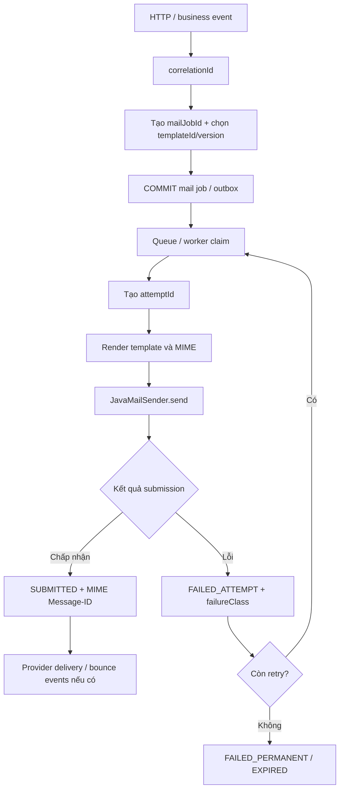

# Log message ID, template ID và correlation ID trong Spring Framework Mail

Khi ứng dụng gửi email bất đồng bộ, một thông điệp có thể đi qua nhiều thành phần: HTTP API, application service, database transaction, outbox, queue, worker, `JavaMailSender`, SMTP relay và nhà cung cấp email. Nếu một người dùng nói “Tôi không nhận được email”, hệ thống cần nối các bản ghi của **cùng một yêu cầu gửi** mà không phải mở raw email, in địa chỉ người nhận hoặc tìm thủ công trong hàng triệu dòng log.

Ba loại định danh đặc biệt hữu ích là:

- **Message ID**: định danh của thông điệp email theo định dạng Internet Message, thường nằm trong header `Message-ID` do Jakarta Mail hoặc hạ tầng gửi tạo.
- **Template ID**: tên mã hóa, ổn định của mẫu email được sử dụng, ví dụ `ORDER_CONFIRMATION` hoặc `PASSWORD_RESET`. Nên đi kèm **template version** để biết bản nội dung nào đã được dùng.
- **Correlation ID**: định danh liên kết các thao tác thuộc cùng một luồng nghiệp vụ/request, kể cả khi chuyển sang xử lý bất đồng bộ hoặc qua nhiều dịch vụ.

Ba loại ID **không thay thế cho nhau**. Một correlation ID có thể liên quan nhiều mail jobs; một mail job có thể được gửi nhiều attempts; mỗi attempt có thể tạo một MIME `Message-ID` khác nhau. Để theo dõi nhất quán, hệ thống nên có thêm `mailJobId` và `attemptId`.

Bài học này trình bày cách thiết kế log an toàn, tạo và truyền định danh giữa các tầng Spring Framework Mail, cách đọc `MimeMessage.getMessageID()`, dùng SLF4J/MDC với `@Async`, bảo toàn correlation qua outbox hoặc broker, xây dashboard, truy vết sự cố và viết kiểm thử. Mục tiêu không phải in càng nhiều dữ liệu càng tốt, mà là **đủ metadata để xác định chính xác email đã xảy ra điều gì mà không lộ nội dung và secret**.

## 1. Tại sao log một mã lỗi SMTP là chưa đủ?

Giả sử hàng trăm email cùng bị timeout trong vài phút:

```text
2026-11-12T10:00:01Z WARN Failed to send mail: timeout
2026-11-12T10:00:02Z WARN Failed to send mail: timeout
2026-11-12T10:00:02Z WARN Failed to send mail: timeout
```

Những dòng này không cho biết:

- Email nào thuộc yêu cầu của khách hàng đang hỏi?
- Đã được đưa vào queue hay chưa?
- Có bị gửi lại sau khi retry không?
- Email thuộc loại gì và đang dùng template phiên bản nào?
- Sự cố nằm ở render MIME, SMTP submission hay bước giao thư sau đó?
- Có thể liên kết lỗi với request hoặc transaction nghiệp vụ nào không?

Một cách ghi có cấu trúc tốt hơn:

```json
{
  "timestamp": "2026-11-12T10:00:02Z",
  "event": "mail_submission_failed",
  "correlationId": "a8c3fc71-41d9-4e50-8b68-d54144d8d71b",
  "mailJobId": "6c23c255-4e9e-4cdc-8654-ab4375b742b3",
  "attemptId": "7f77bdd9-dcb3-42ef-a7fb-969d40c9736e",
  "templateId": "ORDER_CONFIRMATION",
  "templateVersion": "v12",
  "failureClass": "SMTP_TIMEOUT",
  "retryable": true,
  "elapsedMs": 5010
}
```

Ở ví dụ này, cả ba ID đều không mang địa chỉ người nhận hay nội dung thư. Người vận hành có thể xem chuỗi sự kiện theo `mailJobId` và dùng `correlationId` để tìm request tạo đơn hàng mà không cần in `recipientEmail` hay `htmlBody`.

## 2. Phân biệt sáu loại định danh thường gặp

| Định danh | Được tạo khi nào? | Ổn định trong phạm vi nào? | Mục đích chính |
|---|---|---|---|
| `correlationId` | Khi request/business workflow bắt đầu | Xuyên suốt luồng xử lý liên quan | Nối API, transaction, outbox, worker |
| `mailJobId` | Khi ghi một ý định gửi vào job store/outbox | Suốt đời mail job, kể cả retry | Tìm đúng yêu cầu gửi |
| `attemptId` | Mỗi lần worker bắt đầu một nỗ lực gửi | Một lần thử gửi | Phân biệt retry, timeout và submission |
| `templateId` | Khi nghiệp vụ chọn mẫu thư | Một loại template xác định | Nhận biết mẫu đang dùng |
| `templateVersion` | Khi template được xuất bản hoặc job được tạo | Một phiên bản nội dung | Điều tra thay đổi template |
| MIME `Message-ID` | Khi MIME message được tạo/lưu để gửi | Thường là một message instance | Đối chiếu header thư và một số dữ liệu provider |

Ngoài ra, một số provider cung cấp **provider message ID**, **SMTP queue ID** hoặc **delivery event ID**. Đây là các định danh thuộc nhà cung cấp và không nhất thiết trùng với `Message-ID` trong header.

### 2.1. Tại sao không chỉ dùng Message-ID?

`Message-ID` có thể chưa tồn tại lúc ứng dụng mới tạo job. Khi `JavaMailSender` submit thất bại trước khi message được lưu/serialize, bạn có thể không lấy được một ID hữu ích. Khi retry dựng lại MIME message, Message-ID có thể thay đổi. Một số provider còn thêm định danh riêng sau khi nhận message.

Do đó, **`mailJobId` phải được tạo và lưu trước khi gửi** để có thể truy vết cả khi chưa từng mở kết nối SMTP. Message-ID chỉ là một định danh bổ sung liên kết với thông điệp đã dựng hoặc đã submit.

### 2.2. Tại sao không chỉ dùng correlation ID?

Một request tạo đơn hàng có thể dẫn tới ba công việc:

```text
correlationId = C1
    |
    +--> mailJobId = J1 (email khách hàng)
    +--> mailJobId = J2 (email vận hành)
    +--> notificationJobId = N1 (push notification)
```

Nếu chỉ lọc theo `C1`, ta biết toàn bộ workflow nhưng chưa phân biệt trạng thái của từng email. Mỗi job cần một `mailJobId` riêng; khi retry, `mailJobId` giữ nguyên còn `attemptId` thay đổi.

### 2.3. Template ID không phải nội dung template

`templateId = PASSWORD_RESET` là một khóa nghiệp vụ được kiểm soát. Nó không phải HTML body, subject thực tế hoặc đường dẫn chứa token. Ghi ID và version giúp điều tra mà không sao chép thông tin nhạy cảm.

## 3. Vòng đời một email và nơi ghi log

Một chuỗi sự kiện tham khảo:



Không cần ghi log mọi dòng lệnh nội bộ. Một tập sự kiện ổn định thường đủ:

| Sự kiện | Trường nên có | Ý nghĩa |
|---|---|---|
| `mail_job_created` | correlationId, mailJobId, templateId, version | Ý định gửi đã được ghi nhận |
| `mail_job_enqueued` | mailJobId, queueName | Job được đưa vào nơi chờ |
| `mail_attempt_started` | mailJobId, attemptId, attemptNo | Worker bắt đầu xử lý |
| `mail_render_completed` | IDs, templateId, version, renderDuration | Template/MIME được dựng |
| `mail_submission_started` | IDs, providerAlias | Bắt đầu gọi tầng gửi |
| `mail_submitted` | IDs, mimeMessageId nếu có, latency | SMTP submission trả về thành công |
| `mail_attempt_failed` | IDs, failureClass, retryable | Một attempt thất bại |
| `mail_retry_scheduled` | mailJobId, nextAttemptAt, attemptNo | Chờ thử lại |
| `mail_job_expired` | mailJobId, expiryReason | Không còn được phép gửi |
| `mail_delivery_event` | mailJobId hoặc providerMessageId, outcome | Provider gửi thêm trạng thái giao nhận |

Không phải mọi project đều cần đủ tất cả sự kiện. Một service nhỏ có thể bắt đầu với **created, attempt started, submitted/failed và retry**. Quy tắc quan trọng hơn là event name và ý nghĩa phải nhất quán; không ghi `mail_submitted` ở bước enqueue.

### Bắt đầu log ở đâu?

Nếu log chỉ được tạo trong `JavaMailSender.send(...)`, bạn không thể thấy job chưa từng được worker lấy, job hết hạn trong queue, hay lỗi render template. Cần ghi ở **application/job layer** và **transport layer**, nhưng không để hai tầng cùng ghi một lỗi thành hàng loạt dòng trùng nhau.

## 4. Message-ID theo RFC 5322 là gì?

`Message-ID` là một trường header của Internet Message Format, thường có dạng:

```text
Message-ID: <unique-part@example.org>
```

Nó được thiết kế để nhận diện một phiên bản thông điệp email, giúp một số hệ thống đối chiếu thư, thread hoặc hỗ trợ chẩn đoán. Định dạng và cách sử dụng có những quy tắc từ RFC 5322; không phải một UUID thuần không kèm miền.

`Message-ID` **không phải**:

- SMTP envelope recipient (`RCPT TO`).
- SMTP queue ID do server trả về trong một reply.
- Idempotency key của nghiệp vụ.
- Token chứng minh thư đã đến Inbox.
- Thông tin chắc chắn được mailbox provider giữ nguyên qua mọi gateway.
- Giá trị luôn có sẵn trước khi gọi `send()`.

### 4.1. Tạo Message-ID với Jakarta Mail

Spring Framework Mail hiện đại dựa trên Jakarta Mail; `JavaMailSender.createMimeMessage()` trả về `MimeMessage`. Thông thường, khi thông điệp được lưu/chuẩn bị để gửi, Jakarta Mail tạo những header còn thiếu, có thể bao gồm `Message-ID`.

```java
MimeMessage message = mailSender.createMimeMessage();
MimeMessageHelper helper = new MimeMessageHelper(
        message, false, "UTF-8");

helper.setFrom("notifications@example.org");
helper.setTo("tester@example.invalid");
helper.setSubject("Xác nhận đơn hàng");
helper.setText("Đơn hàng đã được ghi nhận.", false);

// Có thể chưa có ID trước khi message được save/serialize.
String before = message.getMessageID();

mailSender.send(message);

// Đọc ID sau submission nếu message implementation đã sinh ID.
String after = message.getMessageID();
```

`before` có thể là `null`; đừng viết business logic phụ thuộc vào việc nó luôn có giá trị trước gửi. `after` thường có giá trị với `JavaMailSenderImpl`, nhưng việc log phải xử lý cả trường hợp `null` hoặc khác biệt giữa provider/implementation.

### 4.2. saveChanges() và thời điểm tạo ID

`MimeMessage.saveChanges()` có thể cập nhật các header cần thiết khi message được chuẩn bị để truyền. `JavaMailSenderImpl` cũng có logic chuẩn bị và lưu message trước khi giao cho transport. Tùy phiên bản/thao tác, Message-ID có thể được tạo hoặc thay đổi khi save.

Nếu một ứng dụng cần lấy ID trước khi submit, có thể cân nhắc gọi `message.saveChanges()` theo đúng lifecycle của MIME, nhưng **không nên giả định ID lấy trước sẽ luôn là ID cuối cùng** nếu message còn bị sửa, save lại hoặc provider viết lại header. Khi cần đối chiếu thực tế, kiểm tra thông điệp mà SMTP sink/provider đã nhận.

### 4.3. Có nên tự đặt Message-ID?

Thông thường, để Jakarta Mail tạo ID là cách đơn giản và an toàn hơn. Nếu hệ thống có yêu cầu tương thích hay truy vết bắt buộc một ID tự sinh, cần đáp ứng cú pháp RFC, domain do tổ chức kiểm soát, tính duy nhất và hành vi của Jakarta Mail khi gọi save/send. Một số implementation có thể ghi đè ID tự đặt khi save.

Không lấy `Message-ID` từ raw HTTP header hoặc chuỗi người dùng. Không dùng recipient email, user ID hoặc token mật làm phần local của ID vì nó có thể được lưu/chuyển tiếp ngoài phạm vi ứng dụng.

### 4.4. Message-ID của email gửi lại

Nếu worker tạo mới một `MimeMessage` ở mỗi attempt, message ID có thể khác nhau:

```text
mailJobId=J1
  attemptId=A1 -> mimeMessageId=<m1@example.org> -> timeout
  attemptId=A2 -> mimeMessageId=<m2@example.org> -> accepted
```

Nếu gửi lại cùng một message instance, ID có thể được giữ hoặc thay đổi tùy quá trình save và mail transport. Không được dựa vào việc ID giống nhau để cho rằng SMTP hoặc mailbox sẽ tự deduplicate.

**Message-ID là dữ liệu truy vết thông điệp, không phải exactly-once guarantee.**

## 5. Message-ID và provider message ID phải tách biệt

Một số nhà cung cấp trả về định danh riêng khi nộp email qua REST API hoặc trong metadata của SMTP response. Ví dụ:

```text
mimeMessageId     = <abcd@example.org>
providerMessageId = provider-queue-8f20c...
mailJobId         = 6c23c255-4e9e-4cdc-8654-ab4375b742b3
```

`JavaMailSender` không có một contract chung trả về provider queue ID từ `send(MimeMessage)`. Phương thức `send` trả về `void`; nó không trả một delivery receipt hay provider ID.

Nếu adapter dùng REST API của provider có response chứa ID, hãy ánh xạ ID đó vào trường `providerMessageId` riêng. Nếu dùng SMTP server mà response code có queue ID, không nên tự hứa rằng `JavaMailSender` chuẩn sẽ cung cấp giá trị này một cách portable. Có thể cần instrumentation ở transport/provider integration cụ thể.

### Bảng ánh xạ định danh theo từng attempt

| mailJobId | attemptId | MIME Message-ID | providerMessageId | Kết quả |
|---|---|---|---|---|
| J-101 | A-1 | m-1 | Chưa có | TIMEOUT |
| J-101 | A-2 | m-2 | p-9021 | SUBMITTED |
| J-102 | A-3 | m-3 | p-9022 | SUBMITTED |

Các giá trị trên là ký hiệu minh họa. Trên hệ thống thật, có thể lưu thêm timestamp, provider alias, lỗi đã chuẩn hóa và trạng thái delivery. Dữ liệu định danh provider phải được xử lý như metadata có thể nhạy cảm tùy tính chất và chính sách lưu trữ của provider đó.

## 6. Template ID và template version

`templateId` cho biết **loại mẫu** đã được chọn. Không dùng nguyên Subject để thay thế template ID vì Subject có thể chứa tên khách hàng, mã đơn hoặc giá trị riêng tư.

Ví dụ một enum:

```java
package com.example.mail;

public enum MailTemplateId {
    ACCOUNT_VERIFICATION,
    PASSWORD_RESET,
    ORDER_CONFIRMATION,
    INVOICE_READY,
    APPOINTMENT_REMINDER
}
```

Thay vì:

```java
log.info("template subject={}", renderedSubject);
log.debug("template variables={}", variables);
```

hãy log:

```java
log.info(
        "mail templateSelected jobId={} templateId={} templateVersion={}",
        jobId,
        MailTemplateId.ORDER_CONFIRMATION.name(),
        "v12");
```

### 6.1. Khi nào thêm version?

Giả sử template `ORDER_CONFIRMATION` được sửa:

```text
v10: email text/plain đơn giản
v11: thêm HTML và logo
v12: đổi domain của nút xem đơn hàng
```

Nếu tuần sau người nhận báo nút dẫn đến trang sai, `templateId` một mình không đủ. `templateVersion` giúp biết job đã dùng bản nào và đối chiếu thời điểm triển khai.

Version có thể là:

- Số tăng theo release template (`v12`).
- Một key phiên bản do CMS/template registry cấp.
- Artifact/revision ID cố định của template bundle.
- Một fingerprint ngắn có ý nghĩa theo cơ chế phát hành nội bộ.

Không dùng HTML body hoặc raw template variables làm `version`. Nếu template được tải động từ database, job nên lưu ID/version đã được chọn để retry không vô tình biến đổi nội dung mà không được phép.

### 6.2. Không dùng tên template tự do làm tag vô hạn

Nếu `templateId` đến trực tiếp từ chuỗi do người dùng tự đặt, nó có thể chứa PII, ký tự điều khiển và tạo hàng triệu giá trị khác nhau. Cho mục đích logging/metrics, nên dùng một danh mục đã được phê duyệt hoặc ánh xạ về nhóm hữu hạn.

Một nhóm template thuộc nhiều tenant có thể được phân biệt trong job store có phân quyền; đừng tự động thêm raw tenant ID hoặc full path từ database vào mọi metric tag.

### 6.3. Template ID khác locale

Cùng `ORDER_CONFIRMATION` có thể có bản tiếng Việt và tiếng Anh. Có thể ghi `locale=vi-VN/en-US` nếu giá trị được chọn từ danh sách hỗ trợ. Tránh đặt `templateId=order-confirmation-for-customer-123@example.net`.

## 7. Correlation ID: liên kết request, event và worker

`correlationId` là mã để nối các sự kiện có quan hệ cùng một luồng nghiệp vụ. Một HTTP request có thể tạo outbox event, sau đó worker khác xử lý nhiều phút sau, hoặc có service khác gửi mail thay.

Ví dụ:

```text
HTTP POST /orders
  correlationId = C-100
  |
  +-- OrderService
  |     order created
  |
  +-- MailOutbox
  |     mailJobId = J-200
  |
  +-- Background mail worker
  |     attemptId = A-300
  |     templateId = ORDER_CONFIRMATION
  |
  +-- SMTP provider
        mimeMessageId = <m-400@example.org>
```

Tất cả log trong application workflow có thể chia sẻ `correlationId`, nhưng mỗi thành phần có ID riêng theo trách nhiệm.

### 7.1. Tạo correlation ID

Một cách đơn giản:

```java
UUID correlationId = UUID.randomUUID();
```

Không nên sử dụng email address, session cookie, JWT hoặc số tài khoản làm correlation ID. Nếu muốn nhận mã từ request header như `X-Correlation-ID`, phải kiểm tra format, độ dài, nguồn tin cậy và chính sách truyền qua proxy.

### 7.2. Cẩn trọng với input từ bên ngoài

Một HTTP client có thể tự cung cấp:

```text
X-Correlation-ID: <giá trị bất kỳ>
```

Nếu server ghi trực tiếp giá trị đó vào MDC/log, nó có thể chứa newline, dữ liệu nhạy cảm hoặc chuỗi rất dài. Thực hành an toàn là:

- Chỉ chấp nhận UUID chuẩn hoặc một format đã định nghĩa rõ.
- Từ chối/regenerate nếu đầu vào không hợp lệ.
- Giới hạn độ dài.
- Không tin header do client gửi có quyền đặc biệt.
- Nếu có reverse proxy/tracing infrastructure tin cậy, xác định rõ nguồn nào được phép cấp correlation context.

Ví dụ:

```java
public static UUID parseOrCreateCorrelationId(String supplied) {
    if (supplied != null && supplied.length() == 36) {
        try {
            UUID parsed = UUID.fromString(supplied);
            if (parsed.toString().equalsIgnoreCase(supplied)) {
                return parsed;
            }
        } catch (IllegalArgumentException ignored) {
            // Tạo ID mới cho đầu vào không hợp lệ.
        }
    }
    return UUID.randomUUID();
}
```

Mục đích không phải dùng UUID để xác thực người gọi, mà để có identifier an toàn cho log. Nếu correlation context có liên quan phân quyền/security, không được coi một UUID tự khai là bằng chứng quyền.

### 7.3. Correlation ID khác trace ID

Hệ thống dùng OpenTelemetry/Micrometer Tracing có thể có:

- `traceId`: định danh distributed trace.
- `spanId`: định danh một đoạn công việc trong trace.
- `correlationId`: mã liên kết nghiệp vụ do ứng dụng chọn, có thể tồn tại lâu hơn một trace.

Chúng có thể được liên kết, nhưng không nhất thiết bằng nhau. Một outbox job được xử lý sau nhiều giờ có thể thuộc trace mới trong worker nhưng vẫn giữ `correlationId` của workflow gốc.

Nếu muốn dùng trace ID làm correlation key trong một flow ngắn, cần hiểu lifecycle và retention của tracing. Với job bền vững, nên lưu một correlation ID ổn định trong payload/metadata.

## 8. Tạo correlation ID tại HTTP boundary

Ở tầng HTTP, một filter có thể nhận correlation ID hợp lệ từ header hoặc tự tạo ID mới. Sau đó đặt giá trị vào MDC để service ghi log cùng ngữ cảnh.

Ví dụ Spring Web:

```java
package com.example.mail.observability;

import jakarta.servlet.FilterChain;
import jakarta.servlet.ServletException;
import jakarta.servlet.http.HttpServletRequest;
import jakarta.servlet.http.HttpServletResponse;
import java.io.IOException;
import java.util.UUID;
import org.slf4j.MDC;
import org.springframework.stereotype.Component;
import org.springframework.web.filter.OncePerRequestFilter;

@Component
public class CorrelationIdFilter extends OncePerRequestFilter {

    private static final String HEADER = "X-Correlation-ID";

    @Override
    protected void doFilterInternal(
            HttpServletRequest request,
            HttpServletResponse response,
            FilterChain chain) throws ServletException, IOException {

        UUID correlationId = CorrelationIds.parseOrCreate(
                request.getHeader(HEADER));

        response.setHeader(HEADER, correlationId.toString());

        try (MDC.MDCCloseable ignored = MDC.putCloseable(
                "correlationId", correlationId.toString())) {
            chain.doFilter(request, response);
        }
    }
}
```

`CorrelationIds.parseOrCreate(...)` là tiện ích áp dụng quy tắc UUID ở mục 7. Tên header được cố định; không copy toàn bộ request headers hoặc body vào log. Nếu filter có nhiều cơ chế tracing khác nhau, cần thống nhất tên field và chính sách tin cậy.

### 8.1. Khi request tạo nhiều mail jobs

Ví dụ:

```java
@Transactional
public Order placeOrder(PlaceOrderCommand command) {
    UUID correlationId = currentCorrelationId();
    Order order = orderRepository.save(Order.create(command));

    mailJobRepository.save(MailJob.pending(
            UUID.randomUUID(),
            correlationId,
            MailTemplateId.ORDER_CONFIRMATION,
            "v12",
            order.getId()));

    return order;
}
```

`currentCorrelationId()` là tiện ích do ứng dụng cung cấp, có thể đọc context đã xác thực hoặc nhận tham số tường minh. `MailJob.pending(...)` là factory của entity do dự án định nghĩa. Điểm chính là **lưu correlation ID vào bản ghi bền vững trong cùng transaction tạo ý định gửi**.

Không nên chỉ dựa vào MDC để worker biết ID vài phút sau, bởi MDC gắn với thread hiện tại và biến mất khi request kết thúc.

### 8.2. API không có HTTP request

Mail job có thể được tạo từ `@Scheduled` task, cron job, message broker hoặc thao tác admin. Lúc đó không có inbound request header; ứng dụng nên tự tạo correlation ID cho batch/workflow:

```java
UUID batchCorrelationId = UUID.randomUUID();
```

Nếu một batch xử lý hàng nghìn email, có thể dùng batch correlation ID chung và mail job ID riêng từng thư. Không cố dùng một correlation ID làm message ID của tất cả email.

## 9. Log an toàn với SLF4J và MDC

SLF4J hỗ trợ log theo placeholder và MDC. Thay vì nối chuỗi dài có chứa request data, hãy log các field cụ thể:

```java
private static final Logger log =
        LoggerFactory.getLogger(MailWorker.class);

log.info(
        "mail event={} jobId={} attemptId={} templateId={} templateVersion={}",
        "attempt_started",
        job.id(),
        attemptId,
        job.templateId().name(),
        job.templateVersion());
```

`correlationId` có thể được thêm bởi MDC/logging pattern hoặc đưa vào structured event theo schema riêng.

### 9.1. MDC theo scope

Ví dụ trong worker:

```java
UUID attemptId = UUID.randomUUID();

try (MDC.MDCCloseable correlation = MDC.putCloseable(
             "correlationId", job.correlationId().toString());
     MDC.MDCCloseable mailJob = MDC.putCloseable(
             "mailJobId", job.id().toString());
     MDC.MDCCloseable attempt = MDC.putCloseable(
             "attemptId", attemptId.toString())) {

    log.info("mail event={} templateId={}",
            "attempt_started", job.templateId().name());

    mailProcessor.process(job, attemptId);
}
```

`MDC.putCloseable` tự dọn khóa liên quan khi rời scope. Điều này quan trọng với thread pool: một worker thread có thể xử lý job J1 rồi J2; nếu không dọn MDC, log của J2 có thể mang ID của J1.

**Lưu ý:** việc đóng `MDCCloseable` thường loại khóa đã đặt; nếu cùng khóa đã có giá trị trước đó và cần giữ nguyên, hãy chủ động capture/restore MDC cũ. Trong worker xử lý một job, nên thiết lập context sạch hoặc dùng utility quản lý scope có quy tắc rõ ràng.

### 9.2. Pattern log và JSON logging

Với Logback pattern, có thể thêm MDC fields:

```xml
<pattern>
  %d{ISO8601} %-5level
  [%thread] correlationId=%X{correlationId:-}
  mailJobId=%X{mailJobId:-}
  attemptId=%X{attemptId:-}
  %logger - %msg%n
</pattern>
```

Đoạn XML là phần `pattern` minh họa cần được đặt trong appender/configuration Logback phù hợp. Trên môi trường tập trung logs, JSON encoder hoặc logging framework có cấu hình hỗ trợ structured fields có thể cho phép lọc chính xác theo khóa.

Ví dụ một JSON event hợp lý:

```json
{
  "event": "mail_submitted",
  "correlationId": "a8c3fc71-41d9-4e50-8b68-d54144d8d71b",
  "mailJobId": "6c23c255-4e9e-4cdc-8654-ab4375b742b3",
  "attemptId": "7f77bdd9-dcb3-42ef-a7fb-969d40c9736e",
  "templateId": "ORDER_CONFIRMATION",
  "templateVersion": "v12",
  "mimeMessageId": "<demo-001@example.org>",
  "providerAlias": "outbound-primary",
  "elapsedMs": 308
}
```

Không mặc định cho rằng một câu lệnh `log.info("key={}...", ...)` sẽ tự trở thành các trường JSON riêng biệt. Cần cấu hình log encoder/structured logging thực sự cho các key-value; nếu chỉ có plain text, hệ thống lưu log sẽ nhận một message string.

### 9.3. SLF4J 2 fluent logging

Với SLF4J 2.x, có thể viết:

```java
log.atInfo()
        .addKeyValue("event", "mail_submitted")
        .addKeyValue("mailJobId", job.id().toString())
        .addKeyValue("attemptId", attemptId.toString())
        .addKeyValue("templateId", job.templateId().name())
        .log("Mail submission accepted");
```

Các key-value có thể được encoder/rendering system hỗ trợ theo cấu hình thực tế. Nếu chưa có JSON structured logging, hãy kiểm tra log đầu ra để biết field đang được biểu diễn thế nào; không giả định mọi appender hỗ trợ việc truy vấn theo key.

## 10. Ví dụ hoàn chỉnh: JavaMailSender ghi Message-ID sau khi gửi

Ví dụ sau tập trung vào một lần submit SMTP trong Spring Framework Mail. Những kiểu dữ liệu `MailJobData`, `MailTemplateId` và store được ứng dụng định nghĩa, không phải API dựng sẵn.

### 10.1. DTO không đưa secret vào toString()

```java
package com.example.mail;

import java.util.UUID;

public record MailJobData(
        UUID mailJobId,
        UUID correlationId,
        MailTemplateId templateId,
        String templateVersion,
        int attemptNo,
        String recipientEmail,
        String subject,
        String plainText,
        String htmlText) {
}
```

**Không ghi log toàn bộ record** vì `toString()` mặc định của Java record có thể chứa `recipientEmail`, `subject` và nội dung email. Chỉ log các field được phép.

### 10.2. Adapter gửi và ghi sự kiện

```java
package com.example.mail;

import jakarta.mail.MessagingException;
import jakarta.mail.internet.MimeMessage;
import java.nio.charset.StandardCharsets;
import java.util.UUID;
import org.slf4j.Logger;
import org.slf4j.LoggerFactory;
import org.slf4j.MDC;
import org.springframework.mail.MailException;
import org.springframework.mail.javamail.JavaMailSender;
import org.springframework.mail.javamail.MimeMessageHelper;
import org.springframework.stereotype.Service;

@Service
public class ObservedMailSender {

    private static final Logger log =
            LoggerFactory.getLogger(ObservedMailSender.class);

    private final JavaMailSender sender;

    public ObservedMailSender(JavaMailSender sender) {
        this.sender = sender;
    }

    public void submit(MailJobData job) {
        UUID attemptId = UUID.randomUUID();
        long startedNanos = System.nanoTime();

        try (MDC.MDCCloseable correlation = MDC.putCloseable(
                     "correlationId", job.correlationId().toString());
             MDC.MDCCloseable mailJob = MDC.putCloseable(
                     "mailJobId", job.mailJobId().toString());
             MDC.MDCCloseable attempt = MDC.putCloseable(
                     "attemptId", attemptId.toString())) {

            log.info(
                    "mail event={} templateId={} templateVersion={} attemptNo={}",
                    "submission_started",
                    job.templateId().name(),
                    job.templateVersion(),
                    job.attemptNo());

            MimeMessage message;
            try {
                message = sender.createMimeMessage();

                MimeMessageHelper helper = new MimeMessageHelper(
                        message,
                        MimeMessageHelper.MULTIPART_MODE_MIXED_RELATED,
                        StandardCharsets.UTF_8.name());

                helper.setFrom("notifications@example.org");
                helper.setTo(job.recipientEmail());
                helper.setSubject(job.subject());
                helper.setText(job.plainText(), job.htmlText());
            } catch (MessagingException ex) {
                log.warn(
                        "mail event={} failureClass={}",
                        "submission_failed",
                        "MIME_PREPARATION");
                throw new IllegalStateException(
                        "Cannot prepare email", ex);
            }

            try {
                sender.send(message);
            } catch (MailException ex) {
                log.warn(
                        "mail event={} failureClass={} elapsedMs={}",
                        "submission_failed",
                        "MAIL_TRANSPORT",
                        elapsedMillis(startedNanos));
                throw ex;
            }

            // Gửi thành công: Message-ID có thể có hoặc không.
            String mimeId = safeMessageId(message);

            log.info(
                    "mail event={} templateId={} templateVersion={} " +
                    "mimeMessageId={} elapsedMs={}",
                    "submitted",
                    job.templateId().name(),
                    job.templateVersion(),
                    mimeId,
                    elapsedMillis(startedNanos));
        }
    }

    private static long elapsedMillis(long startNanos) {
        return (System.nanoTime() - startNanos) / 1_000_000;
    }

    private static String safeMessageId(MimeMessage message) {
        try {
            String id = message.getMessageID();
            if (id == null || id.length() > 320) {
                return "unavailable";
            }

            // Chính sách log bảo thủ cho identifier phổ biến.
            if (!id.matches("<[A-Za-z0-9._%+\\-]+@[A-Za-z0-9.\\-]+>")) {
                return "unavailable";
            }
            return id;
        } catch (MessagingException ex) {
            return "unavailable";
        }
    }
}
```

Trong ví dụ:

- `IllegalStateException` ở nhánh chuẩn bị MIME là ví dụ đơn giản; ứng dụng có thể thay bằng exception nghiệp vụ có phân loại lỗi riêng.
- `mailJobId` và `correlationId` được đưa vào MDC từ bản ghi job; không đọc từ request thread đã kết thúc.
- `attemptId` được tạo riêng cho một lần submit. Nếu hệ thống cần lưu attempt vào database, nên tạo attempt ID ở worker trước khi gọi adapter và truyền vào thay vì tạo bên trong.
- `sender.send(message)` trả về bình thường thì ghi `submitted`; điều này **không chứng minh delivered hay vào Inbox**.
- `safeMessageId` dùng allowlist log bảo thủ và trả `unavailable` cho ID không theo dạng thông thường. Một số Message-ID hợp lệ khác có thể không khớp regex này; mục tiêu ở đây là ngăn đưa một header bất thường vào log, không phải viết parser RFC hoàn chỉnh.
- `safeMessageId` không được ném lỗi làm một lần SMTP submission thành công bị đánh dấu thất bại chỉ vì không đọc được ID.
- Adapter không log recipient, Subject, HTML body, OTP, attachment hoặc nguyên `MailException.getMessage()`.
- Lỗi SMTP bị rethrow cho tầng worker quyết định retry, expiry và cập nhật job. Nếu tầng khác lại in toàn bộ exception chain, chính sách log an toàn có thể bị phá vỡ.

Ví dụ trên là **mẫu ghi sự kiện ở ranh giới sender**. Khi triển khai thực tế, cần tách trách nhiệm lưu trạng thái attempt và phân loại `MailException` chi tiết hơn, nhất là lỗi timeout có thể không biết chắc server đã nhận message hay chưa.

### 10.3. Nếu dùng SimpleMailMessage

Với `SimpleMailMessage`, service thường gọi:

```java
SimpleMailMessage mail = new SimpleMailMessage();
mail.setFrom("notifications@example.org");
mail.setTo("tester@example.invalid");
mail.setSubject("Xin chào");
mail.setText("Nội dung");
mailSender.send(mail);
```

Ở tầng này không có `MimeMessage` instance do service nắm giữ để lấy `Message-ID` sau khi gửi. Vì vậy, nếu cần log MIME Message-ID, nên dùng `MimeMessage`/`MimeMessageHelper` hoặc một adapter/instrumentation thật sự hỗ trợ metadata đó. Đừng tự bịa Message-ID chỉ để điền đủ trường log.

## 11. Quản lý attempt ID nhất quán khi retry

Khi một job thất bại và được thử lại, cần tách hai câu hỏi:

1. “Đây có phải cùng **ý định gửi**?” — dùng `mailJobId`.
2. “Đây là **lần thử thứ mấy** và kết quả gì?” — dùng `attemptId` và `attemptNo`.

Ví dụ:

```text
mailJobId=J100  templateId=PASSWORD_RESET  version=v4
    |
    +-- attemptNo=1 attemptId=A101
    |       -> SMTP timeout
    |       -> result=UNKNOWN / retry scheduled
    |
    +-- attemptNo=2 attemptId=A102
            -> SMTP accepted
            -> mimeMessageId=<m102@example.org>
```

Không nên chỉ ghi “send failed” rồi “send success” và mất dấu đó là retry của cùng job. Ngược lại, không được dùng cùng một `attemptId` cho tất cả attempts, vì việc điều tra timeout và duplicate phụ thuộc vào phân biệt từng lần gọi SMTP.

### 11.1. Tạo attempt record ở worker

Một lớp store có thể cung cấp:

```java
public record MailAttempt(
        UUID attemptId,
        UUID mailJobId,
        int attemptNo,
        Instant startedAt) {
}
```

Worker:

```java
MailAttempt attempt = attemptStore.startAttempt(
        job.id(), clock.instant());

senderAdapter.submit(job, attempt.attemptId());
```

Với API này, sender adapter dùng `attemptId` đã được store tạo. Điều đó giúp log, retry và database thống nhất. Việc ghi attempt nên ở transaction ngắn và có chính sách lease/ownership nếu nhiều worker có thể xử lý cùng queue.

### 11.2. Timeout không có nghĩa chắc chắn chưa gửi

Nếu SMTP kết nối bị mất sau khi server đã nhận toàn bộ message, caller có thể không nhận được ACK. Khi ấy:

```text
attempt=A101 -> TIMEOUT
provider có thể đã nhận message
worker không chắc chắn -> retry A102
```

Mail Job J100 có thể dẫn đến hai thư trong mailbox. Một `Message-ID` hoặc `attemptId` chỉ giúp phân biệt/điều tra, **không tự tạo exactly-once delivery**.

Nếu provider có idempotency API phù hợp, dùng key và lưu provider ID theo contract riêng. Nếu chỉ dùng SMTP chuẩn, thiết kế job/retry phải chấp nhận trạng thái không chắc chắn và giảm tác động gửi trùng bằng chính sách nghiệp vụ.

## 12. Truyền correlation ID qua @Async

SLF4J MDC thông thường dựa trên thread-local context. Khi `@Async` chuyển công việc sang thread pool, giá trị MDC của request thread **không được bảo đảm tự truyền sang worker**. Chỉ viết:

```java
@Async("mailExecutor")
public void sendLater(MailJob job) {
    log.info("mail event=started"); // Có thể không có correlationId.
}
```

có thể làm log bị thiếu correlation ID, nhất là nếu publisher và worker chạy trên hai thread khác nhau.

### 12.1. TaskDecorator với allowlist MDC

Spring `ThreadPoolTaskExecutor` hỗ trợ `TaskDecorator` để bọc Runnable. Có thể capture và propagate **chỉ những khóa an toàn**, rồi khôi phục MDC cũ sau khi task hoàn tất:

```java
package com.example.mail.observability;

import java.util.HashMap;
import java.util.List;
import java.util.Map;
import org.slf4j.MDC;
import org.springframework.core.task.TaskDecorator;

public final class SafeMailMdcTaskDecorator implements TaskDecorator {

    private static final List<String> SAFE_KEYS =
            List.of("correlationId", "mailJobId");

    @Override
    public Runnable decorate(Runnable task) {
        Map<String, String> source = MDC.getCopyOfContextMap();
        Map<String, String> safeContext = new HashMap<>();

        if (source != null) {
            for (String key : SAFE_KEYS) {
                String value = source.get(key);
                if (value != null && value.matches(
                        "[0-9a-fA-F-]{36}")) {
                    safeContext.put(key, value);
                }
            }
        }

        return () -> {
            Map<String, String> previous =
                    MDC.getCopyOfContextMap();
            try {
                MDC.clear();
                if (!safeContext.isEmpty()) {
                    MDC.setContextMap(safeContext);
                }
                task.run();
            } finally {
                MDC.clear();
                if (previous != null) {
                    MDC.setContextMap(previous);
                }
            }
        };
    }
}
```

Ví dụ trên cố ý chỉ copy `correlationId` và `mailJobId`, không copy mọi trường trong request context. Regex là bước kiểm tra độ dài/ký tự đơn giản khi truyền; ở boundary tạo ID vẫn cần UUID parser chặt chẽ. Trong production, nên dùng một hàm validate ID thống nhất thay vì lặp policy ở nhiều nơi.

### 12.2. Gắn TaskDecorator vào executor

```java
@Configuration
@EnableAsync
public class MailAsyncConfiguration {

    @Bean("mailExecutor")
    public ThreadPoolTaskExecutor mailExecutor() {
        ThreadPoolTaskExecutor executor =
                new ThreadPoolTaskExecutor();
        executor.setCorePoolSize(4);
        executor.setMaxPoolSize(8);
        executor.setQueueCapacity(200);
        executor.setThreadNamePrefix("mail-worker-");
        executor.setTaskDecorator(
                new SafeMailMdcTaskDecorator());
        return executor;
    }
}
```

Các số thread/queue chỉ minh họa. Executor có bounded queue cần chính sách rejection, giám sát backlog và xử lý khi đầy. `TaskDecorator` cần được cài trước khi executor bắt đầu nhận task.

### 12.3. Giới hạn của TaskDecorator

TaskDecorator chỉ truyền context khi một task được submit từ một thread có MDC phù hợp. Nó **không giúp** khi:

- Job được lấy từ database sau khi request kết thúc.
- Process restart và một instance khác nhận job.
- Job đi qua RabbitMQ/Kafka/SQS.
- Scheduler tạo task từ một background thread không có MDC gốc.
- Retry được thực hiện bởi hệ thống điều phối riêng.

Vì vậy, với email được xử lý bất đồng bộ bền vững, **hãy lưu correlationId trong mail job hoặc event** và thiết lập MDC từ metadata đó khi worker bắt đầu. TaskDecorator là lớp tiện ích cho async nội bộ, không phải nguồn dữ liệu duy nhất.

## 13. Bảo toàn ID qua transactional outbox và message broker

Một mô hình đáng tin cậy là ghi mail job vào outbox trong cùng transaction với nghiệp vụ:

```text
OrderService (transaction)
    |
    +-- save order
    +-- save mail_outbox {
          mailJobId,
          correlationId,
          templateId,
          templateVersion,
          payloadRef
        }
    |
   COMMIT
    |
    v
Mail worker
    +-- đọc metadata từ outbox
    +-- tạo attemptId
    +-- thiết lập logging context
    +-- render/gửi
    +-- ghi trạng thái
```

Nếu transaction rollback, không có job bền vững. Nếu commit, worker có thể tiếp tục sau restart. `correlationId` được lưu cùng job nên vẫn tồn tại qua các lần retry và deployment.

### 13.1. DTO sự kiện có correlation metadata

```java
package com.example.mail;

import java.util.UUID;

public record MailSendRequested(
        UUID mailJobId,
        UUID correlationId,
        MailTemplateId templateId,
        String templateVersion,
        UUID payloadReference) {
}
```

`payloadReference` chỉ là định danh tới dữ liệu được bảo vệ, không phải body email/OTP. Nếu hệ thống cần một snapshot để retry, lưu payload theo quyền truy cập, mã hóa và retention phù hợp.

### 13.2. Khi publish vào broker

Message broker có thể hỗ trợ headers để mang correlation metadata. Có hai cách hợp lý:

1. Đặt `correlationId`, `mailJobId` và template metadata trong **payload envelope** có schema/version rõ.
2. Đặt một số định danh trong broker headers và kiểm tra chúng tại consumer boundary.

Nếu một nguồn không đáng tin cậy có thể publish trực tiếp vào broker, không xem headers là dữ liệu đã được xác thực. Validate format/size; không để input bất kỳ biến thành log, MDC, trace field hoặc custom email header.

### 13.3. Không tự đưa correlation ID vào email header nếu không cần

Một số nhóm muốn thêm:

```text
X-Correlation-ID: ...
```

để tìm kiếm trên raw email. Điều này có thể hữu ích trong một số hệ thống nhưng có trade-off: header được chuyển tới người nhận và các gateway, làm lộ một phần metadata nội bộ. Nếu dùng, ID phải không chứa PII, không phải credential và được tạo/kiểm tra đúng cú pháp.

Trong đa số trường hợp, log nội bộ với `mailJobId` và `Message-ID` đã đủ. Không cần phát tán correlation ID của request qua mọi email chỉ để tiện debugging.

## 14. Một schema database giúp đối chiếu log, retry và provider

Đối với email nghiệp vụ quan trọng, có thể lưu metadata trong database để đối chiếu với logs. Ví dụ PostgreSQL:

```sql
CREATE TABLE mail_job (
    id                UUID PRIMARY KEY,
    correlation_id    UUID NOT NULL,
    template_id       VARCHAR(80) NOT NULL,
    template_version  VARCHAR(40) NOT NULL,
    status            VARCHAR(40) NOT NULL,
    created_at        TIMESTAMPTZ NOT NULL,
    updated_at        TIMESTAMPTZ NOT NULL,
    completed_at      TIMESTAMPTZ
);

CREATE TABLE mail_attempt (
    id                   UUID PRIMARY KEY,
    mail_job_id          UUID NOT NULL REFERENCES mail_job(id),
    attempt_no           INTEGER NOT NULL,
    started_at           TIMESTAMPTZ NOT NULL,
    completed_at         TIMESTAMPTZ,
    result               VARCHAR(40),
    failure_class        VARCHAR(80),
    mime_message_id      VARCHAR(320),
    provider_message_id  VARCHAR(320),
    CONSTRAINT uq_mail_attempt_no
        UNIQUE (mail_job_id, attempt_no)
);

CREATE INDEX idx_mail_job_correlation
    ON mail_job (correlation_id);

CREATE INDEX idx_mail_attempt_message_id
    ON mail_attempt (mime_message_id);
```

Đây là schema minh họa, không phải hệ thống outbox đầy đủ. Nếu nhiều worker cùng claim job, còn cần trạng thái/lease/fencing token và transaction ngắn; nếu cần retry, bổ sung `next_attempt_at`, `expires_at` và cơ chế polling. Các giá trị từ provider nên được kiểm tra độ dài trước khi lưu.

### 14.1. Tại sao tách mail_job và mail_attempt?

Một job có thể có nhiều attempts:

```text
mail_job
  id=J100
  correlation=C200
  template=ORDER_CONFIRMATION/v12

mail_attempt
  A1 / J100 / TIMEOUT / mime m1
  A2 / J100 / SUBMITTED / mime m2
```

Nếu chỉ có một trường `messageId` ở bảng job, mỗi lần retry sẽ ghi đè ID cũ, mất khả năng đối chiếu provider events hoặc phân tích khả năng gửi trùng.

### 14.2. Index giúp tra cứu như thế nào?

- Tìm mail jobs theo correlation ID: `mail_job.correlation_id`.
- Tìm toàn bộ attempts của một job: `mail_attempt.mail_job_id`.
- Tìm attempt theo MIME Message-ID: `mail_attempt.mime_message_id`.
- Tìm theo provider ID: có thể thêm index riêng nếu đó là cách điều tra phổ biến.

Không đưa Subject, địa chỉ người nhận hay MIME body vào index/log chỉ để phục vụ tìm kiếm thuận tiện. Nếu support cần tra cứu theo người dùng, hãy đi qua hệ thống nghiệp vụ có phân quyền và join theo ID nội bộ.

### 14.3. Log không thay thế trạng thái bền vững

Log collector có thể bị chậm, mất một phần dữ liệu hoặc áp sampling. Trạng thái nghiệp vụ như “job đã retry bao nhiêu lần”, “SMTP đã chấp nhận chưa” nên được lưu theo mô hình job/attempt của ứng dụng. Log là công cụ quan sát và điều tra, không phải một transaction store đáng tin cậy thay thế database.

## 15. Định nghĩa chuẩn cho các trường log

Một hệ thống có nhiều service nên thống nhất schema thay vì mỗi nhóm dùng một tên khác nhau:

| Tên field đề xuất | Kiểu | Ví dụ | Lưu ý |
|---|---|---|---|
| `timestamp` | ISO-8601 UTC | `2026-11-12T10:00:02Z` | Thời điểm ghi event |
| `event` | Enum/string giới hạn | `mail_submitted` | Tên event ổn định |
| `service` | String giới hạn | `mail-worker` | Tên service triển khai |
| `environment` | Enum | `staging` | Không trộn test/prod |
| `correlationId` | UUID | `a8c3...` | Liên kết workflow |
| `mailJobId` | UUID | `6c23...` | Ý định gửi |
| `attemptId` | UUID | `7f77...` | Một lần gửi |
| `attemptNo` | Integer | `2` | Thứ tự attempt |
| `templateId` | Enum | `ORDER_CONFIRMATION` | Danh mục hữu hạn |
| `templateVersion` | String giới hạn | `v12` | Mã phiên bản đã phê duyệt |
| `mimeMessageId` | String tùy chọn | `<m1@example.org>` | Có thể null/không có |
| `providerMessageId` | String tùy chọn | `provider-9021` | Không trùng MIME ID mặc định |
| `providerAlias` | Enum | `outbound-primary` | Không ghi credential |
| `failureClass` | Enum | `SMTP_TIMEOUT` | Mã hóa nguyên nhân lỗi |
| `retryable` | Boolean | `true` | Quyết định retry hiện tại |
| `elapsedMs` | Long | `308` | Thời lượng của bước tương ứng |
| `nextAttemptAt` | ISO-8601 UTC | `2026-11-12T10:02:00Z` | Chỉ có khi lên lịch retry |

Không phải sự kiện nào cũng có tất cả field. Ví dụ `mail_job_created` có thể chưa có `attemptId` hoặc `mimeMessageId`; không tạo giá trị giả chỉ để đủ JSON schema.

### 15.1. Dùng cùng một tên field ở mọi service

Các tên `correlation_id`, `correlationId` và `requestCorrelation` không sai độc lập, nhưng nếu dùng lẫn lộn trong cùng hệ thống sẽ làm query và dashboard khó bảo trì. Chọn một convention và áp dụng nhất quán ở:

- Logging của HTTP API.
- Outbox/queue producer.
- Mail worker.
- SMTP sender adapter.
- Delivery webhook processor.
- Incident/dashboard queries.

Tên nội bộ trong Java có thể là camelCase, còn OpenTelemetry conventions hoặc hệ thống lưu log có thể dùng tên khác. Có thể ánh xạ ở collector, nhưng nên tài liệu hóa rõ ý nghĩa từng field.

### 15.2. Định nghĩa event theo quá trình, không theo thông điệp mơ hồ

Thay vì:

```text
Mail finished
Mail failed
Mail done
```

hãy chọn:

```text
mail_job_created
mail_attempt_started
mail_render_failed
mail_submission_started
mail_submitted
mail_attempt_failed
mail_retry_scheduled
mail_job_expired
mail_delivery_confirmed
mail_bounced
```

Với mỗi event, thống nhất ai phát ra, thời điểm phát ra và trạng thái nào đã được ghi bền vững. Không phát event `mail_submitted` trước khi thực sự hoàn tất `JavaMailSender.send(...)`.

## 16. Log kết quả SMTP một cách chính xác

Phản hồi từ SMTP server không giống trạng thái delivery ở mailbox. Một lỗi phổ biến là:

```java
mailSender.send(message);
log.info("Email delivered successfully");
```

Đây là cách diễn đạt quá mức. `JavaMailSender.send(...)` trả về bình thường thường cho biết transport đã submit tới server nhận ở bước đó. Đặt tên:

```java
log.info("mail event=mail_submitted ...");
```

thay vì `mail_delivered`, trừ khi bạn có một event giao thư được provider xác nhận.

### 16.1. Một lần submit có thể có nhiều kết quả sau đó

Ví dụ:

```text
10:00:00 mail_submitted
10:00:04 provider_delivery_event = deferred
10:01:20 provider_delivery_event = bounced
```

Nếu chỉ xem log đầu tiên, ứng dụng có thể báo “đã gửi thành công” dù người nhận không nhận được thư. Cần lưu outcome từ provider riêng, với một mã chuẩn hóa và thời điểm provider công bố.

### 16.2. Message-ID không chứng minh delivery

Mail provider hoặc mailbox server có thể có Message-ID trong message source mà thư vẫn bị từ chối hoặc vào Spam. Sự hiện diện của header không phải là bằng chứng SMTP submit thành công.

Khi điều tra, kết hợp:

1. Job/attempt state.
2. Kết quả `JavaMailSender.send`.
3. Thời điểm SMTP submission.
4. Provider message ID/queue ID nếu có.
5. Delivery/bounce/webhook và recipient policy.

Không dùng số lượng MIME Message-ID được log như số email đã được người nhận đọc.

## 17. Phân loại failureClass thay vì ghi exception raw

Một số exception SMTP có thể chứa địa chỉ người nhận, server response hoặc phần header. Ghi nguyên `ex.getMessage()` hoặc stack trace ở mọi tầng có thể làm lộ dữ liệu và gây khó lọc.

Một danh mục gợi ý:

```java
public enum MailFailureClass {
    SMTP_AUTHENTICATION,
    SMTP_CONNECTION,
    SMTP_TIMEOUT,
    SMTP_THROTTLED,
    SMTP_RECIPIENT_REJECTED,
    SMTP_MESSAGE_TOO_LARGE,
    MIME_PREPARATION,
    TEMPLATE_RENDERING,
    POLICY_REJECTED,
    UNKNOWN
}
```

Các giá trị này do application định nghĩa; không phải enum có sẵn của Spring Mail. Khi không xác định được lỗi, dùng `UNKNOWN` thay vì ghi raw provider reply vào trường `failureClass`.

### 17.1. Error classifier cần có dữ liệu đầu vào an toàn

```java
public MailFailureClass classify(MailException ex) {
    if (ex instanceof MailAuthenticationException) {
        return MailFailureClass.SMTP_AUTHENTICATION;
    }
    if (ex instanceof MailSendException) {
        return MailFailureClass.UNKNOWN;
    }
    return MailFailureClass.UNKNOWN;
}
```

Đây là một ví dụ tối giản. Trong production, có thể phân loại thêm dựa trên exception type hoặc SMTP reply code được thư viện/provider expose có kiểm soát, nhưng không cần log nguyên message để phân loại. Cần thận trọng khi gắn `retryable`: timeout có thể retry, lỗi auth cấu hình thường không nên retry liên tục, còn lỗi recipient vĩnh viễn nên được đưa vào trạng thái kết thúc.

### 17.2. Thông tin nào có thể được log khi lỗi?

Ví dụ:

```json
{
  "event": "mail_attempt_failed",
  "mailJobId": "6c23c255-4e9e-4cdc-8654-ab4375b742b3",
  "attemptId": "7f77bdd9-dcb3-42ef-a7fb-969d40c9736e",
  "templateId": "ORDER_CONFIRMATION",
  "failureClass": "SMTP_TIMEOUT",
  "retryable": true,
  "elapsedMs": 5010
}
```

Không cần:

- Raw SMTP password, OAuth token hoặc API key.
- `recipientEmail`, `Cc`, `Bcc`.
- Subject có mã đơn hàng hoặc tên người dùng.
- Nội dung HTML/plain text hoặc biến template.
- Attachment filename gắn với người dùng, file bytes.
- Full provider response có dữ liệu không kiểm soát.

Nếu có hệ thống diagnostic riêng cho đội vận hành có quyền, nội dung bổ sung vẫn phải tuân thủ retention, access control và masking; không mặc định mở toàn bộ raw MIME.

### 17.3. Chỉ một tầng chịu trách nhiệm ghi lỗi chính

Nếu exception đi qua mail adapter, retry worker, event listener, executor và HTTP handler, đừng để cả năm tầng ghi một exception đầy đủ giống nhau.

Quy ước:

- Adapter phân loại lỗi transport và có thể đo metric.
- Worker sở hữu attempt state, ghi một event `mail_attempt_failed`.
- Scheduler ghi `mail_retry_scheduled` khi đã cập nhật trạng thái.
- Controller chỉ trả outcome nghiệp vụ phù hợp.

Điều này giúp tránh log storm và dữ liệu lặp, đồng thời giữ đúng semantics của mỗi event.

## 18. Metrics, traces và logs: ba nguồn dữ liệu khác nhau

Log có `mailJobId` và `attemptId` giúp tra cứu một case cụ thể. Metrics cho biết xu hướng toàn hệ thống. Traces giúp hiểu thời gian đi qua các bước.

| Công cụ | Thích hợp cho | Ví dụ |
|---|---|---|
| Logs | Điều tra một job/attempt | Tìm mọi dòng có `mailJobId=J100` |
| Metrics | Rate, latency, backlog và cảnh báo | SMTP timeout tăng sau deploy |
| Traces | Quan hệ giữa các thao tác và duration | HTTP → transaction → worker → SMTP |
| Job/attempt database | Trạng thái bền vững và audit | Job J100 retry hai lần, attempt A2 submitted |

### 18.1. Không dùng high-cardinality IDs làm metric tags

Micrometer có thể tạo counter:

```java
registry.counter(
        "mail.submission.attempts",
        "templateId", job.templateId().name(),
        "outcome", "failed",
        "failureClass", failureClass.name())
        .increment();
```

Đây là các tag có danh mục hữu hạn, phù hợp với thống kê. Ngược lại:

```java
// Không dùng: mỗi job tạo một time series riêng.
registry.counter(
        "mail.submission.attempts",
        "mailJobId", job.id().toString())
        .increment();
```

`mailJobId`, `attemptId`, `correlationId` và `mimeMessageId` là các ID có cardinality cao. Nếu đưa vào metric tags, số time series có thể tăng theo từng email, gây tốn bộ nhớ, chi phí lưu trữ và làm hệ thống monitoring chậm.

Các ID chi tiết nên nằm trong logs/traces hoặc store có quyền truy cập phù hợp. Với tracing, high-cardinality attributes vẫn cần kiểm soát sampling, privacy và chi phí.

### 18.2. Metric cần thiết cho mail worker

| Metric | Loại | Ý nghĩa |
|---|---|---|
| `mail.jobs.created` | Counter | Số ý định gửi đã ghi nhận |
| `mail.jobs.ready` | Gauge | Số job đến hạn đang chờ |
| `mail.attempts.started` | Counter | Số attempt bắt đầu |
| `mail.submissions.accepted` | Counter | Số lần SMTP submit trả success |
| `mail.attempts.failed` | Counter | Số attempt lỗi theo failure class |
| `mail.jobs.expired` | Counter | Số job hết hạn trước gửi |
| `mail.jobs.retry_scheduled` | Counter | Số job được hẹn retry |
| `mail.smtp.duration` | Timer | Độ trễ call SMTP |
| `mail.queue.wait` | Timer | Thời gian job chờ worker |

Những metric này không cần nhãn message ID. Dashboard có thể phân tách theo `mailType`, `providerAlias`, `templateId` nếu tập giá trị nhỏ và cần thiết. Không tự động thêm `templateVersion` nếu hệ thống sinh phiên bản động với vô số giá trị; cần kiểm tra cardinality và nhu cầu phân tích.

### 18.3. Distributed tracing

Với Micrometer Tracing/OpenTelemetry, có thể tạo spans cho:

```text
order.place
  |
  +--> mail.job.create

mail.job.process
  |
  +--> mail.render
  +--> mail.smtp.submit
```

Nếu outbox được xử lý sau vài giờ, đó có thể là một trace mới được liên kết (trace link) với trace cũ thay vì giữ một span dài nhiều giờ. Hãy lưu `correlationId` ổn định để hỗ trợ truy vấn xuyên trace.

Nếu trace context truyền qua queue/broker, dùng propagation format được framework hỗ trợ và chú ý ranh giới tin cậy. Không tự ghép raw baggage chứa recipient/OTP/template variables để truyền sang dịch vụ khác.

### 18.4. Log sampling

Với hàng triệu email mỗi ngày, ghi mọi sự kiện INFO có thể tốn chi phí. Có thể:

- Dùng metrics đếm đầy đủ attempts/outcomes.
- Log các trạng thái thất bại, retry hoặc chuyển trạng thái quan trọng.
- Sampling một số event thành công.
- Lưu job/attempt state bền vững để tra cứu chính xác.

Sampling không nên khiến hệ thống mất luôn trạng thái gửi chính thức. Log được sample có thể bỏ mất một dòng; không vì vậy mà đánh dấu job là chưa gửi. Dữ liệu trạng thái trong database mới là nguồn sự thật.

## 19. Truy vấn log khi một email bị thất lạc

Giả sử bộ phận hỗ trợ có một `mailJobId` từ hệ thống nghiệp vụ. Quy trình điều tra:

### Bước 1 — Tìm job

Tra cứu bản ghi job theo ID trong hệ thống có quyền:

```sql
SELECT id, correlation_id, template_id,
       template_version, status,
       created_at, completed_at
FROM mail_job
WHERE id = :mail_job_id;
```

Nếu không có job, kiểm tra bước tạo ý định gửi và transaction. Không vội kết luận là SMTP lỗi.

### Bước 2 — Tìm attempts

```sql
SELECT id, attempt_no, started_at,
       completed_at, result,
       failure_class, mime_message_id,
       provider_message_id
FROM mail_attempt
WHERE mail_job_id = :mail_job_id
ORDER BY attempt_no;
```

Nếu không có attempt, job có thể còn `PENDING`, chưa được claim, đã hết hạn hoặc bị policy từ chối trước SMTP.

### Bước 3 — Đọc log theo mailJobId

Trong hệ thống hỗ trợ structured logging, có thể lọc:

```text
mailJobId = "6c23c255-4e9e-4cdc-8654-ab4375b742b3"
```

Tùy công cụ là OpenSearch/Elastic, Loki, Splunk hay một platform khác, cú pháp query sẽ khác. Điều cốt lõi là field được index/parse nhất quán và quyền truy cập logs phù hợp.

### Bước 4 — Soi attempt có vấn đề

Nếu job có hai attempts, lọc thêm `attemptId` hoặc `attemptNo`:

```text
mailJobId=J100 AND attemptId=A102
```

Kiểm tra có `submission_started`, `mail_submitted`, `mail_attempt_failed`, `mail_retry_scheduled` hay không. Đừng chỉ tìm chuỗi “error” trong raw log.

### Bước 5 — Đối chiếu Message-ID và provider ID

Khi `mail_submitted` có `mimeMessageId`, có thể dùng nó để đối chiếu email source hoặc dữ liệu provider nếu công cụ hỗ trợ. Nếu provider trả một ID riêng, dùng đúng trường đó để tìm delivery/bounce events.

Không phải mọi hệ thống nhận đều cho phép tìm theo MIME Message-ID, và các gateway có thể xử lý message khác nhau. Nếu thiếu ID ở tầng provider, ghi nhận hạn chế thay vì suy luận kết quả.

### Bước 6 — Phân biệt không gửi với không nhận

| Dữ liệu thấy được | Diễn giải hợp lý | Hướng điều tra |
|---|---|---|
| Không có job | Ý định gửi chưa được ghi nhận | Business flow, transaction/outbox |
| Job pending, chưa có attempt | Worker chưa claim | Queue depth, schedule, lease |
| Render failed | Chưa gọi SMTP | Template, dữ liệu, attachment |
| Attempt timeout | Không chắc server đã nhận hay chưa | Retry, provider status, network |
| Job submitted | Tầng submission chấp nhận | Delivery/bounce/provider events |
| Provider delivered | Thư tới hệ thống nhận theo báo cáo provider | Inbox placement, spam/quarantine, người nhận |
| Provider bounced | Bị từ chối/hoàn trả | Bounce reason, suppression |
| Job expired | Không còn được phép bắt đầu gửi | Deadline, queue backlog, chính sách retry |

### Bước 7 — Truy ngược correlation ID

Nếu việc gửi thất bại do dữ liệu nghiệp vụ:

```text
correlationId=C100
    -> order.created
    -> outbox.mail_job_created
    -> mail_attempt_started
    -> mail_render_failed
```

Truy vấn theo correlation ID giúp hiểu các bước trước mail worker; không cần tìm bằng recipient email trong log tập trung.

## 20. Chẩn đoán bằng ví dụ ba tình huống

### 20.1. SMTP timeout rồi retry thành công

```text
event=mail_job_created      job=J1 corr=C1 tpl=ORDER_CONFIRMATION/v12
event=mail_attempt_started  job=J1 corr=C1 attempt=A1
event=mail_attempt_failed   job=J1 attempt=A1 reason=SMTP_TIMEOUT
event=mail_retry_scheduled  job=J1 nextAttemptAt=...
event=mail_attempt_started  job=J1 corr=C1 attempt=A2
event=mail_submitted        job=J1 attempt=A2 mimeMessageId=<m2@example.org>
```

Kết luận chắc chắn: một attempt timeout, attempt sau được tầng submission chấp nhận. Không thể chắc chắn attempt A1 không tới provider chỉ vì timeout. Nếu người nhận thấy hai thư, cần xem provider events và chính sách xử lý idempotency.

### 20.2. Template mới gây lỗi render

```text
event=mail_job_created     tpl=INVOICE_READY version=v18 job=J2
event=mail_attempt_started job=J2 attempt=A3
event=mail_render_failed   job=J2 tpl=INVOICE_READY version=v18
                           reason=TEMPLATE_RENDERING
```

Nếu lỗi tăng đột biến ở `INVOICE_READY/v18` nhưng `v17` trước đó ổn định, template version giúp khoanh vùng bản phát hành cần điều tra. Không cần in HTML template variables hoặc file hóa đơn ra log.

### 20.3. Worker mất correlation ID sau khi chuyển queue

```text
HTTP       correlationId=C3  job=J3
OUTBOX     correlationId=C3  job=J3
MAIL WORKER correlationId=- job=J3
```

Khả năng là worker chỉ dựa vào MDC của request thread, không đọc correlation metadata từ outbox. Cách sửa: lưu `correlationId` cùng job, đặt MDC từ payload khi worker bắt đầu và dọn context sau xử lý.

Không khắc phục bằng cách copy toàn bộ inbound HTTP headers hoặc request body vào event, vì có thể làm lộ session token và dữ liệu nhạy cảm.

## 21. Kiểm thử log các định danh

Một test đúng không chỉ xác nhận mail được gửi mà còn xác nhận những ID quan trọng có trong log, được giữ qua các tầng, và không làm lộ dữ liệu bí mật.

### 21.1. Kiểm thử định danh bất biến qua retry

Một test worker có thể tạo job:

```java
UUID jobId = UUID.randomUUID();
UUID correlationId = UUID.randomUUID();
MailTemplateId templateId = MailTemplateId.ORDER_CONFIRMATION;

// Gửi attempt đầu có lỗi, attempt thứ hai thành công.
```

Kết quả cần kiểm tra:

| Giá trị | Attempt 1 | Attempt 2 |
|---|---|---|
| `mailJobId` | Giữ nguyên | Giữ nguyên |
| `correlationId` | Giữ nguyên | Giữ nguyên |
| `templateId` | Theo chính sách template | Theo chính sách template |
| `templateVersion` | Phiên bản được chọn/lưu | Giữ nguyên nếu retry snapshot |
| `attemptId` | ID mới A1 | ID mới A2 |
| `attemptNo` | 1 | 2 |
| `mimeMessageId` | Có thể không có | Có thể có ID mới |

Không khẳng định Message-ID luôn thay đổi nếu implementation tái sử dụng MIME message; test cần kiểm tra contract cụ thể của adapter đang triển khai.

### 21.2. Kiểm thử MDC được dọn sau worker

Với thread pool tái sử dụng thread, lỗi “ID của mail J1 chảy sang J2” rất khó phát hiện nếu chỉ test một lần gửi.

Một test đơn giản đối với scope MDC:

```java
import static org.junit.jupiter.api.Assertions.*;
import java.util.UUID;
import org.junit.jupiter.api.Test;
import org.slf4j.MDC;

class MailMdcScopeTest {

    @Test
    void removesJobIdAfterScope() {
        String id = UUID.randomUUID().toString();

        try (MDC.MDCCloseable ignored =
                     MDC.putCloseable("mailJobId", id)) {
            assertEquals(id, MDC.get("mailJobId"));
        }

        assertNull(MDC.get("mailJobId"));
    }
}
```

Test trên giả định không có giá trị `mailJobId` trước scope. Để kiểm thử propagation thực sự, dùng một executor có một thread, submit lần lượt hai task, xác nhận task thứ hai không còn MDC của task đầu sau khi restore.

### 21.3. Kiểm thử TaskDecorator truyền đúng khóa

Ý tưởng test:

1. Đặt `correlationId=C1` và một khóa nhạy cảm `Authorization=TEST_SECRET` vào MDC trên thread gửi task.
2. Submit một `Runnable` qua `ThreadPoolTaskExecutor` có `SafeMailMdcTaskDecorator`.
3. Trong worker, xác nhận `correlationId=C1`.
4. Xác nhận `Authorization` không tồn tại trong MDC của worker.
5. Submit task thứ hai không có correlation ID và kiểm tra không rò giá trị từ task trước.

Với asynchronous tests, sử dụng `CountDownLatch` hoặc `CompletableFuture` có timeout hữu hạn, không dùng `Thread.sleep` với một khoảng đoán trước.

### 21.4. Kiểm thử Message-ID từ MIME

Ví dụ kiểm tra việc Jakarta Mail có thể sinh ID trong memory:

```java
import static org.junit.jupiter.api.Assertions.*;
import jakarta.mail.Session;
import jakarta.mail.internet.InternetAddress;
import jakarta.mail.internet.MimeMessage;
import java.util.Properties;
import org.junit.jupiter.api.Test;

class MimeMessageIdTest {

    @Test
    void messageHasIdentifierAfterSaveChanges() throws Exception {
        Session session = Session.getInstance(new Properties());
        MimeMessage message = new MimeMessage(session);

        message.setFrom(
                new InternetAddress("no-reply@example.org"));
        message.setRecipients(
                jakarta.mail.Message.RecipientType.TO,
                "alice@example.invalid");
        message.setSubject("Kiểm thử Message-ID", "UTF-8");
        message.setText("Nội dung thử nghiệm", "UTF-8");

        message.saveChanges();

        String messageId = message.getMessageID();
        assertNotNull(messageId);
        assertFalse(messageId.isBlank());
    }
}
```

Test này xác nhận hành vi của implementation Jakarta Mail trong môi trường kiểm thử khi gọi `saveChanges()`; không chứng minh provider production sẽ giữ nguyên ID hoặc email sẽ được giao.

### 21.5. Kiểm thử log không chứa recipient, OTP, token

Sử dụng **dữ liệu giả**:

```text
recipient: alice@example.invalid
smtpPassword: TEST_PASSWORD_DO_NOT_LOG
resetToken: TEST_TOKEN_DO_NOT_LOG
htmlMarker: TEST_PRIVATE_HTML_DO_NOT_LOG
```

Trong một integration test có mock sender throw exception, capture log appender của service và assert:

```java
assertFalse(logs.contains("alice@example.invalid"));
assertFalse(logs.contains("TEST_PASSWORD_DO_NOT_LOG"));
assertFalse(logs.contains("TEST_TOKEN_DO_NOT_LOG"));
assertFalse(logs.contains("TEST_PRIVATE_HTML_DO_NOT_LOG"));

assertTrue(logs.contains(jobId.toString()));
assertTrue(logs.contains(correlationId.toString()));
assertTrue(logs.contains("PASSWORD_RESET"));
```

`logs` là chuỗi thu được từ một test log appender do test fixture tạo. Đây là khung assertion, không phải một test hoàn chỉnh độc lập. Cần kiểm tra thêm HTTP logging, Jakarta Mail debug output, executor và các thư viện thứ ba nếu chúng có thể ghi ra stdout hoặc logging backend riêng.

### 21.6. Kiểm thử SMTP sink thay cho provider thật

Với Mailpit hoặc GreenMail, có thể:

- Submit một MIME message qua `JavaMailSenderImpl` trỏ tới SMTP sink.
- Lấy raw message từ sink trong test, kiểm tra Message-ID.
- Đối chiếu với ID mà sender adapter ghi nhận.
- Xác nhận Subject, charset và MIME structure đúng khi cần.
- Không phát email đến địa chỉ thật.

Nếu implementation viết lại Message-ID trong quá trình save/transport, test này sẽ giúp phát hiện khác biệt giữa đối tượng ở ứng dụng và bản message mà sink đã nhận. Không cần gửi tới Gmail production để kiểm tra tính nhất quán này.

## 22. Bảo vệ dữ liệu cá nhân trong logs và IDs

Ghi các ID thay vì raw payload giúp giảm rủi ro, nhưng **identifier cũng có thể là dữ liệu nhạy cảm** nếu nó có thể liên kết tới một con người hoặc một giao dịch.

Ví dụ:

- `mailJobId` có thể được dùng để tra cứu người nhận trong database.
- `correlationId` có thể liên kết nhiều thao tác của một người dùng.
- `Message-ID` được chuyển qua email/gateway và có thể chứa thông tin domain.
- `providerMessageId` có thể liên kết tới logs của provider.

Do đó:

1. Chỉ người có trách nhiệm được truy vấn log và job/attempt store.
2. Không dùng email address, phone number hoặc account ID làm identifier log trực tiếp.
3. Không chèn token vào ID hoặc metadata.
4. Tránh dùng Subject/body và exception text làm tên trường hoặc phần value.
5. Áp retention cho logs phù hợp nhu cầu chẩn đoán.
6. Bảo vệ log transport, index và exports.
7. Không đẩy toàn bộ log vào ticket/chat không có phân quyền.
8. Rà soát hệ thống tracing/metrics nếu nó tự động thu thập request headers hoặc payload.

### 22.1. Không sử dụng correlation ID làm credential

Nếu một API cho phép tra cứu mọi thông tin của một email chỉ vì caller biết `correlationId`, ID đó đang trở thành bearer token không đúng thiết kế.

Correlation ID dùng để nối dữ liệu cho người vận hành; truy cập trạng thái mail vẫn cần authentication, authorization và kiểm tra phạm vi người dùng/tenant. Một UUID khó đoán không thay thế access control.

### 22.2. Không nhúng PII vào MIME Message-ID

Tránh xây:

```text
Message-ID: <alice@example.net.ORDER-123@example.org>
```

Thay bằng identifier ngẫu nhiên hoặc để mail library sinh ID. Header có thể được lưu nhiều nơi ngoài application logs; không dùng nó để mang recipient, session ID hoặc thông tin nội bộ nhạy cảm.

### 22.3. Log injection là rủi ro riêng

Nếu một provider trả message ID hoặc response text chứa control characters, ghi raw vào plain text log có thể làm giả dòng mới. Vì vậy cần:

- Giới hạn độ dài field.
- Kiểm tra/chuẩn hóa ID theo policy.
- Không ghi raw header/SMTP response vào log thông thường.
- Dùng encoder JSON có khả năng escape đúng khi có structured logging.
- Không nhận tên field log tùy ý từ client.

Ví dụ `safeMessageId(...)` ở mục 10 áp dụng allowlist bảo thủ cho một header identifier. Với provider ID khác, có thể xây policy riêng theo contract provider để không làm mất giá trị hợp lệ nhưng vẫn ngăn control chars.

## 23. Retention và quyền truy cập cho dữ liệu truy vết

Không nên giữ tất cả log, raw MIME và attachment mãi mãi “để debug”. Các loại dữ liệu có thời hạn lưu khác nhau:

| Nơi lưu | Dữ liệu chủ yếu | Gợi ý kiểm soát |
|---|---|---|
| Application logs | IDs, event, failureClass, latency | Retention vận hành; phân quyền theo service |
| Mail job store | Status, template ID/version, correlation ID | Retention nghiệp vụ/audit |
| Mail attempt store | Attempt ID, MIME/provider IDs, lỗi | Retention gắn với điều tra retry/delivery |
| Trace backend | Trace/span và attributes | Sampling, retention riêng |
| Provider dashboard | Delivery/bounce, recipient metadata | Quyền theo provider, chính sách riêng |
| Raw MIME / attachment | Nội dung thư, file và token | Tránh lưu nếu không cần; bảo vệ rất chặt |

Thời gian cụ thể phải dựa trên chính sách doanh nghiệp và yêu cầu pháp lý áp dụng; không có con số retention mặc định từ `JavaMailSender`.

### Khi cần xóa dữ liệu người dùng

Không giả định xóa bản ghi trong ứng dụng cũng xóa ngay log backup, trace hoặc dữ liệu bên provider. Cần một quy trình quản lý retention/deletion phù hợp với từng hệ thống. Giữ metadata cần thiết cho sự cố an toàn trong phạm vi được phép, không giữ raw personal data chỉ vì thiếu cơ chế correlation.

## 24. Checklist triển khai thực tế

### Thiết kế ID

- [ ] `correlationId` có định dạng thống nhất, không chứa PII và không dùng làm authorization token.
- [ ] `mailJobId` được tạo trước khi gửi và được lưu bền vững nếu cần retry.
- [ ] `attemptId` mới được tạo cho mỗi attempt và không ghi đè ID attempt cũ.
- [ ] `templateId` là danh mục kiểm soát, không phải Subject hoặc nội dung template.
- [ ] `templateVersion` được ghi với job/attempt theo chính sách render/retry.
- [ ] `mimeMessageId` chỉ được đọc/ghi khi tồn tại; không tự bịa khi thiếu.
- [ ] `providerMessageId` được quản lý riêng, không đồng nhất với MIME ID.

### Logging và correlation

- [ ] Tên event/field thống nhất ở API, outbox, worker và sender.
- [ ] MDC được thiết lập và dọn ở mỗi worker task.
- [ ] `@Async` có truyền context an toàn khi cần; không dựa vào MDC cho job bền vững.
- [ ] Outbox/broker giữ correlation ID trong metadata.
- [ ] Mỗi event ghi đúng thời điểm: created, started, submitted, failed, retry.
- [ ] Có thể tìm toàn bộ attempts bằng `mailJobId`.
- [ ] Có thể tìm workflow bằng `correlationId`.
- [ ] Không ghi cùng một exception raw ở nhiều tầng.

### Bảo mật và vận hành

- [ ] Không log SMTP password, OAuth token, OTP/reset token, raw MIME, Subject/body hoặc attachment.
- [ ] Exception/provider responses được phân loại an toàn.
- [ ] Message-ID/provider ID được kiểm tra độ dài và control chars trước khi log.
- [ ] Correlation ID từ HTTP client được validate trước khi dùng.
- [ ] Không dùng per-message IDs làm metric tags.
- [ ] Tracing không tự thu thập dữ liệu bí mật vào span/baggage.
- [ ] Logs, traces và audit store có retention/quyền truy cập riêng.
- [ ] Có test truyền ID qua retry, async, outbox và kiểm tra không rò MDC.

## 25. Những lỗi thường gặp

| Hiện tượng | Nguyên nhân có thể | Cách xử lý |
|---|---|---|
| `Message-ID` là null trước gửi | MIME chưa được save/serialize | Đọc sau gửi khi thích hợp; cho phép missing |
| Message-ID thay đổi giữa attempts | Tạo message mới hoặc save lại | Gắn ID với attempt, không chỉ job |
| Job chưa có Message-ID | Chưa đến SMTP hoặc lỗi render | Dùng mailJobId làm định danh gốc |
| Không tra được provider bằng Message-ID | Provider dùng ID riêng hoặc gateway viết lại | Lưu providerMessageId nếu API cung cấp |
| Log thiếu correlationId trong @Async | MDC không tự truyền qua thread | TaskDecorator an toàn hoặc thiết lập từ job |
| Log J2 mang correlationId J1 | MDC không dọn khi thread pool tái sử dụng | Scope/finally restore và test isolation |
| Correlation ID mất sau restart | Chỉ giữ trong ThreadLocal | Lưu trong outbox/job metadata |
| Một correlation ID có quá nhiều mail | Một workflow tạo nhiều jobs | Tra cứu thêm mailJobId/attemptId |
| Không biết retry thứ mấy | Không tạo attempt records | attemptId và attemptNo riêng |
| Subject thay đổi nhưng không biết version | Chỉ log templateId | Lưu templateVersion |
| Metrics bị quá tải | Tag bằng mailJobId/correlationId | Dùng nhãn hữu hạn, ID ở logs |
| Log có recipient hoặc token | Log DTO/toString/ex.getMessage | Allowlist field, không log payload |
| Lỗi SMTP bị ghi năm lần | Nhiều tầng log cùng exception | Định nghĩa ownership logging |
| Log `delivered` nhưng người nhận không có thư | Đánh đồng send success với delivery | Đổi thành `submitted` và theo dõi provider events |
| SMTP timeout rồi có hai thư | Retry khi ACK không chắc chắn | Lưu attempts, idempotency và provider status |
| Header X-Correlation-ID chứa ký tự lạ | Tin tưởng input HTTP | Chỉ nhận ID định dạng hợp lệ, regenerate |
| Không tìm được mail khi ticket chỉ có người dùng | Log không chứa PII theo chính sách | Tra cứu qua business system được phân quyền |

## 26. Câu hỏi thường gặp

**Message-ID và mailJobId có phải một không?** Không. Message-ID là header của MIME message; mailJobId là định danh ý định gửi do ứng dụng quản lý. Một job có thể có nhiều attempts và nhiều Message-ID.

**Tại sao cần attemptId nếu đã có mailJobId?** Vì retry có thể xảy ra nhiều lần. Attempt ID giúp xác định lần gửi nào bị timeout, lần nào được chấp nhận, và có nguy cơ gửi trùng ở đâu.

**Message-ID có được tạo khi gọi `createMimeMessage()` không?** Có thể chưa. Nó thường được sinh khi message được save/chuẩn bị gửi. Hãy xử lý trường hợp chưa có ID và không phụ thuộc lifecycle nội bộ chưa được xác minh.

**Có nên tự đặt Message-ID bằng UUID không?** Chỉ khi có nhu cầu rõ ràng và hiểu cú pháp RFC/behavior của mail implementation. Không lấy raw dữ liệu người dùng làm Message-ID. Thông thường, để Jakarta Mail sinh là đơn giản hơn.

**`JavaMailSender.send(...)` có trả về Message-ID không?** Không. API `send(MimeMessage)` trả về `void`. Có thể đọc `message.getMessageID()` từ đối tượng MIME sau khi gửi khi implementation có giá trị đó.

**Message-ID có chứng minh email đã vào Inbox không?** Không. Nó là định danh header, không phải bằng chứng delivery hoặc Inbox placement.

**Provider message ID khác Message-ID thế nào?** Provider ID là định danh nội bộ từ mail service/queue. MIME Message-ID nằm trong header thư. Một số provider cung cấp cả hai, nhưng không nên tự đồng nhất.

**Template ID nên chứa Subject không?** Không. Subject có thể động và mang dữ liệu riêng tư. Template ID nên là khóa ổn định, ví dụ `PASSWORD_RESET`.

**Tại sao cần template version?** Khi template đổi HTML, link hoặc ngôn ngữ, version giúp biết bản cụ thể đã dùng trong một attempt và khoanh vùng regression.

**Có thể dùng email address làm correlation ID không?** Không nên. Nó làm lộ PII trong log và không phân biệt các workflow của cùng người dùng. Dùng identifier nội bộ ngẫu nhiên.

**Correlation ID có phải trace ID không?** Không nhất thiết. Trace ID thuộc distributed tracing, có thể đổi qua các giai đoạn xử lý; correlation ID nghiệp vụ có thể tồn tại lâu hơn.

**MDC có tự theo @Async không?** Không được bảo đảm. Cần context propagation phù hợp hoặc lấy lại correlationId từ job ở worker.

**Nếu dùng Kafka/RabbitMQ cần log thêm gì?** Giữ `correlationId` và `mailJobId` trong envelope/metadata được kiểm tra. Broker offset hoặc delivery tag là định danh vận chuyển, không thay thế mailJobId.

**Đã có correlation ID thì có cần outbox không?** Correlation ID giúp truy vết, không bảo đảm job tồn tại sau crash. Nếu cần độ tin cậy cao, vẫn phải dùng outbox hoặc queue bền vững.

**Một email có nhiều Message-ID thì làm sao?** Gắn mỗi ID quan sát được với attempt/job và thời điểm. Đừng ghi đè lịch sử attempts.

**Có nên log raw MimeMessage để đối chiếu?** Không trong operational logs. Raw MIME có thể chứa recipient, token, HTML body, attachment và nhiều dữ liệu riêng tư.

**Có nên thêm mailJobId vào email header?** Chỉ khi thật sự có nhu cầu tích hợp ngoài ứng dụng và đã xem xét quyền riêng tư. Thông thường, giữ mailJobId ở hệ thống nội bộ là đủ.

**Tại sao không dùng correlationId làm metric tag?** Mỗi request có một ID khác nhau, tạo cardinality rất cao và tốn tài nguyên. Dùng các nhóm hữu hạn như templateId/outcome cho metrics.

**Tại sao `send()` không lỗi nhưng provider báo bounce?** Submission và delivery là các giai đoạn khác nhau. Server có thể chấp nhận rồi mới phát sinh lỗi tại bước tiếp theo.

**Trong test có thể tạo Message-ID mà không kết nối SMTP không?** Có thể tạo `MimeMessage` trong memory, gọi `saveChanges()` rồi kiểm tra ID nếu implementation hỗ trợ. Test này không kiểm tra provider.

**Nếu raw SMTP response có queue ID, có nên parse log để lấy không?** Chỉ khi adapter/provider hỗ trợ rõ ràng và dữ liệu được validate, theo contract ổn định. `JavaMailSender` chuẩn không cung cấp provider ID một cách portable.

**Có nên log exception.getMessage()?** Không mặc định. SMTP responses và exception chain có thể chứa recipient và dữ liệu không kiểm soát. Dùng failure class an toàn trong operational logs.

**Khi một test chạy async làm log bị thiếu ID, nên thêm sleep không?** Không. Sửa context propagation hoặc metadata job và dùng đồng bộ hóa test có timeout hữu hạn để đợi kết quả.

**Log có thể thay thế database mail attempts không?** Không nên. Logs có thể bị sample, chậm hoặc mất; trạng thái retry/delivery cần nguồn bền vững phù hợp.

## 27. Tài liệu kỹ thuật liên quan

- **Spring Framework Mail:** `JavaMailSender`, `JavaMailSenderImpl`, `MimeMessageHelper` và `MailException`.
- **Jakarta Mail / Eclipse Angus Mail:** `MimeMessage`, `getMessageID()`, `saveChanges()` và SMTP transport behavior.
- **RFC 5322 — Internet Message Format:** `Message-ID`, `References` và định dạng Internet Message.
- **Spring Framework Task Execution:** `@Async`, `ThreadPoolTaskExecutor` và `TaskDecorator`.
- **SLF4J:** parameterized logging, `MDC` và fluent key-value logging.
- **Logback:** pattern layout, MDC fields, structured encoders và quản lý appenders.
- **Spring Transaction Management:** `@Transactional`, `@TransactionalEventListener(AFTER_COMMIT)` và transactional outbox.
- **Micrometer / Spring Boot Actuator:** `Counter`, `Timer`, metrics endpoint và tag cardinality.
- **OpenTelemetry / Micrometer Tracing:** trace/span context, propagation, span links và baggage.
- **OWASP Logging Cheat Sheet:** dữ liệu nhạy cảm, log injection, quyền truy cập và retention.
- **Tài liệu provider mail thực tế:** API provider message ID, submission status, delivery/bounce events và khả năng tra cứu theo Message-ID.

---

**Ghi nhớ:** để truy vết một email đúng cách, hãy giữ **`correlationId` cho toàn workflow**, **`mailJobId` cho ý định gửi**, **`attemptId` cho từng lần thử**, **`templateId` + `templateVersion` cho nội dung**, và **MIME `Message-ID`/provider ID khi thực sự có**. Log các trạng thái ở đúng thời điểm, truyền context an toàn qua `@Async` và lưu metadata trong outbox nếu cần phục hồi sau restart. Không coi Message-ID là bằng chứng delivery hoặc idempotency; không dùng per-message IDs làm metric tags và không ghi recipient, Subject, token, body hay raw MIME vào operational logs.
