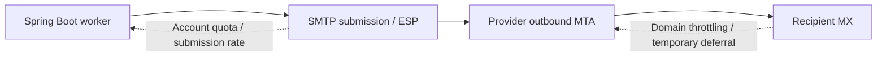
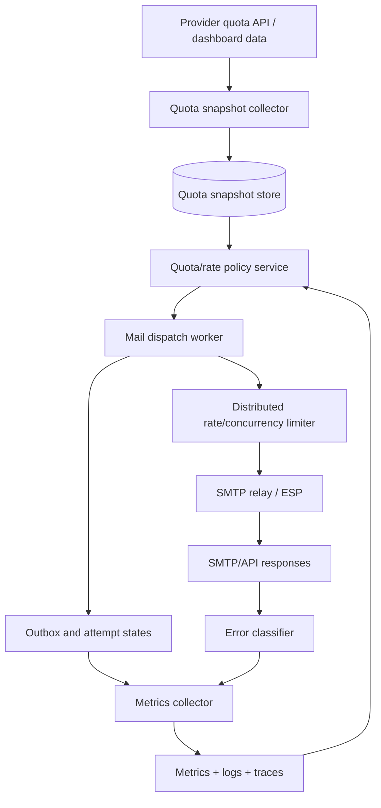

# Theo dõi quota và tốc độ nhà cung cấp

Một ứng dụng Spring Boot dùng `JavaMailSender` để gửi email OTP, hóa đơn và thông báo đơn hàng qua SMTP relay. Bình thường hệ thống gửi được vài trăm thư mỗi giờ. Đến ngày chạy chiến dịch, hàng chục nghìn yêu cầu gửi xuất hiện trong vài phút: SMTP provider bắt đầu trả lỗi giới hạn, một số message bị trì hoãn, worker retry dồn dập và hàng đợi cứ tăng. Nếu ứng dụng chỉ ghi log `MailSendException` rồi retry ngay, việc tăng số worker có thể khiến sự cố nặng hơn.

Trong môi trường production, một nhà cung cấp email (ESP/SMTP relay) thường áp dụng **nhiều giới hạn đồng thời**: tổng số thư hoặc người nhận được phép gửi trong một khoảng thời gian, tốc độ gửi trong một phút hoặc một giây, số kết nối SMTP đang hoạt động, quota tài khoản hoặc subaccount, giới hạn từng domain đích và những hạn chế phát sinh từ uy tín nguồn gửi. Có giới hạn được công bố, có giới hạn thay đổi động và có giới hạn chỉ thể hiện qua phản hồi của provider.

Bài học này thuộc chương **Quan sát và vận hành** của **Spring Framework Mail**. Mục tiêu là thiết kế cách **đo usage, nhận biết sát ngưỡng quota, điều tiết throughput, quản lý retry, dự báo dung lượng và vận hành khi provider throttling**. Các ví dụ dùng Spring Boot, Jakarta Mail, Java, SQL và công cụ metrics phổ biến; không giả định nhà cung cấp nào có cùng đơn vị đếm hoặc chính sách.

## 1. Vì sao quota và tốc độ gửi phải được theo dõi riêng?

Hai hệ thống cùng báo “gửi tối đa 10.000 email” có thể rất khác nhau:

- Hệ thống A cho phép 10.000 **recipient** trong 24 giờ, nhưng giới hạn 100 recipient mỗi giây.
- Hệ thống B cho phép 10.000 **messages** mỗi ngày, tối đa 10 SMTP connections đồng thời.
- Hệ thống C có quota theo **API requests** và giới hạn recipient cho mỗi request.
- Hệ thống D không công bố con số cứng; khi IP/domain có dấu hiệu quá tải sẽ trả temporary deferral hoặc giảm tốc tự động.

Nếu chỉ lưu một biến `maxEmailsPerDay`, ứng dụng sẽ không thể phản ánh đúng tất cả giới hạn.

**Quota** trả lời: *Tổng cộng được sử dụng bao nhiêu tài nguyên trong một khoảng hoặc chu kỳ?*

**Rate limit/throughput** trả lời: *Được gửi với tốc độ tối đa bao nhiêu trong một cửa sổ thời gian?*

**Concurrency limit** trả lời: *Có thể mở bao nhiêu kết nối hoặc xử lý bao nhiêu submission song song?*

**Capacity** trả lời: *Với các giới hạn và trạng thái hiện tại, hệ thống có thể hoàn thành lượng mail đang chờ trong bao lâu?*

**Reputation-based throttling** là trường hợp nhà cung cấp hoặc hệ thống nhận giảm tốc độ chấp nhận dựa trên hành vi gửi, không nhất thiết là quota cấu hình cố định.

### 1.1. Một ví dụ số học

Giả sử provider công bố giới hạn minh họa:

| Giới hạn | Giá trị giả định |
|---|---:|
| Tổng người nhận trong 24 giờ | 50.000 recipients |
| Tốc độ tối đa | 120 recipients/phút |
| SMTP connections đang mở | 5 |
| Số recipient tối đa trong một message | 50 |

Doanh nghiệp cần gửi 8.000 email, mỗi email có một recipient. Nếu dành 20% headroom cho giới hạn tốc độ, mức mục tiêu là:

```text
Safe target rate = 120 × 0,80
                 = 96 recipients/phút

Estimated minimum dispatch time
    = 8.000 / 96
    ≈ 83,3 phút
```

Đây là **thời gian tối thiểu lý tưởng** theo tốc độ mục tiêu, chưa tính timeout, retry, throttling thực tế, latency hay khả năng gửi tới recipient domain cụ thể. Còn phải kiểm tra **quota remaining trong 24 giờ**; nếu chỉ còn 5.000 recipient, không thể hoàn thành toàn bộ chiến dịch ngay cả khi rate limit cho phép.

Không copy các giá trị giả định này vào production. Mỗi provider, gói dịch vụ, tài khoản, vùng triển khai và loại API có contract riêng.

## 2. Những đơn vị giới hạn thường bị nhầm lẫn

| Đơn vị | Ý nghĩa | Rủi ro khi đếm sai |
|---|---|---|
| **API request** | Một HTTP call tới provider API | Một request có thể chứa nhiều message/recipient |
| **SMTP transaction** | Một giao dịch MAIL FROM/RCPT TO/DATA | Không nhất thiết được đếm giống “email” trong dashboard |
| **Message** | Một thông điệp MIME | Một message có thể gửi tới nhiều recipient |
| **Recipient** | Một địa chỉ nhận được provider tính vào quota | Gửi 1 message cho 20 người có thể tiêu 20 đơn vị |
| **Submitted/accepted message** | Provider đã chấp nhận submission | Chưa có nghĩa delivered vào Inbox |
| **Connection** | Một phiên TCP/TLS/AUTH đang mở | Bị hạn chế riêng với số messages/giây |
| **Bytes / message size** | Kích thước payload hoặc bandwidth | Attachment lớn có thể chạm giới hạn kích thước |
| **Per-domain throughput** | Tốc độ tới một domain đích | Có thể bị MX đích trì hoãn dù ESP vẫn còn quota |
| **Daily/window allowance** | Tổng mức cho chu kỳ xác định | Reset theo giờ cố định hoặc rolling window tùy provider |

### 2.1. Ví dụ một message có nhiều recipients

```text
Một MimeMessage:
    To: a@example.net
    Cc: b@example.net
    Bcc: c@example.net

Số MIME messages: 1
Số recipient identities: 3
Số SMTP RCPT TO: thường là 3 ở giao dịch tương ứng
```

Provider có thể tính quota dựa trên số recipient, request hoặc quy tắc khác. **Không giả định một lần gọi `JavaMailSender.send(message)` luôn tiêu một đơn vị quota.**

Trong hệ thống gửi thông báo giao dịch, một notification intent cho mỗi recipient thường dễ kiểm soát rate, suppression, error và audit hơn; nếu business yêu cầu gửi nhóm trong cùng MIME message, phải thiết kế cost model phù hợp.

### 2.2. Attempt, accepted và delivered không được trộn

Nếu cùng notification bị retry ba lần:

```text
Notification N-100
  attempt 1: SMTP connect timeout
  attempt 2: SMTP 451 temporary reject
  attempt 3: SMTP accepted
```

Ứng dụng ghi nhận **3 attempts**, nhưng có thể chỉ có **1 accepted submission**. Nhà cung cấp có thể tính một phần usage khác đi; đôi khi client không biết chắc attempt timeout đã được tính hay chưa.

Do vậy, nên lưu riêng:

- `attempt_count` của ứng dụng.
- `accepted_count` theo kết quả submission chắc chắn.
- `provider_usage` theo số liệu provider cung cấp.
- `delivery_count` theo event chuyển phát.
- `ambiguous_attempt_count` khi kết quả không rõ.

**Số lượng call gửi không phải thước đo quota chính xác nếu contract của provider đếm theo accepted recipients hoặc có các trường hợp timeout không rõ.**

## 3. Có hai tầng giới hạn: ESP và receiving MX

### 3.1. Giới hạn do SMTP relay/ESP áp dụng

Spring Boot gửi tới `smtp.provider.example:587`. Provider có thể giới hạn:

- Số recipients trên tài khoản.
- Số submissions mỗi giây.
- Số concurrent connections.
- Số recipients tối đa trong một message.
- Quota theo tháng/gói dịch vụ.
- Burst allowance.
- Vùng triển khai, subaccount hoặc IP pool.

Spring ứng dụng thường thấy các giới hạn này qua error response hoặc dữ liệu account/API của ESP.

### 3.2. Giới hạn do máy chủ nhận áp dụng

Sau khi ESP chấp nhận, outbound MTA của họ chuyển thư tới MX của người nhận. MX có thể trả temporary deferral nếu một IP gửi quá nhanh tới domain đó, hoặc dựa trên reputation.



**Điểm khác nhau quan trọng:**

- `JavaMailSender.send(...)` có thể thành công khi ESP chấp nhận thư.
- MX có thể trì hoãn thư **sau đó**; ứng dụng chỉ biết nếu provider gửi delivery event/bounce hoặc có dashboard/log.
- Nếu provider đang retry chuyển phát tại MX, application **không nên tự tạo email mới** chỉ vì delivery chưa hoàn thành.

Một dashboard cần phân biệt **submission throttling** ở ranh giới application → ESP với **downstream deferral** ở ESP → recipient MX.

## 4. Những chiều giới hạn cần đưa vào inventory

Hãy lập một **quota inventory** cho từng phương thức gửi:

| Dimension | Ví dụ identifier | Ý nghĩa |
|---|---|---|
| Provider | `primary-esp` | Nhà cung cấp đang dùng |
| Account/subaccount | `transactional-account` | Hạn mức tách theo tài khoản |
| Region/endpoint | `region-a` | Hạn mức có thể phụ thuộc vùng |
| Channel | `SMTP` hoặc `HTTP_API` | Hai API có thể có quota khác |
| Sending identity | `billing-domain` | Domain, sender/verified identity |
| IP pool | `transactional-pool` | Tốc độ và reputation riêng |
| Tenant | `tenant-42` | Giới hạn nội bộ để bảo đảm công bằng |
| Notification type | `OTP`, `INVOICE`, `MARKETING` | SLA và mức ưu tiên khác nhau |
| Recipient domain | `example.net` | Kiểm soát tốc độ gửi tới một domain đích |
| Window | `PER_SECOND`, `ROLLING_24H` | Cách tính usage theo thời gian |

Không phải provider nào cũng hỗ trợ mọi dimension. Chỉ ghi các dimension dựa trên tài liệu provider, số liệu account hoặc chính sách nội bộ thực sự.

### 4.1. Cấu hình quota cần có nguồn gốc

Một giới hạn nên có các trường:

```text
providerKey: primary-esp
accountKey: transactional-account
metric: recipient_units
limit: 50000
window: rolling_24h
source: provider_api
observedAt: <timestamp>
validUntil: <timestamp or TTL>
confidence: reported
```

Giá trị trên chỉ là ví dụ. Nếu quota được nhập thủ công theo hợp đồng, `source` có thể là `contract_config`. Nếu giới hạn chỉ suy ra từ phản hồi throttling, không ghi nó như một quota được provider cam kết.

### 4.2. Phân biệt limit và target

- **Hard provider limit:** giới hạn provider áp dụng, có thể gây từ chối.
- **Internal configured limit:** ngưỡng mà ứng dụng chủ động không vượt.
- **Target rate:** tốc độ vận hành thực tế, thường thấp hơn hard limit để có headroom.
- **Observed accepted rate:** thông lượng thực tế đo được.
- **Available capacity:** phần còn lại sau khi tính quota, rate, backlog và tải cùng thời điểm.

Ví dụ provider công bố 120 recipient/phút, nhưng internal limit đặt 96 recipient/phút để giữ headroom. Dashboard nên hiện cả hai, không gộp thành một con số gây hiểu nhầm.

## 5. Quota theo cửa sổ thời gian và thời điểm reset

Một lỗi thiết kế phổ biến là mặc định “daily quota reset lúc 00:00 local time”. Trên thực tế, provider có thể dùng:

- Cửa sổ **rolling 24 giờ**: tính usage trong 24 giờ lùi từ hiện tại.
- Ngày dương lịch theo **UTC**.
- Ngày theo timezone của account.
- Quota theo **tháng billing**.
- Token bucket/leaky bucket không có một reset timestamp đơn giản.
- Hạn mức động, được tăng/giảm theo account reputation.

### 5.1. Rolling window khác calendar window

Giả sử vào 23:59 gửi 10.000 recipients:

- Với calendar window reset 00:00, quota mới có thể xuất hiện sau một phút.
- Với rolling 24h, 10.000 recipients đó có thể tiếp tục nằm trong usage gần 24 giờ.
- Với token bucket, capacity được hồi phục dần theo refill rate.

Nếu dùng sai mô hình, ứng dụng có thể tự cho rằng quota “đã reset” và đẩy batch lớn quá sớm.

### 5.2. Luôn lưu timestamp có timezone

Trong database hoặc telemetry, dùng `Instant`/UTC để lưu:

- `observedAt` khi đọc dữ liệu provider.
- `windowStart`/`windowEnd` khi provider có window chính xác.
- `resetAt` nếu provider công bố.
- `nextAllowedAt` khi limiter cho phép thử lại.
- `nextAttemptAt` của outbox.
- `providerRetryAfter` nếu API cung cấp.

Khi hiển thị trên dashboard cho đội vận hành, có thể đổi timezone, nhưng không suy luận lại reset boundary từ giờ máy local.

### 5.3. Dữ liệu remaining có thể stale

Provider usage API có thể cập nhật trễ. Ví dụ dashboard báo còn 5.000 recipients nhưng trong lúc đó nhiều worker vẫn gửi, nên remaining thực tế thấp hơn.

Do vậy:

1. Ghi timestamp của lần lấy quota.
2. Đánh dấu dữ liệu stale sau ngưỡng định trước.
3. Kết hợp **internal reservation/accounting** để chặn oversubscription giữa các worker.
4. Không coi số remaining API là lock đồng thời.
5. Định kỳ reconcile chênh lệch giữa provider usage và telemetry nội bộ.

## 6. Lấy dữ liệu quota từ đâu?

Có nhiều nguồn và chúng đo các khía cạnh khác nhau.

### 6.1. API hoặc dashboard của nhà cung cấp

Một số ESP có endpoint hoặc giao diện cho:

- Daily sending quota/remaining.
- Max send rate.
- Account restrictions.
- Sending statistics.
- Concurrent connections hoặc throughput.
- Rate-limit headers với HTTP API.
- Subaccount/region usage.

Phải dựa trên contract của provider cụ thể. **Không giả định mọi SMTP relay đều cung cấp API quota.** SMTP protocol thuần không có một câu lệnh chuẩn dùng chung để hỏi “còn bao nhiêu email hôm nay?”.

### 6.2. Response đồng bộ của SMTP

Một SMTP server có thể trả:

```text
421 4.7.0 Service temporarily unavailable
451 4.7.1 Temporarily rejected
452 4.5.3 Too many recipients
```

Các câu trên là **ví dụ**, không phải diễn giải duy nhất cho mỗi mã. SMTP codes và enhanced status code có thể phụ thuộc giai đoạn/lý do và nhà cung cấp. Cần xem message an toàn đã chuẩn hóa và tài liệu provider.

- `4xx` thường báo temporary negative completion, **không phải xác nhận chính xác quota đã hết**.
- `5xx` thường báo permanent negative completion đối với thao tác đó; có thể là policy hoặc sender/recipient issue.
- `421` có thể là outage hoặc limit, không nên gán thành “quota exceeded” nếu không có thêm bằng chứng.
- Throttling có thể diễn ra ở `CONNECT`, `MAIL FROM`, `RCPT TO` hoặc `DATA`.

Đừng xây thuật toán quota chỉ bằng regex so khớp chữ “limit” trong exception message. Dùng mã trạng thái, enhanced code, bước giao thức và provider diagnostics khi có.

### 6.3. HTTP provider API

Một provider gửi mail qua HTTP có thể trả `429 Too Many Requests` hoặc `503 Service Unavailable`, có thể kèm:

```http
HTTP/1.1 429 Too Many Requests
Retry-After: 30
```

`Retry-After` có thể là số giây hoặc dạng HTTP-date theo ngữ nghĩa HTTP. Chỉ sử dụng khi provider hỗ trợ và phản hồi hợp lệ; cần parse đúng định dạng, time skew và giới hạn giá trị.

**SMTP 4xx không mặc nhiên có header Retry-After giống HTTP.** Không tự suy ra thời điểm retry cụ thể từ mã 421/451 nếu nhà cung cấp không công bố.

### 6.4. Telemetry nội bộ của ứng dụng

Kể cả khi provider không có usage API, ứng dụng có thể đo:

- Số intent được tạo.
- Recipient units dự kiến của intent.
- Số attempts.
- Số accepted/failed/unknown submissions.
- Tốc độ gọi send.
- Queue depth/age.
- Lượng request bị local rate limiter trì hoãn.
- Retry count và provider error categories.

Các số này giúp điều hành nhưng **không tự thay thế số quota chính thức** nếu provider tính usage theo cách khác.

### 6.5. Delivery events từ ESP

Webhook/DSN có thể cung cấp delivery, bounce, complaint và downstream deferral. Chúng là dữ liệu quan trọng cho reputation và khả năng hoàn thành SLA, nhưng **không được cộng lẫn vào “quota remaining”** nếu provider quota đếm tại submission.

## 7. Thiết kế đường dữ liệu quan sát

Một kiến trúc có thể tách collection và enforcement:



Các trách nhiệm nên rõ ràng:

- **Quota collector:** lấy dữ liệu theo quyền đọc, ghi thời điểm và nguồn.
- **Policy service:** xác định mức tốc độ mục tiêu dựa trên quota, tải và cảnh báo.
- **Rate limiter:** thực thi giới hạn trên các worker đồng thời.
- **Dispatcher:** claim notification đã commit và gửi khi được cấp capacity.
- **Metrics/logging:** quan sát kết quả và phát hiện bất thường.
- **Reconciler:** xử lý sự khác biệt giữa nội bộ và số liệu provider.
- **Operations:** quyết định nâng quota, giảm traffic, failover hoặc điều chỉnh campaign.

Không đặt tất cả logic này vào một `catch (MailSendException)` ở mail service.

## 8. Outbox giúp quản lý quota mà không làm mất email

Khi hết capacity, cách an toàn thường là **đưa notification vào hàng đợi bền vững và chờ**, không cố gửi đến khi timeout.

```text
Business event
    |
    v
Insert notification intent into outbox (transaction)
    |
    v
PENDING
    |
    +--> chưa có rate/quota budget --> DEFERRED / nextAttemptAt
    |
    +--> được cấp capacity --> PROCESSING
                                  |
                                  v
                            JavaMailSender.send
                                  |
                +-----------------+------------------+
                |                 |                  |
           Accepted         Temporary reject    Uncertain
                |                 |                  |
           SUBMITTED          RETRY_WAIT           UNKNOWN
```

### 8.1. Không tạo intent mới khi rate limited

Một ý định gửi email xác nhận có thể chờ 10 phút. Khi hết rate budget, worker chỉ cập nhật `nextAttemptAt` của **cùng outbox row**, không tạo một message mới với ID mới.

Trường dữ liệu hữu ích:

```sql
CREATE TABLE mail_outbox (
    id UUID PRIMARY KEY,
    idempotency_key VARCHAR(240) NOT NULL UNIQUE,
    provider_key VARCHAR(80) NOT NULL,
    account_key VARCHAR(80) NOT NULL,
    tenant_key VARCHAR(120) NOT NULL,
    notification_type VARCHAR(80) NOT NULL,
    recipient_units INTEGER NOT NULL,
    status VARCHAR(40) NOT NULL,
    attempts INTEGER NOT NULL DEFAULT 0,
    next_attempt_at TIMESTAMPTZ,
    created_at TIMESTAMPTZ NOT NULL,
    expires_at TIMESTAMPTZ,
    claim_token UUID,
    lease_until TIMESTAMPTZ,
    provider_reference VARCHAR(240),
    last_error_code VARCHAR(100)
);
```

Ví dụ schema chưa có subject/payload vì tập trung quan sát quota; hệ thống thật phải lưu hoặc tham chiếu nội dung đủ bền vững để gửi sau khi process restart. Không để payload chỉ sống trong một request HTTP.

### 8.2. Phân biệt chờ quota với send failure

Một row chưa được gửi do local limiter không nên tăng `attempts` như thể đã thực hiện SMTP attempt.

Ví dụ:

```text
N-100 status=PENDING, attempts=0
Local limiter: DENIED -> nextAttemptAt=10:01, attempts=0
Local limiter: ALLOWED -> attempt #1
Provider accepted -> SUBMITTED, attempts=1
```

Nếu provider trả 421/451 sau khi đã thử gửi, đó là một transport attempt thất bại; tăng số attempt theo policy.

Sự phân biệt này rất quan trọng cho metric “attempts per notification”, retry exhaustion và vận hành.

### 8.3. Notification hết hạn

OTP, payment link và một số thông báo ngắn hạn có `expiresAt`. Nếu quota phục hồi sau khi OTP hết hạn, worker không nên gửi token đã mất hiệu lực.

Các lựa chọn:

- Đánh dấu `EXPIRED` và không gửi.
- Ưu tiên queue OTP trước marketing.
- Reserve phần capacity cho email giao dịch.
- Nếu business yêu cầu tạo token mới, tạo command/notification mới có identity rõ ràng, không âm thầm đổi nội dung của intent đã snapshot.

## 9. Rate limiter: burst khác sustained rate

### 9.1. Fixed window

Ví dụ cho tối đa 100 recipients trong mỗi phút ấn định:

```text
10:00:00 - 10:00:59 -> tối đa 100
10:01:00 - 10:01:59 -> tối đa 100
```

Dễ triển khai nhưng có **boundary burst**: 100 ở cuối phút trước cộng 100 ở đầu phút sau có thể tạo 200 recipients trong vài giây.

Nếu provider dùng sliding window hoặc token bucket, một limiter fixed-window đơn giản có thể không đủ để tránh vượt tốc độ tại ranh giới.

### 9.2. Sliding window

Giới hạn số event trong **khoảng liên tục** lùi từ hiện tại. Ví dụ bất kỳ 60 giây nào cũng không quá 100 recipients.

- Phù hợp khi provider áp dụng rolling window.
- Cần lưu timestamp/event hoặc bucket aggregates.
- Tốn tài nguyên hơn fixed window trong một số triển khai.

### 9.3. Token bucket

Token bucket có:

- `capacity`: số token tối đa, cho phép một burst nhất định.
- `refillRate`: tốc độ token được bổ sung.
- `cost`: số token một submission cần dùng.
- `availableTokens`: token hiện có.

Ví dụ capacity 120 recipients, refill 2 recipients/giây. Một message có 3 recipients tốn 3 tokens khi provider quota được xác định theo recipients.

Token bucket điều tiết **burst và tốc độ trung bình**, nhưng không tự bảo vệ daily quota nếu không có một bộ giới hạn bổ sung.

### 9.4. Leaky bucket và pacing

Leaky bucket hoặc bộ lập lịch theo khoảng cách giữa requests có thể làm trơn lưu lượng, hữu ích khi SMTP provider nhạy với burst. Một hệ thống có thể kết hợp:

- Token bucket cho burst + sustained rate.
- Daily/rolling quota ledger.
- Semaphore cho concurrency.
- Per-domain pacing.
- Outbox queue bảo đảm durability.

Không chọn thuật toán theo tên hấp dẫn; hãy chọn theo **ngữ nghĩa giới hạn thực tế của provider**.

## 10. Ví dụ Java: token bucket trong một JVM

Đoạn code dưới đây minh họa bộ giới hạn theo recipient units. Nó không phụ thuộc Spring và không tự thực hiện gửi email.

```java
import java.time.Instant;

public final class LocalRecipientTokenBucket {

    private final int capacity;
    private final double tokensPerSecond;

    private double available;
    private long lastRefillMillis;

    public LocalRecipientTokenBucket(
            int capacity,
            double tokensPerSecond,
            Instant initialTime) {

        if (capacity <= 0 || tokensPerSecond <= 0.0) {
            throw new IllegalArgumentException(
                    "Capacity and refill rate must be positive");
        }

        this.capacity = capacity;
        this.tokensPerSecond = tokensPerSecond;
        this.available = capacity;
        this.lastRefillMillis = initialTime.toEpochMilli();
    }

    public synchronized boolean tryAcquire(
            int recipientUnits, Instant now) {

        if (recipientUnits <= 0 || recipientUnits > capacity) {
            throw new IllegalArgumentException(
                    "Invalid recipient unit cost");
        }

        long timestamp = now.toEpochMilli();
        long elapsed = Math.max(
                0L, timestamp - lastRefillMillis);

        available = Math.min(
                capacity,
                available + elapsed / 1000.0 * tokensPerSecond);

        lastRefillMillis = Math.max(lastRefillMillis, timestamp);

        if (available < recipientUnits) {
            return false;
        }

        available -= recipientUnits;
        return true;
    }
}
```

Cách dùng:

```java
Instant now = Instant.parse("2026-11-12T08:00:00Z");

LocalRecipientTokenBucket bucket =
        new LocalRecipientTokenBucket(120, 2.0, now);

boolean first = bucket.tryAcquire(5, now);
boolean second = bucket.tryAcquire(120, now);

// first = true; second = false vì đã dùng 5 tokens.
```

### 10.1. Giới hạn quan trọng của ví dụ

- `synchronized` chỉ bảo vệ các threads **trong cùng một JVM**.
- Mỗi instance/pod tạo bucket riêng sẽ cộng dồn capacity không mong muốn.
- Dùng `Instant`/wall clock trong ví dụ để dễ test; bộ limiter production thường nên dựa trên monotonic time source hoặc server-side atomic time semantics để tránh clock jump.
- Bucket cho phép burst tới capacity, không cam kết chính xác sliding-window limit.
- Không phản ánh daily quota, provider dynamic limits hoặc SMTP connection limit.
- Không nên coi `tryAcquire()` thành công là provider đã chấp nhận request.
- Token là **budget admission**, không nhất thiết chính xác số usage provider sẽ tính.

Với nhiều instance Spring Boot, cần distributed limiter hoặc một dispatcher dùng chung capacity toàn provider account.

### 10.2. Test limiter bằng thời gian cố định

```java
@Test
void rejectsWhenBurstCapacityIsConsumed() {
    Instant t0 = Instant.parse("2026-11-12T08:00:00Z");

    LocalRecipientTokenBucket bucket =
            new LocalRecipientTokenBucket(10, 1.0, t0);

    assertThat(bucket.tryAcquire(7, t0)).isTrue();
    assertThat(bucket.tryAcquire(4, t0)).isFalse();

    assertThat(bucket.tryAcquire(
            4, t0.plusSeconds(1))).isTrue();
}
```

Ở thời điểm `t0+1s`, bucket đã refill 1 token; còn 3 + 1 = 4 token. Không dùng `Thread.sleep` trong test vì dễ flaky và không cần thiết khi đồng hồ được inject.

## 11. Multi-instance: distributed rate limiter

Giả sử một account được phép tối đa 100 recipients/phút, nhưng ứng dụng có 10 worker pods. Nếu mỗi pod tự tạo limiter 100/phút, tổng cộng có thể lên tới 1.000/phút — vượt limit gấp 10 lần.

Cần một cơ chế điều phối chung cho toàn phạm vi quota.

### 11.1. Các kiến trúc thường gặp

| Kiến trúc | Ưu điểm | Ràng buộc |
|---|---|---|
| Một dispatch service trung tâm | Dễ bảo đảm quota toàn account | Cần HA và kiểm soát bottleneck |
| Redis + atomic Lua/function | Nhanh, phù hợp token bucket phân tán | Cần xử lý Redis outage, atomicity, clock, TTL |
| PostgreSQL quota ledger | Tận dụng DB và transaction, dễ audit | Có thể tạo lock contention ở throughput rất cao |
| Provider-managed throttling + local conservative limiter | Đơn giản hơn khi ESP hỗ trợ tốt | Phải chấp nhận/reconcile rate rejects và unknown usage |
| Message queue với giới hạn consumer/dispatch | Dễ điều tiết concurrency | Một mình giới hạn consumer **không tương đương** quota recipients/time window |

### 11.2. Atomic reservation là điều kiện cần

Đừng làm:

```text
GET remaining tokens
IF remaining >= cost:
    SET remaining = remaining - cost
```

Hai workers có thể cùng thấy còn 5 token rồi cùng lấy 5, tạo oversubscription. Dùng transaction/atomic operation:

```text
reserve(cost, quotaKey, window):
    kiểm tra token/usage
    trừ token/cộng usage một cách atomic
    trả ALLOWED hoặc DENIED
```

Trong Redis, cần dùng primitive/transaction/script atomic phù hợp. Trong database, cần row lock/conditional update hoặc unique/upsert có điều kiện.

### 11.3. Multi-dimensional quota phải được cấp đồng bộ

Một send có thể cần đồng thời:

- 1 SMTP connection slot.
- 3 recipient tokens/phút.
- 3 recipient units trong daily quota.
- 3 units theo per-tenant limit.
- 3 units theo recipient-domain bucket.

Nếu lần lượt cấp từng bucket và bucket cuối bị từ chối, đã tiêu budget ở các bucket đầu dù chưa gửi. Hệ thống cần **atomic multi-key admission**, transaction bao các ledger liên quan, hoặc giao thức reservation/cancel có xác định.

Không giữ database transaction khóa quota trong lúc gọi SMTP. **Admission/reservation** phải hoàn thành trong transaction ngắn, sau đó transport I/O xảy ra độc lập.

### 11.4. Reservation không phải chứng từ usage cuối cùng

Vấn đề khó:

1. Worker reserve 5 recipient units.
2. Trước khi gửi, worker crash.
3. Provider chưa nhận message.
4. Budget reservation vẫn còn.

Nếu lập tức refund mọi reservation sau timeout, trường hợp ngược lại có thể xảy ra: provider đã nhận nhưng client tưởng chưa gửi, refund rồi retry và vượt quota.

Nên phân biệt:

- `RESERVED`: capacity được giữ để chuẩn bị attempt.
- `ATTEMPTED`: đã thực hiện transport call.
- `ACCEPTED`: provider xác nhận submission.
- `UNKNOWN`: chưa biết outcome.
- `RELEASED/EXPIRED`: reservation được hủy theo chính sách rõ.
- `RECONCILED`: usage được đối chiếu với provider.

Với quota khó và provider không có usage API, có thể ưu tiên tính **bảo thủ** cho ambiguous attempts để tránh vượt giới hạn, chấp nhận underutilization.

## 12. PostgreSQL fixed-window counter minh họa

Một giải pháp DB đơn giản có thể đếm recipient units theo một window mà **application xác định rõ**. Ví dụ schema:

```sql
CREATE TABLE provider_quota_window (
    provider_key VARCHAR(80) NOT NULL,
    account_key VARCHAR(80) NOT NULL,
    window_kind VARCHAR(40) NOT NULL,
    window_start TIMESTAMPTZ NOT NULL,
    used_units BIGINT NOT NULL DEFAULT 0,
    updated_at TIMESTAMPTZ NOT NULL,
    PRIMARY KEY (
        provider_key, account_key,
        window_kind, window_start
    ),
    CONSTRAINT ck_used_units_nonnegative CHECK (used_units >= 0)
);
```

Với PostgreSQL, có thể reserve cost trong một fixed window bằng insert/upsert có điều kiện:

```sql
INSERT INTO provider_quota_window (
    provider_key, account_key,
    window_kind, window_start,
    used_units, updated_at
)
SELECT
    :providerKey, :accountKey,
    :windowKind, :windowStart,
    :cost, CURRENT_TIMESTAMP
WHERE :cost > 0 AND :cost <= :windowLimit
ON CONFLICT (
    provider_key, account_key,
    window_kind, window_start
)
DO UPDATE
SET used_units =
        provider_quota_window.used_units
        + EXCLUDED.used_units,
    updated_at = CURRENT_TIMESTAMP
WHERE provider_quota_window.used_units
      + EXCLUDED.used_units <= :windowLimit
RETURNING used_units;
```

- Trả một row: đã reserve thành công.
- Không trả row: cost không hợp lệ hoặc window đã đầy theo logic này.
- Unique key/upsert bảo vệ phép cập nhật dưới concurrency ở PostgreSQL.
- `windowStart` phải được tạo **theo đúng contract window**, không mặc định truncate minute/day cho mọi provider.

### 12.1. Hạn chế của fixed-window ledger

Ví dụ này:

- Không mô phỏng được rolling 24h hoặc token bucket chỉ bằng một row.
- Không cấp đồng thời nhiều loại window nếu caller chạy từng statement ngoài transaction.
- Không biết actual provider usage nếu có attempts ambiguous.
- Không giải quyết time skew khi các instances tính `windowStart` khác nhau.
- Có thể trở thành hot row nếu throughput rất cao.
- Cần cleanup/retention theo contract và audit.

Nếu provider công bố rolling window, cần thuật toán/ledger phù hợp. Đây là ví dụ **thực thi atomic conditional counter**, không phải công thức chuẩn cho mọi quota.

## 13. Concurrency limit không phải rate limit

Giả sử provider cho phép tối đa 5 SMTP connections cùng lúc. Một ứng dụng có thể giữ 5 connections rồi gửi cực nhanh trên chúng; vẫn có nguy cơ vượt recipients/second.

Ngược lại, rate limiter 100 recipients/phút không bảo đảm ứng dụng không mở 100 TCP connections đồng thời để gửi 100 recipients ở đầu phút.

Cần hai loại điều khiển riêng:

1. **Semaphore/concurrency gate:** số kết nối hoặc send operations đang chạy.
2. **Rate/quota gate:** số đơn vị gửi được cấp trong thời gian.

### 13.1. SMTP connections và Spring Mail

`JavaMailSenderImpl` dùng Jakarta Mail SMTP transport theo implementation. Trong đường gửi thông thường, transport được mở/sử dụng/đóng theo chu trình `send` của implementation, trừ khi ứng dụng có thiết kế kết nối riêng. Không giả định có connection pool SMTP dùng lại mọi lúc.

Khi nhiều worker gọi `send` cùng lúc, concurrent TCP/TLS/AUTH có thể tăng nhanh. Theo dõi:

- Active mail submission calls.
- Connection errors/timeouts.
- Duration connect/TLS/AUTH/send khi instrumentation có dữ liệu.
- Worker concurrency.
- Provider connection limit diagnostics.

Nếu dùng connection reuse/pooling ở adapter tùy chỉnh, phải xem contract thread-safety của transport và lifecycle; không chia sẻ một object không thread-safe giữa worker threads chỉ để tiết kiệm handshake.

### 13.2. Semaphore không giải quyết giới hạn toàn cluster

Một `Semaphore(5)` đặt trong mỗi JVM sẽ cho tối đa 5 connections **mỗi instance**, không phải 5 toàn provider account. Nếu có 8 pods, số kết nối có thể lên đến 40. Với provider limit toàn account, cần distributed concurrency gate hoặc kiến trúc dispatch tập trung.

## 14. Hạn chế theo tenant và loại thông báo

Một doanh nghiệp có 20 tenants gửi email qua cùng provider account. Nếu một tenant chạy chiến dịch lớn, toàn bộ quota có thể bị tiêu hết, làm OTP của tenant khác không gửi được.

### 14.1. Hierarchical quotas

Có thể đặt nhiều cấp:

```text
Provider account: 10.000 recipients/hour
    |
    +-- Transactional pool: reserved 3.000/hour
    |     +-- OTP
    |     +-- Invoice
    |
    +-- Marketing pool: max 7.000/hour
          +-- Tenant A
          +-- Tenant B
```

Đây là ví dụ phân bổ **capacity nội bộ**; phải bảo đảm tổng không vượt quota thực của provider.

Chính sách có thể dùng:

- Hard cap từng tenant.
- Weighted fair scheduling.
- Reserved capacity cho email giao dịch.
- Priority queues.
- Borrowing unused capacity khi bảo đảm có thể thu hồi trước nhu cầu ưu tiên.
- Per-tenant campaign quotas.

### 14.2. Không để marketing chiếm hết quota của OTP

Giả sử quota ngày còn 500 recipients, một campaign đang chờ 5.000. Nếu dispatcher không ưu tiên, 500 quota cuối có thể bị dùng hết cho marketing, trong khi user mới yêu cầu reset password.

Vì vậy, admission policy nên xét **notification type và deadline**:

- OTP/reset password: SLA ngắn, có `expiresAt`.
- Hóa đơn/biên nhận: bền vững, có thể chờ lâu hơn nhưng vẫn cần theo dõi.
- Marketing: thường có thể trì hoãn hoặc giới hạn batch.
- Alerts nội bộ: tùy severity, có thể chọn kênh dự phòng khi mail quota bị bóp.

Priority không có nghĩa gửi một email đã hết hạn hoặc không còn consent.

### 14.3. Fair scheduling

Một queue ưu tiên tuyệt đối cũng có thể làm marketing starvation vô hạn. Có thể sử dụng weighted fair queueing với tối thiểu/hạn mức theo stream, hoặc reservation cho mục tiêu SLA quan trọng và chia phần còn lại theo tenant.

Cần monitoring “oldest pending age” theo notification type/tenant class, không chỉ tổng backlog.

## 15. Quota exhaustion, throttling và lỗi SMTP

Khi provider bắt đầu giới hạn tốc độ, phản ứng nên phụ thuộc **mức chắc chắn về nguyên nhân và giai đoạn SMTP**.

### 15.1. Temporary rejection rõ ràng

Ví dụ provider trả `451 4.7.1` trước khi hoàn tất DATA, diagnostic cho biết temporary rate limit.

Có thể:

1. Phân loại `PROVIDER_RATE_LIMIT`.
2. Ghi attempt failure và provider code.
3. Giảm target rate theo policy.
4. Tính `nextAttemptAt` với backoff/jitter hoặc provider-advised delay.
5. Giữ nguyên notification ID/idempotency key.
6. Không tăng tốc cho đến khi có bằng chứng phục hồi.

### 15.2. Permanent rejection

Nếu provider trả `550`, `554` hoặc phản hồi vĩnh viễn liên quan account/sender/policy, không retry tự động chỉ vì hệ thống đang có backlog. Cần phân loại recipient rejection, account suspension, domain verification và configuration failure.

Một permanent code có thể được sửa bởi operator về sau, nhưng retry tức thời bằng cùng cấu hình thường không hiệu quả.

### 15.3. Timeout sau DATA: outcome unknown

Nếu SMTP provider đã nhận MIME bytes nhưng client mất kết nối trước phản hồi cuối, provider **có thể đã chấp nhận message**.

```text
Application -> SMTP: DATA + MIME + end marker
SMTP provider: possibly accepted
Network timeout before client reads final response

Result: submission outcome uncertain
```

Không được tự kết luận “quota chưa bị trừ” hoặc “email chắc chắn chưa gửi”. Dùng trạng thái `UNKNOWN`/reconciliation; retry tiếp có thể tạo duplicate dù vẫn chỉ có một outbox row.

### 15.4. Downstream deferral sau submission

Nếu ESP đã nhận message rồi chính ESP gặp `421` từ recipient MX sau đó, application không nên gửi lại toàn bộ message ngay. ESP thường có chính sách queue/retry chuyển phát riêng. Theo dõi delivery event và deferral ở đúng tầng.

## 16. Chính sách retry và adaptive pacing

Một chính sách hợp lý cần phân biệt:

| Tình huống | Hành động mặc định |
|---|---|
| Local quota gate từ chối trước transport | Hoãn dispatch, không tính send attempt |
| Provider báo throttling tạm thời rõ ràng | Backoff có jitter, có thể giảm target rate |
| Provider quota ngày đã hết theo số liệu đáng tin | Chờ đúng reset/rolling capacity, ưu tiên SLA quan trọng |
| Provider timeout trước submission chắc chắn | Retry có giới hạn, kiểm tra network và policy |
| Submission outcome unknown | Reconciliation hoặc quyết định duplicate-aware |
| Credential/hostname/TLS config sai | Dừng retry tự động và cảnh báo |
| Recipient hard bounce | Suppression, không retry theo cách làm xấu reputation |
| Notification hết hạn | EXPIRED, không gửi nội dung không còn giá trị |

### 16.1. Exponential backoff với jitter

Ví dụ chờ sau các lần tạm từ chối:

```text
Attempt 1 -> khoảng 30 giây
Attempt 2 -> khoảng 60 giây
Attempt 3 -> khoảng 120 giây
Attempt 4 -> khoảng 240 giây
Sau đó  -> cap 10 phút, giới hạn max attempts / max age
```

Trong production, thêm jitter, tránh hàng nghìn workers cùng retry đúng một thời điểm. Nếu provider HTTP API cung cấp `Retry-After` hợp lệ, không retry trước deadline đó. SMTP 4xx không có một cơ chế Retry-After phổ quát.

### 16.2. Adaptive throttling

Nếu provider liên tục trả temporary rate-limit, một controller có thể giảm target rate. Một chiến lược khái niệm:

- Bắt đầu tại target thấp hơn provider limit đã biết.
- Nếu tỷ lệ throttling vượt ngưỡng, giảm tốc đáng kể.
- Sau một khoảng ổn định không có throttling và queue vẫn còn, tăng từ từ.
- Đặt hard ceiling theo quota/provider contract.
- Không tăng khi quota remaining thấp hoặc provider usage stale.
- Tách điều chỉnh theo provider/account/region và recipient domain khi cần.

Đây là nguyên lý gần với additive-increase/multiplicative-decrease, nhưng **không có bộ hệ số cố định đúng cho mọi ESP**. Điều chỉnh tốc độ cần có hysteresis để tránh dao động tăng–giảm liên tục.

### 16.3. Circuit breaker không thay quota limiter

Circuit breaker tạm ngừng gọi một provider khi tỷ lệ lỗi hạ tầng cao. Nó không thay token bucket hoặc quota ledger. Một provider khỏe mạnh vẫn có thể cần giới hạn rate vì contract chỉ cho phép N recipients/phút.

## 17. Dự báo thời gian xả backlog

Giả sử:

```text
Pending recipients = 8.000
Safe target rate   = 96 recipients/phút
Average new arrival = 20 recipients/phút
```

Nếu gửi và nhận mới cùng lúc, **net drain capacity**:

```text
Net drain rate = 96 - 20 = 76 recipients/phút

Estimated backlog drain time
    = 8.000 / 76
    ≈ 105,3 phút
```

Nhưng dự báo chỉ có ý nghĩa nếu:

- Daily quota remaining đủ cho các messages cần gửi.
- Retry failure rate không làm giảm accepted throughput quá mức.
- Provider/recipient-domain throttling không thay đổi bất thường.
- Arrival rate tương đối ổn định.
- Queues có priority/fairness rõ.
- Notification chưa hết hạn.
- Đơn vị đếm nhất quán (recipients vs messages).

Nếu `newArrivalRate >= acceptedDispatchCapacity`, backlog không thể giảm bền vững. Tăng thêm worker **không giải quyết được** khi bottleneck là quota provider.

### 17.1. Chỉ số tuổi hàng đợi quan trọng hơn count

Có 10.000 email marketing pending có thể chấp nhận được trong một số batch. Nhưng chỉ 30 OTP chờ hơn 5 phút có thể là sự cố nghiêm trọng. Theo dõi:

- `pending_count`.
- `oldest_pending_age_seconds`.
- `p50/p95/p99 time_to_submission`.
- `expiring_soon_count`.
- `retry_wait_count`.
- `unknown_count`.
- Tất cả phân tách theo provider và notification class phù hợp.

### 17.2. Tính utilization

Một cách đo gần đúng:

```text
Rate utilization (%) =
    observed submitted recipient units per minute
    ------------------------------------------------ × 100
        configured safe recipient units per minute
```

Không tính utilization theo số messages nếu limit theo recipients. Nếu provider cap động và không biết chính xác, công bố rằng đây là **utilization so với internal target**, không phải phần trăm hard quota của provider.

## 18. Metrics cho Spring Boot/Micrometer

Một ứng dụng dùng Spring Boot Actuator và Micrometer có thể ghi các metrics sau:

| Metric đề xuất | Loại | Ý nghĩa |
|---|---|---|
| `mail_intents_created_total` | Counter | Số notification intents mới |
| `mail_submission_attempts_total` | Counter | Số attempts tới SMTP/API |
| `mail_submission_recipients_total` | Counter | Recipient units được attempt hoặc accepted (cần label result rõ) |
| `mail_rate_limit_denials_total` | Counter | Local quota/rate gate từ chối |
| `mail_provider_throttles_total` | Counter | Provider trả rate-limit/throttle được xác định |
| `mail_submission_duration_seconds` | Timer/Histogram | Độ trễ một attempt |
| `mail_outbox_pending_count` | Gauge | Số row chưa gửi |
| `mail_outbox_oldest_age_seconds` | Gauge | Tuổi row pending cũ nhất |
| `mail_quota_limit_units` | Gauge | Provider/internal reported limit theo window |
| `mail_quota_remaining_units` | Gauge | Provider remaining được quan sát |
| `mail_quota_snapshot_age_seconds` | Gauge | Tuổi dữ liệu quota |
| `mail_active_submissions` | Gauge | Số calls đang chạy |
| `mail_submission_unknown_count` | Gauge | Notification outcome chưa rõ |
| `mail_notification_expired_total` | Counter | Notification hết hạn trước submission |

### 18.1. Đặt tên và đơn vị rõ ràng

Không dùng `mail_count` cho mọi thứ. Khi counter đếm recipients, hãy đặt `recipient_units` hoặc metadata tương đương. Khi đo duration dùng seconds; khi đo capacity không đổi metric giữa messages và recipients mà giữ cùng tên.

Nếu dùng Prometheus, convention `_total` cho counter và `_seconds` cho duration giúp dễ hiểu. Micrometer có thể thực hiện một số quy tắc đặt tên khi export; hãy xem tên thực tế ở endpoint metrics trước khi viết dashboard.

### 18.2. Label cardinality

Các labels hữu ích:

- `provider`: ví dụ `primary-esp`.
- `account_class`: transactional/marketing.
- `region`: khi quota thực sự tách vùng.
- `notification_type`: OTP/INVOICE/MARKETING.
- `result`: accepted/temporary_reject/permanent_reject/unknown.
- `error_category`: rate_limit/auth/network/policy.
- `window_kind`: per_minute/rolling_24h.

Không đặt vào metric labels:

- Email recipient.
- Notification ID, event ID, message ID.
- Request ID hoặc raw idempotency key.
- Từng SQL row ID.
- Raw SMTP response text.
- URL hoặc user-input tùy ý.

Những giá trị này tạo time-series cardinality quá lớn và có thể làm lộ dữ liệu. Dùng structured log/tracing có giới hạn truy cập cho định danh cần điều tra.

### 18.3. Ví dụ ghi counter với MeterRegistry

```java
import io.micrometer.core.instrument.MeterRegistry;

public final class MailMetrics {

    private final MeterRegistry registry;

    public MailMetrics(MeterRegistry registry) {
        this.registry = registry;
    }

    public void recordAttempt(
            String providerKey,
            String result,
            int recipientUnits) {

        if (recipientUnits < 1) {
            throw new IllegalArgumentException(
                    "Recipient units must be positive");
        }

        registry.counter(
                "mail.submission.attempts",
                "provider", providerKey,
                "result", result).increment();

        registry.counter(
                "mail.submission.recipient.units",
                "provider", providerKey,
                "result", result).increment(recipientUnits);
    }
}
```

Ở production, `providerKey` và `result` phải được chuẩn hóa qua whitelist/enum có số giá trị hữu hạn. Không truyền chuỗi lỗi raw của provider làm label. Counter `mail.submission.recipient.units` trong ví dụ đếm cost **của attempts theo result**, không phải quota provider usage đã xác minh.

Gauges quota có thể được cập nhật từ collector, nhưng cần ghi thời điểm snapshot và không phát remaining stale như thể đang real-time.

## 19. Dashboard vận hành nên trả lời câu hỏi gì?

Một dashboard tốt cho mail delivery không chỉ có đồ thị “emails sent per day”. Ít nhất cần trả lời:

1. Provider/account nào sắp hết quota?
2. Số còn lại đang lấy từ API, cấu hình hay suy đoán?
3. Tốc độ gửi thực so với safe target và hard limit?
4. Có throttling từ provider hay chỉ local limiter đang trì hoãn?
5. Quota reset khi nào, theo nguồn nào?
6. Backlog hiện tại có xả kịp SLA?
7. OTP/hóa đơn có bị ảnh hưởng bởi marketing không?
8. Retry rate tăng vì throttling, outage hay recipient failures?
9. Có bao nhiêu submission outcome unknown?
10. Có sự khác biệt lớn giữa internal usage và số provider công bố?

### 19.1. Các khu vực dashboard

**Quota & capacity:**

- Limit, used, remaining và window kind.
- Snapshot freshness.
- Safe target rate.
- Projected time to exhaustion nếu có dữ liệu hợp lệ.

**Real-time sending:**

- Attempts/giây, accepted recipients/giây.
- Concurrent sends, connection failures.
- Provider throttle code breakdown.
- Local admission denials.

**Backlog & SLA:**

- Pending/RetryWait/Unknown count.
- Oldest pending age.
- Time-to-submission by notification type.
- Expiring-soon và expired counts.

**Deliverability after submission:**

- Provider delivery/bounce/deferral events.
- Per-domain downstream delay.
- Reputation/complaints nếu provider cung cấp.

### 19.2. PromQL minh họa tỷ lệ throttling

Giả sử metric export có tên `mail_submission_attempts_total`:

```promql
sum by (provider) (
  rate(mail_submission_attempts_total{
    result="rate_limited"
  }[5m])
)
/
clamp_min(
  sum by (provider) (
    rate(mail_submission_attempts_total[5m])
  ),
  0.000001
)
```

Kết quả là tỷ lệ attempts bị phân loại `rate_limited` trên toàn bộ attempts trong cửa sổ 5 phút, theo provider. Chỉ có ý nghĩa nếu instrumentation gắn nhãn `result` nhất quán và không double-count retries.

### 19.3. PromQL minh họa throughput accepted

Giả sử counter recipient units có label `result="accepted"`:

```promql
sum by (provider) (
  rate(mail_submission_recipient_units_total{
    result="accepted"
  }[5m])
)
```

Đơn vị của giá trị là **accepted recipient units/giây**, nếu counter increment theo số recipients được xác nhận accepted. Để hiển thị recipients/phút, nhân `60` trong query hoặc cấu hình hiển thị tương ứng.

Không đem tốc độ attempts so với hard limit accepted recipients khi provider đếm khác.

### 19.4. Gauge quota còn lại

Hiển thị ví dụ:

```text
Provider: primary-esp
Window: rolling_24h
Limit: 50.000 recipient units
Remaining: 7.500 recipient units
Snapshot age: 4 phút
Internal safe rate: 96 recipients/phút
Current accepted rate: 80 recipients/phút
```

Dashboard phải làm rõ snapshot age: remaining ở thời điểm quan sát **không bảo đảm** vẫn là giá trị hiện tại. Nếu dữ liệu quá cũ, nên hiển thị trạng thái `STALE`/`UNKNOWN` thay vì giữ màu xanh “plenty of quota”.

## 20. Alerting: ngưỡng, tốc độ tiêu thụ và backlog

### 20.1. Các nhóm cảnh báo

| Loại | Điều kiện gợi ý | Hành động |
|---|---|---|
| Quota remaining thấp | Dưới ngưỡng nội bộ, số liệu còn tươi | Giảm campaign, giữ capacity cho transactional |
| Projected exhaustion | Với tốc độ hiện tại, quota sẽ hết trước kỳ reset | Điều chỉnh pacing/nguồn lực |
| Provider throttling tăng | Tỷ lệ temporary rate-limit tăng nhiều phút | Giảm target rate, kiểm tra provider |
| Quota snapshot stale | Collector không cập nhật đúng hạn | Cảnh báo dữ liệu thiếu; dùng conservative mode |
| Queue SLA bị đe dọa | Oldest pending của OTP/invoice vượt mục tiêu | Ưu tiên xử lý/điều tra bottleneck |
| Submission unknown tăng | Nhiều timeout sau DATA hoặc crash window | Reconciliation, tránh retry mù quáng |
| Quota usage mismatch | Provider usage khác nội bộ vượt tolerance | Kiểm tra accounting/window/recipient units |
| Connection saturation | Active connections sát max, connect errors tăng | Giảm concurrency, kiểm tra network/server |

Các ngưỡng phụ thuộc workload và SLO. Không dùng “80% quota” như một luật bất biến nếu quota reset trong vài phút và backlog thấp; ngược lại, 50% usage có thể nguy hiểm nếu lưu lượng dự kiến trước reset còn lớn.

### 20.2. Alert theo time-to-exhaustion

Nếu `remaining = 7.500` units và observed accepted consumption `80` units/phút:

```text
Time to exhaustion ≈ 7.500 / 80
                   ≈ 93,75 phút
```

Đây là phép tính gần đúng cho một tốc độ không đổi. Với rolling window, capacity có thể hồi phục khi usage cũ trôi ra khỏi cửa sổ, nên công thức trên **không phải thời điểm hết quota chính xác**. Với fixed window, so sánh time-to-exhaustion với `resetAt` đã được provider xác minh.

Nếu tốc độ bằng 0 hoặc data stale, time-to-exhaustion nên là `UNKNOWN` hoặc “không thể tính”, không đặt vô cùng một cách khó hiểu.

### 20.3. Tránh alert storm

Nếu 1.000 attempts cùng bị throttled, không gửi 1.000 thông báo incident. Alert theo:

- Provider/account/window.
- Tỷ lệ lỗi trong một khoảng.
- Backlog/SLA impact.
- Thay đổi state của circuit/pacing controller.

Cần grouping, deduplication và suppression giữa alerts liên quan, đặc biệt khi chính email provider đang lỗi khiến kênh email alert cũng không đáng tin. Sử dụng kênh quan sát/sự cố khác độc lập với provider email đang gặp vấn đề.

## 21. Cách kiểm tra việc đo quota có nhất quán không?

### 21.1. Một bảng reconciliation

Ví dụ:

| Nguồn | Thời điểm/cửa sổ | Giá trị |
|---|---|---:|
| Internal reserved units | Window A | 8.500 |
| Internal accepted units | Window A | 7.900 |
| Internal unknown units | Window A | 150 |
| Provider reported usage | Window A, cập nhật trễ | 8.020 |

Không nên vội nói provider sai vì `8.020 != 7.900`. Các nguyên nhân có thể:

- Provider đếm cả một phần ambiguous attempts.
- Provider window/reset khác nội bộ.
- Provider report lag.
- ESP có sends ngoài ứng dụng Spring này.
- Account được chia cho nhiều services/subaccounts.
- Multi-recipient message có cost khác dự kiến.
- Provider trừ quota ở thời điểm accepted khác submitted timestamps.
- Webhook/metrics events bị mất hoặc double-count.

### 21.2. Reconcile theo key và window, không bằng tổng toàn thời gian

Nếu provider cung cấp breakdown theo account/region/window, hãy đối chiếu cùng scope đó. Một usage total tính trên local time không so trực tiếp được với provider rolling 24h. Chênh lệch có thể hoàn toàn do mô hình thời gian.

### 21.3. Cần theo dõi sends ngoài hệ thống

Một người dùng có thể gửi email trực tiếp qua dashboard ESP hoặc một service khác dùng chung account. Internal counters của ứng dụng không thấy những sends này, nhưng provider quota vẫn bị tiêu.

Giải pháp:

- Inventory các hệ thống sử dụng cùng account.
- Tách subaccounts/credentials khi có thể.
- Đọc provider usage định kỳ.
- Thiết lập internal capacity reservation có headroom.
- Phân tích audit logs và provider message references.

## 22. Bảo mật và quyền riêng tư khi theo dõi quota

Để chẩn đoán throttling, không cần thu thập toàn bộ nội dung email.

### 22.1. Log có cấu trúc

Ví dụ:

```json
{
  "event": "mail_submission_throttled",
  "provider": "primary-esp",
  "accountClass": "transactional",
  "notificationType": "INVOICE",
  "attempt": 2,
  "recipientUnits": 1,
  "smtpCode": 451,
  "failureCategory": "RATE_LIMIT",
  "nextAttemptAt": "<UTC timestamp>",
  "quotaSnapshotAgeSeconds": 35
}
```

Đây là JSON minh họa; trường timestamp là placeholder, không phải thời gian được ứng dụng tự suy diễn.

### 22.2. Tránh thông tin nhạy cảm trong logs/metrics

Không đưa:

- SMTP username/password hoặc OAuth token.
- Raw MIME body hoặc attachments.
- Recipient address vào metric label.
- Full SMTP transcript (có thể chứa địa chỉ/secret).
- Raw provider response nếu có PII.
- Tenant/customer IDs có cardinality lớn làm metric labels.

Nếu cần truy vết một notification, log ID theo quyền truy cập và retention phù hợp; không gắn nó vào mọi time series.

### 22.3. Quota API credentials

Collector quota có thể cần permission để đọc account usage. Nên:

- Dùng quyền tối thiểu/read-only nếu provider hỗ trợ.
- Lưu credentials trong secret manager.
- Đặt timeout và backoff cho quota API.
- Không polling quá thường xuyên đến mức tự bị API rate limit.
- Không in credential vào cấu hình debug.
- Audit việc thay quota hoặc switch provider account.

## 23. Khi provider không công bố quota rõ ràng

Một số SMTP relay chỉ báo khi bạn gửi quá nhanh hoặc khi reputation khiến recipient domains trì hoãn.

Khi đó:

1. Thiết lập **conservative internal target** ban đầu.
2. Thu thập attempt/accepted/throttle/deferral signals.
3. Phân biệt vấn đề account submission với downstream MX.
4. Tăng dần tốc độ theo policy có kiểm soát, không burst mù quáng.
5. Khi có temporary deferral, giảm target và quan sát xu hướng.
6. Trao đổi với provider support để xin documented limits/khuyến nghị.
7. Không tự diễn giải việc “không thấy 4xx” là provider cam kết vô hạn.
8. Theo dõi deliverability và reputation song song.

### 23.1. Dynamic rate limit không được học từ một lỗi đơn lẻ

Một phản hồi `421` có thể do outage, DNS hoặc network maintenance chứ không phải rate. Phân loại nên dựa vào mã, enhanced code, provider diagnostic, correlation theo thời gian và tình trạng các accounts khác.

### 23.2. Warm-up và IP reputation

Nếu provider quản lý dedicated IP, tốc độ cho phép trên thực tế có thể phụ thuộc warm-up và người nhận. Việc giảm throttling bằng cách tăng quota contract chưa chắc cải thiện Inbox placement nếu danh sách email có nhiều hard bounces/complaints.

Theo dõi:

- Bounce/complaint.
- Recipient engagement khi provider cho phép và hợp pháp.
- Domain/IP reputation signals.
- Per-domain deferrals.
- Consent, unsubscribe và suppression.

Capacity engineering không thay thế deliverability hygiene.

## 24. Failover sang provider khác: có thật sự giải quyết quota?

Một chiến lược failover có thể dùng hai ESP:

```text
Primary provider -> gần hết quota
          |
          +--> secondary provider (nếu được ủy quyền)
```

Nhưng failover có những rủi ro riêng:

- Secondary provider cũng có quota/rate limit và reputation khác.
- Domain gửi phải được xác thực (SPF/DKIM/DMARC) phù hợp.
- Webhook và provider message IDs có schema khác.
- Một submission outcome **UNKNOWN** ở primary có thể đã được nhận; gửi lại qua secondary dễ tạo duplicate.
- Trạng thái opt-out/suppression cần nhất quán giữa hai providers.
- Email OTP/hóa đơn không thể bị đổi nội dung ngầm vì template/provider khác.
- Failover traffic spike có thể làm secondary bị throttled hoặc giảm reputation.

### 24.1. Chỉ failover intent chưa được nhận rõ ràng

Nếu primary **chưa từng được gọi** do local quota gate DENIED, việc chọn secondary là tương đối rõ nếu cả hai được cấu hình và chính sách cho phép.

Nếu primary đã nhận request nhưng client timeout sau DATA, không thể coi đây là “failure chắc chắn” rồi failover ngay. Hãy reconcile trước hoặc chấp nhận trade-off duplicate theo quyết định nghiệp vụ.

### 24.2. Thống nhất usage/accounting

Khi failover, lưu provider account đã được chọn cho mỗi attempt. Không cộng số usage của hai accounts vào một daily quota chung nếu chúng có limits khác nhau; đồng thời phải có capacity policy tổng thể để giữ chất lượng gửi.

## 25. Runbook khi quota sắp hết

### Bước 1 — Xác minh nguồn dữ liệu

Ghi nhận:

```text
Provider/account/region:
Quota unit:
Window type:
Provider hard limit:
Provider reported remaining:
Snapshot observedAt:
Internal reserved/accepted:
Safe target rate:
Pending and expiring notifications:
Next known reset/replenishment:
```

Nếu provider usage API stale, gắn cờ và dùng chính sách bảo thủ. Không dựa vào một con số “remaining” không có timestamp.

### Bước 2 — Kiểm tra traffic nào đang tiêu capacity

Phân tách:

- Transactional vs marketing.
- Tenant/subaccount.
- Campaign vs user-triggered.
- Single vs multi-recipient.
- New intents vs retries.
- Các service dùng chung account.

Tìm một đợt batch hoặc retry storm đang tiêu quá nhiều capacity mà không đóng góp thêm successful submissions.

### Bước 3 — Điều chỉnh ngay việc dispatch

Các hành động phù hợp:

1. Tạm hoãn campaign không khẩn.
2. Giữ capacity cho OTP/hóa đơn cần SLA.
3. Giảm target rate và concurrency nếu có throttling.
4. Dừng việc tự retry ngay; đưa về backoff có jitter.
5. Đánh dấu/loại khỏi queue các notification đã hết hạn theo policy.
6. Không xóa outbox pending chỉ để giảm biểu đồ backlog.

### Bước 4 — Kiểm tra giới hạn và reset

- Provider có cho tăng quota không?
- Tài khoản có bị hạn chế do reputation hoặc policy không?
- Reset rolling hay calendar?
- Có một subaccount/region chưa được dùng không?
- Secondary provider có đủ điều kiện failover không?

Nếu cần nâng quota, cung cấp lưu lượng thực tế, dự báo, bounce/complaint và business justification. Đừng mặc định nâng quota là hành động có hiệu lực tức thì.

### Bước 5 — Khôi phục có kiểm soát

Khi quota hồi phục:

- Tăng tốc từng bước.
- Duy trì per-provider cap.
- Không flush toàn bộ backlog trong một phút.
- Ưu tiên những notification còn hợp lệ.
- Theo dõi temporary deferral và SMTP connection errors.
- Xác minh usage reconciliation.
- Đối chiếu delivery events, không chỉ accepted count.

### Bước 6 — Sau sự cố

Lưu kết quả:

- Nguyên nhân quota exhaustion hoặc throttling.
- Source of truth và data lag.
- Traffic class gây tăng đột biến.
- Ảnh hưởng đến SLA và notification expiry.
- Thời điểm áp dụng giảm tốc/failover.
- Sai lệch usage.
- Action items cho limiter, forecasting, tests và capacity planning.

## 26. Runbook khi provider liên tục trả rate-limit

Nếu đang nhận `421`/`451`/`429` hoặc diagnostic tương ứng:

1. **Xác định tầng:** SMTP submission của ESP, HTTP API hay MX đích sau submission?
2. **Xác định phạm vi:** một account, region, domain hay tất cả?
3. **Đọc code và context:** SMTP stage, enhanced code, HTTP status/Retry-After theo contract.
4. **Đối chiếu quota:** remaining có thật sự thấp hay provider đang giới hạn tốc độ dù daily quota còn?
5. **Giảm tốc:** hạ tokens/refill, concurrency hoặc per-domain pace.
6. **Không retry đồng loạt:** schedule có backoff và jitter.
7. **Kiểm tra error classification:** đừng biến mọi `MailSendException` thành RATE_LIMIT.
8. **Giữ intent:** outbox và idempotency key không đổi.
9. **Theo dõi hiệu quả:** tỷ lệ throttle giảm, accepted rate ổn, queue lag không tăng vô hạn.
10. **Nâng cấp sự cố:** nếu provider báo account restriction/reputation, liên hệ support và sửa nguồn gửi.

Không bắt đầu bằng cách tăng worker count; khi đã chạm provider throttle, nhiều worker hơn có thể chỉ tạo thêm attempts thất bại.

## 27. Kiểm thử hệ thống giới hạn tốc độ

### 27.1. Unit test limiter

Các case:

- Bucket mới có đủ tokens, được phép gửi.
- Cost nhiều recipients trừ đúng số units.
- Không đủ tokens thì từ chối.
- Refill theo thời gian kiểm soát.
- Cost 0/âm bị từ chối.
- Burst không vượt capacity.
- Clock rollback không làm tạo thêm tokens tùy tiện.
- Limit/target thay đổi phải có policy rõ.

### 27.2. Unit test quota policy

Ví dụ:

| Tình huống | Kỳ vọng |
|---|---|
| Quota còn đủ, rate còn đủ | ALLOW |
| Daily quota hết | DEFER, không gọi SMTP |
| Per-minute token hết | DEFER tới thời điểm hợp lý |
| Snapshot provider stale | Conservative mode hoặc policy được cấu hình |
| Notification OTP hết hạn | EXPIRE, không gửi |
| Marketing đang chạy, reserved transactional pool gần hết | Hoãn marketing, giữ capacity |
| Account bị provider disabled | BLOCKED_CONFIGURATION, không retry vô hạn |
| Primary outcome unknown | Reconciliation, không failover mù quáng |

### 27.3. Integration test với DB/Redis thật

Nếu triển khai distributed limiter, test:

1. Nhiều threads/processes cùng reserve key.
2. Tổng granted recipient units không vượt limit đã cấu hình.
3. Cùng window không bị lost update.
4. Window rollover theo thời gian được kiểm soát.
5. Multi-dimensional reservation không tiêu budget một phần khi một dimension từ chối.
6. Reservation crash/lease expiry được xử lý theo policy.
7. Dữ liệu quota tồn tại qua worker restart khi thiết kế yêu cầu.
8. Không có deadlock/lock starvation kéo dài dưới tải mô phỏng.

Không thể chứng minh atomicity của Redis Lua hay PostgreSQL upsert bằng mock đơn giản. Dùng container thật hoặc môi trường integration test tương thích production.

### 27.4. Integration test với SMTP catcher

Test adapter Spring Mail:

- Một request đủ capacity gọi `JavaMailSender` và tạo MIME hợp lệ.
- Local quota gate DENIED không thực hiện SMTP.
- SMTP 4xx tạm thời chuyển outbox sang `RETRY_WAIT`.
- SMTP 5xx không được retry mù quáng.
- Timeout sau DATA tạo `UNKNOWN` theo policy.
- Nhiều recipient được tính cost đúng theo hợp đồng.
- Batch partial failure không retry tất cả message đã accepted.

SMTP catcher kiểm tra giao tiếp kỹ thuật, không mô phỏng tự nhiên mọi quota policy của ESP thật. Nếu test response throttling, dùng SMTP test server/proxy có khả năng phát reply có kiểm soát và bảo đảm không gửi tới hộp thư thật.

### 27.5. Load test và kiểm tra SLA

Một workload thử nghiệm:

```text
Expected new arrivals: 200 recipients/phút
Safe capacity:         150 recipients/phút
Duration:              30 phút
```

Chênh lệch 50 recipients/phút sẽ làm backlog **tăng khoảng 1.500 recipient units** nếu mọi đơn vị đều được xếp hàng và không có nguyên nhân khác.

Test cần xác nhận:

- Admission gate không vượt safe rate.
- Backlog tăng đúng kỳ vọng khi arrival > capacity.
- Không mất intent.
- Retry không làm tăng số intent.
- Worker không mở quá giới hạn connections.
- OTP không chờ quá deadline vì marketing.
- Sau khi arrival giảm, backlog được xả dần.

Không dùng load test gửi email thật tới khách hàng hoặc bắn khối lượng lớn vào ESP nếu chưa có phê duyệt/hạn mức thử nghiệm; dùng fake provider/test relay.

### 27.6. Chaos/failure test

Giả lập:

- Provider quota API không phản hồi.
- Redis limiter mất kết nối.
- Worker crash sau reservation trước send.
- Worker crash sau SMTP acceptance trước DB update.
- Provider đổi limit trong khi worker đang chạy.
- Clock skew giữa pods.
- Một account bị block còn account khác bình thường.
- Webhook delivery event bị trễ/duplicate.

Kiểm tra trạng thái persisted, alert và recovery policy. Đừng coi “retry thành công” là bằng chứng không có duplicate khi outcome từng bị unknown.

## 28. Những lỗi thiết kế phổ biến

### 28.1. Chỉ đếm số lần send()

`JavaMailSender.send` có thể gửi một message tới nhiều recipients. Provider có thể tính recipient units chứ không phải method calls.

### 28.2. Dùng quota daily để suy ra max per-second

Còn 50.000 recipients/ngày không có nghĩa được gửi tất cả trong một phút. Rate và quota là hai giới hạn độc lập.

### 28.3. Coi SMTP 4xx nào cũng là quota exceeded

421 có thể là outage; 451 có thể là lỗi tạm thời khác. Cần code/stage/provider diagnostics để phân loại.

### 28.4. Mặc định quota reset lúc nửa đêm

Có provider dùng rolling 24h, timezone riêng hoặc token bucket. Xác nhận contract trước.

### 28.5. Đọc quota API một lần rồi tin mãi

Dữ liệu stale có thể khiến worker oversubscribe. Lưu snapshot age và policy bảo thủ.

### 28.6. Mỗi pod có một bucket bằng toàn provider limit

Tổng công suất nhiều pods vượt hard cap. Cần distributed gate cho quota chia sẻ.

### 28.7. Gọi Redis GET rồi SET không atomic

Hai workers có thể cùng tiêu tokens. Dùng atomic reservation.

### 28.8. Reserve từng quota dimension nhưng không rollback khi dimension sau bị từ chối

Có thể hao budget dù không gửi. Thiết kế multi-key atomic admission hoặc reservation/cancellation an toàn.

### 28.9. Refund toàn bộ cost khi timeout

Provider có thể đã nhận message. Unknown outcome phải xử lý thận trọng, tránh oversubscription và duplicate.

### 28.10. Dùng semaphore như thể đó là recipients/minute limit

Concurrency và rate khác nhau. Cần cả hai khi provider áp dụng.

### 28.11. Tăng số worker khi bị throttle

Nếu bottleneck là provider limit, tăng worker chỉ tạo retry storm.

### 28.12. Retry ngay lập tức khi nhận 429 hoặc 451

Dùng Retry-After hợp lệ với HTTP API, backoff và jitter; đừng retry dồn dập.

### 28.13. Tạo notification intent mới cho mỗi retry

Vi phạm idempotency. Retry cùng outbox ID và giữ lịch sử attempts.

### 28.14. Coi send thành công là delivered

ESP submission accepted không phải Inbox. Theo dõi provider events.

### 28.15. Đánh dấu quota hết dựa vào một lỗi MX downstream

Một MX có thể throttle riêng theo domain đích; account ESP vẫn còn quota. Phân biệt tầng.

### 28.16. Không dành capacity cho transactional email

Marketing batch có thể làm OTP/hóa đơn trễ hoặc hết hạn.

### 28.17. Không đo queue age

Tổng queue nhỏ vẫn có thể chứa thông báo khẩn đã chờ quá lâu.

### 28.18. Dùng một metric label cho từng recipient

Cardinality bùng nổ, chi phí và rủi ro riêng tư tăng. Dùng low-cardinality labels.

### 28.19. So sánh usage nội bộ với provider sai window

Calendar day và rolling 24h không thể so trực tiếp. Cần scope/window thống nhất.

### 28.20. Tin rằng dedicated IP tự có throughput và reputation tốt

Dedicated IP cần warm-up, list quality và provider policy. Quota cấp account có thể vẫn là giới hạn chính.

### 28.21. Failover ngay khi primary timeout sau DATA

Primary có thể đã nhận message. Secondary có thể tạo duplicate và tự có quota/reputation khác.

### 28.22. Flush toàn bộ backlog khi quota vừa reset

Có thể lập tức chạm rate limit hoặc downstream deferral. Hồi phục theo pacing.

## 29. Bài tập thực hành

### Bài 1 — Phân biệt quota và tốc độ

Provider A cho 50.000 recipients/rolling-24h và 120 recipients/phút. Hãy thiết kế hai bộ kiểm soát độc lập và mô tả lý do một bộ không thay thế bộ còn lại.

### Bài 2 — Multi-recipient cost

Một `MimeMessage` gửi cho 2 To, 1 Cc và 2 Bcc. Provider tính theo số recipient. Xác định recipient units cần reserve và giải thích vì sao đếm `send` calls là sai.

### Bài 3 — Fixed window vs rolling window

Một worker gửi 100 recipients lúc 10:00:59 và 100 recipients lúc 10:01:01. Điều gì xảy ra khi limiter dùng fixed minute window so với rolling 60 giây?

### Bài 4 — Token bucket

Thiết kế bucket capacity 120, refill 2 token/giây. Sau khi gửi 100 recipients tại thời điểm T, một request 30 recipients đến ngay có được cấp không? Sau 5 giây thì sao?

### Bài 5 — Multi-pod

Một provider account có limit 300 recipients/phút, hệ thống có 6 worker pods. Nêu vì sao tạo bucket 300/phút trên mỗi pod sai và thiết kế distributed rate gate.

### Bài 6 — Dual quota

Một request cần 5 recipient units/phút và 5 units/day. Bộ daily quota từ chối sau khi minute bucket đã cấp. Hãy thiết kế atomic reservation hoặc compensation để không tiêu sai budget.

### Bài 7 — Provider quota snapshot

Quota API trả 2.000 remaining tại 10:00; hiện tại là 10:20 và worker đã xử lý 1.500 recipients. Trình bày vì sao không thể tin remaining là 2.000 và cách xử lý stale data.

### Bài 8 — SMTP throttling

Provider trả `451 4.7.1` cho các attempts. Thiết kế classifier, adaptive target rate và lịch retry với jitter. Phân biệt với `451` do nguyên nhân không liên quan quota.

### Bài 9 — HTTP 429

Một HTTP email API trả `429` cùng `Retry-After: 30`. Viết logic trì hoãn không sớm hơn 30 giây và kiểm tra notification còn hiệu lực. Vì sao không áp dụng header này như tiêu chuẩn chung cho SMTP?

### Bài 10 — Backlog forecast

Backlog 8.000 recipient units, safe send 96 units/phút, arrivals 20 units/phút. Tính thời gian xả backlog lý tưởng và các giả định khiến ước lượng sai.

### Bài 11 — OTP priority

Provider chỉ còn 500 recipient units trong window, marketing backlog 5.000, OTP vẫn đang đến. Thiết kế capacity reservation và fairness policy.

### Bài 12 — Unknown submission

Worker timeout sau SMTP DATA; local limiter đã reserve một token và provider có thể đã nhận. Vì sao không thể refund chắc chắn? Đề xuất reconciliation.

### Bài 13 — Quota và provider failover

Primary hết capacity; secondary còn dư nhưng có DKIM và bounce domain riêng. Nêu điều kiện DNS, consent, idempotency và account usage cần kiểm tra trước khi failover.

### Bài 14 — Prometheus dashboard

Thiết kế các counters/gauges cho attempts, accepted recipients, throttle, remaining quota, snapshot age, oldest pending và unknown submissions. Chọn labels cardinality thấp.

### Bài 15 — Alerting

Tạo ba alert: time-to-exhaustion, provider throttling tăng và OTP pending quá SLA. Giải thích vì sao chỉ đặt alert “quota usage > 80%” không đủ.

### Bài 16 — Provider usage mismatch

Nội bộ báo 7.900 accepted recipient units, provider báo 8.020. Đề xuất bước đối chiếu window, nguồn sends khác, recipients per message và ambiguous attempts.

### Bài 17 — Redis outage

Limiter phân tán dùng Redis. Redis tạm không kết nối được. Đưa ra chính sách fail-closed/conservative fallback, backlog và alert; phân tích rủi ro fail-open.

### Bài 18 — Load test có kiểm soát

Tạo một fake SMTP/provider chỉ nhận 150 recipients/phút, trong khi arrivals 200/phút. Kiểm tra rate gate, backlog, retry, queue priority và recovery mà không gửi email thật.

### Bài 19 — Daily quota và rolling window

Thiết kế test quanh mốc 00:00 cho một provider dùng rolling 24h. Giải thích vì sao cắt window theo local midnight làm vượt quota.

### Bài 20 — Incident runbook

Provider báo throttling suốt 30 phút, quota API stale và backlog hóa đơn tăng. Lập runbook xác định tầng lỗi, giảm traffic marketing, giữ transactional capacity, cập nhật alerts và hậu kiểm.

## 30. Ghi nhớ và tài liệu tham khảo

Để **theo dõi quota và tốc độ nhà cung cấp** trong Spring Framework Mail:

1. **Phân biệt quota, rate limit, concurrency limit và downstream recipient MX throttling.**
2. Xác định đúng **đơn vị provider đếm**: requests, messages, recipients, accepted units hay một loại khác.
3. Ghi rõ dimension của quota: provider, account, region, IP pool, tenant và window type khi thực sự áp dụng.
4. **Không mặc định daily reset lúc nửa đêm**; rolling windows và token bucket có ngữ nghĩa khác.
5. Kết hợp provider-reported usage với internal attempts, accepted counts, reservations và snapshot freshness.
6. Khi provider không cung cấp quota API, dùng telemetry nội bộ nhưng ghi rõ giới hạn độ chính xác.
7. Dùng **outbox bền vững**, giữ intent khi hết capacity; local limiter DENIED không phải một SMTP attempt thất bại.
8. Dùng distributed atomic rate/quota gate nếu nhiều workers chia cùng provider account.
9. Rate limiter, daily quota và concurrency semaphore phục vụ những giới hạn **khác nhau**.
10. Multi-dimensional reservation cần tránh tiêu token một phần khi dimension khác bị từ chối.
11. Xử lý SMTP 4xx, HTTP 429 và downstream deferral theo **đúng tầng, giai đoạn, provider contract**.
12. Retry có backoff/jitter, ưu tiên SLA, không retry ngay khi bị throttle.
13. Timeout sau DATA có thể là **UNKNOWN**; không tự refund quota hoặc failover và khẳng định không có duplicate.
14. Đo backlog age, time-to-submission và notification expiry bên cạnh counts.
15. Dùng low-cardinality metrics và logging bảo vệ credential/PII.
16. Theo dõi quota snapshot age, sai lệch internal/provider và sends từ hệ thống khác.
17. Khi quota phục hồi, xả queue theo pacing; không đẩy backlog đồng loạt.
18. Nâng quota không tự cải thiện domain/IP reputation, bounce hoặc Inbox placement.

Tài liệu tham khảo nên đọc:

- **Spring Framework Reference — Email:** `JavaMailSender`, `MimeMessageHelper` và gửi email qua Spring.
- **Spring Boot Reference — Sending Email:** cấu hình `spring.mail.*` và Jakarta Mail properties.
- **Jakarta Mail / Eclipse Angus Mail SMTP Provider documentation:** SMTP transport properties, timeouts, diagnostics.
- **RFC 5321 — Simple Mail Transfer Protocol:** các bước SMTP và mã phản hồi.
- **RFC 3463 — Enhanced Mail System Status Codes:** nhóm temporary/permanent enhanced status.
- **RFC 6585 — Additional HTTP Status Codes:** `429 Too Many Requests`.
- **RFC 9110 — HTTP Semantics:** `Retry-After` và ngữ nghĩa HTTP response.
- **Micrometer Documentation:** `MeterRegistry`, counters, timers, gauges và tagging.
- **Prometheus Documentation:** counter/gauge semantics, `rate`, `sum by`, alerting rules.
- **PostgreSQL documentation — Transactions/INSERT ON CONFLICT:** counter updates và atomic admission.
- **Redis documentation — atomic operations/scripts:** building blocks cho distributed limiter.
- **Transactional Outbox pattern:** tách business commit và external mail submission.
- **Idempotent Consumer pattern:** chống tạo notification intents trùng khi event redelivery.
- **Tài liệu quota/rate limits chính thức của ESP/SMTP provider đang sử dụng:** limits, scopes, usage APIs, HTTP headers, account restrictions và thời điểm reset.
- **Sender guidance của các recipient mailbox providers:** deliverability, throttling, authentication, complaints và list quality.

**Theo dõi quota không phải chỉ nhìn xem còn bao nhiêu email được gửi.** Một hệ thống vận hành tốt phải biết provider tính cái gì, trong window nào, account nào đang tiêu capacity, bao nhiêu thông báo đang chờ, tốc độ gửi thực và rủi ro sắp vi phạm SLA. Khi kết hợp số liệu provider, outbox, distributed admission, backoff, metrics, cảnh báo và capacity planning, Spring Mail có thể gửi ổn định ngay cả khi lưu lượng tăng đột biến hoặc nhà cung cấp tạm giới hạn tốc độ.
