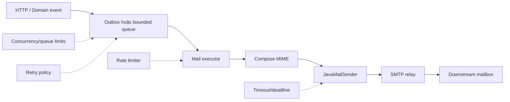
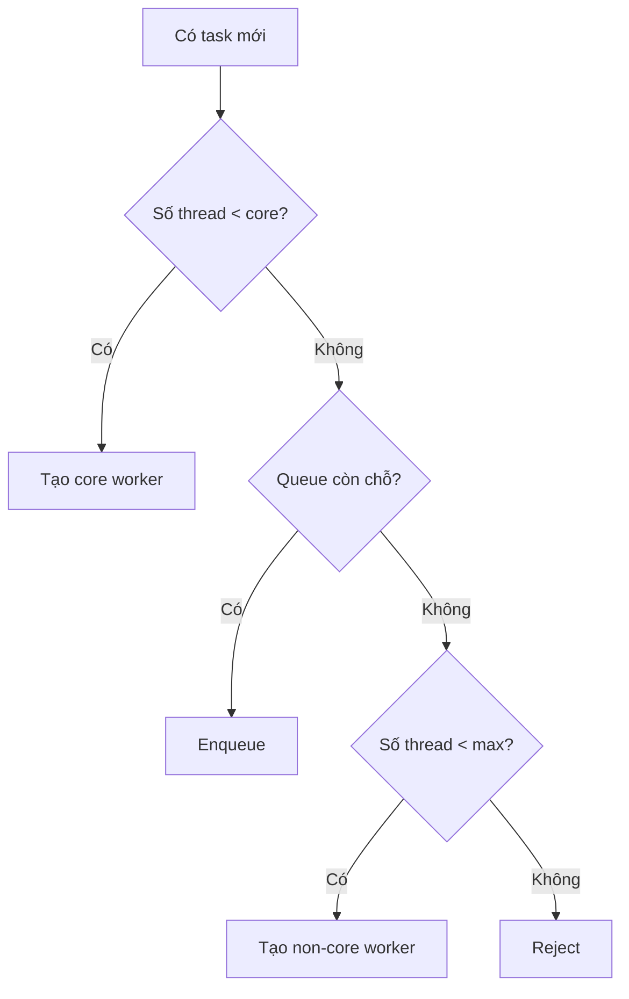
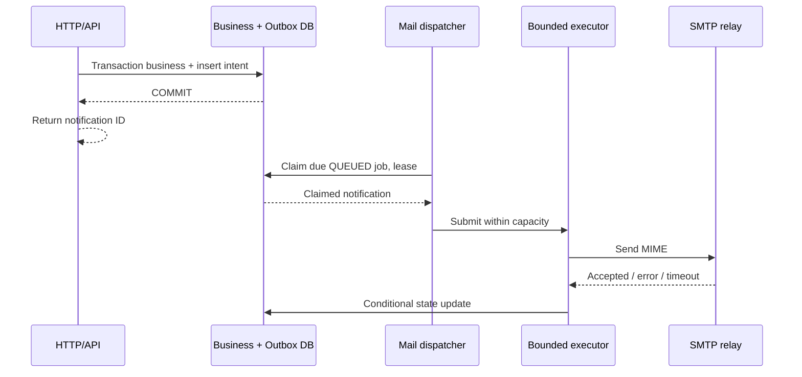

# Giới hạn thread pool gửi email

Trong ứng dụng Spring Framework Mail, gửi thư thường là thao tác **I/O có độ trễ lớn và biến động**. Một lần gửi không chỉ gồm câu lệnh `JavaMailSender.send(...)`: client còn phải phân giải DNS, tạo kết nối TCP, thỏa thuận TLS, xác thực SMTP, truyền MIME body/attachment và chờ mail relay phản hồi. Nếu thực hiện ngay trên HTTP request thread, người dùng có thể phải chờ nhiều giây. Nếu chuyển toàn bộ công việc sang `@Async` nhưng không giới hạn số thread và số job chờ, hệ thống lại có nguy cơ cạn thread, đầy heap, tăng latency, gửi vượt hạn mức provider và mất tác vụ khi process restart.

Vì vậy, **giới hạn thread pool gửi email** không đơn giản là chọn `maxPoolSize=100` để “gửi nhanh hơn”. Cần thiết kế một ngân sách tài nguyên xuyên suốt: số SMTP connection đồng thời, tốc độ gửi mà nhà cung cấp cho phép, dung lượng hàng đợi, deadline, memory cho MIME/attachment, transaction database, số instance triển khai và nhu cầu retry. Mục tiêu là đạt throughput phù hợp trong khi **không để backlog và lỗi lan sang request hoặc chức năng khác**.

Bài học này thuộc chương *Hiệu năng và giới hạn* của Spring Framework Mail. Nội dung phân tích cách `ThreadPoolTaskExecutor` thực sự hoạt động, công thức ước lượng concurrency từ latency, queue capacity và backpressure, cấu hình Spring `@Async`, phản ứng khi executor đầy, phối hợp với SMTP rate limits, transactional outbox, retry, timeout, observability, load test và các lỗi thiết kế thường gặp. Ví dụ hướng đến Java 21, Spring Framework 6.x / Spring Boot 3.x và Jakarta Mail.

> **Phạm vi:** Thread pool kiểm soát số tác vụ Java được thực thi đồng thời; nó **không** thay thế SMTP rate limiter, không bảo đảm delivery và không làm SMTP trở thành một phần của database transaction.

## 1. Một email tốn tài nguyên gì?

Một lời gọi gửi mail có thể chiếm:

- **Worker thread:** thường chờ I/O phần lớn thời gian; vẫn tiêu thụ stack, scheduling và tài nguyên thread.
- **SMTP connection:** socket, TLS session, relay connection slot; provider có thể giới hạn connection đồng thời.
- **CPU:** dựng template, MIME encoding, Base64 attachment, TLS crypto, serialization.
- **Memory:** object `MimeMessage`, HTML/text, attachment nếu tải vào `byte[]`, job queue và buffers.
- **Network bandwidth:** nhất là attachment lớn hoặc ảnh inline.
- **Database resources:** đọc dữ liệu nghiệp vụ, claim outbox, cập nhật trạng thái, lưu attempt history.
- **Quyền gửi của provider:** giới hạn email/giây, recipient/ngày, message size, số kết nối, quota theo account/domain/IP.

Một thread không tương ứng cố định với một SMTP connection trong mọi triển khai, nhưng với kiểu gửi đồng bộ `JavaMailSender.send(...)`, thường có một thao tác transport đang chạy trong worker. Cấu hình connection reuse/batch hoặc provider API có thể thay đổi tương quan này; phải đo thực tế.



Không nên chỉ nhìn CPU thấp rồi tăng số thread. SMTP thread có thể đợi network trong khi provider đã đạt giới hạn concurrent connection hoặc rate quota; tăng thread lúc này chỉ gây thêm timeout và throttling.

## 2. Khác biệt giữa request thread, mail worker và SMTP connection

Giả sử một API nhận 200 yêu cầu mỗi giây, mỗi yêu cầu kích hoạt một email.

Nếu gửi đồng bộ:

```text
HTTP thread
  -> load invoice
  -> render HTML
  -> JavaMailSender.send(...)
  -> SMTP round-trip
  -> HTTP response
```

Khi SMTP chậm, request thread bị giữ lâu và server có thể giảm khả năng đáp ứng các request khác. Chuyển sang `@Async`:

```text
HTTP thread
  -> submit email task
  -> HTTP response

Mail worker
  -> render / read attachment
  -> JavaMailSender.send(...)
```

giúp **tách latency** của HTTP và SMTP nhưng không làm công việc biến mất. Nếu tạo 200 task/giây mà worker chỉ xử lý được 40 task/giây, backlog tăng 160 task/giây. Không có giới hạn queue, hậu quả chỉ bị hoãn đến lúc heap hoặc hệ thống cạn tài nguyên.

### 2.1. HTTP nhanh không có nghĩa email đã gửi

Một API chỉ đưa task vào executor nên trả lời theo ngữ nghĩa “đã tiếp nhận để xử lý”, không tuyên bố SMTP relay accepted. Với công việc cần độ tin cậy, API có thể ghi transactional outbox rồi trả một notification ID và trạng thái `QUEUED`; worker mới thực hiện gửi.

### 2.2. @Async không tự cấp một ngân sách tài nguyên hợp lý

Nếu ứng dụng chỉ có:

```java
@Async
public void send(MailCommand command) {
    mailSender.send(buildMessage(command));
}
```

mà chưa biết executor nào được chọn, cấu hình pool/queue là gì, lỗi trả về ở đâu và thread khác nào dùng chung executor, thiết kế chưa đủ an toàn để vận hành. Spring có cơ chế chọn executor mặc định tùy cấu hình/framework/Boot; đừng giả định mặc định đó luôn bounded hoặc tối ưu cho SMTP.

Tốt hơn: **định nghĩa một executor riêng cho mail** và chỉ rõ nó bằng `@Async("mailExecutor")`, hoặc dùng worker polling outbox có concurrency limit do ứng dụng quản lý.

## 3. Các tham số của ThreadPoolTaskExecutor

Spring cung cấp `ThreadPoolTaskExecutor`, một abstraction trên Java `ThreadPoolExecutor`:

| Tham số | Ý nghĩa | Lỗi hiểu thường gặp |
|---|---|---|
| `corePoolSize` | Số worker core mà pool có thể duy trì | Không có nghĩa cứ có task là tạo ngay tới `maxPoolSize` |
| `maxPoolSize` | Trần số worker trong pool | Đặt 100 không có nghĩa luôn có 100 thread |
| `queueCapacity` | Số task có thể chờ trong queue của executor | Queue quá lớn có thể khiến `maxPoolSize` hiếm khi được dùng |
| `keepAliveSeconds` | Thời gian giữ non-core idle threads trước khi thu hẹp | Không phải SMTP timeout |
| `threadNamePrefix` | Prefix giúp phân biệt log/thread dump | Không giới hạn tài nguyên |
| `RejectedExecutionHandler` | Chính sách khi task không thể được nhận | Không được bỏ qua trạng thái notification bị từ chối |
| `TaskDecorator` | Bọc task, ví dụ context propagation | Không thay đổi bản chất giới hạn concurrency/queue |

Khi `queueCapacity > 0`, `ThreadPoolTaskExecutor` thường dùng một `LinkedBlockingQueue` có capacity tương ứng. Khi capacity bằng hoặc nhỏ hơn 0, implementation dùng đường bàn giao trực tiếp kiểu `SynchronousQueue`. Những lựa chọn này làm thay đổi thời điểm pool tăng thread.

### 3.1. Thứ tự nhận task rất quan trọng

Với cấu hình:

```text
corePoolSize  = 4
maxPoolSize   = 12
queueCapacity = 200
```

và executor dùng queue bounded thông thường, thứ tự phổ biến:

1. Khi số worker dưới core size, tạo thêm worker cho task.
2. Khi đã có đủ core workers, ưu tiên **enqueue** task đang tới.
3. Chỉ khi queue đầy, mới tăng số worker vượt core, tối đa max size.
4. Khi pool đã tới max và queue đầy, task bị từ chối theo rejection policy.



Do đó, nhiều người đặt `core=4, max=100, queue=100000` và tưởng có thể scale lên 100 worker khi bận. Trong thực tế, queue rất lớn có thể tích hàng chục nghìn task **trước khi** thread thứ 5 xuất hiện. Nếu muốn tăng concurrency sớm, cần chọn core size/queue phù hợp với yêu cầu, không chỉ nâng max size.

### 3.2. Queue capacity tính số task, không tính bytes

`queueCapacity=500` nghĩa tối đa 500 `Runnable` chờ, không phải 500 KB hay 500 email nhỏ. Nếu mỗi task closure giữ một object `MimeMessage` lớn hoặc mảng attachment 5 MB, 500 task có thể gây áp lực heap rất lớn. Nên enqueue **reference/ID nhẹ** rồi render/đọc attachment khi worker xử lý, hoặc lưu intent bền vững trong database.

### 3.3. Core threads và keep alive

Non-core threads có thể bị thu hẹp sau khi idle đủ lâu theo `keepAliveSeconds`. Core threads thường được giữ, trừ khi bật cho phép timeout core thread. Với lưu lượng email không đều, chính sách này ảnh hưởng thời gian warm-up và số thread tồn tại khi nhàn rỗi. Nhưng đừng thay đổi `keepAliveSeconds` để sửa SMTP read timeout; đây là hai tầng hoàn toàn khác nhau.

## 4. Cấu hình executor riêng cho gửi email

Ví dụ cấu hình Spring:

```java
package com.example.mail.config;

import java.util.concurrent.ThreadPoolExecutor;

import org.springframework.context.annotation.Bean;
import org.springframework.context.annotation.Configuration;
import org.springframework.core.task.AsyncTaskExecutor;
import org.springframework.scheduling.annotation.EnableAsync;
import org.springframework.scheduling.concurrent.ThreadPoolTaskExecutor;

@Configuration(proxyBeanMethods = false)
@EnableAsync
public class MailAsyncConfig {

    @Bean(name = "mailExecutor")
    public AsyncTaskExecutor mailExecutor() {
        ThreadPoolTaskExecutor executor = new ThreadPoolTaskExecutor();
        executor.setThreadNamePrefix("mail-worker-");
        executor.setCorePoolSize(4);
        executor.setMaxPoolSize(8);
        executor.setQueueCapacity(80);
        executor.setKeepAliveSeconds(60);
        executor.setRejectedExecutionHandler(
                new ThreadPoolExecutor.AbortPolicy());
        executor.setWaitForTasksToCompleteOnShutdown(false);
        executor.initialize();
        return executor;
    }
}
```

Các con số **4 / 8 / 80 chỉ là ví dụ**, không phải cấu hình khuyến nghị cho mọi provider. `AbortPolicy` từ chối khi không còn capacity, giúp tầng gọi biết overload thay vì lặng lẽ bỏ job. Cách xử lý rejection phải được viết rõ trong ứng dụng. Với nhu cầu dừng êm, sẽ cần chính sách lifecycle/outbox riêng; `waitForTasksToCompleteOnShutdown=false` ở đây làm nổi bật rằng executor in-memory **không phải nơi lưu job bền vững**.

### 4.1. Service dùng đúng executor

```java
package com.example.mail;

import java.util.concurrent.CompletableFuture;

import org.springframework.scheduling.annotation.Async;
import org.springframework.stereotype.Service;

@Service
public class AsyncMailService {

    private final MailComposer composer;
    private final MailTransport transport;

    public AsyncMailService(
            MailComposer composer,
            MailTransport transport) {
        this.composer = composer;
        this.transport = transport;
    }

    @Async("mailExecutor")
    public CompletableFuture<Void> sendAsync(MailCommand command) {
        var message = composer.compose(command);
        transport.send(message);
        return CompletableFuture.completedFuture(null);
    }
}
```

`MailComposer`, `MailTransport` và `MailCommand` là abstraction do ứng dụng định nghĩa để tách render khỏi SMTP transport. Có thể dùng `JavaMailSender` trực tiếp, nhưng tách lớp giúp test, rate limiting và phân loại lỗi dễ hơn.

`@Async` dựa trên Spring proxy trong cấu hình thông thường. Gọi `this.sendAsync(...)` từ chính bean có thể bypass proxy, khiến tác vụ chạy đồng bộ và bỏ qua executor. Để bảo đảm bất đồng bộ, gọi phương thức qua một bean Spring khác hoặc cơ chế proxy phù hợp.

### 4.2. Void so với CompletableFuture

`@Async void` không cho caller trực tiếp giữ future để biết exception trong worker. Spring có cơ chế `AsyncUncaughtExceptionHandler`, nhưng đối với công việc email cần theo dõi kết quả, nên có một outcome/future hoặc **trạng thái bền vững trong outbox**.

Trả `CompletableFuture<Void>` giúp quan sát exception khi task đã được nhận vào executor. Tuy nhiên, **rejection có thể xảy ra ngay tại thời điểm submit** và cần được xử lý khác với lỗi SMTP xảy ra trong task; chỉ đặt `whenComplete(...)` chưa đủ nếu method proxy ném exception lúc submit.

### 4.3. Cấu hình shutdown không biến queue thành durable storage

Tùy lifecycle, Spring có thể cho executor chờ task hoàn tất khi ứng dụng shutdown, có await-termination hoặc hủy task còn chờ. Tất cả đều chỉ cải thiện graceful shutdown ở mức process. Process kill, OOM hoặc mất máy vẫn có thể làm mất task chưa được lưu bền vững.

Với email giao dịch, lưu outbox trước khi dispatch là cách đáng tin hơn là dựa vào “chờ hết task khi shutdown”.

## 5. Ước lượng concurrency từ throughput và latency

Một cách suy nghĩ cơ bản là quan hệ giữa throughput, số công việc đang xử lý và thời gian xử lý trung bình (Little's law ở điều kiện ổn định):

\[
L = \lambda W
\]

Trong đó:

- `L`: số công việc trung bình đang ở hệ thống/pha được đo.
- `λ`: tốc độ công việc hoàn tất trung bình, tính theo email/giây.
- `W`: thời gian trung bình một công việc ở trong hệ thống/pha đó.

Nếu chỉ xét **giai đoạn worker đang gửi**, giả sử mỗi SMTP attempt chiếm một worker trung bình 0,5 giây và muốn thông lượng 20 attempts/giây, số worker đang bận trung bình cần xấp xỉ:

\[
20\ \text{attempts/s} \times 0.5\ \text{s/attempt} = 10\ \text{attempts đồng thời}
\]

Đây là **ước lượng khởi đầu**, không phải công thức bảo đảm. Latency có phân bố đuôi, timeouts, retry, rate limits, overhead CPU/MIME và giới hạn connection; pool còn cần dư địa tránh hoạt động liên tục ở 100% utilization.

### 5.1. Ví dụ khi SMTP chậm đi

Giả sử có 10 worker gửi liên tục:

| SMTP attempt trung bình | Trần throughput gần đúng khi worker luôn bận |
|---:|---:|
| 0,2 giây | ~50 attempts/giây |
| 0,5 giây | ~20 attempts/giây |
| 1,0 giây | ~10 attempts/giây |
| 2,0 giây | ~5 attempts/giây |
| 5,0 giây | ~2 attempts/giây |

Các số này tính từ `workers / averageDuration`, **chưa tính** rate limit, batch, render CPU hay queue. Khi relay chậm từ 0,5 lên 2 giây, throughput giảm khoảng bốn lần nếu giữ số worker. Việc tự động tăng thread bốn lần có thể làm relay quá tải và khiến latency còn tệ hơn.

### 5.2. Sizing phải xét toàn bộ thời gian giữ worker

Nếu worker thực hiện:

```text
Read data        80 ms
Render template  30 ms
Read attachment  90 ms
SMTP send       500 ms
Update DB        20 ms
----------------------
Total           720 ms
```

thì ước lượng concurrency cần dựa trên **720 ms** nếu cùng một thread giữ suốt toàn bộ tác vụ, không chỉ 500 ms SMTP. Nếu tách các pha thành những executor khác nhau, tính ngân sách theo từng pha.

### 5.3. Throughput là attempt hay notification?

Một notification có thể cần retry. Nếu 100 notifications tạo ra 120 SMTP attempts do lỗi tạm thời, throughput của executor và provider tính theo **attempt**, còn KPI kinh doanh có thể tính theo notification. Đừng dùng số `SENT` notifications làm ước lượng duy nhất cho số SMTP calls hoặc bandwidth.

## 6. Khi nào backlog phát triển không giới hạn?

Giả sử trong một khoảng thời gian:

- Producer tạo `λ_in = 60` email/giây.
- Worker hoàn thành `μ = 40` email/giây.

Backlog tăng gần:

\[
\Delta Q / \Delta t \approx \lambda_{in} - \mu = 20\ \text{email/s}
\]

Sau 5 phút, backlog tăng khoảng 6.000 job nếu tốc độ không đổi. Nếu queue chỉ có capacity 500, giới hạn bị chạm rất nhanh. Nếu queue không giới hạn, ứng dụng có thể duy trì cảm giác “API vẫn nhận được yêu cầu” cho tới lúc heap cạn hoặc tuổi thư vượt SLA.

### 6.1. Queue capacity là ngân sách thời gian chờ

Một ước lượng đơn giản cho hàng đợi ổn định là:

\[
W_q \approx Q / \mu
\]

Với 200 job đang chờ và tốc độ hoàn tất 40 email/giây, chỉ riêng khoảng chờ trung bình được ước lượng ở mức vài giây trong điều kiện đều và không đổi. Đây không phải bảo đảm p95 hoặc thời gian chờ tối đa; producer liên tục, batch, thứ tự ưu tiên và retry có thể làm biến động lớn.

Nếu SLA yêu cầu mail xác minh phải được dispatch trong 10 giây, hàng đợi 50.000 task không phải giải pháp phù hợp chỉ vì heap còn chỗ.

### 6.2. Queue lớn có ba cái giá

1. **Memory:** closure giữ dữ liệu, payload, object graph và có thể giữ cả tham chiếu tới request/session nếu thiết kế sai.
2. **Latency:** task đến muộn, có thể hết hạn token hoặc business intent không còn hợp lệ.
3. **Shutdown/crash:** task chỉ ở RAM có thể mất; thời gian drain queue quá dài khi deploy.

Vì vậy, chọn queue theo **thời gian chờ cho phép và memory budget**, không theo “đặt số lớn để khỏi báo lỗi”.

## 7. Backpressure: hệ thống làm gì khi pool đầy?

Backpressure là cơ chế báo cho producer hoặc tầng điều phối biết rằng consumer không thể nhận thêm công việc ở tốc độ hiện tại. Với gửi mail, điều đó quan trọng vì ứng dụng thường không được phép mất ý định gửi hóa đơn, OTP hoặc email nghiệp vụ chỉ vì executor tạm quá tải.

Ba trạng thái cần phân biệt:

1. **Accepted into durable storage:** intent đã commit vào database/outbox; dispatcher có thể gửi khi có capacity.
2. **Accepted into executor memory queue:** task mới chỉ được giữ trong RAM; chưa bảo đảm qua restart.
3. **Rejected by executor:** không được nhận vào pool; người gọi phải xử lý hoặc thông báo phù hợp.

Không được gọi cả ba là “đã gửi email thành công”.

### 7.1. Bốn kiểu RejectedExecutionHandler

Java `ThreadPoolExecutor` cung cấp một số policy tiêu chuẩn:

| Policy | Khi pool và queue đều đầy | Phù hợp với mail? |
|---|---|---|
| `AbortPolicy` | Ném `RejectedExecutionException`; Spring có thể chuyển thành `TaskRejectedException` | Thường phù hợp khi caller có xử lý rõ |
| `CallerRunsPolicy` | Chạy task ngay trên thread gọi `execute`, nếu executor còn hoạt động | Cẩn trọng: có thể làm HTTP request chờ SMTP |
| `DiscardPolicy` | Im lặng bỏ task | **Không phù hợp** với email quan trọng |
| `DiscardOldestPolicy` | Loại job chờ lâu nhất rồi thử nhận job mới | Nguy cơ mất notification và phá thứ tự nghiệp vụ |

Đặc biệt, `CallerRunsPolicy` có thể đóng vai trò backpressure nếu producer là một dispatcher worker nội bộ: dispatcher chậm lại khi pool đầy. Nhưng nếu producer là HTTP thread, policy này có thể **chạy SMTP ngay trong HTTP request**, làm mất lợi ích bất đồng bộ, chiếm request thread và gây timeout. Hơn nữa, khi executor đã shutdown, cách xử lý của policy cần được hiểu rõ; đừng coi CallerRuns là bảo đảm không mất job.

### 7.2. Lỗi khi submit không phải lỗi SMTP

Ví dụ:

```java
try {
    asyncMailService.sendAsync(command);
} catch (TaskRejectedException rejected) {
    // Executor không nhận task; SMTP chưa được thử.
    enqueueForLaterOrReturnOverloaded(command);
}
```

`TaskRejectedException` thuộc `org.springframework.core.task`. Trong ứng dụng thực, logic recovery cần bảo đảm không enqueue **hai lần** nếu intent đã được ghi trước đó. Nên dùng một idempotency key để tạo intent duy nhất, không chỉ bắt exception rồi retry HTTP vô hạn.

Nếu `sendAsync` trả `CompletableFuture`, còn cần xử lý exception **sau khi task được nhận**:

```java
CompletableFuture<Void> future =
        asyncMailService.sendAsync(command);

future.whenComplete((ignored, failure) -> {
    if (failure != null) {
        recordAsyncFailure(command.notificationId(), failure);
    }
});
```

Hai ví dụ minh họa hai thời điểm thất bại khác nhau. `recordAsyncFailure(...)` và `enqueueForLaterOrReturnOverloaded(...)` là abstraction do ứng dụng định nghĩa. Với luồng cần bền vững, ưu tiên outbox status và worker retry, không dùng một `CompletableFuture` tồn tại trong process làm nguồn sự thật duy nhất.

### 7.3. HTTP API trả gì khi quá tải?

Phụ thuộc semantics:

- Nếu **đã commit outbox intent**, có thể trả phản hồi đã tiếp nhận và notification ID; không cần chờ SMTP.
- Nếu request **chưa ghi bền vững** và không thể nhận thêm vì overload, trả tín hiệu lỗi rõ ràng, ví dụ `429 Too Many Requests` hoặc `503 Service Unavailable` tùy contract, kèm gợi ý retry nếu phù hợp.
- Nếu tác vụ optional, có thể lựa chọn best-effort/drop theo business requirement được nêu rõ, nhưng không âm thầm bỏ email giao dịch quan trọng.

Số thread không thay thế việc định nghĩa **admission control**: có những email bắt buộc nhận, có loại chiến dịch có thể delay, có loại OTP quá hạn nên bị bỏ qua và tạo yêu cầu mới.

## 8. Thread pool limit khác rate limit của SMTP provider

Giả sử executor cho phép 20 worker đồng thời. Nếu mỗi lần SMTP mất 0,2 giây, throughput thô có thể lên tới khoảng 100 attempts/giây. Nhưng relay có thể chỉ cho phép **10 messages/giây** hoặc **5 connection đồng thời**. Khi đó nâng thread lên 20 không làm quota tăng; nó gây throttling.

Các loại giới hạn provider thường gặp:

| Loại giới hạn | Ví dụ | Công cụ kiểm soát |
|---|---|---|
| Concurrent SMTP connections | Tối đa một số socket đồng thời | Semaphore / concurrency cap |
| Messages per second | Tốc độ submit message | Token bucket / rate limiter |
| Recipients per second | Một message nhiều recipient cũng tính nhiều đơn vị | Rate limiter theo recipient |
| Quota theo giờ/ngày | Tổng số message/recipient | Durable quota accounting, scheduling |
| Max message size | Kích thước MIME sau encoding | Validate/cap attachment trước enqueue |
| Burst limit | Chỉ cho phép burst ngắn | Token bucket capacity + refill rate |
| Tenant/account quota | Mỗi credential/sender có limit | Rate limiter theo account/tenant |

Những con số trên là ví dụ về **loại hạn mức**, không phải hạn mức của một provider cụ thể. Luôn tham khảo hợp đồng SMTP/API và đo phản hồi thực tế.

### 8.1. Hai ràng buộc song song

Có thể mô hình hóa:

\[
\text{SMTP attempts đang gửi} \leq C_{\text{connection}}
\]

và:

\[
\text{SMTP attempts / giây} \leq R_{\text{provider}}
\]

Đặt số worker `C=5` giúp kiểm soát concurrent calls nhưng **không tự bảo đảm** tốc độ dưới 10 messages/giây khi một attempt rất nhanh. Ngược lại, token bucket 10 requests/giây **không tự bảo đảm** chỉ có tối đa 5 kết nối khi server chậm. Hệ thống cần cả hai khi provider áp dụng hai loại hạn mức.

### 8.2. Cấp permit ngay trước điểm gửi

Một kiến trúc minh họa:

```java
public final class ThrottledMailTransport {

    private final MailRateLimiter rateLimiter;
    private final Semaphore smtpConnections;
    private final JavaMailSender sender;

    public ThrottledMailTransport(
            MailRateLimiter rateLimiter,
            Semaphore smtpConnections,
            JavaMailSender sender) {
        this.rateLimiter = rateLimiter;
        this.smtpConnections = smtpConnections;
        this.sender = sender;
    }

    public void send(MimeMessage message) throws InterruptedException {
        if (!rateLimiter.tryAcquire()) {
            throw new MailRateLimitedException();
        }

        if (!smtpConnections.tryAcquire()) {
            // Không block vô hạn; caller lên lịch lại.
            throw new MailConcurrencyLimitException();
        }

        try {
            sender.send(message);
        } finally {
            smtpConnections.release();
        }
    }
}
```

`MailRateLimiter`, `MailRateLimitedException` và `MailConcurrencyLimitException` là abstraction của ứng dụng. Đoạn code trên đơn giản hóa để giải thích hai loại permit; bản production cần quản lý atomicity/thứ tự lấy permit và policy khi rate permit đã tiêu thụ nhưng concurrency permit không lấy được, cũng như xử lý interrupt/cancellation. Có thể lấy concurrency trước rồi rate với thời gian chờ bounded và hoàn trả permit khi chưa bắt đầu gửi, tùy contract limiter.

Điểm thiết kế quan trọng là **không giữ hàng nghìn worker đứng chờ permit**. Hạn chế lấy job/submit task từ dispatcher khi đã biết provider chưa có quota, hoặc trả job về trạng thái chờ thời điểm gửi sau.

### 8.3. Rate limit có thể cần dùng chung giữa các instance

Một deployment có 5 pod, mỗi pod cho gửi 10 message/giây có thể tạo tới 50 message/giây vào cùng SMTP account. Nếu provider giới hạn 20 message/giây **toàn account**, limiter riêng ở từng JVM không đủ.

Tùy kiến trúc có thể:

- Chia quota tĩnh theo pod khi số replica được kiểm soát.
- Dùng distributed rate limiter có atomic accounting và TTL thích hợp.
- Điều phối gửi qua một nhóm dispatcher tập trung theo account/provider.
- Chia worker pool theo provider/tenant với ngân sách cụ thể.

Limiter phân tán cần tính cả network partition, clock drift và TTL; không giả định một counter đơn giản luôn chính xác tuyệt đối. Để an toàn, nên có headroom bên dưới quota chính thức thay vì cấu hình chạm trần.

## 9. Retry, rate limiting và retry storm

Khi SMTP trả 421, 450, 451 hoặc 452, hệ thống có thể phân loại là lỗi tạm thời. Nếu mọi task retry ngay trên executor bằng vòng lặp:

```java
while (!sent) {
    mailSender.send(message);
}
```

thì mỗi worker chiếm thread liên tục, tăng request lên relay đang quá tải và làm queue của email mới bị tắc. Đây là **retry storm**.

Đúng hơn, mỗi attempt:

1. Gửi một lần.
2. Phân loại kết quả là accepted, temporary, permanent hoặc unknown.
3. Nếu temporary và còn retry budget, ghi thời điểm thử tiếp theo.
4. **Giải phóng worker**; job chờ lịch trong outbox/scheduler.
5. Đến hạn mới claim và gửi lại.

### 9.1. Exponential backoff có jitter

Ví dụ:

```text
Attempt 1: 451 -> retry sau khoảng 30 giây
Attempt 2: 451 -> retry sau khoảng 1 phút
Attempt 3: 451 -> retry sau khoảng 2 phút
Attempt 4: 451 -> retry sau khoảng 4 phút
Attempt 5: hết retry budget -> FAILED / DEAD_LETTER
```

Jitter giúp tránh hàng nghìn tác vụ cùng thức dậy tại một thời điểm. Nếu provider có tín hiệu rate limit window hoặc retry-after đáng tin cậy, kết hợp với policy tương ứng. Không lặp retry ngay chỉ vì queue còn trống.

### 9.2. Timeout có giới hạn là điều kiện để pool hồi phục

Ví dụ Jakarta Mail SMTP:

```yaml
spring:
  mail:
    properties:
      "[mail.smtp.connectiontimeout]": "5000"
      "[mail.smtp.timeout]": "10000"
      "[mail.smtp.writetimeout]": "10000"
```

- `connectiontimeout`: thời hạn thiết lập kết nối socket.
- `timeout`: thời hạn chờ đọc phản hồi socket.
- `writetimeout`: thời hạn chờ ghi socket theo implementation.

Nếu không có timeout, worker có thể chờ rất lâu trong network I/O, khiến active count chạm max và queue không tiêu thụ được. Nhưng ba timeout socket này **không phải deadline tổng** cho toàn bộ attempt hoặc notification; DNS, nhiều pha protocol, MIME serialization và retry vẫn có thể làm tổng thời gian dài hơn.

### 9.3. Deadline và job TTL

Một email OTP có thể chỉ có giá trị 5 phút. Nếu queue backlog khiến worker bắt đầu sau 6 phút, gửi một mã hết hạn có thể gây khó hiểu. Trước khi gửi, nên kiểm tra:

```java
if (clock.instant().isAfter(job.expiresAt())) {
    outbox.markExpired(job.id(), job.leaseToken());
    return;
}
```

`clock`, `job` và `outbox` là abstraction của ứng dụng. Với thư giao dịch như hóa đơn, policy TTL có thể khác; không tự xóa mọi email cũ chỉ vì chờ lâu. TTL là quyết định nghiệp vụ bên cạnh giới hạn executor.

### 9.4. Trạng thái UNKNOWN và duplicate

Nếu relay đã nhận DATA nhưng client mất phản hồi 250 cuối, kết quả có thể không chắc chắn. Tăng thread hoặc retry ngay không làm kết quả rõ hơn; nó có thể tạo duplicate. Outbox cần lưu thông tin attempt outcome và dùng policy reconciliation/retry phù hợp, không coi mọi `MailSendException` là “chưa gửi”.

## 10. Thiết kế lâu dài: transactional outbox + bounded worker

`@Async` hữu ích cho công việc ngắn, best-effort. Nhưng khi email là một phần đáng tin cậy của nghiệp vụ, kiến trúc thường phù hợp hơn là:



Ưu điểm:

- Intent được lưu qua restart.
- Queue RAM của executor có thể nhỏ hoặc không có queue.
- Worker chỉ claim khi có năng lực xử lý.
- SMTP failure không kéo dài business transaction.
- Retry có thể lên lịch bằng database, không giữ thread ngủ.
- Có dữ liệu để đo backlog, tuổi notification và SLA.
- Khi cần scale, tăng worker có kiểm soát theo quota provider.

### 10.1. Ghi intent trong cùng transaction nghiệp vụ

```java
@Transactional
public void issueInvoice(long invoiceId) {
    Invoice invoice =
            invoiceRepository.findById(invoiceId).orElseThrow();
    invoice.issue();

    outbox.insertIfAbsent(new MailIntent(
            "invoice-issued:" + invoiceId,
            invoice.tenantId(),
            invoice.customerId(),
            "INVOICE_ISSUED",
            clock.instant()));
}
```

`Invoice`, `MailIntent` và các repository là abstraction của ứng dụng. Một unique constraint trên notification key/tenant ngăn enqueue trùng. Không gọi SMTP trong transaction này; mail worker gửi sau commit.

### 10.2. Trạng thái job và lease

Một job có thể có:

```text
id             = ...
status         = QUEUED | SENDING | SENT | FAILED | DEAD_LETTER
attempts       = 0
nextAttemptAt  = 2026-11-12T14:00:00Z
leaseOwner     = null
leaseToken     = null
leaseUntil     = null
```

Worker claim nguyên tử từ QUEUED sang SENDING, gắn lease token; khi gửi xong cập nhật bằng điều kiện status + token. Nếu worker crash, lease hết hạn cho phép recovery. Nhưng lease **không** tự hủy một SMTP call đã bắt đầu, và không loại bỏ khả năng duplicate sau timeout/ack failure.

### 10.3. Đừng claim nhiều hơn năng lực xử lý

Một lỗi thiết kế là:

```text
Database claim 5.000 jobs -> SENDING
Executor capacity: 8 running + 80 queued
4.912 jobs không thể submit
```

Những job đó đã bị gắn lease dù chưa có worker sẵn sàng, có thể bị kẹt hoặc hồi phục muộn. Giải pháp tốt hơn:

- Xác định slot còn trống **trước** khi claim.
- Claim batch nhỏ dựa trên capacity và quota.
- Nếu submit bị từ chối, release/requeue claim bằng transition có fencing token.
- Không giữ transaction claim mở trong khi gửi SMTP.
- Không chỉ dựa vào trạng thái queue của executor như nguồn sự thật duy nhất: queue size có thể thay đổi giữa lúc đo và lúc submit.

## 11. Worker dispatcher giới hạn in-flight bằng Semaphore

Một cách minh họa là kết hợp permit tại dispatcher với executor có giới hạn. **Semaphore** tránh claim nhiều job hơn khả năng in-flight (running + chờ) mà ứng dụng cho phép.

```java
package com.example.mail.worker;

import java.util.Optional;
import java.util.concurrent.Semaphore;

import org.springframework.core.task.AsyncTaskExecutor;
import org.springframework.core.task.TaskRejectedException;
import org.springframework.scheduling.annotation.Scheduled;
import org.springframework.stereotype.Component;

@Component
public final class MailOutboxDispatcher {

    private final AsyncTaskExecutor mailExecutor;
    private final OutboxClaims claims;
    private final MailAttemptProcessor processor;
    private final Semaphore inFlight = new Semaphore(8);

    public MailOutboxDispatcher(
            AsyncTaskExecutor mailExecutor,
            OutboxClaims claims,
            MailAttemptProcessor processor) {
        this.mailExecutor = mailExecutor;
        this.claims = claims;
        this.processor = processor;
    }

    @Scheduled(fixedDelayString = "${app.mail.poll-delay-ms:250}")
    public void poll() {
        while (inFlight.tryAcquire()) {
            Optional<ClaimedMailJob> maybeJob = claims.claimOneDue();
            if (maybeJob.isEmpty()) {
                inFlight.release();
                break;
            }

            ClaimedMailJob job = maybeJob.get();
            try {
                mailExecutor.execute(() -> {
                    try {
                        processor.processOne(job);
                    } finally {
                        inFlight.release();
                    }
                });
            } catch (TaskRejectedException rejected) {
                inFlight.release();
                claims.releaseAndReschedule(
                        job.id(), job.leaseToken());
                break;
            }
        }
    }
}
```

Các interface `OutboxClaims`, `MailAttemptProcessor`, `ClaimedMailJob` và hai phương thức repository là abstraction của ứng dụng. Ví dụ chỉ nhằm minh họa **acquire slot → claim → submit → finally release**. Tầng production cần xử lý cả lỗi `claimOneDue()` (đảm bảo release permit nếu database lỗi), rollback/requeue khi submission fail, shutdown và khả năng callback bất thường; nên tổ chức các thao tác trong helper có `try/finally` rõ ràng. `@Scheduled` yêu cầu bật scheduling, chẳng hạn `@EnableScheduling` ở configuration.

Ngoài ra, nếu có **nhiều dispatcher gọi `poll()` cùng một lúc** trong cùng JVM, semaphore thread-safe nhưng vẫn phải bảo vệ transaction claim bằng locking/fencing ở DB. Với nhiều instance, mỗi instance có semaphore riêng, cần phân phối global quota theo provider.

### 11.1. Vì sao semaphore và queue executor không giống nhau?

- `Semaphore` ở dispatcher có thể hạn chế **tổng số job đã claim đang in-flight**, tránh claim vượt ngân sách.
- `ThreadPoolTaskExecutor` hạn chế **thread chạy và queue RAM**.
- `RateLimiter` hạn chế **số SMTP request trong khoảng thời gian**.
- `Database lease` hạn chế **quyền sở hữu job** giữa nhiều worker/process.

Bốn lớp này giải quyết các rủi ro khác nhau. Không nên thay thế tất cả bằng một biến `maxPoolSize`.

### 11.2. Tránh busy polling khi không có quota

Nếu không lấy được permit, không cần liên tục truy vấn DB với tần suất cao. Poll interval, signal/event notification và adaptive backoff cho dispatcher giúp giảm DB load khi không có slot. Khi provider đang rate limit, chuyển job sang thời điểm `nextAttemptAt` phù hợp thay vì liên tục claim rồi reject.

## 12. Multi-tenant fairness và chống một nguồn chiếm hết pool

Trong sản phẩm nhiều tenant, một tenant có thể enqueue chiến dịch 20.000 email, trong khi tenant khác cần gửi 5 email hóa đơn. Một FIFO queue chung có thể khiến hóa đơn chờ sau chiến dịch rất lâu.

Có nhiều phương án:

- Tách pool hoặc quota cho **transactional** và **bulk/marketing**.
- Giới hạn concurrency và gửi theo từng tenant/account.
- Dùng weighted fair scheduling, round-robin hoặc rate allocation.
- Cho priority có kiểm soát nhưng tránh starve các job thường.
- Giữ retry queue riêng theo thời điểm đến hạn, không để retry lỗi provider chiếm mọi worker.

### 12.1. Không đơn giản đưa priority vào một queue vô hạn

Nếu task ưu tiên cao đến liên tục, task thấp có thể bị starvation. Đồng thời, ưu tiên không bảo đảm nhà cung cấp cho gửi nhanh hơn quota. Một thiết kế phù hợp có thể dành một số worker/quota dự trữ cho email bảo mật, xác minh hoặc giao dịch và một quota khác cho chiến dịch.

### 12.2. Hạn mức toàn cluster

Giả sử mỗi pod có:

```text
mailExecutor maxPoolSize = 8
replicas = 6
```

Trần lý thuyết toàn cluster có thể là **48 worker** đang chạy. Nếu provider chỉ cho 20 SMTP connections đồng thời, pool tổng lớn hơn hạn mức. Cần tính theo **replica count và per-provider account**, không chỉ đọc một cấu hình JVM.

### 12.3. Attachment lớn và head-of-line blocking

Một email 20 MB có thể chiếm worker lâu hơn một OTP text-only. Nếu cùng một FIFO queue, các job nhỏ phía sau có thể chờ lâu khi nhiều attachment lớn được xử lý cùng lúc. Có thể:

- Giới hạn message size để giảm cạnh tranh tài nguyên.
- Tách lane theo loại job/size khi có dữ liệu thực nghiệm.
- Dự trù memory và bandwidth cho lane attachment.
- Giữ fairness và quota giữa lane, tránh tuyệt đối hóa priority.

Không tạo hàng chục pool theo từng template khi chưa có lý do: quá nhiều pool làm tổng số thread tăng khó kiểm soát và gây khó vận hành.

## 13. Memory budget: một queue bounded vẫn có thể gây OOM

Số task chờ chỉ là một phần của bài toán heap. Một task có thể giữ dữ liệu:

```java
record MailCommand(
        String recipient,
        byte[] pdfAttachment,
        String renderedHtml
) {}
```

Giả sử mỗi command chứa PDF 4 MB. Nếu queue giữ 200 command chưa chạy, chỉ riêng mảng bytes đã xấp xỉ:

\[
200 \times 4\ \mathrm{MB} = 800\ \mathrm{MB}
\]

Con số này **chưa gồm** Java objects, HTML, MIME representation, các bản sao khi encoding, buffer, worker stack, heap của phần khác và overhead GC. Có thể thấy queueCapacity=200 không phải luôn nhỏ.

### 13.1. Enqueue lightweight reference

Thay vì:

```java
executor.execute(() ->
        mailSender.send(createMail(largePdfBytes)));
```

có thể lưu một notification ID hoặc reference tới attachment đã được xác thực:

```java
executor.execute(() -> {
    MailJob job = outbox.load(jobId);
    processor.sendOne(job);
});
```

Task chờ chỉ giữ `jobId` và một closure nhẹ. Tuy nhiên, nếu dùng executor queue in-memory mà **không** có outbox bền vững, việc giữ ID không giải quyết rủi ro mất job khi crash. Nên dùng outbox để vừa giảm memory vừa bảo vệ intent.

### 13.2. MIME và Base64 overhead

SMTP MIME attachment thường được encode, ví dụ Base64. Payload trên dây và buffers có thể lớn hơn file gốc; không lấy kích thước attachment ban đầu làm tổng memory/network duy nhất. Nếu xử lý đồng thời nhiều PDF 20 MB, throughput có thể bị giới hạn bởi network hoặc GC trước khi chạm `maxPoolSize`.

Tối ưu đúng cách:

- Giới hạn số lượng và kích thước attachment.
- Dùng nguồn dữ liệu có thể mở stream mới khi Jakarta Mail cần serialize.
- Không giữ `InputStream` sống suốt thời gian chờ trong queue.
- Giới hạn concurrency riêng cho job lớn nếu cần.
- Theo dõi heap/GC pause và network egress cùng số worker.
- Kiểm tra retry có thể mở lại attachment sau nhiều phút hoặc restart.

### 13.3. Không đưa HTTP request/session vào queued Runnable

Một closure giữ `HttpServletRequest`, session, JPA entity mutable hoặc `SecurityContext` của người dùng có thể kéo dài vòng đời dữ liệu ngoài dự kiến và gây rò rỉ. Với async task ngắn, truyền DTO bất biến tối thiểu; với outbox, lưu actor ID, tenant ID và notification ID đã được xác thực thay vì serialize nguyên request/principal.

## 14. Security context và correlation context trong mail worker

Spring Security `SecurityContextHolder` và SLF4J MDC thường dùng context gắn với thread. Khi công việc được submit sang executor, principal và correlation ID **không mặc nhiên** đi theo worker.

Nếu job cần danh tính user trong một tác vụ ngắn trong cùng JVM, có thể dùng `DelegatingSecurityContextAsyncTaskExecutor` với semantics capture context theo từng task. Đối với MDC, có thể dùng `TaskDecorator` chụp/khôi phục context trong `try/finally`.

Tuy nhiên, thread pool tái sử dụng thread. Nếu tự gọi:

```java
MDC.put("tenantId", tenantId);
mailSender.send(message);
// Quên MDC.remove/restore trong finally
```

thì task kế tiếp có thể nhìn thấy tenant ID của task trước, làm log sai và có khả năng rò rỉ metadata. Không tăng số thread để “né” lỗi này; phải quản lý vòng đời context đúng.

Với outbox chạy sau restart, **không serialize `Authentication`/JWT hoặc session** để truyền sang worker dài hạn. Worker dùng service identity, dữ liệu tenant/reference từ nguồn tin cậy và policy kiểm tra resource; correlation ID chỉ phục vụ truy vết, không phải quyền truy cập.

## 15. Graceful shutdown, deploy và lost in-flight work

Khi ứng dụng shutdown, executor có thể chứa:

```text
Pool:
  4 worker đang kết nối SMTP
  60 task đang nằm trong RAM queue
```

Nếu tắt process ngay, task chờ trong RAM có thể biến mất và các task đang gửi có thể bị ngắt. Nếu cấu hình chờ drain hết queue, shutdown có thể mất lâu hơn thời gian cho phép của orchestration platform.

### 15.1. Những tham số liên quan

Spring `ThreadPoolTaskExecutor` có các khả năng cấu hình:

- Chờ task hoàn tất khi shutdown.
- Giới hạn thời gian await termination.
- Phối hợp lifecycle với Spring context.
- Chính sách hủy task chờ hoặc tiếp nhận task muộn tùy phiên bản/cấu hình.

Ví dụ cấu hình cho một luồng best-effort có thể chọn:

```java
executor.setWaitForTasksToCompleteOnShutdown(true);
executor.setAwaitTerminationSeconds(30);
```

Hai dòng này không bảo đảm process sẽ sống đủ 30 giây khi orchestrator gửi SIGKILL, máy mất nguồn hoặc JVM crash. Chúng chỉ ảnh hưởng hành vi shutdown bình thường trong phạm vi Spring quản lý. Cần phối hợp với grace period của runtime và timeout SMTP.

### 15.2. With outbox: ưu tiên durability hơn drain vô hạn

Nếu mỗi email có một outbox row:

1. Dừng tiếp nhận claim mới khi shutdown bắt đầu.
2. Cho các attempt hiện tại kết thúc trong grace period nếu có thể.
3. Cập nhật trạng thái bằng lease token khi kết quả có thể xác định.
4. Các job chưa claim vẫn `QUEUED` trong database.
5. Job `SENDING` của worker đã chết được recovery theo lease expiry.

Đừng luôn “reset mọi SENDING thành QUEUED ngay khi shutdown” nếu SMTP attempt có thể đã được relay nhận; làm vậy có thể gửi trùng. Cần policy outcome/lease phù hợp.

### 15.3. Rolling deployment và nhiều phiên bản template

Khi nhiều pod chạy phiên bản ứng dụng khác nhau trong rolling deploy, job QUEUED có thể được xử lý bởi phiên bản worker khác phiên bản đã tạo intent. Nếu payload/schema/template thay đổi, cần version hóa phù hợp. Đây không phải lỗi thread pool nhưng thường lộ ra khi backlog lớn và deploy liên tục.

## 16. Virtual threads có thay thế giới hạn SMTP không?

Java 21 có virtual threads. Một virtual thread có thể xử lý blocking I/O với chi phí thread thấp hơn platform thread trong nhiều tình huống. Spring Boot ở các phiên bản hỗ trợ có thể dùng virtual threads cho một số executor khi bật cấu hình tương ứng.

Nhưng **virtual threads không giải quyết mọi giới hạn của SMTP**:

- Provider vẫn giới hạn concurrent connections và messages/giây.
- Network, CPU TLS/Base64, memory attachment và quota vẫn hữu hạn.
- Một triệu virtual threads đồng thời gọi SMTP không biến relay thành một triệu connection slots.
- Job trong RAM vẫn mất khi process chết.
- Retry vô hạn vẫn tạo retry storm.

Nếu dùng virtual-thread executor không giới hạn concurrency, vẫn cần semaphore/rate limiter/admission control bên ngoài. Khi đo performance, kiểm tra implementation thực tế của `JavaMailSender`, thư viện SMTP và các blocking sections; đừng mặc định tất cả I/O sẽ scale tuyến tính.

### 16.1. Platform thread pool so với virtual-thread-per-task

| Tiêu chí | Bounded platform thread pool | Virtual-thread-per-task với concurrency control |
|---|---|---|
 Số platform threads | Có trần nhỏ, dễ nhìn | Có thể xử lý nhiều virtual threads, nhưng carrier threads giới hạn |
 Memory stack per task | Có chi phí platform thread stack | Thường nhẹ hơn, nhưng task/payload vẫn chiếm heap |
 SMTP quota | Cần rate/concurrency cap | **Vẫn** cần rate/concurrency cap |
 RAM queue | Có thể bounded bằng queueCapacity | Cần admission control riêng |
 Durability | Không tự có | Không tự có |
 Tính dễ vận hành | Mô hình pool/queue quen thuộc | Cần metrics và giới hạn rõ ràng |

Không dùng lựa chọn virtual thread như lý do bỏ qua outbox hoặc provider quota.

## 17. Quan sát thread pool: đừng chỉ đo số mail đã gửi

Một dashboard tốt cần nhìn nhiều lớp:

| Nhóm | Tín hiệu cần đo | Ý nghĩa vận hành |
|---|---|---|
| Executor | Active threads / pool size | Pool có thường xuyên chạm trần? |
| Executor | Queue length / capacity | Task chờ tăng hay giảm? |
| Executor | Rejected submissions | Có mất năng lực tiếp nhận? |
| Outbox | Số QUEUED đến hạn | Backlog bền vững |
| Outbox | Tuổi job QUEUED cũ nhất | SLA đang bị ảnh hưởng? |
| Outbox | SENDING và lease expired | Worker bị kẹt, timeout hoặc crash |
| SMTP | Attempt duration p50/p95/p99 | Độ trễ và tail latency |
| SMTP | Accepted / 4xx / 5xx / unknown outcomes | Provider khỏe hay quá tải? |
| SMTP | Concurrent connections | Có tiệm cận hạn mức? |
| Rate limiter | Acquired/denied permits | Có bị throttle không? |
| Retry | Scheduled retries, retry age | Retry storm hoặc lỗi kéo dài? |
| JVM | Heap, GC pause, CPU, thread count | Thread/payload ảnh hưởng runtime ra sao? |

### 17.1. Đọc executor metrics từ ThreadPoolExecutor

Với một `ThreadPoolTaskExecutor` đã initialize, có thể lấy executor bên dưới:

```java
ThreadPoolExecutor pool = mailTaskExecutor.getThreadPoolExecutor();

int active = pool.getActiveCount();
int workers = pool.getPoolSize();
int queued = pool.getQueue().size();
int remainingQueueCapacity = pool.getQueue().remainingCapacity();
long completed = pool.getCompletedTaskCount();
```

`mailTaskExecutor` ở đây là bean kiểu `ThreadPoolTaskExecutor`. Các số liệu là snapshot gần đúng trong hệ thống concurrent, không phải phép đo nguyên tử cho quyết định “còn chính xác N slot”. Không dùng chúng một mình để claim job hoặc quyết định phân quyền; cơ chế submit/permit/lease vẫn là nguồn kiểm soát thực.

Trong Spring Boot/Micrometer, có thể bind executor metrics hoặc custom gauges phù hợp với version và registry của dự án. Tên metric cụ thể phụ thuộc instrumentation; đừng giả định một metric tự xuất hiện trong mọi cấu hình chỉ vì đã thêm Actuator.

### 17.2. Logging với notificationId và attemptId

Ví dụ structured log đã giảm dữ liệu nhạy cảm:

```text
INFO event=mail_claimed notificationId=N-102 attemptId=A-1
INFO event=mail_smtp_started notificationId=N-102 attemptId=A-1
WARN event=mail_smtp_temporary_error notificationId=N-102
     attemptId=A-1 errorClass=THROTTLED
INFO event=mail_retry_scheduled notificationId=N-102
     nextAttemptAt=2026-11-12T15:30:00Z
```

Không cần log recipient email, body, token xác minh hoặc password SMTP. Đừng dùng notification ID/attempt ID làm metric label có cardinality cao; chúng phù hợp hơn với log hoặc trace.

### 17.3. Correlation với response time của ứng dụng

Theo dõi đồng thời:

- HTTP latency/429/503 rate.
- Mail submit rejection rate.
- SMTP latency và lỗi.
- Outbox backlog và tuổi job.
- Database connection pool saturation.

Nếu HTTP latency tăng cùng SMTP overload và caller dùng `CallerRunsPolicy`, đó là tín hiệu thread pool mail đang chiếm request threads. Nếu HTTP ổn nhưng queue age tăng, hệ thống có thể đang **che quá tải bằng backlog**.

## 18. Alert và phản ứng tự động

Không nên alert chỉ vì active threads bằng core size trong vài giây. Điều đó có thể là hệ thống hoạt động bình thường. Alert nên dựa trên **tín hiệu bền vững hoặc ảnh hưởng SLA**:

- Queue gần đầy trong nhiều phút, không có xu hướng giảm.
- Rejected submissions tăng liên tục.
- Outbox oldest due age vượt yêu cầu nghiệp vụ.
- SMTP 4xx throttling tăng theo provider/account.
- SENDING lease expired bất thường.
- Mail worker không claim job dù còn job đến hạn.
- Heap/GC pause tăng cùng queued payload size.
- Tỷ lệ FAILED/DEAD_LETTER vượt ngưỡng.

### 18.1. Runbook khi queue đầy

1. **Không tăng max threads ngay lập tức.** Xác định provider đang throttle, SMTP latency tăng, lỗi network hay CPU/DB đang bottleneck.
2. Kiểm tra active threads, queue, job age, SMTP outcome theo provider.
3. Nếu provider rate limited, **giảm tốc và backoff**, không mở thêm connection.
4. Nếu DB/attachment storage chậm, tối ưu pha đó hoặc tách pool có kiểm soát.
5. Nếu worker under-provisioned mà provider còn headroom, tăng concurrency **từng bước**, theo dõi tail latency và lỗi.
6. Nếu producer tăng vượt capacity lâu dài, áp dụng admission control, ưu tiên nghiệp vụ và mở rộng hạ tầng có quota hợp lệ.
7. Bảo đảm task bị từ chối không bị mất: dùng outbox và recovery.

### 18.2. Runbook khi active thread chạm max nhưng queue rỗng

Có thể tác vụ đang chờ I/O và có thêm capacity cho submit nếu queue được xử lý nhanh, hoặc dispatcher bị giới hạn bởi semaphore/rate limiter ở trước executor. Xem toàn bộ pipeline. Một queue rỗng không chứng minh email gửi nhanh; nó có thể cho thấy producer đang bị backpressure từ upstream.

### 18.3. Runbook khi queue tăng dù CPU thấp

Đây là tình huống thường gặp với SMTP:

- Worker chờ socket read/write.
- Provider giới hạn connection.
- DNS/TLS handshake chậm.
- Attachment từ remote storage đọc chậm.
- Pool core quá nhỏ so với latency.
- Queue capacity lớn khiến max threads không được kích hoạt như người vận hành kỳ vọng.

Điều tra network/provider latency và cấu hình executor trước khi tăng CPU resources.

## 19. Kiểm thử executor đầy bằng JUnit mà không cần SMTP thật

Trong unit/integration test nhỏ, có thể chủ động giữ worker bằng `CountDownLatch` để kiểm tra rejection. Không dùng một SMTP server chậm ngẫu nhiên làm công cụ duy nhất để lấp đầy pool vì test dễ flaky.

### 19.1. Ví dụ pool 2 worker, queue 2

```java
package com.example.mail;

import static org.junit.jupiter.api.Assertions.*;

import java.util.concurrent.CountDownLatch;
import java.util.concurrent.TimeUnit;

import org.junit.jupiter.api.Test;
import org.springframework.core.task.TaskRejectedException;
import org.springframework.scheduling.concurrent.ThreadPoolTaskExecutor;

class MailExecutorCapacityTest {

    @Test
    void rejectsWhenWorkersAndQueueAreFull() throws Exception {
        ThreadPoolTaskExecutor executor = new ThreadPoolTaskExecutor();
        executor.setCorePoolSize(2);
        executor.setMaxPoolSize(2);
        executor.setQueueCapacity(2);
        executor.setThreadNamePrefix("mail-capacity-test-");
        executor.initialize();

        CountDownLatch running = new CountDownLatch(2);
        CountDownLatch release = new CountDownLatch(1);

        Runnable blocked = () -> {
            running.countDown();
            try {
                release.await();
            } catch (InterruptedException ex) {
                Thread.currentThread().interrupt();
            }
        };

        try {
            executor.execute(blocked);
            executor.execute(blocked);

            assertTrue(running.await(5, TimeUnit.SECONDS));

            // Hai worker đang chạy; hai task tiếp theo nằm trong queue.
            executor.execute(blocked);
            executor.execute(blocked);

            assertEquals(
                    2,
                    executor.getThreadPoolExecutor()
                            .getQueue().size());

            assertThrows(
                    TaskRejectedException.class,
                    () -> executor.execute(blocked));
        } finally {
            release.countDown();
            executor.shutdown();
        }
    }
}
```

Test giữ hai worker bận, lấp hai vị trí chờ và xác minh task thứ năm bị từ chối. Nó kiểm tra **behavior của executor**, không kiểm tra SMTP. Với cấu hình rejection mặc định dựa trên abort, Spring báo `TaskRejectedException`; nếu dự án đổi sang `CallerRunsPolicy`, hành vi mong đợi sẽ khác.

### 19.2. Test CallerRunsPolicy không làm HTTP mất khả năng đáp ứng

Nếu dự án cố ý dùng CallerRuns cho một dispatcher thread nội bộ, hãy test rằng khi pool đầy, task thật sự chạy ở thread submit và dispatcher chậm lại. Không áp dụng test này trên HTTP request bằng một SMTP call chậm vì có thể làm test treo; dùng fake task có latch/deadline. Kết luận phải chỉ rõ chính sách này **không nên được dùng mù quáng** khi producer là request thread.

### 19.3. Test task không bị bỏ âm thầm

Với `AbortPolicy` và outbox, khi executor reject:

1. Caller nhận tín hiệu lỗi submit.
2. Job đã claim được release/requeue bằng lease token.
3. Lịch `nextAttemptAt` được xác định.
4. Không có trạng thái `SENT` giả.
5. Job không biến mất dù worker process restart.

Nếu test chỉ assert có exception mà không kiểm tra outbox state, vẫn có nguy cơ mất mail.

## 20. Integration test throughput với SMTP test server

Khi cần đo hiệu năng thực tế, một SMTP test server như GreenMail hoặc Mailpit có thể nhận email trên loopback/container. Dùng `JavaMailSenderImpl` với host/port test, không mock transport. Tuy nhiên, sandbox thường nhanh hơn provider thật và không áp dụng toàn bộ quota/rate limit production, nên kết quả **không đại diện trực tiếp** cho throughput bên ngoài Internet.

### 20.1. Một kịch bản thử nghiệm có kiểm soát

1. Khởi động SMTP test server, cấu hình để không gửi thư ra Internet.
2. Định nghĩa 1.000 notification test có recipient và payload giả.
3. Giữ cùng kích thước MIME/attachment như use case cần đo.
4. Thử concurrency lần lượt 2, 4, 8, 12 worker trong môi trường cô lập.
5. Đo SMTP attempt duration p50/p95/p99, throughput, queue age, CPU, heap và GC.
6. Xác nhận test server nhận đúng số message, phân biệt notification với attempts.
7. Chạy thêm failure injection với 451, timeout hoặc connection reset nếu server test hỗ trợ.
8. Không coi một kết quả cực đại nhất thời là capacity an toàn của production.

### 20.2. Bảng kết quả ví dụ

Giả sử một phép đo minh họa cho ra:

| Workers | Throughput attempts/s | SMTP p95 | Rejection | Ghi chú |
|---:|---:|---:|---:|---|
| 2 | 6 | 0,4 s | 0 | Pool chưa đủ so với mục tiêu |
| 4 | 12 | 0,4 s | 0 | Gần tăng tuyến tính |
| 8 | 21 | 0,6 s | 0 | Bắt đầu có độ trễ |
| 12 | 22 | 1,5 s | Có | Relay/network đã bão hòa |

Đây là **dữ liệu giả định để minh họa cách đọc**, không phải benchmark có thật và không phải khuyến nghị đặt 8 worker. Nếu throughput gần không tăng từ 8 lên 12 nhưng p95 tăng mạnh, giới hạn có thể nằm ở relay, network, CPU serialization hoặc quota chứ không ở số thread thiếu.

### 20.3. Load test thật cần môi trường giống production

Khi dự án có yêu cầu throughput lớn:

- Dùng payload và attachment size đại diện (dữ liệu giả).
- Đo theo nhiều provider và recipient domains nếu có quota khác nhau.
- Tạo failure/throttling có kiểm soát để kiểm tra backoff.
- Tính cùng số replica như production hoặc mô phỏng quota toàn cluster.
- Đo hiệu năng database/outbox và object storage, không chỉ SMTP.
- Có timeouts và quy tắc dừng test để không gây tải ngoài ý muốn.

Không dùng danh sách email khách hàng làm load test. Không gửi ồ ạt tới mailbox provider thật khi chưa có quyền và kế hoạch; có thể vi phạm quota/chính sách và ảnh hưởng reputation.

## 21. Capacity planning theo mục tiêu SLA

Một cách tiếp cận:

### Bước 1 — Xác định phân loại mail

Ví dụ:

| Loại | Mục tiêu | Policy khi quá tải |
|---|---|---|
| OTP/verification | Thường cần gửi sớm, TTL ngắn | Ưu tiên, bỏ qua mã hết hạn, cho tạo mã mới |
| Hóa đơn/biên nhận | Phải gửi đáng tin cậy, có thể chờ ngắn | Outbox + retry + audit |
| Marketing campaign | Cho phép giãn tải theo lịch | Rate limit riêng, có thể pause |
| Alert vận hành | Quan trọng nhưng cần chống storm | Deduplication, priority, rate cap |

Không phải email nào cũng có cùng SLA hay chiến lược retry. Một pool chung đôi khi đủ; khi có phân loại rõ, tách lane/priority có ngân sách sẽ giúp tránh backlog chiến dịch chặn OTP.

### Bước 2 — Ước lượng arrival rate

Đo theo giờ cao điểm, không chỉ trung bình ngày. Nếu trung bình 100.000 emails/ngày nhưng 80% phát sinh trong 30 phút, capacity cần dựa trên burst đó hoặc có cơ chế giãn lịch.

Ví dụ:

```text
Total/day = 100.000 messages
Peak 30 minutes = 80.000 messages
Average peak arrival = 80.000 / 1.800
                     ≈ 44,4 messages/giây
```

Nếu provider chỉ cho 20 messages/giây, không có số worker nào khiến 44,4 messages/giây được chấp nhận ổn định mà không backlog. Cần chuyển load qua thời gian, tăng quota theo hợp đồng hoặc phân phối qua provider/account được phép.

### Bước 3 — Ước lượng attempt multiplier

Giả sử khoảng 10% notification cần thêm một attempt do lỗi tạm thời, số SMTP attempts có thể lớn hơn số notification. Dự phòng phải dựa trên phân bố lỗi thực tế, không giả định mọi gửi luôn thành công ngay.

### Bước 4 — Chọn concurrency theo latency và quota

Đặt giới hạn ban đầu:

\[
C_{\text{target}}
\approx \lambda_{\text{target}} \times W_{\text{attempt}}
\]

Sau đó áp trần theo SMTP concurrent connections, memory, DB và số replicas. Khi không đủ quota, không tăng concurrency quá giới hạn; hãy lên lịch/giãn tải.

### Bước 5 — Chọn queue theo khả năng chờ

Nếu muốn tối đa 10 giây chờ trước dispatch và service rate bền vững khoảng 20 messages/giây, queue mục tiêu khoảng hàng trăm task là một điểm bắt đầu cho việc tính toán **trong điều kiện ổn định**. Cần kiểm tra burst, ưu tiên, retry, p95 và memory trước khi chốt.

Với outbox, RAM queue có thể rất nhỏ; job chờ dài được lưu trong DB thay vì dồn vào executor.

### Bước 6 — Dự phòng suy giảm

Thử khi:

- Provider latency gấp đôi hoặc gấp năm.
- Provider giảm quota hoặc trả rate limit.
- Một instance chết, số replica giảm.
- DB chậm hoặc object storage tạm không sẵn sàng.
- Retry backlog từ hôm trước chưa xử lý hết.

Capacity planning đúng là biết hệ thống **suy giảm có kiểm soát**, không chỉ biết nó chạy tốt khi mọi điều kiện lý tưởng.

## 22. Autoscaling và giới hạn tổng thể

Tăng số pod có thể tăng năng lực xử lý khi bottleneck là CPU hoặc số worker local. Nhưng nếu bottleneck là **quota SMTP chung**, autoscaling có thể khiến tình hình xấu hơn:

```text
3 pods × 8 workers = 24 concurrent attempts
6 pods × 8 workers = 48 concurrent attempts
Provider quota = 20 concurrent connections
```

Hệ thống cần một giới hạn cấp cluster hoặc allocation per replica; không thể chỉ nhìn HPA CPU rồi scale mail workers vô hạn.

### 22.1. Khi nào scale theo backlog?

Backlog và oldest-job age là tín hiệu mạnh hơn CPU khi worker chờ I/O. Nhưng scale theo queue depth cũng cần guardrails:

- Max replicas theo SMTP quota, network và database.
- Per-replica concurrency cap.
- Global rate limiting nếu provider dùng account chung.
- Cooldown để tránh pod oscillation.
- Xử lý khi event/notification đến theo burst.

Nếu queue tăng do provider throttling, scale thêm pod có thể không giúp; hệ thống cần giảm rate hoặc thương lượng tăng quota.

### 22.2. Dynamic tuning

Có thể điều chỉnh pool size hoặc quota dựa trên quan sát nhưng phải bảo đảm:

- Có giới hạn min/max an toàn.
- Không tăng thread khi provider error/latency đang tăng.
- Có hysteresis/cooldown, tránh thay đổi liên tục.
- Mỗi thay đổi có metric/audit để rollback.
- Không dùng giá trị queue length snapshot như tín hiệu duy nhất.

Tuning động là chức năng nâng cao. Với nhiều hệ thống, cấu hình bounded cố định cùng alert, load test và outbox đã đủ đáng tin cậy.

## 23. Ngộ nhận thường gặp

**“CPU thấp nên thêm 100 thread sẽ gửi nhanh gấp 10.”** SMTP chủ yếu chờ I/O, nhưng provider connection/rate quota, bandwidth và TLS/serialization vẫn giới hạn throughput.

**“Đặt maxPoolSize lớn là executor tự tăng thread ngay.”** Với bounded `LinkedBlockingQueue`, executor thường đưa task vào queue sau khi đủ core workers; chỉ tăng trên core khi queue đầy.

**“Queue không giới hạn thì không bao giờ mất email.”** Task RAM có thể làm heap cạn và mất khi crash; chỉ durable storage mới bảo vệ intent qua restart.

**“@Async bảo đảm gửi mail sau commit.”** Không. Worker có thể chạy trước khi business transaction commit, và task không bền vững qua restart.

**“CallerRunsPolicy luôn an toàn.”** Nếu caller là HTTP thread, SMTP có thể chạy ngay trên request và làm nghẽn server.

**“DiscardPolicy không sao vì email có thể gửi lại.”** Bỏ task âm thầm mà không có outbox sẽ mất intent, không có căn cứ retry.

**“Rate limiter 10/s nghĩa tối đa 10 connection.”** Sai. Rate và concurrency là hai ràng buộc khác nhau.

**“Pool 8 worker mỗi pod nghĩa toàn hệ thống tối đa 8 SMTP calls.”** Nếu có nhiều pod, tổng concurrency có thể bằng tổng các pool.

**“SMTP 451 thì giữ thread ngủ 30 giây rồi thử lại.”** Ngủ chiếm slot; nên release worker và lưu `nextAttemptAt`.

**“Timeout nghĩa server chắc chắn chưa nhận thư.”** Đặc biệt sau DATA, outcome có thể UNKNOWN và retry tạo duplicate.

**“Virtual threads thì không cần concurrency limit.”** Dù virtual thread nhẹ hơn, socket, payload, provider quota và RAM vẫn hữu hạn.

**“Khi shutdown chờ queue drain là không mất email.”** Crash và hard kill vẫn làm mất task in-memory.

**“GreenMail/Mailpit đạt 1.000 email/s thì production cũng vậy.”** Sandbox không nhất thiết có latency, TLS/AUTH policy, quota và reputation giống provider thật.

**“Email đã SENT nghĩa người nhận thấy trong Inbox.”** SENT thường chỉ ghi nhận kết quả của SMTP submission hoặc provider accepted theo contract; downstream delivery và Inbox placement khác nhau.

## 24. Bài thực hành

### Phần A — Đọc thuật toán queueing

Cấu hình `corePoolSize=2`, `maxPoolSize=6`, `queueCapacity=10`. Mô tả thứ tự khi 20 task đến cùng lúc và tất cả worker đang bị chặn. Giải thích lúc nào pool tăng từ 2 lên 3 và khi nào task mới bị reject.

### Phần B — Dự tính concurrency

Mục tiêu 15 attempts/giây, average attempt duration 0,8 giây. Tính concurrency trung bình cần theo Little's law, sau đó nêu vì sao vẫn phải có headroom và đối chiếu quota provider.

### Phần C — Tạo executor riêng

Viết bean `mailExecutor` với core=3, max=6, queue=40, AbortPolicy và thread name prefix. Dùng `@Async("mailExecutor")` trên service. Kiểm tra lời gọi đi qua Spring proxy chứ không self-invocation.

### Phần D — Bão hòa pool có kiểm soát

Dùng `CountDownLatch` giữ worker, lấp queue và xác nhận rejection xảy ra. Ghi nhận số task đã accept/reject, không để test tự gửi email thật.

### Phần E — Backpressure từ HTTP

Thiết kế API enqueue email. Nếu outbox insert commit, trả notification ID. Nếu không thể nhận intent vì policy/quota, trả lỗi được định nghĩa rõ. Thử hai policy `AbortPolicy` và `CallerRunsPolicy` để thấy khác biệt với request latency.

### Phần F — Outbox worker

Tạo `mail_outbox` với status, nextAttemptAt, leaseToken, attempts. Dispatcher chỉ claim khi còn in-flight permit; khi executor reject, release/requeue job bằng lease token. Mô phỏng restart để xác nhận job không mất.

### Phần G — Retry có backoff

Giả lập SMTP 451 trong ba attempt. Xác nhận worker không `Thread.sleep` giữa các lần thử; job chuyển về QUEUED với nextAttemptAt, không chiếm slot executor.

### Phần H — Rate limit và concurrency

Đặt pool max=8, semaphore connection=3, rate limiter=5 attempts/giây. Tạo 100 fake notifications. Xác nhận giới hạn concurrent call và tốc độ submit được tôn trọng một cách độc lập.

### Phần I — Multi-instance

Mô phỏng hai mail worker instance, mỗi instance có 4 slots. Thiết kế distributed quota để toàn cluster không vượt 5 concurrent connections vào cùng SMTP account. Kiểm tra claim DB không trùng.

### Phần J — Tenant fairness

Tenant A tạo 1.000 mail marketing; tenant B tạo một email hóa đơn. Thiết kế lane/quota để email của B không phải chờ sau toàn bộ chiến dịch A. Kiểm tra starvation khi ưu tiên quá mức.

### Phần K — Memory profile

So sánh queue 200 command chứa `byte[]` attachment 4 MB với queue 200 notification IDs. Đo heap và GC trong test với fixture giả, không dùng dữ liệu khách hàng.

### Phần L — SMTP integration và timeout

Chạy SMTP test server, đo latency với 2/4/8 workers. Giả lập read timeout và attachment chậm; kiểm tra các worker giải phóng slot sau lỗi và outbox cập nhật outcome.

### Phần M — Metrics và cảnh báo

Tạo dashboard cho active threads, pool size, queue depth, rejection count, oldest QUEUED age, SMTP p95, retry count và provider throttling. Xây alert khi queue age vượt SLA, không chỉ khi CPU cao.

### Phần N — Graceful shutdown

Dừng worker khi có 3 job SENDING và 20 job QUEUED. Xác nhận không claim thêm, job còn chờ vẫn ở outbox, job chưa xong được recovery theo lease. Phân tích nguy cơ duplicate nếu relay đã accepted nhưng chưa ghi SENT.

## 25. Checklist triển khai production

Trước khi tăng số thread cho Spring Framework Mail, hãy trả lời:

- Email thuộc loại OTP, transactional, marketing hay alert? SLA/TTL từng loại là gì?
- Task được lưu trong RAM queue hay đã commit vào outbox bền vững?
- `@Async` có chạy qua đúng Spring proxy và đúng executor riêng không?
- `corePoolSize`, `maxPoolSize`, `queueCapacity` được chọn dựa trên đo lường hay đoán?
- Hiểu rằng queue bounded thường được dùng trước khi pool tăng trên core không?
- Queue task có giữ `MimeMessage`, attachment bytes hoặc request/session quá lớn không?
- SMTP provider có giới hạn connection, message rate và quota account/tenant không?
- Tổng concurrency trên tất cả replica có nằm trong ngân sách provider không?
- Có rate limiter **và** concurrency cap khi cần không?
- Có rejection policy rõ ràng, không làm mất intent khi pool đầy không?
- Có dùng CallerRuns trên HTTP request thread ngoài ý muốn không?
- Backlog có tuổi job vượt SLA hoặc làm token hết hạn trước khi gửi không?
- SMTP connect/read/write timeout và retry deadline đã được đặt chưa?
- Retry có backoff/jitter, max attempts và job TTL không?
- Worker có ngủ giữ thread giữa các retry không?
- Outbox claim có dựa vào capacity thật và transaction ngắn không?
- Lease/fencing token có bảo vệ cập nhật trạng thái giữa worker không?
- Shutdown/crash có cơ chế recovery, không chỉ dựa vào drain RAM queue không?
- Security/MDC context có được cleanup trên thread tái sử dụng không?
- Tenant hoặc chiến dịch bulk có thể chiếm hết capacity của email quan trọng không?
- Có đo active/queued/rejected, SMTP p95, oldest due age, 4xx/5xx và memory/GC không?
- Load test có kịch bản SMTP chậm, rate limited, attachment lớn và replica mất không?
- Có phân biệt SMTP accepted với delivered/Inbox placement không?

## 26. Kết luận

**Giới hạn thread pool gửi email là một biện pháp quản lý tài nguyên, không chỉ là cấu hình tăng tốc.** `ThreadPoolTaskExecutor` cho phép đặt core/max threads và queue capacity, nhưng cách enqueue có thể khiến max size không được sử dụng như người mới kỳ vọng. Queue RAM quá lớn dễ che quá tải và tăng rủi ro memory/shutdown, còn queue quá nhỏ mà không có backpressure có thể làm mất tác vụ.

Số worker nên bắt đầu từ **arrival rate, latency thực tế và quota SMTP**, sau đó được kiểm chứng bằng load test, p95/p99, queue age và số lỗi provider. Cần phân biệt concurrency limit với rate limit; trong hệ thống nhiều replica, hạn mức phải được tính ở cấp cluster/account chứ không chỉ một JVM. Retry tạm thời cần được lên lịch với backoff và giải phóng thread, không ngủ giữ worker.

Với mail nghiệp vụ quan trọng, cách bền vững hơn là **transactional outbox + bounded dispatcher + SMTP/rate limiter + lease/retry/metrics**. Khi pool bận, công việc chờ trong storage bền vững; khi provider chậm, hệ thống giảm tốc; khi process chết, worker khác có thể recovery mà không đánh mất intent. Và dù pool được cấu hình tốt đến đâu, SMTP accepted vẫn không có nghĩa thư đã được giao vào Inbox: hiệu năng gửi, tính đúng đắn của retry và deliverability là những trách nhiệm liên quan nhưng khác nhau.


