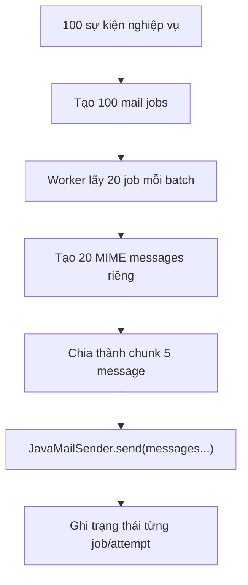
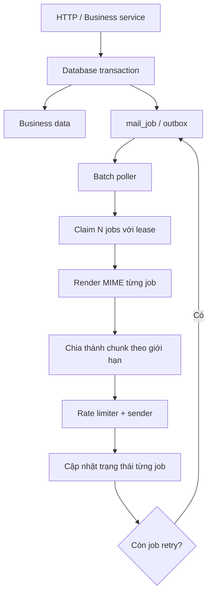

# Gom hoặc chia lô yêu cầu gửi trong Spring Framework Mail

Khi số lượng email tăng từ vài thông báo mỗi phút lên hàng nghìn hoặc hàng chục nghìn yêu cầu, việc gọi `JavaMailSender.send(...)` riêng lẻ ngay trong HTTP request thường không còn phù hợp. Mỗi lần chuẩn bị template, tạo MIME message, kết nối SMTP, xác thực và truyền dữ liệu đều tiêu tốn thời gian và tài nguyên. Nếu mọi yêu cầu cùng gửi tức thời, ứng dụng dễ gặp timeout, hết worker, queue đầy, vượt quota của SMTP provider hoặc gửi trùng khi retry.

**Gom hoặc chia lô yêu cầu gửi** (*batching*) là tổ chức các yêu cầu gửi thành những nhóm có giới hạn để lấy việc từ queue, tạo thông điệp, gửi SMTP và cập nhật trạng thái một cách hiệu quả, an toàn, có kiểm soát tải.

Tuy nhiên, “gom email” có thể mang nhiều nghĩa khác nhau: gom nhiều job để worker lấy từ database trong một lượt; truyền nhiều `MimeMessage` qua một lần gọi `JavaMailSender.send(...)`; gộp nhiều thông báo thành một email digest; hoặc gửi một thông điệp cho nhiều recipients. Bốn cách này **không tương đương**, đặc biệt về quyền riêng tư, nội dung, retry và idempotency.

Trong Spring Framework Mail, `JavaMailSender` và `MimeMessageHelper` giải quyết việc tạo và submit email, nhưng **không tự cung cấp hệ thống durable queue, batching policy, rate limit, per-job state hay bảo đảm exactly-once delivery**. Ứng dụng phải thiết kế các thành phần này dựa trên SLA, quota và đặc tính email.

Tài liệu tập trung vào mô hình vận hành, các giới hạn thực tế, ví dụ Java/Spring Boot, transactional outbox, SQL claim theo batch, xử lý partial failure, retry, concurrency, quan sát và kiểm thử.

## 1. Trước hết, phân biệt bốn kiểu “gom”

| Kiểu gom | Thao tác | Phù hợp với | Rủi ro chính |
|---|---|---|---|
| **Batch lấy job** | Worker claim 20–100 job trong một truy vấn queue/outbox | Giảm số lần truy vấn, chia workload | Job bị giữ lease quá lâu, phân phối không đều |
| **Batch SMTP submission** | Tạo nhiều `MimeMessage` rồi gọi `send(messages...)` | Giảm overhead ở tầng gọi/giao vận trong điều kiện phù hợp | Partial failure, memory và lỗi không chắc chắn |
| **Digest/aggregation** | Gộp nhiều sự kiện thành **một email** | Báo cáo, thông báo định kỳ | Delay, nội dung quá dài, trộn dữ liệu không cùng quyền |
| **Một email tới nhiều recipients** | Một message có nhiều To/Cc/Bcc | Thông báo chung, nội dung không cá nhân hóa | Lộ người nhận, quota per-recipient, thiếu theo dõi cá nhân |

Một hệ thống có thể kết hợp nhiều kỹ thuật: lấy 50 job từ outbox, chia thành 5 chunk, tạo một message cho mỗi job rồi submit theo chunk. Ngược lại, cùng 50 thông báo của **một người nhận** có thể được tập hợp thành một digest sau khi đã kiểm tra quyền và thời hạn.

### 1.1. Ví dụ trực quan



Trong sơ đồ này có **100 ý định gửi, 100 message khác nhau**. Việc gom ở tầng worker/SMTP không làm thay đổi danh sách người nhận hoặc nội dung của từng thư.

Một dạng khác:

```text
20 activity events của user A
            |
            v
    Digest aggregator
            |
            v
   1 email tổng hợp cho user A
```

Ở đây, số email giảm vì **nghiệp vụ cho phép hợp nhất nội dung**. Không thể thay kiểu gom thứ nhất bằng digest nếu các sự kiện có nghĩa vụ gửi riêng, chẳng hạn OTP, hóa đơn hoặc thông báo thay đổi bảo mật.

## 2. Lợi ích thực tế của batching

### 2.1. Giảm overhead điều phối

Khi worker mỗi lần lấy một row từ database, mỗi job có thể gây một vòng truy vấn/transaction riêng. Claim nhiều row trong một transaction ngắn có thể giảm overhead, đặc biệt khi queue có lưu lượng lớn.

### 2.2. Có thể giảm chi phí khởi tạo kết nối SMTP

`JavaMailSender` hỗ trợ gửi nhiều MIME message bằng phương thức varargs. Với một số implementation, đặc biệt `JavaMailSenderImpl`, phương thức gửi nhiều message có thể sử dụng cùng một phiên làm việc SMTP cho chuỗi gửi thay vì tạo một kết nối mới mỗi message. Điều này có thể giúp giảm chi phí kết nối/TLS/AUTH trong workload phù hợp.

Tuy nhiên, **không có cam kết rằng mọi implementation/provider đều giữ một kết nối hoặc gửi theo đúng một round-trip**. Mỗi email vẫn có header, body, recipients, dữ liệu MIME và SMTP transaction riêng. Cần đo thực tế thay vì coi một lời gọi Java tương đương một lần gửi network.

### 2.3. Kiểm soát throughput và quota

Batch size, số worker đồng thời và tốc độ dispatch có thể được điều chỉnh để không vượt ngưỡng:

- Messages mỗi giây/phút.
- Recipients mỗi giờ/ngày.
- Số kết nối SMTP đồng thời.
- Giới hạn kích thước một message.
- Tổng băng thông/CPU/memory của ứng dụng.
- Quota theo account, tenant hoặc loại email.

### 2.4. Cải thiện tính dự đoán của hệ thống

Batching có giới hạn tạo điểm kiểm soát tải. Worker có thể quyết định nhận tối đa 20 job, gửi tối đa 5 message trong một chunk và chỉ mở một số kết nối nhất định. Điều này dễ quan sát và khôi phục hơn một queue không giới hạn với hàng nghìn task đồng thời gọi SMTP.

### 2.5. Đánh đổi: latency và độ phức tạp

Gom để tiết kiệm overhead thường có chi phí:

- Job phải chờ đủ phần tử hoặc hết batch window.
- Một batch lớn chiếm worker lâu, làm các job ưu tiên cao bị chậm.
- Khi có lỗi giữa batch, phải xác định từng item đã được submit hay chưa.
- Một MIME message lớn hoặc attachment nặng có thể gây memory pressure.
- Retry hàng loạt có thể tạo burst thứ cấp.

**Batching không phải mục tiêu tự thân.** Chỉ tăng batch size khi throughput đo được cải thiện và thời gian chờ, tỷ lệ lỗi, bộ nhớ vẫn nằm trong SLO.

## 3. Chọn chiến lược theo loại email

| Loại email | Độ nhạy thời gian | Cách tiếp cận gợi ý |
|---|---|---|
| OTP / reset password | Rất cao, có deadline | Queue ưu tiên, batch rất nhỏ hoặc gửi ngay sau khi claim |
| Thông báo thay đổi bảo mật | Cao | Tách khỏi bulk; không delay để đủ batch |
| Xác nhận đơn hàng | Cao–trung bình | Outbox bền vững, batch nhỏ, retry từng job |
| Hóa đơn/chứng từ | Phụ thuộc quy định nghiệp vụ | Batch có kiểm soát; không tự drop khi trễ |
| Báo cáo định kỳ | Thường ít khẩn hơn | Batch hoặc digest theo người nhận khi nghiệp vụ cho phép |
| Newsletter/marketing | Bulk; tôn trọng consent/unsubscribe | Rate limit, batch dispatch, suppression và quota riêng |
| Tổng hợp thông báo | Có thể trì hoãn | Digest theo recipient/tenant và time window |

Ví dụ, chờ 30 giây để gom newsletter thường có thể chấp nhận; chờ 30 giây cho OTP có hạn 90 giây có thể làm trải nghiệm kém. Nếu dùng chung queue, bulk campaign có thể làm email khẩn cấp bị kẹt phía sau.

### Workload isolation

```text
Business events
    |
    +--> critical-mail-queue
    |       OTP / reset / security
    |
    +--> transactional-mail-queue
    |       order / invoice
    |
    +--> bulk-mail-queue
            newsletter / reports
```

Mỗi queue có batch size, worker count, deadline, retry và monitoring riêng. Nếu SMTP provider có quota tổng cho cùng account, việc tách queue **không tự tạo thêm quota**; cần limiter dùng chung ở tầng gửi.

## 4. Những tham số cần định nghĩa trước khi chia batch

Một batch policy có thể bao gồm:

| Tham số | Ý nghĩa | Ví dụ minh họa |
|---|---|---|
| `maxBatchItems` | Tối đa bao nhiêu job lấy trong một lần | 50 |
| `maxChunkMessages` | Tối đa bao nhiêu MIME message trong một lần gọi send | 10 |
| `maxBatchWait` | Tối đa đợi để gom job | 200 ms |
| `maxBatchBytes` | Ngưỡng ngân sách kích thước ước tính | 5 MiB |
| `maxConcurrentSends` | Số chunk/connection đang gửi đồng thời | 4 |
| `maxAttempts` | Số lần gửi lại tối đa cho mỗi job | 5 |
| `expiresAt` | Deadline nghiệp vụ của từng job | Theo loại mail |
| `leaseDuration` | Thời hạn worker sở hữu claim | Lớn hơn thời gian xử lý dự kiến và có gia hạn |

Tất cả giá trị chỉ là ví dụ, **không phải mặc định của Spring Framework Mail**. Nếu provider cho phép gửi 100 email/phút, một chunk 10 message cũng phải tuân theo giới hạn này; batch size không được xem là số lượng recipients hoặc quota “miễn phí”.

### 4.1. Giới hạn theo nhiều chiều

Không nên quyết định kích thước batch bằng số message đơn thuần. Một email text 2 KB và một email đính kèm PDF 15 MB có chi phí rất khác nhau.

Có thể dùng ngân sách tổng:

```text
batchItems <= maxBatchItems
estimatedBatchBytes <= maxBatchBytes
now - firstEnqueuedAt <= maxBatchWait
now < earliestExpiresAt - safetyMargin
```

Trong đó `estimatedBatchBytes` là ước tính trước render. MIME transfer encoding, attachment và HTML có thể làm kích thước thực khác ước tính. Cần giới hạn kích thước **từng message** riêng, không chỉ tổng batch.

### 4.2. Batch size và wait window

Chiến lược phổ biến là **size-or-time**: flush khi đủ số lượng hoặc khi phần tử đầu tiên đã chờ quá giới hạn.

```text
Tạo batch lúc 10:00:00.000
    |
    +-- 10:00:00.030: nhận job 1
    +-- 10:00:00.050: nhận job 2
    +-- ...
    +-- đủ 10 job: gửi ngay

Nếu không đủ 10 job trước 10:00:00.230
    -> gửi những job đang có, không chờ vô hạn
```

Khi có `expiresAt` gần, flush sớm hơn để không giữ mail cho đến khi hết hạn. Với nguồn database/outbox, có thể không cần đợi gom trong memory; worker poll batch những job đã ready theo lịch.

## 5. Spring Mail hỗ trợ gửi nhiều thông điệp như thế nào?

`JavaMailSender` cung cấp các overload chính:

```java
void send(MimeMessage mimeMessage) throws MailException;

void send(MimeMessage... mimeMessages) throws MailException;

void send(MimeMessagePreparator mimeMessagePreparator)
        throws MailException;

void send(MimeMessagePreparator... mimeMessagePreparators)
        throws MailException;

void send(SimpleMailMessage simpleMessage) throws MailException;

void send(SimpleMailMessage... simpleMessages)
        throws MailException;
```

Đây là các phương thức API Spring Mail, được minh họa về signature. Trong code thực tế, dùng interface `JavaMailSender` và gọi varargs khi có nhiều message.

### 5.1. Gửi một message cho một recipient

```java
MimeMessage message = mailSender.createMimeMessage();
MimeMessageHelper helper = new MimeMessageHelper(
        message, false, "UTF-8");

helper.setFrom("notifications@example.org");
helper.setTo("customer-a@example.invalid");
helper.setSubject("Xác nhận đơn hàng A");
helper.setText("Đơn hàng A đã được ghi nhận.", false);

mailSender.send(message);
```

Một lần submit xử lý một thông điệp. Địa chỉ `example.invalid` là fixture, không phải người nhận thật.

### 5.2. Gửi một mảng nhiều message

```java
MimeMessage[] messages = new MimeMessage[2];

messages[0] = buildTextMessage(
        mailSender,
        "customer-a@example.invalid",
        "Xác nhận đơn hàng A",
        "Đơn hàng A đã được ghi nhận.");

messages[1] = buildTextMessage(
        mailSender,
        "customer-b@example.invalid",
        "Xác nhận đơn hàng B",
        "Đơn hàng B đã được ghi nhận.");

mailSender.send(messages);
```

Helper:

```java
private static MimeMessage buildTextMessage(
        JavaMailSender sender,
        String recipient,
        String subject,
        String body) throws MessagingException {

    MimeMessage message = sender.createMimeMessage();
    MimeMessageHelper helper =
            new MimeMessageHelper(message, false, "UTF-8");

    helper.setFrom("notifications@example.org");
    helper.setTo(recipient);
    helper.setSubject(subject);
    helper.setText(body, false);

    return message;
}
```

Mỗi mảng phần tử là **một message riêng biệt** với người nhận, Subject và body có thể khác nhau. Một lần gọi `send(messages)` không có nghĩa provider biến tất cả thành một email chung.

**Không nên mặc định rằng việc gửi mảng là nguyên tử**: nếu message thứ ba thất bại, hai message đầu có thể đã được SMTP server chấp nhận. Xử lý lỗi phải theo từng mail job/attempt.

### 5.3. Varargs không phải một SMTP transaction

Trong SMTP, việc gửi message thường liên quan `MAIL FROM`, `RCPT TO` và `DATA` cho từng transaction. Khi gửi nhiều messages qua một connection, có thể tái sử dụng kết nối nhưng vẫn cần transaction riêng và nhận response riêng.

Không coi:

```java
mailSender.send(messageA, messageB, messageC);
```

là một lệnh nguyên tử với ba thư cùng thành công hoặc cùng rollback. SMTP không tham gia transaction database của Spring.

## 6. Tại sao không tạo một MimeMessage cho toàn bộ danh sách?

Một lựa chọn tưởng tiết kiệm là:

```java
helper.setTo(new String[]{
        "alice@example.invalid",
        "bob@example.invalid",
        "carol@example.invalid"
});
mailSender.send(message);
```

Đoạn code tạo **một email nhiều người nhận**. Nó khác hoàn toàn với ba message riêng.

### 6.1. Rủi ro riêng tư

`To` và `Cc` thường hiển thị cho người nhận, nên mọi người có thể thấy địa chỉ của nhau. Với email cá nhân hóa, hóa đơn, reset password, OTP hoặc tài khoản riêng, không được dùng cách này để gộp người nhận.

`Bcc` có thể ẩn recipient ở header, nhưng vẫn cần xét:

- Chính sách bulk sending của provider.
- Việc một content chung có phù hợp với mọi recipient hay không.
- Khả năng theo dõi bounce, complaint và unsubscribe của từng người.
- Vấn đề reply/reply-all, group semantics và header processing.
- Quota theo số recipients, không chỉ theo số messages.
- Cơ chế cá nhân hóa và link/token riêng.

**Bcc không biến một message chung thành các email cá nhân hóa độc lập.** Nếu mỗi người nhận có token riêng, phải dùng message riêng hoặc một provider bulk API có merge/personalization rõ ràng.

### 6.2. Trường hợp nhiều người nhận hợp lệ

Một thông báo nội bộ cho nhóm đã được xác thực có thể dùng nhiều `To` hoặc `Cc` khi việc chia sẻ địa chỉ đã được phê duyệt. Nhưng đó là quyết định nghiệp vụ và quyền riêng tư, không phải một tối ưu batching được áp dụng mặc định.

### 6.3. Một recipient, nhiều thông báo

Nếu mục tiêu là giảm số email cho một người, dùng **digest** được thiết kế ở tầng nghiệp vụ. Không chuyển hàng loạt sự kiện khác nhau thành một Subject/body tùy tiện mà bỏ qua deadline, nội dung nhạy cảm hoặc thời hạn token.

## 7. Kiến trúc chia lô dựa trên transactional outbox

Với email giao dịch quan trọng, không nên chỉ gom các `Runnable` vào một queue trong memory rồi trả HTTP 200. Nếu process restart, các task chưa được gửi có thể mất. Một kiến trúc bền vững thường là:



Một đơn hàng được commit cùng một bản ghi yêu cầu gửi trong transaction. Sau commit, worker poller lấy một số job ready và xử lý độc lập. Điều này tách latency SMTP khỏi HTTP response, đồng thời cho phép retry sau restart.

### 7.1. Không gửi SMTP trong transaction nghiệp vụ

Ví dụ không nên:

```java
@Transactional
public void placeOrder(PlaceOrderCommand command) {
    orderRepository.save(...);
    mailSender.send(...); // Network side effect bên trong DB transaction.
}
```

Nếu SMTP đã chấp nhận nhưng database rollback sau đó, không thể “rollback” email. Nếu SMTP chậm, database transaction giữ connection và lock lâu hơn cần thiết. Với outbox, transaction chỉ ghi nghiệp vụ + ý định gửi; email được gửi sau commit.

### 7.2. Không giữ database lock suốt thời gian gửi batch

Một batch có thể mất nhiều giây, thậm chí vài phút nếu attachment nặng hoặc provider bị throttle. Không giữ `SELECT FOR UPDATE` transaction mở trong suốt SMTP call. Hãy:

1. Claim job và ghi lease token trong một transaction ngắn.
2. Commit để giải phóng database lock.
3. Render/gửi SMTP bên ngoài transaction đó.
4. Cập nhật kết quả trong các transaction ngắn có điều kiện theo lease token.

Nếu crash giữa bước 3 và 4, có thể cần retry và xử lý tình huống không biết chắc SMTP đã chấp nhận; outbox tạo **at-least-once processing**, không tự bảo đảm exactly-once email delivery.

## 8. Schema lưu trạng thái cho batch worker

Một bảng minh họa theo PostgreSQL:

```sql
CREATE TABLE mail_job (
    id               UUID PRIMARY KEY,
    idempotency_key  VARCHAR(160) NOT NULL UNIQUE,
    mail_type        VARCHAR(64) NOT NULL,
    template_id      VARCHAR(80) NOT NULL,
    template_version VARCHAR(40) NOT NULL,
    payload_ref      VARCHAR(200) NOT NULL,
    status           VARCHAR(32) NOT NULL,
    priority         INTEGER NOT NULL DEFAULT 0,
    created_at       TIMESTAMPTZ NOT NULL,
    next_attempt_at  TIMESTAMPTZ NOT NULL,
    expires_at       TIMESTAMPTZ,
    attempts         INTEGER NOT NULL DEFAULT 0,
    claim_token      UUID,
    lease_until      TIMESTAMPTZ,
    submitted_at     TIMESTAMPTZ,
    last_error_class VARCHAR(80),
    CHECK (attempts >= 0)
);

CREATE INDEX idx_mail_job_ready
    ON mail_job (priority DESC, next_attempt_at, created_at)
    WHERE status IN ('PENDING', 'RETRY_WAIT');

CREATE INDEX idx_mail_job_processing_lease
    ON mail_job (lease_until)
    WHERE status = 'PROCESSING';
```

Đây là schema định hướng thiết kế, không phải implementation hoàn chỉnh. Production cần thêm tenant/provider routing, attempts table, payload access control, cleanup/retention, logic claim và xử lý provider events theo yêu cầu thực tế.

### 8.1. Chỉ lấy những job đã đến hạn

Một truy vấn claim batch với PostgreSQL:

```sql
WITH ready AS (
    SELECT id
    FROM mail_job
    WHERE status IN ('PENDING', 'RETRY_WAIT')
      AND next_attempt_at <= NOW()
      AND (expires_at IS NULL OR expires_at > NOW())
    ORDER BY priority DESC, next_attempt_at, created_at, id
    FOR UPDATE SKIP LOCKED
    LIMIT :batch_size
)
UPDATE mail_job AS j
SET status = 'PROCESSING',
    claim_token = :claim_token,
    lease_until = NOW() + INTERVAL '2 minutes',
    attempts = attempts + 1
FROM ready
WHERE j.id = ready.id
RETURNING j.*;
```

Lệnh được thực thi trong transaction ngắn với `:claim_token` duy nhất cho lần claim; mỗi job vẫn có `id` riêng. Trong hệ thống nhiều worker, `SKIP LOCKED` giúp worker bỏ qua row đang được claim bởi transaction khác thay vì cùng chờ một row.

**Không có nghĩa truy vấn này đã xử lý xong lease recovery.** Nếu worker crash sau claim, job có thể kẹt `PROCESSING`. Cần quy trình lấy lại job khi `lease_until` đã qua, kiểm tra deadline và tránh worker cũ tiếp tục ghi trạng thái.

### 8.2. Reclaim job bị mất lease

Một maintenance worker có thể phát hiện:

```sql
SELECT id, claim_token, lease_until
FROM mail_job
WHERE status = 'PROCESSING'
  AND lease_until <= NOW();
```

Không đơn giản chuyển toàn bộ về `PENDING` mà không kiểm tra hạn, attempt state và khả năng SMTP đã nhận thư. Nếu worker cũ còn sống, một worker mới nhận lại job có thể gây gửi trùng.

Có thể dùng claim token/fencing token, lease renewal, trạng thái submission không chắc chắn và chính sách retry theo loại mail. Các thao tác cập nhật cần điều kiện `WHERE id = :id AND claim_token = :token AND status = 'PROCESSING'` để không cho owner cũ ghi đè trạng thái của owner mới.

### 8.3. Vì sao batch claim và send chunk có thể có kích thước khác nhau?

Ví dụ worker claim 50 job từ database, nhưng gửi 5 message mỗi chunk:

```text
Claim batch: 50 jobs
    |
    +-- chunk 1: 5 MIME messages
    +-- chunk 2: 5 MIME messages
    ...
    +-- chunk 10: 5 MIME messages
```

Claim nhiều job giảm overhead database, nhưng nếu mỗi chunk chậm, những job ở cuối batch phải chờ lease dài. Vì thế không nên claim quá nhiều job trước khi có năng lực xử lý; giới hạn claim size bằng throughput và lease duration. Một số kiến trúc chỉ claim khi worker slot thực sự khả dụng, thay vì gom rất nhiều job vào memory.

## 9. Chia danh sách thành chunk có kích thước cố định

Giả sử hệ thống đã có danh sách những job thuộc quyền xử lý của một worker. Có thể tách thành chunk:

```java
package com.example.mail.batch;

import java.util.ArrayList;
import java.util.List;

public final class MailChunks {

    private MailChunks() {
    }

    public static <T> List<List<T>> partition(
            List<T> items,
            int maxItems) {

        if (maxItems <= 0) {
            throw new IllegalArgumentException(
                    "maxItems must be positive");
        }
        List<List<T>> chunks = new ArrayList<>();
        for (int start = 0;
                start < items.size();
                start += maxItems) {

            int end = Math.min(
                    start + maxItems, items.size());
            chunks.add(List.copyOf(
                    items.subList(start, end)));
        }
        return chunks;
    }
}
```

Sử dụng:

```java
List<MailJob> claimedJobs = jobStore.claimReady(50);
List<List<MailJob>> chunks =
        MailChunks.partition(claimedJobs, 10);

for (List<MailJob> chunk : chunks) {
    processChunk(chunk);
}
```

Ví dụ này dễ hiểu và hữu ích khi batch tối đa nhỏ. Với tập dữ liệu rất lớn, **không tải toàn bộ hàng triệu job vào memory rồi chia list**. Hãy phân trang/claim từ database hoặc broker theo các nhóm nhỏ có giới hạn, xử lý xong rồi lấy tiếp.

### 9.1. Tránh phân trang OFFSET trên queue đang thay đổi

Nếu nhiều worker đồng thời cập nhật trạng thái, kiểu:

```sql
SELECT *
FROM mail_job
WHERE status = 'PENDING'
ORDER BY created_at
LIMIT 100 OFFSET 500;
```

không phù hợp để claim job an toàn; việc các row trước đó biến mất khỏi `PENDING` có thể gây skip/duplicate trong các trang. Dùng claim nguyên tử với `FOR UPDATE SKIP LOCKED` hoặc cơ chế broker acknowledgment phù hợp.

### 9.2. Tránh chunk quá lớn

Một chunk chứa 5.000 MIME messages có thể:

- Tạo hàng nghìn object `MimeMessage` và attachment trong heap.
- Giữ nhiều dữ liệu cá nhân đồng thời ở memory.
- Làm một connection SMTP sống rất lâu.
- Gây thời gian retry/khôi phục dài.
- Gặp giới hạn provider hoặc timeout.
- Làm khó xác định kết quả từng item khi xảy ra lỗi.

Hãy chọn chunk size dựa trên benchmark tại mức tải mục tiêu, không chỉ dựa vào số lượng record tối đa database có thể trả.

## 10. Batch theo tổng dung lượng ước tính

Không phải mọi email đều tương đương về kích thước. Một batch 10 thư text có thể nhẹ hơn một email chứa nhiều tệp.

Một policy định hướng:

```java
public record MailWeight(
        UUID jobId,
        long estimatedBytes) {
}
```

Khi ghép chunk, xét đồng thời giới hạn số item và ngân sách byte:

```text
if (chunk.size >= maxChunkMessages)
    flush chunk

if (estimatedChunkBytes + next.estimatedBytes > maxChunkBytes)
    flush chunk

add next to chunk
```

### 10.1. Trường hợp một job vượt ngân sách chunk

Nếu một message riêng đã 10 MiB nhưng `maxChunkBytes` là 5 MiB, không nên tạo chunk rỗng rồi lặp vô hạn. Cần policy rõ:

- Nếu vượt **per-message provider limit**, đánh dấu lỗi nội dung/kích thước và chuyển sang quy trình xử lý khác.
- Nếu chỉ vượt **chunk budget nội bộ** nhưng message vẫn được provider cho phép, có thể gửi riêng một chunk với ngân sách riêng theo policy.
- Nếu có thể dùng link tải tài liệu có quyền truy cập, cân nhắc gửi link thay attachment lớn.

Lưu ý kích thước MIME thực có overhead do transfer encoding và boundaries. Dự đoán bytes từ payload cần có safety margin; không dùng kích thước file gốc làm giới hạn chắc chắn cho raw MIME.

### 10.2. Không giữ toàn bộ attachment bytes trong batch

Nếu 20 jobs, mỗi job chứa PDF 12 MiB và worker dựng tất cả MIME trước khi gửi, chỉ riêng dữ liệu file gốc đã có thể chiếm hàng trăm MiB, chưa kể encoded forms, template và object overhead.

Nên:

- Lưu `payloadRef` hoặc asset reference an toàn trong job thay vì raw attachment bytes.
- Render từng chunk ngay trước gửi.
- Giới hạn số chunk xử lý đồng thời.
- Giải phóng tham chiếu sau xử lý.
- Nếu tài nguyên hỗ trợ streaming, sử dụng `InputStreamSource`/`DataSource` phù hợp và cân nhắc khả năng đọc lại stream khi Jakarta Mail cần.
- Đo heap, GC và kích thước message thực trong load test.

**Một sender có batch lớn không thay thế giới hạn memory và backpressure.**

## 11. Gửi chunk bằng JavaMailSender

Một mô hình tách trách nhiệm:

```text
MailJobStore.claimReady(N)
        |
        v
MailChunkProcessor
  ├── check expiresAt
  ├── check business relevance
  ├── render MimeMessage của từng job
  ├── invoke JavaMailSender.send(MimeMessage...)
  └── report outcome theo job
        |
        v
MailJobStore.finalize(...)
```

### 11.1. API kết quả của application

Nên phân biệt result của từng item:

```java
public enum AttemptOutcome {
    SUBMITTED,
    FAILED_RETRYABLE,
    FAILED_PERMANENT,
    UNKNOWN_SUBMISSION
}

public record MailAttemptResult(
        UUID jobId,
        UUID attemptId,
        AttemptOutcome outcome,
        String failureClass) {
}
```

`UNKNOWN_SUBMISSION` đặc biệt quan trọng khi SMTP connection mất ở thời điểm không thể biết chắc server đã nhận message hay chưa.

### 11.2. Bản triển khai cơ bản

Ví dụ dưới đây giả định `PreparedMail` chứa `jobId()`, `attemptId()` và `mimeMessage()` do worker đã dựng. Mọi job đã được claim và kiểm tra quyền trước khi vào sender.

```java
package com.example.mail.batch;

import jakarta.mail.internet.MimeMessage;
import java.util.ArrayList;
import java.util.List;
import org.springframework.mail.MailException;
import org.springframework.mail.MailSendException;
import org.springframework.mail.javamail.JavaMailSender;
import org.springframework.stereotype.Component;

@Component
public class ChunkSmtpSubmitter {

    private final JavaMailSender sender;

    public ChunkSmtpSubmitter(JavaMailSender sender) {
        this.sender = sender;
    }

    public List<MailAttemptResult> submit(
            List<PreparedMail> prepared) {

        if (prepared.isEmpty()) {
            return List.of();
        }

        MimeMessage[] messages = prepared.stream()
                .map(PreparedMail::mimeMessage)
                .toArray(MimeMessage[]::new);

        try {
            sender.send(messages);

            List<MailAttemptResult> results =
                    new ArrayList<>(prepared.size());
            for (PreparedMail item : prepared) {
                results.add(new MailAttemptResult(
                        item.jobId(),
                        item.attemptId(),
                        AttemptOutcome.SUBMITTED,
                        null));
            }
            return results;
        } catch (MailSendException ex) {
            // Không suy luận rằng mọi item đều thất bại
            // hoặc rằng mọi item không nằm trong map đã thành công.
            return uncertainResults(prepared, "SMTP_PARTIAL_OR_UNKNOWN");
        } catch (MailException ex) {
            return uncertainResults(prepared, "SMTP_SUBMISSION_FAILED");
        }
    }

    private List<MailAttemptResult> uncertainResults(
            List<PreparedMail> prepared,
            String failureClass) {

        List<MailAttemptResult> results =
                new ArrayList<>(prepared.size());
        for (PreparedMail item : prepared) {
            results.add(new MailAttemptResult(
                    item.jobId(),
                    item.attemptId(),
                    AttemptOutcome.UNKNOWN_SUBMISSION,
                    failureClass));
        }
        return results;
    }
}
```

Đây là một chính sách **bảo thủ** để tránh đánh dấu nhầm các item thành công khi exception không cung cấp đủ thông tin. Nó không tối ưu throughput của mọi hệ thống: nếu implementation cho kết quả chi tiết đáng tin cậy, ứng dụng có thể phân loại chính xác từng item như phần tiếp theo.

Vì `UNKNOWN_SUBMISSION` có thể dẫn tới retry và gửi trùng, job store phải quản lý trạng thái này theo chính sách nghiệp vụ. Không coi unknown là hoàn tất và cũng không tự gửi lại vô hạn.

### 11.3. Xử lý lỗi khi render

Nếu tạo MIME cho 10 job và job thứ tư có attachment bị hỏng, không nên ném toàn bộ batch vào một exception rồi đánh dấu cả 10 job thất bại. Hãy tách:

1. Kiểm tra deadline và trạng thái nghiệp vụ từng job.
2. Render từng job trong phạm vi try/catch riêng.
3. Job lỗi template/attachment: ghi failure class riêng.
4. Chỉ đưa các MIME messages đã chuẩn bị hợp lệ vào `send(...)`.

Đừng trộn một lỗi `TEMPLATE_RENDERING` không retryable với lỗi SMTP timeout có thể retry.

## 12. Partial failure trong send(messages...)

Spring Mail có `MailSendException`, cho phép truy xuất một số thông tin về message gửi lỗi thông qua `getFailedMessages()` trong những trường hợp implementation ghi nhận được.

Ví dụ khung:

```java
try {
    mailSender.send(messages);
} catch (MailSendException ex) {
    Map<Object, Exception> failures =
            ex.getFailedMessages();

    for (MimeMessage message : messages) {
        Exception failure = failures.get(message);
        if (failure != null) {
            // Có một lỗi liên quan đến message này.
            recordKnownFailure(message, failure);
        } else {
            // Không được tự xem là SUBMITTED nếu
            // không có bằng chứng per-message đáng tin.
            recordUnknownOutcome(message);
        }
    }
}
```

`recordKnownFailure` và `recordUnknownOutcome` là hàm application do dự án định nghĩa. Đoạn này cho thấy **không chỉ nhìn số lượng exception** để kết luận trạng thái toàn bộ batch.

### 12.1. Tại sao map có thể không đủ?

Một exception có thể phát sinh trước khi gửi bất kỳ item nào, giữa chừng khi connection lỗi, hoặc sau khi một số item đã được server chấp nhận. Contract và metadata chi tiết phụ thuộc implementation `JavaMailSender`, SMTP server và lúc lỗi xảy ra.

Trường hợp:

```text
Batch [A, B, C, D]
 A -> SMTP accepted
 B -> SMTP accepted
 C -> timeout / lost connection
 D -> chưa bắt đầu
```

Một exception tổng không thể chứng minh A–D đều thất bại. Ngay cả việc C timeout không chắc C chưa đến provider. Nếu cần trạng thái cực kỳ chính xác, có thể dùng gửi từng MIME message với retry riêng, hoặc adapter/provider API có per-message result rõ ràng.

### 12.2. Gửi từng message để giảm ambiguity

Với giao dịch nhạy cảm, một worker có thể vẫn **lấy job theo batch từ database** nhưng submit từng message:

```java
for (PreparedMail item : prepared) {
    try {
        mailSender.send(item.mimeMessage());
        jobStore.markSubmitted(
                item.jobId(), item.attemptId());
    } catch (MailException ex) {
        jobStore.recordFailure(
                item.jobId(), item.attemptId(), classify(ex));
    }
}
```

Điều này không loại bỏ khả năng SMTP ACK bị mất, nhưng giúp thu hẹp phạm vi lỗi về một lần gửi thay vì một chunk. Giá phải trả có thể là nhiều round-trip/connection overhead hơn. Hãy chọn dựa trên SLO và mức độ cần kiểm soát kết quả của từng mail.

### 12.3. Cập nhật job state theo transaction ngắn

Không dùng:

```java
@Transactional
void submitEntireBatchAndCommit(...) {
    mailSender.send(messages); // SMTP nằm trong transaction DB dài.
    markAllSubmitted();
}
```

Nếu SMTP chấp nhận một số thư rồi database rollback, vẫn có side effects. Thay bằng claim transaction ngắn, network call bên ngoài transaction và finalize từng kết quả với điều kiện ownership.

## 13. Retry trong batch: per-job thay vì retry cả batch

Khi batch 50 job có 3 job thất bại, retry toàn bộ 50 sẽ có nguy cơ gửi trùng 47 email đã thành công. Thiết kế nên lưu outcome cho từng job/attempt:

```text
Batch B1: 50 jobs
   45 confirmed SUBMITTED
    2 confirmed FAILED_RETRYABLE
    1 FAILED_PERMANENT
    2 UNKNOWN_SUBMISSION
```

Ở đây:

- `SUBMITTED`: không retry như job chưa gửi.
- `FAILED_RETRYABLE`: lên lịch retry với backoff nếu còn hạn.
- `FAILED_PERMANENT`: kết thúc và ghi nguyên nhân.
- `UNKNOWN_SUBMISSION`: áp policy riêng, tùy nội dung và provider; có thể cần tra cứu provider trước khi retry.

Không kết luận rằng 2 unknown “chắc chắn chưa gửi”.

### 13.1. Exponential backoff với jitter

Ví dụ chính sách:

```text
base delay: 5 giây
attempt 1: khoảng 5 giây + jitter
attempt 2: khoảng 10 giây + jitter
attempt 3: khoảng 20 giây + jitter
attempt 4: khoảng 40 giây + jitter
max delay: 60 giây + jitter
```

Jitter phân tán thời điểm retry để không có hàng nghìn job đồng thời quay lại queue sau khi provider phục hồi.

### 13.2. Deadline phải là của từng job

Một batch có thể chứa email có deadline khác nhau:

```text
job A: OTP expires at 10:02
job B: order confirmation expires at 17:00
job C: newsletter expires at 23:59
```

Nếu worker xử lý theo FIFO và chờ đủ batch, job A có thể hết hạn trước khi tới lượt. Hãy kiểm tra:

- Trước khi claim.
- Sau khi render xong, trước send.
- Khi lập lịch retry.

Nếu `nextAttemptAt >= expiresAt`, không tạo retry mới. Không kéo dài `expiresAt` chỉ vì job được gom vào batch. Nếu job không còn ý nghĩa do trạng thái nghiệp vụ thay đổi, kết thúc với `CANCELLED`/`EXPIRED` theo policy.

### 13.3. Idempotency key không đổi khi retry

Mỗi ý định gửi nên có idempotency key cố định (theo business event và loại mail). Retry giữ nguyên key, tạo `attemptId` mới.

```text
mailJobId = J100
idempotencyKey = order-123:confirmation:v1
attempt A1 -> timeout
attempt A2 -> submitted
```

Một đơn hàng mới hoặc một lần yêu cầu OTP mới là ý định nghiệp vụ mới, có key/deadline mới. Không sửa key cũ để “hợp nhất” các yêu cầu không cùng mục đích.

### 13.4. Không có exactly-once delivery phổ quát

SMTP là side effect ngoài transaction database. Nếu server đã nhận email nhưng worker crash trước khi `markSubmitted`, một retry có thể gửi thư trùng.

Giảm tác động bằng:

- Lưu attempt và trạng thái không chắc chắn.
- Claim token/lease để tránh nhiều worker gửi cùng job.
- Provider API idempotency key nếu dịch vụ thực sự hỗ trợ.
- Nội dung và nghiệp vụ có thể chịu duplicate (ví dụ đơn hàng đã tạo tồn tại).
- Đối soát provider events khi có.

Không giả định `Message-ID` giống nhau sẽ khiến SMTP hoặc mailbox tự loại gửi trùng.

## 14. Kiểm soát concurrency và rate limiting

Batch size và concurrency là hai tham số khác nhau:

- **Batch size**: một lần lấy/gửi bao nhiêu message.
- **Concurrency**: bao nhiêu batch, chunk hoặc SMTP connection có thể chạy đồng thời.

Ví dụ, 4 worker gửi 10 messages mỗi chunk tạo tối đa 4 chunk đồng thời, nhưng không có nghĩa tự động được phép gửi 40 messages/giây. Thời gian gửi một chunk, số recipients và quota của provider vẫn quyết định throughput.

### 14.1. Giới hạn executor

Với Spring:

```java
@Configuration
@EnableAsync
public class MailWorkerConfiguration {

    @Bean("mailExecutor")
    public ThreadPoolTaskExecutor mailExecutor() {
        ThreadPoolTaskExecutor executor =
                new ThreadPoolTaskExecutor();

        executor.setCorePoolSize(4);
        executor.setMaxPoolSize(8);
        executor.setQueueCapacity(100);
        executor.setThreadNamePrefix("mail-batch-");
        executor.setRejectedExecutionHandler(
                new ThreadPoolExecutor.AbortPolicy());
        return executor;
    }
}
```

Ví dụ giả định các import từ `org.springframework.context.annotation`, `org.springframework.scheduling.annotation`, `org.springframework.scheduling.concurrent` và `java.util.concurrent`. Khi dùng `ThreadPoolTaskExecutor`, việc thay đổi `corePoolSize`/`maxPoolSize` và `queueCapacity` ảnh hưởng cách mở thread:

- Pool mở tới core size trước.
- Khi core thread bận, queue nhận task nếu còn capacity.
- Khi queue đầy, pool có thể tăng thêm tới max size.
- Khi cả worker và queue đã đầy, rejection policy được áp dụng.

Không mặc định tăng `maxPoolSize` sẽ làm mọi job chạy ngay nếu queue vẫn còn chỗ. Nếu mailbox provider đã throttle, tăng concurrency có thể chỉ tạo thêm timeout và retry.

### 14.2. Số worker không phải tổng số kết nối

Một worker có thể gửi một chunk tuần tự trên một SMTP connection hoặc mỗi message bằng một connection, tùy adapter. Một worker cũng có thể gọi các dịch vụ khác khi render. Đo số connection active nếu provider/transport hỗ trợ; không suy luận chỉ từ số thread.

### 14.3. Giới hạn số message/recipient trong thời gian

Provider có thể đặt quota:

```text
Max 100 messages/minute
Max 300 recipients/minute
Max 5 concurrent SMTP connections
```

Đây là số giả để minh họa. Với một message có 20 recipients, nó có thể tiêu thụ 1 message quota nhưng 20 recipient quota; chính sách từng provider khác nhau.

Batching không làm biến mất các giới hạn. Trước khi dispatch chunk, limiter phải xét số tokens cần tiêu thụ theo semantics quota thực tế.

### 14.4. Token bucket và distributed limiter

Một token bucket có thể cấp phép gửi theo tốc độ trung bình, cho phép burst có giới hạn. Với một instance, thư viện limiter nội bộ có thể đủ. Với nhiều pod, nếu mỗi pod tự cấp 100 tokens/phút trong khi provider chỉ cho **toàn account** 100 messages/phút, tổng tải có thể vượt quota nhiều lần.

Giải pháp:

- Phân chia quota rõ ràng cho mỗi worker/instance nếu số instance cố định.
- Sử dụng distributed rate limiter với shared state nếu cần.
- Dùng broker scheduler hoặc provider queue/API có cơ chế throttling được định nghĩa.
- Theo dõi rate limit và điều chỉnh tốc độ theo phản hồi 4xx/throttle.

Không giữ database transaction mở trong lúc chờ limiter cấp token. Nếu phải đợi lâu, có thể đưa job về trạng thái `RETRY_WAIT`/`SCHEDULED` thay vì chiếm một worker và lease không cần thiết.

### 14.5. Circuit breaker khi provider gặp sự cố

Nếu SMTP server liên tục trả timeout hoặc lỗi tạm thời, tiếp tục lấy hàng trăm job và gửi dồn dập có thể làm backlog lỗi tăng nhanh. Circuit breaker/backoff ở tầng adapter có thể tạm giảm hoặc ngừng dispatch khi dependency không khỏe.

Nhưng phải phân biệt:

- Lỗi một recipient không hợp lệ: không nên “đánh sập” toàn bộ provider.
- Lỗi SMTP AUTH toàn account: cần cảnh báo cấu hình.
- Lỗi 4xx/rate limit: cần giảm tốc theo policy.
- Lỗi network hàng loạt: có thể tạm ngừng batch submission và giữ job bền vững.

Khi circuit breaker mở, job chưa được gửi phải giữ trạng thái rõ ràng; không đánh dấu submitted chỉ vì job đã được chuyển đến worker.

## 15. Batch poller trong Spring Boot

Một poller có thể chạy theo lịch, claim batch ready rồi chia chunk để xử lý. Mẫu dưới đây minh họa các thành phần ở mức orchestration, không gộp SQL, SMTP và transaction vào một phương thức.

```java
package com.example.mail.batch;

import java.util.List;
import org.springframework.scheduling.annotation.Scheduled;
import org.springframework.stereotype.Component;

@Component
public class MailBatchPoller {

    private final MailJobStore jobStore;
    private final MailChunkPreparer preparer;
    private final ChunkSmtpSubmitter submitter;

    public MailBatchPoller(
            MailJobStore jobStore,
            MailChunkPreparer preparer,
            ChunkSmtpSubmitter submitter) {
        this.jobStore = jobStore;
        this.preparer = preparer;
        this.submitter = submitter;
    }

    @Scheduled(fixedDelayString =
            "${app.mail.batch.poll-delay-ms:500}")
    public void poll() {
        List<ClaimedMailJob> jobs =
                jobStore.claimReady(50);

        for (List<ClaimedMailJob> chunk :
                MailChunks.partition(jobs, 10)) {

            PreparationOutcome preparation =
                    preparer.prepareValidMessages(chunk);

            // Lỗi render/hết hạn được xử lý từng job.
            jobStore.persistPreparationFailures(
                    preparation.failures());

            List<MailAttemptResult> results =
                    submitter.submit(preparation.messages());

            // Finalize có điều kiện ownership từng job.
            jobStore.persistSubmissionOutcomes(results);
        }
    }
}
```

Các interface/record `MailJobStore`, `ClaimedMailJob`, `MailChunkPreparer` và `PreparationOutcome` do ứng dụng định nghĩa. `MailChunks` và `ChunkSmtpSubmitter` được minh họa ở các mục trước. Đây là khung luồng xử lý, không phải một module chạy độc lập.

### 15.1. Những việc poller thật phải bổ sung

- Không claim mới khi executor/SMTP capacity đã đầy.
- Kiểm soát multi-instance concurrency bằng claim token/lease.
- Renew lease nếu quá trình gửi lâu hơn dự kiến.
- Bắt lỗi ở mức chunk để không bỏ dở các job đã claim còn lại.
- Không làm mất job nếu `persistSubmissionOutcomes` thất bại.
- Giới hạn thời gian tổng của một vòng poll, hoặc dùng scheduler/worker tách biệt.
- Kiểm tra deadline và trạng thái nghiệp vụ sát thời điểm send.
- Ghi metrics queue wait, batch size, chunk duration, partial failure.
- Không để một chunk lỗi làm toàn bộ poller ngừng hoạt động vô hạn.

### 15.2. Tránh chạy poll song song không kiểm soát

Một ứng dụng có nhiều instance đều có `@Scheduled` poller. Điều này không sai nếu claim DB/broker được thực hiện an toàn, nhưng không được dựa vào “mỗi JVM chỉ có một scheduler” để khẳng định toàn hệ thống chỉ một worker claim job.

Nếu cần singleton scheduler, phải có cơ chế leader/lock phân tán tương ứng. Nếu muốn scale-out, thiết kế claim cạnh tranh với `SKIP LOCKED`/lease hoặc broker consumer semantics rõ ràng.

### 15.3. Xử lý lỗi ở orchestration level

Nếu `mailSender.send(...)` ném exception nhưng poller không ghi outcome/đặt retry, job có thể ở `PROCESSING` cho đến hết lease. Mỗi nhánh phải có transition rõ.

Nếu một exception không dự đoán được xảy ra trong poll loop, log mã lỗi và IDs an toàn; không log raw MIME/credentials. Dùng monitoring phát hiện job mất tiến triển và reaper phục hồi claim cũ.

## 16. Batching trong RabbitMQ, Kafka hoặc broker khác

Khi nguồn job là broker thay vì database, cơ chế batching phụ thuộc consumer:

### RabbitMQ

Message được nhận theo chính sách consumer/prefetch. Một worker có thể tích lũy tối đa N messages hoặc một khoảng thời gian, nhưng cần quan tâm:

- Prefetch ảnh hưởng số message đã được giao nhưng chưa ack.
- Batch xử lý xong không có nghĩa mọi message đều thành công.
- Ack/nack cần tương ứng với kết quả từng message; không ack hàng loạt nếu còn job chưa xử lý.
- Với consumer có parallel workers, cần tránh ack nhầm delivery tag và xử lý đúng giới hạn channel.
- Dead-letter/retry queue phải phân biệt với ready messages.

Nếu một chunk có 9 email thành công và 1 thất bại, việc ack cả batch như một đơn vị có thể làm mất job lỗi hoặc gây redelivery các job đã thành công, tùy cách dùng broker. Thiết kế per-message acknowledgment hoặc cơ chế checkpoint rõ ràng.

### Kafka

Kafka consumer có thể `poll()` một batch records. Tuy nhiên:

- Batch records không có nghĩa tất cả side effects SMTP xảy ra atomically.
- Offset commit phải phản ánh trạng thái đã xử lý an toàn.
- Một record lỗi có thể chặn tiến độ của partition nếu cần bảo toàn thứ tự.
- Không commit offset vượt qua những records chưa có phương án bền vững cho retry/dead-letter.
- Kafka transaction không tự bao phủ SMTP side effect bên ngoài Kafka.

Nếu chuyển record lỗi sang một retry topic/outbox, cần đảm bảo luồng chuyển trạng thái có tính bền vững phù hợp trước khi commit offset. Không xem Kafka exactly-once processing nội bộ là bảo đảm exactly-once SMTP delivery.

### SQS và các queue có visibility timeout

Consumer lấy một batch messages rồi xử lý. Nếu processing lâu hơn visibility timeout, message có thể xuất hiện lại và consumer khác xử lý, gây gửi trùng. Cần điều chỉnh visibility extension hoặc batch size theo thời gian xử lý; thực hiện delete/ack cho message đã hoàn tất đúng semantics.

Các giới hạn kích thước batch và API operation tùy broker/provider, nên tham khảo tài liệu phiên bản đang dùng. Không bê nguyên batch size của database worker sang mọi broker.

## 17. Gom nhiều sự kiện thành một digest

**Digest** là một quyết định nghiệp vụ khác với batching transport. Nó giảm số email bằng cách biến một tập event cùng recipient thành một bản tổng hợp.

Ví dụ thay vì:

```text
10:00: user A có bình luận mới -> email 1
10:01: user A có người theo dõi mới -> email 2
10:02: user A có lượt thích mới -> email 3
```

có thể:

```text
10:05: email "Hoạt động mới trong 5 phút qua"
  - 1 bình luận
  - 1 người theo dõi
  - 1 lượt thích
```

Chỉ áp dụng khi người dùng/chính sách sản phẩm cho phép trì hoãn và kết hợp. Không gộp OTP, token reset, hóa đơn bắt buộc hoặc nội dung của nhiều tài khoản khác nhau vào cùng digest chỉ vì chung địa chỉ email.

### 17.1. Chọn grouping key

Một khóa gom có thể gồm:

```text
(tenantId, recipientAccountId, digestType, locale, timeWindow)
```

Trong đó:

- `tenantId` ngăn trộn dữ liệu của các tổ chức.
- `recipientAccountId` là ID người nhận nội bộ, không nhất thiết là email text.
- `digestType` phân biệt hoạt động hệ thống, báo cáo, cập nhật dự án.
- `locale` bảo đảm cùng ngôn ngữ.
- `timeWindow` xác định kỳ tổng hợp.

Thêm giới hạn theo quyền xem nội dung: một người dùng có thể có nhiều role, dự án và dữ liệu được phân loại khác nhau. Chỉ cùng recipient chưa đủ để kết luận mọi event được phép nằm chung một thư.

### 17.2. Time window không được làm mất sự kiện

Một digest scheduler có thể gom các event vào một kỳ:

```text
Window: [10:00, 10:05)
    |
    +-- event E1
    +-- event E2
    +-- event E3
    |
    v
digest D1 -> một mail job
```

Trong database, cần bảo đảm:

1. Event được ghi bền vững.
2. Mỗi event được assign vào kỳ digest có quy tắc rõ.
3. Một digest được tạo idempotently cho cùng recipient/kỳ.
4. Không tự đánh dấu event đã tiêu thụ trước khi ý định gửi digest được commit.
5. Nếu gửi digest lỗi, job vẫn được retry theo chính sách.

Nếu event đến muộn sau khi window đóng, cần một chiến lược: đưa vào window kế tiếp, tạo bản bổ sung hoặc đánh dấu late event theo nghiệp vụ. Không âm thầm bỏ event vì nó lỡ mốc scheduler.

### 17.3. Giới hạn số mục trong một digest

Một người dùng có 20.000 sự kiện trong ngày không nên nhận một email HTML khổng lồ. Có thể hiển thị 20 mục quan trọng nhất, kèm link đến trang chi tiết có đăng nhập.

```text
20 cập nhật mới trong tuần
  1. ...
  2. ...
  ...
  20. ...

Xem tất cả: https://account.example.org/updates
```

Thông tin tổng hợp phải trung thực: nếu có nhiều hơn số mục hiển thị, nêu rõ số lượng và để người nhận xem phần còn lại trong sản phẩm. Với nội dung nhạy cảm, link đến trang có xác thực thay vì nhúng hết dữ liệu vào email.

### 17.4. Digest và unsubscribe

Người dùng có thể muốn nhận thông báo ngay, digest hàng ngày hoặc tắt thông báo. Tôn trọng tùy chọn khi tạo digest, khi submit và trong các lần tiếp theo. Đối với marketing/bulk, áp dụng consent, suppression và unsubscribe theo chính sách/law/provider requirements.

### 17.5. Digest version và idempotency

Một digest job có thể dùng key:

```text
digest:<recipientAccountId>:<digestType>:<windowStart>
```

Key được tạo từ định danh nội bộ và mốc thời gian đã chuẩn hóa; nếu cần lưu trong logs, nên dùng ID độc lập thay vì đưa raw PII. Unique constraint trên key giúp scheduler không tạo hai digest jobs khi restart hoặc bị chạy lặp.

Nếu người dùng thay đổi tùy chọn ngay trước khi gửi, worker cần kiểm tra lại policy phù hợp. Digest được gửi rồi không thể “thu hồi” bằng rollback database.

## 18. Tính toán throughput, backlog và batch latency

Batching không tự giải quyết được bài toán **tốc độ yêu cầu lớn hơn tốc độ hệ thống xử lý**. Cần ước lượng:

- `λ`: tốc độ job mới đến, job/giây.
- `μ`: tốc độ job hoàn tất, job/giây.
- `B`: số job đang chờ.
- `W`: thời gian một job chờ trước khi worker bắt đầu.
- `S`: thời gian xử lý/submit một job hoặc một chunk.
- `C`: số job/chunk đồng thời tối đa.

Trong một khoảng tương đối ngắn nếu các tốc độ ổn định:

```text
backlog growth ≈ arrivals per second - completions per second
```

Ví dụ:

```text
Ứng dụng tạo:           25 job/giây
Hệ thống hoàn tất:      20 job/giây
Backlog tăng:            5 job/giây

Queue còn chỗ 300 job
  -> khoảng 60 giây để lấp đầy phần capacity còn lại
     nếu tốc độ giữ nguyên và không có giới hạn/biến động khác.
```

Tăng `maxBatchItems` từ 50 lên 100 **không nhất thiết tăng μ**. Nếu SMTP provider chỉ chấp nhận 20 messages/giây, batch lớn hơn có thể làm các job chờ lâu hơn mà throughput không đổi.

### 18.1. Little's Law

Trong hệ thống ổn định:

\[
L = \lambda W
\]

với `L` là số lượng trung bình trong hệ thống/queue được định nghĩa tương ứng, `λ` là throughput và `W` là thời gian lưu trung bình trong phạm vi đo đó.

Ví dụ, nếu 10 jobs/giây hoàn tất và trung bình 50 jobs đang chờ trong queue, queue wait trung bình xấp xỉ 5 giây, khi các giả định ổn định của định luật được đáp ứng.

Không dùng Little's Law để dự đoán một hệ thống đang backlog tăng mãi vì `λ > μ` như thể nó ổn định.

### 18.2. Tính chi phí batch window

Nếu policy `maxBatchWait=500ms`, một job có thể phải chờ gần 500 ms **chỉ để đủ điều kiện flush**, chưa tính queue, render hoặc SMTP. Với OTP, 500 ms có thể không đáng; với báo cáo định kỳ, có thể chấp nhận.

Thời gian end-to-end gần đúng gồm:

```text
business event -> outbox insert
    + queue wait
    + batch wait
    + rendering/MIME
    + limiter wait
    + SMTP submission latency
    + downstream provider delivery
```

`JavaMailSender` chỉ đo phần submission khi đã bắt đầu gửi. Nếu cần SLO “OTP tới trong 1 phút”, phải theo dõi tuổi từ sự kiện gốc và dữ liệu giao nhận, không chỉ đo duration của một lời gọi `send()`.

### 18.3. Connection reuse có ích khi nào?

Giả sử một lần bắt tay kết nối/TLS/AUTH tốn 100 ms, còn submission mỗi message tốn 20 ms ở môi trường test:

```text
Không reuse:
  10 * (100 ms + 20 ms) = 1200 ms

Reuse một connection cho 10 messages:
  100 ms + 10 * 20 ms = 300 ms
```

Đây chỉ là phép tính minh họa, chưa bao gồm provider throttling, dung lượng MIME, tải network và giới hạn đồng thời. Không khẳng định rằng mọi lần gọi `JavaMailSender.send(messages...)` đạt đúng mức này. Cần benchmark với implementation và SMTP endpoint được phép dùng trong test.

## 19. Kích thước batch tối ưu không phải cố định

Một batch size “tốt” ở giờ thấp điểm có thể kém trong chiến dịch cao điểm. Nó còn phụ thuộc kích thước message, hỗn hợp mail type, số worker và provider quota.

### 19.1. Bắt đầu bằng cấu hình bảo thủ

Một trình tự điều chỉnh:

1. Đo baseline gửi từng message hoặc chunk nhỏ.
2. Đo SMTP connection/setup time và per-message latency.
3. Thử tăng chunk size ở mức tải cố định.
4. Quan sát queue wait P95/P99, throughput, error rate, memory và GC.
5. Tăng concurrency có kiểm soát, không vượt provider quota.
6. Tách mail có attachment lớn hoặc SLA ngắn.
7. Giữ cấu hình có thể rollback nếu production gặp latency/timeout tăng.

Khi so sánh, phải giữ workload tương đồng. Test 100 thư text và test 100 thư có PDF không thể cho kết luận tổng quát về tác dụng của batch size.

### 19.2. Không nên tự tăng vô hạn khi thấy backlog

Nếu hệ thống đang bị 4xx throttling, tăng batch size có thể làm provider từ chối nhiều hơn. Nếu CPU render HTML là bottleneck, tăng connection SMTP không giúp. Nếu database polling quá nặng, tăng số worker lại tạo thêm áp lực DB.

Nhìn vào bottleneck:

| Dấu hiệu | Khả năng | Hướng xử lý |
|---|---|---|
| SMTP duration cao, lỗi 4xx tăng | Provider throttle | Giảm tốc, theo chính sách backoff |
| CPU cao, SMTP duration bình thường | Render/template/PDF nặng | Tối ưu render, giới hạn parallelism |
| Heap/GC tăng khi chunk lớn | Quá nhiều MIME/attachment | Giảm chunk size/byte budget |
| DB query chậm, worker idle | Claim/index bottleneck | Index, batch claim, transaction ngắn |
| Queue wait tăng, active workers đạt max | Thiếu capacity hoặc dependency chậm | Xác định bottleneck trước khi scale |
| OTP trễ trong giờ campaign | Head-of-line blocking | Tách queue/priority/workload |
| Retry queue tăng liên tục | Lỗi hệ thống hoặc backoff không phù hợp | Circuit breaker, dead-letter và điều tra |

### 19.3. Adaptive batching

Một số hệ thống có thể điều chỉnh kích thước chunk theo tín hiệu:

```text
Provider ổn định + latency thấp:
    có thể tăng dần kích thước chunk trong giới hạn

Provider throttle/timeout:
    giảm tốc và/hoặc chunk size

Memory pressure:
    giảm số MIME messages dựng đồng thời
```

Đây là cơ chế điều khiển tải cần có ngưỡng min/max, hysteresis, thời gian quan sát đủ dài và khả năng rollback. Không nên bắt đầu bằng bộ điều khiển phức tạp khi chưa có metrics nền. Batch size tự động lớn hơn không có nghĩa deliverability tốt hơn.

## 20. Observability cho batch email

Để vận hành batching, nên đo cả **lô** và **từng job/attempt**. Nếu chỉ ghi một event “batch completed”, có thể che khuất các message lỗi.

### 20.1. Metrics hữu ích

| Metric đề xuất | Loại | Mục đích |
|---|---|---|
| `mail.batch.claimed.items` | Distribution summary | Số job được claim mỗi batch |
| `mail.batch.chunk.size` | Distribution summary | Số messages trong chunk |
| `mail.batch.chunk.duration` | Timer | Thời gian xử lý một chunk |
| `mail.batch.submission.failed` | Counter | Chunk có lỗi gửi |
| `mail.jobs.ready` | Gauge | Số job ready |
| `mail.jobs.inflight` | Gauge | Số job đang được worker xử lý |
| `mail.jobs.oldest.ready.age` | Gauge | Tuổi job ready lâu nhất |
| `mail.jobs.expired` | Counter | Job bị bỏ vì quá deadline |
| `mail.attempts.started` | Counter | Số lần thử gửi |
| `mail.submission.accepted` | Counter | Các submissions được xác nhận |
| `mail.submission.unknown` | Counter | Outcome chưa chắc chắn |
| `mail.attempts.failed` | Counter | Attempts lỗi theo class |
| `mail.smtp.duration` | Timer | SMTP submission duration |
| `mail.executor.rejections` | Counter | Task bị executor từ chối |

Tên metric có thể được chuẩn hóa khi export Prometheus. Quan trọng là các số đo có ý nghĩa và nhất quán; đừng đếm số lần gọi `send(messages)` rồi gọi nó là số email đã submit.

### 20.2. Ví dụ Micrometer

```java
DistributionSummary chunkSizes = DistributionSummary.builder(
        "mail.batch.chunk.size")
        .baseUnit("messages")
        .description("Messages in a mail SMTP chunk")
        .register(registry);

Timer chunkTimer = Timer.builder("mail.batch.chunk.duration")
        .description("Processing duration of SMTP chunk")
        .register(registry);

chunkSizes.record(prepared.size());

Timer.Sample sample = Timer.start(registry);
try {
    List<MailAttemptResult> results =
            submitter.submit(prepared);
    persistResults(results);
} finally {
    sample.stop(chunkTimer);
}
```

`registry` và `prepared` là các đối tượng được cung cấp bởi service thực tế. Cần quyết định nhất quán duration có tính cả kết quả persist hay chỉ thời gian gửi. Đừng thay đổi ý nghĩa của metric giữa các phiên bản mà không cập nhật dashboard.

### 20.3. Đếm attempts, messages và recipients riêng

Trong một chunk 10 messages, mỗi message có một recipient, `attempts=10` và `recipientAttempts=10`. Nhưng nếu một message gửi tới 5 recipients, số này có thể là:

```text
SMTP chunk calls: 1
MIME messages:    1
Recipients:       5
```

Không dùng một metric `mail.count` chung cho cả ba. Với retry, attempts còn có thể lớn hơn số unique jobs.

### 20.4. Ghi log IDs nhưng không dùng chúng làm metric tags

Một event log hợp lý:

```json
{
  "event": "mail_chunk_completed",
  "batchId": "1b950c15-f762-42a2-a685-36db5b224fed",
  "providerAlias": "transactional-primary",
  "chunkSize": 10,
  "submittedCount": 8,
  "failedCount": 1,
  "unknownCount": 1,
  "elapsedMs": 1240
}
```

Log từng attempt có `mailJobId`, `attemptId`, `templateId` và correlation ID ở nơi thích hợp, nhưng không ghi raw recipient/body/credentials.

Trong metrics, chỉ dùng nhãn có tập giá trị nhỏ như `mailType`, `providerAlias`, `outcome` và `failureClass`. Không dùng `batchId`, `mailJobId`, `recipientEmail` hoặc `attemptId` làm metric tag, vì cardinality cao.

### 20.5. Alert khi batching có vấn đề

Một số tín hiệu:

- `oldestReadyAge` vượt SLO, kể cả khi queue depth nhỏ.
- Queue depth tăng bền vững trong nhiều phút.
- Batch fill ratio thấp nhưng batch wait quá dài.
- Chunk duration P95/P99 tăng sau deploy.
- `UNKNOWN_SUBMISSION` tăng khi provider/network lỗi.
- Retry/dead-letter tăng trong khi completed jobs giảm.
- Executor queue đầy hoặc rejection xuất hiện.
- Job `PROCESSING` vượt lease và không được reclaim đúng cách.

Một cảnh báo “queue > 0” thường gây ồn vì batching cố ý giữ một số job chờ ngắn hạn. Hãy dùng cả age, latency, throughput và tỷ lệ lỗi.

## 21. Bảo vệ dữ liệu khi gom nhiều yêu cầu gửi

Batching không chỉ là tối ưu hiệu năng. Nó có thể làm tăng bề mặt rò dữ liệu vì một worker hoặc object chứa dữ liệu của nhiều người nhận cùng lúc.

### 21.1. Ngăn trộn tenant và recipient

Khi digest, grouping key phải bao gồm tenant/security boundary. Khi batch transport, mỗi MIME message vẫn có đúng recipient và nội dung riêng.

Không làm:

```java
String combinedBody = jobs.stream()
        .map(MailJob::renderedHtml)
        .collect(Collectors.joining());

helper.setTo(allRecipients);
helper.setText(combinedBody, true);
```

Đoạn này có thể đưa nội dung của nhiều người nhận vào chung một message, làm lộ dữ liệu. Chỉ gom nội dung khi đã có nghiệp vụ digest và authorization rõ ràng.

### 21.2. Không log hoặc dump cả batch

Tránh:

```java
log.debug("batch={}", jobs);
log.error("failed MIME messages={}",
        exception.getFailedMessages());
```

Một batch object có thể chứa email addresses, OTP, HTML, PDFs và reset links. Ngay cả exception map có thể tham chiếu `MimeMessage` hoặc provider reply nhạy cảm. Log count, IDs nội bộ, failure class và duration thay thế.

### 21.3. Không gom credentials hoặc quyền riêng của provider

Nếu một hệ thống multi-tenant có nhiều SMTP sender identities, không tự động gom tất cả jobs vào một `JavaMailSenderImpl` dùng chung credentials. Routing theo provider/tenant/sender cần được xác thực:

```text
Job -> authorized sender identity
    -> approved SMTP provider/account
    -> rate limit/quota
    -> submit
```

Nếu batch gồm các job cần tài khoản gửi khác nhau, phải phân nhóm theo sender identity hợp lệ trước khi gửi. Không thay `From` đơn thuần để giả mạo domain chưa được provider xác minh.

### 21.4. Quản lý memory và file tài liệu

Attachment bytes của nhiều recipients nếu giữ trong heap có thể dẫn tới OOM hoặc spill vào disk dump. Giới hạn concurrency/size, dùng resource có khả năng đọc lại khi cần và đặt retention an toàn cho file tạm. Nếu tệp nguồn từ upload, kiểm tra MIME type, kích thước và quyền truy cập trước khi đưa vào email.

### 21.5. Không cố tăng throughput bằng cách né giới hạn

Không dùng batching để vượt quota, né unsubscribe hoặc gửi đến danh sách chưa có cơ sở hợp lệ. Sự tuân thủ recipient policy, consent và provider limit quan trọng hơn lợi ích tiết kiệm một số kết nối SMTP.

## 22. Kiểm thử batching

Một bài kiểm thử tốt nên xác nhận **không mất, không trộn, không đánh dấu nhầm trạng thái** khi xử lý nhiều job.

### 22.1. Unit test chia chunk

Ví dụ JUnit 5:

```java
import static org.junit.jupiter.api.Assertions.*;
import java.util.List;
import org.junit.jupiter.api.Test;

class MailChunksTest {

    @Test
    void partitionsWithoutLosingOrRepeatingItems() {
        List<Integer> jobs = List.of(1, 2, 3, 4, 5, 6, 7);

        List<List<Integer>> chunks =
                MailChunks.partition(jobs, 3);

        assertEquals(
                List.of(
                        List.of(1, 2, 3),
                        List.of(4, 5, 6),
                        List.of(7)),
                chunks);

        List<Integer> flattened = chunks.stream()
                .flatMap(List::stream)
                .toList();
        assertEquals(jobs, flattened);
    }

    @Test
    void returnsNoChunksForEmptyInput() {
        assertTrue(
                MailChunks.partition(List.of(), 3).isEmpty());
    }

    @Test
    void rejectsInvalidChunkSize() {
        assertThrows(
                IllegalArgumentException.class,
                () -> MailChunks.partition(
                        List.of(1, 2), 0));
    }
}
```

Đây là test cho thuật toán chia list. Nó chưa kiểm tra SMTP và không nên được coi là bằng chứng mail đã gửi.

### 22.2. Mockito test varargs send

Nếu cần xác minh chunk được đưa vào sender:

```java
@Test
void submitsOneChunkAsMessageArray() {
    JavaMailSender sender = mock(JavaMailSender.class);

    MimeMessage first = new MimeMessage(
            Session.getInstance(new Properties()));
    MimeMessage second = new MimeMessage(
            Session.getInstance(new Properties()));

    sender.send(new MimeMessage[]{first, second});

    verify(sender).send(
            any(MimeMessage[].class));
}
```

Ví dụ này chủ yếu minh họa overload nhận mảng: test thực tế cần gọi `ChunkSmtpSubmitter.submit(prepared)`, rồi dùng `ArgumentCaptor<MimeMessage[]>` để xác nhận số lượng và từng message. Mockito mock không có network, không xác nhận SMTP provider nhận email.

### 22.3. Test partial failure

Với một chunk ba message, mô phỏng:

```text
Job A -> accepted
Job B -> SMTP timeout
Job C -> not attempted / unknown
```

Kiểm tra:

- Không gọi `markSubmitted` cho mọi job chỉ vì batch không rỗng.
- Những outcome có bằng chứng chắc chắn được ghi đúng.
- Những outcome chưa chắc chắn được đưa vào `UNKNOWN_SUBMISSION` hoặc trạng thái tương đương.
- Job retry vẫn giữ idempotency key, tạo attempt mới.
- Job đã submitted không được đưa vào retry queue như một job mới.

Không cần dùng SMTP production để mô phỏng lỗi; dùng mock adapter hoặc SMTP stub có khả năng điều khiển response.

### 22.4. Test đồng thời claim database

Với PostgreSQL Testcontainers hoặc test DB tương thích:

1. Tạo 100 ready mail jobs.
2. Khởi chạy hai worker poller đồng thời.
3. Mỗi worker claim một batch với `SKIP LOCKED`.
4. Kiểm tra cùng một job không có hai owner hợp lệ ở cùng thời điểm.
5. Kiểm tra tổng số job claim không mất hoặc trùng vô cớ.
6. Giả lập crash/lease timeout và xác nhận recovery policy.

Không dùng H2 rồi suy ra mọi kết quả locking sẽ giống PostgreSQL production; semantics của `SKIP LOCKED` và isolation level phụ thuộc database.

### 22.5. Test với Mailpit hoặc GreenMail

Khi kiểm tra SMTP thực sự:

- Dùng `JavaMailSenderImpl` trỏ tới SMTP sink.
- Gửi batch những MIME messages khác nhau.
- Xác nhận sink capture số lượng và từng Subject/To tương ứng.
- Kiểm tra Bcc/envelope recipients khi yêu cầu.
- Đảm bảo không rò nội dung từ job A sang job B.
- Kiểm tra charset UTF-8, HTML, attachment/CID nếu có.
- Xác nhận không gửi ra Internet.

SMTP sink không mô phỏng toàn bộ deliverability, spam filter hay provider quota. Rate limiting/circuit breaker cần mock/stub hoặc môi trường thử nghiệm được phép điều khiển.

### 22.6. Test @Async và deadline

Với batch worker bất đồng bộ, dùng `CountDownLatch`/Awaitility để chờ job hoàn tất; không dùng `Thread.sleep(...)` cố định. Inject `Clock` để kiểm tra:

- Job hết hạn trước khi claim không được gửi.
- Job hết hạn trong lúc chờ batch bị bỏ.
- Retry vượt deadline không được lập lịch.
- Job urgent được flush trước khi batch window kết thúc.

Test phải cô lập executor queue và database/outbox state giữa các lần chạy. Không dùng một SMTP inbox chia sẻ rồi chỉ assert tổng số thư, vì có thể có thư còn từ test trước.

## 23. Các tình huống vận hành và cách khắc phục

### 23.1. Queue tăng dù đã tăng batch size

Nếu arrivals luôn cao hơn completions, batch size tăng đơn thuần không giải quyết bottleneck. Đo:

- Queue depth/oldest ready age.
- Số worker active.
- Thời gian render và SMTP submission.
- Số message/recipient theo phút.
- Provider throttling/quota.
- Rejection, retries và dead-letter.

Nếu provider giới hạn gửi, ưu tiên kiểm soát tốc độ và mở rộng quota hợp lệ theo chính sách; nếu render PDF là bottleneck, giảm memory và tối ưu render trước.

### 23.2. Một chunk rất chậm khiến nhiều job hết lease

Nguyên nhân thường do chunk quá lớn, attachment nặng, SMTP timeout dài hoặc không renew lease. Khi lease hết, worker khác có thể claim lại.

Hướng xử lý:

1. Giảm số job claim trước khi có capacity.
2. Giới hạn thời gian xử lý một chunk.
3. Gia hạn lease có điều kiện khi xử lý lâu.
4. Kiểm tra ownership token trước khi finalizing.
5. Xử lý submission ambiguity trước retry.

Không đặt lease duration bằng một số rất lớn rồi bỏ qua crash recovery, vì job có thể kẹt lâu sau khi process dừng.

### 23.3. Mail job bị gửi hai lần

Kiểm tra:

- Có nhiều worker cùng claim một job không?
- Job đã được SMTP chấp nhận nhưng database update thất bại không?
- Retry có dùng idempotency key cũ không?
- Có gửi lại toàn batch khi một item lỗi không?
- Broker message được redeliver vì ack/visibility timeout không?
- Provider có cung cấp idempotency support không?

Nếu vấn đề là ACK không chắc chắn, không thể sửa triệt để bằng cách chỉ thêm `synchronized` trong JVM, vì nhiều instance/process vẫn có thể tham gia, và SMTP không nằm trong transaction đó.

### 23.4. Một số người nhận không nhận email

Nếu dùng một message chung cho nhiều recipients, phải phân biệt lỗi từng recipient, SMTP envelope và provider events. Nếu dùng nhiều message riêng, tra cứu theo `mailJobId`, `attemptId` và provider ID khi có.

Không suy ra “mọi email đã gửi” từ một log `batch_completed` mà không có per-message outcomes. Không suy ra thư đã vào Inbox chỉ từ `JavaMailSender.send(...)` trả về bình thường.

### 23.5. Tăng concurrency khiến lỗi tăng mạnh

Nguyên nhân có thể là provider concurrent connection limit, quota, TLS connection churn, memory/CPU hoặc socket resources. Hãy giảm tải về baseline đã đo, xem lỗi theo nhóm và điều chỉnh concurrency độc lập với chunk size.

Nếu provider throttle, retry ngay không delay có thể tạo vòng xoáy: càng lỗi càng retry, càng retry càng lỗi. Dùng exponential backoff, jitter, circuit breaker và limiter.

### 23.6. Digest gửi nội dung của sai người

Đây là lỗi nghiêm trọng về phân quyền. Kiểm tra grouping key, tenant boundary, account ID, locale, dữ liệu cache và cách lấy recipient. Không chỉ sửa template để ẩn một số dòng; phải đảm bảo aggregator không thể trộn event của các tài khoản không có cùng quyền.

Nếu đã gửi email sai người, xử lý theo incident response/data exposure policy và kiểm tra phạm vi. Không log lại toàn bộ nội dung bị lộ trong quá trình điều tra.

## 24. Những lỗi thiết kế thường gặp

| Lỗi | Hậu quả | Hướng xử lý |
|---|---|---|
| Gọi SMTP trong HTTP transaction | API chậm, rollback không thu hồi mail | Outbox/worker sau commit |
| Dùng mảng `MimeMessage` như một transaction nguyên tử | Ghi nhận sai khi partial failure | Per-message outcome/attempt |
| Retry toàn bộ chunk khi một message lỗi | Gửi trùng thư đã accepted | Retry theo từng job |
| Dùng một To/Cc chung cho nhiều khách hàng | Lộ địa chỉ/nội dung | Message riêng mỗi recipient |
| Dùng Bcc để thay cá nhân hóa | Một nội dung chung cho mọi người | Individual messages/merge API có kiểm soát |
| Batch size cố định rất lớn | OOM, timeout, lease hết hạn | Giới hạn count, bytes và time |
| Claim nhiều job nhưng worker xử lý chậm | Job bị lease/reclaim trước khi gửi | Capacity-aware claim và renew lease |
| Giữ transaction SQL trong SMTP send | Lock và connection bị giữ quá lâu | Transaction ngắn trước/sau network |
| OFFSET paging trên queue đang thay đổi | Có thể bỏ sót hoặc chọn lại job | Atomic claim, `SKIP LOCKED` |
| Cộng queue trên một JVM rồi coi là toàn hệ thống | Bỏ qua backlog DB/broker/instance khác | Aggregate theo nguồn queue đúng |
| Không phân biệt quota message và recipient | Vượt quota dù chunk ít | Limiter theo quota provider |
| Limiter riêng mỗi pod với quota global | Nhiều pod gửi quá mức | Distributed/shared quota |
| Gom OTP chờ đủ số lượng | Mã đến muộn/hết hạn | Queue riêng, flush sớm, expiry |
| Trộn events khác tenant trong digest | Lộ dữ liệu nghiêm trọng | Group key + authorization |
| Không có idempotency key cho digest | Scheduler restart tạo bản trùng | Unique key theo recipient/kỳ |
| Batch exception làm poller chết | Queue ngừng tiến triển | Handle lỗi, metrics, lease recovery |
| Ghi log raw batch/MIME | Lộ token, recipient và file | Structured metadata logs |
| Tag metrics bằng job ID | Cardinality tăng theo từng mail | Low-cardinality labels |
| Tăng worker khi SMTP đang throttle | Lỗi và retry nhiều hơn | Rate limit/circuit breaker |
| Coi Mailpit pass là deliverability tốt | Đánh giá sai khả năng vào Inbox | Provider events và kiểm thử deliverability riêng |

## 25. Quy trình triển khai batching từng bước

### Bước 1 — Phân loại mail và đặt SLO

Xác định loại mail nào có thể chờ batch, loại nào phải ưu tiên; đặt deadline/latency mục tiêu. Không triển khai chung một policy cho OTP và marketing.

### Bước 2 — Tạo ý định gửi bền vững

Ghi job/outbox cùng transaction nghiệp vụ khi email cần độ tin cậy cao. Mỗi job có ID, idempotency key, template ID, recipient reference, trạng thái, thời điểm có thể gửi và deadline khi thích hợp.

### Bước 3 — Claim theo batch

Chọn những job đã ready, chưa hết hạn bằng một cơ chế claim an toàn. Với PostgreSQL, có thể dùng `FOR UPDATE SKIP LOCKED` trong transaction ngắn; với broker, dùng consumer/ack/visibility semantics của nó.

### Bước 4 — Chia chunk theo ngân sách

Phân nhóm theo sender/provider và workload class, rồi giới hạn count, estimated bytes và thời gian chờ. Không dựng trước quá nhiều attachment trong memory.

### Bước 5 — Kiểm tra từng job và dựng MIME

Kiểm tra recipient, consent/business relevance và expiry. Dùng `MimeMessageHelper`, charset UTF-8, template version và MIME structure phù hợp; không tự ghép SMTP headers bằng String.

### Bước 6 — Rate limit và submit

Chỉ dispatch khi có capacity. Chọn gửi mảng nhiều message hoặc gửi từng message theo nhu cầu throughput và mức độ chấp nhận partial-failure ambiguity.

### Bước 7 — Ghi outcome từng attempt

Không đánh dấu cả batch là success/failure. Phân biệt `SUBMITTED`, lỗi retryable, permanent failure và trạng thái không chắc chắn. Finalize có điều kiện ownership.

### Bước 8 — Retry và recovery

Exponential backoff/jitter, kiểm tra deadline và idempotency; có lease renewal/reaper để phục hồi job sau crash.

### Bước 9 — Đo lường trước khi tăng batch size

So sánh P95/P99 queue wait, SMTP latency, memory, throughput, throttling và unknown outcomes. Tăng batch size/concurrency từng bước có giới hạn, rollback khi metrics xấu.

## 26. Câu hỏi thường gặp

**Gom hoặc chia lô yêu cầu gửi nghĩa là gì?** Có thể là claim nhiều mail jobs cùng lúc, submit nhiều MIME messages trong một lời gọi, hoặc digest nhiều sự kiện thành một email. Cần xác định loại batching trước khi chọn giải pháp.

**`JavaMailSender` có API gửi nhiều email không?** Có. `send(MimeMessage... mimeMessages)` và các overload tương ứng nhận nhiều messages. Đây là API submission, không phải một queue scheduler có retry và quota.

**`send(messages)` có chắc dùng một SMTP connection không?** Không nên xem đó là bảo đảm chung cho mọi implementation/provider. Một số implementation như `JavaMailSenderImpl` có thể tái sử dụng session/connection khi gửi nhiều messages. Cần đo trong môi trường thử nghiệm tương ứng.

**Một lần gọi `send(messages)` có được coi là một email không?** Không. Mảng có nhiều MIME messages, mỗi message có SMTP transaction/recipient và nội dung riêng. Quota của provider có thể tính theo message, recipient hoặc cả hai.

**Có nên tạo một MimeMessage với hàng nghìn người nhận không?** Không phải cách batching mặc định. Có rủi ro lộ To/Cc, quota và thiếu cá nhân hóa. Chỉ làm khi nghiệp vụ cho phép gửi cùng nội dung tới nhóm có quyền phù hợp và provider cho phép.

**Dùng Bcc có giải quyết riêng tư không?** Nó giúp ẩn danh sách Bcc trong header gửi tới người nhận theo cơ chế thông thường, nhưng vẫn là một message chung, không tạo personalization/retry/delivery tracking riêng từng người. Cần đánh giá cả policy và dữ liệu nội dung.

**Batch size bao nhiêu là tối ưu?** Không có số chung. Dựa vào provider quota, SMTP latency, attachment size, heap, worker count, deadline và benchmark. Bắt đầu nhỏ, đo rồi tăng có kiểm soát.

**Có thể batch OTP không?** Có thể claim vài job cùng lúc, nhưng không nên cố giữ OTP chờ đủ batch. Dùng queue ưu tiên, flush sớm và kiểm tra token/job expiry.

**Giữa batch và chunk khác nhau thế nào?** Trong tài liệu này, batch claim là số jobs worker lấy một lượt; chunk là nhóm messages thực tế được submit/điều phối trong một lần xử lý nhỏ. Hai kích thước có thể khác nhau.

**Có nên claim 1.000 jobs rồi chia 100 chunks không?** Chỉ khi worker có capacity, memory và lease đủ để xử lý an toàn. Claim quá sớm có thể làm job cuối chờ lâu, hết hạn hoặc bị reclaim.

**Làm sao không bỏ sót job khi nhiều worker cùng lấy?** Dùng atomic claim/lease hoặc broker acknowledgment. Với PostgreSQL, `FOR UPDATE SKIP LOCKED` trong transaction ngắn là một kỹ thuật hữu ích; vẫn cần recovery khi crash.

**Vì sao không dùng OFFSET để lấy trang job?** Queue đang biến đổi liên tục; paging theo OFFSET có thể skip hoặc lặp row khi trạng thái thay đổi. Claim theo batch an toàn hơn.

**Nếu một message lỗi giữa batch, có retry cả batch không?** Không nên. Ghi outcome từng job; retry những job chưa hoàn tất theo chính sách, và xử lý `UNKNOWN_SUBMISSION` thận trọng.

**`MailSendException.getFailedMessages()` có chứng minh các item còn lại thành công?** Không nên suy luận chung cho mọi tình huống. Nó cung cấp một số thông tin lỗi theo message khi implementation có được; kết nối mất hoặc lỗi tổng thể vẫn có thể khiến outcome không chắc chắn.

**Có thể đảm bảo không gửi trùng bằng outbox không?** Outbox bảo đảm ý định gửi được ghi bền vững và hỗ trợ at-least-once processing. SMTP side effect không tham gia transaction DB; vẫn có rủi ro duplicate khi crash hoặc ACK không chắc chắn.

**Digest có phải là một SMTP batch không?** Không. Digest gộp nội dung nghiệp vụ thành một message mới. SMTP batch xử lý nhiều message có thể độc lập mà không thay đổi nội dung.

**Có thể digest sự kiện của nhiều tenant dùng chung email không?** Không mặc định. Phải kiểm tra tenant boundary và quyền xem. Cùng địa chỉ email không chứng minh dữ liệu thuộc cùng phạm vi quyền.

**Batching có giúp vượt hạn mức provider không?** Không. Nó chỉ giúp điều phối. Provider vẫn có quota và chính sách theo account/message/recipient/connection.

**Nhiều pod nên đặt limiter ở đâu?** Nếu quota là global cho account, cần limiter chia sẻ hoặc phân quota đủ chính xác giữa các pod. Limiter riêng mỗi pod có thể cộng dồn vượt giới hạn.

**Nếu SMTP bị timeout sau khi gửi dữ liệu thì trạng thái nào?** Có thể là `UNKNOWN_SUBMISSION` vì không biết server đã chấp nhận chưa. Retry cần cân nhắc duplicate và dữ liệu provider nếu có.

**Vì sao tăng batch size làm memory tăng?** Mỗi MIME message có header, body, attachment/resource, encoding và object overhead. Batch càng nhiều, dữ liệu đồng thời trong heap càng lớn.

**Có cần dùng `@Async` để batch không?** Không bắt buộc. Có thể có scheduled poller/worker độc lập. `@Async` chỉ hỗ trợ chạy bất đồng bộ trong Spring; nó không biến task thành job bền vững sau restart.

**RabbitMQ/Kafka có tự bảo đảm gửi mail đúng một lần không?** Không. Ack/offset và transaction của broker không đồng bộ nguyên tử với SMTP side effect. Cần idempotency, state và retry policy phù hợp.

**Có nên tạo nhiều kết nối SMTP đồng thời không?** Chỉ trong quota provider và capacity hệ thống. Đo latency/error rate; nhiều kết nối hơn có thể làm throttling nặng hơn.

**Test batching có cần SMTP thật không?** Không. Unit test chunker và mock sender kiểm tra logic; SMTP sink như Mailpit/GreenMail kiểm tra transport. Không gửi tới khách hàng thật trong test.

**Metric nào quan trọng nhất?** Ít nhất queue depth, oldest ready age, batch size, chunk duration, throughput, SMTP latency, errors, retries, unknown submissions và executor rejection. Không dùng một số “batch sent” để thay toàn bộ các số đó.

**Batching có cải thiện deliverability không?** Nó giúp điều tiết tốc độ gửi và giảm đột biến nếu thiết kế đúng, nhưng không bảo đảm vào Inbox. Sender authentication, reputation, consent, bounce/complaint và nội dung vẫn quan trọng.

## 27. Tài liệu kỹ thuật liên quan

- **Spring Framework Mail:** `JavaMailSender`, `JavaMailSenderImpl`, `MimeMessageHelper`, `MailSendException` và `MimeMessagePreparator`.
- **Jakarta Mail:** `MimeMessage`, `Transport`, SMTP transaction và MIME/attachment transfer encoding.
- **Spring Framework Task Execution:** `@Async`, `ThreadPoolTaskExecutor`, queue capacity và rejection policy.
- **Spring Scheduling:** `@Scheduled` và lifecycle của background workers.
- **Spring Transaction Management:** `@Transactional`, `@TransactionalEventListener(AFTER_COMMIT)` và transactional outbox.
- **PostgreSQL:** `FOR UPDATE SKIP LOCKED`, row-level locking, transaction isolation và partial indexes.
- **Micrometer / Spring Boot Actuator:** Timer, Counter, DistributionSummary, Gauge và metric cardinality.
- **RabbitMQ:** consumer prefetch, manual acknowledgment, retry/dead-letter.
- **Kafka:** consumer poll batch, partition ordering, offset commits và retry semantics.
- **Amazon SQS:** batch receive/delete, visibility timeout và at-least-once delivery.
- **Testcontainers / Mailpit / GreenMail:** kiểm thử SMTP submission trong môi trường cô lập.
- **SMTP provider documentation:** message/recipient quota, per-connection limitations, rate limit, retry và bulk-send APIs.

---

**Ghi nhớ:** **batching** trong Spring Framework Mail là cách tổ chức và điều tiết các yêu cầu gửi, không phải phép biến nhiều email thành một transaction nguyên tử. Có thể dùng `JavaMailSender.send(MimeMessage...)` để submit nhiều message, nhưng vẫn phải quản lý từng job/attempt, partial failure, retry, quota và thời hạn. Với email quan trọng, dùng outbox bền vững và claim an toàn; với thông báo có thể tổng hợp, thiết kế digest theo đúng recipient/tenant/quyền. Đặt giới hạn theo số message, dung lượng, thời gian chờ và concurrency, đo throughput cùng latency thực tế, và không hy sinh quyền riêng tư hoặc tính đúng đắn để tăng số email mỗi giây.
