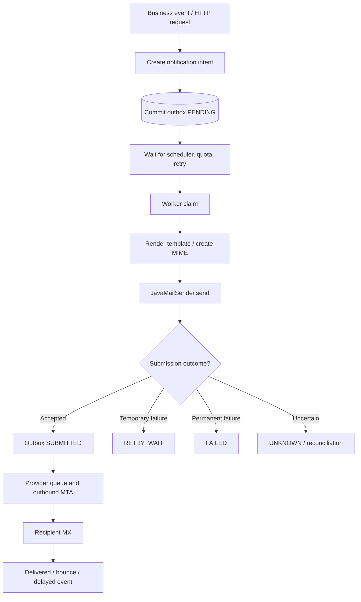

# Đo throughput, latency và tỷ lệ thành công cùng nhau

Một hệ thống Spring Boot dùng `JavaMailSender` gửi email xác nhận đơn hàng, mã OTP và hóa đơn. Sau khi tăng số mail worker từ 4 lên 20, dashboard cho thấy số lần gọi `send(...)` mỗi giây tăng gấp đôi. Nhìn riêng chỉ số này, có vẻ tối ưu đã thành công. Nhưng khách hàng lại nhận OTP chậm hơn, nhà cung cấp SMTP bắt đầu trả nhiều lỗi giới hạn tốc độ, hàng đợi tăng, và một số email được chấp nhận nhưng sau đó bị bounce. **Throughput tăng không đồng nghĩa năng lực gửi email hữu ích tăng.**

Một đội khác tối ưu độ trễ bằng cách chỉ thống kê các email gửi thành công. Chỉ số p95 của `send(...)` giảm mạnh, bởi những yêu cầu bị timeout hoặc retry nhiều lần không nằm trong tập số liệu. Kết quả là dashboard hiển thị “latency tốt hơn” trong khi người nhận phải chờ lâu hơn.

Để đánh giá đúng hiệu năng của **Spring Framework Mail**, cần đo **throughput, latency và tỷ lệ thành công cùng nhau**, trên **cùng ranh giới nghiệp vụ**, với đơn vị và mẫu số minh bạch. Cần thêm các tín hiệu hỗ trợ như queue depth/age, retry, quota provider và kết quả delivery bất đồng bộ.

Bài học thuộc chương **Hiệu năng và giới hạn**. Nội dung trình bày mô hình đo ở từng giai đoạn email, các công thức và bẫy thống kê, cách instrument JavaMailSender bằng Micrometer, truy vấn Prometheus, dashboard/SLO, kiểm thử tải, phân tích nghẽn cổ chai và quy trình vận hành khi ba chỉ số biến động trái chiều.

## 1. Ba đại lượng trả lời ba câu hỏi khác nhau

| Đại lượng | Câu hỏi | Ví dụ đơn vị | Một sai lầm hay gặp |
|---|---|---|---|
| **Throughput** | Hệ thống xử lý được bao nhiêu công việc trong mỗi đơn vị thời gian? | recipient units/giây, submissions/phút, notifications/phút | Đếm attempts thay cho accepted notifications |
| **Latency** | Một công việc phải chờ bao lâu? | ms/attempt, giây đến submission, phút đến delivery | Chỉ tính thời gian SMTP socket, bỏ thời gian nằm trong queue |
| **Success rate** | Bao nhiêu công việc đạt kết quả mong muốn trong tập được đánh giá? | % attempts accepted, % notification intents submitted, % delivered | Dùng sai mẫu số hoặc coi accepted = delivered |

Ba đại lượng có tính bổ sung:

- Throughput cao nhưng success rate thấp có thể chỉ là **retry storm**.
- Latency transport thấp nhưng queue latency cao có thể là **thiếu capacity hoặc quota bị chặn**.
- Success rate cao nhưng throughput rất thấp có thể khiến **hàng nghìn notification chờ quá SLA**.
- Throughput và latency cùng tăng khi tải tăng có thể báo hiệu **saturation**.
- Success rate nhìn chung cao có thể che vấn đề ở một tenant, provider hoặc loại thư quan trọng.

Một báo cáo hiệu năng nghiêm túc cần nói rõ: **đo tại đâu, đếm gì, trong cửa sổ nào, theo loại email nào và thế nào được coi là thành công**.

### 1.1. Throughput không phải “tốc độ CPU”

Ví dụ hệ thống thực hiện 200 lời gọi `JavaMailSender.send(...)` mỗi phút nhưng chỉ 120 lần được SMTP relay xác nhận chấp nhận. Throughput **attempts** là 200/phút; throughput **accepted submissions** là 120/phút. Chúng không thể thay thế nhau.

### 1.2. Latency không phải “thời gian gọi một method”

Một email có thể mất 70 ms để tạo MIME, 8 phút chờ quota, 1,2 giây gọi SMTP, sau đó 3 phút nằm trong queue của provider. Tùy SLA, metric cần đo có thể là:

- 70 ms: thời gian chuẩn bị message.
- 1,2 giây: SMTP attempt latency.
- Khoảng 8 phút: thời gian chờ dispatch.
- Hơn 8 phút: time-to-submission.
- Hơn 11 phút: time-to-delivery nếu provider thực sự cung cấp delivery event đáng tin.

Không thể dùng một timer quanh `send(...)` để đại diện tất cả.

### 1.3. Success rate không phải luôn là một tỷ số duy nhất

Một lần gửi thành công ở SMTP submission nghĩa là relay đầu tiên chấp nhận trách nhiệm xử lý theo phản hồi giao thức; điều đó không bảo đảm recipient MX nhận, càng không bảo đảm vào Inbox.

Cần nhiều mức thành công tương ứng nhiều contract:

1. Ý định thông báo được **ghi bền vững**.
2. SMTP relay/provider **chấp nhận submission**.
3. Hệ thống nhận **chấp nhận delivery**.
4. Message được **đưa vào hộp thư** theo dữ liệu có thể xác minh.
5. Người nhận **đọc hoặc hành động** nếu sản phẩm có quyền theo dõi phù hợp.

Mỗi mức dùng nguồn dữ liệu và thời điểm xác nhận khác nhau.

## 2. Vẽ đúng đường đi của một email

Giả sử hệ thống dùng transactional outbox và worker gửi mail bất đồng bộ:



Từng đoạn là một **measurement boundary** riêng:

| Điểm | Timestamp / sự kiện | Dùng để đo |
|---|---|---|
| Business event phát sinh | `eventOccurredAt` | Độ trễ toàn use case nếu cần |
| Intent commit | `createdAt` hoặc `committedAt` có semantics rõ | Từ lúc công việc bền vững bắt đầu chờ |
| Worker claim | `claimedAt` | Queue wait và scheduling delay |
| Bắt đầu submission | `attemptStartedAt` | Thời điểm transport attempt |
| Kết thúc submission | `attemptFinishedAt` | SMTP/API attempt latency, result |
| Provider xác nhận accepted | `acceptedAt` | Time-to-submission |
| Provider báo delivered | `deliveredAt` | Time-to-delivery |
| Bounce/complaint event | `eventTimestamp` và `receivedAt` | Failure sau submission và webhook lag |

Không nhất thiết lưu toàn bộ timestamp trên một row; có thể có bảng `mail_attempt`, delivery events, tracing và metrics. Quan trọng là mọi trường có semantics rõ.

### 2.1. Nếu không dùng outbox

Một service gọi `JavaMailSender.send` đồng bộ ngay trong HTTP request có ít tầng queue hơn, nhưng vẫn phải phân biệt:

- Thời gian HTTP request.
- Thời gian render nội dung.
- Thời gian chờ thread/connection limit.
- Thời gian SMTP attempt.
- Kết quả accepted.
- Delivery event tới sau.

Không vì code đồng bộ mà đồng nhất HTTP 200 với email delivered.

### 2.2. Nếu gọi qua ESP HTTP API

Thay `SMTP transport` bằng HTTP client. Khi đó:

- HTTP 2xx có thể đại diện accepted/queued tùy contract.
- HTTP 429 phản ánh limit của API.
- `Retry-After` chỉ dùng khi có và đúng ngữ nghĩa.
- HTTP request latency khác downstream delivery latency.
- API có thể hỗ trợ idempotency key hoặc status API riêng.

Mô hình ba chỉ số vẫn áp dụng, nhưng taxonomy kết quả cần theo contract của provider.

## 3. Chọn đơn vị công việc: message, recipient hay intent?

Giới hạn của provider có thể dựa trên số **recipients**, không phải số MIME messages. Trong khi đó business SLO thường được định nghĩa theo **notification intent**.

Ví dụ:

```text
Notification N-1: 1 recipient, 1 MIME message, 1 attempt
Notification N-2: 3 recipients, 1 MIME message, 2 attempts
Notification N-3: 1 recipient, 1 MIME message, 0 attempts (đang chờ)
```

Từ cùng dữ liệu, ta có:

- 3 notification intents.
- 5 recipient units logic nếu provider đếm toàn bộ recipients.
- 3 SMTP attempts đã bắt đầu.
- 1 notification chưa được thử.
- Tổng recipients **đã attempt** có thể khác số recipients logic vì retry.

Các đơn vị này không nên đặt cùng một metric tên `mail_sent_total`.

### 3.1. Đề xuất taxonomy

| Metric concept | Đơn vị | Ý nghĩa |
|---|---|---|
| `intents_created` | Unique intents | Notification đã được lưu bền vững |
| `attempts_started` | Transport calls | Số lần thử, gồm retry |
| `attempts_accepted` | Accepted attempts | Provider đã xác nhận chấp nhận ở attempt |
| `attempted_recipient_units` | Recipient attempts | Tổng chi phí recipient theo attempts |
| `accepted_recipient_units` | Recipient units accepted | Khối lượng provider đã nhận, khi xác định được |
| `unique_intents_submitted` | Unique intents | Số intent đạt submitted lần đầu |
| `unique_intents_delivered` | Unique intents | Số intent có delivery confirmation |
| `outstanding_intents` | Intents | Công việc chưa có terminal outcome |

Trong thiết kế đa người nhận, phải định nghĩa rõ **outcome theo toàn message** hay **theo từng recipient**. Nếu recipient A được chấp nhận nhưng B bị từ chối, một boolean success cho cả message có thể không đủ.

### 3.2. Không đổi đơn vị khi dựng dashboard

Nếu limit ESP là 100 recipients/phút, đồ thị 100 messages/phút không trực tiếp so sánh được nếu messages có nhiều recipients. Hãy dùng cost model thống nhất và báo rõ phương pháp đếm.

## 4. Một ví dụ xuyên suốt: cùng dữ liệu, kết luận khác nhau

Trong một cohort có **1.000 notification intents** được tạo ở cùng khoảng thời gian, tại thời điểm đánh giá:

| Trạng thái của intent | Số intent |
|---|---:|
| Đã được SMTP provider chấp nhận | 900 |
| Thất bại vĩnh viễn, không được chấp nhận | 50 |
| Đang chờ retry / chưa đến hạn | 30 |
| Kết quả submission không rõ | 20 |
| **Tổng** | **1.000** |

Trong quá trình xử lý, worker đã thực hiện **1.200 attempts**: 900 accepted, 210 temporary failures, 60 permanent failures và 30 unknown results. Các attempts thất bại có thể thuộc những intents sau đó được retry thành công; bởi vậy không thể cộng attempt outcomes để suy ra trực tiếp trạng thái cuối của từng intent.

Giả sử 900 intents đã accepted có 800 delivery confirmations, 50 bounces và 50 còn chờ báo cáo downstream.

### 4.1. Attempt success rate

```text
Attempt acceptance rate
    = accepted attempts / all completed attempts
    = 900 / 1.200
    = 75%
```

Tỷ lệ 75% cho biết chất lượng của **attempts**, phản ánh retries và network/provider issues; không phải tỷ lệ 75% notification được gửi thành công.

### 4.2. Intent submission success theo snapshot

```text
Accepted intents / all created intents
    = 900 / 1.000
    = 90%
```

Tỷ lệ 90% tại thời điểm snapshot còn chịu tác động của 30 pending và 20 unknown. Nó khác tỷ lệ “terminal outcomes”:

```text
Accepted / (accepted + permanently failed)
    = 900 / (900 + 50)
    ≈ 94,74%
```

Tỷ lệ terminal-only **không thay thế** tỷ lệ trên toàn cohort: nếu backlog chưa xử lý tăng, tỷ lệ chỉ tính terminal có thể trông tốt hơn thực tế. Khi báo cáo, phải hiển thị cả tỷ lệ pending/unknown và tuổi cohort.

### 4.3. Delivery theo snapshot

```text
Confirmed delivered / accepted intents
    = 800 / 900
    ≈ 88,89%
```

Giá trị này còn chịu độ trễ của provider events. Nếu 50 messages chưa có delivery event, chúng chưa thể tự động bị coi là delivered hoặc bounced. Một phân tích delivery cần **cohort đủ trưởng thành** và xử lý event trễ.

### 4.4. Bài học từ ví dụ

Những câu sau cùng đúng nhưng nói về **ba hiện tượng khác nhau**:

- “75% attempts được provider chấp nhận.”
- “90% intents của cohort đã submitted tại thời điểm đo.”
- “88,89% accepted intents đã có delivery confirmation tại thời điểm quan sát.”

Khi làm dashboard, không chọn con số đẹp nhất rồi gọi chung là “email success rate”.

## 5. Định nghĩa throughput tại từng giai đoạn

Throughput là lượng công việc hoàn thành ở một ranh giới trong một khoảng đo:

\[
\text{Throughput} = \frac{\text{work units completed}}{\text{elapsed time}}
\]

Ví dụ trong 60 giây:

- 300 intents được tạo → **5 intents/s** (arrival rate).
- 240 attempts bắt đầu → **4 attempts/s**.
- 210 attempts được chấp nhận, mỗi attempt một recipient → **3,5 accepted recipients/s**.
- 180 provider delivery events tới trong phút đó → **3 delivery events/s**.

Không thể lấy 180 delivery events trong phút đó chia cho 300 intents vừa tạo rồi gọi là delivery success rate. Hai nhóm có thể thuộc **các cohort khác nhau** vì delivery xảy ra muộn.

### 5.1. Arrival rate và service rate

Gọi:

- \(\lambda\): tốc độ intent mới đến (intents/giây).
- \(\mu\): tốc độ hệ thống đưa intent ra khỏi queue bằng một kết quả xử lý phù hợp (intents/giây).
- \(B(t)\): backlog tại thời điểm \(t\).

Gần đúng trong một khoảng nếu không có thay đổi trạng thái khác:

\[
\Delta B \approx (\lambda-\mu)\Delta t
\]

Nếu \(\lambda>\mu\) kéo dài, backlog tăng. Tăng thêm thread không giúp nhiều nếu \(\mu\) bị khóa bởi quota provider.

### 5.2. Attempt throughput và useful throughput

Gọi một SMTP transport attempt là “processed” dù nó bị 451 và đưa vào retry có thể làm tổng attempts/giây rất cao. **Useful throughput** nên đo số recipient units được provider xác nhận accepted hoặc số unique intents đạt bước tiếp theo.

Một chiến lược giảm retry storm có thể làm:

- Attempt throughput **giảm**.
- Acceptance rate **tăng**.
- Accepted throughput **tăng hoặc ổn định**.
- Queue latency **giảm dần**.

Đây có thể là tối ưu tốt dù số request/giây giảm.

### 5.3. Throughput theo notification priority

Không gộp OTP với marketing nếu yêu cầu khác nhau:

- OTP: tỷ lệ submitted trong 30 giây hoặc 60 giây.
- Hóa đơn: thời gian submission cho batch.
- Marketing: sustained accepted recipients/minute với chi phí hợp lý.

Một đồ thị tổng cao có thể che việc transactional queue bị nghẽn bởi campaign.

## 6. Đo latency theo giai đoạn, không chỉ trung bình toàn cục

### 6.1. Các thành phần latency

Với một notification intent:

```text
t0 = intent committed / eligible
t1 = worker claimed
t2 = MIME rendering started
t3 = SMTP send started
t4 = SMTP send completed (accepted/error)
t5 = provider confirmed delivered
```

Một số khoảng:

```text
Queue wait          = t1 - t0
Prepare latency     = t3 - t2
SMTP attempt time   = t4 - t3
Time to submission  = t4 - t0     (nếu accepted)
Time to delivery    = t5 - t0     (nếu event đáng tin)
```

Nếu retry, `t4` của accepted attempt cuối có thể cách xa `t0` nhiều phút. Thời gian từ intent đến acceptance **bao gồm các lần chờ retry** và là đại lượng quan trọng đối với người dùng.

### 6.2. Phân biệt queue wait và transport wait

Queue wait có thể đến từ:

- Chưa đến `nextAttemptAt`.
- Provider quota/rate gate.
- Worker thiếu capacity.
- Database claim/lock contention.
- Priority scheduling.
- Circuit breaker đang mở.
- Retry backoff có chủ đích.

Transport latency có thể đến từ:

- DNS resolution và TCP connect.
- TLS/STARTTLS handshake.
- SMTP AUTH.
- MAIL FROM / RCPT TO / DATA exchange.
- Payload/attachment size.
- Server response delay.
- Network timeout.

Hai nhóm cần metric riêng để không chẩn đoán sai.

### 6.3. Dùng monotonic time cho duration trong process

Ở một JVM, để đo thời gian trôi qua của `send(...)`, `System.nanoTime()` hoặc `Timer.Sample` thích hợp hơn việc lấy hiệu hai `Instant.now()` vì wall clock có thể chỉnh bởi NTP.

Đối với latency trải qua nhiều process, hệ thống phải dùng timestamps UTC có ngữ nghĩa rõ và theo dõi clock skew. Nếu nhận được duration âm vì lệch đồng hồ, **đừng âm thầm ép về 0 rồi coi không có vấn đề**; ghi nhận sự cố timestamp/skew và bảo vệ dashboard theo policy.

### 6.4. Độ trễ “đến Inbox” có chắc đo được không?

Thông thường **không** với chỉ `JavaMailSender`. Provider có thể báo delivered sau khi recipient MX chấp nhận, nhưng không biết chính xác Inbox vs Spam hoặc thời điểm khách hàng thấy thư.

Vì vậy, gọi metric `time_to_delivery` khi nguồn là provider delivery event, không gọi `time_to_inbox` nếu không có dữ liệu inbox placement hợp lệ.

## 7. Mean, median, p95, p99 và histogram

### 7.1. Trung bình không mô tả được phần đuôi

Ví dụ 100 SMTP attempts:

- 95 attempts: 200 ms.
- 5 attempts: 10 giây.

Mean:

```text
(95 × 0,2 + 5 × 10) / 100
= 0,69 giây
```

Một mean 690 ms có thể khiến đội vận hành nghĩ thời gian chờ thấp, nhưng 5% khách hàng phải chịu 10 giây chỉ riêng SMTP attempt.

Cần xem phân phối:

- **p50 (median):** một nửa observations có latency không lớn hơn giá trị này theo quy ước quantile.
- **p95:** khoảng 95% observations nằm ở hoặc dưới ngưỡng p95.
- **p99:** phản ánh phần đuôi khoảng 1%.
- **Max:** cực trị quan sát trong cửa sổ, nhạy với một điểm bất thường.
- **Histogram buckets:** cho biết số observations trong các khoảng latency, hỗ trợ aggregate/quantile.

### 7.2. Không cộng p95 của từng giai đoạn để suy ra p95 tổng

Nếu:

```text
Queue p95   = 8 giây
SMTP p95    = 2 giây
MIME p95    = 100 ms
```

không thể khẳng định:

```text
End-to-end p95 = 8 + 2 + 0,1 = 10,1 giây
```

Vì các percentile có thể thuộc **những notification khác nhau**, cộng p95 không cho p95 của tổng. Cần đo duration end-to-end trên **từng notification** hoặc thống kê phân phối của tổng tương ứng.

### 7.3. Đo latency của failed attempts nữa

Nếu chỉ record timer sau khi `send(...)` trả về thành công:

```java
sender.send(message);
timer.record(duration); // Chỉ chạy khi không ném lỗi.
```

thì những attempt bị timeout chờ 10–30 giây sẽ biến mất khỏi latency distribution. Cách đúng là record duration trong `finally`, gắn outcome classification phù hợp.

Nên xem:

- p95/p99 latency **all attempts**.
- p95/p99 latency **accepted attempts**.
- p95/p99 latency **temporary/permanent failures** nếu sample đủ.
- Time-to-submission của cohort intents (bao gồm retry wait).
- Queue wait của intents đang/đã xử lý.

Cần chú ý latency chỉ của các completed attempts có thể bỏ qua calls đang treo. Theo dõi thêm `active_attempts` và age của những attempts đang chạy.

## 8. Success rate: chọn mẫu số có ý nghĩa

### 8.1. Attempt success rate

\[
R_{\text{attempt}} =
\frac{\text{accepted attempts}}{\text{completed attempts}}
\]

Dùng để theo dõi transport health, throttling, network và tỷ lệ retry.

Các trạng thái khả dĩ:

- `accepted`.
- `temporary_rejection`.
- `permanent_rejection`.
- `unknown`.
- `client_preparation_failure`.
- `not_attempted_local_gate` — **không** nằm trong completed transport attempts.

Nếu một attempt bắt đầu nhưng bị crash và không ghi kết quả, có thể cần state `IN_FLIGHT_STALE` hoặc recovery reconciliation. Không cho nó biến mất khỏi quan sát chỉ vì chưa có event kết thúc.

### 8.2. Intent submission success

\[
R_{\text{intent-submission}} =
\frac{\text{unique intents accepted}}
     {\text{eligible intents in cohort}}
\]

Cohort thường được chọn theo `createdAt` hoặc thời điểm đủ điều kiện gửi. **Eligible** cần định nghĩa rõ: có loại trừ notifications bị hủy hợp lệ, không có consent, hết hạn ngay từ đầu hoặc validation lỗi không?

Đừng tùy tiện loại những trường hợp thất bại khó để làm tỷ lệ đẹp. SLO phải phản ánh trải nghiệm nghiệp vụ muốn bảo đảm.

### 8.3. Time-bounded success

Với OTP, quan trọng hơn có thể là:

\[
R_{\le 60s} =
\frac{\text{eligible intents accepted trong 60 giây}}
     {\text{eligible intents đủ tuổi để đánh giá}}
\]

Một OTP được SMTP relay accepted sau 15 phút có thể được coi “submitted successfully” về transport, nhưng **thất bại đối với SLO thời gian**.

Một SLI time-bounded kết hợp yếu tố thành công và latency trong cùng một outcome, giúp tránh trường hợp throughput cao nhưng gửi quá trễ.

### 8.4. Delivery success rate

\[
R_{\text{delivery}} =
\frac{\text{intents confirmed delivered}}
     {\text{mature accepted intents có outcome đánh giá}}
\]

Cần định nghĩa rõ cohort và “mature”: ví dụ các submissions đã qua một khoảng đủ dài theo SLA/provider reporting window. Webhook event đến trễ hoặc bị mất có thể gây sai lệch. Nếu không có reliable delivery events, **đừng tự tính delivery success từ send()**.

### 8.5. Các loại tỷ lệ không được đánh đồng

| Chỉ số | Numerator | Denominator | Câu hỏi |
|---|---|---|---|
| Attempt acceptance | Accepted attempts | Completed attempts | Transport attempts hoạt động thế nào? |
| Intent submission | Unique intents accepted | Eligible intents của cohort | Công việc logic có được submitted không? |
| On-time submission | Intents accepted trước deadline | Eligible intents đã đủ thời gian đánh giá | Có đáp ứng SLA cho người dùng không? |
| Provider delivery | Intents với delivered event | Cohort được định nghĩa rõ | Đã chuyển tới downstream destination chưa? |
| Bounce rate | Bounced messages/recipients | Tập submissions phù hợp | Chất lượng recipient/policy thế nào? |

## 9. Cohort và độ trễ của kết quả: bẫy “right censoring”

Vào phút thứ nhất, hệ thống tạo 1.000 intents nhưng chỉ 300 được xử lý do giới hạn tốc độ. Nếu ngay lúc đó tính:

```text
success = accepted / created = 300/1000 = 30%
```

thì ta có **tỷ lệ accepted-as-of-now**, không phải tỷ lệ thất bại cuối cùng. 700 intents còn chờ không nên bị gán thành permanently failed.

Ngược lại, nếu tính:

```text
success = accepted / completed = 300/300 = 100%
```

thì số liệu đẹp nhưng che backlog 700 intents.

### 9.1. Giải pháp là hiển thị nhiều mặt của cùng cohort

Cho cohort tạo trong khoảng `10:00–10:05`, theo dõi:

- Số eligible intents.
- Số accepted.
- Số failed permanent.
- Số pending / retry wait.
- Số unknown.
- Số expired hoặc canceled theo policy.
- p95 time-to-submission của intents được accepted.
- % accepted trong SLA của tất cả intents **đã đủ tuổi đánh giá**.

Khi đánh giá SLO 60 giây, đợi mỗi intent ít nhất 60 giây từ mốc bắt đầu trước khi chấm, tránh tính nhầm những intent mới được tạo cách đây 5 giây.

### 9.2. Tránh pha hai cửa sổ không cùng nguồn

Không lấy:

- Numerator = delivered events xảy ra “5 phút vừa qua”.
- Denominator = intents được tạo “5 phút vừa qua”.

Vì event delivery hôm nay có thể thuộc message submission 15 phút trước. Tỷ số đó có thể vượt 100% hoặc dao động vô nghĩa.

Nếu cần đồ thị event rates theo wall-clock, hiển thị như **hai throughput series**, không gọi phép chia trực tiếp là success rate của cohort.

## 10. Kết hợp cả ba trong một bảng đọc nhanh

Một tập metric hữu ích cho mỗi provider/notification type:

| Tín hiệu | Ý nghĩa | Cảnh báo khi |
|---|---|---|
| Accepted recipients/giây | Useful throughput | Giảm trong khi arrivals/backlog tăng |
| Attempt recipients/giây | Tải lên provider | Tăng vọt không tương ứng accepted throughput |
| Attempt acceptance rate | Hiệu quả transport | Giảm do 4xx, 5xx, network |
| p95 SMTP attempt | Độ trễ transport | Tăng, đặc biệt kèm timeouts |
| p95 queue wait | Độ trễ scheduling/quota | Tăng dù SMTP attempt vẫn nhanh |
| p95 time-to-submission | Trải nghiệm toàn pipeline | Tăng qua SLA |
| On-time intent submission rate | Business SLI | Giảm dưới objective |
| Oldest pending age | Nguy cơ backlog | Tăng liên tục hoặc gần expiry |
| Retry per accepted intent | Retry overhead | Tăng mà accepted throughput không cải thiện |
| Provider throttle rate | Quota/rate feedback | Tăng trong khi local limit không giảm tốc |
| Unknown submission count | Sự bất định của kết quả | Tăng sau timeout/crash |
| Delivery/bounce status | Kết quả downstream | Accepted cao nhưng bounce tăng |

### 10.1. Không coi nhiều biểu đồ là đủ

Các metrics phải **cùng dimension và đồng nhất định nghĩa** khi đặt cạnh nhau. Ví dụ graph throughput của toàn bộ traffic nhưng latency của riêng OTP và success rate của chỉ accepted attempts có thể khiến người xem kết luận sai.

Hãy có bộ lọc đồng bộ theo provider, account, notification class, môi trường và time window; đặt nhãn đơn vị rõ ràng.

## 11. Trường hợp 1: throughput tăng, success rate giảm

Giả sử trước tối ưu:

```text
Attempts: 100/phút
Accepted: 95/phút
Attempt acceptance: 95%
p95 attempt latency: 0,9s
```

Sau khi tăng worker:

```text
Attempts: 250/phút
Accepted: 100/phút
Attempt acceptance: 40%
p95 attempt latency: 4,5s
```

Attempt throughput tăng 2,5 lần, nhưng useful throughput chỉ tăng 5,3%. Độ trễ tăng và provider có thể đang throttling.

**Hướng điều tra:**

1. Xem SMTP response codes/enhanced codes và provider quota.
2. Kiểm tra concurrency vs connection limit.
3. So sánh accepted recipients/s, không chỉ attempts/s.
4. Kiểm tra retry storm và local limiter.
5. Giảm concurrency/rate về mức mà provider chấp nhận ổn định.
6. Theo dõi queue age thay vì tăng thêm worker mù quáng.

Tối ưu đúng có thể là **giảm attempts** để tăng tỷ lệ accepted và ổn định SLA.

## 12. Trường hợp 2: p95 SMTP thấp nhưng time-to-submission cao

Ví dụ:

```text
p95 SMTP attempt:           0,3 giây
p95 queue wait:             12 phút
p95 time-to-submission:     13 phút
Attempt acceptance:         99%
Oldest pending:             28 phút
```

Transport khỏe; vấn đề nằm trước `send(...)`. Nguyên nhân có thể:

- Rate limiter chặn theo quota.
- Scheduler chỉ poll mỗi vài phút.
- Worker pool thiếu.
- Database query claim chậm.
- Một queue marketing chiếm hết khả năng dispatch.
- Circuit breaker mở quá lâu.
- Retry backoff được cấu hình quá lớn.
- Tenant fairness gây starvation.

Không nên tối ưu MIME rendering hoặc TLS handshake trước khi xem queue scheduling và quota.

### 12.1. Độ trễ của email chưa hoàn thành

Một p95 time-to-submission chỉ tính các intents accepted sẽ bỏ qua pending. Nếu backlog tăng, p95 accepted có thể đẹp vì những notification quá chậm **chưa được đưa vào tập đo**.

Để tránh bẫy:

- Theo dõi `oldest_pending_age`.
- Theo dõi `pending_age` distribution.
- Dùng SLI time-bounded theo matured cohort.
- Theo dõi `expired_total` và `pending_count`.
- Không chỉ vẽ latency của completed submissions.

## 13. Trường hợp 3: success rate cao, throughput thấp

Ví dụ một provider giới hạn 20 recipients/phút, trong khi ứng dụng tạo 300 intents/phút:

```text
Accepted / attempted: 100%
Accepted throughput: 20/phút
Arrival rate: 300/phút
Backlog growth: ~280/phút
```

Nếu chỉ xem acceptance rate 100%, đội vận hành có thể nghĩ mọi thứ khỏe. Nhưng queue đang tăng nhanh và người nhận sẽ không nhận thông báo đúng hạn.

**Hướng điều tra:**

- Quota theo account/region, remaining và reset.
- Phân bổ capacity cho các loại thông báo.
- Có đẩy marketing/OTP cùng một queue không?
- Có phương án nâng quota hoặc giảm new arrivals không?
- SLA nào sắp bị vi phạm?
- Có cần ngừng tiếp nhận batch không thiết yếu không?

Đây là lý do success rate cần được xem bên cạnh accepted throughput và backlog.

## 14. Trường hợp 4: throughput và success đều tăng nhưng delivery giảm

SMTP provider có thể chấp nhận mọi request, nhưng recipient MX phát sinh bounce/deferral về sau. Ví dụ:

```text
Submission accepted rate: 98%
Accepted recipients:       10.000/ngày
Provider delivered:        8.200/ngày
Hard bounces:              tăng
```

Cần kiểm tra:

- Đơn vị/cohort của delivered rate.
- Recipient list quality và suppression.
- SPF/DKIM/DMARC.
- PTR/forward DNS và IP/domain reputation.
- Provider-specific throttling ở downstream MX.
- Nội dung, attachment, link và policy.
- Webhook event lag/loss.

**Không tăng throughput chỉ vì ESP nhận request**; hạ tầng email phải đánh giá kết quả sau submission bằng nguồn dữ liệu phù hợp.

## 15. Trường hợp 5: p95 tăng nhưng success rate không giảm

Có thể provider xử lý chậm trước khi chạm timeout. Đây là dấu hiệu sớm của saturation hoặc network delay:

```text
Accepted success rate: 99%
p95 SMTP latency: 0,5s -> 5s
Active submissions: tăng
Queue wait: tăng nhẹ
```

Nếu chờ tới khi 4xx/timeout tăng mới cảnh báo, ứng dụng có thể đã tích tụ nhiều request đang mở. Latency tail thường hữu ích để cảnh báo sớm, đặc biệt kèm active connections/queue trend.

Cũng có thể latency tăng do attachment lớn hoặc thay đổi payload mix; hãy phân nhóm theo message size band/notification type, không so sánh những workload hoàn toàn khác nhau bằng một đường trung bình.

## 16. Định nghĩa sự kiện và trạng thái để tránh double counting

Một vòng đời outbox có thể là:

```text
PENDING
  |
  +-- Local rate gate denied --> PENDING / nextAttemptAt
  |
  +-- Attempt #1 --> TEMPORARY_FAILURE -> RETRY_WAIT
  |
  +-- Attempt #2 --> UNKNOWN -> reconciliation
  |
  +-- Attempt #3 --> SUBMITTED -> DELIVERED (provider event)
```

Mỗi transition cần quyết định nên tăng counter nào:

| Sự kiện | Counter/Gauge cập nhật |
|---|---|
| Intent insert thành công vào DB | `intents_created_total +1` một lần |
| Local limiter DENIED | `local_rate_denials_total +1`; không tăng attempts |
| Attempt được bắt đầu | `attempts_started_total +1` |
| Attempt kết thúc temporary failure | `attempts_total{result="temporary"} +1` |
| Attempt kết thúc unknown | `attempts_total{result="unknown"} +1` |
| Provider accepted | `attempts_total{result="accepted"} +1` |
| Intent lần đầu chuyển SUBMITTED | `intents_submitted_total +1` |
| Delivery webhook lần đầu ghi nhận | `intents_delivered_total +1` nếu có uniqueness |
| Notification hết hạn trước khi gửi | `intents_expired_total +1` |
| Pending count/age | Gauge từ trạng thái hiện tại |

### 16.1. Counters và events khi process crash

Một counter trong memory có thể mất hoặc bị reset khi process restart. Prometheus xử lý counter resets khi dùng `rate()` trong điều kiện scrape đầy đủ, nhưng **metric counter không phải transactional audit log**.

Nếu cần thống kê kinh doanh chính xác theo intent và cohort, nguồn bền vững thường là database/outbox/attempt events. Metrics phục vụ giám sát nhanh, còn phép kiểm tra reconciliation dựa trên state/log bền vững.

### 16.2. Tránh tăng unique intent counter trong mỗi retry

Nếu worker xử lý cùng notification ba lần, `attempts_total` có thể tăng ba. `intents_submitted_total` chỉ nên tăng **khi trạng thái logic lần đầu chuyển sang SUBMITTED**; cần guard ở persistence transaction để hai worker không double count event.

Một unique idempotency key bảo vệ tạo intent, nhưng không tự giải quyết duplicate acceptance sau SMTP outcome unknown.

## 17. Instrument JavaMailSender với Micrometer

Trong Spring Boot, Micrometer có thể ghi counter, timer, gauges và export qua backend quan sát được cấu hình, chẳng hạn Prometheus. Ví dụ sau minh họa **một SMTP attempt** trên một `MimeMessage`.

### 17.1. Một adapter đơn giản

```java
package com.example.mail;

import io.micrometer.core.instrument.MeterRegistry;
import io.micrometer.core.instrument.Timer;

import jakarta.mail.internet.MimeMessage;

import org.springframework.mail.MailException;
import org.springframework.mail.javamail.JavaMailSender;

public final class InstrumentedMailSubmitter {

    private final JavaMailSender sender;
    private final MeterRegistry meters;
    private final String providerKey;

    public InstrumentedMailSubmitter(
            JavaMailSender sender,
            MeterRegistry meters,
            String providerKey) {
        this.sender = sender;
        this.meters = meters;
        this.providerKey = providerKey;
    }

    public void submitOnce(MimeMessage message) {
        Timer.Sample sample = Timer.start(meters);
        String result = "unknown";

        meters.counter(
                "mail.submission.attempts.started",
                "provider", providerKey).increment();

        try {
            sender.send(message);
            // Đối với một send(MimeMessage) thành công:
            // transport call không báo lỗi tại boundary này.
            result = "accepted";
        } catch (MailException ex) {
            result = MailFailureCategories.classify(ex);
            throw ex;
        } finally {
            sample.stop(
                    Timer.builder("mail.submission.attempt.duration")
                            .description(
                                    "Elapsed time of one submission attempt")
                            .tag("provider", providerKey)
                            .tag("result", result)
                            .publishPercentileHistogram()
                            .register(meters));

            meters.counter(
                    "mail.submission.attempts",
                    "provider", providerKey,
                    "result", result).increment();
        }
    }
}
```

`MailFailureCategories.classify(ex)` ở đây là **hàm do ứng dụng tự định nghĩa**, không phải API có sẵn trong Spring. Nó phải trả về tập nhỏ các category, ví dụ `temporary_rejection`, `permanent_rejection`, `connectivity`, `authentication`, `unknown`; không dùng raw exception message làm label.

### 17.2. Ý nghĩa của ví dụ

- `Timer.Sample` dùng cơ chế thời gian đo của Micrometer phù hợp với elapsed duration.
- `finally` ghi timer dù success hay exception.
- `result` được đặt trước khi ghi metric.
- Method không chủ động retry; một invocation là một attempt.
- Timer kết thúc ngay khi transport call hoàn tất, không bao gồm queue wait.
- `accepted` ở đây chỉ có nghĩa method send một message trả về không exception theo contract transport; không tự có provider delivery event.
- Không instrument thêm lần thứ hai cùng một attempt ở một AOP advice nếu không muốn double count.

**Giới hạn:** trong mã thực, phân loại chính xác các trạng thái partial failure, timeout sau DATA và batch `send(MimeMessage[])` có thể cần xem nested exceptions, failed messages và SMTP stage. Không biến mọi `MailException` thành một boolean thất bại đơn giản nếu hệ thống cần đối chiếu recipient-level outcomes.

### 17.3. Classifier minh họa

```java
import org.springframework.mail.MailAuthenticationException;
import org.springframework.mail.MailException;
import org.springframework.mail.MailParseException;

public final class MailFailureCategories {

    private MailFailureCategories() {}

    public static String classify(MailException ex) {
        if (ex instanceof MailAuthenticationException) {
            return "authentication";
        }
        if (ex instanceof MailParseException) {
            return "preparation";
        }
        // Cần đọc cause chain, MessagingException.nextException,
        // provider SMTP reply và giai đoạn DATA ở implementation thật.
        return "unknown";
    }
}
```

Đây là classifier **rất bảo thủ** cho ví dụ, không phải quy tắc “cứ không nhận ra lỗi thì retry”. Phân loại `unknown` phải dẫn đến chính sách thận trọng ở tầng application/outbox.

### 17.4. Cấu hình MeterRegistry cho latency histogram

Với Micrometer và Prometheus, histogram có thể được bật qua `publishPercentileHistogram()` như trên hoặc qua cấu hình `MeterFilter`/distribution statistics phù hợp.

Nếu request latency của SMTP chủ yếu từ vài chục mili giây đến hàng chục giây, nên chọn histogram boundaries/SLO buckets dựa trên phân phối thật. Không dùng mọi default bucket một cách máy móc nếu làm tăng chi phí time series quá nhiều.

Cần kiểm tra tên metrics thực tế khi export. Micrometer chuyển tên dạng `mail.submission.attempt.duration` thành convention của backend; ví dụ Prometheus thường có series như `mail_submission_attempt_duration_seconds_bucket`, `_sum`, `_count`. Không tự giả định tên hậu tố nếu exporter/version đã được cấu hình khác.

## 18. Instrument latency của notification intent end-to-end

### 18.1. Dùng dữ liệu persisted thay vì memory object

Worker nhận một outbox row đã commit:

```java
record OutboxNotification(
        UUID id,
        Instant createdAt,
        String notificationType,
        String providerKey) {
}
```

Sau khi provider accepted và DB commit trạng thái `SUBMITTED`, có thể ghi nhận:

```java
Duration elapsed =
        Duration.between(notification.createdAt(), acceptedAt);

meters.timer(
        "mail.intent.time.to.submission",
        "provider", notification.providerKey(),
        "type", notification.notificationType()
).record(elapsed);
```

Ký hiệu code giả định `notification`, `acceptedAt` và `meters` được cấp sẵn; cần import `java.time.Duration` và `Instant`.

Một số lưu ý:

- `createdAt` phải biểu diễn mốc business đã chọn (ví dụ intent committed/ready), không tùy tiện chọn timestamp trước transaction kéo dài.
- `acceptedAt` là thời điểm app biết transport accepted, không phải delivery time.
- Timestamps lấy trên những host khác nhau có thể sai lệch; cần đồng bộ clock và policy xử lý invalid durations.
- **Chỉ record một lần cho unique intent khi state chuyển SUBMITTED.**
- Không dùng timer chỉ trên accepted intents làm SLO duy nhất; cần thêm pending age/time-bounded cohort để quan sát intents chưa hoàn thành.
- Một message có nhiều recipients cần quyết định time-to-submission ở mức message hay từng recipient.

### 18.2. Phân biệt thời gian retry

Nếu attempt #1 fail rồi chờ 5 phút, attempt #2 accepted trong 200 ms:

```text
Attempt 2 latency = 200 ms
Time-to-submission = > 5 phút
```

Chúng đều đúng. Chỉ xem attempt latency có thể dẫn tới kết luận sai rằng dịch vụ gửi nhanh.

### 18.3. Khi nào dùng @Timed?

`@Timed` hoặc observation framework có thể hữu ích để instrument một method, nhưng cần bảo đảm:

- Có cơ chế interceptor/AOP phù hợp để annotation thực sự có hiệu lực.
- Method boundary đúng hợp đồng.
- Timeout/exception vẫn được ghi nhận.
- Không gắn recipient/messageId thành tag.
- Không double count với timer explicit.
- Method-level timer không bị gọi sai qua self-invocation/proxy boundary.

Trong bài học này, `Timer.Sample` explicit làm rõ thời điểm bắt đầu/kết thúc một transport attempt.

## 19. Theo dõi queue: count, age và scheduling delay

### 19.1. Đếm pending là cần nhưng chưa đủ

Một queue có 10.000 marketing messages có thể phù hợp với chiến dịch đã lập lịch. Nhưng 50 OTP pending 4 phút có thể vi phạm nghiêm trọng trải nghiệm.

Nên có:

- `mail_outbox_pending_count` theo provider/type.
- `mail_outbox_retry_wait_count`.
- `mail_outbox_processing_count`.
- `mail_outbox_unknown_count`.
- `mail_outbox_oldest_pending_age_seconds`.
- `mail_outbox_expiring_soon_count`.
- `mail_outbox_due_count`: đến hạn nhưng chưa được claim.
- `mail_claim_delay_seconds`: từ đủ điều kiện đến lúc worker claim.

### 19.2. SQL tính oldest pending age

Với PostgreSQL, ý tưởng:

```sql
SELECT
    provider_key,
    notification_type,
    EXTRACT(
        EPOCH FROM (
            CURRENT_TIMESTAMP - MIN(created_at)
        )
    ) AS oldest_pending_age_seconds
FROM mail_outbox
WHERE status IN ('PENDING', 'RETRY_WAIT')
GROUP BY provider_key, notification_type;
```

Câu query minh họa chỉ đo **tuổi từ createdAt**. Nếu muốn độ trễ “đến hạn dispatch” thì cần dùng `next_attempt_at`/eligible timestamp và phân biệt retry wait có chủ đích. Không xem tất cả `RETRY_WAIT` là scheduler bị trễ; một row có `next_attempt_at` trong tương lai chưa đến hạn.

### 19.3. Gauge và truy vấn DB có chi phí

Không chạy `SELECT COUNT(*)` hoặc `MIN(created_at)` trên bảng cực lớn mỗi 100 ms chỉ để cập nhật dashboard. Cân nhắc:

- Poll theo khoảng hợp lý.
- Index phù hợp status/next_attempt_at/created_at.
- Materialized/aggregate counters có reconciliation.
- Query/read replica nếu độ trễ và consistency cho phép.
- Sample nếu mục tiêu quan sát không yêu cầu chính xác từng giây.

Cần biết snapshot gauge có thể chậm so với thực tế và không dùng nó làm cơ chế khóa quota.

## 20. Truy vấn Prometheus: throughput, latency và success

Giả sử Micrometer export các series theo convention sau:

```text
mail_submission_attempts_total{provider,result}
mail_submission_attempt_duration_seconds_bucket{provider,result,le}
mail_submission_attempt_duration_seconds_sum{provider,result}
mail_submission_attempt_duration_seconds_count{provider,result}
mail_intent_time_to_submission_seconds_bucket{provider,type,le}
mail_intent_time_to_submission_seconds_count{provider,type}
mail_outbox_pending_count{provider,type}
mail_outbox_oldest_pending_age_seconds{provider,type}
```

Tên trên chỉ là **schema telemetry minh họa**, phải xác minh từ endpoint exporter thực tế.

### 20.1. Attempt throughput theo provider

```promql
sum by (provider) (
  rate(mail_submission_attempts_total[5m])
)
```

Đơn vị: attempts/giây.

### 20.2. Accepted attempt throughput

```promql
sum by (provider) (
  rate(mail_submission_attempts_total{
    result="accepted"
  }[5m])
)
```

Đơn vị: accepted attempts/giây, **không nhất thiết recipient units/giây** nếu một attempt gửi nhiều recipients.

### 20.3. Attempt acceptance rate

```promql
sum by (provider) (
  rate(mail_submission_attempts_total{
    result="accepted"
  }[5m])
)
/
clamp_min(
  sum by (provider) (
    rate(mail_submission_attempts_total[5m])
  ),
  0.000001
)
```

Nhân 100 ở dashboard để hiển thị %. Khi không có attempts, mẫu số rất nhỏ không tạo ra một success rate “100%”. Nên hiển thị N/A hoặc yêu cầu minimum sample volume trước khi diễn giải tỷ lệ.

Nếu accepted throughput bằng 0 và attempts cũng 0, không được vội kết luận provider đang lỗi. Có thể hệ thống đơn giản là không có việc cần gửi.

### 20.4. p95 attempt latency trên histogram

```promql
histogram_quantile(
  0.95,
  sum by (le, provider) (
    rate(mail_submission_attempt_duration_seconds_bucket[5m])
  )
)
```

Query yêu cầu có histogram bucket series với nhãn `le`. Giá trị là ước lượng từ bucket, **không phải percentile chính xác của từng raw sample**.

Nếu histogram có tag `result`, phép tổng ở trên gộp accepted và failed attempts. Để xem p95 của accepted attempts:

```promql
histogram_quantile(
  0.95,
  sum by (le, provider) (
    rate(mail_submission_attempt_duration_seconds_bucket{
      result="accepted"
    }[5m])
  )
)
```

Hai đường nên được đặt cạnh nhau khi điều tra latency bias.

### 20.5. Average attempt latency

```promql
sum by (provider) (
  rate(mail_submission_attempt_duration_seconds_sum[5m])
)
/
clamp_min(
  sum by (provider) (
    rate(mail_submission_attempt_duration_seconds_count[5m])
  ),
  0.000001
)
```

Mean hữu ích cho xu hướng và resource cost nhưng không thay p95/p99.

### 20.6. p95 time-to-submission của accepted intents

```promql
histogram_quantile(
  0.95,
  sum by (le, provider, type) (
    rate(mail_intent_time_to_submission_seconds_bucket[15m])
  )
)
```

Lưu ý: đây là percentile của những intents **đã accepted và đã được record trong window**, không đại diện pending/expired. Phải xem cùng queue age và on-time success cohort.

### 20.7. So sánh arrival rate với accepted throughput

Nếu có:

```text
mail_intents_created_total{provider,type}
mail_intents_submitted_total{provider,type}
```

thì hai đồ thị:

```promql
sum by (provider, type) (
  rate(mail_intents_created_total[5m])
)
```

và:

```promql
sum by (provider, type) (
  rate(mail_intents_submitted_total[5m])
)
```

cho biết arrival rate và completion rate trong thời gian thực. **Không chia hai rates để gọi là cohort success rate** vì intents submitted trong cửa sổ có thể được tạo từ rất lâu trước đó.

## 21. Histogram aggregation và sampling pitfalls

### 21.1. Tính percentile sau khi aggregate buckets

Nếu có nhiều pods, đừng lấy trung bình số p95 riêng của từng pod:

```text
p95 toàn hệ thống != average(p95 pod A, p95 pod B, ...)
```

Để xấp xỉ percentile toàn bộ observations bằng histogram, cộng bucket rates cùng boundary và label phù hợp trước, rồi dùng `histogram_quantile`.

### 21.2. Histogram buckets phải nhất quán

Nếu service A dùng buckets `0.1s, 1s, 10s` còn service B dùng tập khác, aggregate có thể sai hoặc không có semantics rõ. Cần thống nhất histogram configuration trong cùng nhóm metrics.

### 21.3. Percentile accuracy phụ thuộc bucket boundaries

Nếu mọi request từ 2 đến 10 giây rơi vào một bucket rộng, ước lượng p95 sẽ kém chính xác. Chọn boundaries quanh các SLO ngưỡng cần quan tâm, chẳng hạn 0,1s, 0,25s, 0,5s, 1s, 2s, 5s, 10s, 30s, 60s — chỉ là ví dụ.

Không tăng số buckets/labels vô hạn vì time-series cost tăng nhanh.

### 21.4. Volume thấp thì p99 dễ gây hiểu lầm

Nếu chỉ có 12 attempts trong 5 phút, p99 gần với max và dao động mạnh. Hãy hiển thị sample count, chọn cửa sổ phù hợp và tránh dựng alert p99 nghiêm ngặt khi volume quá thấp.

### 21.5. Không trộn SMTP và HTTP API latency

Hai transport có connection/setup semantics khác. Khi so sánh, gắn nhãn channel và chỉ so sánh những ranh giới tương đương, ví dụ “provider accepted response latency”, không trộn với end-to-end delivery.

## 22. SLO: kết hợp chất lượng với hạn thời gian

Một SLO có ý nghĩa với người dùng thường là **đúng hạn** thay vì chỉ “tất cả email cuối cùng đều được gửi”.

### 22.1. Ví dụ SLO OTP

> Ít nhất 99% notification OTP hợp lệ được SMTP provider chấp nhận trong 60 giây kể từ lúc intent commit, xét trên một cửa sổ đánh giá đã định.

Định nghĩa cần làm rõ:

- **Eligible:** OTP còn hợp lệ ngay tại thời điểm tạo, recipient đủ điều kiện.
- **Start:** thời điểm commit intent.
- **Success:** provider xác nhận submission trước deadline 60 giây.
- **Failure:** bị rejected, expired, còn pending sau 60 giây hoặc outcome unknown chưa xác minh tại deadline.
- **Observation:** chỉ chấm intents đã có ít nhất 60 giây để hoàn thành.
- **Exclusions:** nếu có business cancellation hoặc test traffic, phải công bố rõ và áp dụng nhất quán.

SLO này kết hợp success với time-to-submission, và phản ánh user experience tốt hơn chỉ số `MailSendException` rate.

### 22.2. Ví dụ SLO hóa đơn

Hóa đơn có thể không cần 60 giây, nhưng cần độ bền:

> 99,9% invoice notification intents hợp lệ được provider chấp nhận trong 15 phút, đồng thời không mất intent sau business transaction commit.

Một phần là **time-bounded submission SLO**, một phần là **durability invariant** cần integration tests và operational checks.

### 22.3. SLO không đồng nghĩa Inbox guarantee

Nếu business thật sự yêu cầu recipient nhìn thấy email trong khoảng thời gian nhất định, cần hợp đồng với provider và dữ liệu delivery/inbox thực tế. Đừng đổi tên `time_to_submission` thành “time user receives mail”.

### 22.4. Error budget

Nếu SLO là 99% on-time submission, error budget cho một cohort 100.000 eligible notifications là:

```text
Allowed misses = 1% × 100.000 = 1.000 notifications
```

Một miss có thể là late, permanently failed hoặc still unknown sau deadline tùy định nghĩa. Nếu dashboard đếm cả một email late và một email permanently failed thành hai misses cho cùng intent, error budget sẽ bị double-count. Mỗi intent cần outcome rõ tại deadline.

## 23. Dự báo backlog và giới hạn công suất

### 23.1. Net drain rate

Giả sử:

```text
Arrival rate:                120 intents/phút
Accepted completion capacity: 90 intents/phút
```

Backlog kỳ vọng tăng:

```text
120 - 90 = 30 intents/phút
30 phút -> khoảng 900 intents backlog tăng thêm
```

Giả định mọi intent đủ điều kiện và không có cancellation/expiry/requeue làm thay đổi count. Nếu 15% attempts fail và phải retry, effective capacity theo **unique accepted intents** có thể thấp hơn số attempts mà worker thực hiện.

### 23.2. Thời gian xả backlog

Nếu backlog có 6.000 intents, accepted completion capacity 150 intents/phút và new arrivals 50 intents/phút:

```text
Net drain = 150 - 50 = 100 intents/phút
Estimated drain time ≈ 6.000 / 100 = 60 phút
```

Đây là xấp xỉ lý tưởng, phụ thuộc quota daily remaining, provider pacing, message size, failures và workload mix. Nếu provider rate limit thấp hơn 150/phút, tăng thêm workers không thay đổi net drain.

### 23.3. Little's Law

Trong một hệ thống ổn định, dưới những giả định phù hợp:

\[
L = \lambda W
\]

với:

- \(L\): số công việc trung bình trong hệ thống.
- \(\lambda\): throughput hoàn thành trung bình của hệ thống ổn định.
- \(W\): thời gian trung bình công việc nằm trong hệ thống.

Không dùng Little's Law một cách máy móc khi backlog đang tăng vô hạn, traffic không ổn định hoặc hệ thống bỏ/drop nhiều requests mà không được tính.

Nó giúp kiểm tra tính hợp lý của các số liệu về concurrency, throughput và latency khi workload tương đối ổn định.

### 23.4. Công suất thực bị giới hạn bởi nút cổ chai

Các giới hạn có thể cùng tồn tại:

- CPU/template rendering.
- Database claim/outbox throughput.
- Worker concurrency.
- SMTP connections.
- Provider recipients/second.
- Provider daily quota.
- Network throughput với attachments.
- Recipient MX throttling.

Khi thay đổi một biến, hãy đo cả ba đại lượng để biết nút cổ chai có chuyển chỗ hay không.

## 24. Load test phải đo đúng mục tiêu

Một thử nghiệm “500 emails/second” không có giá trị nếu không nói đó là 500 calls, 500 recipients hay 500 accepted submissions; workload có bao nhiêu retry, payload size và concurrency?

### 24.1. Chuẩn bị các workload đại diện

Ví dụ phân nhóm:

| Traffic class | Payload | Đặc điểm |
|---|---|---|
| OTP/reset | Text + HTML nhỏ, một recipient | Deadline ngắn, yêu cầu latency thấp |
| Order confirmation | HTML + text, một recipient | Dòng ổn định, transactional |
| Invoice | PDF attachment có size phân phối thực tế | CPU/serialization/bandwidth cao hơn |
| Marketing batch | HTML lớn, nhiều intents | Throughput, queueing và consent |
| Retry/recovery | Lỗi temporary, backoff | Tăng attempts nhưng không tăng new intents |

Không chỉ test email ASCII ngắn rồi suy ra hiệu năng của thư chứa PDF vài MB.

### 24.2. Open-loop và closed-loop test

- **Open-loop arrival:** tạo công việc theo một lịch đến độc lập tương đối với tốc độ xử lý. Hữu ích để quan sát queue growth khi hệ thống chạm limit.
- **Closed-loop clients:** client đợi request trước hoàn thành rồi mới gửi tiếp; khi server chậm, lượng đến tự giảm, có thể che saturation nếu diễn giải không đúng.

Đối với hệ thống outbox, cần test **arrival rate vào queue** và **effective accepted completion rate** riêng. Nếu generator bị backpressure ngoài ý muốn, số lượng intents thực tạo có thể thấp hơn mục tiêu mà người thử nghiệm không biết.

### 24.3. Coordinated omission

Nếu load generator đợi server trả lời rồi mới phát request kế tiếp, các giai đoạn server bị treo có thể bị lấy mẫu ít hơn, khiến histogram latency trông tốt giả tạo.

Cần công bố load model, đo scheduled arrival time vs actual handling và instrument queue delay. Với ứng dụng async, đo thời gian từ intent commit tới accepted cũng giúp tránh bỏ sót chờ đợi.

### 24.4. Không chạy load test lên hộp thư người thật

Dùng fake SMTP provider, Mailpit, GreenMail hoặc test relay được phép với giới hạn lưu lượng rõ; không spam ESP/recipient MX thật để kiểm tra concurrency. Nếu phải kiểm chứng quota thực của provider, cần tài khoản, điều kiện và sự phê duyệt thích hợp.

## 25. Kịch bản load test tăng dần

Một kế hoạch có thể gồm:

1. **Baseline:** mức tải thấp hơn safe provider rate; đo accepted throughput, p95/p99, queue age.
2. **Step load:** tăng arrivals theo bậc; tìm điểm bắt đầu queue tăng liên tục.
3. **Burst:** tăng đột ngột rồi giảm; quan sát token bucket và recovery.
4. **Sustained load:** giữ tải gần safe target trong thời gian đủ để phát hiện quota window/concurrency pressure.
5. **Throttling:** fake provider trả 4xx rate limit có kiểm soát; đo adaptive backoff và accepted throughput.
6. **Timeout:** fake provider chậm hoặc cắt kết nối ở nhiều giai đoạn; đo latency tail và UNKNOWN.
7. **Attachment mix:** tăng tỷ lệ email có PDF; quan sát CPU/network/memory.
8. **Recovery:** provider trở lại bình thường; kiểm tra xả backlog có pacing, không tạo spike.
9. **Mixed priorities:** marketing flood cùng OTP; kiểm tra transactional SLO.
10. **Restart:** worker crash/restart; kiểm tra intents không mất và metrics không double-count business outcomes.

### 25.1. Dữ liệu cần ghi trong mỗi pha

```text
Scenario name:
Arrival rate (intents/s):
Attempt rate (attempts/s):
Accepted rate (unique intents/s; recipients/s):
Attempt acceptance rate:
p50/p95/p99 SMTP attempt:
p95 time-to-submission:
Oldest pending age:
Pending/retry/unknown counts:
Active submissions:
Provider throttles:
CPU/memory/DB load:
Duration and ramp schedule:
```

Nếu chỉ có “sends/s” và CPU %, thử nghiệm chưa đủ dữ liệu để đưa ra kết luận về trải nghiệm người nhận.

## 26. Test contract của metrics instrumentation

### 26.1. Unit test counter/timer

Một test có thể cấp `SimpleMeterRegistry`, mock `JavaMailSender` và gọi adapter:

```java
SimpleMeterRegistry meters = new SimpleMeterRegistry();
JavaMailSender sender = mock(JavaMailSender.class);

InstrumentedMailSubmitter adapter =
        new InstrumentedMailSubmitter(
                sender, meters, "primary-esp");

MimeMessage message = new MimeMessage(
        Session.getInstance(new Properties()));

adapter.submitOnce(message);

verify(sender, times(1)).send(message);

double attempts = meters.get("mail.submission.attempts")
        .tag("provider", "primary-esp")
        .tag("result", "accepted")
        .counter()
        .count();

assertThat(attempts).isEqualTo(1.0);
```

Các import tương ứng gồm Micrometer `SimpleMeterRegistry`, Mockito, Jakarta Mail `Session`/`MimeMessage` và `java.util.Properties`.

Test này kiểm tra metric được tăng khi mock sender không ném lỗi; nó **không xác minh SMTP accepted thật ngoài mạng**.

### 26.2. Unit test lỗi vẫn được ghi duration

Stub:

```java
doThrow(new MailSendException("SMTP unavailable"))
        .when(sender)
        .send(any(MimeMessage.class));
```

Assert:

- Service ném `MailSendException` ra ngoài theo contract.
- `attempts_total` tăng với result `unknown` hoặc category tương ứng.
- Timer `mail.submission.attempt.duration` có count 1 ở result đó.
- Không có accepted attempt increment.
- Một lần gọi tạo đúng một observation, không hai.

### 26.3. Đừng dựa vào độ dài duration chính xác trong unit test

Elapsed duration của một mock call có thể chỉ vài micro/milliseconds và dao động theo máy. Unit test nên kiểm **timer count, totalTime không âm và tags**, không assert `duration == 7 ms`.

Nếu test trực tiếp logic duration theo timestamps, inject clock/time source có kiểm soát.

### 26.4. Integration test với SMTP test server

Dùng SMTP catcher có kiểm soát để xác minh:

- `JavaMailSender` thật mở kết nối, gửi message có From/To/Subject.
- Instrumentation vẫn ghi duration và result đúng.
- Server tạm không hoạt động tạo lỗi, timer được ghi.
- Timeout/read delay được phân loại theo giai đoạn.
- Một request có nhiều recipients được đếm cost đúng.
- Accepted submission không tự tạo delivered event nếu không có provider events.
- Retry worker dùng cùng notification ID và không tăng intents created thêm.

Không cần gửi email tới khách hàng thật.

## 27. Delivery events: thống kê thành công cuối với deduplication

Nếu ESP cung cấp webhook:

```json
{
  "eventId": "evt-123",
  "providerMessageId": "msg-456",
  "type": "delivered",
  "occurredAt": "2026-11-12T08:03:00Z"
}
```

Ví dụ giả định không gắn với một provider cụ thể. Để tính tỷ lệ delivery đúng:

1. Xác minh chữ ký webhook theo contract provider.
2. Map providerMessageId tới notification/recipient.
3. Deduplicate `eventId` hoặc khóa tương đương của provider.
4. Lưu occurredAt và receivedAt riêng.
5. Cập nhật state machine theo event ordering policy.
6. Không tăng delivered count hai lần nếu provider retry webhook.
7. Xử lý delivery events đến trễ hoặc đảo thứ tự.
8. Theo dõi webhook lag và missing data.

### 27.1. Một message gửi nhiều recipients

Một ESP có thể phát event cho từng recipient. Nếu một MIME message có ba recipients và chỉ hai được delivered, message-level success boolean có thể che người thứ ba bị bounce.

Nên chọn recipient-level status khi business contract yêu cầu chính xác. Không đo “1 delivered message” rồi coi cả ba người đã nhận.

### 27.2. Delivered không đồng nghĩa opened

Open tracking có thể bị ảnh hưởng bởi privacy protection, image proxy, client blocking và consent. Không dùng open rate làm bằng chứng thay cho delivery success hoặc transport health.

## 28. Gắn trace để phân tích latency

Distributed tracing hữu ích khi notification đi qua HTTP → domain service → outbox → worker → SMTP.

Ví dụ logical spans:

```text
HTTP POST /orders/{id}/confirm
  └── order.confirm transaction
       └── outbox.insert

[Async trace/link via notificationId]

mail.worker.claim
  └── mail.prepare
       └── mail.smtp.submit
```

Ở async boundary, có thể dùng trace link/propagated context phù hợp để liên hệ một notification intent với attempt; không bắt buộc giữ một trace khổng lồ sống qua nhiều ngày retry.

### 28.1. Traces bổ sung, không thay metrics

- Trace giúp xem một ca chậm cụ thể tốn thời gian ở đâu.
- Histogram/metrics cho phân phối trên tất cả requests.
- Outbox DB cho trạng thái bền vững.
- Provider events cho delivery outcomes.

Nếu tracing sampling chỉ giữ 1% attempts, không lấy trực tiếp số trace sampled để tính tỷ lệ thành công toàn hệ thống trừ khi có phương pháp statistical weighting hợp lệ.

### 28.2. Bảo vệ thông tin

Không đưa email body, attachment, SMTP password, full recipient email hoặc token reset password vào span attributes. Dùng notification type, provider key, failure category và trace ID có kiểm soát.

## 29. Sự khác biệt giữa metric theo event time và processing time

Một message được provider accepted lúc 10:00, nhưng webhook delivered tới ứng dụng lúc 10:08, trong khi provider ghi occurredAt=10:04.

Có ít nhất hai đồng hồ:

- **Event time:** lúc provider nói event xảy ra.
- **Processing/received time:** lúc hệ thống nhận và xử lý webhook.

Nếu dashboard gắn delivered event vào 10:08, đó là throughput **webhook processing**; nếu gắn vào 10:04, đó là throughput **event occurrence** theo thông tin provider. Cả hai hữu ích nhưng không được trộn.

Thêm một metric `webhook_delivery_lag_seconds = receivedAt - occurredAt`, có xử lý clock/source trust và bất thường. Nếu lag tăng, delivery rate theo processing time có thể tụt rồi spike sau khi events đổ về, không nhất thiết phản ánh thay đổi thật của SMTP pipeline.

## 30. Phân nhóm metrics đúng cách

### 30.1. Những dimensions có giá trị

- Provider/account class.
- Region khi quota/endpoint thực sự tách biệt.
- Notification type.
- Channel (SMTP/HTTP).
- Result/error category.
- Message size band (small/medium/large) khi cần.
- Tenant tier hoặc class, **không** tùy tiện từng tenant ID.
- Recipient domain class (nếu giới hạn số nhóm và có nhu cầu vận hành).

### 30.2. Tránh high-cardinality labels

Không đưa:

- Recipient address.
- Notification ID/event ID.
- Raw SMTP response text.
- Subject/template parameters tùy ý.
- Message-ID hoặc providerMessageId.
- Full URL/tracking token.
- User-supplied domain chưa được chuẩn hóa.
- Timestamp cụ thể làm label.

Những giá trị này làm số time series phình to và tăng nguy cơ lộ dữ liệu. Cần log có cấu trúc/audit database/traces để điều tra từng notification.

### 30.3. Simpson's paradox trong dashboard

Giả sử traffic mix thay đổi: trước tối ưu có 90% OTP nhẹ và 10% hóa đơn PDF, sau đó chỉ còn 20% OTP và 80% PDF. Latency trung bình toàn hệ thống tăng, dù độ trễ của **từng loại** đều giảm. Đây là một dạng bẫy do thay đổi tỷ trọng nhóm.

Ngược lại, success rate tổng có thể tăng chỉ vì traffic chuyển sang provider dễ chấp nhận hơn, che một provider khác đang suy giảm.

Luôn nhìn cả **tổng quan** và **breakdown theo dimension có ý nghĩa**, tránh kết luận hiệu năng ứng dụng thay đổi chỉ từ aggregate.

## 31. Cảnh báo khi ba tín hiệu lệch nhau

### 31.1. Bộ tín hiệu cảnh báo đề xuất

| Tình trạng | Dấu hiệu kết hợp | Hướng xử lý |
|---|---|---|
| Provider throttling | Attempt rate tăng, acceptance rate giảm, queue age tăng | Giảm concurrency/rate; kiểm tra quota |
| Capacity thiếu | Arrival rate > accepted rate, success attempts vẫn cao, pending tăng | Tăng capacity nếu bottleneck nội bộ |
| Slow transport | p95 SMTP tăng, active calls tăng, accepted throughput giảm | Kiểm tra DNS/TCP/TLS/provider latency |
| Retry storm | Attempts tăng mạnh, unique submitted rate không tăng | Backoff+jitter, classifier/circuit breaker |
| Pipeline scheduling issue | SMTP latency thấp, queue wait cao, oldest due tăng | Worker claim/poller/DB/limiter |
| Downstream deliverability | Submission accepted cao, bounce/deferral tăng | ESP events, DNS/auth/list quality |
| Metric blind spot | Latency cải thiện bất thường nhưng timeout tăng | Kiểm tra timer có ghi failure/active attempts không |
| Cohort backlog | Terminal success cao, nhiều pending quá deadline | Đo on-time SLI theo matured cohort |
| Webhook lag | Delivered events ít, webhook lag cao | Kiểm tra event pipeline trước khi quy kết provider |

### 31.2. Đừng alert chỉ một metric rời rạc

Một p95 SMTP = 2 giây có thể bình thường ở một provider nhưng là bất thường với loại thư cần OTP nhanh. Một success rate 90% có thể nguy hiểm nếu volume lớn, nhưng nếu chỉ có 3 attempts cần đánh giá sample size.

Cảnh báo hữu ích kết hợp:

- SLO/on-time success rate.
- Volume tối thiểu.
- Window đủ dài.
- Queue age/deadline.
- Error categories.
- Provider/notification dimension.
- Trend so với baseline.

### 31.3. Alert bằng kênh độc lập với hệ thống đang lỗi

Khi SMTP provider gặp sự cố, nếu hệ thống gửi incident alert qua chính provider đó, cảnh báo có thể bị chặn. Dùng kênh đáng tin khác như monitoring notification service/pager theo chính sách tổ chức.

## 32. Runbook khi throughput giảm

1. **Xác nhận định nghĩa:** accepted recipients/s hay attempts/s đang giảm?
2. **Xem arrival rate:** có thật sự còn công việc mới?
3. **Xem backlog:** pending/due/oldest age có tăng không?
4. **Xem attempt acceptance:** 4xx/5xx, timeout hoặc local DENIED?
5. **Xem latency:** SMTP attempt p95, queue wait p95, active calls.
6. **Xem quota:** provider remaining, snapshot age, concurrency/rate caps.
7. **Khoanh vùng:** một provider/account, notification type, region, tenant class?
8. **Kiểm tra deploy/config:** pool size, executor queue, DB migrations, JVM/runtime, DNS/TLS.
9. **Áp dụng hành động đúng tầng:** giảm pacing nếu throttled; tăng worker nếu DB/CPU chưa saturated và provider còn capacity; sửa scheduler nếu due rows không được claim.
10. **Theo dõi phục hồi:** accepted throughput, on-time SLI, queue age và failures đồng thời.

Không tăng worker chỉ vì accepted throughput giảm; cần biết nó đang bị giới hạn ở đâu.

## 33. Runbook khi latency tăng

### 33.1. Bắt đầu bằng câu hỏi “latency nào?”

- HTTP request latency?
- Outbox queue wait?
- MIME preparation latency?
- SMTP attempt latency?
- Time-to-submission?
- Provider delivery latency?

### 33.2. Nếu SMTP attempt p95 tăng

- Kiểm tra connection/read/write timeout.
- Quan sát size distribution, attachment mix.
- Kiểm tra concurrency, thread pool và resource contention.
- Kiểm tra DNS/TCP/TLS/AUTH stage nếu có instrumentation.
- Xem provider outage/quota và SMTP diagnostics.
- Không tắt xác minh TLS để giảm handshake duration.

### 33.3. Nếu queue wait tăng

- Kiểm tra due rows vs worker claim rate.
- Xem quota limiter `DENIED`/`nextAttemptAt`.
- Kiểm tra database locks, claim query/index.
- Kiểm tra priority starvation và marketing burst.
- Xem retry backoff liệu có được áp dụng quá mức.
- Đo throughput accepted so với arrivals.

### 33.4. Nếu time-to-delivery tăng

- Kiểm tra ESP events và downstream MX deferral.
- Xem webhook lag trước khi kết luận delivery chậm.
- Kiểm tra recipient domain reputation/limiting.
- Không tự gửi lại message đã accepted chỉ vì delivery event chưa về nếu provider đang retry.

## 34. Runbook khi success rate giảm

### 34.1. Xác định success boundary

“Success giảm” có thể là:

- Attempt acceptance giảm.
- On-time intent submission giảm.
- Provider delivery giảm.
- Unique intents thất bại tăng.
- Webhook data loss làm thiếu delivered events.

Không bắt đầu khắc phục trước khi biết metric đang đo tầng nào.

### 34.2. Phân loại lỗi

| Loại | Tín hiệu thường gặp | Phản ứng |
|---|---|---|
| TCP/DNS/connectivity | Connect timeout/refused, UnknownHost | Kiểm tra network/host/port |
| TLS/Trust | PKIX, hostname mismatch | Sửa CA/server certificate, không trust-all |
| Authentication | SMTP 535, auth failure | Sửa credential/account policy |
| Rate limiting | Provider-specific temporary throttle | Backoff, pacing, quota reconciliation |
| Permanent recipient failure | 5xx/DSN hard bounce | Suppression, validation |
| MIME/size | Invalid addresses, oversized attachment | Sửa data/format/size |
| Submission unknown | Timeout sau DATA/crash | Reconcile, chống duplicate-aware |
| Downstream deferral | ESP MX 4xx events | Quan sát provider queue/reputation |
| Missing webhook | Event lag/loss | Sửa event processing trước khi kết luận delivered rate |

### 34.3. Không xem mọi failure đều retry được

Retry mù quáng làm tăng attempts throughput và làm tỷ lệ thành công trên attempts thấp hơn nữa. Lỗi không thể khôi phục với cùng cấu hình cần dừng hoặc báo vận hành. Lỗi tạm thời cần max attempts/max age/backoff/jitter và idempotency.

## 35. Kiểm thử các tình huống failure và recovery

### 35.1. SMTP 4xx tạm thời

Fake SMTP server trả temporary rejection cho 30% attempts. Đo:

- Attempts/s.
- Accepted/s.
- Attempt acceptance ratio.
- p95 latency của accepted/failed attempts.
- Retry wait queue.
- Time-to-submission của intents cuối cùng accepted.

Một test chỉ assert số send calls sẽ không cho biết hệ thống hoạt động tốt khi bị throttling.

### 35.2. SMTP timeout

Fake server chờ lâu hơn read timeout:

- Timer vẫn record duration khi exception.
- Active submissions không tăng mãi.
- Retry policy không làm attempt rate bùng nổ.
- Unknown outcomes phân biệt theo giai đoạn.
- Worker release/claim lease theo chính sách.

### 35.3. Provider quota cạn

Local limiter từ chối admission:

- Không có transport attempt nếu chưa mở kết nối.
- Intents vẫn pending/nextAttemptAt.
- Attempts metrics không tăng giả.
- Queue age tăng nhưng metrics thể hiện đúng.
- OTP capacity reservation được bảo vệ.
- Sau refill, dispatch phục hồi không gây burst vượt quota.

### 35.4. Crash sau acceptance

Mô phỏng worker nhận accepted nhưng crash trước commit trạng thái:

- Intent vẫn có thể được khôi phục.
- Metrics attempts có thể đã ghi nhưng DB chưa đánh dấu submitted.
- Không dùng counter đơn thuần làm source of truth.
- Không tuyên bố exactly-once.
- Theo policy, chuyển UNKNOWN/reconcile hoặc retry có kiểm soát.

### 35.5. Duplicate provider webhook

Gửi cùng delivered event hai lần:

- Deduplication ngăn delivered intent counter tăng đôi.
- Time-to-delivery không được record hai lần.
- Event lag vẫn có semantics riêng nếu provider retry giao webhook.

## 36. Performance tuning theo từng bottleneck

### 36.1. Nếu MIME rendering chiếm CPU

Giải pháp có thể gồm:

- Cache template compilation hợp lệ.
- Tránh render lại dữ liệu không đổi trong cùng attempt khi an toàn.
- Giảm thao tác copy attachment lớn.
- Xem lại cách tạo `ByteArrayResource`/stream.
- Tách mail rendering khỏi business transaction.
- Benchmark theo kích thước message thực.

Nhưng **không** bỏ escaping HTML, validation hoặc ràng buộc bảo mật để giảm vài mili giây.

### 36.2. Nếu connection setup tốn thời gian

- Đo connect/TLS/AUTH separately nếu provider instrumentation hỗ trợ.
- Kiểm tra DNS/network path.
- Kiểm tra SMTP provider guidance về connection reuse và concurrency.
- Không giả định `JavaMailSenderImpl` tự có pool connection bền vững cho nhiều calls.
- Nếu xây custom pooling, xem thread-safety/lifecycle và connection limits.
- Không bỏ TLS hostname verification để giảm latency.

### 36.3. Nếu database outbox claim chậm

- Index theo status/due time/provider.
- Dùng batching có giới hạn.
- Đo query duration và locks.
- Tránh transaction giữ lock trong lúc SMTP send.
- Xem contention khi nhiều workers claim đồng thời.
- Dùng lease/fencing token để tránh stale worker ghi đè.
- Cân nhắc partition/retention nếu bảng quá lớn.

### 36.4. Nếu provider rate là nút cổ chai

- Dùng distributed rate limiter chia sẻ account capacity.
- Dành headroom và ưu tiên transactional.
- Thỏa thuận quota nâng lên nếu có nhu cầu và đủ điều kiện.
- Giảm duplicate attempts do retry không đúng.
- Điều tiết campaign.
- Theo dõi recipient-domain deferral và reputation.

Tăng số worker lúc này không tự tăng accepted throughput.

## 37. Một báo cáo thay đổi hiệu năng đúng cách

Giả sử một pull request tăng số worker. Trước khi kết luận, nên so sánh **cùng workload mix và cửa sổ đủ dài**:

| Chỉ số | Trước | Sau | Cách hiểu |
|---|---:|---:|---|
| Arrival rate (intents/phút) | 150 | 150 | Workload tương đương |
| Attempt rate (attempts/phút) | 140 | 210 | Nhiều request tới SMTP hơn |
| Accepted unique intents/phút | 130 | 135 | Useful throughput chỉ tăng ít |
| Attempt acceptance | 92,9% | 64,3% | Retry/throttle tăng |
| p95 SMTP attempt | 1,0s | 3,5s | Transport chậm hơn |
| p95 time-to-submission | 25s | 75s | Trải nghiệm xấu hơn |
| Oldest due age | 45s | 180s | Queue đang tích lũy |
| Provider throttle events/phút | 2 | 55 | Có dấu hiệu vượt limit |

Số liệu minh họa. Trong tình huống này, không thể nói “hiệu năng tăng 50%” chỉ vì attempt rate tăng từ 140 lên 210.

Một báo cáo có giá trị nên nêu:

1. Điều gì thay đổi ở code/config?
2. Workload, payload size, quota và provider có tương đương không?
3. Useful throughput tăng bao nhiêu?
4. Latency p50/p95/p99 và time-bounded SLI thay đổi ra sao?
5. Failure/retry/unknown/bounce tăng hay giảm?
6. Queue age và deadline có được đáp ứng?
7. Resource usage/cost thay đổi thế nào?
8. Có trade-off được chấp nhận hoặc cần rollback không?

## 38. Những lỗi thường gặp khi đo

### 38.1. Đếm `send()` calls thành email delivered

`send()` không chứng minh Inbox/delivery; phải phân biệt provider acceptance và event downstream.

### 38.2. Dùng attempt throughput làm productive throughput

Retry storm có thể tạo rất nhiều attempts nhưng ít accepted notifications.

### 38.3. Chỉ record timer của successful attempts

Timeout bị loại khỏi mẫu, làm p95/mean thấp giả tạo. Ghi timer trong `finally`.

### 38.4. Chỉ xem p95 của accepted intents

Pending có thể chờ vô hạn mà chưa xuất hiện trong metric latency. Dùng queue age và on-time cohort SLI.

### 38.5. Tính delivery rate bằng events của phút này / intents của phút này

Hai nhóm có thể không liên quan cohort. Dùng cohort theo event/intention identity hoặc hiển thị riêng event rates.

### 38.6. Trộn messages và recipients

Provider quota có thể đếm recipients. Một MimeMessage nhiều recipients không bằng một recipient unit.

### 38.7. Chia accepted attempts cho created intents

Attempts và intents khác đơn vị; tỷ lệ có thể vượt 100% hoặc méo vì retry.

### 38.8. Tính success 100% khi mẫu số bằng 0

Không có traffic không phải bằng chứng hệ thống khỏe. Hiển thị no data/N/A và heartbeat/health riêng.

### 38.9. Chỉ đo mean latency

Một số ít request rất chậm có thể ảnh hưởng OTP dù mean đẹp. Dùng percentiles và thresholds.

### 38.10. Lấy trung bình các p95 pods

Percentiles không cộng/trung bình đơn giản. Aggregate histograms có buckets tương thích.

### 38.11. Dùng quá ít samples rồi tin p99 tuyệt đối

p99 trên 5 requests không ổn định. Kèm sample volume và window.

### 38.12. Tăng worker rồi quên provider concurrency/quota

Attempt rate có thể tăng nhưng accepted rate tụt, retries và latency tăng.

### 38.13. Bỏ qua window reset và snapshot age

Quota usage stale hoặc rolling windows làm forecast sai; có thể gây throttling bất ngờ.

### 38.14. Dùng high-cardinality metric labels

Recipient/email ID/message ID không nên làm Prometheus labels. Dùng log/traces có bảo vệ.

### 38.15. Ghi delivered event nhiều lần

Provider có thể retry webhook. Deduplicate trước khi tính unique delivered intents.

### 38.16. Không phân biệt event time với processing time

Webhook đến muộn làm delivery throughput theo processing time spike giả.

### 38.17. Coi SMTP timeout sau DATA là fail chắc chắn

Outcome có thể unknown. Retry có nguy cơ duplicate và quota accounting không rõ.

### 38.18. Không công bố sample/exclusion rules của SLO

Một số tỷ lệ có thể đẹp vì loại đi các trường hợp pending/expired. SLO phải có eligible cohort rõ.

### 38.19. Dùng một p95 cho OTP và marketing

Workload, SLA, attachment và priority khác nhau. Phải có breakdown phù hợp.

### 38.20. Thử tải trên ESP production không kiểm soát

Có thể gây reputation damage, phát sinh chi phí và ảnh hưởng khách hàng. Dùng fake/test SMTP và phối hợp provider khi cần.

## 39. Bài tập thực hành

### Bài 1 — Chọn đúng metric boundary

Vẽ đường đi từ `OrderConfirmed` đến outbox → SMTP relay → recipient MX. Gắn timestamp và định nghĩa queue wait, attempt latency, time-to-submission và time-to-delivery.

### Bài 2 — Phân biệt đơn vị

Một message được gửi cho 3 recipients và retry hai lần. Liệt kê số intents, MIME messages, transport attempts và recipient attempt units theo giả định cụ thể.

### Bài 3 — Tính attempt success

Trong 10 phút có 2.000 SMTP attempts, 1.600 accepted, 300 temporary failures, 100 unknown. Tính attempt acceptance rate và giải thích vì sao không suy ra intent success rate nếu không có distinct intent IDs.

### Bài 4 — Cohort success

Một cohort có 1.000 intents: 900 accepted, 50 permanent failed, 30 pending, 20 unknown. Tính accepted-as-of-now và terminal-only ratio. Giải thích thông tin mỗi tỷ lệ bỏ qua.

### Bài 5 — Latency theo từng giai đoạn

Một notification chờ queue 5 phút, render trong 100 ms và SMTP attempt được accepted sau 2 giây. Hãy nêu attempt latency và time-to-submission gần đúng; giải thích vì sao p95 hai giai đoạn không cộng được thành p95 tổng.

### Bài 6 — Instrument exception

Viết wrapper `InstrumentedJavaMailSender` hoặc adapter gọi `JavaMailSender.send` và dùng `Timer.Sample` để record duration ở `finally` cho success lẫn exceptions.

### Bài 7 — Micrometer unit test

Dùng `SimpleMeterRegistry`, mock `JavaMailSender` và kiểm tra counter/timer của một accepted attempt. Sau đó stub `MailSendException` và xác minh timer vẫn có observation.

### Bài 8 — Prometheus success query

Viết PromQL cho accepted attempts/giây và attempt acceptance ratio theo provider. Giải thích kết quả khi không có samples.

### Bài 9 — Histogram p95

Viết query `histogram_quantile(0.95, ...)` trên bucket của SMTP attempt theo provider. Vì sao không được lấy mean của per-pod p95?

### Bài 10 — Queue aging

Viết SQL tính oldest pending age trên PostgreSQL và so sánh ý nghĩa của age tính từ `createdAt` với delay tính từ `nextAttemptAt` khi row đang trong RETRY_WAIT.

### Bài 11 — Throttle scenario

Attempt rate tăng từ 100 lên 300/phút, accepted rate giữ 100/phút, p95 attempt từ 0,8s lên 5s. Nêu nguyên nhân có thể và thứ tự điều tra, không khuyến nghị tăng worker vô điều kiện.

### Bài 12 — Time-bounded SLO

Định nghĩa SLI “OTP accepted trong 60 giây” với eligibility, numerator, denominator và maturity window. Phân loại pending/unknown/expired tại deadline.

### Bài 13 — Downstream webhook

Provider gửi hai webhook `delivered` trùng eventId, cùng một message. Thiết kế deduplication và cách tính time-to-delivery một lần.

### Bài 14 — Capacity planning

Arrivals 120 intents/phút, accepted capacity 90 intents/phút trong 30 phút. Tính backlog tăng lý tưởng. Đề xuất cách kiểm tra quota, queue age và SLA.

### Bài 15 — Load test model

So sánh closed-loop và open-loop load test. Giải thích coordinated omission và cách đo thời gian chờ queue.

### Bài 16 — Mixed workload

Một nhóm thử nghiệm có 80% OTP, 20% PDF invoices; nhóm khác có 20% OTP, 80% invoices. Tại sao latency trung bình tổng không đủ để so sánh tối ưu?

### Bài 17 — Partial failure

Một SMTP batch có 3 recipients, hai được chấp nhận và một bị từ chối. Thiết kế success status/metrics đủ để không gọi cả batch là fully accepted và không retry trùng những recipient đã accepted.

### Bài 18 — Crash window

Worker nhận SMTP accepted rồi crash trước khi ghi `SUBMITTED`. Giải thích cách metrics attempts, DB outbox status và provider events có thể khác nhau; nêu phương án reconciliation.

### Bài 19 — Dashboard

Thiết kế dashboard có accepted throughput, attempt success, p95 attempt, p95 time-to-submission, oldest pending, throttle rate và provider quota remaining, tất cả có bộ lọc chung.

### Bài 20 — Incident triage

Trong production, p95 SMTP thấp, attempt success 99,5%, nhưng OTP bị trễ 10 phút. Viết runbook khoanh vùng queue wait, rate gate, worker scheduling, database claim và quota.

### Bài 21 — Sampling

Một hệ thống dùng tracing sample 1%. Giải thích vì sao không lấy số trace sampled làm mẫu số cho success rate và nên dùng event/counter/database nào thay thế.

### Bài 22 — Thử nghiệm cải tiến

Sau khi thêm 8 workers, attempts/s tăng 50%, accepted intents/s tăng 2%, p95 queue wait tăng 3 lần. Hãy đề xuất đánh giá giữ/rollback thay đổi dựa trên SLO và hiệu quả thực, không chỉ throughput attempts.

## 40. Ghi nhớ và tài liệu tham khảo

Khi **đo throughput, latency và tỷ lệ thành công cùng nhau** trong Spring Framework Mail:

1. Xác định rõ **ranh giới đo**: intent created, SMTP attempt, provider accepted hay delivered.
2. Phân biệt **attempts**, **unique notification intents**, **messages** và **recipient units**.
3. Đo **accepted throughput**, không chỉ số lời gọi `send(...)`; retry storm có thể làm attempts tăng giả.
4. Đo **SMTP attempt latency** cùng **queue wait** và **time-to-submission**; transport nhanh không chứng minh user nhận thư nhanh.
5. Ghi latency cho **cả attempts thất bại**, không loại timeout khỏi histogram.
6. Theo dõi mean cùng p50/p95/p99 và sample volume; không lấy trung bình p95 các pods.
7. Thành công cần định nghĩa theo mục tiêu: accepted ở ranh giới SMTP khác delivered theo provider event.
8. Tính success rate theo **mẫu số và cohort đúng**, tránh chia hai event streams thuộc thời điểm khác nhau.
9. Dùng **time-bounded SLO** cho thông báo có deadline, đặc biệt OTP/reset.
10. Xem **pending age, queue depth, retry wait, unknown submissions** để tránh survivorship bias của metrics chỉ trên completed jobs.
11. Dùng Micrometer counters/timers/histograms với nhãn ít giá trị; dùng Prometheus `rate`, `histogram_quantile` và phân nhóm theo provider/type.
12. Giữ event/DB state bền vững làm nguồn đối chiếu; counter trong RAM không thay thế transactional audit.
13. Tách provider throttling ở submission khỏi downstream MX deferral; quota và reputation có thể là nút cổ chai.
14. Khi tăng concurrency, luôn đánh giá **accepted throughput + latency tail + success + backlog**, không chỉ CPU/sends per second.
15. Tính đến webhook delay, duplicate events và outcome unknown; không tự khẳng định exactly-once delivery.
16. Đo theo workload thật, kích thước MIME, provider/account và notification class; tránh so sánh traffic mix khác nhau.
17. Cảnh báo theo **tác động SLO** và tín hiệu kết hợp, không dựa vào một metric rời rạc.
18. Load test có giới hạn, dùng SMTP sink/fake provider và tình huống throttling/retry/crash để đánh giá toàn pipeline.

Tài liệu kỹ thuật nên tham khảo:

- **Spring Framework Reference — Email:** `JavaMailSender`, `MimeMessageHelper` và cơ chế gửi email.
- **Spring Framework API — MailSendException, MailAuthenticationException:** phân biệt kết quả và các loại lỗi tại SMTP adapter.
- **Spring Boot Reference — Actuator and Metrics:** cấu hình monitoring, xuất dữ liệu từ application.
- **Micrometer Reference:** `MeterRegistry`, `Timer.Sample`, counters, timers, histogram, service-level objectives và tag cardinality.
- **Prometheus documentation — Querying:** `rate`, `sum by`, `histogram_quantile`, histogram buckets, counters và alerting rules.
- **OpenTelemetry Semantic Conventions / Tracing:** measurement boundaries và liên kết spans cho tác vụ bất đồng bộ.
- **RFC 5321 — SMTP:** các giai đoạn submission, accepted reply và lỗi tạm thời/vĩnh viễn.
- **RFC 3463 — Enhanced Mail System Status Codes:** phân loại status của email system.
- **Jakarta Mail / Eclipse Angus Mail SMTP provider documentation:** transport, timeouts và exception chain.
- **Transactional Outbox pattern:** intent bền vững và worker retries tách khỏi business transaction.
- **Idempotent Consumer pattern:** deduplication của events và intents.
- **Tài liệu quota, rate limits và delivery events của ESP đang sử dụng:** ranh giới accepted, provider usage, webhook semantics và latency.
- **SRE / SLO engineering references:** latency distributions, error budgets, overload/backpressure và capacity management.

**Một hệ thống gửi email chỉ được xem là cải thiện khi công việc hữu ích được hoàn thành nhiều hơn, nhanh hơn và đáng tin hơn.** Hãy đặt accepted throughput, latency theo từng giai đoạn và tỷ lệ thành công theo cohort trên cùng một dashboard; đối chiếu với backlog, quota và delivery events. Khi các thước đo kể cùng một câu chuyện, bạn mới có cơ sở tối ưu Spring Mail mà không nhầm lưu lượng retry với thành công, không che thời gian chờ trong queue và không biến việc “SMTP relay đã nhận thư” thành lời hứa rằng khách hàng đã thấy email.
