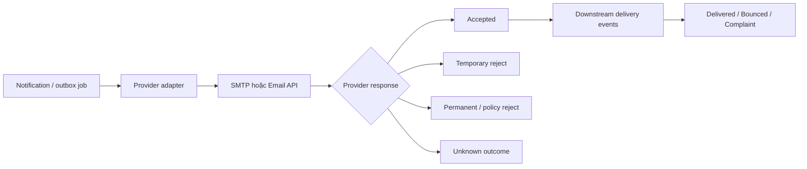
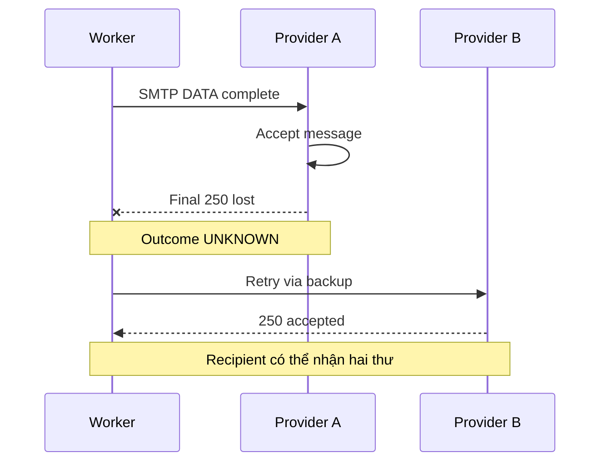
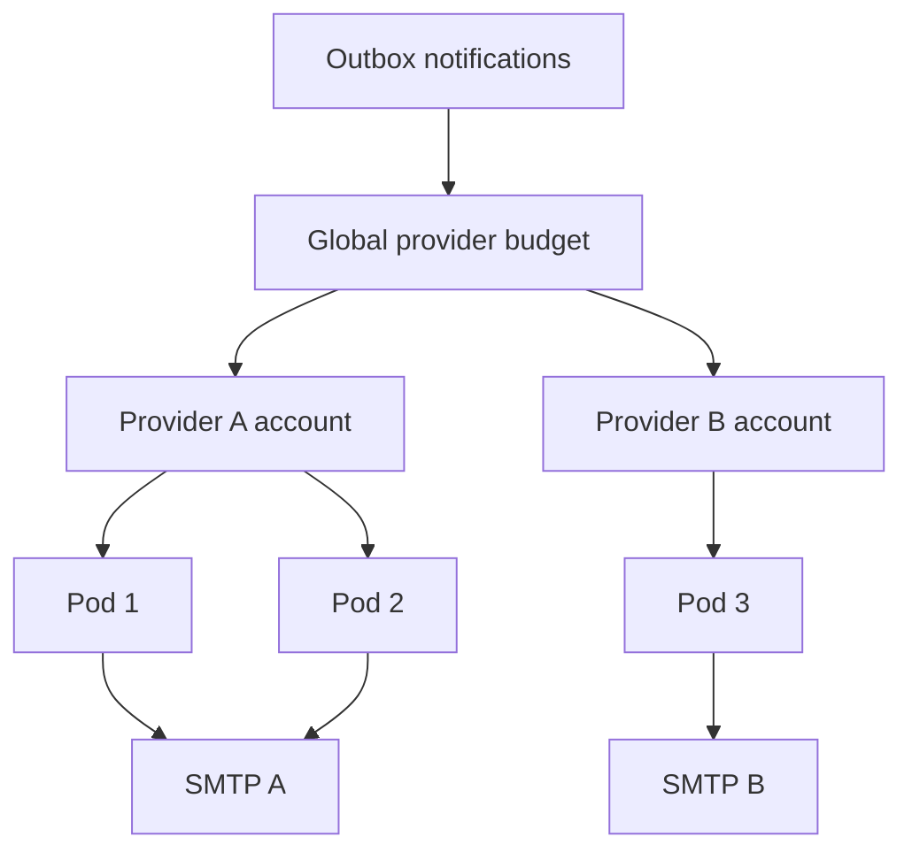

# Khác biệt mã lỗi và giới hạn giữa nhà cung cấp

Một ứng dụng Spring Framework Mail có thể gửi email qua nhiều SMTP relay hoặc dịch vụ email: một provider chuyên giao dịch, một provider phục vụ chiến dịch, một relay của doanh nghiệp hoặc một dịch vụ dự phòng. Về mặt API, thao tác trông giống nhau: tạo `MimeMessage`, gọi `JavaMailSender.send(...)` và xử lý `MailException`. Nhưng khi vận hành thật, **hai nhà cung cấp không nhất thiết có cùng chính sách trả mã lỗi, giới hạn tốc độ, cách xác thực, sender identity, hành vi retry hay cách báo delivery**.

Ví dụ, cùng một hành vi bị hạn chế tốc độ, provider A có thể từ chối tạm bằng SMTP `421`, provider B trả `451 4.7.0`, provider C từ chối một recipient bằng `452` kèm thông điệp quota, còn nhà cung cấp API trả HTTP `429` với thời điểm có thể thử lại. Kết quả nghiệp vụ có thể đều là “tạm thời không được tiếp nhận”, nhưng **mã và dữ liệu kỹ thuật không giống nhau**. Ngược lại, cùng một mã `550` có thể biểu thị recipient không tồn tại, sender chưa được cấp quyền, hoặc một chính sách chống lạm dụng; không nên tự động đưa mọi recipient có `550` vào suppression list.

Để xây hệ thống mail dùng nhiều nhà cung cấp đáng tin cậy, cần một kiến trúc gồm hai lớp:

1. **Provider adapter** hiểu ngôn ngữ kỹ thuật và giới hạn của từng SMTP relay/API.
2. **Ứng dụng** nhận một outcome chuẩn hóa để quyết định retry, chuyển provider, ghi outbox, cảnh báo hoặc cần can thiệp.

Bài học thuộc chương *Nhiều nhà cung cấp* của Spring Framework Mail, tập trung trực tiếp vào **khác biệt mã lỗi và giới hạn giữa nhà cung cấp**: cách đọc SMTP primary/enhanced status code, lỗi provider-specific, quota, rate/concurrency, kích thước, sandbox, sender verification, cấu hình `JavaMailSender` theo provider, phân loại lỗi, chuyển tuyến, retry/failover an toàn, observability và kiểm thử hợp đồng. Các ví dụ minh họa dùng Java 21, Spring Framework 6.x / Spring Boot 3.x và Jakarta Mail; giá trị giới hạn chỉ là giả định để học cách tính, **không phải hạn mức hiện hành của bất kỳ nhà cung cấp cụ thể nào**.

## 1. “Cùng SMTP” không có nghĩa “cùng chính sách”

SMTP xác định các command và nhóm phản hồi mà các hệ thống hiểu được. Nhưng nhiều khía cạnh thuộc cấu hình hoặc quyết định của provider:

| Khía cạnh | Điểm tương đối chuẩn hóa | Điểm có thể khác nhau |
|---|---|---|
| SMTP command | EHLO, STARTTLS, AUTH, MAIL FROM, RCPT TO, DATA | Extension hỗ trợ, yêu cầu command, policy tại từng pha |
| Primary reply code | Ba chữ số, nhóm 2xx/3xx/4xx/5xx | Chọn mã cụ thể cho quota, sender restriction, recipient rejection |
| Enhanced status code | Dạng `x.y.z` giúp diễn giải nhóm nguyên nhân | Mã mở rộng mà provider dùng và mức độ chi tiết |
| Nội dung reply | Dòng mô tả sau mã | Ngôn ngữ, mã nội bộ, URL hướng dẫn, queue ID |
| AUTH | Cơ chế SMTP AUTH được thỏa thuận | Password, app password, OAuth, token, IP allowlist |
| TLS | STARTTLS/implicit TLS tùy endpoint | Port, mức TLS yêu cầu, hostname và certificate policy |
| Giới hạn gửi | Không có một “quota SMTP” chung của toàn Internet | Connections, messages/s, recipients/s, ngày, size, burst, tenant |
| Sender identity | MAIL FROM, header From, DKIM/DMARC | Domain verification, custom return-path, sender pool |
| Tiếp nhận thành công | SMTP relay thường trả `250` sau DATA | ID, tracking, độ trễ webhook, suppression |
| Hậu giao | Delivery/bounce/complaint có thể quan sát qua hệ thống bổ sung | Event schema, trạng thái, webhook signature, dashboard và retention |

Một adapter đúng không cố biến mọi provider thành giống nhau ở tầng wire protocol. Nó **giữ lại thông tin gốc đủ để điều tra** và đồng thời xuất ra **ngữ nghĩa ổn định** để ứng dụng ra quyết định.

### 1.1. Phân biệt ba lớp kết quả



- **Attempt outcome:** lời gọi SMTP/API đã được tiếp nhận, bị từ chối hay không biết chắc?
- **Notification status:** intent trong outbox là QUEUED, SENDING, SENT, FAILED hay DEAD_LETTER?
- **Downstream delivery status:** provider hoặc mailbox đích đã giao, hoãn, bounce, complaint hay chưa có thông tin?

Không lấy `JavaMailSender.send(...)` trả bình thường để gán `DELIVERED_TO_INBOX`. Khi SMTP relay trả `250` cuối sau DATA, điều có thể ghi nhận là **relay accepted ở ranh giới submit**. Nó chưa bảo đảm downstream hay inbox placement.

## 2. Đọc primary SMTP reply code trước

Phần lớn phản hồi SMTP bắt đầu bằng ba chữ số. Chữ số đầu có ý nghĩa chung:

| Nhóm | Ý nghĩa ở mức SMTP | Định hướng ban đầu |
|---|---|---|
| `2xx` | Command được chấp nhận/hoàn tất | Tiếp tục pha tiếp theo hoặc ghi nhận accepted nếu đúng sau DATA |
| `3xx` | Server yêu cầu client tiếp tục cung cấp thông tin | Chưa phải kết quả cuối của message |
| `4xx` | Thất bại tạm thời | Xem retry với backoff, TTL, quota và error cause |
| `5xx` | Không thể hoàn tất request hiện tại | Phân biệt recipient, sender, policy, config; không retry nguyên xi vô hạn |

**Không thể quyết định nghiệp vụ chỉ bằng chữ số đầu.** Ví dụ provider có thể trả 4xx khi bảo trì, nhưng cũng có thể dùng nó cho quota kéo dài hàng giờ. Một mã 5xx có thể yêu cầu sửa sender configuration trước khi gửi lại; nó không nhất thiết nói email người nhận không tồn tại.

### 2.1. Cùng mã, khác pha

Trong một SMTP session:

```text
S: 220 smtp.provider.test ESMTP
C: EHLO mail-app.example.test
S: 250-SIZE 26214400
S: 250 STARTTLS
C: MAIL FROM:<bounce@example.test>
S: 250 2.1.0 Sender accepted
C: RCPT TO:<recipient@example.test>
S: 250 2.1.5 Recipient accepted
C: DATA
S: 354 Start mail input
C: [MIME bytes omitted]
S: 250 2.0.0 Message queued
```

Đây là transcript minh họa đã lọc dữ liệu; `C:`/`S:` là ký hiệu thêm để dễ đọc.

Một dòng `250` trả lời EHLO, MAIL FROM hoặc RCPT TO **không có cùng ý nghĩa** với `250` sau khi DATA kết thúc. Và `354` chỉ báo được bắt đầu DATA, không phải cuối cùng đã accepted.

### 2.2. Những reply code thường gặp

| Code | Ngữ cảnh phổ biến | Điều cần xác minh |
|---|---|---|
| `220` | Server ready hoặc sẵn sàng bắt đầu TLS | Vị trí trong phiên |
| `221` | Server đóng session | Đóng bình thường hay sau lỗi? |
| `235` | Xác thực thành công | AUTH trong session hiện tại |
| `250` | Command accepted | Pha nào? Có phải sau DATA không? |
| `354` | Client được bắt đầu gửi DATA | Chưa có kết quả cuối |
| `421` | Service unavailable/closing connection | Relay quá tải, maintenance, connection policy |
| `450` | Mailbox/action tạm không khả dụng | Retry window, recipient state |
| `451` | Lỗi xử lý tạm thời | Provider outage, throttling, greylisting, policy |
| `452` | Thiếu capacity hoặc giới hạn tạm | Quota, recipient count, provider-specific reason |
| `530` | Authentication hoặc một điều kiện policy cần được đáp ứng | AUTH/TLS/permission theo pha |
| `535` | Authentication bị từ chối | Credentials, cơ chế AUTH, account state |
| `550` | Mailbox/policy rejection | Enhanced code: địa chỉ, sender, relaying hay policy? |
| `552` | Giới hạn storage/message size | Kích thước MIME, quota |
| `553` | Address/mailbox name không được chấp nhận | Address syntax, sender/recipient policy |
| `554` | Transaction/policy refusal | Content, filter hoặc relay rules |

Thông điệp của provider và enhanced code là bằng chứng quan trọng để hiểu từng mã. Bảng trên là **cách hiểu thường gặp**, không phải lời hứa rằng mọi relay sẽ dùng mã giống nhau cho cùng một nguyên nhân.

## 3. Enhanced status code: vì sao cần đọc x.y.z?

Nhiều SMTP relay trả thêm mã mở rộng, ví dụ:

```text
550 5.1.1 Recipient address rejected
550 5.7.1 Relaying denied
451 4.3.0 Temporary server problem
421 4.7.0 Rate limit temporarily exceeded
```

Mã `5.1.1` hay `4.7.0` là **enhanced status code**; nó phân loại kỹ hơn primary reply. Với tính tương thích, receiver vẫn có thể không trả enhanced code hoặc trả thông điệp provider-specific ngoài cấu trúc chuẩn.

### 3.1. Cùng primary 550, hai hướng xử lý khác nhau

```text
C: RCPT TO:<recipient@example.test>
S: 550 5.1.1 User unknown
```

Thường cần kiểm tra địa chỉ đích và đánh giá có nên suppress theo chính sách không. Nhưng:

```text
C: RCPT TO:<recipient@example.test>
S: 550 5.7.1 Relaying denied
```

thường cần kiểm tra quyền SMTP account, domain đã xác thực, IP allowlist hoặc sender identity. **Suppress recipient ngay** có thể che lỗi cấu hình diện rộng. Hai tình huống đều là 550 nhưng nguyên nhân khác nhau.

### 3.2. 4.7.x không tự có nghĩa “retry ngay”

Một số relay sử dụng mã nhóm `4.7.x` cho policy/rate limit. Nếu account đang bị throttled, retry ngay trên mọi worker có thể tạo retry storm, gia tăng connection và kéo dài thời gian bị giới hạn. Cần provider-specific backoff, phân phối theo account, jitter và khả năng tạm dừng dispatcher.

### 3.3. Mô hình thông tin lỗi không nên chỉ lưu một chuỗi

Thay vì:

```text
error = "Send email failed: 550"
```

nên lưu các field phân biệt:

```text
providerId       = smtp-primary
transport        = SMTP
smtpCommandPhase = RCPT_TO
primaryCode      = 550
enhancedCode     = 5.7.1
safeReason       = RELAY_NOT_AUTHORIZED
attemptId        = ...
occurredAt       = ...
```

Thông tin đầy đủ giúp phân biệt lỗi theo tenant/provider và đưa ra retry action khác nhau. Chuỗi `safeReason` là mã do ứng dụng chuẩn hóa, **không** phải sao chép nguyên `exception.getMessage()` vào log vì message có thể chứa địa chỉ hoặc dữ liệu nhạy cảm.

## 4. Provider-specific message: nguồn thông tin, không phải hợp đồng bất biến

Hai SMTP relay có thể phản hồi khác nhau cho cùng loại lỗi:

```text
# Provider A giả định
451 4.7.0 Temporary throttling; reduce sending rate

# Provider B giả định
421 4.3.2 Too many simultaneous sessions

# Provider C giả định
452 4.2.2 Recipient quota exceeded
```

Các đoạn trên là **kịch bản mô phỏng**, không gán cho nhà cung cấp có tên thật và không phải cam kết về code được trả. Adapter cần đọc:

1. Command phase.
2. Primary SMTP code.
3. Enhanced status code (nếu có).
4. Provider-specific machine-readable code (nếu tài liệu/SDK hỗ trợ).
5. Context account, region, tenant, sender stream.
6. Retry/rate-limit guidance được provider công bố.

Text tự do hữu ích cho điều tra, nhưng provider có thể thay dấu câu, ngôn ngữ, tên sản phẩm hoặc URL; không nên thiết kế tất cả retry logic bằng `message.contains("too many")`.

### 4.1. Tránh regex toàn cục cho mọi provider

Anti-pattern:

```java
if (exception.getMessage().contains("550")) {
    suppressionService.hardBounce(recipient);
}
```

Cách này nguy hiểm vì:

- “550” có thể xuất hiện trong nhiều phần của exception message.
- Một batch có thể có nhiều recipient với các phản hồi khác nhau.
- 550 có thể là sender restriction, relaying denied hoặc content policy.
- Message có thể chứa các nested exceptions, không phải một reply duy nhất.
- Provider có thể thay đổi định dạng text.

Thay vào đó, adapter lấy mã có cấu trúc khi thư viện cung cấp, cộng với phase và provider policy; nếu chưa rõ, phân loại `UNCLASSIFIED` và giữ bằng chứng đã redaction cho vận hành.

## 5. Phân biệt SMTP, email HTTP API và provider webhook

Một công ty có thể dùng nhà cung cấp A qua SMTP, nhà cung cấp B qua REST API, và cả hai đều đẩy delivery events qua webhook. Khi đó có **ba namespace lỗi**:

| Nguồn | Ví dụ | Ý nghĩa cần kiểm tra |
|---|---|---|
| SMTP reply | `451 4.7.0` | Một SMTP command/transaction bị từ chối tạm |
| HTTP status | `429 Too Many Requests` | API request bị rate limit, theo contract endpoint |
| HTTP status | `400/401/403/413` | Validation/auth/permission/payload size; cụ thể theo API |
| Provider error code | `RATE_LIMIT_EXCEEDED` (minh họa) | Mã nội bộ của provider, không phải mã SMTP tiêu chuẩn |
| Webhook event | `delivered`, `bounce`, `complaint` | Kết quả sau khi provider đã nhận request, theo định nghĩa của provider |

**Không map máy móc `HTTP 200` thành `SMTP 250`.** API có thể trả 200/202 nghĩa là request đã được nhận để xử lý; trạng thái downstream vẫn chưa biết. Tương tự, một webhook `delivered` chưa chắc là thư ở Inbox, và event có thể đến trễ/lặp.

### 5.1. Cách ứng dụng chuẩn hóa ở tầng outcome

Có thể trả về:

```text
SUBMISSION_ACCEPTED
TEMPORARY_REJECTION
PERMANENT_REJECTION
AUTH_OR_CONFIGURATION_ERROR
RATE_LIMITED
UNKNOWN_OUTCOME
```

nhưng vẫn lưu source:

```text
sourceTransport = SMTP | HTTP_API
rawCodeType     = SMTP_PRIMARY | HTTP_STATUS | PROVIDER_CODE
rawCode         = ...
providerId      = ...
phase           = ...
```

Đây là cách thống nhất business semantics mà không đánh mất tín hiệu gốc để giải quyết các sự cố khác nhau giữa các nhà cung cấp.

## 6. Giới hạn nhà cung cấp không chỉ có email/ngày

Khi nói “provider A cho 10.000 email/ngày”, vẫn còn rất nhiều giới hạn khác có thể khiến gửi thất bại **trước khi chạm quota ngày**:

| Giới hạn | Đơn vị | Ảnh hưởng tới thiết kế |
|---|---|---|
| Messages per second | Message/giây hoặc request/giây | Token bucket, throttle toàn account |
| Recipients per second | Recipient/giây | Batch nhiều To/Cc/Bcc vẫn tiêu thụ nhiều quota |
| Messages/recipients per ngày | Đơn vị trên rolling/fixed window | Quota accounting, campaign scheduling |
| Concurrent SMTP connections | Số connection đồng thời | Semaphore/connection pool cap |
| Requests per minute | API request/phút | API rate limiter, Retry-After handling |
| Burst capacity | Số request cho phép tăng đột biến ngắn | Burst token bucket |
| Max message size | Byte của MIME hoặc kích thước theo provider định nghĩa | Validate attachment và encoding overhead |
| Recipient count per message | Số To/Cc/Bcc theo SMTP envelope | Batch partition, tránh partial success |
| Attachment count/type | Số lượng/định dạng | MIME validation, alternate delivery |
| Authentication/session policy | Login/account/IP/region | Sender configuration, connection lifecycle |
| Sandbox restriction | Domain/recipient được phép gửi | Test/prod access, verification |
| Domain/sender verification | Domain, From, MAIL FROM, DKIM | DNS + provider registration |
| Event/webhook quota | Throughput và retention event | Receiver backpressure, reconciliation |

Một nhà cung cấp có thể tính limit theo **account, region, sender identity, IP pool hoặc tenant**. Ngưỡng cũng có thể khác giữa tài khoản mới và tài khoản đã được phê duyệt, và có thể điều chỉnh theo tình trạng reputation. Không hardcode một “limit mặc định của hãng” trong chương trình nếu chưa biết tài khoản cụ thể.

### 6.1. Hạn mức theo thời gian và concurrency là hai thứ khác nhau

Giả sử provider thử nghiệm cho phép:

```text
maxConcurrentConnections = 5
messagesPerSecond        = 12
dailyMessageQuota        = 50_000
maxMimeBytes             = 12_000_000
```

**Các giá trị đều giả định.** Một ứng dụng có 5 concurrent connections vẫn có thể vượt 12 messages/giây nếu mỗi connection gửi nhanh. Ngược lại, token bucket 12/s không ngăn 100 connection đang chờ server chậm. Cần cả **rate limiter** và **concurrency cap** nếu provider áp dụng cả hai.

### 6.2. Batching có thể làm sai đơn vị quota

Một email MIME có 1 From và 200 recipients có thể được tính như 1 message ở một phép đo, nhưng là 200 recipients ở quota khác, hoặc bị chặn vì limit recipients/message. Khi lập lịch:

- Đọc contract **đơn vị tính** của provider.
- Phân biệt `messageCount`, `recipientCount` và `attemptCount`.
- Xác định có đếm retry hay failed attempts không.
- Cẩn trọng về Bcc privacy và partial success.

Đừng tối ưu bằng cách gom mọi người nhận vào một Bcc lớn mà không xem quota, rủi ro lộ metadata và khả năng retry theo từng recipient.

### 6.3. Kích thước wire MIME lớn hơn tệp đính kèm gốc

Tệp đính kèm thường được Base64 encode, kèm header/boundary và line folding, làm payload SMTP lớn hơn file gốc. Nếu provider giới hạn 12 MB **MIME message**, file 12 MB gốc có thể đã vượt trần. Khi định nghĩa validation:

- Kiểm tra kích thước file/attachment sớm.
- Dành headroom cho encoding và các phần HTML/inline.
- Xác định provider tính limit trên bytes nào: raw payload hay encoded MIME.
- Không đọc toàn bộ attachment khổng lồ vào RAM chỉ để “thử xem relay có nhận”.
- Với tài liệu lớn, cân nhắc link HTTPS có xác thực thay vì attachment, nếu phù hợp nghiệp vụ và bảo mật.

## 7. Giới hạn có thể khác theo tài khoản, vùng và giai đoạn vận hành

Ví dụ cùng một provider:

```text
account=trial    region=R1  sandbox=true  quota=Q1
account=paid     region=R1  sandbox=false quota=Q2
account=paid     region=R2  sandbox=false quota=Q3
```

Không nên giả định `Q2 = Q3` hoặc tài khoản vừa chuyển sang production lập tức có quota mong muốn. Những giá trị cần lấy từ cấu hình/quản trị/account telemetry thực tế, được cập nhật theo chính sách provider.

### 7.1. Sandbox không tương đương production

Một số dịch vụ giới hạn sandbox chỉ được gửi tới verified recipients hoặc domains. Test gửi thành công tới một địa chỉ đã xác minh không chứng minh rằng production access được mở cho mọi recipient. Khi chuyển môi trường, cần kiểm tra:

1. Sender identity/domain đã verify chưa?
2. Giới hạn account hiện hành là gì?
3. Region/provider endpoint có thay đổi không?
4. Permission của API key/SMTP credential có đúng không?
5. Có yêu cầu domain DNS, DKIM hoặc custom MAIL FROM riêng không?
6. Provider có giới hạn đối với tài khoản mới hoặc warm-up không?

### 7.2. Không suy hạn mức từ thông điệp lỗi đơn lẻ

Nếu provider trả `421` “temporarily throttled”, điều đó không chứng minh quota cố định là 10/s. Throttle có thể mang tính động theo IP, domain nhận, volume, danh tiếng hoặc trạng thái hệ thống. Nên kết hợp tài liệu, dashboard và telemetry thay vì suy ra quota chính thức từ một lần lỗi.

## 8. AUTH, TLS và sender verification giữa các provider

Cùng `JavaMailSenderImpl` không có nghĩa mọi SMTP endpoint đều dùng chung:

- Cổng 587 với STARTTLS và SMTP AUTH.
- Cổng 465 với implicit TLS.
- Username/password SMTP, application password hoặc token riêng.
- Cơ chế OAuth/SASL theo khả năng provider/client.
- Relay dựa vào IP allowlist trong mạng tin cậy.
- Domain/sender identity đã được xác minh.
- Quyền gửi bằng một header `From` hoặc envelope `MAIL FROM` cụ thể.

Không nên suy ra “AUTH thành công thì gửi được mọi địa chỉ From”. Một provider có thể xác thực account ở AUTH, nhưng từ chối `MAIL FROM` vì chưa verify domain.

### 8.1. AUTH thành công, MAIL FROM vẫn thất bại

```text
C: AUTH [REDACTED]
S: 235 2.7.0 Authentication successful
C: MAIL FROM:<billing@example.test>
S: 550 5.7.1 Sender not authorized
```

Ở đây, **không có bằng chứng password sai** khi AUTH đã thành công. Cần xem sender registration, verified domain, custom MAIL FROM, policy account hoặc IP. Không sửa bằng cách retry cùng message liên tục.

### 8.2. STARTTLS khác implicit TLS

| Cách kết nối | Cổng thường gặp | Đặc điểm |
|---|---:|---|
| SMTP submission + STARTTLS | 587 | Bắt đầu với SMTP rồi nâng cấp TLS |
| SMTP submission + implicit TLS | 465 | TLS handshake ngay sau TCP connect |
| SMTP relay/server-to-server | 25 | Chính sách STARTTLS tùy endpoint, cloud có thể chặn egress |
| Endpoint riêng | Tùy provider | Theo tài liệu, không tự suy TLS mode từ port |

Với STARTTLS bắt buộc:

```properties
mail.smtp.starttls.enable=true
mail.smtp.starttls.required=true
```

Với implicit TLS trong Jakarta Mail SMTP provider thông dụng:

```properties
mail.smtp.ssl.enable=true
```

Không bật ngẫu nhiên cả hai mode rồi coi lỗi là “SMTP server down”. Cần cấu hình certificate validation và hostname verification phù hợp. Không tắt kiểm tra TLS trong production để “chữa” lỗi một provider.

### 8.3. AUTH failure là lỗi cấu hình/tài khoản

Provider có thể dùng `530`, `535` hoặc lỗi khác tùy pha và policy. Khi lỗi xảy ra diện rộng, có thể liên quan account bị khóa, secret rotation, phương thức AUTH, yêu cầu TLS hoặc provider outage. **Đừng suppress recipient** và đừng retry từng email không giới hạn.

Không ghi raw AUTH exchange. Dữ liệu dạng Base64 không được coi là bảo mật; Jakarta Mail protocol debug có thể in ra stdout ngoài SLF4J. Chỉ bật debug có kiểm soát và không ghi credential.

### 8.4. SPF, DKIM, DMARC phải được thiết lập ở cả tuyến mới

Provider A có thể ký DKIM bằng `d=example.test`, trong khi provider B ban đầu chỉ ký bằng domain chung của provider. Hai email đều SMTP accepted, nhưng alignment của DKIM với header From có thể khác.

- SPF liên quan nguồn gửi cho envelope domain.
- DKIM liên quan signing domain `d=` và chữ ký hợp lệ.
- DMARC yêu cầu SPF hoặc DKIM **pass và aligned** với header From.

Khi chuyển provider, kiểm tra SPF (nếu envelope domain/nguồn gửi đổi), DKIM selector/key, custom MAIL FROM và DMARC alignment. Chỉ thay `spring.mail.host` không hoàn thành migration sender identity.

## 9. Cấu hình SMTP riêng cho từng provider

Một cấu hình nhiều provider cần thể hiện endpoint, security mode, timeouts và limits **độc lập**:

```yaml
app:
  mail:
    providers:
      primary:
        host: smtp-primary.example.test
        port: 587
        username: ${MAIL_PRIMARY_USERNAME}
        password: ${MAIL_PRIMARY_PASSWORD}
        tls-mode: STARTTLS_REQUIRED
        envelope-from: bounce@example.test
        connect-timeout-ms: 5000
        read-timeout-ms: 10000
        write-timeout-ms: 10000
        max-connections: 4
        messages-per-second: 8
      backup:
        host: smtp-backup.example.test
        port: 465
        username: ${MAIL_BACKUP_USERNAME}
        password: ${MAIL_BACKUP_PASSWORD}
        tls-mode: IMPLICIT_TLS
        envelope-from: bounce-backup@example.test
        connect-timeout-ms: 7000
        read-timeout-ms: 12000
        write-timeout-ms: 12000
        max-connections: 2
        messages-per-second: 4
```

Các host, timeouts và quota trên đều là **giá trị giả định**. Namespace `app.mail.providers` là custom configuration do ứng dụng định nghĩa, không tự được Spring Boot biến thành nhiều sender nếu chưa viết binding/factory tương ứng.

### 9.1. Không mutate một JavaMailSender singleton cho mọi provider

Anti-pattern nguy hiểm là thay `setHost(...)`, `setUsername(...)` và JavaMail properties trên cùng một sender đang được nhiều request dùng. Hai thread có thể đua nhau chỉnh cấu hình, làm tenant A gửi nhầm qua account B.

Nên:

- Tạo sender riêng theo provider/account, cấu hình cố định sau khởi tạo.
- Giữ các sender trong registry và chọn theo policy đã xác thực.
- Không cho HTTP client tùy ý chỉ định provider có credential của tenant khác.
- Khi rotate secret, thay cấu hình/sender theo cơ chế rollout/version, không sửa ngẫu nhiên lúc đang gửi.
- Tách rate limiter/concurrency cap theo account của provider, không chỉ theo sender object.

### 9.2. Factory ví dụ cho hai TLS mode

```java
package com.example.mail.provider;

public enum SmtpTlsMode {
    STARTTLS_REQUIRED,
    IMPLICIT_TLS
}

public record SmtpProviderSettings(
        String id,
        String host,
        int port,
        String username,
        String password,
        String envelopeFrom,
        SmtpTlsMode tlsMode,
        int connectTimeoutMs,
        int readTimeoutMs,
        int writeTimeoutMs
) {}
```

```java
package com.example.mail.provider;

import java.util.Properties;
import org.springframework.mail.javamail.JavaMailSenderImpl;

public final class SmtpSenderFactory {

    private SmtpSenderFactory() {}

    public static JavaMailSenderImpl create(SmtpProviderSettings cfg) {
        JavaMailSenderImpl sender = new JavaMailSenderImpl();
        sender.setHost(cfg.host());
        sender.setPort(cfg.port());
        sender.setProtocol("smtp");
        sender.setUsername(cfg.username());
        sender.setPassword(cfg.password());
        sender.setDefaultEncoding("UTF-8");

        Properties p = sender.getJavaMailProperties();
        p.put("mail.smtp.auth", "true");
        p.put("mail.smtp.connectiontimeout",
                Integer.toString(cfg.connectTimeoutMs()));
        p.put("mail.smtp.timeout",
                Integer.toString(cfg.readTimeoutMs()));
        p.put("mail.smtp.writetimeout",
                Integer.toString(cfg.writeTimeoutMs()));
        p.put("mail.smtp.ssl.checkserveridentity", "true");

        if (cfg.tlsMode() == SmtpTlsMode.STARTTLS_REQUIRED) {
            p.put("mail.smtp.starttls.enable", "true");
            p.put("mail.smtp.starttls.required", "true");
            p.put("mail.smtp.ssl.enable", "false");
        } else {
            p.put("mail.smtp.starttls.enable", "false");
            p.put("mail.smtp.ssl.enable", "true");
        }

        if (cfg.envelopeFrom() != null
                && !cfg.envelopeFrom().isBlank()) {
            p.put("mail.smtp.from", cfg.envelopeFrom());
        }

        return sender;
    }
}
```

Ví dụ dành cho các endpoint dùng username/password SMTP. Provider sử dụng IP authentication, OAuth hoặc HTTP API cần một adapter/factory khác; không hardcode `mail.smtp.auth=true` cho mọi endpoint.

Các JavaMail properties như `mail.smtp.from` và `mail.smtp.ssl.checkserveridentity` phụ thuộc implementation. Một managed service có thể quản lý custom MAIL FROM ở dashboard thay vì cho client tự chọn. Luôn kiểm tra behavior thực với provider.

### 9.3. Registry thay vì biến global cấu hình

```java
package com.example.mail.provider;

import java.util.Map;
import org.springframework.mail.javamail.JavaMailSender;

public final class MailSenderRegistry {

    private final Map<String, JavaMailSender> senders;

    public MailSenderRegistry(Map<String, JavaMailSender> senders) {
        this.senders = Map.copyOf(senders);
    }

    public JavaMailSender require(String providerId) {
        JavaMailSender sender = senders.get(providerId);
        if (sender == null) {
            throw new IllegalArgumentException(
                    "Unknown mail provider id");
        }
        return sender;
    }
}
```

Registry có thể được dựng từ các `@Bean` hoặc cấu hình custom. Với nhiều `JavaMailSender` beans, injection cần `@Qualifier`/registry rõ ràng và xem điều kiện Spring Boot mail auto-configuration. Provider ID phải được chọn bởi policy tin cậy của server, không nhận tùy tiện từ input người dùng.

### 9.4. Những cấu hình nào cần cập nhật nhanh?

Rate limit, connection cap và circuit breaker có thể được điều chỉnh khi provider thông báo tăng/giảm quota. Host, TLS policy và credentials thường cần quản lý qua secret manager và rollout có audit. Không cho một lỗi response text từ endpoint bên ngoài tự thay đổi cấu hình global không giới hạn.

## 10. Tạo mô hình lỗi chuẩn hóa

Business service không nên tự tìm chuỗi `"550"` trong mọi `MailSendException`. Provider adapter nên trả một outcome có ý nghĩa nhưng vẫn giữ provider ID và mã gốc.

```java
package com.example.mail.provider;

public enum MailErrorCategory {
    RECIPIENT_INVALID,
    SENDER_NOT_AUTHORIZED,
    AUTH_CONFIGURATION,
    RATE_LIMITED,
    TEMPORARY_PROVIDER_FAILURE,
    PERMANENT_PROVIDER_REJECTION,
    MESSAGE_TOO_LARGE,
    CONTENT_POLICY_REJECTION,
    CONNECTION_OR_TLS,
    UNKNOWN_OUTCOME,
    UNCLASSIFIED
}

public enum SmtpPhase {
    CONNECT, EHLO, STARTTLS, AUTH,
    MAIL_FROM, RCPT_TO, DATA, AFTER_DATA, UNKNOWN
}

public record SmtpFailureObservation(
        String providerId,
        SmtpPhase phase,
        Integer primaryCode,
        String enhancedCode,
        String safeProviderCode
) {}

public record MailFailureDecision(
        MailErrorCategory category,
        boolean retryable,
        boolean suppressRecipient,
        boolean requireOperatorReview
) {}
```

`primaryCode` có thể null nếu failure ở DNS, network hoặc TLS trước khi nhận reply SMTP. `safeProviderCode` là mã đã được kiểm tra/chuẩn hóa, không phải response text thô chứa địa chỉ.

### 10.1. Bộ quy tắc khởi đầu theo bằng chứng

```java
public final class BasicSmtpFailureClassifier {

    public MailFailureDecision classify(SmtpFailureObservation o) {
        Integer code = o.primaryCode();
        String enhanced = o.enhancedCode();

        if (o.phase() == SmtpPhase.RCPT_TO
                && Integer.valueOf(550).equals(code)
                && "5.1.1".equals(enhanced)) {
            return new MailFailureDecision(
                    MailErrorCategory.RECIPIENT_INVALID,
                    false, true, false);
        }

        if (o.phase() == SmtpPhase.AUTH
                && Integer.valueOf(535).equals(code)) {
            return new MailFailureDecision(
                    MailErrorCategory.AUTH_CONFIGURATION,
                    false, false, true);
        }

        if (code != null
                && code / 100 == 4
                && "4.7.0".equals(enhanced)) {
            return new MailFailureDecision(
                    MailErrorCategory.RATE_LIMITED,
                    true, false, false);
        }

        if (code != null && code / 100 == 4) {
            return new MailFailureDecision(
                    MailErrorCategory.TEMPORARY_PROVIDER_FAILURE,
                    true, false, false);
        }

        if (code != null && code / 100 == 5) {
            return new MailFailureDecision(
                    MailErrorCategory.PERMANENT_PROVIDER_REJECTION,
                    false, false, true);
        }

        return new MailFailureDecision(
                MailErrorCategory.UNCLASSIFIED,
                false, false, true);
    }
}
```

Đây chỉ là classifier **minh họa các case có bằng chứng**. Nó không suppress mọi mã 550, không suppress khi AUTH fail và không tự suy phase từ exception message. Ngay cả mã 4.7.0 có thể có ngữ nghĩa khác nhau theo provider: adapter nên cho phép rule cụ thể ghi đè, và một lỗi chưa hiểu phải đi vào `UNCLASSIFIED` thay vì hành động phá hủy dữ liệu.

### 10.2. Timeout sau DATA không phải “SMTP 4xx”

Nếu socket mất sau khi gửi DATA nhưng trước khi nhận reply cuối, không có SMTP code để đưa vào classifier trên. Kết quả có thể `UNKNOWN_OUTCOME`:

```text
phase           = AFTER_DATA
primaryCode     = null
category        = UNKNOWN_OUTCOME
retryable       = depends on duplicate-risk policy
```

Chỉ gán `AFTER_DATA` khi có bằng chứng từ instrumentation hoặc trace. Một `SocketTimeoutException` đơn lẻ có thể xảy ra ở EHLO, AUTH, RCPT hoặc DATA; nếu không rõ, giữ `phase=UNKNOWN`.

### 10.3. Thêm phạm vi lỗi vào quyết định

| Scope | Ví dụ | Hành động |
|---|---|---|
| Recipient | Địa chỉ đích không tồn tại theo bằng chứng rõ | Suppress đúng recipient |
| Message | MIME quá lớn | Sửa payload, không retry nguyên message |
| Sender/domain | From domain chưa verify | Dừng stream đó, sửa identity |
| Account | Quota hết, credentials bị khóa | Pause account, thông báo vận hành |
| Provider/region | Outage có bằng chứng | Circuit breaker và failover có điều kiện |
| Application/DB | Không commit được trạng thái sau accepted | Recovery/persistence, không quy lỗi SMTP |

Một boolean `retryable` chưa đủ nếu lỗi ảnh hưởng mọi recipient của cùng account. Chính sách retry cần scope và mã nguyên nhân.

## 11. Spring Mail exception không đồng nhất theo provider

Spring sử dụng `MailException` và các subclass như `MailAuthenticationException`, `MailSendException`, `MailParseException`, `MailPreparationException`. Với Jakarta Mail, nested `MessagingException` có thể chứa cause qua `getCause()` và exception tiếp qua `getNextException()`.

Provider SMTP implementation còn có thể đưa ra các subclass chuyên biệt giữ reply code/failed address; package/type có thể khác giữa các phiên bản JavaMail cũ và Jakarta Mail/Angus.

Adapter nên:

1. Xác định outer exception class.
2. Duyệt cause chain; với MessagingException, cân nhắc next-exception chain và tránh lặp vô hạn.
3. Lấy mã SMTP có cấu trúc qua API implementation khi hỗ trợ.
4. Gắn provider ID, phase, account/tenant scope và error category.
5. Fallback `UNCLASSIFIED` nếu không có đủ thông tin; không đoán từ message text.

### 11.1. FailedMessages không phải bảng recipient outcome đầy đủ

`MailSendException.getFailedMessages()` có thể cung cấp mapping message → exception khi gửi nhiều message. Nó không mặc định là toàn bộ trạng thái của từng `RCPT TO`. Với một MIME message nhiều recipient, cần đọc nested `SendFailedException`/provider-specific details theo semantics thực tế.

Không dump map này ra log: key có thể là `MimeMessage` chứa header/body/địa chỉ. Với yêu cầu retry chính xác theo recipient, thường dễ thiết kế một notification/outbox row cho mỗi recipient.

### 11.2. Phụ thuộc phiên bản ở đúng chỗ

Nếu provider Jakarta Mail đổi namespace/class giữa các release, code `instanceof` trong application service có thể gãy. Hãy cô lập logic đó ở adapter có contract tests và đường fallback, không rải package implementation SMTP khắp tầng nghiệp vụ.

## 12. Ma trận quyết định: retry, sửa cấu hình, pause hay chuyển provider?

Một chính sách đáng tin cần xem đồng thời **loại lỗi, phạm vi, bằng chứng accepted và khả năng lặp lại an toàn**.

| Tín hiệu | Định hướng ban đầu | Không nên làm |
|---|---|---|
| `550 5.1.1` ở RCPT: recipient rõ ràng không tồn tại | Suppress recipient sau khi xác minh ngữ nghĩa provider | Failover chỉ để gửi tiếp tới địa chỉ đó |
| `550 5.7.1`: sender/relay permission | Sửa domain, account permission, verified sender | Suppress toàn bộ recipients |
| `535` ở AUTH | Pause account, cảnh báo cấu hình/secret | Retry mọi job liên tục |
| `451` temporary | Backoff + jitter, retry trong budget | Giữ worker ngủ hàng phút |
| `421` do concurrent session limit | Giảm concurrent connections, xem provider status | Tăng pool threads |
| `452` quota/throttle theo diễn giải provider | Chờ quota window hoặc giãn gửi | Retry cùng tốc độ |
| `552` message too large | Giảm attachment hoặc gửi link phù hợp | Retry cùng payload vô hạn |
| `554` content/policy refusal | Điều tra policy, nội dung, sender trust | Chuyển provider để né chính sách |
| TLS certificate/hostname failure | Sửa endpoint, truststore, TLS mode | Tắt certificate validation |
| Connection refused trước SMTP handshake | Retry có backoff, xét failover có điều kiện | Kết luận recipient sai |
| Timeout sau DATA, chưa nhận phản hồi cuối | Ghi `UNKNOWN_OUTCOME`, cân nhắc reconciliation | Khẳng định chắc chắn chưa gửi |
| SMTP `250` cuối sau DATA | Ghi accepted, theo dõi downstream | Retry vì người nhận chưa thấy Inbox |

Bảng chỉ là **định hướng**. `421` có thể do maintenance chứ không phải connection limit; `550` có thể mang nhiều nghĩa. Hãy đọc enhanced code và chính sách provider trước quyết định có tác động mạnh như suppression.

### 12.1. Retry budget và job TTL

Một outbox job cần lưu:

```text
notificationId      = N-177
status              = QUEUED
attempts            = 2
nextAttemptAt       = 2026-11-12T14:40:00Z
expiresAt           = 2026-11-12T16:00:00Z
lastProviderId      = primary
lastOutcome         = TEMPORARY_REJECTION
```

Max attempts và TTL khác nhau theo nghiệp vụ: mã xác minh có thể hết hạn nhanh; biên nhận có thể cần gửi lại sau outage; marketing có thể bị pause khi thiếu consent hoặc quota. Không dùng một retry policy bất biến cho mọi loại email.

### 12.2. Backoff có jitter

Ví dụ lịch retry giả định:

```text
Attempt 1: 451 -> khoảng 30 giây
Attempt 2: 451 -> khoảng 60 giây
Attempt 3: 451 -> khoảng 120 giây
Attempt 4: 451 -> khoảng 240 giây
```

Giới hạn thời gian chờ tối đa, thêm jitter và dừng khi quá budget/TTL. Khi provider có retry-after guidance đáng tin (chẳng hạn header của HTTP API hoặc thông báo quota chính thức), kết hợp để điều chỉnh. **Không dùng `Thread.sleep` để giữ worker SMTP chờ retry**: ghi `nextAttemptAt` rồi giải phóng thread.

### 12.3. Rate-limited có thể kéo dài cả account

Nếu quota theo ngày đã cạn, backoff vài giây sẽ dẫn tới nhiều attempts vô ích. Provider adapter hoặc scheduler có thể:

- Đặt `accountPauseUntil`.
- Giảm tốc limiter cấp provider/account.
- Dời `nextAttemptAt` của job chưa gửi.
- Theo dõi backlog và tuổi job theo SLA.
- Dành quota còn lại cho transactional mail nếu contract cho phép.

Restart pod không reset quota của provider. Không cố mở thêm connection hoặc chuyển account chỉ để né hạn chế chống lạm dụng.

## 13. Failover không phải “gặp exception thì gửi qua B”

Một lỗi từ `JavaMailSender.send(...)` không phải lúc nào cũng chứng minh relay chưa nhận message.

### 13.1. Khi có thể cân nhắc failover

- Không kết nối được endpoint trước SMTP transaction và có bằng chứng chưa submit.
- Provider primary outage rõ ràng, backup đã cấu hình và được phép gửi.
- Provider có quota tạm cạn, backup có quota hợp lệ và chính sách routing cho phép.
- Circuit breaker ở scope provider/account đang OPEN vì lỗi hạ tầng.

Phải kiểm tra domain authentication, rate quota, sender verification và dữ liệu được phép xử lý tại provider backup. Failover là **quyết định theo notification và policy**, không phải một `catch(Exception)` chung.

### 13.2. Khi không được tự động failover

- Recipient invalid rõ ràng.
- Sender/domain chưa được verify ở cả hai tuyến.
- Message quá lớn hoặc vi phạm nội dung/policy.
- Account bị đình chỉ do spam/complaint.
- AUTH hoặc cấu hình tenant sai.
- Kết quả attempt là `UNKNOWN_OUTCOME` sau DATA, trong khi nghiệp vụ không chấp nhận duplicate.

**Failover không dùng để né chính sách chống spam, bảo mật hoặc consent của provider.** Phải sửa nguồn gốc vấn đề.

### 13.3. Mất phản hồi cuối sau DATA



SMTP không có idempotency toàn Internet. Cùng `Message-ID` hoặc idempotency key ở ứng dụng **không khiến hai SMTP relay độc lập tự deduplicate**. Email API đôi khi có idempotency contract riêng; phải kiểm tra phạm vi key, thời hạn và API behavior trước khi dựa vào nó.

### 13.4. Giữ một notification ID xuyên các attempts

```text
notificationId    = N-177
businessKey       = invoice:42:issued
preferredProvider = primary
attempts:
  A1 primary -> TEMPORARY_REJECTION
  A2 primary -> TEMPORARY_REJECTION
  A3 backup  -> SUBMISSION_ACCEPTED
```

Không tạo ba notification nghiệp vụ khác nhau chỉ vì chuyển provider. Lưu attempt history giúp biết ai đã gửi, tại đâu, mã nào, vì sao chuyển tuyến và có nguy cơ duplicate không.

### 13.5. Backup phải được chuẩn bị trước incident

Không chờ provider A down rồi mới nhận ra B chưa bật DKIM, custom MAIL FROM chưa verify, account còn sandbox, quota quá thấp, credentials hết hạn hoặc không đáp ứng yêu cầu vùng dữ liệu. Test tuyến dự phòng bằng **lưu lượng test nhỏ, được cấp phép**, không tự động đổ toàn backlog production sang một account chưa được kiểm chứng.

## 14. Circuit breaker phải biết scope của lỗi

Circuit breaker có thể ngăn tiếp tục gọi provider đang lỗi, giảm retry storm. Nhưng một recipient `550 5.1.1` đơn lẻ không phải bằng chứng toàn provider down.

| Loại lỗi | Có nên tính vào provider health? |
|---|---|
| TCP connect failure diện rộng | Có |
| Repeated 421/451 diện rộng | Có thể, theo provider policy |
| AUTH fail liên tục | Có ở scope account, thường cần operator |
| Recipient 550 5.1.1 | Không; đây là lỗi recipient |
| Message 552 quá lớn | Không; lỗi message |
| Sender 550 5.7.1 | Scope sender/domain/account |
| Timeout sau DATA | Cẩn trọng, vì outcome có thể UNKNOWN |

Breaker thường có CLOSED, OPEN, HALF_OPEN và cooldown/probe giới hạn. Không biến một đợt recipient rejection thành global outage. Nếu cùng một recipient domain bị trì hoãn nhưng domain khác vẫn nhận bình thường, có thể cần phân tích per-route thay vì ngắt tất cả.

### 14.1. HALF_OPEN probe

Khi circuit sắp mở lại, có thể thử một request nhỏ, có kiểm soát. Không gửi thư thật không được người nhận mong đợi chỉ để health-check; ưu tiên endpoint health hoặc test recipient được cấp quyền. Probe phải tuân thủ quota và TLS/Auth policy giống luồng chính.

## 15. Quota ở cấp cluster, không chỉ một JVM

Giả sử có bốn pod, mỗi pod cấu hình:

```text
mailExecutor maxPoolSize       = 8
local messagesPerSecond limit = 10
```

Toàn cluster có thể tạo tới **32 attempts đồng thời và 40 attempts/giây**, dù SMTP account chỉ được phép 12 messages/giây (giả định). Limiter mỗi JVM chưa đủ cho account chia sẻ.



Có thể chọn distributed rate limiter theo account/region, dispatcher tập trung theo provider, hoặc phân bổ quota tĩnh theo pod khi replica count được kiểm soát. Mỗi cách cần xem trade-off về availability, consistency và coordination failure.

### 15.1. Cần cả rate và concurrency limit

Nếu provider giả định có `messagesPerSecond=12` và `maxConnections=5`, phải đồng thời bảo đảm:

\[
\text{attempts/s} \leq 12,\qquad
\text{active SMTP connections} \leq 5
\]

Rate limiter không bảo đảm chỉ có năm connection khi server chậm. Semaphore không bảo đảm gửi dưới 12/s nếu email rất nhanh. Tách hai loại permit; dispatcher chỉ claim job khi có capacity thay vì giữ hàng nghìn worker đợi token.

### 15.2. Account, tenant và region

Nếu ba tenant dùng cùng provider account, quota account là **tổng** của cả ba. Nếu mỗi tenant có account riêng, khóa quota cần thêm account ID. Mô hình có thể:

```text
providerId + accountId + region + trafficType
```

Tùy provider có thể còn IP pool, sender domain hoặc recipient-domain limit. Không sử dụng password hoặc địa chỉ người nhận làm metric label.

## 16. Khi quota có hạn, loại email nào được ưu tiên?

Một ứng dụng có thể gửi đồng thời:

- OTP/verification: TTL ngắn, người nhận cần sớm.
- Security alert: quan trọng, cần chống trùng và tránh alert storm.
- Hóa đơn/biên nhận: phải gửi đáng tin cậy, có audit.
- Marketing/bulk: thường có thể giãn theo lịch, bắt buộc tôn trọng consent.

Nếu quota còn 100 messages trong một giờ (giả định), không nên cho chiến dịch bulk chiếm hết rồi khiến OTP hết hạn khi chờ. Có thể:

1. Dành quota/reservation cho transactional streams.
2. Đặt lane/priority có fairness để không starve job thường.
3. Đặt rate limiter theo loại mail nhưng vẫn nằm dưới global account limiter.
4. Kiểm tra TTL trước dispatch, không gửi mã xác minh đã hết hạn.
5. Pause bulk khi provider health hoặc quota không đáp ứng.

**Priority không tăng quota.** Nó chỉ thay đổi thứ tự tiêu thụ ngân sách hiện có.

### 16.1. Giới hạn phần quota dành cho retry

Nếu retry chiếm mọi permit, notification mới có thể bị đói tài nguyên. Có thể chia ngân sách cho new attempts và retries, có jitter/backoff và circuit breaker. Nhưng một OTP đã hết hạn không nên được retry thêm chỉ để đạt mục tiêu “gửi thành công”.

### 16.2. Attachment lớn và head-of-line blocking

Một email 20 MB có thể giữ SMTP connection lâu hơn thư text-only. Có thể tách lane theo kích thước nếu có số liệu, giới hạn MIME size và đưa file lớn qua link tải có quyền truy cập. Không chia quá nhiều pool không cần thiết làm tổng số connection vượt trần.

## 17. Partial success: một MIME message, nhiều RCPT TO

Một SMTP transaction có thể có nhiều recipient:

```text
C: RCPT TO:<person-a@example.test>
S: 250 2.1.5 Accepted
C: RCPT TO:<person-b@example.test>
S: 550 5.1.1 User unknown
C: RCPT TO:<person-c@example.test>
S: 451 4.3.0 Temporary error
```

Provider có thể chấp nhận một phần và từ chối phần khác, tùy server, SMTP client và configuration. Không mặc định:

- Có một `550` nghĩa **mọi recipient** đều thất bại.
- Có một `250` nghĩa **mọi recipient** đều được accepted.
- Retry nguyên batch luôn an toàn.

### 17.1. Transport configuration ảnh hưởng partial send

Jakarta Mail SMTP implementation thường có property như `mail.smtp.sendpartial` tác động tới cách xử lý recipient hợp lệ/không hợp lệ. `SendFailedException` hoặc subclass provider-specific có thể chứa danh sách địa chỉ sent/unsent/invalid. Hãy kiểm tra contract của implementation đang dùng và viết integration test có phản hồi RCPT cụ thể.

### 17.2. Một notification cho một recipient

Với email cá nhân hóa và retry chính xác, mô hình dễ vận hành:

```text
notification N1 -> recipient A -> attempt A1 -> ACCEPTED
notification N2 -> recipient B -> attempt B1 -> PERMANENT_REJECT
notification N3 -> recipient C -> attempt C1 -> TEMPORARY_REJECT
```

Retry N3 không cần gửi lại cho A, và suppression B có thể cập nhật riêng. Batching vẫn phù hợp trong vài use case nhưng phải xử lý quota recipient, privacy và partial success.

### 17.3. Failover cho một phần batch

Nếu provider A đã nhận recipient A nhưng tạm từ chối C, chuyển tất cả recipient sang provider B có thể gửi trùng A. Cần lưu kết quả theo từng recipient hoặc tách intent trước khi chuyển tuyến. Nếu phase outcome của A không rõ, không khẳng định các recipient chắc chắn chưa được nhận.

## 18. Webhook delivery, bounce và complaint cũng khác nhau

Hai provider có thể cùng trả SMTP accepted nhưng cung cấp các downstream events khác:

| Thuộc tính | Có thể khác |
|---|---|
| Event name | `delivered`, `delivery`, `deferred`, `bounce`, `complaint`... |
| Timestamp | Unix seconds, milliseconds hoặc ISO 8601 |
| Message ID | ID của provider, ID per recipient hoặc ID per submit |
| Payload schema | JSON field names/nested structure |
| Authentication | HMAC, public-key signature, token hoặc cơ chế riêng |
| Retry | Webhook có thể gửi lại khi receiver trả lỗi hoặc timeout |
| Ordering | Event có thể đến trễ hoặc không theo thứ tự |
| Retention | Thời hạn truy cập event/message trace |
| Delivered semantics | Có thể nghĩa mailbox server accepted, không phải Inbox |

### 18.1. Chuẩn hóa event mà vẫn lưu nguồn

```java
public enum ProviderDeliveryEventType {
    ACCEPTED,
    DEFERRED,
    DELIVERED,
    BOUNCED,
    COMPLAINT,
    UNSUBSCRIBED,
    UNKNOWN
}

public record NormalizedProviderEvent(
        String providerId,
        String providerEventId,
        String providerMessageId,
        String notificationId,
        ProviderDeliveryEventType type,
        java.time.Instant occurredAt,
        String safeReasonCode
) {}
```

`DELIVERED` phải được tài liệu nội bộ định nghĩa theo **provider contract**, không tự đồng nghĩa `INBOX`. Nếu không có event hoặc API lookup, giữ downstream status UNKNOWN. Không tự tạo provider delivered event từ `JavaMailSender.send(...)` trả bình thường.

### 18.2. Xác thực webhook và idempotency

Webhook receiver cần:

- Verify signature đúng scheme của provider, dùng secret/public key riêng.
- Kiểm tra payload size, schema, timestamp/clock skew.
- Dùng providerEventId hoặc khóa tương đương để deduplicate event lặp.
- Xử lý out-of-order events bằng transition policy rõ ràng.
- Liên kết providerMessageId với đúng **attempt**, không chỉ với địa chỉ email.
- Không ghi raw payload có PII/token vào log công khai.
- Không cho webhook chưa xác thực xóa suppression hoặc đảo state.

### 18.3. Bounce và complaint thuộc chính sách khác nhau

Hard bounce recipient thường dẫn tới suppression theo policy; complaint có thể yêu cầu dừng marketing với người đó. Nhưng cách provider phân biệt hard/soft bounce có thể khác nhau. Cần dựa vào code/event được xác thực và chuẩn hóa cẩn thận.

Không suppress cả danh sách khi lỗi là DKIM chưa setup hoặc quota account đã hết. Ngược lại, không bỏ qua spam complaint chỉ vì submission trước đó thành công.

## 19. Một outbox model hỗ trợ nhiều provider

Nên tách ý định gửi mail khỏi một lần gọi SMTP cụ thể:

```text
mail_notification
  id
  tenant_id
  business_key
  message_type
  recipient_ref
  payload_ref
  status
  next_attempt_at
  expires_at

mail_attempt
  id
  notification_id
  attempt_number
  provider_id
  provider_account_id
  transport
  smtp_phase
  smtp_primary_code
  smtp_enhanced_code
  provider_message_id
  normalized_outcome
  started_at
  completed_at
```

Đây là schema ý tưởng, không phải DDL hoàn chỉnh. Mỗi notification có thể có nhiều attempts, gồm cả attempts trên provider khác nhau. Một business key duy nhất theo tenant/nghiệp vụ giúp tránh enqueue trùng, còn attempt ID phân biệt từng lần transport thật sự.

### 19.1. Transactional outbox

Khi phát hành hóa đơn:

1. Transaction nghiệp vụ commit trạng thái hóa đơn **và** outbox intent.
2. Mail dispatcher claim các job đến hạn theo lease/fencing token.
3. Chọn provider dựa trên policy, quota, health và sender verification.
4. Ghi attempt bắt đầu trước transport.
5. Gọi SMTP/API bên ngoài transaction claim.
6. Ghi accepted/rejected/unknown vào attempt và chuyển notification state có điều kiện.
7. Nếu retryable, lưu `nextAttemptAt`, không giữ thread ngủ.

### 19.2. SMTP không tham gia DB transaction

Nếu SMTP accepted nhưng update SENT vào database thất bại, email có thể đã được gửi trong khi trạng thái còn SENDING. Lease expiry có thể cho worker khác retry. **Không có exactly-once SMTP delivery tự động chỉ nhờ transactional outbox.** Cần thiết kế recovery, duplicate-tolerant business semantics và reconciliation phù hợp.

### 19.3. Provider affinity theo notification

Một notification có thể giữ preferred provider từ lúc enqueue, hoặc được chọn tại dispatch. Quyết định nào đúng phụ thuộc yêu cầu routing/region/compliance:

- Affinity giúp điều tra và tránh thay đổi sender identity bất ngờ giữa attempts.
- Dynamic routing tận dụng health/quota nhưng phải ghi lại route decision.
- Không đổi provider giữa hai attempts có outcome UNKNOWN nếu không chấp nhận duplicate risk.
- Provider account/region có thể là phần của data-residency policy.

### 19.4. Không queue quá nhiều dữ liệu nặng

Outbox nên lưu payload reference hoặc DTO cần thiết, không giữ toàn bộ MIME message/attachment bytes trong executor queue RAM. Worker render/đọc attachment khi xử lý, với nguồn có thể mở lại cho retry. Khi chuyển provider, phải đảm bảo content, charset và attachment đáp ứng limit của provider mới.

## 20. Ví dụ routing policy có điều kiện

Một bộ điều phối không nên kiểm tra duy nhất `primaryHealthy ? primary : backup`. Nó cần cả quyền gửi và ngân sách:

```java
public interface ProviderRouter {
    String selectProvider(
            String tenantId,
            String messageType,
            long estimatedMimeBytes,
            String preferredProvider);
}
```

Implementation có thể kiểm tra:

1. Provider có được phép phục vụ tenant/region không?
2. Sender identity có được verify và aligned không?
3. Message có nằm dưới size/recipient quota không?
4. Account có chưa vượt daily quota/rate/concurrency không?
5. Circuit breaker có CLOSED hoặc probe được phép không?
6. Loại message có được provider chấp nhận không?
7. Notification có đang bị khóa route do attempt UNKNOWN không?

Routing decision cần được ghi cùng attempt trước khi gọi provider. Không đưa secret, raw HTML/body hoặc email recipient vào log chỉ để giải thích route.

### 20.1. Khi cả hai provider đều không có quota

Không chọn một provider rồi “hy vọng nó nhận”. Nếu không có capacity:

```text
notification.status = QUEUED
notification.nextAttemptAt = nextPermittedWindow
```

Hoặc trạng thái chờ/quota chuyên biệt nếu ứng dụng định nghĩa. Nếu job sẽ hết hạn trước cửa sổ đó (ví dụ OTP), xử lý expiration theo nghiệp vụ. Không làm đầy executor với task không thể được chấp nhận.

### 20.2. Khi provider A bị policy rejection, provider B vẫn healthy

Nếu message bị chặn do recipient không cho phép, spam/complaint hoặc sender identity không hợp lệ, **không tự chọn B chỉ vì B healthy**. Healthy chỉ nói B có thể hoạt động, không chứng minh hành vi gửi được phép hoặc đúng đắn.

## 21. Observability theo provider, account và error category

Một hệ thống nhiều provider cần số liệu theo từng route:

| Metric/tín hiệu | Câu hỏi |
|---|---|
| Attempts theo provider/account | Tải đang phân bổ ra sao? |
| Accepted rate | Provider nào đang tiếp nhận tốt? |
| 4xx/5xx theo category/phase | Lỗi tạm, policy hay dữ liệu? |
| AUTH/TLS/connection failures | Có lỗi cấu hình hoặc endpoint? |
| p50/p95/p99 SMTP duration | Provider nào chậm hay có tail latency? |
| Concurrent connections | Có chạm trần provider account? |
| Rate limiter denied permits | Quota nào đang bão hòa? |
| Outbox backlog/oldest due age | Delay tới người dùng ra sao? |
| Provider-specific bounce/complaint | Chất lượng gửi và deliverability thế nào? |
| Failover count và reason | Vì sao chuyển tuyến? Có tăng duplicate risk? |
| UNKNOWN outcomes | Khả năng reconciliation và rủi ro duplicate |
| Circuit breaker state | Provider/account nào đang bị pause? |

### 21.1. Structured logging

```text
event=mail_attempt_rejected
notificationId=N-177
attemptId=A-4
providerId=primary
providerAccountId=acct-primary
phase=RCPT_TO
smtpCode=451
enhancedCode=4.7.0
category=RATE_LIMITED
retryAt=2026-11-12T15:00:00Z
```

Đây là ví dụ field đã chuẩn hóa. Không log AUTH token/password, MIME body, URL reset mật khẩu, attachment hay full recipient list. Một exception/provider response có thể chứa địa chỉ hoặc dữ liệu điều tra nhạy cảm; phải redact trước khi lưu.

### 21.2. Tránh metric cardinality cao

Label như `providerId`, `accountGroup`, `smtpPhase`, `errorCategory` có thể hữu ích nếu số giá trị hữu hạn. Tránh dùng notification ID, attempt ID, recipient email hoặc full provider text làm Prometheus label. Chúng làm tăng cardinality và có thể lộ dữ liệu.

### 21.3. So sánh công bằng giữa providers

Một provider chủ yếu xử lý OTP, provider kia xử lý PDF lớn thì so sánh SMTP p95 trực tiếp có thể gây hiểu lầm. Phân đoạn theo loại thư, kích thước, recipient domain và môi trường để tránh quy một workload khác thành “provider B chậm hơn”.

### 21.4. Khi alert cần scope

Mã 550 của một recipient có thể là WARN nghiệp vụ. Nhưng 535 trên mọi attempt của account là incident cấu hình. Một cảnh báo nên dựa vào **tỷ lệ, phạm vi và tác động SLA**, không alert ERROR cho mỗi lần mailbox không tồn tại. Khi quota tạm cạn, giãn dispatcher và quan sát backlog thay vì chỉ tăng số worker.

## 22. Contract tests: bảo đảm adapter hiểu đúng từng provider

Mọi quy tắc provider-specific đều có nguy cơ lỗi thời khi thay SMTP service, nâng cấp thư viện Jakarta Mail hoặc provider điều chỉnh thông điệp. Vì vậy cần **contract tests** kiểm tra adapter từ dữ liệu lỗi đầu vào đến quyết định chuẩn hóa.

### 22.1. Test matrix cho classifier

Ví dụ các dòng test **giả lập**:

| Provider giả định | Phase | Primary/enhanced code | Kết quả mong muốn |
|---|---|---|---|
| A | RCPT_TO | `550 5.1.1` | RECIPIENT_INVALID, không retry, suppress có điều kiện |
| A | RCPT_TO | `550 5.7.1` | PERMANENT/POLICY, không suppress recipient |
| A | AUTH | `535 5.7.8` | AUTH_CONFIGURATION, pause account |
| B | RCPT_TO | `451 4.3.0` | TEMPORARY_PROVIDER_FAILURE, retry backoff |
| B | CONNECT | Không có mã SMTP | CONNECTION_OR_TLS, retry/failover theo bằng chứng |
| B | AFTER_DATA | Không nhận phản hồi cuối | UNKNOWN_OUTCOME, không failover mù |
| C qua HTTP API | N/A | HTTP 429 | RATE_LIMITED, theo quota window |
| C qua HTTP API | N/A | HTTP 403 | Cần đọc provider error code để phân biệt permission/policy |

Không kiểm tra chỉ có `retryable=true` mà bỏ qua `suppressRecipient` hoặc `requireOperatorReview`. Một classifier trả đúng retry nhưng suppress nhầm có thể làm mất email của hàng nghìn người dùng.

### 22.2. JUnit test phân loại hai mã 550

```java
import static org.junit.jupiter.api.Assertions.*;
import org.junit.jupiter.api.Test;

class BasicSmtpFailureClassifierTest {

    private final BasicSmtpFailureClassifier classifier =
            new BasicSmtpFailureClassifier();

    @Test
    void invalidRecipientCanBeSuppressed() {
        SmtpFailureObservation failure = new SmtpFailureObservation(
                "primary", SmtpPhase.RCPT_TO,
                550, "5.1.1", "USER_UNKNOWN");

        MailFailureDecision decision =
                classifier.classify(failure);

        assertEquals(
                MailErrorCategory.RECIPIENT_INVALID,
                decision.category());
        assertFalse(decision.retryable());
        assertTrue(decision.suppressRecipient());
    }

    @Test
    void relayingDeniedMustNotSuppressRecipient() {
        SmtpFailureObservation failure = new SmtpFailureObservation(
                "primary", SmtpPhase.RCPT_TO,
                550, "5.7.1", "RELAYING_DENIED");

        MailFailureDecision decision =
                classifier.classify(failure);

        assertFalse(decision.suppressRecipient());
        assertTrue(decision.requireOperatorReview());
    }
}
```

Test thứ hai đặc biệt hữu ích: nếu một developer “đơn giản hóa” rule thành `all 550 ⇒ invalid recipient`, test sẽ phát hiện nguy cơ suppress sai.

### 22.3. Test provider-specific override

Giả sử provider B có documented machine-readable code chỉ ra account rate limited dù primary/enhanced SMTP code chung. Test cần đảm bảo:

1. Adapter đọc mã theo contract B.
2. Đổi thành RATE_LIMITED ở scope B/account.
3. Không suppress recipient.
4. Áp dụng lịch chờ theo policy B.
5. Provider A với cùng primary code nhưng mã mở rộng khác **không** bị ép dùng rule của B.

Không đưa định dạng text “tình cờ thấy trong production” thành hợp đồng nếu chưa xác minh provider đã tài liệu hóa.

## 23. SMTP integration test thay vì chỉ Mockito

Mockito mock `JavaMailSender` giúp test render/template và nhánh lỗi giả lập, nhưng không kiểm tra server thực sự trả mã gì tại MAIL FROM, RCPT TO hoặc DATA. Integration test cần một SMTP test server chạy thật.

Các lựa chọn:

- **GreenMail:** SMTP server in-process, hữu ích để kiểm tra message được nhận; chọn phiên bản tương thích Jakarta Mail.
- **Mailpit:** SMTP sandbox/container giúp kiểm tra nội dung thư và luồng submit.
- **Scriptable SMTP server/fault injection:** hữu ích để chủ động trả 421/451/550, đóng socket hoặc hoãn response sau DATA.

Không giả định GreenMail/Mailpit mặc định mô phỏng mọi lỗi provider. Một sandbox nhận tất cả recipient vẫn có giá trị kiểm tra MIME/SMTP accepted, nhưng **không** thay thế test rejection/failover.

### 23.1. Test bình thường

1. Cấu hình `JavaMailSenderImpl` thật trỏ tới SMTP server test ở host/port được kiểm soát.
2. Gửi một `MimeMessage` có Unicode, From/To/Subject và attachment giả.
3. Xác nhận server test nhận đúng message.
4. Kiểm tra MIME body, attachment bytes và recipient envelope nếu server hỗ trợ.
5. Xác nhận hệ thống ghi attempt accepted ở provider ID test.

### 23.2. Test AUTH/TLS khác nhau

Tạo hai SMTP endpoints test:

- Endpoint P1 yêu cầu STARTTLS và AUTH.
- Endpoint P2 dùng implicit TLS với certificate test hợp lệ.

Kiểm tra registry/factory chọn đúng TLS mode, credential và cổng; không dùng certificate bypass để làm test pass. Khi account P1 thiếu permission sender, test server có thể từ chối ở MAIL FROM; điều này khác với AUTH fail.

### 23.3. Test lỗi RCPT và DATA

Scripted relay có thể trả:

```text
RCPT TO:<invalid@example.test>
550 5.1.1 Unknown mailbox
```

hoặc:

```text
DATA
354 Continue
[message body]
554 5.7.1 Message rejected
```

Ở cả hai trường hợp, không đánh dấu SUBMISSION_ACCEPTED cho message bị từ chối. Nhưng classifier phải phân biệt recipient invalid với content/policy rejection.

### 23.4. Test timeout outcome UNKNOWN

Scripted SMTP server nhận đầy đủ DATA, sau đó làm mất response cuối. Assert:

- Attempt được ghi là UNKNOWN nếu không có bằng chứng received reply.
- Không tự kết luận NOT_SENT.
- Failover không tự xảy ra nếu duplicate-risk policy cấm.
- Outbox giữ notification intent và attempt history.
- Mọi task kết thúc hoặc được timeout trong thời gian test cho phép.

### 23.5. Test multi-recipient partial success

Cho recipient A accepted, recipient B rejected và recipient C temporary. Quan sát behavior của Jakarta Mail SMTP provider và chính sách `mail.smtp.sendpartial` nếu dùng. Đảm bảo không retry lại recipient A khi retry B/C và không lấy `MailSendException` ở cấp message làm bằng chứng mọi recipient đều failed.

## 24. Kiểm thử quota và dispatcher bằng đồng hồ giả

Để kiểm tra limits, không cần gửi hàng nghìn email thật. Dùng rate limiter/counter giả và clock điều khiển được:

```text
Provider A:
  rateLimit = 5 messages/second
  maxConcurrentConnections = 2

Provider B:
  rateLimit = 3 messages/second
  maxConcurrentConnections = 1

Input:
  20 pending notifications
  4 dispatcher instances
```

Test cần xác nhận:

- Không quá 5 attempts/s tại account A và 3 attempts/s tại B.
- In-flight SMTP sessions không quá 2 tại A và 1 tại B.
- Limit là **global** cho bốn dispatcher instances.
- Nếu không còn permit, job tiếp tục chờ trong outbox, không biến mất.
- Nếu provider trả rate limit, backoff thay đổi schedule thay vì tạo retry storm.
- Job expired theo TTL không được gửi sau hạn.

### 24.1. Không dùng Thread.sleep để test rate

Một test chỉ dùng `Thread.sleep(1000)` rồi đếm gửi có thể flaky trên CI. Ưu tiên virtual clock, deterministic limiter và test scheduler riêng. Với integration test concurrency thực, có thể dùng `CountDownLatch` giữ các tasks để assert permit; có timeout rõ ràng để suite không treo.

### 24.2. Kiểm tra quota account chung qua nhiều instance

Nếu mỗi instance đều cho 5/s mà provider account chỉ có 5/s toàn cluster, test phải phát hiện lỗi tổng 20/s. Một đơn vị test với một JVM sẽ không đủ để xác minh distributed quota. Dùng test coordination backend/distributed limiter với nhiều dispatcher giả lập, hoặc test tích hợp cơ chế phân bổ quota.

## 25. Những tình huống phân tích mẫu

### Tình huống A — Cùng mã 550, nguyên nhân khác nhau

```text
Provider A:
  RCPT TO -> 550 5.1.1 Recipient unknown

Provider B:
  MAIL FROM -> 550 5.7.1 Sender not authorized
```

**Nhận định:** A có thể cần recipient-level suppression nếu phản hồi đáng tin. B cần sửa verified sender/permission. Không đưa cả hai vào một nhánh “hard bounce của recipient”.

### Tình huống B — Provider A throttle, B còn quota

```text
Provider A: 421 4.7.0 temporary throttle
Provider B: healthy, quota available
Notification: invoice-issued, chưa có bằng chứng accepted ở A
```

**Nhận định:** Có thể xét B theo routing policy, sender identity/region và chi phí; nhưng trước hết xác định A đã thật sự từ chối và chưa nhận message. Với quota cạn tạm thời, dời lịch qua A cũng có thể là lựa chọn đúng. Không tạo một failover “mặc định phải gửi ngay” nếu điều đó tăng chi phí hoặc vượt ràng buộc.

### Tình huống C — SMTP accepted, webhook bounce sau

```text
T0: JavaMailSenderImpl -> Provider A -> 250 after DATA
T1: Provider A attempts downstream delivery
T2: Provider A emits BOUNCED event
```

**Nhận định:** T0 là SUBMISSION_ACCEPTED; T2 là downstream failure. Không đổi lịch sử attempt thành “chưa từng gửi”. Cần phân loại bounce theo provider và suppression/retry phù hợp.

### Tình huống D — Backup có message size thấp hơn

```text
MIME size = 11 MiB
Provider A max MIME = 15 MiB
Provider B max MIME = 10 MiB
```

**Nhận định:** Các số đều giả định. Không failover sang B với payload y nguyên; trước routing phải kiểm tra limit kích thước của B hoặc chọn giải pháp khác được nghiệp vụ cho phép (ví dụ link an toàn).

### Tình huống E — Backup ở region không được phép

```text
Primary: allowed region
Backup: healthy nhưng region không nằm trong policy tenant
Primary: temporary outage
```

**Nhận định:** Backup không hợp lệ cho tenant dù kỹ thuật SMTP vẫn hoạt động. Không chuyển dữ liệu cá nhân/hóa đơn sang một route vi phạm data-residency hoặc hợp đồng xử lý dữ liệu; giữ job pending và báo SLA risk.

### Tình huống F — Retry sau DATA gây duplicate

```text
A1 -> Provider A: DATA sent, final response lost
A2 -> Provider B: accepted
Receiver: sees two equivalent emails
```

**Nhận định:** A1 là UNKNOWN, không chắc failed. Cần duplicate-risk policy, reconciliation và idempotency ở tầng nghiệp vụ khi có thể; đừng tuyên bố backup loại bỏ mọi rủi ro.

### Tình huống G — Quota tăng theo account, cấu hình cũ vẫn giới hạn

```text
Provider account quota recently increased
App rate limiter still uses old quota
Observed throughput below approved quota
```

**Nhận định:** Không phải provider chậm hay lỗi. Cần cập nhật cấu hình limiter có kiểm soát, kiểm tra tổng quota nhiều pod và theo dõi tail latency trước khi mở rộng.

### Tình huống H — Provider thay đổi error message

```text
Before:
451 4.7.0 Too many requests

After:
451 4.7.0 Temporarily deferred by policy
```

**Nhận định:** Parser dựa `contains("Too many")` có thể ngừng hoạt động. Rule dựa primary/enhanced code và tài liệu provider bền vững hơn; khi ngữ nghĩa không chắc, fallback safe category rồi điều tra.

## 26. Runbook điều tra lỗi theo provider

Khi số email gửi thất bại tăng, nên dùng cùng một trình tự để không nhầm lỗi account với lỗi recipient:

**Bước 1 — Định danh.** Lấy notification ID, attempt ID, provider ID, account/region, message type, thời gian. Không dùng email người nhận làm log key duy nhất.

**Bước 2 — Xác định transport.** Đây là SMTP hay HTTP API? Nếu SMTP, lỗi ở CONNECT, EHLO, TLS, AUTH, MAIL FROM, RCPT TO hay DATA? Nếu API, endpoint, HTTP status và provider error code nào?

**Bước 3 — Đọc tín hiệu đã chuẩn hóa.** Kiểm tra primary/enhanced code, safe provider code, error category và scope. Nếu không đủ bằng chứng, giữ UNCLASSIFIED/UNKNOWN, không ép thành permanent recipient failure.

**Bước 4 — Kiểm tra account limits.** Đối chiếu dashboard/quota chính thức của tài khoản/region với concurrency, rate limiter và backlog trong hệ thống. Kiểm tra account có bị sandbox/restricted không.

**Bước 5 — Kiểm tra sender identity.** AUTH đã pass? MAIL FROM có được phép? DKIM/DMARC alignment của route này? Có provider mới hoặc secret vừa rotate?

**Bước 6 — Quyết định hành động.** Temporary → backoff/giãn gửi; invalid recipient → suppression có kiểm soát; account/config → pause và sửa; provider outage → failover có điều kiện; unknown → reconcile/đánh giá duplicate.

**Bước 7 — Phục hồi và xác minh.** Dùng test recipient hợp lệ và payload giả để kiểm tra tuyến sửa xong. Quan sát mã submit, provider event, oldest outbox age và warning/error rate. Không chạy thử bulk ngoài ý muốn.

**Bước 8 — Ghi nhận thay đổi.** Lưu timestamp, provider status evidence, policy/rate limit thay đổi, kết quả test và nguyên nhân gốc đã redaction để lần sau không phải điều tra lại từ đầu.

## 27. Các lỗi thiết kế thường gặp

**“Mọi 550 đều là hard bounce.”** Không; có thể là relaying denied hoặc sender policy. Cần command phase, enhanced code và provider semantics.

**“Mọi 4xx đều retry ngay.”** Retry storm làm tăng throttling; cần backoff, quota window, jitter và max attempts.

**“Provider B healthy nên chuyển tất cả lỗi qua B.”** Message invalid, account bị chặn vì spam, hay outcome UNKNOWN đều cần xử lý khác.

**“Một JavaMailSender có thể đổi host/password per request.”** Mutate shared sender dễ tạo race và sai tenant; dùng sender riêng/registry.

**“Có nhiều pod thì mỗi pod được dùng full quota.”** Account quota có thể áp dụng toàn cluster; cần global limiter.

**“Tăng thread pool sẽ vượt rate limit.”** Thread concurrency và message rate là hai giới hạn khác nhau; tăng thread thường làm tăng lỗi.

**“Cổng 465 và 587 chỉ khác số.”** Implicit TLS và STARTTLS có handshake khác; không thể dùng cùng mode bừa bãi.

**“AUTH pass là sender domain hợp lệ.”** Provider vẫn có thể từ chối MAIL FROM hoặc ký DKIM bằng domain không aligned.

**“Một SMTP message có nhiều recipients tính như một quota ở mọi provider.”** Có giới hạn riêng về recipients/message hoặc recipients/s; phải đọc đơn vị tính.

**“Đổi provider không thay đổi deliverability.”** DKIM, MAIL FROM, IP/domain reputation và content policy có thể khác.

**“Provider delivered là vào Inbox.”** Một event delivered có thể chỉ xác nhận giao tới mailbox server, không chứng minh folder placement.

**“Cùng Message-ID sẽ được mọi provider deduplicate.”** SMTP không bảo đảm exactly-once giữa các relay.

**“Cứ gặp timeout là chắc chắn chưa gửi.”** Sau DATA có thể là kết quả UNKNOWN; failover có thể tạo email trùng.

**“GreenMail/Mailpit nhận được thư thì production quota và policy cũng pass.”** Sandbox không tự mô phỏng đúng AUTH/TLS/quota/anti-spam của account thật.

**“Log toàn bộ exception là đủ để debug.”** Có thể lộ địa chỉ, token, credential hoặc MIME body; cần mã và phase đã chuẩn hóa.

**“Webhook nào ghi delivered thì cập nhật bất kể nguồn.”** Phải xác minh chữ ký, deduplicate, kiểm tra event ordering và liên kết provider message ID đúng attempt.

## 28. Bài thực hành

### Phần A — Phân loại mã 550

Cho hai bản ghi:

```text
Provider A: RCPT TO -> 550 5.1.1 User unknown
Provider B: MAIL FROM -> 550 5.7.1 Sender not authorized
```

Xây một bảng category, scope, retryable, suppressRecipient và operator action cho cả hai. Giải thích vì sao chỉ tìm “550” trong exception text là không đủ.

### Phần B — Mã khác nhau cho quota

Giả lập ba provider:

```text
A -> SMTP 421 4.7.0: too many sessions
B -> SMTP 451 4.7.0: temporary throttle
C -> HTTP 429: API quota exceeded
```

Viết ba provider adapters đều trả `RATE_LIMITED` nhưng giữ nguyên transport/code/source. Đặt cooldown, account scope và retry policy độc lập cho mỗi provider.

### Phần C — Chọn STARTTLS/implicit TLS

Cấu hình sender A trên port 587 với STARTTLS_REQUIRED và B trên port 465 với IMPLICIT_TLS. Dùng SMTP test endpoints tương ứng để kiểm tra factory không trộn TLS properties hoặc credential.

### Phần D — Domain verification

Cho header From thuộc `example.test`, provider A DKIM ký `d=example.test`, provider B ký `d=provider.test`. Phân tích khả năng DMARC alignment và viết checklist DNS/sender verification trước khi chuyển sang B.

### Phần E — Kích thước MIME

Provider A có max 15 MiB, B max 10 MiB (giả định). Notification có MIME size 11 MiB. Xác định route nào hợp lệ và vì sao không thể fallback sang B với payload y nguyên.

### Phần F — Account quota cấp cluster

Triển khai 4 pod, mỗi pod 8 workers; toàn account cho tối đa 5 SMTP connections và 12 messages/giây (giả định). Thiết kế semaphore/rate limiter cấp cluster hoặc quota allocation; chứng minh không vượt cả hai ràng buộc khi tăng replicas.

### Phần G — Partial success

Giả lập SMTP transaction với A accepted, B permanent reject, C temporary reject. Dùng một notification/recipient hoặc mô hình per-recipient result để đảm bảo retry C không gửi lại A. Tính đúng recipient quota theo contract giả định.

### Phần H — Timeout sau DATA và provider failover

Provider A nhận DATA nhưng không trả phản hồi cuối; worker nhận read timeout. Thiết kế state `UNKNOWN_OUTCOME` và một policy failover thận trọng, có ghi nhận duplicate risk. So sánh với connection refused trước khi SMTP handshake.

### Phần I — Circuit breaker theo scope

Cho 20 lỗi 550 5.1.1 từ 20 địa chỉ không tồn tại, rồi một đợt 421 diện rộng. Xác định loại nào nên làm thay đổi provider health và loại nào chỉ cập nhật recipient-level suppression. Test breaker không mở chỉ vì dữ liệu recipient kém.

### Phần J — Webhook deduplication

Nhận hai bản sao `BOUNCED` cho cùng providerEventId, sau đó một event cũ đến lệch thứ tự. Viết handler xác thực chữ ký, xử lý idempotent và không đảo ngược trạng thái mới bằng event stale.

### Phần K — Provider migration

Di chuyển một tenant từ A sang B. Xây checklist sender identity, DKIM/SPF/DMARC, MAIL FROM, TLS, quota, account production access, data region, event API và test recipient. Tạo kế hoạch rollback không gửi trùng các job UNKNOWN.

### Phần L — Observability

Tạo dashboard theo provider/account, gồm SMTP 4xx/5xx theo error category, AUTH failures, throttled permits, p95 SMTP latency, oldest QUEUED age, failover rate, UNKNOWN outcomes và complaint rate. Không dùng recipient email hoặc attempt ID làm metric labels.

### Phần M — Runbook incident

Một provider báo “quota exceeded” trong giờ cao điểm. Viết runbook xác minh đơn vị quota, account/region, source of truth, toàn cluster concurrency/rate, tải do retry và TTL của các notification. Đề xuất giãn tải thay vì tự động tăng worker.

## 29. Checklist khi triển khai nhiều nhà cung cấp

### Mã lỗi và retry

- Có phân biệt SMTP primary code, enhanced code, provider code và HTTP status không?
- Lỗi có gắn đúng phase: CONNECT, TLS, AUTH, MAIL FROM, RCPT TO, DATA không?
- Có phân biệt recipient invalid với sender not authorized dù đều trả 550 không?
- Có xử lý 4xx theo backoff, jitter, TTL và account quota không?
- Có tránh retry vĩnh viễn khi message size quá lớn hoặc AUTH cấu hình sai không?
- Timeout sau DATA được ghi UNKNOWN thay vì chắc chắn NOT_SENT không?
- Có giữ nguyên provider/raw code đã lọc để điều tra bên cạnh normalized outcome không?
- Provider-specific rules có contract tests và fallback UNCLASSIFIED không?

### Giới hạn và cấu hình

- Mỗi account/region có các limits hiện hành từ tài liệu/dashboard đáng tin không?
- Có xác định rõ đơn vị quota là message, recipient, request hay attempt không?
- Rate limiter và concurrency cap có hoạt động độc lập không?
- Quota cấp account có được áp dụng xuyên nhiều pod/tenants dùng chung không?
- MIME size có tính encoding overhead và attachment không?
- Có phân biệt sandbox với production access không?
- TLS mode/port, AUTH method và sender identity có đúng từng provider không?
- Secret được quản lý riêng, không đổi shared sender mutable theo request không?
- SPF/DKIM/DMARC và custom MAIL FROM đã được cấu hình ở provider dự phòng chưa?

### Routing và failover

- Provider được chọn theo tenant, region, loại mail và sender policy hay theo input tùy ý?
- Mỗi notification giữ business key/idempotency intent ổn định qua attempts không?
- Có attempt history theo provider/account và message ID riêng không?
- Failover chỉ được phép khi có bằng chứng và route phù hợp không?
- Lỗi content/policy/recipient invalid có bị chuyển provider để né chặn không?
- Outcome UNKNOWN có tránh automatic cross-provider retry gây duplicate không?
- Circuit breaker có xét scope lỗi, không bị recipient invalid kích hoạt không?
- Khi không còn quota, job có được giữ bền vững trong outbox không?

### Delivery và vận hành

- SMTP accepted có được tách khỏi downstream delivered và Inbox placement không?
- Webhook mỗi provider có được xác minh signature, deduplicate, validate ordering không?
- Bounce/complaint có được map đúng scope suppression và recipient không?
- Dashboard có oldest due age, 4xx/5xx, throttling, auth failure, failover và UNKNOWN không?
- Có alert khi một account bị lỗi diện rộng, không chỉ cho một recipient hỏng không?
- Có test tuyến dự phòng định kỳ bằng recipient test hợp lệ không?
- CI có kiểm thử MIME/SMTP và lỗi protocol theo từng adapter không?
- Log có loại bỏ AUTH, password, token, full recipient list và MIME body không?
- Có quy trình cập nhật quotas khi provider thay đổi chính sách hoặc account tier không?

## 30. Kết luận

**Các nhà cung cấp email có thể cùng nói SMTP nhưng không cùng mã lỗi chi tiết, hạn mức, cơ chế xác thực hoặc chính sách giao thư.** Primary reply code giúp xác định nhóm kết quả; enhanced status code, command phase và provider-specific metadata giúp phân biệt recipient lỗi, sender bị cấm, account quota, authentication, content policy hay sự cố tạm thời. Không thể viết một quy tắc “mọi 550 = hard bounce” hoặc “mọi 4xx = retry ngay” an toàn cho mọi provider.

Trong Spring Framework Mail, hãy giữ một `JavaMailSender`/adapter riêng theo provider/account, không mutate shared sender theo request. Một lớp chuẩn hóa kết quả trả về error category và scope ổn định nhưng vẫn giữ provider ID, transport type, reply code và attempt history. Quota phải được quản lý theo đúng đơn vị, trên toàn cluster khi nhiều instance dùng chung tài khoản; concurrency, rate, daily quota và MIME size là những ràng buộc khác nhau.

Với nhiều provider, **failover chỉ an toàn khi biết đủ trạng thái attempt và tuyến dự phòng được phép gửi**. Sau SMTP DATA mà mất phản hồi cuối, kết quả có thể UNKNOWN: chuyển ngay sang nhà cung cấp khác có thể tạo email trùng. Outbox, lease, retry có backoff, circuit breaker đúng scope, webhook đã xác thực và quan sát theo provider/account là nền tảng để vận hành đáng tin cậy.

Cuối cùng, hãy luôn nói rõ điều hệ thống biết: `SUBMISSION_ACCEPTED` nghĩa relay/provider đã tiếp nhận ở một mốc xác định, **không** đồng nghĩa email đã vào Inbox. Phân biệt chính xác các ranh giới này giúp quyết định đúng khi nhà cung cấp thay đổi mã lỗi, giảm quota, gặp outage hoặc khi cần chuyển tuyến mà không đánh mất thông báo và không vô tình gửi trùng.


