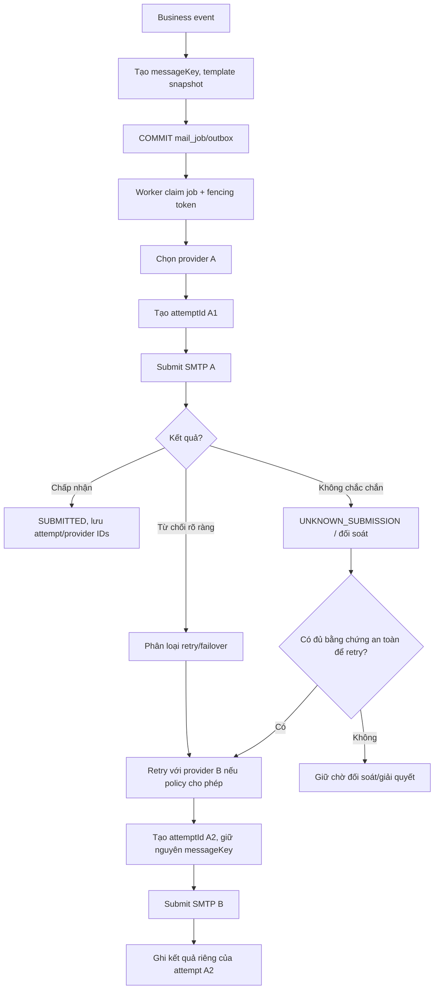

# Bảo toàn message key khi chuyển provider trong Spring Framework Mail

Khi một ứng dụng sử dụng **nhiều nhà cung cấp email** (SMTP relay chính, relay dự phòng, dịch vụ gửi qua API), việc chuyển tuyến gửi từ provider A sang provider B không nên làm mất định danh của cùng một yêu cầu gửi. Nếu hệ thống tạo một “message key” mới mỗi khi failover, dữ liệu trạng thái có thể bị tách thành nhiều job độc lập, khó nhận diện gửi trùng, khó tra cứu bounce/delivery và khó áp dụng idempotency.

Nguyên tắc trung tâm:

> **Một ý định gửi email có một message key ổn định do ứng dụng quản lý; mỗi lần thử gửi và mỗi nhà cung cấp có định danh riêng. Khi đổi provider, giữ nguyên key ở tầng ứng dụng, nhưng không giả định provider mới có thể nhận hoặc thực thi idempotency key của provider cũ.**

Ví dụ: người dùng đặt đơn hàng, hệ thống cần gửi **một** email xác nhận. Lần đầu qua SMTP provider A bị timeout; sau đó worker chuyển sang provider B. Cả hai attempts vẫn thuộc cùng một mail job và cùng message key, dù MIME `Message-ID`, SMTP queue ID và provider message ID có thể khác nhau.

Trong Spring Framework Mail, `JavaMailSender` tạo và gửi message, không cung cấp một cơ chế idempotency xuyên nhà cung cấp. Vì vậy, ứng dụng phải thiết kế **logical message key**, trạng thái job/attempt, quy trình failover, mapping provider IDs và xử lý kết quả không chắc chắn.

Bài học này tập trung vào cách giữ key xuyên tuyến gửi, phân biệt các loại ID, lưu trữ trong transactional outbox, cấu hình nhiều `JavaMailSender`, kiểm tra trạng thái trước khi failover, liên kết webhook, chống race condition, bảo vệ quyền riêng tư và kiểm thử các trường hợp khó.

## 1. “Message key” là gì và tại sao cần phân biệt với Message-ID?

Thuật ngữ *message key* thường được sử dụng không hoàn toàn thống nhất. Trong bài học này:

- **`messageKey`**: khóa logic ổn định, do **ứng dụng** tạo và sở hữu, nhận diện *một ý định gửi* xuyên suốt vòng đời, kể cả khi retry hoặc đổi provider.
- **`mailJobId`**: khóa chính của bản ghi job/outbox. Có thể chọn chính `messageKey` làm UUID primary key, hoặc giữ hai trường riêng nếu nghiệp vụ cần.
- **`attemptId`**: định danh mới cho **mỗi lần thử submission** tới một provider.
- **MIME `Message-ID`**: header Internet Message theo RFC 5322, thường do Jakarta Mail tạo hoặc hạ tầng xử lý; nhận diện một phiên bản message trên luồng email.
- **`providerMessageId`**: ID riêng mà provider trả về hoặc ghi nhận để tra cứu sự kiện, không nhất thiết trùng MIME Message-ID.
- **`businessEventId` / `idempotencyKey`**: định danh nghiệp vụ giúp chống tạo hai ý định gửi do xử lý trùng cùng một sự kiện.
- **`correlationId` / `traceId`**: định danh truy vết xuyên các service, thường bao phủ nhiều mail jobs.

Các loại ID có phạm vi khác nhau:

| Loại ID | Nguồn tạo | Thay đổi khi retry? | Thay đổi khi đổi provider? | Vai trò |
|---|---|---|---|---|
| `messageKey` | Ứng dụng | **Không** | **Không** | Gốc để nối mọi lần gửi của một ý định |
| `mailJobId` | Job store/ứng dụng | Không | Không | Tra cứu trạng thái bền vững |
| `businessEventId` | Hệ thống nghiệp vụ | Không cho cùng sự kiện | Không | Chặn enqueue trùng |
| `attemptId` | Worker/attempt store | **Có** | **Có** khi tạo attempt mới | Điều tra kết quả mỗi lần gọi |
| MIME `Message-ID` | Jakarta Mail/adapter | Có thể | Có thể | Đối chiếu thông điệp email |
| `providerMessageId` | Nhà cung cấp | Có thể | **Thường là khác** | Đối chiếu sự kiện của provider |
| `correlationId` | Request/workflow | Thường không | Không | Truy vết cả workflow |

**Không đồng nhất `Message-ID` trong header với `messageKey`** chỉ vì tên giống nhau. Nếu mục tiêu là bảo toàn định danh nghiệp vụ khi chuyển provider, thứ cần bảo toàn bắt buộc là **`messageKey`**. Việc cố giữ cùng MIME Message-ID là quyết định riêng, có giới hạn và không thay thế idempotency.

### 1.1. Ví dụ về hai attempts

```text
messageKey = 8dbf0c30-5b9e-4ac8-b6f2-7bc7ecef01aa
mailJobId  = 8dbf0c30-5b9e-4ac8-b6f2-7bc7ecef01aa
templateId = ORDER_CONFIRMATION

attemptId = 7ce6175f-2a96-4234-bd08-cc70b6d07f4c
    provider = smtp-primary
    mimeMessageId = <first-001@mailer.example.org>
    providerMessageId = (chưa biết)
    outcome = UNKNOWN_SUBMISSION

attemptId = c08d1d76-4b83-485a-a3ce-b09ef0974c3f
    provider = smtp-backup
    mimeMessageId = <second-002@mailer.example.org>
    providerMessageId = backup-queue-10026
    outcome = SUBMITTED
```

Cả hai attempts vẫn cùng một `messageKey`. Nếu provider A thực tế đã nhận thư trước khi connection mất, việc chuyển sang B có thể khiến người nhận thấy hai email. **Bảo toàn key giúp phát hiện và quản lý sự việc; tự nó không loại bỏ rủi ro duplicate SMTP.**

## 2. Xác định phạm vi duy nhất của message key

Một khóa chỉ có ích nếu định nghĩa rõ “một message” nghĩa là gì đối với nghiệp vụ.

Ví dụ đơn hàng:

```text
Một đơn hàng -> một email xác nhận tới khách hàng
  messageKey = K1

Một đơn hàng -> một email xác nhận cho khách
               và một email nội bộ cho kế toán
  messageKey = K1 (customer confirmation)
  messageKey = K2 (internal notification)
```

Không dùng một key cho hai email có người nhận hoặc nội dung/ý định khác nhau. Nếu một email bị huỷ và tạo ý định gửi mới, cần xác định liệu nó là **retry cùng intent** hay **intent mới**.

### 2.1. Các bất biến nên duy trì

1. `messageKey` được tạo một lần tại lúc ứng dụng xác định ý định gửi.
2. Nó được lưu bền vững **trước khi bắt đầu SMTP submission**.
3. Retry và failover không tạo key mới cho cùng ý định.
4. `attemptId` được tạo riêng cho mỗi lần gọi provider có thể tạo side effect.
5. Kết quả từng attempt được liên kết với `messageKey`, không ghi đè mất lịch sử.
6. Chỉ một worker có ownership hợp lệ được bắt đầu attempt mới cho một job tại một thời điểm, trừ khi nghiệp vụ chủ đích chấp nhận đồng thời.
7. Không dùng key chứa email address, token hoặc PII có thể suy đoán.
8. Trạng thái `SUBMITTED` chỉ phản ánh submission; delivery/bounce là bước tiếp theo.
9. Mapping provider-specific IDs được lưu cùng **provider alias** để tránh đụng tên.
10. Khi kết quả lần gửi cũ chưa chắc chắn, không coi failover là “gửi đúng một lần” nếu chưa có bằng chứng.

### 2.2. Key ngẫu nhiên hay key xác định từ nghiệp vụ?

Có hai lựa chọn thông dụng:

**Key ngẫu nhiên, lưu theo outbox:**

```java
UUID messageKey = UUID.randomUUID();
```

Phù hợp khi một transaction đã có cơ chế unique constraint theo business event, còn `messageKey` là định danh public-safe cho job.

**Khóa chống tạo trùng dựa trên nghiệp vụ:**

```text
tenant + businessEventId + mailPurpose + recipientAccountId
```

Có thể đặt unique constraint trên các trường này; sau khi insert thành công, tạo/lưu `messageKey` ngẫu nhiên làm định danh gửi. Cách này giúp replay cùng event không sinh thêm một ý định mới.

Không khuyến khích nối thẳng `recipientEmail + orderId` rồi đưa làm key vào headers/logs: có thể lộ PII và khó thay đổi khi email của người dùng cập nhật.

### 2.3. Khi nào tạo message key mới?

| Tình huống | Giữ key cũ? | Giải thích |
|---|---|---|
| Provider A timeout, retry qua A | Có | Cùng ý định gửi |
| Provider A hỏng, chuyển sang B | Có | Chỉ đổi tuyến vận chuyển |
| Worker crash và nhận lại outbox job | Có | Phục hồi cùng job |
| Provider trả 429, hẹn gửi lại | Có | Retry có điều kiện |
| Request tạo đơn hàng bị giao lại cùng event ID | Không tạo intent trùng | Unique business event |
| Người dùng tạo yêu cầu reset password mới | Thường **key mới** | Challenge/token/deadline mới |
| Một hóa đơn được chỉnh sửa và phát hành lại | Phụ thuộc nghiệp vụ; thường mới | Nội dung/phiên bản ý định thay đổi |
| Gửi thông báo tới người nhận thứ hai | Key riêng | Mỗi ý định/recipient riêng |
| Campaign được chia theo từng subscriber | Key riêng từng recipient/message | Theo dõi unsubscribe/bounce độc lập |

Không “giữ key cũ” để ghép những nghiệp vụ khác nhau chỉ nhằm giảm số lượng job.

## 3. Luồng gửi đa provider với message key ổn định



Trong sơ đồ, **đổi provider không tạo mail job mới**. Worker bắt đầu attempt mới trỏ đến `smtp-backup` và vẫn tham chiếu cùng `messageKey` ở job store.

### 3.1. Không phụ thuộc chỉ vào @Async

`@Async` hữu ích để tách request thread khỏi việc gửi, nhưng queue của executor trong memory có thể mất khi process restart. Nếu yêu cầu bảo toàn key và phục hồi sau lỗi của provider, nên lưu một bản ghi job/outbox bền vững có `messageKey`, provider routing policy và trạng thái.

### 3.2. Tách routing khỏi content rendering

Một kiến trúc có các phần:

```text
MailIntentService
  -> MailJobStore (messageKey, business idempotency)
  -> MailWorker
       -> MailTemplateRenderer
       -> ProviderRouter
            -> smtp-primary adapter
            -> smtp-backup adapter
       -> AttemptStore / outcome reconciler
```

Tầng template biết nội dung dự định gửi. Tầng routing quyết định chọn provider nào phù hợp. Tầng state store biết lịch sử những lần thử. Không để provider adapter tự tạo một message key mới mỗi lần được gọi.

## 4. Ba cấp idempotency khác nhau

**Idempotency không chỉ là “có một UUID”.** Cần xem các lớp:

| Lớp | Mục tiêu | Biện pháp |
|---|---|---|
| **Business enqueue** | Một business event không tạo hai mail jobs | Unique key trên tenant/event/purpose/recipient |
| **Application dispatch** | Nhiều worker không đồng thời gửi cùng job | Atomic claim, lease/fencing, compare-and-set state |
| **Provider submission** | Retry network không tạo side effect trùng | Provider idempotency API nếu được hỗ trợ, đối soát trạng thái, chính sách unknown |

Trong SMTP chuẩn, không có một **idempotency key header phổ quát** được mọi SMTP server dùng để loại thư trùng. Dù application gửi hai email cùng `Message-ID`, server có thể chấp nhận cả hai.

Nếu provider hỗ trợ REST API có idempotency key, scope và TTL phải xem tài liệu riêng của **provider đó**. Key chấp nhận bởi A không mặc nhiên có hiệu lực ở B. Hệ thống vẫn cần `messageKey` xuyên provider để liên kết.

### 4.1. Không hứa exactly-once delivery

Xét kịch bản:

```text
Worker -> SMTP provider A: DATA hoàn tất
Provider A: đã nhận message
Network: mất kết nối trước khi worker nhận 250
Worker: timeout
```

Ứng dụng không thể biết chắc A đã submit thành công nếu không có một cơ chế đối soát khác. Nếu gửi lại qua B ngay lập tức, cả A và B có thể phát thư.

Transactional outbox, message key và lease hỗ trợ **at-least-once processing có kiểm soát**, nhưng không biến SMTP thành giao dịch phân tán nguyên tử với database.

## 5. MIME Message-ID: có nên giữ nguyên qua provider?

Header `Message-ID` theo RFC 5322 thường có dạng:

```text
Message-ID: <unique-opaque-id@mailer.example.org>
```

Nó có thể giúp support, provider logs và mailbox threading. Nhưng **khác với application message key**:

- Một `MimeMessage` có thể chưa có ID trước khi `saveChanges()` hoặc gửi.
- Jakarta Mail/Spring Mail có thể tạo hoặc cập nhật `Message-ID` khi chuẩn bị thông điệp.
- Một provider/gateway có thể giữ, thay hoặc bỏ header tùy implementation và chính sách.
- Khi dựng một MIME message mới cho retry, ID có thể thay đổi.
- Không có bảo đảm provider tự deduplicate nếu `Message-ID` giống nhau.

### 5.1. Cách đơn giản: giữ application key, cho MIME ID thay đổi

Đây thường là lựa chọn ít phụ thuộc provider nhất:

```text
messageKey=K-123
    attempt=A-1, provider=primary,
        mimeMessageId=<m1@mailer.example.org>
    attempt=A-2, provider=backup,
        mimeMessageId=<m2@mailer.example.org>
```

Lưu mapping từng attempt. Hệ thống vẫn biết hai MIME messages xuất phát từ cùng ý định gửi K-123.

### 5.2. Khi thật sự cần một MIME Message-ID đã lên kế hoạch

Nếu một hệ thống tích hợp yêu cầu đối chiếu dựa trên MIME Message-ID, có thể thiết kế một ID hợp lệ, ổn định cho logical message:

```text
plannedMessageId = <opaque-unique-value@mailer.example.org>
```

Tuy nhiên, việc tự set header phải được kiểm chứng với `JavaMailSenderImpl`/Jakarta Mail của phiên bản đang chạy. `MimeMessage.saveChanges()` có thể sinh lại các header. Không tự chèn newline/raw header, và không lấy ID từ user input. Kiểm tra bản mà SMTP sink nhận, **không chỉ bản object trước khi gửi**.

Ngay cả khi giữ đúng cùng MIME ID ở A và B, đây vẫn **không phải idempotency mechanism** của SMTP và không bảo đảm một bản thư duy nhất trong mailbox. Có thể còn tác động tới threading hoặc analytics tùy client/provider, nên cần quyết định có chủ đích.

### 5.3. Không dùng MIME Message-ID làm business authorization

Đừng tạo API “biết Message-ID là được xem nội dung email”. Message-ID có thể lộ ra ở mail headers, được chuyển tiếp hoặc chia sẻ. Các API trạng thái phải kiểm tra quyền theo user/tenant. Logical `messageKey` cũng chỉ là identifier, không phải bearer credential.

## 6. Provider message ID khác nhau theo nhà cung cấp

Một số SMTP relay ghi queue ID trong response hoặc cung cấp thông qua hệ thống log/dashboard; một số REST email service trả một ID trong response. Trong khi đó, `JavaMailSender.send(MimeMessage)` trả về `void` và **không có API chung trả về providerMessageId**.

Ví dụ mapping:

| messageKey | attemptId | Provider | MIME Message-ID | providerMessageId | Outcome |
|---|---|---|---|---|---|
| K1 | A1 | smtp-primary | m1 | Chưa biết | UNKNOWN |
| K1 | A2 | smtp-backup | m2 | backup-7912 | SUBMITTED |
| K2 | A3 | smtp-primary | m3 | primary-6001 | SUBMITTED |

Không dùng duy nhất `providerMessageId` làm khóa toàn hệ thống: hai provider khác nhau có thể có ID cùng dạng, thậm chí trùng nhau. Ít nhất hãy lưu **`(providerAlias, providerMessageId)`**; nếu một provider có nhiều account/region, có thể cần scope thêm account/region theo contract.

### 6.1. Các ranh giới thường gặp

```text
messageKey
   -> job nội bộ
attemptId
   -> một lần submit
mimeMessageId
   -> một bản email MIME
providerMessageId
   -> một bản ghi submission/delivery của provider
providerEventId
   -> một webhook/event cụ thể
```

Mỗi định danh phục vụ một mục tiêu. Khi phân tích bounce, không nên tự chuyển `providerEventId` thành `messageKey` mà không có mapping được xác minh.

## 7. Thiết kế database để bảo toàn key và lịch sử attempts

Để retry/failover an toàn, hệ thống cần một **nguồn trạng thái bền vững**. Dưới đây là schema PostgreSQL tham khảo. Mỗi ý định gửi có một row trong `mail_job`; mỗi lần submit có một row trong `mail_attempt`.

```sql
CREATE TABLE mail_job (
    message_key         UUID PRIMARY KEY,
    tenant_id           UUID NOT NULL,
    business_event_id   UUID NOT NULL,
    mail_purpose        VARCHAR(80) NOT NULL,
    recipient_ref       UUID NOT NULL,
    template_id         VARCHAR(80) NOT NULL,
    template_version    VARCHAR(40) NOT NULL,
    payload_ref         VARCHAR(200) NOT NULL,
    state               VARCHAR(32) NOT NULL,
    attempt_count       INTEGER NOT NULL DEFAULT 0,
    next_attempt_at     TIMESTAMPTZ NOT NULL,
    expires_at          TIMESTAMPTZ,
    claim_token         UUID,
    lease_until         TIMESTAMPTZ,
    submitted_at        TIMESTAMPTZ,
    created_at          TIMESTAMPTZ NOT NULL DEFAULT NOW(),
    updated_at          TIMESTAMPTZ NOT NULL DEFAULT NOW(),
    CHECK (attempt_count >= 0),
    CONSTRAINT uq_mail_intent UNIQUE (
        tenant_id,
        business_event_id,
        mail_purpose,
        recipient_ref
    )
);

CREATE TABLE mail_attempt (
    attempt_id           UUID PRIMARY KEY,
    message_key          UUID NOT NULL
                         REFERENCES mail_job(message_key),
    attempt_no           INTEGER NOT NULL,
    provider_alias       VARCHAR(80) NOT NULL,
    state                VARCHAR(32) NOT NULL,
    mime_message_id      VARCHAR(320),
    provider_message_id  VARCHAR(320),
    failure_class        VARCHAR(80),
    started_at           TIMESTAMPTZ NOT NULL,
    completed_at         TIMESTAMPTZ,
    CONSTRAINT uq_mail_attempt_number UNIQUE (
        message_key, attempt_no
    )
);

CREATE INDEX idx_mail_attempt_lookup
    ON mail_attempt (message_key, started_at);

CREATE INDEX idx_mail_provider_message
    ON mail_attempt (provider_alias, provider_message_id)
    WHERE provider_message_id IS NOT NULL;

CREATE INDEX idx_mail_jobs_ready
    ON mail_job (next_attempt_at, created_at)
    WHERE state IN ('PENDING', 'RETRY_WAIT');
```

Tất cả bảng và trạng thái trong bài là **mô hình ứng dụng đề xuất**, không phải schema do Spring Mail tự tạo. Nếu provider ID chỉ duy nhất trong phạm vi account/region, cần lưu và index thêm những trường đó.

### 7.1. Vì sao message_key là khóa chính?

Chọn `message_key UUID PRIMARY KEY` là cách diễn đạt trực tiếp bất biến “một logical message có một khóa bền vững”. Có dự án thích giữ `mail_job.id` riêng và `message_key UNIQUE`: cũng hợp lệ nếu code không lẫn hai trường.

Mọi lần gửi phải tham chiếu row này; không chèn một `mail_job` mới chỉ vì chuyển từ provider A sang B.

### 7.2. Vì sao cần business unique constraint?

`messageKey` ngẫu nhiên có xác suất trùng cực thấp nhưng **không ngăn hai consumer cùng xử lý một business event và sinh hai UUID khác nhau**. Unique constraint trên `(tenant, event, purpose, recipientRef)` đảm bảo replay một sự kiện đã biết không tạo thêm intent trùng.

Nếu một nghiệp vụ cho phép gửi lại *có chủ đích* cùng một thông báo, phải có một business event hoặc revision mới phù hợp. Không vô hiệu hóa unique constraint chỉ vì muốn “resend”; phân biệt manual resend là attempt mới của intent cũ hay intent mới theo yêu cầu vận hành.

### 7.3. Không ghi đè attempt cũ khi đổi provider

Một thao tác không nên làm:

```sql
-- Không chỉ ghi đè provider hiện tại và xóa lịch sử.
UPDATE mail_job
SET current_provider = 'backup',
    message_key = gen_random_uuid()
WHERE message_key = :old_key;
```

Thay vào đó, giữ `mail_job.message_key` bất biến và **INSERT thêm một `mail_attempt`** với `provider_alias='backup'`, attempt ID và số thứ tự mới.

### 7.4. Không dùng providerMessageId một mình làm khóa

Nếu nhận webhook theo provider ID, cần xác định đúng scope:

```sql
SELECT attempt_id, message_key
FROM mail_attempt
WHERE provider_alias = :provider_alias
  AND provider_message_id = :provider_message_id;
```

Truy vấn có thể trả nhiều row khi provider không đảm bảo uniqueness hoặc có nhiều account; production cần ràng buộc/điều kiện chính xác theo contract thực tế. Không ép unique index mà không chắc provider ID duy nhất trong scope đó.

## 8. Tạo mail job một lần bằng transactional outbox

Một lỗi kiến trúc phổ biến là:

```java
try {
    primarySender.send(message);
} catch (Exception ex) {
    // Sai: tạo một mail job mới với key khác chỉ vì đổi provider.
    mailJobRepository.save(MailJob.newJobForBackup(...));
    backupSender.send(message);
}
```

Như vậy hệ thống dễ có hai bản ghi độc lập cho cùng nghiệp vụ, khó kiểm soát gửi trùng và không biết attempt A liên quan attempt B.

### 8.1. Transaction chỉ ghi ý định gửi

Ví dụ rút gọn:

```java
@Transactional
public void confirmOrder(Order order, UUID businessEventId) {
    orderRepository.save(order);

    mailJobStore.insertIfAbsent(
            UUID.randomUUID(),           // messageKey nếu chưa có
            order.getTenantId(),
            businessEventId,
            "ORDER_CONFIRMATION",
            order.getCustomerAccountId(),
            "ORDER_CONFIRMATION",
            "v7",
            order.getId().toString());
}
```

`insertIfAbsent(...)` là một operation do ứng dụng triển khai, không phải API có sẵn của Spring; cần dùng unique constraint và **khôi phục key hiện có khi conflict**, thay vì tạo thêm job. Trong một transaction có thể có các biện pháp race-safe như `INSERT ... ON CONFLICT DO NOTHING`, rồi query row đã tồn tại theo unique business key.

### 8.2. PostgreSQL insert idempotent

```sql
INSERT INTO mail_job (
    message_key, tenant_id, business_event_id,
    mail_purpose, recipient_ref,
    template_id, template_version, payload_ref,
    state, next_attempt_at
)
VALUES (
    :message_key, :tenant_id, :business_event_id,
    :mail_purpose, :recipient_ref,
    :template_id, :template_version, :payload_ref,
    'PENDING', NOW()
)
ON CONFLICT ON CONSTRAINT uq_mail_intent DO NOTHING;
```

Sau đó tra cứu:

```sql
SELECT message_key, state, template_id, template_version
FROM mail_job
WHERE tenant_id = :tenant_id
  AND business_event_id = :business_event_id
  AND mail_purpose = :mail_purpose
  AND recipient_ref = :recipient_ref;
```

Nếu row đã có, caller nhận **message key đã lưu**, không trả UUID mới vừa thử insert. Cũng cần kiểm tra payload/template có phù hợp intent cũ; nếu cùng idempotency key nhưng nội dung bị thay đổi trái phép, coi đó là conflict nghiệp vụ, không ghi đè âm thầm.

### 8.3. Giữ nội dung logic ổn định qua provider

Khi chuyển provider, không chỉ key cần ổn định. Nên giữ:

- Recipient đã được phê duyệt.
- Loại email và template version.
- Tham chiếu/snapshot nội dung nghiệp vụ.
- Link xác thực/token gắn với intent còn hiệu lực.
- Ngôn ngữ/locale được chọn.
- Quy tắc gửi và thời hạn hết hiệu lực.

Các field kỹ thuật có thể thay đổi hợp lệ theo provider: SMTP credentials, return-path/bounce domain, DKIM signer, transport headers hoặc provider-specific metadata. Nhưng **ý nghĩa của email đối với người nhận không nên thay đổi bất ngờ chỉ vì routing**.

Ví dụ không đúng: attempt A dùng OTP `123456`, attempt B tự sinh OTP `654321` nhưng vẫn giữ cùng `messageKey`; đó có thể là hai challenge khác nhau và làm người nhận nhầm lẫn. Hãy xác định token/challenge ở tầng nghiệp vụ trước khi tạo mail job, kiểm tra còn hiệu lực khi retry.

## 9. State machine tách job và từng attempt

Một vòng đời job:

```text
PENDING
  |
  v
PROCESSING
  |         \
  |          +--> RETRY_WAIT --> PROCESSING
  |          |
  |          +--> UNCERTAIN --> RECONCILING
  |                                  |
  +--> SUBMITTED <-------------------+
  |
  +--> FAILED_PERMANENT
  +--> EXPIRED
  +--> CANCELLED
```

Đây là state machine minh họa; triển khai thật cần định nghĩa đầy đủ những transition hợp lệ. Không phải tất cả trạng thái đều xuất phát trực tiếp từ `PROCESSING`, đặc biệt một job có thể bị `CANCELLED` khi vẫn đang chờ.

Một **attempt** có vòng đời riêng:

```text
CREATED
  |
  v
SUBMITTING
  |
  +--> SUBMITTED
  +--> FAILED_DEFINITE
  +--> UNKNOWN_SUBMISSION
```

Trong đó `SUBMITTED` là sự kiện ở **tầng submission**, chưa chứng minh delivery. Provider có thể gửi sự kiện `delivered`, `bounced` hay `complained` sau đó; các sự kiện này phải được lưu/áp chính sách riêng.

### 9.1. Quy tắc giữ key

Trong mọi transition của cùng job:

```text
job.messageKey = constant
job.templateId = logical template identity
job.intentSnapshot = stable for retry policy
```

Các trường thay đổi theo attempt:

```text
attempt.id = new
attempt.provider = primary | backup | ...
attempt.startedAt = new
attempt.mimeMessageId = optional/new
attempt.providerMessageId = optional/new
attempt.outcome = per-attempt
```

### 9.2. Không tự failover từ trạng thái SUBMITTED

Nếu provider A đã báo SMTP acceptance, ứng dụng không nên tự chuyển sang B chỉ vì chưa thấy webhook `delivered` trong vài giây. Delivery có thể bị trì hoãn hoặc provider events đến chậm. Chuyển tuyến sau submission thành công có nguy cơ tạo email trùng.

Nếu doanh nghiệp có yêu cầu SLA rất cao và chấp nhận duplicate trong một số điều kiện, phải có **policy business rõ ràng**, thời hạn chờ, audit và xử lý duplicate. Không ngầm thực hiện trong `catch (Exception)`.

### 9.3. Chuyển khi lỗi chắc chắn xảy ra trước submission

Một số lỗi có thể xác định rõ chưa thể submit message, ví dụ provider route không được cấu hình, lỗi validation trước khi dựng MIME hoặc SMTP AUTH bị từ chối trước giai đoạn DATA. Tuy nhiên, không phải mọi exception của thư viện đều cho phép suy luận chính xác điểm thất bại.

Nếu có bằng chứng **chưa có side effect**, retry qua provider khác có rủi ro duplicate thấp hơn. Nhưng lỗi validation nội dung/recipient không được “chữa” bằng failover: phải sửa input hoặc policy trước.

## 10. Atomic claim và fencing chống hai worker đổi provider cùng lúc

Trong hệ thống nhiều instance, worker A có thể đang submit qua primary; một worker B nhìn thấy lease quá hạn và quyết định dùng backup. Nếu hai worker cùng gửi, dù `messageKey` giống nhau vẫn có thể tạo hai email.

Vì vậy, song song với key ổn định cần:

1. Claim job bằng transaction nguyên tử.
2. Lưu `claim_token`/lease version.
3. Chỉ worker đang sở hữu claim hợp lệ được bắt đầu attempt mới.
4. Cập nhật state có điều kiện theo ownership token.
5. Giới hạn thời gian submission hoặc renew lease khi cần.
6. Xử lý kết quả không chắc chắn trước khi tự động chuyển provider.

### 10.1. Claim theo batch với PostgreSQL

```sql
WITH candidates AS (
    SELECT message_key
    FROM mail_job
    WHERE state IN ('PENDING', 'RETRY_WAIT')
      AND next_attempt_at <= NOW()
      AND (expires_at IS NULL OR expires_at > NOW())
    ORDER BY next_attempt_at, created_at, message_key
    FOR UPDATE SKIP LOCKED
    LIMIT :batch_size
)
UPDATE mail_job j
SET state = 'PROCESSING',
    claim_token = :new_claim_token,
    lease_until = NOW() + INTERVAL '90 seconds',
    attempt_count = attempt_count + 1,
    updated_at = NOW()
FROM candidates c
WHERE j.message_key = c.message_key
RETURNING j.*;
```

Transaction claim phải ngắn; commit trước SMTP call. Sau đó tạo `mail_attempt` tương ứng với mỗi job/attempt number (trong cùng transaction claim nếu phù hợp), với provider route đã quyết định theo policy.

### 10.2. Finalize theo ownership

```sql
UPDATE mail_job
SET state = 'SUBMITTED',
    submitted_at = NOW(),
    updated_at = NOW(),
    claim_token = NULL,
    lease_until = NULL
WHERE message_key = :message_key
  AND claim_token = :expected_claim_token
  AND state = 'PROCESSING';
```

Nếu `UPDATE` ảnh hưởng 0 row, worker đã mất ownership hoặc state đã bị thay đổi; không được ghi đè bằng một UPDATE không điều kiện. Cần ghi nhận attempted submission ở attempt store và điều tra trạng thái; có thể email đã được provider nhận dù owner đã thay đổi.

### 10.3. Fencing không thể thu hồi SMTP đã gửi

Fencing ngăn worker cũ làm hỏng trạng thái database, nhưng **không thể hoàn tác email đã tới SMTP server**. Nếu lease hết trong khi provider A đã nhận message mà worker B đã bắt đầu B, có thể vẫn gửi trùng. Cần tính lease duration, renew lease và ưu tiên xử lý trạng thái `UNCERTAIN` khi ownership bị đứt giữa submission.

### 10.4. Không chọn provider trong nhiều transaction không liên quan

Để tránh thay đổi route trong lúc gửi, khi bắt đầu attempt nên cố định `provider_alias` trong attempt row:

```text
attempt A1 -> provider primary
attempt A2 -> provider backup
```

Nếu cấu hình routing toàn cục thay đổi giữa hai bước, worker vẫn phải lưu đúng provider thật sự đã gọi. Không ghi provider alias bằng cách đọc “cấu hình hiện tại” lúc webhook đến, vì route có thể đã đổi từ lâu.

## 11. Cấu hình hai SMTP provider trong Spring Boot

Spring Boot thường auto-configure một `JavaMailSender` từ `spring.mail.*`. Khi cần chủ động sử dụng hai SMTP accounts/providers, ứng dụng có thể khai báo **hai bean riêng** và chọn qua adapter. Tránh để một bean có cấu hình bị thay đổi bằng setter trong khi nhiều worker đang gửi đồng thời.

### 11.1. Cấu hình mẫu

```yaml
# application.yml — không chứa secret thật
app:
  mail:
    primary:
      host: ${PRIMARY_SMTP_HOST}
      port: 587
      username: ${PRIMARY_SMTP_USER}
      password: ${PRIMARY_SMTP_PASSWORD}
    backup:
      host: ${BACKUP_SMTP_HOST}
      port: 587
      username: ${BACKUP_SMTP_USER}
      password: ${BACKUP_SMTP_PASSWORD}
```

Các placeholder ở trên là giá trị lấy từ môi trường. Secret phải được quản lý bằng cơ chế phù hợp như secret manager. Không log username/password hoặc dump toàn bộ object configuration.

Provider backup phải được cấu hình và xác minh **trước khi có sự cố**, bao gồm identity gửi, giới hạn quota và quyền sử dụng domain. Không đợi production provider A ngừng hoạt động mới phát hiện B không có quyền gửi `From` của ứng dụng.

### 11.2. Hai JavaMailSender tách biệt

```java
package com.example.mail.provider;

import java.util.Properties;
import org.springframework.beans.factory.annotation.Value;
import org.springframework.context.annotation.Bean;
import org.springframework.context.annotation.Configuration;
import org.springframework.mail.javamail.JavaMailSender;
import org.springframework.mail.javamail.JavaMailSenderImpl;

@Configuration(proxyBeanMethods = false)
public class MultipleMailSenderConfiguration {

    @Bean("primaryMailSender")
    JavaMailSender primaryMailSender(
            @Value("${app.mail.primary.host}") String host,
            @Value("${app.mail.primary.port:587}") int port,
            @Value("${app.mail.primary.username}") String username,
            @Value("${app.mail.primary.password}") String password) {
        return createSmtpSender(host, port, username, password);
    }

    @Bean("backupMailSender")
    JavaMailSender backupMailSender(
            @Value("${app.mail.backup.host}") String host,
            @Value("${app.mail.backup.port:587}") int port,
            @Value("${app.mail.backup.username}") String username,
            @Value("${app.mail.backup.password}") String password) {
        return createSmtpSender(host, port, username, password);
    }

    private static JavaMailSender createSmtpSender(
            String host,
            int port,
            String username,
            String password) {

        JavaMailSenderImpl sender = new JavaMailSenderImpl();
        sender.setHost(host);
        sender.setPort(port);
        sender.setProtocol("smtp");
        sender.setUsername(username);
        sender.setPassword(password);
        sender.setDefaultEncoding("UTF-8");

        Properties p = sender.getJavaMailProperties();
        p.put("mail.smtp.auth", "true");
        p.put("mail.smtp.starttls.enable", "true");
        p.put("mail.smtp.starttls.required", "true");
        p.put("mail.smtp.connectiontimeout", "5000");
        p.put("mail.smtp.timeout", "10000");
        p.put("mail.smtp.writetimeout", "10000");
        p.put("mail.debug", "false");
        p.put("mail.debug.auth", "false");
        return sender;
    }
}
```

Ví dụ dùng SMTP submission port 587 với STARTTLS; đối với implicit TLS/port 465 hoặc cơ chế OAuth/API key, cấu hình và adapter cần thay đổi theo provider. Không sao chép cùng một config cho hai dịch vụ mà không kiểm tra tài liệu hiện hành.

Nếu không có bean nào được chọn làm `@Primary` và có nơi inject `JavaMailSender` không kèm qualifier, Spring có thể báo `NoUniqueBeanDefinitionException`. Đây là tín hiệu tốt để xác định rõ nơi chọn provider, thay vì dùng `@Primary` tùy tiện khiến mọi mail luôn đi primary.

### 11.3. Không đổi cấu hình trên một shared sender

Tránh:

```java
JavaMailSenderImpl sender = sharedSender;
sender.setHost(routeToBackup ? backupHost : primaryHost);
sender.setPassword(routeToBackup ? backupPassword : primaryPassword);
sender.send(message);
```

Nếu hai worker dùng chung bean singleton, thay đổi host/password trong khi worker khác đang gửi là một nguồn race condition nghiêm trọng. Giữ **mỗi provider một sender được cấu hình cố định** hoặc một adapter/provider client riêng; routing chọn client, không mutate cấu hình.

## 12. Một provider-neutral envelope mang message key

Tầng routing nên nhận một bản dữ liệu đã có `messageKey` và `attemptId`, không tự tạo lại key. Đây là một contract minh họa:

```java
package com.example.mail.provider;

import java.util.UUID;

public enum ProviderAlias {
    PRIMARY,
    BACKUP
}

public enum SubmissionState {
    SUBMITTED,
    DEFINITELY_NOT_SUBMITTED,
    UNKNOWN_SUBMISSION
}

public record OutboundMail(
        UUID messageKey,
        UUID attemptId,
        String from,
        String recipient,
        String subject,
        String plainText,
        String htmlText) {
}

public record ProviderSubmission(
        ProviderAlias provider,
        UUID messageKey,
        UUID attemptId,
        SubmissionState state,
        String mimeMessageId,
        String providerMessageId,
        String failureClass) {
}
```

Các `enum`/`record` nên được tách thành file Java riêng trong dự án; ở đây chúng được gom thành một đoạn minh họa ý tưởng. `OutboundMail` chứa recipient/body và có thể nhạy cảm: **không log toàn bộ record**. Hai ID là giá trị do tầng job store tạo trước.

### 12.1. Vì sao envelope độc lập với provider?

Nếu `PrimaryProviderRequest` và `BackupProviderRequest` mỗi loại tự sinh key, rất dễ có:

```text
business mail intent K1
  primary adapter creates K2
  backup adapter creates K3
```

Điều này phá vỡ correlation. Thay vào đó:

```text
MailJob K1
  -> Attempt A1 -> primary adapter, key K1
  -> Attempt A2 -> backup adapter, key K1
```

Adapter có thể chuyển đổi envelope sang API/provider-specific payload, nhưng phải giữ reference `messageKey` trong outcome/metadata của ứng dụng.

## 13. Adapter SMTP chọn provider mà không đổi message key

Ví dụ một gateway triển khai bằng hai `JavaMailSender`. Nó cố ý phân biệt lỗi chắc chắn xảy ra trước SMTP và lỗi submission có thể không xác định, thay vì tự failover ngay trong một `catch`.

```java
package com.example.mail.provider;

import jakarta.mail.MessagingException;
import jakarta.mail.internet.MimeMessage;
import java.util.Objects;
import org.springframework.beans.factory.annotation.Qualifier;
import org.springframework.mail.MailAuthenticationException;
import org.springframework.mail.MailException;
import org.springframework.mail.javamail.JavaMailSender;
import org.springframework.mail.javamail.MimeMessageHelper;
import org.springframework.stereotype.Component;

@Component
public class MultiSmtpGateway {

    private final JavaMailSender primary;
    private final JavaMailSender backup;

    public MultiSmtpGateway(
            @Qualifier("primaryMailSender") JavaMailSender primary,
            @Qualifier("backupMailSender") JavaMailSender backup) {
        this.primary = Objects.requireNonNull(primary);
        this.backup = Objects.requireNonNull(backup);
    }

    public ProviderSubmission submit(
            ProviderAlias provider,
            OutboundMail mail) {

        JavaMailSender selected = switch (provider) {
            case PRIMARY -> primary;
            case BACKUP -> backup;
        };

        MimeMessage mime = selected.createMimeMessage();
        try {
            MimeMessageHelper helper = new MimeMessageHelper(
                    mime,
                    MimeMessageHelper.MULTIPART_MODE_MIXED_RELATED,
                    "UTF-8");

            helper.setFrom(mail.from());
            helper.setTo(mail.recipient());
            helper.setSubject(mail.subject());
            helper.setText(mail.plainText(), mail.htmlText());

            // messageKey không nằm trong SMTP credential;
            // caller/store giữ nguyên khi route sang backup.
        } catch (MessagingException | IllegalArgumentException ex) {
            // Thất bại trước khi gọi send: không có SMTP side effect
            // trong chính attempt này.
            return new ProviderSubmission(
                    provider, mail.messageKey(), mail.attemptId(),
                    SubmissionState.DEFINITELY_NOT_SUBMITTED,
                    null, null, "MIME_PREPARATION");
        }

        try {
            selected.send(mime);

            // API SMTP JavaMailSender không trả providerMessageId.
            return new ProviderSubmission(
                    provider, mail.messageKey(), mail.attemptId(),
                    SubmissionState.SUBMITTED,
                    safeMimeMessageId(mime), null, null);

        } catch (MailAuthenticationException ex) {
            // Lỗi AUTH xảy ra trước khi submit nội dung message.
            return new ProviderSubmission(
                    provider, mail.messageKey(), mail.attemptId(),
                    SubmissionState.DEFINITELY_NOT_SUBMITTED,
                    safeMimeMessageId(mime), null,
                    "SMTP_AUTHENTICATION");

        } catch (MailException ex) {
            // Không thể suy ra từ một MailException tổng quát
            // rằng SMTP server chắc chắn chưa nhận message.
            return new ProviderSubmission(
                    provider, mail.messageKey(), mail.attemptId(),
                    SubmissionState.UNKNOWN_SUBMISSION,
                    safeMimeMessageId(mime), null,
                    "SMTP_TRANSPORT_UNCERTAIN");
        }
    }

    private static String safeMimeMessageId(MimeMessage mime) {
        try {
            String value = mime.getMessageID();
            if (value == null || value.length() > 320) {
                return null;
            }
            for (int i = 0; i < value.length(); i++) {
                char c = value.charAt(i);
                if (Character.isISOControl(c)) {
                    return null;
                }
            }
            return value;
        } catch (MessagingException ex) {
            return null;
        }
    }
}
```

**Giải thích contract:**

- `messageKey` đến từ job store và được trả lại nguyên vẹn trong `ProviderSubmission`.
- `attemptId` là ID mới của attempt, được truyền tới adapter thay vì tự sinh trong adapter.
- Cả primary và backup đều tạo `MimeMessage` từ cùng envelope logic.
- `MailAuthenticationException` được xem là lỗi xác thực trước DATA đối với luồng SMTP thông thường; production nên phân loại theo contract adapter/provider thực tế.
- `MailException` tổng quát được phân loại `UNKNOWN_SUBMISSION` một cách bảo thủ. Không phải mọi `MailException` đều có trạng thái không chắc chắn, nhưng nếu không có đủ dữ liệu an toàn để phân biệt, không nên tự đánh dấu “chắc chắn chưa gửi”.
- `safeMimeMessageId` chỉ giúp tránh ghi ID có control characters hoặc quá dài; nếu cần validate RFC đầy đủ, dùng bộ kiểm tra thích hợp.
- Không log exception message, SMTP password, recipient, Subject hoặc MIME body.
- Khi provider hỗ trợ ID response qua REST API, adapter REST có thể trả `providerMessageId`; adapter SMTP chuẩn ở trên trả `null`.

Đây là ví dụ tập trung vào **tuyến gửi và định danh**. Production còn cần authorization của recipient/From, template escaping, timeout, cấu hình sender identity, provider quota, attachment handling và kiểm soát lỗi ở tầng nghiệp vụ.

### 13.1. Không cho gateway tự retry và đổi provider vô điều kiện

Tránh:

```java
try {
    primary.send(mime);
} catch (MailException ex) {
    backup.send(mime); // Có thể gửi trùng nếu primary đã nhận.
}
```

Gateway nên trả outcome cho worker/routing policy. **Worker quyết định** có lập lịch lại, đổi tuyến, giữ trạng thái uncertain hay yêu cầu đối soát.

### 13.2. Không sử dụng provider selection làm key

Không dùng key như:

```text
primary:order-123
backup:order-123
```

để biểu diễn hai logical messages. Provider là **thuộc tính của attempt**, không phải thành phần làm thay đổi danh tính của intent. Nếu cần một khóa API theo namespace provider, có thể dẫn xuất từ key ứng dụng theo mapping có kiểm soát, nhưng database vẫn giữ `messageKey` gốc.

## 14. Worker phối hợp gửi, retry và chuyển provider

Một worker thường thực hiện:

1. Claim job và xác nhận chưa hết hạn.
2. Chọn provider dựa trên routing policy/current health/tenant.
3. Tạo attempt row gắn `messageKey` và `provider_alias`.
4. Lấy snapshot/recipient có quyền phù hợp.
5. Gọi gateway.
6. Persist attempt outcome trong transaction ngắn.
7. Cập nhật job state hoặc lên lịch attempt kế tiếp.

Khung pseudocode Java:

```java
void processClaimedMail(ClaimedMailJob claimed) {
    MailJob job = claimed.job();

    if (job.expiresAt() != null
            && !clock.instant().isBefore(job.expiresAt())) {
        jobStore.expireIfOwned(
                job.messageKey(), claimed.claimToken());
        return;
    }

    ProviderAlias selected = router.chooseProvider(job);
    MailAttempt attempt = attemptStore.start(
            job.messageKey(), selected, claimed.claimToken());

    OutboundMail payload = renderer.render(
            job, attempt.attemptId());

    ProviderSubmission result =
            smtpGateway.submit(selected, payload);

    attemptStore.recordResult(
            attempt.attemptId(), result);

    switch (result.state()) {
        case SUBMITTED ->
                jobStore.markSubmittedIfOwned(
                        job.messageKey(), claimed.claimToken());
        case DEFINITELY_NOT_SUBMITTED ->
                retryPolicy.scheduleOrFail(
                        job, attempt, result);
        case UNKNOWN_SUBMISSION ->
                jobStore.markUncertainIfOwned(
                        job.messageKey(), claimed.claimToken());
    }
}
```

Các kiểu `ClaimedMailJob`, `MailJob`, `MailAttempt`, `router`, `renderer`, `jobStore` và `retryPolicy` là API do dự án định nghĩa. Pseudocode này **không phải đoạn có thể chạy độc lập**; nó thể hiện nơi message key được giữ, nơi attempt được tạo và nơi xử lý ambiguity.

### 14.1. Lưu result và cập nhật job có tính nhất quán

Trong triển khai thật, nên đưa `attemptStore.recordResult` và transition tương ứng của `mail_job` vào **cùng một DB transaction khi có thể**, với điều kiện claim token. Nếu chỉ ghi attempt thành công rồi crash trước khi update job, recovery logic phải phát hiện sự bất nhất và reconcile, không tạo attempt mới mù quáng.

### 14.2. Tách rendering lỗi khỏi gửi lỗi

Nếu template không render được, chưa có SMTP side effect nên đây không phải lý do chuyển sang backup. Một provider khác không làm template thiếu variable trở nên hợp lệ. Phân loại:

- `TEMPLATE_RENDERING`/`MIME_PREPARATION`: sửa dữ liệu/template, có thể fail vĩnh viễn.
- `SMTP_AUTHENTICATION`: kiểm tra secret/identity; có thể chuyển tuyến khi policy cho phép và backup có quyền gửi.
- `SMTP_THROTTLED`: backoff/limiter; không ồ ạt đẩy sang backup vượt quota.
- `SMTP_TIMEOUT`/`UNKNOWN_SUBMISSION`: đối soát, hạn chế chuyển ngay.
- `RECIPIENT_REJECTED`: đánh giá permanent/temporary theo response code, không thử tất cả providers để lách từ chối.

### 14.3. Giữ snapshot logic khi retry

Nếu template được cập nhật giữa attempt A1 và A2, worker phải có chính sách:

**Giữ snapshot/version** — phù hợp khi intent cần nội dung cố định để audit, giao dịch hoặc token.

**Render lại dữ liệu hiện tại** — chỉ khi nghiệp vụ cho phép và có kiểm tra tính phù hợp/expiry/consent; có thể cần tạo intent mới nếu ý nghĩa thay đổi.

Không để sự thay đổi ngầm của template registry biến retry qua backup thành một nội dung email hoàn toàn khác trong khi vẫn dùng cùng key.

## 15. Failover policy: khi nào đổi provider?

Một router tốt không đơn thuần chọn “A lỗi thì B”. Nó phải phân biệt **chắc chắn chưa submit**, **đã submit** và **kết quả chưa xác định**.

| Kết quả attempt qua A | Đổi sang B ngay? | Lý do |
|---|---|---|
| Không tạo được MIME do template sai | **Không** | Vấn đề nội dung, không phải nhà cung cấp |
| Cấu hình A không có route trước khi gửi | Có thể | Chưa gọi SMTP, backup phải được cho phép |
| SMTP AUTH của A bị từ chối trước DATA | Có thể sau kiểm tra policy | Chưa submit, nhưng cần kiểm tra sender identity/secret |
| Provider A trả lỗi tạm thời rõ ràng trước chấp nhận | Có điều kiện | Cần hiểu response code, quota và luật retry |
| Provider A trả 429/throttled | Không mặc định | Có thể backoff thay vì chuyển tải ồ ạt |
| A từ chối recipient vĩnh viễn | **Không** | Không dùng B để lách từ chối/chính sách |
| `JavaMailSender.send` qua A thành công | **Không** | Đã có submission, không tự gửi bản thứ hai |
| Connection timeout trước khi biết A có nhận chưa | **Không ngay theo mặc định** | Có thể tạo duplicate |
| A có delivery/bounce event sau đó | Phụ thuộc nghiệp vụ | Bounce không đồng nghĩa được phép resend qua B |

### 15.1. Ba quyết định riêng

Một routing policy có thể trả:

```java
public enum FailoverDecision {
    USE_BACKUP_NOW,
    RETRY_CURRENT_PROVIDER_LATER,
    RECONCILE_BEFORE_RESEND,
    DO_NOT_RETRY
}
```

Không nên trộn quyết định “retryable” với “failover now”. Một lỗi có thể retryable nhưng vẫn nên chờ provider A thay vì chuyển tới B; hoặc có thể đã quá deadline và không còn được phép gửi.

### 15.2. Provider health không phải trạng thái của một email

Circuit breaker báo provider A đang không khỏe là thông tin của **nhà cung cấp**. Nó không chứng minh một message gửi trước khi breaker mở đã thất bại. Với job đang `UNKNOWN_SUBMISSION`, vẫn cần đối soát từng attempt.

Router có thể chuyển các **job chưa từng submit** sang B trong khi giữ các job unknown trong hàng đợi reconcile riêng. Như vậy hệ thống phục hồi throughput mà không tự động tạo duplicates cho các attempts đang mơ hồ.

### 15.3. Chuyển provider không làm tăng quota vô hạn

Mỗi provider có giới hạn gửi, tài khoản và domain reputation riêng. Failover hàng trăm nghìn jobs sang B có thể làm B bị throttle hoặc bị tạm khóa. Cần:

- Quota budget và rate limiter theo provider/account.
- Circuit breaker và backoff riêng.
- Giới hạn số attempts trên mỗi logical message.
- Deadline theo mail type.
- Kiểm soát traffic ramp-up và load shedding theo policy.
- Không chuyển danh sách mail marketing chưa có consent chỉ để duy trì throughput.

### 15.4. Ưu tiên và phân vùng theo loại email

Email OTP, reset password, xác nhận giao dịch, báo cáo và bulk marketing không cùng mức độ khẩn cấp. Trong outage:

```text
Provider A down
  |
  +--> OTP chưa gửi -> B nếu được ủy quyền, ưu tiên cao
  +--> Giao dịch chưa gửi -> B, giới hạn tốc độ
  +--> Newsletter -> chờ / giảm tải theo chính sách
  +--> Job unknown ở A -> reconcile trước khi retry
```

Việc giữ nguyên `messageKey` áp dụng cho mọi loại, nhưng **quyết định khi nào failover** có thể khác nhau.

## 16. Tại sao kết quả UNKNOWN_SUBMISSION đặc biệt khó?

Giả sử:

```text
T0: Worker A bắt đầu SMTP attempt A1 với key K1
T1: SMTP server A nhận DATA
T2: Connection mất trước khi client thấy ACK
T3: Worker ghi UNKNOWN_SUBMISSION
T4: Router định dùng provider B
```

Tại T3, ứng dụng có hai khả năng:

- A **đã nhận** email và sẽ gửi nó.
- A **chưa nhận** email và người nhận chưa có thư.

Nếu chọn B, có thể gửi trùng; nếu không chọn B, có thể bỏ lỡ SLA. Không có một phép đổi provider thuần túy nào loại bỏ hoàn toàn đánh đổi này đối với SMTP thông thường.

### 16.1. Chiến lược reconcile

Khi provider hỗ trợ query theo provider ID, request metadata hoặc log đã được lập chỉ mục:

1. Đọc attempt row, provider alias, thời điểm và các ID có sẵn.
2. Query **đúng provider A**, không provider B.
3. Đánh giá trạng thái accepted/rejected/deferred theo contract của provider.
4. Chỉ khi có bằng chứng đủ mạnh rằng attempt chưa được nhận, mới cân nhắc resend.
5. Nếu đã accepted, đánh dấu `SUBMITTED` và theo dõi delivery.
6. Nếu vẫn unknown, quyết định dựa trên mail type, deadline, rủi ro duplicate và chính sách hỗ trợ.

Không phải mọi SMTP relay đều cung cấp API tra cứu theo MIME Message-ID. Nếu không có kênh đối soát, giữ trạng thái unknown có thể là lựa chọn đúng hơn gửi lại mù quáng, đặc biệt với email chứa thông tin nhạy cảm hoặc giao dịch.

### 16.2. Hành động cần sự chủ ý

Với email “đơn hàng đã được tạo”, gửi trùng có thể gây phiền nhưng ít gây hậu quả hơn một số thông báo pháp lý hoặc bảo mật. Với các trường hợp nhạy cảm, có thể cần:

- Chờ một khoảng retry window.
- Kiểm tra trạng thái nghiệp vụ trước resend.
- Có nút resend trong hệ thống hỗ trợ có phân quyền.
- Áp per-message maximum attempts.
- Dùng nội dung có thể chịu duplicate nếu được phép.

Đây là chính sách nghiệp vụ, không nên bị giấu trong một phương thức utility tên `fallback()`.

### 16.3. Lưu lý do và bằng chứng

Một record đối soát nên có:

```text
messageKey: K1
attemptId: A1
provider: smtp-primary
originalOutcome: UNKNOWN_SUBMISSION
reconciliationDecision: RETRY_ALLOWED
reasonCode: PROVIDER_CONFIRMED_NOT_ACCEPTED
decisionAt: timestamp
decisionBy: automated-policy-version / authorized-operator
```

Không lưu raw SMTP password, entire MIME message hoặc dữ liệu người dùng trong audit log chỉ để chứng minh lý do failover.

## 17. Đối chiếu webhook từ nhiều provider

Sau submission, các provider có thể phát sự kiện `delivered`, `deferred`, `bounced`, `complained` hoặc những trạng thái riêng. Nếu một logical message có attempts ở A và B, webhook của A có thể đến **sau** khi B đã submit.

Ví dụ:

```text
K1
  A1 / provider A / unknown at 10:00
  A2 / provider B / submitted at 10:01

10:02 provider B: delivered event for A2
10:03 provider A: delivered event for A1
```

Nếu chỉ lưu “provider hiện tại = B” và bỏ lịch sử A1, hệ thống có thể gán sự kiện từ A cho sai attempt hoặc bỏ qua bằng chứng gửi trùng.

### 17.1. Khóa tra cứu webhook phải có provider namespace

Một webhook thường có provider ID:

```json
{
  "eventId": "evt-109",
  "messageId": "queue-501",
  "status": "delivered"
}
```

Webhook handler phải biết request đến từ provider nào **sau khi xác thực chữ ký/source**. Từ đó tra cứu:

```sql
SELECT attempt_id, message_key
FROM mail_attempt
WHERE provider_alias = :verified_provider_alias
  AND provider_message_id = :provider_message_id;
```

Không nhận một trường `provider` do payload tự khai mà không xác minh request thực sự đến từ provider tương ứng. Mỗi provider có signature/key/cơ chế xác thực khác nhau.

### 17.2. Sự kiện đến muộn không làm mất lịch sử

Một câu lệnh sai:

```java
if (!event.provider().equals(job.currentProvider())) {
    return; // Bỏ qua tất cả event từ provider trước.
}
```

Provider A có thể vẫn giao thư thành công sau khi job đổi sang B. Hãy ghi sự kiện vào **attempt A1** nếu mapping xác minh được, rồi cập nhật aggregate outcome phù hợp, ví dụ:

```text
logical message K1
    submissionAttempts = 2
    deliveredAttempts = 2
    duplicateDeliveryDetected = true
```

Điều này quan trọng cho incident review và phân tích reliability.

### 17.3. Deduplicate provider events

Provider có thể retry webhook khi endpoint timeout; một event có thể đến nhiều lần. Dùng một khóa duy nhất trong phạm vi provider:

```sql
CREATE TABLE mail_provider_event (
    provider_alias       VARCHAR(80) NOT NULL,
    provider_event_id    VARCHAR(200) NOT NULL,
    attempt_id           UUID REFERENCES mail_attempt(attempt_id),
    event_type           VARCHAR(60) NOT NULL,
    occurred_at          TIMESTAMPTZ,
    received_at          TIMESTAMPTZ NOT NULL DEFAULT NOW(),
    PRIMARY KEY (provider_alias, provider_event_id)
);
```

Nếu provider không cung cấp ID sự kiện ổn định, cần một policy dedup riêng dựa trên fields được tài liệu hóa, không tự giả định mọi webhook có `eventId`. Có thể cần thêm provider account scope để tránh collisions.

### 17.4. Webhook không đến theo đúng thứ tự

Một webhook `delivered` có thể đến sau `deferred`, hoặc các hệ thống có thể reorder sự kiện. Không cập nhật một trường trạng thái duy nhất kiểu “event mới nhất theo lúc server nhận” mà bỏ qua thời gian/cấp độ trạng thái.

Thiết kế có thể:

- Lưu immutable raw event metadata đã được lọc và xác thực.
- Chuẩn hóa event type theo provider.
- Có state transition rules cho attempt delivery status.
- Dùng provider event timestamp khi tin cậy, kết hợp received timestamp và version để chống stale update.
- Giữ lịch sử khi có trạng thái xung đột, không âm thầm xóa bằng chứng.

Không coi `DELIVERED` là “người nhận đã đọc”. Nó thường chỉ biểu thị hệ thống nhận đã tiếp nhận theo reporting của provider.

### 17.5. Có nên đưa messageKey vào provider metadata?

Nếu một REST API provider cho phép `custom metadata` hoặc `tags` được phản hồi trong webhook, có thể gửi một **opaque message key** (không chứa PII) để đối chiếu:

```json
{
  "to": ["customer@example.invalid"],
  "template": "ORDER_CONFIRMATION",
  "metadata": {
    "appMessageKey": "8dbf0c30-5b9e-4ac8-b6f2-7bc7ecef01aa"
  }
}
```

Payload JSON là **hình thức khái niệm**, không phải API chuẩn dùng được ở mọi provider. Mỗi provider có schema, giới hạn metadata và cơ chế webhook riêng. Cần kiểm tra tài liệu, không gửi token hay customer email trong metadata không cần thiết.

Đừng nhầm metadata echo với guarantee deduplication: provider có thể trả lại `appMessageKey` chỉ để tra cứu mà vẫn cho phép gửi hai requests giống nhau.

## 18. Custom header X-App-Message-Key: lợi và hại

Một số hệ thống thêm custom header:

```java
mime.setHeader(
        "X-App-Message-Key",
        mail.messageKey().toString());
```

Nếu mọi provider chuyển tiếp header này, người vận hành có thể đối chiếu raw MIME message ở các nơi. Nhưng có ba giới hạn quan trọng:

1. **Privacy:** header sẽ rời khỏi ứng dụng, có thể xuất hiện ở mailbox, email forward và mail gateways; không dùng dữ liệu bí mật hay PII.
2. **Portability:** provider có thể sửa, bỏ hoặc không trả header trong webhook; không được dựa hoàn toàn vào nó.
3. **Idempotency:** SMTP server không có nghĩa vụ loại các message cùng `X-App-Message-Key`.

Với đa số ứng dụng, lưu `messageKey` trong job/attempt store là đủ. Chỉ thêm header nếu có nhu cầu tích hợp cụ thể và đã kiểm tra quyền riêng tư, độ dài, encoding và header injection.

### 18.1. Không đặt raw business key nhạy cảm vào header

Tránh:

```text
X-App-Message-Key: user@example.net:medical-report:12345
```

Tốt hơn:

```text
X-App-Message-Key: 8dbf0c30-5b9e-4ac8-b6f2-7bc7ecef01aa
```

Định danh ngẫu nhiên không mang nội dung trực tiếp, dù vẫn cần quản lý quyền truy cập nếu tra cứu được dữ liệu cá nhân qua nó.

### 18.2. Không chèn header qua chuỗi raw MIME

Không xây:

```java
String raw = "X-App-Message-Key: " + clientInput + "\r\n";
```

Dùng API `MimeMessage.setHeader` với tên cố định và giá trị đã parse thành UUID/opaque token đúng policy. Điều này bảo vệ khỏi CRLF/header injection và tránh client tự ghi thêm `Bcc`/`Reply-To`.

## 19. Bảo toàn danh tính gửi khi chuyển provider

Giữ nguyên `messageKey` không có nghĩa mọi thông số SMTP đều có thể giống nhau. Hai providers có thể yêu cầu khác nhau về sender verification, DKIM, return-path hoặc SMTP authentication.

Trước khi bật failover, kiểm tra:

| Thành phần | Cần bảo toàn hoặc kiểm tra |
|---|---|
| `From` hiển thị | Domain và địa chỉ được phép sử dụng ở cả hai providers |
| `Reply-To` | Giữ đúng chính sách nghiệp vụ, không đổi sang mailbox không liên quan |
| Envelope sender/MAIL FROM | Có thể khác theo provider; cấu hình bounce routing và SPF phù hợp |
| DKIM | Mỗi provider có selector/key riêng nhưng domain alignment vẫn cần hợp lệ |
| SPF | DNS phải cho phép những nguồn gửi thực sự dùng cho domain liên quan |
| DMARC | Alignment với From cần được kiểm tra với từng tuyến |
| TLS/AUTH | Credentials và yêu cầu transport riêng, tuyệt đối không ghi vào log |
| Link domain | Không tự đổi sang host giả mạo/không được kiểm soát khi failover |
| Unsubscribe | Thư marketing phải tiếp tục tuân theo suppression, preference và quy tắc provider |
| Tracking/callback | Nếu provider thay link/tracking domain, phải biết mapping và policy |
| Quota | Backup phải có khả năng tiếp nhận tải; không tự tăng vô hạn |

### 19.1. Một khóa, hai chữ ký DKIM

Nếu provider A ký bằng `selector=a1` và B ký bằng `selector=b2`, hai message đã submit có thể có chữ ký khác nhau. Điều này không làm thay đổi `messageKey` ở ứng dụng. Đừng so sánh raw MIME byte-for-byte để suy ra chúng có cùng intent; headers, Date, Message-ID, boundary và chữ ký có thể khác.

### 19.2. Đừng đổi From sang domain chưa được xác minh

Một lỗi thường gặp: backup provider chỉ được xác minh domain riêng, nhưng adapter vẫn cố gửi `From: notifications@example.org` dù provider B không hỗ trợ domain này. Kết quả là thư bị từ chối hoặc nhận đánh giá xác thực kém.

Cần có mapping sender identity được phép:

```text
logical sender identity = transactional-example
    |
    +-- primary: verified notifications@example.org
    +-- backup:  verified notifications@example.org
```

Nếu không thể duy trì cùng From vì giới hạn provider, sự thay đổi phải được business/security phê duyệt và thể hiện nhất quán tới người nhận. Không tự giả mạo domain khi chuyển tuyến.

### 19.3. Suppression phải là toàn hệ thống

Nếu một recipient đã unsubscribed hoặc bị hard bounce, không được “quên” trạng thái đó khi chuyển từ provider A sang B. Provider-specific suppression lists có thể không tự đồng bộ.

Một nguồn suppression/consent chung ở ứng dụng nên được kiểm tra **trước mỗi attempt**, kể cả failover. Đồng thời tiếp nhận complaint/bounce từ cả hai providers để cập nhật danh sách chung theo policy.

## 20. Correlation ID và tracing xuyên failover

Để tra cứu một logical message, ghi:

- `correlationId`: workflow nghiệp vụ gốc.
- `messageKey`: email intent.
- `attemptId`: lần submit cụ thể.
- `providerAlias`: nhà cung cấp được gọi trong attempt đó.
- `templateId` và `templateVersion`: nội dung logic.
- `mimeMessageId`, `providerMessageId`: nếu có.
- `outcome` và `failureClass`: kết quả được chuẩn hóa.

Ví dụ structured logs:

```json
{
  "event": "mail_attempt_started",
  "correlationId": "2188d0b3-9cbe-46f5-ab50-b9b594312cc1",
  "messageKey": "8dbf0c30-5b9e-4ac8-b6f2-7bc7ecef01aa",
  "attemptId": "7ce6175f-2a96-4234-bd08-cc70b6d07f4c",
  "providerAlias": "smtp-primary",
  "templateId": "ORDER_CONFIRMATION",
  "templateVersion": "v7"
}
```

Và khi route sang backup:

```json
{
  "event": "mail_attempt_started",
  "correlationId": "2188d0b3-9cbe-46f5-ab50-b9b594312cc1",
  "messageKey": "8dbf0c30-5b9e-4ac8-b6f2-7bc7ecef01aa",
  "attemptId": "c08d1d76-4b83-485a-a3ce-b09ef0974c3f",
  "providerAlias": "smtp-backup",
  "templateId": "ORDER_CONFIRMATION",
  "templateVersion": "v7"
}
```

**Cùng `messageKey`, khác `attemptId` và `providerAlias`**. Đây là tính chất cần kiểm tra bằng test.

### 20.1. Không tự dùng provider ID thay message key trong log

Nếu log của provider A có `providerMessageId=abc` rồi log của B có `providerMessageId=xyz`, sẽ rất khó nối chúng nếu thiếu `messageKey` ở application logs. Vì vậy ID chuẩn phải được gắn ngay từ job và có mặt trong event của mọi attempt.

### 20.2. MDC phải được thiết lập tại worker

`MDC` thường dựa vào thread-local; request thread không phải worker thread. Nếu job xử lý sau vài phút hoặc qua instance khác, correlation context có thể mất.

Một scope:

```java
try (MDC.MDCCloseable m = MDC.putCloseable(
             "messageKey", job.messageKey().toString());
     MDC.MDCCloseable a = MDC.putCloseable(
             "attemptId", attempt.attemptId().toString());
     MDC.MDCCloseable p = MDC.putCloseable(
             "providerAlias", attempt.provider().name())) {

    log.info("mail event=attempt_started");
    gateway.submit(attempt.provider(), envelope);
}
```

`job`, `attempt` và `envelope` là các biến thuộc worker. Đừng copy toàn bộ MDC của HTTP request sang background task, vì nó có thể chứa user data hoặc authentication context. Đọc metadata đã lưu từ outbox và đặt những khóa allowlisted trong worker.

### 20.3. Log một event khi routing thay đổi

Ví dụ:

```json
{
  "event": "mail_provider_failover_decided",
  "messageKey": "8dbf0c30-5b9e-4ac8-b6f2-7bc7ecef01aa",
  "previousProvider": "smtp-primary",
  "nextProvider": "smtp-backup",
  "reasonClass": "PRIMARY_UNAVAILABLE",
  "decisionPolicy": "v3"
}
```

Không log SMTP password, raw Subject/body hay toàn bộ `MailException.getMessage()`. Sự kiện trên thể hiện **quyết định chuyển tuyến**, chưa chứng minh email đã được B gửi thành công.

### 20.4. Distributed tracing

Với Micrometer Tracing/OpenTelemetry, có thể tạo spans:

```text
mail.job.process [messageKey=K1]
  |
  +-- mail.provider.primary.submit [attempt=A1]
  |
  +-- mail.reconciliation
  |
  +-- mail.provider.backup.submit [attempt=A2]
```

Các attempts có thể diễn ra ở những process khác nhau, qua thời gian dài; có thể dùng trace link/correlation field thay vì cố giữ một span mở trong nhiều giờ. Không dùng full recipient, token hay MIME body làm span attributes.

### 20.5. Metrics không nhận message key làm tag

`messageKey` và `attemptId` có cardinality gần bằng số email/attempts. Không nên gắn chúng vào Micrometer counter:

```java
// Không làm như vậy: tạo rất nhiều metric series.
registry.counter(
        "mail.provider.attempts",
        "messageKey", job.messageKey().toString())
        .increment();
```

Thay bằng:

```java
registry.counter(
        "mail.provider.attempts",
        "provider", provider.name(),
        "mailType", job.mailType().name(),
        "outcome", outcome.name())
        .increment();
```

Các nhãn này phải là danh mục hữu hạn. Dùng logs/job store cho tra cứu theo ID riêng lẻ.

## 21. Đo hiệu quả failover và phát hiện gửi trùng

Một số metrics gợi ý:

| Metric | Mục đích |
|---|---|
| `mail.jobs.created` | Số ý định gửi mới |
| `mail.jobs.submitted` | Số logical jobs đã được submit |
| `mail.attempts.total` | Số attempts qua mọi provider |
| `mail.attempts.by_provider` | Lượng attempt từng provider |
| `mail.provider.failover.decisions` | Số quyết định chuyển tuyến |
| `mail.attempts.unknown` | Số submission chưa xác định |
| `mail.attempts.reconciled` | Số unknown được đối soát |
| `mail.jobs.expired` | Job hết deadline trước khi gửi |
| `mail.provider.latency` | Duration từng provider |
| `mail.provider.throttled` | Số phản hồi rate limit |
| `mail.provider.webhook.unmatched` | Event chưa map được attempt |
| `mail.provider.webhook.duplicates` | Provider events bị delivery lại |
| `mail.logical.duplicate_submission` | Job có nhiều attempts accepted |

Tên metric cụ thể cần được thống nhất theo Micrometer/Prometheus exporter; bảng là gợi ý về **ý nghĩa số đo**. Không dùng `mail.jobs.submitted` để đếm số lần gọi `JavaMailSender.send(...)` nếu một job đã retry nhiều lần.

### 21.1. Sự khác biệt giữa jobs và attempts

Ví dụ:

```text
100 mail jobs
  80 gửi qua primary lần đầu
  20 chuyển sang backup sau lỗi
  10 trong số 20 có attempt A đã được nhận dù timeout
```

Số job logic vẫn là 100, nhưng số SMTP attempts có thể là 120 và số email thực sự được nhận bởi providers có thể vượt 100. Không báo cáo “120 khách hàng được gửi email” chỉ từ attempt count.

### 21.2. Cảnh báo quan trọng

- `UNKNOWN_SUBMISSION` tăng sau một lần triển khai.
- Failover từ A sang B tăng đột ngột.
- Cả A và B cùng có tỷ lệ `SMTP_AUTHENTICATION` cao.
- Một message key có nhiều attempts `SUBMITTED` hoặc nhiều delivery events.
- Webhook từ provider cũ không map được vì dữ liệu attempt đã bị xóa quá sớm.
- Provider B bị throttled do traffic chuyển tuyến quá nhanh.
- Job nằm `PROCESSING` vượt lease hoặc `UNCERTAIN` quá thời gian đối soát.
- Khối lượng email tăng nhưng số logical jobs không tăng tương ứng.

Một dashboard nên phân biệt **sức khỏe provider** với **trạng thái từng mail job**. Chỉ vì provider primary down không chứng minh từng email trước đó bị mất.

## 22. Kiểm thử message key xuyên provider failover

Kiểm thử tốt cần chứng minh **định danh và trạng thái**, không chỉ chứng minh “backup sender đã được gọi”. Những tình huống quan trọng:

| Kịch bản | Kết quả mong đợi |
|---|---|
| Provider A lỗi chắc chắn trước submission | Attempt A1 thất bại; job giữ key K1; B tạo A2 với key K1 |
| Provider A submit thành công | Không tạo A2 chỉ vì delivery event chưa đến |
| A timeout sau khi gửi DATA, outcome unknown | Job `UNCERTAIN`, không fallback ngay theo policy bảo thủ |
| A trả lỗi AUTH rõ ràng | Có thể route B nếu sender identity/quota hợp lệ |
| B cũng lỗi | Giữ key K1, attempts A1/A2, áp retry/deadline |
| Business event bị replay | Không tạo thêm logical job mới |
| Worker crash sau khi claim | Reclaim có fencing; giữ key K1 và attempt history |
| Hai workers claim cùng job | Chỉ một owner hợp lệ; không gửi đồng thời theo thiết kế |
| Provider webhook A đến sau khi B accepted | Map về attempt A1, không tự bỏ vì provider hiện tại là B |
| Cùng webhook được provider gửi lại | Không xử lý business side effect hai lần |
| Provider IDs trùng chuỗi ở A và B | Mapping theo provider namespace, không lẫn jobs |
| Template đổi giữa attempts | Giữ snapshot/version theo policy |
| OTP đã hết hạn khi đến lượt B | Không gửi token cũ |
| Suppression cập nhật giữa A và B | Check lại consent/policy trước B |

### 22.1. Unit test router với sender mock

Ý tưởng chính là bắt request đến cả hai adapters và so sánh `messageKey`.

Một interface gửi ở tầng adapter:

```java
public interface ProviderGateway {
    ProviderSubmission submit(
            ProviderAlias provider,
            OutboundMail mail);
}
```

Test skeleton với JUnit 5 và Mockito:

```java
@Test
void preservesMessageKeyAcrossFailoverAttempts() {
    UUID messageKey = UUID.randomUUID();
    UUID attemptA = UUID.randomUUID();
    UUID attemptB = UUID.randomUUID();

    OutboundMail first = mailFixture(
            messageKey, attemptA);
    OutboundMail second = mailFixture(
            messageKey, attemptB);

    assertEquals(first.messageKey(), second.messageKey());
    assertNotEquals(first.attemptId(), second.attemptId());

    when(providerGateway.submit(
            eq(ProviderAlias.PRIMARY), eq(first)))
            .thenReturn(new ProviderSubmission(
                    ProviderAlias.PRIMARY,
                    messageKey,
                    attemptA,
                    SubmissionState.DEFINITELY_NOT_SUBMITTED,
                    null, null, "SMTP_AUTHENTICATION"));

    when(providerGateway.submit(
            eq(ProviderAlias.BACKUP), eq(second)))
            .thenReturn(new ProviderSubmission(
                    ProviderAlias.BACKUP,
                    messageKey,
                    attemptB,
                    SubmissionState.SUBMITTED,
                    "<backup-m1@mailer.example.org>",
                    null, null));

    // Trong bài test thực, gọi routing/worker service,
    // không chỉ gọi mock để tự tạo kết quả.
    // assert job store chỉ chứa 1 logical message,
    // đồng thời có 2 attempt records.
}
```

`mailFixture(...)` và `providerGateway` là các fixture do dự án định nghĩa. Đoạn này biểu diễn những assertion quan trọng; để thành test chạy được, cần import JUnit/Mockito và gọi worker/routing implementation thực tế.

### 22.2. Kiểm thử không fallback khi UNKNOWN_SUBMISSION

Với mock adapter A:

```java
when(providerGateway.submit(
        eq(ProviderAlias.PRIMARY), any()))
        .thenReturn(unknownPrimaryResult);

worker.process(job);

verify(providerGateway, never()).submit(
        eq(ProviderAlias.BACKUP), any());

assertEquals(
        MailJobState.UNCERTAIN,
        jobStore.get(job.messageKey()).state());
```

`MailJobState` và `unknownPrimaryResult` do test fixture định nghĩa. Đây là yêu cầu cho **policy bảo thủ** mô tả trong bài; nếu sản phẩm có chính sách chấp nhận duplicate để đáp ứng một SLO cụ thể, test phải mô tả rõ exception policy đó.

### 22.3. Kiểm thử idempotent enqueue

```text
Given:
  same tenantId
  same businessEventId
  same mailPurpose
  same recipientAccountId

When:
  2 concurrent requests enqueue

Then:
  exactly 1 row in mail_job
  both callers can resolve the stored messageKey
  no second messageKey is treated as a new intent
```

Nên test bằng database engine thực tế, ví dụ PostgreSQL Testcontainers nếu production dùng PostgreSQL, vì concurrency và unique constraint semantics là phần mục tiêu. Không dùng mock repository rồi kết luận race condition đã được giải quyết.

### 22.4. Kiểm thử claim fencing

Một kịch bản:

```text
Worker W1 claims K1 with token T1
Lease T1 expires
Worker W2 legally claims K1 with token T2
W1 attempts UPDATE state WHERE token=T1 -> affects 0 rows
W2 can finalize WHERE token=T2
```

Assertion phải kiểm tra số row được update, không chỉ giá trị trả về từ một entity object stale. Test này xác nhận ownership của state store; nó không chứng minh W1 không từng gửi mail ra SMTP trước khi mất lease.

### 22.5. Kiểm thử bằng hai SMTP sinks

Muốn xác minh thực tế adapter chọn hai senders đúng cách, có thể khởi động **hai instance Mailpit hoặc GreenMail** trong môi trường test:

```text
Spring Boot integration test
   |
   +-- primaryMailSender  --> SMTP sink A
   |
   +-- backupMailSender   --> SMTP sink B
```

Các bước:

1. Inject hai host/port riêng vào test context.
2. Dùng dữ liệu giả và địa chỉ `example.invalid`.
3. Cho A từ chối kết nối hoặc có lỗi rõ ràng trước submission theo phương án kiểm thử được kiểm soát.
4. Cho router chọn B theo policy.
5. Xác nhận sink B capture một MIME message, A không capture message trong kịch bản lỗi chắc chắn.
6. Kiểm tra `messageKey` ở job/attempt DB không đổi.
7. Kiểm tra `provider_alias` và MIME ID theo từng attempt.
8. Không kết luận deliverability ngoài Internet chỉ vì sink nhận message.

Nếu cần test SMTP response timing/partial acceptance phức tạp, dùng một server stub có thể điều khiển giao thức hoặc mock adapter. Mailpit mặc định chủ yếu là SMTP sink để capture, không phải mô phỏng toàn bộ lỗi/điều kiện của mọi provider.

### 22.6. Kiểm thử webhook hai provider

Giả lập:

```text
Provider A event: attempt A1, delivered
Provider B event: attempt A2, delivered
Provider A event lặp lại: same event ID
```

Kiểm tra:

- Cả hai sự kiện đầu được gắn đúng attempts của cùng key.
- Duplicate event A không tạo side effect mới.
- Aggregate view có thể phát hiện nhiều deliveries của một logical intent.
- Event đến chậm vẫn được nhận nếu provider signature và mapping hợp lệ.
- Một event có provider ID giả không thể tự gán sang job thuộc tenant khác.

### 22.7. Kiểm thử bảo mật

Sử dụng sentinel:

```text
SMTP secret: TEST_SMTP_SECRET_DO_NOT_LOG
recipient: private@example.invalid
reset token: TEST_RESET_TOKEN_DO_NOT_LOG
```

Kiểm tra logs không chứa các chuỗi này khi primary AUTH lỗi và worker chuyển B. Không dùng secret thực trong fixture. Nếu provider adapter có custom headers hoặc metadata, xác nhận chúng chỉ chứa opaque IDs, không có recipient/token.

## 23. Phân biệt failover, failback và requeue

Khi A hồi phục, có thể có ba loại job:

- **Job chưa từng submit**: chọn A hoặc B tùy current routing policy.
- **Job đã submit qua B**: không gửi lại qua A chỉ vì A đã khỏe.
- **Job unknown từ A**: tiếp tục đối soát trước khi quyết định gửi lại.

### 23.1. Failback không phải resend

**Failback** thường có nghĩa đưa **lưu lượng mới** về primary, không phải nạp lại tất cả job đã đi qua backup. Một implementation sai:

```java
if (primaryRecovered) {
    allJobsSentViaBackup.forEach(this::sendViaPrimary);
}
```

Điều này tạo duplicates. Một job đã `SUBMITTED` qua backup phải giữ trạng thái đó.

### 23.2. Không dùng trạng thái “provider hiện tại” làm nguồn sự thật

Nếu hệ thống chỉ có một cột `current_provider` trong job table, sau failover mọi query có thể mất dấu provider đã xử lý attempt A1. Hãy lưu attempts bất biến; `current_provider` có thể là thông tin điều phối gần nhất nhưng không thay thế lịch sử.

### 23.3. Requeue không tạo intent mới

Một retry scheduler có thể đưa cùng `messageKey` vào queue lần nữa. Broker message/queue delivery ID có thể thay đổi; đó là ID vận chuyển, không phải logical message. Worker phải đọc job bền vững, kiểm tra trạng thái và claim trước khi submit.

Không dùng `UUID.randomUUID()` cho `messageKey` ở **consumer** mỗi lần broker redelivery; chỉ tạo attempt ID mới nếu thật sự bắt đầu một lần gửi mới được phép.

## 24. Bảo mật và quyền riêng tư cho message key

Một UUID ngẫu nhiên thường không chứa PII trực tiếp, nhưng vẫn có thể liên kết đến người nhận, giao dịch và nội dung email qua database.

Các biện pháp:

- Tạo key ở application boundary bằng nguồn ngẫu nhiên phù hợp; không chứa email, tên người dùng, OTP hay token.
- Không đưa mật khẩu SMTP hoặc refresh/access token vào custom metadata.
- Không dùng message key làm secret để truy cập một email; mọi API tra cứu vẫn phải xác thực và phân quyền.
- Chỉ các service được phép mới có thể resolve key sang recipient/payload.
- Log metadata cần thiết, không log toàn bộ `OutboundMail` record vì `toString()` có thể chứa body.
- Giới hạn retention của job, attempts, logs và provider event mapping theo yêu cầu vận hành/pháp lý.
- Nếu message key đi ra ngoài trong custom header/URL, đánh giá khả năng người nhận hoặc bên thứ ba truy vết chéo.
- Không đưa key, recipient hoặc provider ID có cardinality cao vào metric tags.

### 24.1. Multi-tenant key scope

Một hệ thống nhiều tenant phải lưu `tenantId` trong job và kiểm tra quyền khi tra cứu theo `messageKey`. Dù UUID là duy nhất toàn cục, caller không được xem job của tenant khác chỉ bằng cách biết key.

Với provider account dùng chung, mapping webhook cũng phải được gắn về đúng tenant qua attempt record, không tin `tenantId` do webhook body tự khai nếu thiếu xác thực.

### 24.2. Message key trong URL có nên dùng?

Nếu một link theo dõi chứa `messageKey`:

```text
https://click.example.org/t/8dbf0c30-...
```

ID có thể xuất hiện trong browser history, access logs, proxy và analytics. Nếu mục tiêu là tracking, cân nhắc token/alias riêng với giới hạn thời hạn và quyền truy cập; không dùng trực tiếp key nội bộ nếu không cần.

Với reset-password URL, token bảo mật có vai trò riêng với message key. Không dùng message key làm reset token.

## 25. Runbook: điều tra một email sau khi đổi provider

Giả sử bộ phận hỗ trợ báo “người nhận không có thư, nhưng hệ thống nói đã gửi”. Với một `messageKey`, thực hiện:

### Bước 1 — Xác nhận job tồn tại

```sql
SELECT message_key,
       tenant_id,
       mail_purpose,
       template_id,
       template_version,
       state,
       attempt_count,
       next_attempt_at,
       expires_at,
       submitted_at
FROM mail_job
WHERE message_key = :message_key;
```

Tra cứu qua API/tool đã có authorization của tenant. Không tìm theo recipient email trong centralized logs nếu có thể dùng ID nghiệp vụ được bảo vệ.

Nếu job không tồn tại, kiểm tra business enqueue, outbox transaction và unique constraint trước khi đổ lỗi cho SMTP.

### Bước 2 — Xem attempts theo thời gian

```sql
SELECT attempt_id,
       attempt_no,
       provider_alias,
       state,
       mime_message_id,
       provider_message_id,
       failure_class,
       started_at,
       completed_at
FROM mail_attempt
WHERE message_key = :message_key
ORDER BY attempt_no;
```

Kiểm tra có bao nhiêu lần submit, provider nào được gọi, và kết quả nào chưa chắc chắn. Nếu chỉ có A1 rồi `UNKNOWN_SUBMISSION`, không nên kết luận “chưa gửi”.

### Bước 3 — Xem routing decision

Truy vấn structured log theo:

```text
messageKey = "8dbf0c30-5b9e-4ac8-b6f2-7bc7ecef01aa"
```

Tìm sự kiện `mail_provider_failover_decided`, `mail_attempt_started`, `mail_submission_accepted`, `mail_attempt_failed` và `mail_reconciliation_completed`. Tên event cần thống nhất trong dự án; ví dụ ở đây là một convention đề xuất.

### Bước 4 — Đối chiếu provider A và B

Nếu có `providerMessageId`, dùng ID và account tương ứng để truy vấn đúng provider. Nếu chỉ có MIME Message-ID, kiểm tra provider có hỗ trợ search theo header không.

Không tự gửi lại bằng B chỉ vì dashboard A chưa cập nhật trong vài giây. Provider events có thể đến trễ hoặc bất đồng bộ.

### Bước 5 — Đọc delivery events

Phân biệt:

- `SUBMITTED`: phía submission chấp nhận.
- `DEFERRED`: nhận tạm hoãn.
- `DELIVERED`: provider báo giao tới hệ thống nhận, không nhất thiết vào Inbox.
- `BOUNCED`: bị từ chối/hoàn trả.
- `COMPLAINED`: người nhận báo spam.

Nếu cả A và B có delivery events cho cùng key, cần đánh giá **duplicate delivery**, không chỉ đổi `job.state` thành `DELIVERED` rồi bỏ qua lịch sử.

### Bước 6 — Quyết định hành động

Nếu xác định rõ chưa submit và job vẫn hợp lệ, retry/failover theo policy. Nếu đã submit, không resend mù quáng. Nếu unknown, kích hoạt đối soát/hỗ trợ có phân quyền; lưu lý do quyết định và deadline.

### Bước 7 — Kiểm tra dữ liệu/secret không lọt vào logs

Tránh export raw SMTP transcript, recipient list hoặc toàn bộ MIME từ provider dashboard. Sử dụng IDs và failure classes đã chuẩn hóa; giới hạn quyền truy cập các chi tiết nhạy cảm.

## 26. Các lỗi thường gặp khi giữ message key xuyên provider

| Hiện tượng | Nguyên nhân | Cách khắc phục |
|---|---|---|
| Chuyển A sang B tạo hai job IDs | Adapter B tự enqueue job mới | Tạo key ở business/outbox, B chỉ tạo attempt |
| Cùng event enqueue hai lần | Key ngẫu nhiên không có unique business constraint | Unique theo tenant/event/purpose/recipient |
| Log mất liên hệ sau failover | Chỉ ghi provider ID, không ghi message key | Ghi key ở mọi attempt event |
| Backup dùng một MIME Message-ID khác | Dựng message mới / provider thay header | Lưu mapping theo attempt, đừng xem là lỗi tự động |
| Giữ cùng MIME ID nhưng vẫn có hai thư | SMTP không deduplicate theo Message-ID | Idempotency/policy/đối soát ở application |
| Provider webhook A bị bỏ khi route hiện tại là B | Handler so với current provider | Map event theo attempt/provider history |
| Provider B dùng ID giống A | ID không có provider namespace | Lookup theo provider + ID/account scope |
| Timeout A dẫn tới gửi trùng qua B | Fallback ngay sau mọi exception | `UNKNOWN_SUBMISSION` và reconciliation |
| Worker cũ ghi đè kết quả của worker mới | Thiếu fencing/claim token | Conditional update theo owner token |
| Lease hết giữa lúc gọi SMTP | Processing lâu, lease quá ngắn | Renew lease, kiểm soát duration/ambiguity |
| Failback làm gửi lại tất cả job của B | Nhầm route change với resend | Chỉ route traffic chưa submit |
| Backup bị khóa vì vượt quota | Không có limiter theo provider/account | Giảm tải, rate limiter, circuit breaker |
| Backup gửi từ domain sai | Chưa xác minh From/DKIM/SPF/DMARC | Kiểm tra identity trên cả hai tuyến |
| Người đã unsubscribe vẫn nhận từ B | Suppression chỉ lưu ở A | Chính sách suppression chung, kiểm tra trước mỗi attempt |
| Template/OTP đổi giữa retries | Render lại payload không có snapshot | Cố định intent, kiểm tra token và deadline |
| Một key được dùng cho nhiều recipients | Định nghĩa intent quá rộng | Key riêng theo từng logical recipient/message |
| Không truy vấn được webhook trễ | Xóa attempt mapping quá sớm | Retention mapping theo SLA/provider |
| Chỉ có event SUBMITTED nhưng support nói không nhận | Nhầm submission với delivery | Xem bounce/provider events và mailbox placement |
| Logs chứa body hoặc token khi failover | Dump exception/OutboundMail record | Structured metadata, không log secret |
| Metrics nổ cardinality | Dùng messageKey làm label | Chỉ dùng các nhóm provider/outcome/mailType |

### 26.1. Một lỗi logic đặc biệt nguy hiểm

```java
if (job.getProvider().equals("PRIMARY")) {
    job.setMessageKey(UUID.randomUUID());
    job.setProvider("BACKUP");
}
```

Code này thay danh tính logical message chỉ vì thay tuyến gửi. Thay vì vậy, giữ `messageKey` và tạo attempt mới:

```java
MailAttempt attempt = attemptStore.start(
        job.messageKey(),
        ProviderAlias.BACKUP);
```

`attemptStore.start(...)` phải tự tạo attempt ID mới và bảo đảm concurrency/ownership; ví dụ chỉ cho thấy nơi lưu provider choice.

### 26.2. Một lỗi vận hành thường bị bỏ sót

Khi provider A gặp downtime, người vận hành có thể chuyển toàn bộ queue sang B. Những job đã `SUBMITTED` qua A nhưng chưa có webhook vẫn có thể đang ở trạng thái delivery pending. Nếu chọn job chỉ theo “chưa delivered”, hệ thống có thể resend các thư đã submit.

Điều kiện failover phải dựa trên **submission attempt outcome và policy** chứ không chỉ delivery webhook chậm.

## 27. Checklist trước khi bật failover production

### Thiết kế dữ liệu

- [ ] `messageKey` được sinh một lần trước SMTP và lưu bền vững.
- [ ] Unique business intent ngăn enqueue trùng khi event replay.
- [ ] Job key bất biến khi retry, failover và failback.
- [ ] `attemptId`/provider alias lưu riêng theo từng lần gửi.
- [ ] MIME Message-ID và provider ID được lưu như metadata, không làm thay key gốc.
- [ ] Provider ID có namespace/account scope đúng.
- [ ] Job/attempt state machine có `UNKNOWN_SUBMISSION`.
- [ ] Fencing/lease ngăn hai worker finalize cùng job.
- [ ] Có quy trình reconciliation và thời hạn giữ mapping webhook.

### Adapter và routing

- [ ] Primary và backup có SMTP client/configuration độc lập.
- [ ] Không mutate host/password của shared sender khi đổi tuyến.
- [ ] Backup đã được xác minh From/domain, SPF/DKIM/DMARC/TLS theo nhu cầu.
- [ ] Failover policy phân biệt chắc chắn thất bại, thành công và unknown.
- [ ] Có rate limiter/quota/circuit breaker phù hợp cho từng provider.
- [ ] Lỗi validation/recipient permanent không bị “chữa” bằng đổi provider.
- [ ] Deadline, suppression, consent được kiểm tra trước attempt mới.
- [ ] Nội dung logic/template snapshot không đổi ngoài ý muốn.
- [ ] Không có đường gửi lại job `SUBMITTED` chỉ vì failback hoặc webhook chậm.

### Vận hành và bảo mật

- [ ] Logs chứa messageKey, attemptId, providerAlias, templateId/version và outcome.
- [ ] Không log password/token, recipient, Subject, raw MIME hoặc attachment.
- [ ] Webhooks xác minh chữ ký/source và idempotent event IDs.
- [ ] Webhook đến trễ từ provider trước vẫn được đối chiếu.
- [ ] Metrics tách logical jobs, attempts và provider deliveries.
- [ ] Có alert với uncertain attempts, duplicate submission và backlog reconcile.
- [ ] API tra cứu theo key có authentication/authorization theo tenant.
- [ ] Test có hai SMTP sinks hoặc gateway mocks, không gửi email thật.

## 28. Câu hỏi thường gặp

**“Message key” có phải MIME Message-ID không?** Không nhất thiết. Trong bài này message key là định danh logic do ứng dụng quản lý. MIME Message-ID là header theo RFC, có thể thay đổi khi message được dựng/gửi hoặc khi qua provider.

**Có nên giữ nguyên message key khi đổi provider?** Có. Nếu vẫn là cùng một ý định gửi, luôn giữ nguyên message key; tạo attempt ID mới gắn với provider mới.

**Nếu backup sinh một Message-ID khác thì có mất message key không?** Không, nếu database/outbox vẫn giữ key và mapping attempts. MIME ID mới chỉ là một định danh transport khác.

**Có nên ép cả A và B dùng cùng Message-ID?** Chỉ khi có nhu cầu tích hợp rõ ràng và đã kiểm chứng implementation/header handling. Điều đó không bảo đảm SMTP deduplication, nên không phải cơ chế chống gửi trùng.

**`JavaMailSender.send(...)` có trả provider ID không?** Không. API Spring Mail chuẩn trả về `void`. Với API provider riêng có response ID, adapter lưu nó theo provider/attempt.

**Message key có cần nằm trong header email?** Không bắt buộc. Giữ trong job/attempt store thường đủ. Nếu dùng custom header, chỉ gửi opaque ID và chấp nhận khả năng provider sửa/bỏ header.

**Một message key có thể có nhiều provider IDs không?** Có. Mỗi attempt có thể có một provider message ID riêng; vì vậy lưu lịch sử attempts thay vì ghi đè một cột.

**Một message key có thể liên quan nhiều SMTP sends không?** Có, vì retry/failover. Điều này lý giải tại sao một key logic không đồng nghĩa exactly-once delivery.

**Làm sao tránh tạo hai mail jobs cùng một nghiệp vụ?** Dùng unique constraint theo business event/tenant/purpose/recipient và lưu key gốc; không chỉ gọi `UUID.randomUUID()` ở mỗi retry.

**Timeout qua A có nên lập tức gửi qua B?** Không theo mặc định. Timeout có thể xảy ra sau khi A đã nhận message; cần đối soát hoặc policy chấp nhận rủi ro duplicate.

**Có thể đảm bảo không bao giờ gửi trùng với SMTP không?** Không thể đưa ra guarantee phổ quát chỉ bằng outbox, UUID hay Message-ID. Một số provider/API hỗ trợ idempotency riêng, nhưng phải kiểm tra scope, TTL và hành vi khi đổi provider.

**Nếu A báo submitted mà chưa có delivered, có gửi qua B không?** Không tự động. Submission và delivery là hai giai đoạn. Webhook chậm không chứng minh thư chưa được gửi.

**Khi provider A hồi phục có nên chuyển các job B đã gửi về A?** Không. Failback chủ yếu ảnh hưởng lưu lượng **chưa submit**, không resend các job đã được backup chấp nhận.

**Nếu cùng provider ID string xuất hiện ở hai nhà cung cấp?** Phải tra cứu theo provider namespace, account/region khi cần. ID chuỗi trùng không có nghĩa hai attempts giống nhau.

**Webhook A đến sau khi job đã qua B thì sao?** Gắn event với attempt A và cập nhật aggregate outcome; không bỏ chỉ vì current route là B.

**Webhook provider bị retry nhiều lần thì sao?** Deduplicate theo event key trong namespace provider, persist event một cách idempotent và tránh business side effect lặp.

**Có nên lấy `correlationId` làm message key?** Không mặc định. Một correlation ID có thể bao phủ nhiều mail jobs; mỗi logical email cần message key riêng.

**Có nên lấy email của người nhận làm message key?** Không. Một người có thể nhận nhiều loại thư; email là PII và không phải định danh duy nhất của ý định gửi.

**Khi một người yêu cầu OTP mới có dùng key của OTP cũ không?** Thường không. Challenge/token mới là ý định mới có deadline riêng; tránh dùng lại key chỉ để giảm số jobs.

**Cần lưu gì để phân tích duplicate?** Message key, từng attempt ID/provider, submission outcome, MIME/provider ID khi có, timestamp và webhook delivery. Không cần lưu raw MIME vào operational logs.

**Có nên đặt key trong metric tag không?** Không. Key per-message có cardinality rất cao; dùng logs/job store cho truy vấn theo ID và các nhãn provider/outcome/mailType trong metrics.

**Có cần hai bean JavaMailSender riêng?** Thường có lợi nếu dùng hai SMTP accounts độc lập. Tránh thay host/password trên singleton sender khi nhiều worker gửi đồng thời.

**Nếu provider A hỗ trợ idempotency API nhưng B không thì sao?** Giữ cùng message key nội bộ, áp dụng idempotency của A đúng contract của A; với B vẫn phải dùng trạng thái/lease/reconciliation. Đừng giả định hai providers chia sẻ một idempotency ledger.

**Lỗi SPF/DKIM khi chuyển B có liên quan message key?** Nó không làm key thay đổi, nhưng khiến mail có thể bị từ chối hoặc giảm độ tin cậy. Backup cần cấu hình sender authentication phù hợp.

**Dùng một Message-ID giống nhau có khiến Gmail/Outlook tự loại bản trùng không?** Không thể dựa vào đó làm guarantee. Hành vi mailbox khác nhau và không thuộc contract idempotency của Spring Mail/SMTP.

**Một SMTP provider trả 250 có nghĩa đã vào Inbox?** Không. Phản hồi chấp nhận ở một bước SMTP không chứng minh delivery hay inbox placement. Cần provider events và kiểm thử riêng khi thích hợp.

## 29. Tài liệu kỹ thuật liên quan

- **Spring Framework Mail:** `JavaMailSender`, `JavaMailSenderImpl`, `MimeMessageHelper`, `MailException` và `MailAuthenticationException`.
- **Jakarta Mail / Eclipse Angus Mail:** `MimeMessage`, `Message-ID`, `saveChanges()` và semantics của SMTP transport.
- **RFC 5322 — Internet Message Format:** cú pháp và mục đích của header `Message-ID`.
- **RFC 5321 — Simple Mail Transfer Protocol:** SMTP transactions và phản hồi từ server.
- **Spring Transaction Management:** `@Transactional`, `@TransactionalEventListener(AFTER_COMMIT)` và transactional outbox.
- **PostgreSQL:** unique constraints, `ON CONFLICT`, `FOR UPDATE SKIP LOCKED`, row locks và transaction isolation.
- **Spring Boot Configuration:** cấu hình nhiều JavaMailSender beans, `@Qualifier`, externalized secrets và profile/test configuration.
- **Micrometer / OpenTelemetry:** metrics, tracing, MDC propagation và giới hạn cardinality.
- **OWASP Logging Cheat Sheet:** không log secrets/PII, chống log injection và kiểm soát retention.
- **SPF/DKIM/DMARC:** xác minh danh tính gửi và alignment khi dùng nhiều providers.
- **Tài liệu của từng SMTP/API provider:** idempotency scope/TTL, provider message ID, webhook signature, event schema, retry/rate limits và sender verification.

---

**Ghi nhớ:** trong Spring Framework Mail, **`messageKey` là khóa của một ý định gửi do ứng dụng sở hữu**. Khi chuyển từ SMTP provider A sang B, **giữ nguyên key, tạo attempt ID mới, ghi đúng provider và ID riêng của lần gửi**. Không xem MIME `Message-ID` hay provider ID là thay thế cho khóa logic; không coi việc giữ cùng ID là bảo đảm exactly-once. Trạng thái không chắc chắn sau timeout cần đối soát, không tự fallback mù quáng. Transactional outbox, unique business intent, ownership fencing, webhook correlation, quota và logging an toàn là các thành phần giúp quá trình chuyển provider có thể vận hành và điều tra một cách đáng tin cậy.
