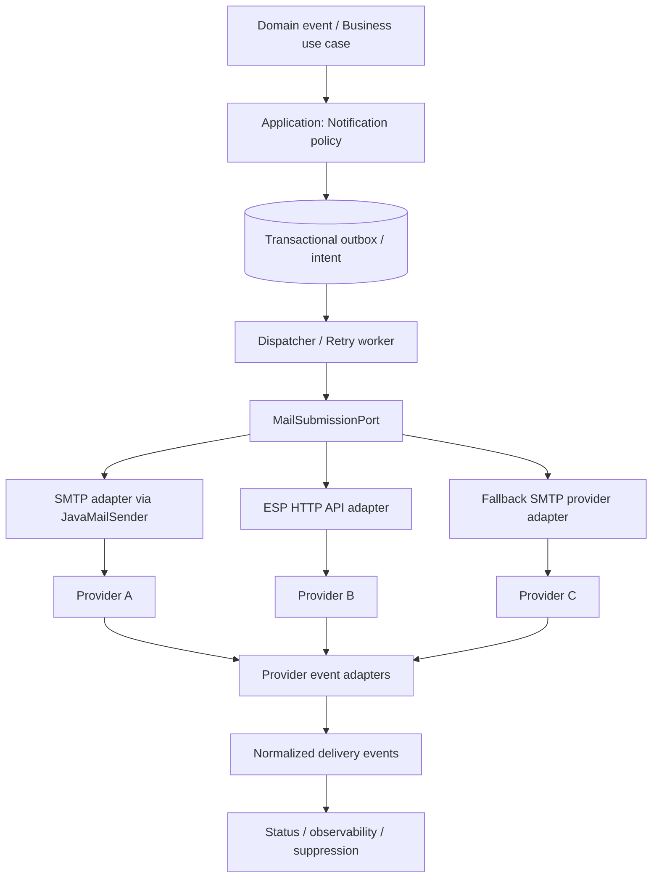

# Tránh phụ thuộc tính năng riêng khi không cần

Một ứng dụng Spring Boot gửi OTP, hóa đơn và thông báo giao dịch qua nhà cung cấp SMTP A. Ở phiên bản đầu tiên, lập trình viên dùng API mẫu email của A, thẻ phân loại `X-A-Campaign-Id`, cơ chế lên lịch `send_at` và trạng thái `delivered` theo webhook riêng. Một năm sau, doanh nghiệp cần chuyển một phần lưu lượng sang nhà cung cấp B để đáp ứng yêu cầu vùng dữ liệu hoặc dự phòng sự cố. Đến lúc đó, domain service, DTO, database, retry worker và dashboard đều đang dùng khái niệm của A. Chuyển nhà cung cấp không còn là thay cấu hình SMTP mà thành dự án sửa nghiệp vụ quy mô lớn.

Ngược lại, một nhóm khác cố xây framework trừu tượng hỗ trợ mọi tính năng của mọi nhà cung cấp, dù sản phẩm chỉ cần gửi email văn bản và HTML. Kết quả là hàng chục interface, enum, capability flags và nhánh fallback không bao giờ được sử dụng. **Tính khả chuyển không có nghĩa trừu tượng hóa tất cả**; mục tiêu là không phụ thuộc vào tính năng độc quyền **khi nhu cầu nghiệp vụ chưa đòi hỏi nó**.

Trong chương **Nhiều nhà cung cấp** của **Spring Framework Mail**, bài học này chỉ ra cách thiết kế ranh giới phù hợp: dùng chuẩn SMTP/MIME và `JavaMailSender` cho những khả năng chung, giữ dữ liệu nghiệp vụ độc lập với SDK nhà cung cấp, thêm extension có chủ đích khi thực sự cần, và kiểm thử khả năng chuyển đổi mà không đánh đổi bảo mật, tính đúng đắn hoặc khả năng gửi email.

## 1. Hiểu đúng vendor lock-in

**Vendor lock-in** là mức độ một hệ thống bị ràng buộc vào cách hoạt động, dữ liệu, API hoặc quy trình của một nhà cung cấp, khiến thay thế họ trở nên tốn kém hoặc rủi ro.

Trong hệ thống email, lock-in không chỉ nằm ở dòng code gọi SDK:

- **Code:** ứng dụng import lớp `VendorXClient` trong application/domain.
- **Dữ liệu:** bảng notification lưu trực tiếp mã trạng thái độc quyền `X_DELIVERED`.
- **Template:** nội dung email chỉ tồn tại trong dashboard nhà cung cấp.
- **Danh tính gửi:** domain, bounce domain, DKIM, webhook endpoint không được quản lý riêng.
- **Quan sát:** metric, alert và báo cáo chỉ hiểu status name của một ESP.
- **Vận hành:** nhân viên chỉ biết kiểm tra queue, quota và blacklist qua một dashboard.
- **Hành vi:** retry, batch, scheduling hay idempotency giả định nhà cung cấp nào cũng giống nhau.
- **Quy trình:** không có cách export suppression list, lịch sử bounce, template và provider references khi migration.

Độ phụ thuộc tăng khi một quyết định riêng của provider **lan qua nhiều tầng** thay vì được giữ ở adapter và operations.

### 1.1. Thay nhà cung cấp thực chất là thay những gì?

Một hệ thống có thể cần thay:

1. SMTP hostname, port, credentials, TLS mode.
2. Hạ tầng sending identities, SPF/DKIM/DMARC và Return-Path.
3. Tốc độ/quota, IP pool, warm-up.
4. API hoặc SMTP transport và cách xử lý exception.
5. Provider-generated message ID.
6. Webhook chữ ký, payload, thứ tự event.
7. Suppression, unsubscribe và consent integration.
8. Template rendering/tracking nếu đang dùng provider.
9. Tài liệu vận hành, dashboards, alerts và incident runbooks.

Dùng `JavaMailSender` giảm phụ thuộc **transport SMTP**, nhưng không tự giải quyết tất cả phụ thuộc còn lại. Khả chuyển là thuộc tính của **toàn bộ luồng email**, không chỉ lớp SMTP.

### 1.2. Khi nào lock-in là một đánh đổi hợp lý?

Nếu một tính năng riêng đem lại lợi ích có thể đo được — chẳng hạn batch personalization giảm chi phí, event API có signed webhooks đáp ứng kiểm toán, hay routing theo dữ liệu cư trú bắt buộc — phụ thuộc có chủ đích có thể hợp lý.

Câu hỏi không phải “có được dùng SDK độc quyền hay không”, mà là:

- Chức năng đó có phải **yêu cầu thật**?
- Lợi ích so với phương án chuẩn là gì?
- Nếu bỏ provider này, phần nào phải sửa?
- Có khả năng thay thế hoặc degraded mode không?
- Rủi ro bảo mật, dữ liệu và vận hành đã được chấp nhận chưa?

## 2. Các lớp chuẩn và các lớp riêng của nhà cung cấp

| Lớp | Nền tảng thường dùng | Khả năng khả chuyển | Lưu ý |
|---|---|---|---|
| MIME message | RFC 5322, MIME RFC 2045–2049, Jakarta Mail | Cao cho text/HTML/attachments/inline | Mail clients có cách render khác nhau |
| SMTP transport | SMTP, SMTP AUTH, STARTTLS/implicit TLS | Cao nếu providers cung cấp SMTP submission | Quota, reply text và vận hành vẫn khác |
| Spring integration | `JavaMailSender`, `MimeMessageHelper` | Cao trong ứng dụng Spring | Không phải abstraction delivery events |
| HTTP email API | REST/JSON SDK của ESP | Thấp hơn nếu dùng trực tiếp | Có thể có idempotency/tags/templates riêng |
| Provider templates | Template IDs, biến và helpers riêng | Tùy provider | Nội dung có thể khó xuất/port |
| Analytics | Open/click, campaign metrics, reputation | Tùy provider | Semantics tracking không đồng nhất |
| Delivery events | Webhook, DSN, status API | Tùy provider | Cần normalization và deduplication |
| Hạ tầng gửi | IP pool, rDNS, quota, sender verification | Phụ thuộc tài khoản/hạ tầng | Không chuyển được chỉ bằng code |
| Scheduling | Delayed send endpoint / queue của provider | Tùy provider | Cần xác định thời điểm và khả năng hủy |

**Các chuẩn là điểm xuất phát tốt, nhưng không đồng nghĩa mọi SMTP provider có hợp đồng giống hệt nhau.** Chúng chỉ giảm số khía cạnh phải viết lại.

### 2.1. SMTP chuẩn hóa điều gì?

SMTP xác định các bước như `EHLO`, `MAIL FROM`, `RCPT TO`, `DATA` và cách diễn giải cơ bản của reply codes. MIME và RFC 5322 xác định định dạng message.

Nhờ đó, với nhiều dịch vụ cung cấp SMTP submission, ứng dụng có thể dùng cùng:

```java
JavaMailSender sender;
MimeMessage message = sender.createMimeMessage();
// Dựng MIME theo API chuẩn
sender.send(message);
```

Thay provider có thể chủ yếu là thay hostname, credentials và một số transport properties. Tuy vậy, SMTP **không** có API chung để hỏi “quota còn lại”, “email đang ở Inbox”, “mẫu template số 42” hoặc “thời điểm gửi lại tốt nhất cho Gmail”.

### 2.2. Vendor-neutral không có nghĩa lowest common denominator bằng mọi giá

Nếu cần scheduled send, không bắt buộc phải từ bỏ scheduling chỉ vì SMTP không chuẩn hóa tính năng đó. Hãy đưa yêu cầu **“gửi không trước thời điểm T”** vào application contract và quyết định implementation:

- Dùng outbox/scheduler của ứng dụng: áp dụng được trên nhiều providers.
- Dùng native scheduling của một ESP: chỉ khi lợi ích và semantics phù hợp.
- Nếu cần hủy một email đã được scheduled, phải thiết kế quyền hủy và xác nhận state rõ ràng.

Sự trừu tượng phù hợp thể hiện **business requirement**, không sao chép tên field API của một provider vào mọi nơi.

## 3. Phân loại tính năng trước khi quyết định trừu tượng hóa

Có thể chia yêu cầu thành bốn nhóm:

| Nhóm | Ví dụ | Quyết định thường phù hợp |
|---|---|---|
| **Lõi, phổ biến** | To/From, subject, plain/HTML, attachment | Dùng contract trung lập + SMTP/MIME |
| **Chính sách nghiệp vụ** | Consent, thời hạn OTP, loại notification, idempotency | Đặt ở application/domain, không giao cho provider quyết định |
| **Nâng cao, tùy chọn** | Tags, categories, tracking, scheduled send, batch personalization | Extension/capability có opt-in và kiểm tra hỗ trợ |
| **Đặc thù, bắt buộc** | Regulatory archive, data region, provider-specific delivery guarantees, managed templates theo compliance | Cho phép provider-specific adapter, tài liệu hóa lock-in |

### 3.1. Nguyên tắc “đừng trừu tượng hóa dự đoán”

Nếu ứng dụng chỉ gửi hóa đơn và OTP, không cần thiết kế sẵn interface:

```java
interface AllPossibleEmailFeatures {
    void createProviderTemplate(...);
    void scheduleVendorCampaign(...);
    void triggerRecipientJourney(...);
    void provisionDedicatedIp(...);
    void queryGlobalReputationScore(...);
}
```

Đây là tập tính năng không cùng một hợp đồng nghiệp vụ. Nó trộn transport, marketing, hạ tầng và analytics, lại khóa kiến trúc vào giả định về những providers chưa được lựa chọn.

Hãy bắt đầu bằng **một use case nhỏ có thật**, rồi mở rộng khi yêu cầu xuất hiện.

### 3.2. Bảng quyết định “có cần tính năng riêng không?”

Trước khi thêm một dependency độc quyền, trả lời:

1. Mục tiêu nghiệp vụ được phát biểu thế nào nếu bỏ tên provider?
2. SMTP/MIME/outbox đã đáp ứng đủ chưa?
3. Có thể thực hiện chức năng ở application mà không mất nhiều hiệu năng không?
4. Có yêu cầu latency/cost/compliance khiến giải pháp chuẩn không đáp ứng?
5. Nếu một provider không hỗ trợ, hệ thống **thất bại rõ ràng** hay có fallback được chấp nhận?
6. Migration cần chuyển những dữ liệu và quy trình nào?
7. Có thể đo lợi ích bằng SLO, throughput, cost hoặc vận hành không?

Không cần trả lời “có thể thêm trong tương lai” cho tất cả tính năng. Yêu cầu hiện tại và lợi ích đo được phải là căn cứ.

## 4. Kiến trúc Ports and Adapters giữ business logic độc lập

Một ranh giới lành mạnh:



### 4.1. Tầng domain/application quyết định *cần gửi gì*

Application biết:

- Đơn hàng đã thanh toán.
- Người nhận và consent phù hợp.
- Email cần loại xác nhận nào.
- Mốc thời gian cần gửi và thời hạn.
- Một business event tạo bao nhiêu notification intents.
- Trạng thái nghiệp vụ nào phải tồn tại khi tạo intent.

Application **không cần biết**:

- `vendorTemplateId`.
- Tên exception do ESP A trả về.
- JSON field `message_id` của ESP B.
- HTTP header secret của webhook ESP C.
- SMTP connection count của ESP D.

### 4.2. MailSubmissionPort quyết định *đã giao cho provider tới đâu*

Port trả về kết quả ở ranh giới submission, không hứa một điều không quan sát được. Ví dụ:

```java
public interface MailSubmissionPort {
    SubmissionOutcome submit(OutgoingEmail email);
}
```

Contract cần định nghĩa rõ:

- `submit` là một attempt, không phải retry toàn bộ lifecycle.
- `ACCEPTED` nghĩa provider/relay chấp nhận submission theo tín hiệu của transport.
- `TEMPORARY_REJECTION`/`PERMANENT_REJECTION` chỉ dùng khi có bằng chứng.
- `UNKNOWN` nghĩa kết quả có thể đã được chấp nhận nhưng client không xác định được.
- Không gọi `DELIVERED` chỉ vì `JavaMailSender.send(...)` trả về bình thường.

Phân biệt những mức chắc chắn này làm thiết kế khả chuyển **đáng tin hơn** so với một boolean `sendSuccessfully`.

## 5. Thiết kế OutgoingEmail trung lập với nhà cung cấp

Một mô hình gửi mail nên biểu diễn nội dung/ý định thực sự, không chứa API field của bất kỳ ESP nào.

### 5.1. DTO lõi

Ví dụ Java 17+:

```java
package com.example.notifications;

import java.time.Instant;
import java.util.List;
import java.util.Objects;
import java.util.UUID;

public record OutgoingEmail(
        UUID notificationId,
        String idempotencyKey,
        String from,
        String to,
        String replyTo,
        String subject,
        String plainText,
        String htmlText,
        List<MailAttachment> attachments,
        Instant expiresAt,
        NotificationPurpose purpose) {

    public OutgoingEmail {
        Objects.requireNonNull(notificationId);
        Objects.requireNonNull(idempotencyKey);
        Objects.requireNonNull(from);
        Objects.requireNonNull(to);
        Objects.requireNonNull(subject);
        Objects.requireNonNull(plainText);
        Objects.requireNonNull(attachments);
        Objects.requireNonNull(purpose);
        attachments = List.copyOf(attachments);
    }
}

public record MailAttachment(
        String fileName,
        String contentType,
        byte[] bytes) {

    public MailAttachment {
        Objects.requireNonNull(fileName);
        Objects.requireNonNull(contentType);
        bytes = Objects.requireNonNull(bytes).clone();
    }

    @Override
    public byte[] bytes() {
        return bytes.clone();
    }
}

public enum NotificationPurpose {
    ORDER_CONFIRMATION,
    INVOICE,
    PASSWORD_RESET,
    MARKETING
}
```

Các type được viết liền nhau để giải thích mô hình; trong dự án Java thông thường, **mỗi public top-level type** cần đặt trong file `.java` riêng phù hợp tên class.

Đây là model minh họa cho payload nhỏ. Với PDF vài MB hoặc attachment lớn:

- Lưu object-storage reference, content hash, content length và MIME metadata.
- Mở stream qua abstraction ở infrastructure.
- Kiểm soát quyền truy cập, TTL và lifecycle của file.
- Không giữ toàn bộ bytes trong outbox row hoặc memory mà không tính toán tài nguyên.
- Bảo đảm retry vẫn đọc được cùng nội dung đã snapshot.

### 5.2. Vì sao không có vendorTemplateId?

Một DTO như:

```java
record OutgoingEmail(
    String to,
    String vendorTemplateId,
    Map<String, Object> vendorMergeVars,
    String vendorCampaignCategory) {}
```

đã ép mọi provider tương lai phải hiểu template engine và campaign taxonomy của provider hiện tại. Nếu nghiệp vụ chỉ yêu cầu “gửi hóa đơn bằng tiếng Việt”, dữ liệu đúng nên là template **do ứng dụng sở hữu** hoặc một notification content contract trung lập.

Nếu sau này native template rendering mang lại lợi ích rõ, có thể bổ sung một **extension** tách biệt, không sửa domain DTO thành bản sao JSON của ESP.

### 5.3. Validation ở đúng tầng

Mô hình trung lập không có nghĩa bỏ validation:

- From thuộc sending identity đã được cấp phép.
- To hợp lệ về cú pháp và theo policy.
- Subject không chứa header injection.
- HTML escape dữ liệu không đáng tin.
- Attachment filename và Content-Type phù hợp.
- Notification không quá `expiresAt`.
- Không gửi marketing nếu thiếu consent.
- Không đưa password/token nhạy cảm vào logs.

Không giao các điều kiện nghiệp vụ này hoàn toàn cho provider; thông báo bị provider từ chối không thay thế một application contract đúng.

## 6. Chuẩn hóa kết quả submission nhưng không làm mất sự bất định

Một contract kết quả có thể là:

```java
package com.example.notifications;

public enum SubmissionState {
    ACCEPTED_BY_RELAY,
    TEMPORARY_REJECTION,
    PERMANENT_REJECTION,
    UNKNOWN
}

public record SubmissionOutcome(
        SubmissionState state,
        String providerKey,
        String providerReference,
        String diagnosticCode) {
}
```

### 6.1. Tránh boolean success

`boolean send()` không diễn đạt được:

- SMTP server trả `451` (temporary failure).
- Provider trả `550` (permanent rejection với request đó).
- TCP connection thất bại trước khi gửi.
- Timeout sau SMTP DATA làm submission outcome unknown.
- Provider trả HTTP 202 “queued for processing”.
- Một phần recipients được chấp nhận, phần khác bị từ chối.

Không phải mọi tình huống đều phải được xử lý cùng một cách. Một kết quả trung lập cần bảo vệ khả năng phân loại và phục hồi.

### 6.2. Không ép mọi provider trả cùng độ giàu dữ liệu

SMTP chuẩn không nhất thiết trả provider message ID có thể tra trạng thái về sau. HTTP API thường có remote request/message ID. Vì vậy:

- `providerReference` được phép `null`.
- `diagnosticCode` là mã **đã chuẩn hóa**, không phải raw response có PII.
- Provider-specific IDs có thể lưu ở bảng attempt metadata, không lan vào domain logic.
- Không tạo ID provider giả để thỏa một contract quá cứng.

### 6.3. Trạng thái accepted không phải delivered

`ACCEPTED_BY_RELAY` nghĩa relay đầu tiên đồng ý nhận công việc theo contract được cấu hình. Sau đó nó có thể:

- Chuyển tiếp thành công.
- Trì hoãn vì receiving MX.
- Bounce.
- Suppress theo policy.
- Bị nhà cung cấp chặn do account/reputation.

Delivery events phải đi qua luồng xử lý **bất đồng bộ** khác, thay vì được đoán từ submission result.

## 7. Dùng JavaMailSender làm adapter SMTP trung lập

Trong Spring Framework Mail, `JavaMailSender` là một điểm tích hợp phù hợp khi providers đều cung cấp SMTP submission.

### 7.1. Ví dụ SMTP adapter

```java
package com.example.notifications.smtp;

import com.example.notifications.*;
import jakarta.mail.MessagingException;
import jakarta.mail.internet.MimeMessage;
import org.springframework.core.io.ByteArrayResource;
import org.springframework.mail.MailException;
import org.springframework.mail.javamail.JavaMailSender;
import org.springframework.mail.javamail.MimeMessageHelper;

public final class SmtpMailAdapter implements MailSubmissionPort {

    private final JavaMailSender sender;
    private final String providerKey;

    public SmtpMailAdapter(
            JavaMailSender sender,
            String providerKey) {
        this.sender = sender;
        this.providerKey = providerKey;
    }

    @Override
    public SubmissionOutcome submit(OutgoingEmail email) {
        MimeMessage message = sender.createMimeMessage();

        try {
            MimeMessageHelper helper =
                    new MimeMessageHelper(message, true, "UTF-8");

            helper.setFrom(email.from());
            helper.setTo(email.to());

            if (email.replyTo() != null) {
                helper.setReplyTo(email.replyTo());
            }

            helper.setSubject(email.subject());

            if (email.htmlText() == null) {
                helper.setText(email.plainText(), false);
            } else {
                helper.setText(
                        email.plainText(),
                        email.htmlText());
            }

            for (MailAttachment attachment : email.attachments()) {
                helper.addAttachment(
                        attachment.fileName(),
                        new ByteArrayResource(attachment.bytes()),
                        attachment.contentType());
            }
        } catch (MessagingException ex) {
            // Lỗi xây dựng payload, không phải SMTP temporary failure.
            throw new IllegalArgumentException(
                    "Cannot prepare outgoing MIME message", ex);
        }

        try {
            sender.send(message);
            return new SubmissionOutcome(
                    SubmissionState.ACCEPTED_BY_RELAY,
                    providerKey,
                    null, // SMTP chuẩn không bắt buộc có provider ID.
                    null);
        } catch (MailException ex) {
            // Ví dụ giữ lỗi cho classifier bên ngoài.
            // Production: phân loại cause/SMTP stage; không mặc định retry.
            throw ex;
        }
    }
}
```

Đây là minh họa cách đóng gói, không phải toàn bộ production implementation. Lớp `MailSubmissionPort`, `OutgoingEmail` và kết quả đã được định nghĩa ở các phần trước. Ở hệ thống thật cần policy cho message size, address validation, exception taxonomy và cách xử lý partial recipient failure.

### 7.2. Điều làm adapter này khả chuyển

- Business service không gọi `MimeMessageHelper`.
- DTO không biết ESP A/B.
- Content của email do ứng dụng chuẩn bị.
- Sender của mỗi provider được cấu hình riêng.
- SMTP-specific exceptions không tràn qua ranh giới application nếu có error translator phù hợp.
- Provider thay đổi không buộc sửa use case `OrderConfirmed`.

### 7.3. Đừng hiểu nhầm adapter đơn giản là đủ cho mọi trường hợp

`sender.send(message)` có thể ném `MailSendException` với nhiều exception con; timeout có thể xảy ra ở những thời điểm khác nhau. Nếu adapter chỉ bắt `MailException` rồi trả `TEMPORARY_REJECTION` cho mọi lỗi, có thể retry một message mà relay đã nhận.

Một bộ phân loại production cần đọc:

- `MailException` subtype.
- Jakarta Mail `MessagingException.getNextException()` và cause chain.
- SMTP reply code và enhanced status code nếu provider trả.
- Giai đoạn kết nối, AUTH, RCPT, DATA nếu có evidence.
- Tình trạng partial failure theo recipient.
- Chính sách retry của ESP.

Giữ `UNKNOWN` cho trường hợp không đủ bằng chứng. **Không dùng portability làm lý do xóa thông tin quan trọng về lỗi.**

## 8. Cấu hình SMTP cho hai nhà cung cấp

Khi ứng dụng chỉ dùng một provider tại một thời điểm, Spring Boot có thể bind chuẩn:

```yaml
spring:
  mail:
    host: ${SMTP_HOST}
    port: ${SMTP_PORT:587}
    protocol: smtp
    username: ${SMTP_USERNAME}
    password: ${SMTP_PASSWORD}
    default-encoding: UTF-8
    properties:
      "[mail.smtp.auth]": true
      "[mail.smtp.starttls.enable]": true
      "[mail.smtp.starttls.required]": true
      "[mail.smtp.ssl.checkserveridentity]": true
      "[mail.smtp.connectiontimeout]": 5000
      "[mail.smtp.timeout]": 10000
      "[mail.smtp.writetimeout]": 10000
```

Đây là cấu hình cho provider yêu cầu STARTTLS ở 587. Với implicit TLS ở 465 cần dùng `mail.smtp.ssl.enable=true` theo provider và không máy móc bật cùng chế độ. Thay provider **không được** tạo fallback sang cleartext hay tắt hostname verification khi TLS báo lỗi.

### 8.1. Multi-provider không phải là sao chép spring.mail.* hai lần

`spring.mail.*` trong cấu hình auto-configuration thông thường đại diện một cấu hình sender. Nếu cần đồng thời hai SMTP providers, ứng dụng có thể quản lý hai `JavaMailSenderImpl` beans được tạo từ cấu hình riêng và đặt tên rõ:

```yaml
app:
  email:
    providers:
      primary:
        kind: smtp
        host: ${PRIMARY_SMTP_HOST}
        port: 587
        username: ${PRIMARY_SMTP_USERNAME}
        password: ${PRIMARY_SMTP_PASSWORD}
      secondary:
        kind: smtp
        host: ${SECONDARY_SMTP_HOST}
        port: 587
        username: ${SECONDARY_SMTP_USERNAME}
        password: ${SECONDARY_SMTP_PASSWORD}
```

Các khóa `app.email.providers.*` là **configuration riêng của ứng dụng**, không phải thuộc tính chuẩn Spring Boot tự sinh hai sender. Cần viết `@ConfigurationProperties` và tạo beans/adapters tương ứng.

### 8.2. Tách secret theo provider

Mỗi account nên có:

- SMTP credentials hoặc API token riêng.
- Secret rotation riêng.
- Domain/identity verification riêng.
- TLS hostname/trust configuration đúng.
- Quota/account mapping riêng.
- Bằng chứng audit và quyền truy cập tối thiểu.

Không copy credential của provider A sang B hay tạo một wildcard trust configuration để “mọi provider đều hoạt động”.

## 9. HTTP API adapter là một nhánh implementation, không phải domain mới

Một ESP có thể cung cấp HTTP API với batch send, scheduling hoặc idempotency key. Nếu business yêu cầu, vẫn giữ `MailSubmissionPort` trung lập và triển khai adapter:

```java
public final class HttpEspMailAdapter
        implements MailSubmissionPort {

    private final EmailProviderHttpClient client;
    private final String providerKey;

    public HttpEspMailAdapter(
            EmailProviderHttpClient client,
            String providerKey) {
        this.client = client;
        this.providerKey = providerKey;
    }

    @Override
    public SubmissionOutcome submit(OutgoingEmail email) {
        ProviderPayload payload =
                ProviderPayloadMapper.from(email);

        ProviderResponse response = client.submit(
                payload,
                email.idempotencyKey());

        return ProviderResponseMapper.toSubmissionOutcome(
                providerKey, response);
    }
}
```

Các lớp `EmailProviderHttpClient`, `ProviderPayload` và mapper trong ví dụ là **placeholder do adapter tự định nghĩa**, không phải SDK cụ thể. Điều quan trọng nằm ở ranh giới:

- Vendor SDK chỉ xuất hiện trong `infrastructure/providerX`.
- Application không parse JSON của vendor.
- Mã HTTP 202 có ý nghĩa theo contract ESP, không mặc định “delivered”.
- Idempotency của provider chỉ có nếu API thực sự hỗ trợ và có scope/TTL xác định.
- Timeout sau gửi request có thể vẫn có outcome unknown.

### 9.1. Khi SMTP và HTTP API khác capability

HTTP API có thể cung cấp provider ID hoặc batch scheduling mà SMTP không có. Contract lõi không nên yêu cầu cả hai khả năng ở mọi adapter.

Nếu use case **bắt buộc** một capability không có ở SMTP, routing policy phải chọn adapter hỗ trợ hoặc trả lỗi rõ; không âm thầm bỏ yêu cầu.

## 10. Nên đặt template rendering ở đâu?

Một nguồn lock-in lớn là đặt toàn bộ nội dung email trong dashboard ESP.

### 10.1. Render trong ứng dụng

Ví dụ:

```text
InvoiceIssued event
     |
     v
TemplateRenderer(Thymeleaf/FreeMarker)
     |
     +--> text/plain
     +--> text/html
     +--> subject
     |
     v
OutgoingEmail
     |
     v
SMTP / HTTP adapter
```

Ưu điểm:

- Template được version cùng code/content repository.
- Có thể test logic/escaping bằng unit tests.
- Không buộc provider hỗ trợ engine/variable syntax giống nhau.
- Có thể so sánh nội dung giữa adapters.
- Có thể snapshot template version trong outbox.

Trade-off:

- Ứng dụng chịu CPU/rendering và cache template.
- Cần quản lý localization, branding và asset URLs.
- Cần hệ thống preview/editor nếu marketing team muốn tự sửa template.

### 10.2. Render trong provider

Một số ESP hỗ trợ managed template với template ID, helpers, dynamic variables và A/B testing.

Lợi ích có thể có:

- Nhóm nội dung chỉnh sửa mà không deploy ứng dụng.
- Batch personalization/campaign workflows.
- Thống kê và kiểm thử riêng tại provider.
- Giảm dữ liệu payload gửi từ application.

Nhưng các template IDs, helpers và workflow có thể không portable. Nếu business quyết định dùng, nên:

- Lưu **logical template key** trong application như `INVOICE_V2`.
- Giữ mapping `logicalKey -> providerTemplateId` ở adapter/config.
- Version template và quy trình publish rõ ràng.
- Có kế hoạch export/migrate.
- Kiểm tra render parity trên provider thay thế.
- Không nhúng provider template IDs vào domain events.

### 10.3. Fallback template phải có nghĩa đúng

Nếu native template không khả dụng, có thể fallback sang render trong ứng dụng **chỉ khi** kết quả đáp ứng yêu cầu nội dung và kiểm toán. Không tự đổi nội dung pháp lý, điều khoản hoặc bản địa hóa chỉ để gửi được.

Nếu cần giữ một template được bên pháp chế phê duyệt chính xác, fallback có thể phải **fail closed** cho đến khi có version tương đương.

## 11. Các tính năng riêng nên là optional capabilities

Thay vì tạo interface “mọi thứ” hoặc phương thức chứa hàng loạt tham số tùy chọn:

```java
submit(
    email,
    vendorCategory,
    vendorTemplateId,
    vendorCampaignId,
    vendorSendAt,
    vendorClickTracking,
    vendorUserAgentMode,
    vendorSpecialFlag
);
```

hãy giữ core contract nhỏ và thêm extension nơi cần thiết.

### 11.1. Ví dụ capability descriptor

```java
public record ProviderCapabilities(
        boolean nativeScheduling,
        boolean nativeTemplates,
        boolean providerIdempotency,
        boolean deliveryWebhooks,
        boolean batchPersonalization,
        boolean trackingControls) {
}
```

Descriptor có thể hữu ích khi application cần **lựa chọn provider tại runtime**. Nhưng:

- Giá trị phải dựa trên phiên bản API, account tier, region, cấu hình và hợp đồng thật.
- Capability “có” không bảo đảm lúc nào cũng có quyền thực hiện.
- Một boolean không thể mô tả hết giới hạn (ví dụ scheduling tối đa 72 giờ).
- Không tạo capability matrix khổng lồ cho những tính năng không dùng.

### 11.2. REQUIRED, PREFERRED và DISABLED

Với một tính năng có ý nghĩa nghiệp vụ, policy có thể biểu diễn:

| Mức | Ý nghĩa | Khi provider không hỗ trợ |
|---|---|---|
| **REQUIRED** | Không được bỏ qua | Không gửi hoặc chọn provider đủ khả năng |
| **PREFERRED** | Có lợi nhưng không thiết yếu | Dùng fallback được phê duyệt |
| **DISABLED** | Không muốn sử dụng | Adapter không bật |
 
Ví dụ tracking click cho một email marketing có thể được bật nếu được phép, nhưng tracking open không phải yêu cầu của email OTP. Ngược lại, “không gửi trước giờ T” có thể là REQUIRED, còn triển khai scheduling bằng provider hay outbox là quyết định hạ tầng.

### 11.3. Không đặt provider feature name vào business policy

Policy nên nói:

```text
sendNotBefore = 2026-11-13T08:00:00Z
purpose = MARKETING
trackingConsent = false
```

thay vì:

```text
vendorSendAt = ...
vendorEnableOpenTracking = ...
```

**Từ vựng nghiệp vụ được sở hữu bởi ứng dụng**; adapter chuyển thành provider options khi có khả năng và có quyền.

## 12. Phân biệt “không hỗ trợ” với “không cần”

Có ba tình huống rất khác nhau:

1. Ứng dụng không cần một capability → **không nên thiết kế phụ thuộc**.
2. Ứng dụng cần capability nhưng provider hiện không hỗ trợ → **cần router/fallback hoặc thay provider**.
3. Ứng dụng cần capability nhưng đang tạm unavailable → **cần xử lý lỗi, retry hoặc failover**.

Không diễn giải tất cả thành “bỏ qua option khi gửi”.

Ví dụ email chứa tài liệu bắt buộc: nếu provider không hỗ trợ attachment qua endpoint đang dùng, **không** gửi message thiếu attachment rồi coi success. Chọn SMTP/MIME adapter khác hoặc fail có kiểm soát.

### 12.1. Fallback phải giữ business semantics

Một fallback an toàn cần bảo toàn:

- Recipient và consent.
- From identity được xác thực.
- Subject và nội dung.
- Attachment bắt buộc.
- Deadline/expiration.
- Dữ liệu localization.
- Privacy/residency requirements.
- Idempotency policy.

Những thứ chỉ liên quan tối ưu như một tag analytics có thể bị bỏ qua nếu business không phụ thuộc. Những thứ làm sai nội dung hoặc tính hợp lệ thì không.

## 13. Metadata của provider: lưu ở attempt, không nhét vào domain

Một thiết kế dữ liệu linh hoạt:

```text
notification_intent
  id
  business_event_id
  purpose
  recipient_snapshot
  content_version
  idempotency_key
  created_at
  status

mail_submission_attempt
  attempt_id
  notification_id
  provider_key
  provider_account
  provider_reference_nullable
  normalized_result
  normalized_error_category
  provider_diagnostic_reference_nullable
  started_at
  finished_at
```

`provider_reference_nullable` có thể là một ID dùng để đối chiếu dashboard/webhook, nhưng business use case không được dùng nó làm business key.

### 13.1. Lý do tách notification identity và provider identity

- Một notification có thể được attempt qua nhiều providers.
- Một provider có thể trả nhiều event cho cùng message.
- Một provider có thể đổi format ID theo API version.
- Một timeout có thể không trả ID dù provider đã accepted.
- Domain entity có lifecycle dài hơn account/ESP.
- Analytics cần group theo provider nhưng audit nghiệp vụ theo notification ID.

### 13.2. Không lưu payload provider làm nguồn chân lý duy nhất

Có thể giữ raw provider request/response đã **redact** theo policy để debug, nhưng dữ liệu nguồn cho retry nên là notification intent/content snapshot trung lập. Nếu chỉ lưu JSON của ESP A, lúc chuyển sang ESP B sẽ phải reverse-engineer các field của A để gửi lại.

## 14. Webhook và delivery events: normalize, đừng ép mọi provider giống hệt

Đa số ESP cung cấp webhook/status API khác nhau. Một provider có `delivered` khi recipient MX chấp nhận; provider khác có trạng thái `processed`, `deferred`, `dropped`, `bounce` với định nghĩa riêng.

### 14.1. Mô hình event trung lập

```java
public enum DeliveryEventType {
    SUBMISSION_ACCEPTED,
    DELIVERY_DEFERRED,
    DELIVERED,
    BOUNCED,
    COMPLAINT,
    SUPPRESSED,
    UNKNOWN
}

public record MailProviderEvent(
        String providerKey,
        String providerEventId,
        String providerMessageId,
        DeliveryEventType type,
        Instant occurredAt,
        Instant receivedAt,
        String normalizedReasonCode) {
}
```

Trong dự án Java thật, đặt các public types vào file riêng. Có thể cần recipient identity, account scope, webhook version và raw event reference để ánh xạ nhiều người nhận.

### 14.2. Event adapter làm gì?

- Xác minh chữ ký webhook theo cơ chế **của từng provider**.
- Chống replay theo window/chính sách.
- Parse payload và version.
- Map providerMessageId/recipient tới notification/attempt.
- Deduplicate provider event ID hoặc composite key đúng.
- Normalize event type và reason.
- Ghi occurredAt và receivedAt riêng.
- Xử lý event đến trễ hoặc đảo thứ tự.
- Không double-count delivered/complaint.
- Quarantine event không nhận diện được thay vì tạo trạng thái sai.

### 14.3. Đừng tạo cảm giác chính xác giả

Nếu ESP A phân biệt `soft_bounce` và `deferred` còn ESP B gộp chúng thành một status, model trung lập có thể chỉ có `DELIVERY_DEFERRED` kèm reason. Khi cần phân tích đặc thù, giữ provider-specific metadata ở storage/log có kiểm soát.

Ngược lại, một provider **không có webhook** không được tự tạo `DELIVERED` sau khi `send()` thành công. Trạng thái phải là `SUBMITTED` hoặc kết quả tương đương.

## 15. Xử lý open/click tracking như một extension, không làm điều kiện gửi

Open/click tracking thường phụ thuộc:

- Tracking pixel.
- Redirect domain.
- Mail client tải hình hay không.
- Chính sách privacy protection.
- Consent và yêu cầu pháp lý.
- Provider tracking ID và webhook formats.
- Link rewriting.

Nếu sản phẩm chỉ cần gửi OTP, tracking opens/clicks thường không phải khả năng lõi. Trói business flow vào một API `open_event` của provider là phụ thuộc không cần thiết.

### 15.1. Open không chứng minh người dùng đọc thư

Image proxy có thể tải ảnh trước, một số client chặn ảnh hoặc tự động tải. Vì vậy “opened” không tương đương “human read” và không được dùng như hard evidence cho giao dịch quan trọng.

### 15.2. Khi cần click analytics

Có thể triển khai extension riêng:

- Tracking được bật có chủ đích và theo consent.
- Link domain thuộc tổ chức/được phê duyệt.
- Không làm hỏng URL, token hoặc chữ ký.
- Không rewrite URL một cách khiến bảo mật bị suy yếu.
- Fallback có policy: nếu tracking không khả dụng, gửi link trực tiếp có được phép không?
- Không gửi password reset token hoặc dữ liệu bí mật vào hệ thống tracking không cần thiết.

Không đồng nhất việc tắt tracking với việc tắt xác thực email SPF/DKIM/DMARC; chúng có vai trò khác nhau.

## 16. Scheduling: nên bắt đầu bằng outbox nếu đó là nhu cầu chung

Giả sử yêu cầu: gửi nhắc lịch hẹn **không trước 08:00 UTC** ngày mai. Nếu chỉ một ESP hỗ trợ `send_at`, ứng dụng có thể dùng lịch gửi ở outbox:

```text
Notification intent
    not_before = 2026-11-13T08:00:00Z
    expires_at = 2026-11-13T09:00:00Z
    status = SCHEDULED
             |
             v
Worker scans due rows
    WHERE not_before <= now
    AND status = SCHEDULED
             |
             v
Quota/rate gate -> submit
```

Điều này tránh phụ thuộc API schedule của ESP nếu ứng dụng đã có worker ổn định.

### 16.1. Lợi ích và giới hạn của scheduling nội bộ

Ưu điểm:

- Cùng quy tắc với mọi provider.
- Dễ thực hiện idempotency/cancel trước submission.
- Có thể ưu tiên traffic và kiểm tra expiry.
- Có audit khi row bị hoãn hoặc hủy.

Giới hạn:

- Ứng dụng chịu trách nhiệm availability của worker.
- Lịch gửi là “không trước T”, **không bảo đảm chính xác tại T** khi quota/outage.
- Cần transaction claim và query/index phù hợp.
- Khi downtime dài, worker cần xử lý stale/expired items.
- Không tự có khả năng recall email đã accepted.

### 16.2. Khi native scheduling có ích

Nếu ESP hỗ trợ lên lịch quy mô lớn, hủy scheduled send chắc chắn và có SLA được chứng minh, có thể đáng sử dụng. Khi đó phải lưu:

- Provider schedule reference.
- Thời điểm nhận lịch, deadline, cancellation status.
- Kết quả hủy có chắc chắn hay không.
- Kịch bản provider outage.
- Hạn chế tối đa bao xa trong tương lai.
- Cách migration các lịch chưa gửi.

Nếu migrate provider, chỉ đổi adapter không đủ khi có hàng triệu lịch gửi đang nằm trong provider cũ.

## 17. Batch personalization và danh sách người nhận

Một số ESP cung cấp batch với merge variables riêng:

```json
{
  "template_id": "provider-template-42",
  "personalizations": [
    {"to": "a@example.net", "variables": {"name": "An"}},
    {"to": "b@example.net", "variables": {"name": "Binh"}}
  ]
}
```

Đây là **ví dụ mô tả** một API giả định, không khẳng định schema có thật của một ESP cụ thể. Nếu nghiệp vụ chỉ có vài trăm hóa đơn giao dịch, render từng email bằng template engine rồi gửi qua SMTP có thể dễ kiểm soát hơn.

### 17.1. Batch không nhất thiết tiết kiệm theo mọi metric

Batch có thể giảm số HTTP calls nhưng:

- Provider vẫn đếm quota theo recipients.
- Partial failure có thể xảy ra.
- Một call có thể chứa hàng nghìn recipient identities.
- Retry cả batch có thể gửi trùng những recipient đã accepted.
- Tracking và provider message IDs có thể theo recipient.
- Batch lớn cần giới hạn payload và privacy controls.

Nếu cần batch theo hiệu năng, nên giữ **mỗi notification intent có identity riêng** và lưu mapping request → per-recipient outcome, không đổi hết business model sang một danh sách JSON độc quyền.

### 17.2. Không lộ người nhận qua To/Cc

Một provider gửi batch có thể đảm bảo personalization từng recipient, nhưng `MimeMessage` gửi chung với danh sách To/Cc không tương đương khả năng đó. Với email cá nhân, không gom recipients vào header chung chỉ vì muốn throughput tăng.

## 18. Tags và categories: dùng từ vựng nội bộ

Nếu ESP A cho phép `category="password-reset"` còn ESP B dùng `tag="auth"`, application nên lưu:

```text
notificationPurpose = PASSWORD_RESET
notificationPriority = HIGH
tenantClass = TRANSACTIONAL
```

Adapter mapping:

| Khái niệm ứng dụng | ESP A | ESP B |
|---|---|---|
| `PASSWORD_RESET` | category `password-reset` | tag `auth` |
| `INVOICE` | category `billing` | tag `transactional_invoice` |
| `MARKETING` | category `campaign` | tag `promotion` |

Mapping chỉ cần khi những tags phục vụ analytics/cost routing thực sự có ích. Không bắt mọi provider phải hỗ trợ tag hoặc chặn gửi OTP khi một tag thống kê tùy chọn không tồn tại.

### 18.1. Tránh truyền metadata tùy ý ra headers

Không tự đưa tenant ID, customer ID, internal invoice key hoặc dữ liệu nhạy cảm vào header `X-Custom-...` với lý do analytics. Headers có thể đi qua nhiều relay và đến người nhận.

Nếu cần correlation, dùng opaque correlation ID đã đánh giá privacy; provider ID và notification ID nên lưu trong database nội bộ và events với quyền truy cập phù hợp.

## 19. Quota, giới hạn và chọn nhà cung cấp: độc lập về giao diện, không độc lập về chính sách

Hai providers có thể đều chấp nhận MIME message qua SMTP nhưng có giới hạn hoàn toàn khác nhau:

| Khía cạnh | Provider A | Provider B |
|---|---|---|
| Đơn vị quota | Recipients/24h | Messages/calendar day |
| Tốc độ | Recipients/giây | Connections + burst requests |
| Kích thước MIME | Theo account | Theo endpoint |
| Thời điểm reset | Rolling window | Calendar window |
| Bounce handling | Webhook chi tiết | Dashboard/DSN |
| SMTP submit | Có | Có |
| API idempotency | Chỉ HTTP API | Không có |
| Native scheduled send | Có | Không |

Bảng trên là ví dụ giả định để chỉ ra sự khác biệt, không đại diện nhà cung cấp cụ thể.

**Trừu tượng hóa transport không xóa những giới hạn vật lý và thương mại này.** Một `MailSubmissionPort` chung có thể gửi qua cả A và B, nhưng dispatcher vẫn phải quản lý quota/rate và recipient cost theo từng account.

### 19.1. Chọn provider trước khi reserve quota

Luồng hợp lý:

```text
Notification intent
     |
     v
Policy: region / consent / required capabilities
     |
     v
Provider selection
     |
     v
Check sender identity + account health
     |
     v
Reserve quota/rate/concurrency capacity
     |
     v
Submit through selected adapter
     |
     v
Persist attempt result
```

Không dùng một limiter 100 requests/giây chung nếu mỗi provider đếm recipient units và windows khác nhau. Nếu failover sang B, phải dùng policy quota của B, không copy token budget của A.

### 19.2. Capability không thay health

Một provider có thể **hỗ trợ** attachment và scheduling nhưng:

- Account bị suspend.
- SMTP AUTH thất bại.
- Quota hết.
- Đường mạng không kết nối.
- Sender identity chưa verify.
- Webhook endpoint bị lỗi.
- Một region bị outage.

Do đó, routing cần phân biệt:

- **Static capability:** tính năng có thể hỗ trợ.
- **Configured entitlement:** account hiện có quyền dùng.
- **Current health/availability:** có thể phục vụ ngay không.
- **Policy eligibility:** có được phép dùng với notification này không.
- **Remaining capacity:** có đủ quota/rate hiện tại không.

Không gọi tất cả là `supports=true`.

## 20. Provider router không nên chỉ là một câu if/else theo lỗi

Một router có thể quyết định provider dựa trên các yêu cầu trung lập:

```java
public record DeliveryRequirements(
        String dataRegion,
        boolean attachmentRequired,
        boolean deliveryEventsRequired,
        boolean nativeSchedulingRequired,
        NotificationPurpose purpose) {
}

public interface ProviderSelector {
    SelectedProvider select(
            OutgoingEmail email,
            DeliveryRequirements requirements);
}

public record SelectedProvider(
        String providerKey,
        MailSubmissionPort adapter) {
}
```

Lớp `ProviderSelector` sử dụng inventory capability, cấu hình account, trạng thái health/quota và policy; không nằm trong domain aggregate.

### 20.1. Nguyên tắc về tính xác định

Để audit một notification:

- Ghi nhận provider đã chọn cho từng attempt.
- Ghi lý do lựa chọn/failover dạng mã có cấu trúc.
- Không đổi provider giữa chừng mà không lưu attempt mới.
- Có thể tái dựng kết quả từ policy version và config snapshot khi cần.
- Không chọn provider bằng random một cách không kiểm soát nếu yêu cầu residency/compliance nghiêm ngặt.

Việc thay đổi policy ở thời điểm retry phải được thiết kế: notification chưa gửi có thể dùng policy mới, nhưng các ràng buộc recipient/region/content không được đổi ngầm.

### 20.2. Ưu tiên đơn giản trước

Nếu sản phẩm chỉ có một provider và yêu cầu dự phòng chưa xuất hiện:

```java
MailSubmissionPort port = smtpAdapter;
```

có thể là đủ. Thêm interface port từ đầu là hợp lý nếu tách application khỏi transport. Nhưng triển khai sẵn weighted routing, canary routing, dynamic pricing optimizer và năm adapter giả khi chưa có nhu cầu dễ làm tăng bề mặt lỗi.

Khi thêm provider thứ hai, bắt đầu bằng **một routing rule được giải thích rõ**, sau đó tăng dần mức phức tạp.

## 21. Failover: khả chuyển không cho phép gửi lại tùy tiện

Một lỗi vận hành nguy hiểm:

```java
try {
    providerA.submit(email);
} catch (Exception ex) {
    providerB.submit(email);
}
```

Đoạn này giả định mọi exception đều chứng minh A chưa nhận email. Điều đó **sai** khi timeout xảy ra sau khi request/DATA đã được gửi.

### 21.1. Bốn trường hợp cần phân biệt

| Kết quả primary | Có thể failover tự động? | Lý do |
|---|---|---|
| Chưa gọi provider vì local quota gate từ chối | Có thể, nếu B đủ điều kiện | Primary chưa có submission attempt |
| Lỗi kết nối được xác minh trước khi gửi message | Có thể theo retry/failover policy | Chưa có bằng chứng message được primary nhận |
| SMTP/HTTP response từ chối rõ ràng | Tùy loại lỗi và chính sách | Permanent data failure không sửa được bằng đổi provider |
| Timeout sau SMTP DATA hoặc HTTP request đã được truyền, outcome unknown | Không mặc định | Primary có thể đã accepted; secondary tạo duplicate |

### 21.2. Idempotency key không tự áp dụng giữa hai providers

Giả sử logical notification có key `order-confirmation:ORDER-1`.

- ESP A hỗ trợ request idempotency ở account A.
- ESP B hỗ trợ request idempotency ở account B.
- Cả hai dùng cùng string key.

Điều đó **không tạo idempotency toàn cục**: A và B không chia sẻ storage dedup. Nếu A đã nhận nhưng app timeout, B vẫn có thể nhận cùng notification và gửi trùng.

`Message-ID` MIME cũng không phải cơ chế deduplication được SMTP servers bảo đảm theo chuẩn.

### 21.3. Outbox là nền tảng, không phải exactly-once SMTP

Một thiết kế phù hợp:

```text
notification_intent(id=N-1, key=K)
         |
         v
attempt #1: provider=A, outcome=UNKNOWN
         |
         +--> QUARANTINE / RECONCILE
         |
         +--> after evidence or policy decision
                   |
                   v
            attempt #2: provider=B
```

Cần quy tắc xử lý riêng cho email nhạy với duplicate:

- OTP: email trùng có thể gây nhầm lẫn và làm token cũ/đường dẫn không hợp lệ.
- Hóa đơn: cần đảm bảo cùng invoice version và file.
- Marketing: có thể không nên gửi lại khi outcome uncertain.
- Cảnh báo sự cố cực kỳ quan trọng: tổ chức có thể chủ động chấp nhận rủi ro duplicate.

Không tồn tại chính sách failover duy nhất đúng cho mọi loại email.

## 22. Error taxonomy trung lập nhưng giữ provider evidence

Có thể chuẩn hóa nhóm lỗi thành:

| Normalized category | Ví dụ | Retry mặc định |
|---|---|---|
| `NETWORK_CONNECT` | DNS/connect timeout trước submission | Có giới hạn nếu chắc chắn chưa được nhận |
| `TLS_CONFIGURATION` | PKIX, SAN mismatch, TLS version | Dừng và cảnh báo |
| `AUTHENTICATION` | SMTP AUTH hoặc API token sai | Dừng/điều tra account |
| `RATE_LIMIT` | Provider throttling được xác nhận | Backoff và quota control |
| `TEMPORARY_PROVIDER` | Transient 4xx/5xx theo provider contract | Có điều kiện |
| `PERMANENT_RECIPIENT` | Recipient invalid/rejected | Suppress hoặc yêu cầu sửa dữ liệu |
| `POLICY_REJECTION` | Sender identity, content/size policy | Sửa cấu hình/nội dung |
| `PAYLOAD_PREPARATION` | MIME/template/attachment invalid | Không retry nguyên dạng |
| `SUBMISSION_UNKNOWN` | Mất phản hồi sau transmission | Reconcile hoặc duplicate-aware policy |
| `UNCLASSIFIED` | Chưa có evidence đủ | Không mặc định retry vô hạn |

### 22.1. Không map bằng HTTP status hoặc SMTP code đơn lẻ

- SMTP `4xx` thường mang ý nghĩa temporary failure; nhưng cần biết giai đoạn và lời giải thích của server.
- SMTP `5xx` thường là permanent failure cho thao tác đó, không đồng nghĩa mọi retry sau sửa cấu hình đều vô ích.
- HTTP `429` thường là rate limit; `Retry-After` nếu có phải được parse theo hợp đồng HTTP.
- HTTP `5xx` có thể xảy ra **sau khi** provider đã xử lý request; không tự kết luận message chưa accepted.
- JavaMail `MailSendException` có thể bọc nhiều nested exceptions, bao gồm Jakarta Mail `MessagingException.getNextException()`.

Adapter nên giữ một `providerDiagnosticReference` an toàn để operations truy log/case ID, nhưng không truyền raw credential, recipient address hoặc HTML body sang metrics.

### 22.2. Bảo toàn giai đoạn lỗi nếu biết

Nếu adapter biết chắc lỗi ở **connect** trước SMTP commands, nó có nhiều thông tin hơn một lỗi socket sau `DATA`. Normalized outcome nên cho phép diễn đạt certainty/stage hoặc giữ evidence ở attempt metadata.

Một abstraction quá “sạch” chỉ còn `success=false` sẽ làm failover kém an toàn hơn.

## 23. DKIM, SPF, DMARC và sender identity không khả chuyển chỉ bằng code

Dùng hai SMTP adapters chung một DTO chưa đủ nếu provider B không được phép gửi với domain đang dùng.

Trước khi chuyển traffic:

1. Xác minh domain/sending identity ở provider B.
2. Cấu hình SPF cho envelope sender/Return-Path theo provider.
3. Cấu hình DKIM selector/key và kiểm tra chữ ký thực.
4. Kiểm tra DMARC alignment với header From.
5. Kiểm tra bounce/return-path domain.
6. Kiểm tra TLS submission và account permissions.
7. Đối chiếu IP pool/rDNS/forward DNS nếu provider dùng dedicated outbound IP.
8. Kiểm tra các yêu cầu sender hiện hành của recipient providers.
9. Theo dõi bounce/complaint/reputation sau migration.

### 23.1. From, Reply-To và envelope sender khác nhau

Một email có thể có:

```text
Header From: billing@example.com
Reply-To: support@example.com
Envelope MAIL FROM: bounce.provider.example
Provider outbound MTA EHLO: mailout1.provider.example
```

Các domain không buộc giống hệt nhau, nhưng authentication alignment và sender requirements phải được đáp ứng.

Không đưa `mail.smtp.from` vào domain DTO với giả định mọi providers sẽ dùng chung envelope policy; adapter/account configuration có thể điều chỉnh theo provider contract.

### 23.2. DNS không thay đổi ngay tức thì

Khi đổi SPF/DKIM, cần kiểm tra TTL, cache, key rotation, deployed records và kết quả thực ở test mailbox. Không bật ngay toàn bộ traffic sang B sau khi mới tạo DNS mà chưa xác minh provider ký đúng.

## 24. Suppression list và consent phải được ứng dụng sở hữu

Đây là một loại phụ thuộc **nguy hiểm hơn code**, vì thiếu dữ liệu có thể dẫn đến gửi email người nhận đã từ chối.

Nếu chỉ provider A biết `user@example.net` đã unsubscribe hoặc hard bounce, khi chuyển sang B mà không đồng bộ suppression, ứng dụng có thể gửi lại tới địa chỉ đó.

### 24.1. Thiết kế source of truth

- Consent/preferences theo loại thông báo nằm trong hệ thống phù hợp của doanh nghiệp.
- Provider webhooks được normalize và ghi nhận suppression reasons.
- Hard bounce/permanent invalid recipient theo policy được cập nhật vào suppression store trung lập.
- Marketing unsubscribe được xử lý nhất quán trước khi chọn adapter.
- Khi provider B có suppression riêng, cần đồng bộ theo hướng đã được phê duyệt.
- Không tự cho phép gửi marketing chỉ vì B chưa có dữ liệu từ A.
- Privacy retention/export phải phù hợp chính sách và quy định áp dụng.

### 24.2. Provider suppression và application suppression là hai lớp

ESP có thể từ chối một recipient vì abuse policy; ứng dụng cũng có policy nội bộ riêng. Khi đánh giá khả chuyển, cần biết:

- Có API export suppression không?
- Event nào được gửi qua webhook?
- Có cần lưu nguyên nhân kỹ thuật và thời gian?
- Danh sách có per-account, per-subaccount hay global?
- Một recipient được phép nhận transactional mail nhưng không nhận marketing thì sao?

Không ép mọi suppression thành một boolean `blacklisted` nếu policy của doanh nghiệp cần phân biệt mục đích gửi.

## 25. Vùng dữ liệu và compliance có thể bắt buộc provider-specific features

Không phải lúc nào portability tối đa cũng là ưu tiên số một. Ví dụ một notification chứa dữ liệu chịu chính sách residency:

- Bắt buộc xử lý trong khu vực đã phê duyệt.
- Attachment không được chuyển sang endpoint ngoài vùng.
- Provider phải đáp ứng retention hoặc audit requirements.
- Webhook payload không được chứa dữ liệu vượt mức tối thiểu.
- Truy cập nội dung phải có logging và quyền kiểm soát.

Trong trường hợp này, adapter/provider selection cần **REQUIRED constraints**. Nếu provider B không đáp ứng, **không** được tự failover sang B chỉ vì A đang lỗi.

### 25.1. Không che compliance bằng abstraction

Một cờ `supportsCompliance=true` quá chung chung không đủ. Cần lưu yêu cầu có thể kiểm tra được: vùng được phép, dữ liệu nào được xử lý, retention, DPA/contract, encryption và loại tài liệu.

Trừu tượng hóa tốt giúp đặt quy tắc ở đúng tầng, **không** làm mất sự khác biệt quan trọng của providers.

## 26. Cấu hình bảo mật không được hạ chuẩn để tăng portability

Một số đoạn code “đa provider” cố xử lý lỗi TLS bằng:

```properties
mail.smtp.ssl.trust=*
mail.smtp.ssl.checkserveridentity=false
```

Đây không phải giải pháp khả chuyển. Nó có thể làm client chấp nhận endpoint không đáng tin hoặc bỏ qua xác minh danh tính.

Yêu cầu tối thiểu đối với mỗi SMTP provider:

- Hostname/port và STARTTLS/implicit TLS đúng theo contract.
- Với STARTTLS submission, yêu cầu TLS nếu policy cần: `mail.smtp.starttls.required=true`.
- Bật xác minh hostname: `mail.smtp.ssl.checkserveridentity=true`.
- Trust store chứa CA được xác minh và chain hợp lệ.
- Credential riêng từng provider, không hardcode.
- Connection/read/write timeouts.
- Sender domain/permissions hợp lệ.
- Không log raw SMTP credentials/transcript trên production không kiểm soát.

### 26.1. Provider cần private CA

Nếu relay nội bộ dùng CA riêng, thêm trust anchor đã được xác minh bằng kênh độc lập, cấu hình truststore phù hợp và test negative cases. Đừng mở trust-all để một adapter hỗ trợ tất cả endpoint.

### 26.2. Provider yêu cầu OAuth2/HTTP token

Nếu một ESP buộc OAuth2 hoặc proprietary auth, giữ token flow trong infrastructure adapter/config. Domain và application vẫn gửi một `OutgoingEmail` trung lập; credential acquisition không xuất hiện trong business event.

## 27. Quan sát nhiều providers: cùng taxonomy, giữ dimension

Một dashboard đa provider nên có:

| Metric | Ý nghĩa |
|---|---|
| `mail_intents_created_total` | Unique notification intents đã commit |
| `mail_attempts_total{provider,result}` | Attempts theo provider và outcome chuẩn hóa |
| `mail_accepted_units_total{provider}` | Accepted recipient units theo contract |
| `mail_submission_duration_seconds` | Latency transport |
| `mail_time_to_submission_seconds` | Từ intent đến accepted, gồm chờ queue |
| `mail_pending_count{provider,type}` | Backlog |
| `mail_unknown_count{provider}` | Submission chưa xác định |
| `mail_provider_throttles_total{provider}` | Throttling được xác nhận |
| `mail_delivery_events_total{provider,event}` | Delivery/bounce/deferred events |
| `mail_webhook_lag_seconds{provider}` | Độ trễ nhận provider events |
| `mail_quota_snapshot_age_seconds{provider}` | Dữ liệu quota có mới không |
| `mail_failover_total{from,to,reason}` | Chuyển provider có kiểm soát |

### 27.1. Giữ label cardinality thấp

Tags phù hợp:

- `provider`, `account_class`, `notification_type`.
- `result`, `error_category`, `channel`.
- `region` khi thực sự hữu ích.

Không dùng recipient email, notification UUID, provider message ID hoặc raw exception làm metric labels. Chúng thuộc logs/traces/audit stores có chính sách bảo vệ.

### 27.2. Đừng so sánh provider bằng một số “success” mơ hồ

Provider A có webhook chi tiết còn B không có. Nếu đếm `delivered` từ A nhưng `accepted` từ B, biểu đồ success rate sẽ so sánh sai tầng.

Nên báo rõ:

- Attempt acceptance rate.
- Time-to-submission.
- Cohort on-time success.
- Delivery confirmation rate **khi có nguồn dữ liệu đáng tin**.
- Bounce rate và data completeness.
- Provider limits/quota, payload mix và recipient domain mix.

### 27.3. So sánh cùng cohort/workload

Không kết luận ESP B tốt hơn vì B nhận traffic OTP đơn giản còn A nhận PDF attachments và marketing batch. So sánh theo notification type, message size, recipient domain, time window và capacity constraints có ý nghĩa.

## 28. Không để SDK của nhà cung cấp lan vào application

Một cấu trúc package dễ bảo trì:

```text
domain/
  OrderConfirmed.java
  NotificationPurpose.java

application/
  NotificationUseCase.java
  NotificationPolicy.java
  OutgoingEmail.java
  MailSubmissionPort.java
  SubmissionOutcome.java
  ProviderSelectionPolicy.java

infrastructure/
  mail/
    smtp/
      SmtpMailAdapter.java
      SmtpSenderConfiguration.java
    provider_a/
      ProviderAHttpAdapter.java
      ProviderAEventMapper.java
      ProviderAWebhookController.java
    provider_b/
      ProviderBHttpAdapter.java
      ProviderBEventMapper.java
      ProviderBWebhookController.java
    outbox/
      MailOutboxRepository.java
      MailDispatchWorker.java
    observability/
      MailMetrics.java
      MailFailureClassifier.java
```

### 28.1. Quy tắc phụ thuộc

- Domain **không import** Spring Mail, Jakarta Mail hoặc provider SDK.
- Application dùng interface trung lập và data models của chính ứng dụng.
- Infrastructure triển khai port và phụ thuộc Spring/provider SDK.
- Webhook controller chỉ chịu trách nhiệm nhận/xác minh/normalize provider events.
- Outbox/worker xử lý retry và idempotency, không đặt trong domain entity.
- Sending configuration không tồn tại dưới dạng static global mutable state mà nhiều providers tranh nhau thay đổi.

### 28.2. Không giấu toàn bộ khác biệt trong một lớp khổng lồ

Một class `UniversalEmailSender` có 2.000 dòng `if(provider == A) ... else if(provider == B)...` dễ trở thành điểm khóa cứng mới.

Giữ các adapters riêng và shared core nhỏ. Chỉ trừu tượng những hành vi **thật sự chung** mà nhiều adapters đã chứng minh.

## 29. Thiết kế test cho portability

Nếu dùng hai adapters, cần test cả **hợp đồng lõi** lẫn **hành vi riêng đúng contract**, không chỉ test mock theo provider A.

### 29.1. Unit test application độc lập với provider

Ví dụ fake port:

```java
public final class RecordingMailPort implements MailSubmissionPort {
    private final List<OutgoingEmail> recorded =
            new ArrayList<>();

    @Override
    public SubmissionOutcome submit(OutgoingEmail email) {
        recorded.add(email);
        return new SubmissionOutcome(
                SubmissionState.ACCEPTED_BY_RELAY,
                "fake-provider",
                null,
                null);
    }

    public List<OutgoingEmail> recorded() {
        return List.copyOf(recorded);
    }
}
```

Application test có thể assert:

- Một `OrderConfirmed` tạo đúng một notification intent.
- From/To/subject và plain/HTML đúng.
- Attachment, expiry và purpose đúng.
- Consent/suppression rule được áp dụng.
- Idempotency key không đổi khi retry.
- Business logic không biết ESP A/B.

Fake port không chứng minh SMTP/TLS hay webhook; nó chỉ kiểm tra hợp đồng application.

### 29.2. Contract tests cho mọi adapter

Mỗi adapter phải đáp ứng những đặc tính mà core contract hứa:

| Test | SMTP adapter | HTTP adapter |
|---|---|---|
| Dựng recipient và From đúng | Real `MimeMessage`/test SMTP | Inspect payload/request |
| Subject UTF-8 và HTML/text | MIME assertions | Provider payload mapping |
| Attachment bytes/filename | Decode MIME part | Verify uploaded bytes/content type |
| Một attempt cho một lần submit | Observe SMTP call | Observe HTTP call |
| Không tự đánh dấu delivered | Assert `ACCEPTED_BY_RELAY` | Assert proper accepted/queued semantics |
| Lỗi cấu hình bị phân loại đúng | TLS/AUTH test | Invalid API token/config test |
| Timeout ambiguous không đổi thành permanent | Stage-aware test | Post-request timeout test |
| Khả năng optional thiếu không bị sử dụng | Capability routing test | Capability routing test |

Một provider không hỗ trợ attachment ở endpoint đã chọn phải làm test **thất bại đúng**, không âm thầm drop file.

### 29.3. SMTP integration test

Dùng GreenMail, Mailpit hoặc SMTP test server thích hợp:

- Kết nối bằng `JavaMailSenderImpl` thật.
- Kiểm tra UTF-8, From/To, MIME alternative.
- Attachment và inline resources đúng.
- TLS/AUTH theo cấu hình test phù hợp.
- SMTP temporary/permanent failures được mô phỏng.
- Không gửi tới mailbox thật.

### 29.4. HTTP adapter integration test

Dùng mock HTTP server/contract harness:

- Endpoint và HTTP method đúng.
- Authorization headers/token handling đúng và không log secret.
- Mapping template/attachment/cost đúng.
- Xử lý status 202/4xx/5xx/429 theo provider docs.
- Parse `Retry-After` khi có.
- Phân biệt timeout trước/giữa/sau request.
- API idempotency key chỉ được gửi khi provider hỗ trợ.
- Provider response ID lưu đúng scope.

### 29.5. Webhook integration test

Với từng provider:

- Signature valid được chấp nhận.
- Invalid signature/replay bị từ chối.
- Duplicate event không tăng count đôi.
- Out-of-order event không làm state machine lùi sai.
- Missing provider reference được quarantine.
- Bounced/complaint cập nhật suppression đúng.
- Event không rõ được lưu lại để điều tra.

## 30. Kiểm thử failover bằng failure matrix

| Tình huống | Điều phải test |
|---|---|
| A local rate gate DENIED, B đủ capacity | Có thể route tới B trước submission |
| A không hỗ trợ REQUIRED attachment | Chọn provider khác hoặc fail rõ |
| A connect refused trước DATA | Thực thi retry/failover theo policy |
| A trả explicit temporary rejection | Backoff/routing, không spam B vô hạn |
| A timeout sau DATA | Không failover mù; lưu UNKNOWN |
| A SMTP accepted, webhook đến trễ | Không gửi lại vì chưa thấy DELIVERED |
| B chưa verify From domain | Không route tới B |
| B khác data region yêu cầu | Không route tới B |
| Quota của B hết | Giữ outbox, không tạo new intent |
| Cả hai providers unavailable | Backoff/circuit breaker, không mất intent |
| Webhook của A đến sau khi B được thử | Correlate đúng provider attempt và notification |
| Worker restart khi đang switching | Khôi phục state từ outbox/attempt history |

### 30.1. Một lỗi dễ bỏ qua: provider selection race

Hai workers cùng thấy notification `PENDING` và chọn hai providers khác nhau có thể gửi trùng, dù cả hai adapters riêng lẻ hoạt động đúng. Phải kiểm soát:

- Transactional claim một row.
- Lease và claim token/fencing.
- Atomic state transition trước submission.
- Chỉ worker hợp lệ được ghi kết quả attempt.
- Idempotency policy theo notification identity.

Không giải quyết race bằng cách cho adapter A/B tự kiểm tra memory flag của JVM.

## 31. Migration playbook từ provider A sang B

Một migration an toàn không phải “đổi SMTP_HOST rồi deploy”.

### Giai đoạn 1 — Kiểm kê phụ thuộc

Lập danh sách:

- Những chỗ import SDK/API của A.
- Template IDs và version.
- Categories/tags/tracking/links.
- Data schemas lưu A-specific fields.
- Webhook endpoints, signature verification.
- Suppression list/consent data.
- SMTP settings và secrets.
- Sender domains/DKIM/bounce domains.
- Quota/rate policies, IP pools.
- Dashboards, alerts, runbooks, reports.
- Outstanding scheduled messages và outbox rows.

Phân loại mỗi dependency thành **core cần duy trì**, **optional có thể bỏ**, **vendor feature có chủ đích**.

### Giai đoạn 2 — Định nghĩa contract trung lập

- Chuẩn hóa `OutgoingEmail`.
- Tách `MailSubmissionPort`.
- Chuẩn hóa attempt results cùng mức độ chắc chắn.
- Đặt provider IDs trong attempt storage.
- Tách webhook event mappers.
- Định nghĩa rõ capability requirements.
- Viết contract tests trước khi migration.

Không cố nhồi tất cả lịch sử trạng thái của A vào enum chung nếu B không thể biểu diễn chính xác.

### Giai đoạn 3 — Chuẩn bị hạ tầng B

- Verify sender identities.
- Cấu hình SPF/DKIM/DMARC theo contract.
- Cấu hình bounce/Return-Path.
- Kiểm tra SMTP TLS hoặc HTTP credentials.
- Đặt webhook secret, signature verification.
- Đồng bộ suppression/preferences.
- Kiểm tra quota, rate, message size, dedicated/shared IP.
- Đảm bảo data region/compliance.
- Test MIME và template content.

### Giai đoạn 4 — Shadow hoặc canary

Nếu có thể, dùng **non-delivering shadow mode**: render và validate payload B nhưng không gửi email thật. Không âm thầm gửi cùng thông báo tới hai providers để “so sánh”.

Khi sẵn sàng:

1. Chọn một lượng nhỏ notifications hợp lệ.
2. Route **mỗi notification** tới một provider theo policy.
3. Theo dõi accepted rate, latency, bounce/complaint, webhook lag.
4. Đối chiếu recipient/domain mix, payload size và SLA.
5. Tăng tỷ trọng B từng bước.
6. Có rollback policy không tạo gửi trùng.

### Giai đoạn 5 — Vận hành đồng thời

Trong giai đoạn chuyển đổi:

- Giữ cả webhook handlers A/B hoạt động cho thư đã gửi.
- Không xóa provider references của A trước khi events/DSN hoàn tất.
- Xem các scheduled messages còn nằm bên A.
- Giữ quota pacing riêng từng provider.
- Kiểm tra invoice/OTP SLO theo provider.
- Không hủy suppression từ A vì chuyển traffic sang B.
- Làm sạch stale configs khi hoàn tất.

### Giai đoạn 6 — Decommission A

Chỉ tắt A sau khi:

- Không còn pending/running attempts hoặc lịch gửi cần xử lý.
- Đã xử lý outcome unknown theo policy.
- Provider events còn lại đã được đối chiếu hoặc hết retention window hợp lý.
- Suppression/consent được duy trì.
- Có lưu audit/history cần thiết.
- Secret được revoke/rotate.
- DNS/provider records cũ được gỡ theo kế hoạch, không phá các luồng khác.

## 32. Khi nên chấp nhận SDK độc quyền

Có những tình huống dùng API riêng là lựa chọn phù hợp:

### 32.1. Native idempotency API

Nếu provider có request-idempotency với SLA và retention được công bố, nó có thể giảm duplicate trong retry. Nhưng cần hiểu scope: account, endpoint, TTL, payload equivalence và behavior khi đổi provider. Dùng trong adapter HTTP và vẫn giữ outbox idempotency nội bộ.

### 32.2. Signed event streams và delivery diagnostics

Một ESP cung cấp detailed per-recipient delivery events có thể giúp xử lý bounce, complaint, suppression và SLO tốt hơn SMTP thuần. Sử dụng khi có giá trị thật, nhưng normalize event và giữ signature verification riêng ở adapter.

### 32.3. Advanced template workflows

Nếu marketing cần chỉnh nội dung, A/B testing, locale management và approval ngay trong ESP, native template platform có thể tiết kiệm đáng kể effort. Khi ấy tài liệu hóa migration/export và cách kiểm tra content parity.

### 32.4. Dedicated IP management, warm-up và routing

Quy mô lớn có thể cần API vận hành IP pools, traffic shaping và provider-managed deliverability. Đây là một phần **operations adapter**, không nên đưa vào mỗi domain use case gọi send email.

### 32.5. Regulatory capabilities

Một provider có tính năng lưu trữ audit, data residency hoặc retention được chứng nhận theo yêu cầu. Nếu bắt buộc và không thay bằng chuẩn chung, hãy thể hiện dependency một cách rõ ràng trong hồ sơ kiến trúc.

### 32.6. Cách ghi nhận trade-off

Có thể lưu một architecture decision record (ADR) ngắn:

```text
Decision: Use provider native template service for campaigns.
Reason: Editorial approval workflow and A/B testing.
Boundary: infrastructure/provider_a/templates.
Core fallback: transactional emails rendered in application.
Migration cost: template export, syntax conversion,
                tracking and analytics mapping.
Required tests: parity, localization, consent, HTML escaping.
Owner: Messaging Platform team.
Review trigger: second provider onboarding or API deprecation.
```

Một dependency có chủ đích, có chủ sở hữu và lộ trình thay thế dễ quản lý hơn lock-in ngẫu nhiên.

## 33. Chi phí của abstraction cũng phải được đo

### 33.1. Over-abstraction

Dấu hiệu:

- Một enum có 70 capabilities nhưng dùng 3.
- Mọi method có nhiều options không ai hiểu.
- Mỗi provider có một fake implementation chỉ để “pass interface”.
- Contract chung nói mọi provider hỗ trợ idempotency dù thực tế không.
- Fallback im lặng làm mất attachment hoặc consent.
- Mọi bug cần debug qua 6 lớp wrapper không thêm thông tin.

### 33.2. Under-abstraction

Dấu hiệu:

- Application import SDK classes.
- Domain lưu providerTemplateId như business key.
- Use case bắt exception cụ thể của vendor.
- Reporting join trực tiếp bảng provider response JSON.
- Webhook controller sửa domain state bằng raw provider status.
- Chuyển provider đòi sửa hàng chục use cases.

### 33.3. Mức abstraction hợp lý

Nên trừu tượng hóa **mối quan hệ ổn định đã được chứng minh**:

- Notification intent.
- Nội dung mail và metadata nghiệp vụ.
- Submission attempt/outcome.
- Provider selection policy.
- Delivery event normalized.
- Suppression/consent.
- Retry và idempotency.

Provider-specific features nằm trong extension khi có yêu cầu. Đừng tự xây một hệ thống email protocol mới để né SDK trong khi chuẩn Jakarta Mail đã giải quyết tốt nhu cầu lõi.

## 34. Một use case hoàn chỉnh: email hóa đơn đa provider

Giả sử doanh nghiệp gửi PDF hóa đơn, bình thường qua SMTP A; có provider B làm dự phòng và một bộ quy tắc dữ liệu cư trú.

### 34.1. Tạo intent

Khi hóa đơn được phát hành:

```text
InvoiceIssued(invoiceId=I-42, customerId=C-7)
          |
          v
Application determines:
    purpose = INVOICE
    verified recipient = customer email
    subject = "Hóa đơn I-42"
    plain/HTML = rendered + escaped content
    attachment = immutable PDF reference
    idempotency key = "invoice:I-42:customer:C-7"
    region = approved-region
          |
          v
Commit notification outbox intent
```

### 34.2. Dispatch

Worker:

1. Claim row đã commit.
2. Kiểm tra expiry/recipient policy.
3. Đọc content snapshot/PDF reference.
4. Xác định providers thỏa region, attachment và From identity.
5. Chọn provider theo priority/quota/health.
6. Ghi attempt và reserve capacity.
7. Gọi adapter đúng một attempt.
8. Ghi accepted, rejected hoặc unknown có bằng chứng.
9. Cập nhật next attempt theo policy nếu cần.

### 34.3. Khi SMTP A accepted

Lưu trạng thái `SUBMITTED`, provider A nếu có reference thì lưu ở attempt. Không giả định `DELIVERED` cho đến khi có nguồn xác nhận.

### 34.4. Khi A timeout sau DATA

Lưu `UNKNOWN`. Trước khi thử B, kiểm tra logs/API/provider references theo khả năng và policy duplicate-aware. Không lập tức gửi lại hóa đơn như thể A chắc chắn thất bại.

### 34.5. Khi B không hỗ trợ attachment hoặc region

Không route B. Ghi lý do rõ, giữ intent/alert/escalation. Đừng bỏ PDF hay gửi ra vùng dữ liệu sai.

### 34.6. Lợi ích của contract trung lập

Business logic vẫn nói “hóa đơn I-42 cần email có PDF tới C-7”. Sự khác nhau giữa SMTP A, ESP API B và chính sách routing/alerts nằm ở infrastructure và operations.

## 35. Runbook khi nhà cung cấp ngừng hoạt động

### Bước 1 — Xác định tầng lỗi

- DNS/connectivity?
- TLS/authentication?
- Provider rate/quota?
- SMTP temporary rejection?
- Provider API outage?
- Webhook lag?
- Recipient MX deferral sau acceptance?

Không failover mọi lỗi, nhất là sender domain và payload invalid.

### Bước 2 — Xem phạm vi

- Provider A toàn cục hay một region?
- Một account hay mọi accounts?
- Một notification type hay toàn traffic?
- OTP SLA đang bị ảnh hưởng?
- Pending, retry wait và unknown counts?
- Provider đã nhận bao nhiêu submissions?

### Bước 3 — Kiểm tra provider B có hợp lệ không

- TLS/credentials/endpoint.
- Sender identity verification, SPF/DKIM.
- Region/compliance.
- Required MIME features.
- Quota/connection limit, IP reputation.
- Suppression sync.
- Webhook availability và diagnostics.

### Bước 4 — Quyết định failover

- **Chưa attempt:** có thể đổi provider nếu policy cho phép.
- **Explicit temporary failure:** retry hoặc failover có điều kiện.
- **Explicit permanent recipient/payload failure:** không kỳ vọng provider khác tự sửa dữ liệu sai.
- **UNKNOWN:** reconcile hoặc chấp nhận duplicate theo quyết định nghiệp vụ.
- **Đã accepted:** không gửi lại chỉ vì delivery event đến chậm.

### Bước 5 — Khôi phục có kiểm soát

- Giữ notification ID/idempotency key.
- Giới hạn rate theo provider B.
- Ưu tiên transactional.
- Theo dõi accepted throughput, p95 submission latency, queue age.
- Không flush toàn bộ backlog khi B vừa hoạt động.
- Theo dõi bounce/complaint và provider events sau switch.

### Bước 6 — Hậu kiểm

- Có dependency độc quyền nào làm migration khó hơn cần thiết?
- Có trường hợp fallback làm sai nội dung không?
- Có duplicate do UNKNOWN không?
- Quota và IP warm-up có được chuẩn bị không?
- Suppression list có đồng bộ không?
- Dashboard phân biệt accepted và delivered không?
- Cần cập nhật capability inventory/ADR và runbook thế nào?

## 36. Những sai lầm thường gặp

### 36.1. Dùng SDK provider trong domain service

Domain không nên tạo `VendorRequest` hay parse vendor status. Đặt trong infrastructure adapter.

### 36.2. Tự xây abstraction quá sớm

Không tạo hàng chục tính năng chưa có nhu cầu. Bắt đầu từ `OutgoingEmail` và `MailSubmissionPort` thực tế.

### 36.3. Đổi SMTP host rồi tuyên bố multi-provider hoàn chỉnh

Vẫn còn sender verification, webhooks, quota, DNS, suppression, reputation và reporting.

### 36.4. Cho rằng mọi nhà cung cấp hỗ trợ cùng một result schema

SMTP không trả mọi message ID/event. Cho phép nullable provider references và giữ normalized semantics đúng.

### 36.5. Dùng boolean success cho mọi loại lỗi

Không biểu diễn temporary/permanent/UNKNOWN và partial recipient outcomes.

### 36.6. Retry qua provider B khi A timeout sau DATA

Có thể gây duplicate. Cần kiểm tra giai đoạn lỗi và reconciliation policy.

### 36.7. Tưởng idempotency key hoạt động xuyên providers

Các ESP không chia sẻ kho idempotency. Outbox logic key không bảo đảm exactly-once delivery.

### 36.8. Lưu template IDs của A trong domain event

Đổi provider đòi chuyển mã nghiệp vụ. Dùng logical template key và mapping ở adapter.

### 36.9. Cho rằng provider-specific scheduling luôn cần thiết

Outbox scheduler thường đáp ứng yêu cầu cơ bản “không trước T” mà ít lock-in hơn.

### 36.10. Bỏ attachment khi provider khác thiếu capability

Làm sai nội dung bắt buộc. REQUIRED features phải fail rõ.

### 36.11. Coi tracking open là hành vi nghiệp vụ bắt buộc

Open tracking phụ thuộc mail client và privacy. Không làm điều kiện xác nhận người dùng đã đọc.

### 36.12. Bỏ suppression khi đổi provider

Có nguy cơ gửi lại tới người đã unsubscribe hoặc hard bounce.

### 36.13. Quên data residency ở router

Provider healthy chưa chắc được phép xử lý mọi notification.

### 36.14. Tắt TLS verification cho provider có certificate lỗi

Đó là lỗ hổng bảo mật, không phải portability solution.

### 36.15. Gắn raw provider status vào bảng domain

Dẫn đến migration schema khó. Normalize và giữ raw evidence ở attempt/event adapter.

### 36.16. Coi các webhook là đồng nhất

Event labels, time, recipient granularity và signing protocols khác nhau; cần per-provider parser và contract tests.

### 36.17. Không tính cost theo recipients

Một MIME message có nhiều recipients có thể tiêu quota khác giả định. Routing cần cost model đúng.

### 36.18. So sánh acceptance của A với delivered của B

Đó là hai ranh giới khác nhau; dashboard sẽ sai.

### 36.19. Test mock sender nhưng không test provider adapter

Mock không chứng minh MIME/TLS/API/webhook mapping. Cần contract/integration tests riêng.

### 36.20. Thay provider khi không có dữ liệu readiness

Thiếu SPF/DKIM, quota hoặc suppression có thể làm deliverability xấu hơn dù code compile.

### 36.21. Shadow-test bằng cách gửi email kép tới người dùng

Làm phiền người nhận và làm sai metrics. Dùng non-delivering payload validation hoặc controlled test recipients.

### 36.22. Dùng provider metadata làm metric labels tùy ý

High cardinality và PII leakage. Dùng tag có tập giá trị giới hạn.

### 36.23. Không xác định ownership cho provider integrations

Không ai chịu trách nhiệm API deprecation, key rotation, template mapping hay webhook signature changes.

### 36.24. Xóa provider A quá sớm

Outstanding schedules, bounce events và unresolved attempts có thể bị bỏ mất. Decommission theo lifecycle thật.

## 37. Bài tập thực hành

### Bài 1 — Phân loại tính năng

Với một ứng dụng gửi OTP/hóa đơn, hãy phân loại: text/plain, HTML, attachment, click tracking, native scheduling, DKIM, native templates, tags, webhook events và IP pool theo lõi/chính sách/optional/provider-specific. Giải thích tiêu chí.

### Bài 2 — Phát hiện lock-in

Cho class `OrderService` import `VendorXClient`, gọi `VendorXTemplate(42)` và lưu `VendorXMessageId` trong entity `Order`. Thiết kế lại ranh giới port/adapter và dữ liệu audit.

### Bài 3 — Thiết kế OutgoingEmail

Viết DTO trung lập có notification ID, from, to, subject, plain/HTML, attachments và expiry. Quy định rõ behavior nếu HTML rỗng hoặc attachment không đọc được.

### Bài 4 — JavaMailSender adapter

Triển khai `SmtpMailAdapter` dùng `MimeMessageHelper` để gửi cả plain/HTML và PDF attachment, nhưng không import SDK nào trong domain.

### Bài 5 — Hai SMTP providers

Cấu hình hai `JavaMailSenderImpl` beans cho hai SMTP accounts độc lập với secrets, TLS mode và timeouts đúng; không hardcode credential hoặc dùng trust-all.

### Bài 6 — Capability REQUIRED

Provider A hỗ trợ attachment còn B không hỗ trợ ở API endpoint hiện tại. Router phải xử lý invoice email như thế nào? Vì sao không thể gửi không có PDF rồi coi success?

### Bài 7 — Provider template mapping

Application lưu logical template key `INVOICE_V2`. Hãy thiết kế mapping tới template ID riêng của A/B, versioning, test localization và fallback policy.

### Bài 8 — Webhook normalizer

A gửi `delivered` với `message_id`, B gửi `success` với `id`. Thiết kế provider event adapters, signature verification và normalized event có scope/identity rõ.

### Bài 9 — Suppression portability

Một người unsubscribe marketing trên A, sau đó doanh nghiệp chuyển sang B. Hãy thiết kế dữ liệu consent/suppression và đồng bộ để không gửi trái ý người nhận.

### Bài 10 — Failover pre-connect

Provider A không thể kết nối ngay từ TCP connect, chưa gửi dữ liệu. Khi nào có thể chọn B, và những điều kiện sender identity/quota/region nào phải kiểm tra?

### Bài 11 — Timeout sau DATA

Provider A có thể đã accepted nhưng client không nhận 250 response. Vì sao không thể gửi ngay qua B? Thiết kế trạng thái UNKNOWN và quy trình reconciliation.

### Bài 12 — API idempotency

A có HTTP idempotency TTL 24 giờ, B không có. Một logical idempotency key trong outbox giúp gì và không giúp gì? Hãy mô tả duplicate risk giữa providers.

### Bài 13 — Scheduling

Thiết kế outbox với `notBefore` và `expiresAt` để gửi thông báo theo lịch mà không dùng vendor-specific `send_at`. Những hạn chế nào vẫn tồn tại?

### Bài 14 — Quota khác đơn vị

Provider A giới hạn recipients/giây, B giới hạn requests/phút. Hãy thiết kế cost model/admission policy để không so sánh hai số như cùng một đơn vị.

### Bài 15 — Tách domain khỏi DTO provider

Viết test dùng `RecordingMailPort` chứng minh `InvoiceIssued` tạo nội dung gửi đúng mà không cần SDK A/B.

### Bài 16 — Contract test

Lập test matrix cho SMTP và HTTP adapters: recipient, UTF-8, HTML, attachment, transport accepted, partial failure, timeout và missing capabilities.

### Bài 17 — Migration readiness

Viết checklist onboarding provider B bao gồm SPF/DKIM/DMARC, verified From, TLS, quota, IP reputation, suppression, webhook secrets và provider references.

### Bài 18 — Canary routing

Lập phương án chuyển 5% notification mới sang B mà mỗi intent chỉ được thử trên một primary theo policy; theo dõi accepted rate, bounce, latency và queue age.

### Bài 19 — Khả chuyển và compliance

Một notification bắt buộc ở region X, nhưng provider B chỉ xử lý tại region Y. Router phải làm gì nếu provider A đang outage?

### Bài 20 — Bảo mật

Một developer đề xuất bật `mail.smtp.ssl.trust=*` để SMTP A/B đều kết nối được. Hãy nêu mối nguy và hướng xử lý truststore/certificate đúng.

### Bài 21 — Dashboard parity

Provider A cung cấp accepted+delivered webhooks, provider B chỉ có SMTP accepted. Hãy thiết kế dashboard không so sánh hai success rates ở các tầng khác nhau.

### Bài 22 — Decommission provider cũ

Sau khi chuyển 100% sends mới sang B, vẫn còn 2.000 email được A accepted đang chờ events và 300 scheduled messages bên A. Viết kế hoạch xử lý trước khi revoke credentials.

### Bài 23 — ADR tính năng độc quyền

Doanh nghiệp muốn dùng native template A/B testing. Viết ADR mô tả lợi ích, boundary, migration cost, dữ liệu cần xuất, kiểm thử tương đương và review trigger.

### Bài 24 — Đánh giá abstraction

Một interface có 40 tùy chọn provider nhưng chỉ dùng plain/HTML + attachment. Hãy đề xuất contract nhỏ hơn, ghi rõ tính năng optional cần được thêm khi nào.

## 38. Ghi nhớ và tài liệu tham khảo

Khi **tránh phụ thuộc tính năng riêng khi không cần** trong Spring Framework Mail:

1. **Dùng chuẩn SMTP/MIME/Jakarta Mail cho nhu cầu lõi** như From/To, text/plain, HTML, inline và attachment.
2. **Giữ business logic độc lập** với provider SDK, provider template ID, webhook schema và raw status.
3. Thiết kế port theo nhu cầu ứng dụng, chẳng hạn `MailSubmissionPort.submit(OutgoingEmail)`; adapter biết transport/provider cụ thể.
4. **Đừng trừu tượng hóa mọi tính năng dự đoán**. Chỉ thêm extension khi có yêu cầu thực và lợi ích đo được.
5. Phân biệt **REQUIRED** và **PREFERRED**: không bỏ qua nội dung, attachment, consent hoặc data region bắt buộc chỉ để gửi được.
6. Phân biệt `ACCEPTED_BY_RELAY` với `DELIVERED`; timeout sau DATA có thể là **UNKNOWN**.
7. Outbox/idempotency nội bộ không bảo đảm exactly-once submission qua SMTP hoặc qua hai providers.
8. Không failover mù quáng khi primary có thể đã accepted.
9. Đặt native template IDs, tags, scheduling, provider message references trong adapter/config/attempt data, không trong domain entity.
10. Normalize webhook events, verify signatures, chống replay và deduplicate, nhưng không bịa trạng thái provider không cung cấp.
11. Giữ suppression/consent ở nguồn dữ liệu phù hợp của doanh nghiệp, không phụ thuộc hoàn toàn provider dashboard.
12. Quota, rate, sender verification, DNS/authentication và region là **những khác biệt vận hành thật** không bị xóa bởi một interface chung.
13. Không tắt TLS certificate/hostname verification nhằm tăng khả chuyển.
14. Test core contract riêng với SMTP/HTTP adapters, provider-specific capabilities, failover và webhook normalization.
15. Migration theo từng giai đoạn: inventory → contract → provider readiness → canary → monitoring → decommission.
16. Nếu tính năng độc quyền có lợi ích đáng kể, sử dụng có chủ đích, có ownership, ADR, extension boundary và kế hoạch thay thế.

Tài liệu nên tham khảo:

- **Spring Framework Reference — Email:** `JavaMailSender`, `MimeMessageHelper` và cấu trúc email.
- **Spring Framework API — JavaMailSender / MimeMessageHelper:** hợp đồng gửi MIME và xử lý mail.
- **Spring Boot Reference — Sending Email:** `spring.mail.*` và cấu hình Jakarta Mail properties.
- **Jakarta Mail / Eclipse Angus Mail SMTP Provider Documentation:** SMTP transports, timeouts, SSL/STARTTLS và exception behavior.
- **RFC 5321 — Simple Mail Transfer Protocol:** các giai đoạn SMTP và ý nghĩa reply codes.
- **RFC 5322 — Internet Message Format:** header From, To, Subject và format email.
- **RFC 2045–2049 — MIME:** Content-Type, multipart, attachments và encoded content.
- **RFC 3207 — SMTP Service Extension for Secure SMTP over TLS:** STARTTLS.
- **RFC 8314 — Use of TLS for Email Submission and Access:** implicit TLS và bảo vệ submission.
- **RFC 7208 — Sender Policy Framework (SPF):** xác thực sending host theo envelope identity.
- **RFC 6376 — DomainKeys Identified Mail (DKIM):** chữ ký domain.
- **RFC 7489 — DMARC:** alignment và domain policy.
- **Transactional Outbox và Idempotent Consumer patterns:** tách business commit khỏi external email submission và xử lý redelivery.
- **Ports and Adapters / Hexagonal Architecture:** tách application contract và infrastructure implementations.
- **Tài liệu chính thức của ESP/SMTP providers được lựa chọn:** API/SMTP limits, idempotency scope, templates, webhooks, quota, security, sender verification và migration/export.

**Mục tiêu không phải là cấm dùng tính năng riêng của nhà cung cấp; mục tiêu là tránh biến một tiện ích không cần thiết thành ràng buộc kiến trúc lâu dài.** Hãy giữ mail intent và nghiệp vụ theo ngôn ngữ của ứng dụng, dùng chuẩn khi đủ, giới hạn SDK/feature-specific logic trong adapters, và chỉ chấp nhận lock-in khi lợi ích, rủi ro, kiểm thử cùng kế hoạch chuyển đổi đã rõ ràng.

