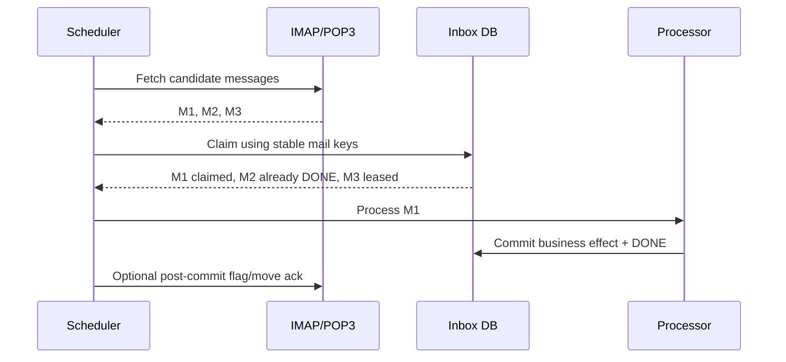
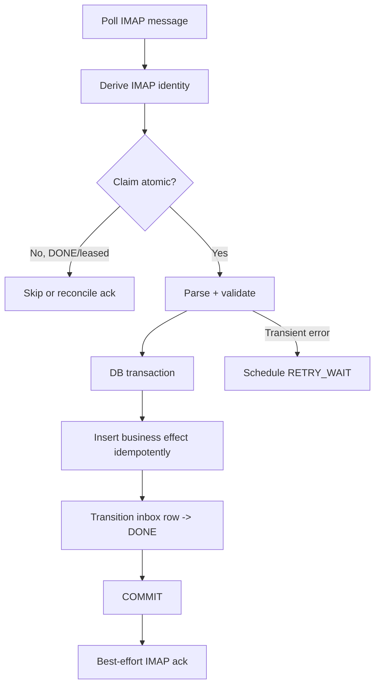

# Xử lý duplicate khi polling mailbox

Trong ứng dụng Spring Framework Mail, nhận thư từ hộp thư đến không chỉ là gọi `Folder.getMessages()` hoặc cấu hình một inbound mail adapter rồi xử lý từng `Message`. Vấn đề xuất hiện rất sớm khi job polling chạy lại: **cùng một email có thể được nhìn thấy nhiều lần**, nhất là sau khi ứng dụng restart, kết nối IMAP gián đoạn, thao tác đánh dấu đã đọc thất bại, worker bị timeout hoặc một instance khác cũng đang đọc mailbox.

Nếu mỗi lần thấy thư đều tạo đơn hàng, ghi hóa đơn, gửi email xác nhận hoặc mở ticket mới, một thông điệp duy nhất có thể gây **nhiều side effect nghiệp vụ**. Ngược lại, nếu đánh dấu email “đã xử lý” trước khi transaction nghiệp vụ commit, crash giữa chừng có thể khiến thông điệp bị **bỏ sót vĩnh viễn**.

Giải pháp không phải đơn giản là “chỉ đọc thư `UNSEEN`” hoặc “lưu `Message-ID` vào một `HashSet`”. Cần thiết kế **danh tính message đủ bền vững, cơ chế claim nguyên tử, trạng thái xử lý có khả năng phục hồi và idempotency ở nơi tạo side effect**. Đây là bài học *Xử lý duplicate khi polling mailbox* thuộc chương *Nhận thư và hộp thư* của Spring Framework Mail.

Nội dung sử dụng Java 21, Spring Framework 6.x / Spring Boot 3.x, Jakarta Mail (API của `jakarta.mail`), IMAP/POP3 và các khái niệm từ Spring Integration Mail. Ví dụ dùng tên miền `example.test`, thông tin giả và schema minh họa. Lưu ý: **mail polling bản chất thường là at-least-once trong thực tế; exactly-once side effect phải được tạo bằng transaction/idempotency ở tầng nghiệp vụ**, không thể chỉ dựa vào protocol.

## 1. Duplicate xảy ra ở đâu?

Hãy hình dung một worker nhận hóa đơn từ mailbox `billing-inbox@example.test`:

```text
08:00 Worker A poll INBOX, thấy message M
08:00 Worker A parse attachment, insert invoice I-42
08:01 Database commit thành công
08:01 Worker A mất kết nối trước khi cập nhật IMAP \Seen
08:02 Worker B poll INBOX, vẫn thấy message M
08:02 Worker B thử insert invoice I-42 lần nữa
```

Không có gì mâu thuẫn: email trên server vẫn chưa được đánh dấu đã đọc; nhưng nghiệp vụ đã xử lý. Nếu worker B dựa duy nhất vào `\Seen` hoặc “thư chưa đọc”, invoice bị tạo trùng.

Một chuỗi ngược lại còn nguy hiểm hơn:

```text
08:00 Worker A poll message M
08:00 Worker A đánh dấu \Seen ngay khi đọc
08:01 Worker A bắt đầu transaction xử lý invoice
08:01 Worker A crash trước database COMMIT
08:02 Worker B chỉ tìm UNSEEN, không thấy message M
```

Hệ thống không tạo invoice lần nào, nhưng message đã bị bỏ qua. Vì vậy phải tách rõ **đã nhìn thấy email**, **đã claim để xử lý**, **đã commit nghiệp vụ** và **đã xác nhận trên mail server**.

### 1.1. Nguồn duplicate thường gặp

| Nguồn | Điều xảy ra | Biện pháp cốt lõi |
|---|---|---|
| Poll lặp định kỳ | Cùng message còn trong mailbox | Persistent dedupe key |
| Worker crash giữa chừng | Job được chạy lại sau recovery | Durable state + lease |
| Xử lý xong nhưng ack thất bại | Server vẫn cho thấy email chưa đọc | DONE trước ack, lần sau skip/re-ack |
| Đọc rồi đánh dấu SEEN trước commit | Có thể mất message | Không coi SEEN là transaction acknowledgment |
| Nhiều replica | Hai worker cùng thấy một message | Unique constraint + atomic claim |
| Retry của ứng dụng | Một attempt bị timeout rồi xử lý lại | Business idempotency key |
| IMAP COPY/MOVE | Message ở folder mới có UID mới | Phân biệt folder identity và business identity |
| Server rebuild, UIDVALIDITY đổi | UID cũ không còn cùng ngữ nghĩa | Lưu UIDVALIDITY và xử lý epoch mới |
| POP3 poll lại | Message vẫn còn trên maildrop | UIDL + durable dedupe |
| Duplicate thực sự từ người gửi | Hai thư riêng chứa cùng yêu cầu | Idempotency ở tầng nghiệp vụ, không chỉ mailbox key |

### 1.2. Ba mức “duplicate” khác nhau

1. **Duplicate observation:** cùng một bản thư trên mail server được poll lại nhiều lần.
2. **Duplicate physical message:** cùng nội dung có nhiều bản sao ở các folder, mailbox hoặc do sender gửi lại.
3. **Duplicate business command:** hai email khác nhau yêu cầu cùng một thao tác, ví dụ cùng mã hóa đơn, cùng đơn đặt hàng.

Khóa dedupe IMAP/POP3 giải quyết mức (1). Nếu cần xử lý mức (2) hoặc (3), phải định nghĩa thêm danh tính ở **tầng nghiệp vụ**. Không tự gộp tất cả thư có subject giống nhau: hai thư khác nhau có thể mang hai công việc hợp lệ.

## 2. Polling khác event-driven nhưng vẫn phải idempotent

Polling nghĩa là ứng dụng chủ động kiểm tra mailbox theo chu kỳ:



IMAP IDLE hoặc provider webhook có thể giảm độ trễ so với polling thuần, nhưng **không loại bỏ duplicate**: reconnect, replay, redelivery hoặc retry vẫn có thể làm một message xuất hiện nhiều lần. Dù nhận theo lịch hay theo event, một inbound processor đáng tin cần idempotency.

### 2.1. Tại sao không dùng message sequence number?

Jakarta Mail `Message.getMessageNumber()` là thứ tự message **trong folder ở thời điểm đang mở**. IMAP sequence number có thể thay đổi khi message bị expunge hoặc mailbox thay đổi. Nó không phải ID bền vững để lưu xuyên nhiều lần poll.

Một khóa như:

```text
mailbox=finance, messageNumber=37
```

có thể trỏ tới một message khác sau khi thư cũ bị xóa. Không dùng message number làm khóa dedupe.

### 2.2. Tại sao không dùng Received Date?

`Message.getReceivedDate()` có thể là `null`, bị ảnh hưởng bởi server hoặc không đủ độ phân giải để phân biệt các thư. Hai email có thể đến trong cùng một giây; một email có thể được copy sang folder khác với metadata thay đổi. Timestamp hữu ích cho telemetry và window scan, không phải khóa danh tính duy nhất.

## 3. IMAP UID: danh tính đáng tin hơn sequence number

Trong IMAP, server gán **UID (Unique Identifier)** cho mỗi message trong một mailbox/folder. Trong cùng UIDVALIDITY epoch của folder, UID giúp client tham chiếu message ổn định hơn sequence number.

Jakarta Mail cung cấp interface `UIDFolder` với các thao tác:

```java
import jakarta.mail.UIDFolder;

UIDFolder uidFolder = (UIDFolder) folder;
long uidValidity = uidFolder.getUIDValidity();
long uid = uidFolder.getUID(message);
```

Nhưng **UID không độc nhất toàn mail server**. UID `2048` trong folder `INBOX` của account A khác UID `2048` trong folder `Archive` hoặc account B.

### 3.1. Khóa IMAP nên gồm những gì?

Một khóa kỹ thuật thường gồm:

```text
mailboxId    = billing-inbound-prod
folderName   = INBOX
uidValidity  = 829311
uid          = 2048
```

Tức:

\[
K_{\mathrm{IMAP}} =
(\mathrm{mailboxId},\mathrm{folder},\mathrm{UIDVALIDITY},\mathrm{UID})
\]

`mailboxId` là ID cấu hình ổn định của mailbox nguồn, **không phải** username/password hoặc một chuỗi chỉ dựa vào host nếu nhiều tài khoản chia sẻ host. Đặt khóa theo chính xác scope mà ứng dụng coi là một nguồn thư.

### 3.2. UIDVALIDITY là gì?

Theo semantics IMAP, `UIDVALIDITY` nhận diện một “thế hệ” của UID trong folder. Nếu server thay đổi UIDVALIDITY, những UID đã lưu của thế hệ cũ không thể mặc định dùng để so sánh với thế hệ mới. Điều này có thể xảy ra khi mailbox được tạo lại, restore/migration hoặc server thay đổi cách tổ chức dữ liệu.

Ví dụ:

```text
Trước migration:
  mailbox=finance, folder=INBOX, UIDVALIDITY=100, UID=55

Sau migration:
  mailbox=finance, folder=INBOX, UIDVALIDITY=101, UID=55
```

Hai tuple là **hai danh tính IMAP khác nhau**. Không ghi đè/cắt bỏ UIDVALIDITY chỉ vì số UID trùng nhau. Tuy vậy, chúng vẫn có thể là **cùng một thư nghiệp vụ** bị server restore/copy. Lớp business idempotency cần bảo vệ nếu xử lý lặp gây hại.

### 3.3. UID tăng không nhất thiết liên tục

Trong một UIDVALIDITY epoch, UID tăng theo quy tắc cấp phát của IMAP nhưng có thể **bỏ qua các số**. Không suy ra đã mất email vì UID nhảy từ 100 lên 104. Khi dùng high-water mark, không giả định mọi UID trung gian tồn tại hoặc đã được xử lý.

### 3.4. Folder là một phần của phạm vi UID

Khi COPY hoặc MOVE thư từ INBOX sang Processed, server có thể cấp UID mới ở folder đích. Nếu polling cả hai folder:

```text
INBOX:    UIDVALIDITY=5, UID=88
Processed: UIDVALIDITY=9, UID=301
```

đây là hai **message identities theo IMAP**. Nếu workflow yêu cầu chỉ xử lý một lần dù thư được chuyển folder, cần định nghĩa business-level key bổ sung, hoặc chỉ poll một folder nguồn theo policy. Một vài provider có message identifier toàn account nhưng đó là extension riêng, không thay thế portable IMAP tuple.

## 4. Message-ID: hữu ích nhưng không đủ

Header MIME `Message-ID` thường có dạng:

```text
Message-ID: <unique-looking-value@example.test>
```

Nó được bên tạo thư thêm vào, không phải ID do IMAP server cấp. Có thể thiếu, sai cú pháp, bị tái sử dụng khi copy/template, hoặc được cùng sender dùng lại ở hai email khác nhau. Hai thông điệp hợp lệ có thể cùng `Message-ID` do lỗi phần mềm; một message có thể bị forward/resend với header thay đổi.

**Không dùng Message-ID là khóa kỹ thuật duy nhất để dedupe IMAP** nếu đang cố bảo vệ việc poll cùng một mailbox. Nó là một tín hiệu bổ sung để đối chiếu logs, điều tra bản sao và có thể hỗ trợ business matching khi nguồn gửi được kiểm soát.

| Thuộc tính | Scope | Có thể thiếu/đổi? | Dùng làm unique key chính? |
|---|---|---|---|
| IMAP sequence number | Thứ tự trong folder hiện tại | Có thể đổi khi expunge | Không |
| IMAP UID | Folder + UIDVALIDITY epoch | Có thể trùng giữa folder/epoch | Có, khi ghép đủ tuple |
| MIME Message-ID | Do sender gán | Có thể thiếu, trùng hoặc giả mạo | Không nên dùng một mình |
| Received date | Metadata thời gian | Có thể null, trùng, không ổn định | Không |
| Subject/From | Nội dung/header | Có thể trùng và không đáng tin | Không |
| Attachment hash | Nội dung tệp | Có thể cùng file trong nhiều thư hợp lệ | Chỉ khi business rule cho phép |
| Invoice/order ID được xác minh | Khóa nghiệp vụ | Tùy loại công việc | Có thể dùng làm business idempotency key |

### 4.1. Không dùng hash toàn email một cách máy móc

Hash raw MIME dễ thay đổi khi gateway thêm header, rewrite link hoặc re-encode body. Nếu hash cùng bytes, nhiều email hợp lệ trùng content vẫn có thể là các sự kiện riêng. Nếu dùng content fingerprint, cần document mục tiêu, phạm vi, canonicalization, bảo vệ dữ liệu và xử lý false positive/false negative. Hash không tự làm email đáng tin hoặc biến dữ liệu cá nhân thành vô danh.

## 5. POP3 UIDL: tương tự mục tiêu, khác đặc tính

POP3 thường cho client liệt kê/thụ nhận các message trong maildrop. Khi server hỗ trợ lệnh `UIDL`, client có thể lấy một unique-id cho mỗi message **trong phạm vi maildrop** để nhận ra thư đã tải ở lần trước.

Với POP3:

```text
K_POP3 = (mailboxId, UIDL)
```

nhưng cần hiểu:

- `UIDL` là khả năng của POP3 server, không được giả định có trong mọi server/cấu hình.
- Chuỗi UIDL có ngữ nghĩa trong **maildrop/account**; không gắn với toàn Internet.
- POP3 không cung cấp cơ chế `\Seen` giống IMAP.
- Message numbers có thể thay đổi sau xóa, không dùng làm dedupe key.
- Server migration/rebuild có thể ảnh hưởng UIDL theo implementation; cần cách khôi phục có kiểm soát.
- Hành vi `DELE` và commit xóa khi kết thúc session không thay thế transaction xử lý nghiệp vụ.

### 5.1. Jakarta Mail generic API và UIDL

API `jakarta.mail.Folder` chung không bảo đảm có một method POP3 UIDL portable giống `UIDFolder.getUID(...)` cho IMAP. Tùy implementation, có class POP3-specific expose UIDL. Khi viết adapter POP3, cần đọc tài liệu **provider Jakarta Mail/Angus phiên bản đã khóa**, dùng extension phù hợp và fallback rõ ràng nếu server không hỗ trợ UIDL.

Không cast POP3 Folder sang `UIDFolder` chỉ vì IMAP đã hoạt động. Nếu không có UIDL đáng tin, phải xác định một chiến lược riêng: snapshot nội dung/metadata có giới hạn, bắt buộc điều kiện cấu hình hoặc từ chối chế độ xử lý cần exactly-once business effect. Một heuristic từ subject/date không đủ an toàn để tự tuyên bố chống duplicate tuyệt đối.

### 5.2. Không xóa POP3 message trước commit

Một sai lầm nghiêm trọng:

```text
POP3 RETR -> process begins -> DELE -> QUIT
                                  |
                                  v
                         business DB commit fails
```

Nếu server thực sự xóa thư khi session kết thúc, ứng dụng có thể mất cơ hội xử lý lại. Thứ tự an toàn hơn là **lưu và commit kết quả nghiệp vụ bền vững trước**, rồi mới thực hiện cleanup theo retention policy. Nếu cleanup fail, lần sau nhìn lại UIDL và skip vì đã DONE.

## 6. Cờ IMAP SEEN không phải là idempotency key

IMAP có các flag như `\Seen`, `\Answered`, `\Flagged` và `\Deleted`. Có thể tìm thư chưa đọc:

```java
import jakarta.mail.Flags;
import jakarta.mail.Message;
import jakarta.mail.search.FlagTerm;

Message[] unread = folder.search(
        new FlagTerm(new Flags(Flags.Flag.SEEN), false));
```

Nhưng `\Seen` là **trạng thái người dùng/client trên mailbox**, không phải commit log của ứng dụng:

- Người dùng có thể mở email và đánh dấu đã đọc trước worker.
- Client khác có thể bật/tắt Seen.
- Đọc body qua một số client/implementation có thể làm thay đổi Seen tùy quyền, cấu hình và server.
- Đồng bộ flags có thể thất bại sau DB commit.
- Hai worker có thể cùng tìm thấy UNSEEN trước khi một worker set flag.
- Một message được xử lý rồi có thể được người dùng đánh dấu unread trở lại.

Do đó, `UNSEEN` chỉ nên là **bộ lọc tối ưu giảm số candidate** nếu quy trình cho phép, không phải nguồn sự thật về “đã xử lý”. Nguồn sự thật phải là dữ liệu idempotency bền vững do ứng dụng quản lý.

### 6.1. Cẩn trọng khi đọc body có tác dụng phụ

Không thể giả định “chỉ đọc header thì không có side effect” hoặc “getContent chắc chắn không đổi flags” cho mọi provider. Khi thiết kế dựa vào UNSEEN, cần hiểu cơ chế fetch/peek của IMAP implementation, quyền READ_ONLY/READ_WRITE và cấu hình cụ thể. Tốt nhất không đặt an toàn nghiệp vụ phụ thuộc vào việc Seen có được cập nhật tự động hay không.

### 6.2. Khi nào set Seen?

Nếu ứng dụng là chủ sở hữu workflow mailbox và cần dùng Seen để giúp người vận hành nhận biết, có thể set **sau khi business transaction commit**:

```java
message.setFlag(Flags.Flag.SEEN, true);
```

Nhưng hành động này phải được xem là một **post-commit acknowledgment không bền vững**: nếu nó lỗi, kết quả nghiệp vụ vẫn DONE. Lần poll sau cần nhận ra DONE trong database và có thể thử ack lại. Không rollback một invoice đã ghi chỉ vì IMAP flag update thất bại.

## 7. Persistent inbox table: trung tâm của cơ chế dedupe

Một `HashSet` trong RAM chỉ chống duplicate đến khi process restart. Với hệ thống nhiều pod, mỗi pod còn có một HashSet riêng. Cơ chế bền vững hơn là lưu danh tính message vào **database có unique constraint**.

Một schema PostgreSQL minh họa:

```sql
CREATE TABLE inbound_mail (
    id BIGSERIAL PRIMARY KEY,
    mailbox_id VARCHAR(120) NOT NULL,
    folder_name VARCHAR(255) NOT NULL,
    uid_validity BIGINT NOT NULL,
    imap_uid BIGINT NOT NULL,
    state VARCHAR(24) NOT NULL,
    lease_owner VARCHAR(120),
    lease_token UUID,
    lease_until TIMESTAMPTZ,
    attempts INTEGER NOT NULL DEFAULT 0,
    message_id_header VARCHAR(512),
    business_key VARCHAR(240),
    first_seen_at TIMESTAMPTZ NOT NULL DEFAULT NOW(),
    processed_at TIMESTAMPTZ,
    last_error_code VARCHAR(80),
    CONSTRAINT uq_inbound_imap_identity UNIQUE (
        mailbox_id, folder_name, uid_validity, imap_uid
    ),
    CONSTRAINT ck_inbound_mail_state CHECK (
        state IN ('DISCOVERED','PROCESSING',
                  'DONE','RETRY_WAIT','FAILED','DEAD_LETTER')
    )
);

CREATE INDEX ix_inbound_mail_reclaim
ON inbound_mail (state, lease_until, first_seen_at);
```

Đây là schema định hướng cho **IMAP**. Nếu cũng hỗ trợ POP3, có thể có bảng khóa riêng với unique `(mailbox_id, uidl)`, hoặc mô hình `source_type/source_key` được chuẩn hóa có constraints phù hợp. Không ép giá trị UIDL dạng chuỗi thành BIGINT của IMAP.

### 7.1. Unique constraint không phải tùy chọn

Giả sử hai worker cùng thấy `UID=2048`:

```text
Worker A: SELECT xem đã có row chưa -> không
Worker B: SELECT xem đã có row chưa -> không
Worker A: INSERT row
Worker B: INSERT row
```

Nếu chỉ dùng `SELECT before INSERT`, hai worker có thể cùng qua kiểm tra rồi tạo hai row. Unique constraint trong database là biên chống race. Với PostgreSQL:

```sql
INSERT INTO inbound_mail (
    mailbox_id, folder_name, uid_validity, imap_uid, state
) VALUES (
    :mailboxId, :folderName, :uidValidity, :imapUid,
    'DISCOVERED'
)
ON CONFLICT (
    mailbox_id, folder_name, uid_validity, imap_uid
) DO NOTHING;
```

Nếu insert không tạo row, **chưa thể kết luận message đã DONE**. Nó có thể đang PROCESSING bởi worker khác, RETRY_WAIT hoặc FAILED. Phải đọc state và thực hiện transition phù hợp thay vì chỉ “có row nghĩa bỏ qua vĩnh viễn”.

### 7.2. Tách discovered, processing và done

| State | Ý nghĩa | Lần poll tiếp theo |
|---|---|---|
| `DISCOVERED` | Đã ghi nhận danh tính nhưng chưa claim | Có thể claim |
| `PROCESSING` | Worker đang có lease thực thi | Không claim khi lease còn hạn |
| `DONE` | Side effect nghiệp vụ đã commit theo contract | Không xử lý lại; có thể retry ack flag |
| `RETRY_WAIT` | Lỗi tạm, có lịch chạy lại | Chờ `nextAttemptAt` nếu schema có |
| `FAILED` | Cần phân loại/điều tra hoặc policy xử lý | Không tự retry vô hạn |
| `DEAD_LETTER` | Đã hết budget, cần xử lý vận hành | Giữ bằng chứng an toàn để replay có kiểm soát |

Một hệ thống đơn giản có thể chỉ cần NEW/PROCESSING/DONE/FAILED, nhưng khi có retry và nhiều worker, cần định nghĩa rõ từng trạng thái. **Không lấy trạng thái IMAP SEEN làm thay thế cho bảng này.**

### 7.3. Claim nguyên tử bằng state + lease

Sau khi insert/discover, worker claim row đang có thể xử lý:

```sql
UPDATE inbound_mail
SET state = 'PROCESSING',
    lease_owner = :workerId,
    lease_token = :leaseToken,
    lease_until = :leaseUntil,
    attempts = attempts + 1
WHERE id = :id
  AND (
      state = 'DISCOVERED'
      OR (
          state = 'PROCESSING'
          AND lease_until < NOW()
      )
      OR (
          state = 'RETRY_WAIT'
          AND :nextAttemptIsDue = TRUE
      )
  )
RETURNING id;
```

`:nextAttemptIsDue` ở đây là tham số minh họa; production nên lưu `next_attempt_at` và so sánh **trong cùng statement SQL**:

```sql
-- Điều kiện cho nhánh retry khi có cột next_attempt_at:
state = 'RETRY_WAIT' AND next_attempt_at <= NOW()
```

Mục tiêu là để database quyết định claim thắng/thua **một cách nguyên tử**. Không đọc state rồi ghi đè vô điều kiện. Dùng đồng hồ database hoặc một chuẩn thời gian nhất quán để tránh lease hết hạn sai vì clock giữa các pod lệch nhau.

### 7.4. Lease token là fencing token cho việc ghi state

Khi worker hoàn tất, update phải có điều kiện:

```sql
UPDATE inbound_mail
SET state = 'DONE',
    processed_at = NOW(),
    lease_owner = NULL,
    lease_token = NULL,
    lease_until = NULL
WHERE id = :id
  AND state = 'PROCESSING'
  AND lease_token = :leaseToken;
```

Nếu update 0 row, worker có thể đã mất lease hoặc row được worker khác claim. Không nên cho một worker cũ ghi DONE lên state của worker mới.

**Giới hạn quan trọng:** lease token bảo vệ state update trong database, **không tự động ngăn side effect đã xảy ra ngoài database**. Nếu worker A mất lease giữa lúc gọi API ngoài, worker B có thể chạy lại. Vì vậy tầng business và external side effects vẫn cần idempotency.

## 8. Inbox pattern: commit nghiệp vụ và DONE trong cùng transaction

Mục tiêu không chỉ là tránh duplicate row trong `inbound_mail`. Ta cần tránh duplicate **hành động** do email kích hoạt.

Ví dụ một thư có thông tin hóa đơn; processor cần:

1. Parse message đủ để xác minh dữ liệu.
2. Tìm invoice key theo business contract.
3. Insert invoice hoặc ghi nhận đã có.
4. Đánh dấu inbound_mail DONE.

Nếu bước (3) commit riêng còn (4) fail, worker retry có thể tạo invoice lần hai. Cách đáng tin hơn là commit hai thay đổi trong **một transaction database cục bộ**, nếu chúng cùng database.



### 8.1. Ví dụ service nghiệp vụ với @Transactional

```java
package com.example.inbound;

import java.util.UUID;

import org.springframework.stereotype.Service;
import org.springframework.transaction.annotation.Transactional;

@Service
public class InboundInvoiceProcessor {

    private final InboundMailRepository inbound;
    private final InvoiceRepository invoices;

    public InboundInvoiceProcessor(
            InboundMailRepository inbound,
            InvoiceRepository invoices) {
        this.inbound = inbound;
        this.invoices = invoices;
    }

    @Transactional
    public ProcessingResult commitInvoice(
            long inboxRowId,
            UUID leaseToken,
            ParsedInvoice parsed) {

        if (!inbound.isOwnedBy(inboxRowId, leaseToken)) {
            return ProcessingResult.LEASE_NOT_OWNED;
        }

        invoices.insertIfAbsent(
                parsed.tenantId(),
                parsed.externalInvoiceId(),
                parsed.amount(),
                parsed.currency());

        int updated = inbound.markDoneIfOwned(
                inboxRowId, leaseToken);

        if (updated != 1) {
            // Bắt buộc rollback cả insertInvoice trước đó.
            throw new StaleInboundLeaseException();
        }

        return ProcessingResult.COMMITTED;
    }
}
```

`InboundMailRepository`, `InvoiceRepository`, `ParsedInvoice`, `ProcessingResult` và `StaleInboundLeaseException` là abstraction do ứng dụng định nghĩa. `insertIfAbsent(...)` cần một **unique business key** thực sự phù hợp, ví dụ `(tenant_id, external_invoice_id)`, và không được nuốt mọi lỗi insert thành “đã tồn tại”.

`@Transactional` phải thực sự được gọi qua Spring proxy/transaction manager phù hợp; gọi self-invocation có thể không kích hoạt transaction. Hai repository phải tham gia cùng transaction nếu ta muốn commit/rollback nguyên tử. Parser MIME hoặc network I/O nên thực hiện **ngoài transaction dài**, chỉ giữ transaction ngắn cho ghi dữ liệu.

### 8.2. Vì sao business unique key cũng cần?

Giả sử cùng hóa đơn được gửi hai lần, tạo hai email có hai UID khác nhau:

```text
IMAP UID 2048 -> invoice INV-2026-42
IMAP UID 2053 -> invoice INV-2026-42
```

Hai IMAP keys đều chưa từng xuất hiện và đều hợp lệ. Chỉ unique inbox key không ngăn tạo hai invoices. Nếu business rule nói một external invoice ID chỉ được tạo một lần cho tenant, database cần constraint phù hợp:

```sql
CREATE UNIQUE INDEX uq_invoice_external
ON invoices(tenant_id, external_invoice_id);
```

Không suy ra business key từ subject một cách thiếu tin cậy. Xác minh sender/content/schema hoặc chữ ký chứng từ theo chính sách; email là dữ liệu đầu vào có thể bị giả mạo.

### 8.3. Chính xác transaction nào giúp được gì?

| Tình huống | Tác động mong muốn |
|---|---|
| Crash trước business DB commit | Không có side effect DB, job recovery được |
| Business insert xong nhưng transaction rollback | Insert không tồn tại, DONE không tồn tại |
| Business DB + DONE commit | Retry thấy DONE, không lặp side effect DB |
| Commit xong, IMAP SEEN update fail | DB vẫn DONE, poll sau skip/re-ack |
| Email bản sao có UID khác | Business key tránh tạo tài nguyên trùng theo policy |
| Đã gọi external API trước commit rồi crash | Vẫn có duplicate risk, cần idempotency ngoài DB |

Nếu xử lý email kích hoạt gửi outbound email, thanh toán hoặc HTTP API khác, nên dùng **outbox** để ghi ý định side effect cùng DB transaction, rồi worker gửi/đẩy với idempotency key nếu hệ thống đích hỗ trợ. Không để transaction database ôm một SMTP/HTTP call kéo dài rồi tưởng rollback sẽ thu hồi side effect.

## 9. Sơ đồ crash windows và cách phục hồi

Không thể thiết kế dedupe an toàn mà bỏ qua thứ tự thao tác.

### 9.1. Các thời điểm quan trọng

```text
T0: IMAP fetch message
T1: DB insert/discover key
T2: DB claim PROCESSING + lease commit
T3: Parse/validate email
T4: Business effect + inbox DONE commit
T5: IMAP ack (SEEN/MOVE) attempt
```

| Crash window | Điều còn lại | Lần poll sau |
|---|---|---|
| Trước T1 | Chưa có row | Discover lại và xử lý |
| Sau T1, trước T2 | DISCOVERED | Worker có thể claim |
| Sau T2, trước T4 | PROCESSING có lease | Chờ lease hết hạn rồi retry |
| Trong transaction T4 | Transaction rollback toàn bộ | Worker mới có thể retry sau recovery |
| Sau T4, trước T5 | DONE, server chưa ack | Skip business, có thể ack lại |
| Sau T5 | DONE và mailbox đã ack | Không xử lý lại |

### 9.2. Không ack trước commit

Trình tự sai:

```text
Set IMAP \Seen -> parse -> update database -> commit
```

Nếu parse/DB commit lỗi mà chỉ poll UNSEEN, thông điệp có thể mất khỏi luồng xử lý. Trình tự đúng hơn:

```text
Poll -> claim -> parse -> commit business + DONE
     -> best-effort IMAP ack
```

Tùy cấu hình, việc fetch body có thể tự tác động Seen; do đó **không chỉ dựa vào unread-only search** để đảm bảo recovery. Durable inbox tracking và reconciliation là tuyến bảo vệ chính.

### 9.3. Lease hết hạn khi worker vẫn chạy

Giả sử:

```text
Worker A claims UID 2048, lease until 10:01
Worker A xử lý attachment rất chậm
10:01 lease expires
Worker B claims same row with new token
Worker A completes and tries markDone(old token) -> 0 rows
```

Để tránh duplicate business effect, cả hai phải dùng unique key/transaction/fencing. Nếu xử lý lâu, có thể heartbeat kéo dài lease có điều kiện, đặt timeout và giới hạn kích thước attachment. Nhưng heartbeat cũng có thể lỗi. Đừng lấy “chúng ta có lease” làm bằng chứng exactly-once cho các external side effects.

## 10. Ví dụ Spring Boot polling IMAP bằng Jakarta Mail

Ví dụ dưới đây minh họa cách lấy identity ổn định từ mailbox rồi giao cho một service xử lý có dedupe. Đây là **khung chương trình có ranh giới trách nhiệm rõ**; repository, parser và error policy do ứng dụng triển khai theo schema đã chọn. Nó không dùng `Message-ID` hoặc `\Seen` làm khóa chính.

### 10.1. Cấu hình thử nghiệm

```yaml
app:
  inbound:
    mailbox-id: billing-inbound-test
    host: imap.example.test
    port: 993
    username: ${INBOUND_IMAP_USERNAME}
    password: ${INBOUND_IMAP_PASSWORD}
    folder: INBOX
    poll-delay-ms: 10000
    max-messages-per-poll: 100
```

Đây là configuration namespace ứng dụng tự định nghĩa. Các biến secret phải lấy qua secret manager hoặc cơ chế bảo vệ tương ứng. Không commit mật khẩu mailbox vào repository; sử dụng mailbox riêng có quyền hạn tối thiểu và TLS verification hợp lệ.

### 10.2. Định nghĩa danh tính IMAP

```java
package com.example.inbound;

public record ImapMailKey(
        String mailboxId,
        String folderName,
        long uidValidity,
        long uid
) {
    public ImapMailKey {
        if (mailboxId == null || mailboxId.isBlank()) {
            throw new IllegalArgumentException("mailboxId required");
        }
        if (folderName == null || folderName.isBlank()) {
            throw new IllegalArgumentException("folderName required");
        }
        if (uidValidity <= 0 || uid <= 0) {
            throw new IllegalArgumentException("Invalid IMAP identity");
        }
    }
}
```

Đừng chuẩn hóa folder bằng cách tự ý lowercase nếu chưa nắm quy tắc tên folder/server. Cần một chính sách folder identity nhất quán giữa các lần kết nối; đổi folder name có thể đổi scope của key và dẫn tới replay.

### 10.3. Poller minh họa

```java
package com.example.inbound;

import java.util.Properties;

import jakarta.mail.Folder;
import jakarta.mail.Message;
import jakarta.mail.MessagingException;
import jakarta.mail.Session;
import jakarta.mail.Store;
import jakarta.mail.UIDFolder;

import org.springframework.scheduling.annotation.Scheduled;
import org.springframework.stereotype.Component;

@Component
public final class ImapMailboxPoller {

    private final ImapMailboxSettings settings;
    private final InboundMessageDispatcher dispatcher;

    public ImapMailboxPoller(
            ImapMailboxSettings settings,
            InboundMessageDispatcher dispatcher) {
        this.settings = settings;
        this.dispatcher = dispatcher;
    }

    @Scheduled(
            fixedDelayString = "${app.inbound.poll-delay-ms:10000}")
    public void poll() {
        Properties props = new Properties();
        props.put("mail.store.protocol", "imaps");
        props.put("mail.imaps.connectiontimeout", "5000");
        props.put("mail.imaps.timeout", "10000");

        Session session = Session.getInstance(props);
        Store store = null;
        Folder folder = null;

        try {
            store = session.getStore("imaps");
            store.connect(
                    settings.host(),
                    settings.port(),
                    settings.username(),
                    settings.password());

            folder = store.getFolder(settings.folder());
            folder.open(Folder.READ_WRITE);

            if (!(folder instanceof UIDFolder uidFolder)) {
                throw new IllegalStateException(
                        "IMAP folder does not expose stable UID");
            }

            long uidValidity = uidFolder.getUIDValidity();
            int total = folder.getMessageCount();
            int first = Math.max(
                    1, total - settings.maxMessagesPerPoll() + 1);

            for (int sequence = first; sequence <= total; sequence++) {
                Message message = folder.getMessage(sequence);
                long uid = uidFolder.getUID(message);
                if (uid <= 0) {
                    continue;
                }

                ImapMailKey key = new ImapMailKey(
                        settings.mailboxId(),
                        folder.getFullName(),
                        uidValidity,
                        uid);

                dispatcher.handleCandidate(key, message);
            }
        } catch (MessagingException ex) {
            // Ghi category và mailboxId an toàn; lên lịch poll sau.
            dispatcher.recordMailboxConnectionFailure(
                    settings.mailboxId(), ex);
        } finally {
            if (folder != null && folder.isOpen()) {
                try {
                    folder.close(false);
                } catch (MessagingException ignored) {
                    // Logging đã redaction trong production.
                }
            }
            if (store != null && store.isConnected()) {
                try {
                    store.close();
                } catch (MessagingException ignored) {
                    // Tránh che lỗi chính bằng close failure.
                }
            }
        }
    }
}
```

`ImapMailboxSettings` là cấu hình immutable do ứng dụng bind và validate từ YAML; `InboundMessageDispatcher` là lớp xử lý claim/parse/commit/ack phía dưới. Cần bật scheduling ở configuration bằng `@EnableScheduling`. Hãy dùng `imaps` với TLS certificate validation đúng; property timeout chỉ minh họa, không thay một deadline tổng.

**Giới hạn cố ý của ví dụ:** đoạn code lấy **N message cuối theo sequence number** để bài học dễ đọc. Với mailbox lớn, nếu chỉ quét N thư cuối sẽ **bỏ sót thư cũ chưa xử lý** khi số thư mới đến vượt N hoặc lỗi kéo dài. Production không dùng đoạn pagination này như một bảo đảm không mất mail; cần thuật toán scan có checkpoint/cursor UID và reconciliation được trình bày ở phần sau.

### 10.4. Dispatcher phân biệt NEW, DONE và BUSY

Một dispatcher có thể dùng contract:

```java
public enum ClaimResult {
    CLAIMED,
    ALREADY_DONE,
    CURRENTLY_OWNED_BY_OTHER,
    NOT_DUE
}

public enum ProcessingOutcome {
    COMMITTED,
    ALREADY_DONE,
    RETRY_SCHEDULED,
    DEAD_LETTERED
}
```

Flow minh họa:

```java
public void handleCandidate(ImapMailKey key, Message message)
        throws MessagingException {

    ClaimResult claim = claimService.tryClaim(key);

    if (claim == ClaimResult.ALREADY_DONE) {
        // Có thể ack lại khi IMAP \Seen chưa được cập nhật.
        acknowledgeIfConfigured(message, key);
        return;
    }

    if (claim != ClaimResult.CLAIMED) {
        return; // Job đang leased hoặc chưa tới lịch retry.
    }

    try {
        ParsedInboundMail parsed = parser.parse(message);

        ProcessingOutcome outcome =
                processingService.processClaimed(key, parsed);

        if (outcome == ProcessingOutcome.COMMITTED
                || outcome == ProcessingOutcome.ALREADY_DONE) {
            acknowledgeIfConfigured(message, key);
        }
    } catch (Exception failure) {
        failureHandler.recordRetryOrDeadLetter(
                key, failure);
    }
}
```

`claimService` phải trả thêm **lease token** cho owner thực tế, dù ví dụ đã rút gọn để tập trung luồng; `processingService` phải dùng token ấy khi chuyển DONE có điều kiện như phần database trước. `parser` cần giới hạn tài nguyên, không nên tin raw attachment. `failureHandler` cũng phải kiểm tra lease token để tránh worker cũ ghi đè trạng thái mới.

Ở production, tốt hơn có object `ClaimedInboundMail(key, inboxRowId, leaseToken)` thay vì truyền chỉ `key`. Quan trọng nhất là thứ tự **claim → parse → commit → optional ack**.

### 10.5. Không giữ Jakarta Mail Message sau khi đóng Folder

`Message` lấy từ IMAP Folder thường là object phụ thuộc Store/Folder session. Khi Folder/Store đã đóng, việc đọc tiếp body/attachment có thể thất bại hoặc gây truy cập mạng bất ngờ.

**Không enqueue `Message` vào thread pool rồi đóng folder ngay**:

```java
// Nguy hiểm:
executor.execute(() -> parseAndProcess(message));
folder.close(false);
```

Với xử lý bất đồng bộ, có thể:

1. Poller lấy stable UID và tải nội dung cần thiết vào một **staging store bền vững** có giới hạn.
2. Commit staging metadata cùng inbound identity.
3. Worker khác xử lý từ DTO/blob đã lưu, không giữ object `Message` qua kết nối IMAP.
4. Nếu staging fail, không đánh dấu DONE và có thể fetch lại theo UID.

Hoặc giữ xử lý đồng bộ trong folder session với batch nhỏ và timeout phù hợp. Cách nào cũng cần kiểm soát lifetime của network resource và tránh parallel access một `Folder` khi provider không bảo đảm thread safety.

## 11. Mailbox lớn: UID checkpoint và reconciliation

Đọc toàn bộ thư trong INBOX ở mỗi poll có thể rất đắt; ngược lại, lấy một số thư cuối sẽ bỏ sót backlog. Với IMAP, có thể thiết kế **checkpoint theo UID**.

Một trạng thái:

```text
mailboxId     = billing-inbound-prod
folderName    = INBOX
uidValidity   = 829311
scanCursorUid = 4050
lastScanAt    = ...
```

Poller truy vấn UID lớn hơn cursor theo batch trong UIDVALIDITY hiện tại, rồi cập nhật cursor khi **đã discover/persist các identity thuộc batch một cách chắc chắn**. Không lấy cursor nghĩa là “mọi message có UID nhỏ hơn đã DONE”; chúng có thể đang RETRY_WAIT, FAILED hoặc PROCESSING.

### 11.1. Đừng cập nhật cursor trước khi lưu identity

Trình tự sai:

```text
Fetch UID 4051..4150
Save scanCursorUid=4150
Crash before inserting inbound_mail rows
Next poll starts at UID 4151
```

Các UID 4051..4150 có thể bị bỏ qua. Trình tự đúng:

```text
Fetch batch identities
Persist each identity (or persist batch)
Commit cursor with discovery rows atomically
Then workers process discovered rows
```

Nếu cùng database, discovery inserts và checkpoint update có thể ở chung transaction. Với message content lưu ngoài database, cần một staging protocol phù hợp, không đánh dấu “discovered safely” trước khi dữ liệu cần thiết có thể được fetch lại hoặc đã bền vững.

### 11.2. UIDFolder.getMessagesByUID và UID gaps

Jakarta Mail `UIDFolder` hỗ trợ truy vấn theo UID ở các implementation IMAP, ví dụ dải UID:

```java
Message[] batch = uidFolder.getMessagesByUID(
        startUid, endUid);
```

Không có bảo đảm mọi giá trị trong dải tương ứng một message. Khi server expunge, có các UID đã mất; response có thể không đủ số lượng mong đợi. Đừng tăng cursor dựa trên “số phần tử nhận được” như thể UID liên tục; cập nhật theo dải/UID đã được xác nhận scan và lưu metadata.

### 11.3. Checkpoint không thay thế bảng retry

Một message UID 4051 đã discover nhưng parse lỗi, được đưa RETRY_WAIT. Cursor lên 4150 là bình thường nếu job 4051 vẫn tồn tại trong `inbound_mail` và worker retry dựa trên bảng này. Nếu chỉ có cursor mà không lưu hàng thất bại, ứng dụng có thể mất cơ hội xử lý.

### 11.4. Khi UIDVALIDITY thay đổi

Nếu mailbox epoch đổi:

1. Ghi sự kiện UIDVALIDITY_CHANGED có mailbox ID và folder.
2. Không dùng cursor UID của epoch cũ trong epoch mới.
3. Reset **scan position cho epoch mới** theo quy trình có kiểm soát.
4. Discover lại các messages trong folder; khởi tạo identity tuple mới.
5. Dùng business idempotency để tránh lặp side effects nếu đó là thư cũ được restore.
6. Theo dõi số lượng replay và lỗi tăng đột biến.

Đây là trường hợp cần đầu tư reconciliation và audit, không âm thầm xóa bảng inbox để “cho chạy lại từ đầu”.

### 11.5. Quét đối soát định kỳ

Một phương án tốt là kết hợp **incremental UID scan** với **periodic reconciliation** trong phạm vi hợp lý:

- Kiểm tra lại một cửa sổ UID/time hữu hạn.
- So sánh folder UIDVALIDITY và cursor.
- Rà các inbox rows bị PROCESSING quá lease.
- Rà RETRY_WAIT đã đến hạn.
- Rà DONE nhưng ACK_PENDING khi cần.
- Rà identity có metadata nhưng thiếu staged content.

Không gọi `\Seen` là nguồn sự thật; reconciliation dựa trên database idempotency. Chọn retention/window theo volume và SLA; không bắt server tải toàn bộ attachments mỗi lần reconcile.

## 12. Multiple pollers và distributed coordination

Khi ứng dụng Spring Boot chạy ba replicas:

```text
Pod A polls INBOX at 08:00:00
Pod B polls INBOX at 08:00:00
Pod C polls INBOX at 08:00:01
```

Không thể dựa vào `@Scheduled(fixedDelay=...)` ở từng pod để tránh trùng. Mỗi process có scheduler riêng; hai worker vẫn có thể thấy cùng mailbox message.

### 12.1. Hai lựa chọn thiết kế

**Lựa chọn A — Một poller sở hữu mailbox:**

- Dùng leader election/distributed lease cho việc scan và cursor.
- Một poller discover/stage messages, nhiều workers process inbox rows.
- Giảm số kết nối IMAP, dễ kiểm soát checkpoint.
- Khi leader chết, lease expiry cho leader khác tiếp quản.

**Lựa chọn B — Nhiều pollers cùng scan:**

- Mọi pod có thể thấy cùng UID.
- Database unique constraint + atomic claim quyết định owner.
- Cần kiểm soát chi phí scan và rate limit IMAP.
- Checkpoint cần CAS/fencing hoặc phân vùng để không đua nhau đẩy cursor sai.

Với mailbox chung và workload lớn, lựa chọn A thường đơn giản hơn cho scanning; B vẫn có thể an toàn về side effects nếu dedupe đầy đủ. **Distributed lock không thay thế unique constraint**: lock có thể hết hạn/đứt kết nối, hoặc một job có thể được retry từ nguồn khác.

### 12.2. Lock mailbox và lock processing khác nhau

Một mailbox scan lease bảo vệ **quá trình phát hiện UID và cập nhật cursor**. Inbox row lease bảo vệ **quyền xử lý một message**. Hai loại lock có phạm vi khác nhau; tránh dùng một mailbox lock dài hàng phút bao trùm cả parse 100 attachments và business side effects, vì nó tạo bottleneck và khó recovery.

### 12.3. Tránh query và network I/O trong transaction dài

Không mở một database transaction rồi giữ nó trong lúc `Folder.getMessages()`, đọc PDF, gọi OCR/antivirus hoặc HTTP API. Transaction dài giữ connection/lock và tăng rủi ro deadlock. Chia thành: scan/fetch có timeout → transaction discovery ngắn → xử lý bên ngoài → transaction commit ngắn → best-effort ack.

## 13. Spring Integration Mail: adapter không tự biến business effect thành exactly-once

Thay vì tự viết `@Scheduled` và quản lý `Session/Store/Folder`, một ứng dụng có thể dùng **Spring Integration Mail** để đưa inbound email vào message channel và xử lý qua integration flow.

Những abstraction thường gặp gồm:

- `ImapMailReceiver` để nhận từ IMAP.
- `Pop3MailReceiver` để nhận từ POP3.
- `MailReceivingMessageSource` để polling một mail receiver.
- IMAP IDLE adapter cho mô hình nhận gần thời gian thực khi server hỗ trợ.
- Poller, message channel và handler để nối các bước xử lý.

Ví dụ sơ đồ:

```text
IMAP / POP3
    |
    v
Mail receiver / inbound adapter
    |
    v
Spring Integration Message channel
    |
    v
Durable Inbox + Atomic Claim
    |
    v
Parse / Business transaction / DONE
    |
    v
Post-commit acknowledgement
```

Spring Integration giúp quản lý một phần việc polling, chuyển đổi message và kết nối các component, nhưng **không làm database nghiệp vụ và IMAP flag update trở thành một transaction chung**. Nếu handler tạo side effect rồi lỗi trước khi adapter đánh dấu thư đã đọc, lần nhận sau vẫn có thể thấy cùng message.

### 13.1. “Accept once” filter không luôn là nguồn sự thật bền vững

Một số integration adapter/filter có thể giữ metadata về message đã chấp nhận. Ý nghĩa và storage backend tùy thành phần/phiên bản. Nếu metadata chỉ lưu trong JVM, restart sẽ làm nó mất. Nếu dùng persistent metadata store, vẫn phải xét:

1. Khóa có bao gồm mailbox/folder/UIDVALIDITY/UID đúng không?
2. Thao tác check-and-set có atomic giữa nhiều replicas không?
3. Đã đánh dấu accepted **trước** hay **sau** business transaction?
4. Nếu business xử lý fail, filter có cho retry không?
5. Metadata có TTL/retention phù hợp và có bị xóa sớm không?

Một filter được thiết kế để giảm duplicate delivery ở channel **không nhất thiết đồng nghĩa business side effect exactly-once**. Có thể dùng nó như lớp tối ưu hóa, nhưng unique constraint và idempotency nghiệp vụ vẫn là tuyến bảo vệ quan trọng.

### 13.2. MetadataStore: lựa chọn lưu trữ phải theo yêu cầu

Trong Spring Integration, `MetadataStore` có các implementation phục vụ lưu metadata; một số dùng memory, một số có backend bên ngoài. Khi cần multi-instance/restart:

- Chọn storage bền vững theo yêu cầu hệ thống.
- Hiểu atomicity của thao tác compare-and-set tương ứng.
- Kiểm tra semantics khi metadata store tạm không sẵn sàng.
- Đặt key namespace cho mailbox/folder/UID epoch.
- Không dùng metadata entry như bản ghi nghiệp vụ nếu nó không có transaction cùng business DB.

Một số kiến trúc đưa mọi message vào **durable inbox repository** trước rồi dùng Spring Integration handler điều phối. Cách này giảm phụ thuộc vào lựa chọn filter của adapter.

### 13.3. Receiver có thể đánh dấu read theo cấu hình

Các mail receiver có option ảnh hưởng việc đánh dấu message đã đọc, search term và delete/expunge theo implementation. Khi cấu hình:

- Xác minh chính xác hành vi của **phiên bản Spring Integration Mail** đang dùng.
- Không bật tùy chọn xóa/đánh dấu đã đọc trước khi có chiến lược idempotency/commit.
- Test trường hợp handler ném exception và application restart.
- Tách “server flag” khỏi “đã commit business” trong data model.

Đừng cho rằng bật một option như `shouldMarkMessagesAsRead` (nếu được phiên bản adapter hỗ trợ) tự bảo đảm delivery exactly-once. Cần xác minh thời điểm cờ được cập nhật so với transaction nghiệp vụ.

### 13.4. Polling và IMAP IDLE vẫn có thể replay

IMAP IDLE thường giúp giảm thời gian chờ thông báo thay đổi mailbox, nhưng disconnect/reconnect, server restart và consumer retry đều có thể làm cùng message xuất hiện lại. Dù trigger là `@Scheduled`, inbound channel adapter hay IMAP IDLE, logic durable dedupe nên dùng cùng một cơ chế key/claim.

### 13.5. Chuyển sang mô hình handler idempotent

Một handler nhận payload từ integration flow có thể thực hiện:

```java
@Service
public final class InboundMailHandler {

    private final InboundMailUseCase useCase;

    public InboundMailHandler(InboundMailUseCase useCase) {
        this.useCase = useCase;
    }

    public void handle(ReceivedMailEnvelope mail) {
        useCase.acceptForProcessing(
                mail.sourceIdentity(),
                mail.stagedContentReference());
    }
}
```

`ReceivedMailEnvelope` chứa danh tính đã chuẩn hóa và reference tới nội dung staged, không cần giữ live `jakarta.mail.Message` đi qua nhiều executor. `InboundMailUseCase` thực hiện unique insert/claim rồi xử lý theo state machine. Kết quả không phụ thuộc adapter có dùng polling hay IDLE.

## 14. Chọn thời điểm ACK: SEEN, MOVE, DELETE hay không thay đổi mailbox?

Sau business commit, nhiều hệ thống muốn dọn INBOX. Mỗi lựa chọn có trade-off:

| Chiến lược | Ưu điểm | Rủi ro / lưu ý |
|---|---|---|
| Set `\Seen` | Dễ nhận biết đã đọc | Người dùng/client khác sửa được, không biểu thị commit |
| Move sang Processed | Tách luồng nghiệp vụ, giảm mailbox nguồn | UID mới ở folder đích; MOVE/ack có thể lỗi, cần key |
| Copy rồi delete/expunge nguồn | Có archive và cleanup | Thao tác nhiều bước, không atomic với DB |
| Delete sau xử lý | Giảm tồn kho | Rủi ro retention/audit, phục hồi khó |
| Không thay đổi mailbox | Giữ nguyên dữ liệu gốc | Cần scan/cursor hiệu quả và retention policy |

### 14.1. IMAP MOVE/COPY tạo danh tính ở folder mới

Nếu process workflow là “INBOX → Processed”, nên:

1. Commit inbox row DONE cùng business effect.
2. Ghi `ackStatus=ACK_PENDING` nếu cần theo dõi.
3. Thực hiện move/copy theo API/provider hỗ trợ.
4. Ghi `ACKED` khi hoàn tất.
5. Nếu move fail, reconcile sau bằng original UID/metadata và mailbox state.

Nếu worker cũng poll Processed, tránh xử lý lại bằng business key hoặc không đưa Processed vào danh sách source. Không lấy việc message xuất hiện với UID mới trong Processed làm tín hiệu “hóa đơn thứ hai”.

### 14.2. Không tự xóa email chỉ để tránh duplicate

Xóa thư gốc có thể phá retention, kiểm toán hoặc khả năng xử lý lại khi parser có bug. Nếu cần dọn mailbox, hãy thiết kế retention và legal/security requirements riêng, phân biệt processed/quarantine/dead-letter, và kiểm tra đã lưu được dữ liệu cần thiết.

### 14.3. ACK failure là tình huống bình thường cần phục hồi

```text
DB: status DONE
IMAP: SETFLAGS \Seen timeout
```

Không rollback transaction DONE. Ghi một ACK_PENDING hoặc event tương đương; khi poll lại thấy UID, lookup DONE rồi thử ack nếu mailbox policy cho phép. Nếu thư đã bị người khác move/delete, có thể kết thúc bằng trạng thái ACK_NOT_APPLICABLE hoặc ghi reconciliation outcome, không vì vậy tái tạo business side effect.

## 15. Phân loại lỗi khi xử lý thư đến

Không phải mọi exception đều nên retry. Một lỗi cần được gắn **pha, nguyên nhân, khả năng phục hồi và phạm vi**.

| Loại lỗi | Ví dụ | Chính sách thường phù hợp |
|---|---|---|
| IMAP connect/auth | Sai secret, endpoint không sẵn sàng | Alert/pause mailbox hoặc retry kết nối có backoff |
| IMAP UID fetch lỗi tạm | Socket reset, timeout | Poll lại theo UID/checkpoint; không mất identity |
| UIDVALIDITY đổi | Server migration | Re-scan epoch mới + business idempotency |
| MIME parse không hợp lệ | Header/body/encoding lỗi | Quarantine hoặc DLQ có bằng chứng; tránh loop vô hạn |
| Attachment vượt size | Ảnh/PDF quá lớn | Reject/quarantine theo policy, không tải tràn bộ nhớ |
| Security validation fail | Sender giả, nội dung nguy hiểm | Không thực thi side effect; quarantine |
| DB serialization/deadlock | Transaction conflict | Retry có backoff, unique/fencing giữ đúng |
| External API tạm lỗi | Downstream unavailable | Outbox/external idempotency + retry |
| Business validation vĩnh viễn | Invoice ID sai, không tồn tại tenant | FAILED/DEAD_LETTER, không retry vô hạn |
| Post-commit SEEN/MOVE lỗi | IMAP ack timeout | Retry ack, **không** xử lý nghiệp vụ lại |

### 15.1. Poison message

Một email malformed có thể làm parser luôn ném exception. Nếu job cứ retry mỗi 10 giây, nó chiếm worker và ngăn các thư khác. Cần:

- Max attempts hoặc giới hạn thời gian.
- Trạng thái DEAD_LETTER/QUARANTINED.
- Lưu mã lỗi đã chuẩn hóa và metadata tối thiểu.
- Cho operator replay có kiểm soát sau khi sửa parser.
- Không biến poison message thành lý do skip mọi thư đến sau nó.

### 15.2. Tách connection retry khỏi processing retry

Một lỗi IMAP connect thường ảnh hưởng toàn mailbox; không nên tạo một failed attempt cho mọi message chưa hề được fetch. Một lỗi parse chỉ ảnh hưởng một message cụ thể. Cần metric và circuit breaker theo scope để không vô tình đánh dấu hàng nghìn message FAILED khi mail server tạm down.

### 15.3. Backoff và jitter

Khi IMAP server tạm mất kết nối hoặc database bị quá tải, retry liên tục từ 20 pods có thể tạo storm. Đặt connection timeout, read timeout và backoff có jitter ở tầng polling. Với message-level retry, lưu `nextAttemptAt` trong inbox table rồi nhả worker; không `Thread.sleep` giữ thread giữa các attempts.

## 16. Resource limits và an toàn khi parse MIME

Email đến là dữ liệu không tin cậy, kể cả khi header From trông giống domain nội bộ. Một attachment hoặc MIME body có thể rất lớn, nested sâu hoặc chứa nội dung độc hại.

### 16.1. Các giới hạn nên có

- Tổng kích thước message được phép.
- Số lượng MIME parts và độ sâu multipart.
- Tổng bytes attachment tải về/được trích xuất.
- Thời gian parse/scan và thời hạn một attempt.
- Concurrency xử lý mail và connection IMAP.
- Băng thông/IO đối với object storage.
- Loại file cho phép và kiểm tra nội dung thực, không chỉ MIME type khai báo.
- Quota/retention cho staging và dead-letter.

Không gọi `getInputStream().readAllBytes()` vô điều kiện trên attachment không tin cậy trong production; nó có thể chiếm rất nhiều heap. Dùng bounded streaming và chặn vượt giới hạn sớm theo policy.

### 16.2. Không tin From như danh tính đã xác thực

`Message.getFrom()` là header do bên gửi cung cấp và có thể bị giả mạo. Nếu email chứa lệnh tạo đơn hàng, chuyển tiền hoặc cập nhật tài khoản, cần xác thực nguồn qua một cơ chế phù hợp: sender allowlist kết hợp SPF/DKIM/DMARC ở trusted boundary khi áp dụng, chữ ký nội dung, account linkage, confirmation hoặc API bảo mật khác.

Không lấy From address là đủ để cho phép một hành động nhạy cảm. Dedupe chống gửi lặp **không thay thế authorization**.

### 16.3. HTML, links và attachment

Không render HTML email thành trang quản trị mà bỏ qua sanitization và content-security policy. Link có thể dẫn tới site độc hại, attachment có macro/exploit. Lưu message với quyền truy cập hạn chế và tuân thủ policy antivirus, quarantine, encryption at rest và retention.

### 16.4. Dữ liệu nào nên log?

Nên:

```text
event=inbound_mail_claimed
mailboxId=billing-inbound-prod
folder=INBOX
uidValidity=829311
uid=2048
inboxId=...
attemptId=...
leaseOwner=worker-3
```

Không nên log:

- Username/password mailbox hoặc OAuth token.
- Nội dung email/attachment thô.
- OTP, reset links, thông tin hóa đơn khách hàng.
- Full To/Cc/Bcc, người gửi cá nhân nếu không cần.
- Raw MIME hoặc stack trace chứa PII vào nơi công khai.

IMAP UID và inbox row ID có thể dùng để tra cứu trong logs được kiểm soát; không nhất thiết phù hợp làm Prometheus label vì cardinality cao.

## 17. Metric và cảnh báo vận hành

Một dashboard nhận email đáng tin không chỉ đếm số poll thành công.

| Tín hiệu | Ý nghĩa |
|---|---|
| Poll attempts/success/failure | Mailbox có đang truy cập được không? |
| Last successful scan timestamp | Hệ thống có ngừng phát hiện mail? |
| Last successfully discovered UID | Có tiến bộ theo UID epoch? |
| UIDVALIDITY changes | Có migration/rebuild gây replay? |
| New/discovered/processing/done counts | Pipeline tiến triển thế nào? |
| Duplicate observations | Số message nhìn lại nhưng đã biết |
| Claim conflicts | Có nhiều worker cạnh tranh hoặc poll trùng? |
| Inbox oldest DISCOVERED/RETRY_WAIT age | Thư chờ quá SLA? |
| Lease expired count | Worker crash, timeout hoặc xử lý quá lâu? |
| Retry/dead-letter count | Poison message hoặc downstream lỗi |
| Parse/attachment size p95 | Có payload nặng bất thường? |
| Post-commit ACK failures | Mailbox state không khớp database? |
| Business idempotency conflicts | Có physical duplicate hoặc sender gửi lại? |

### 17.1. Đọc đúng chỉ số duplicate

Một lần polling nhìn lại message DONE không phải một lỗi nghiệp vụ. Có thể ghi `duplicateObservationCount` như thông số tối ưu hóa scan. Nguy hiểm hơn là **duplicateBusinessEffectCount**, được xác định theo contract nghiệp vụ. Không đánh đồng hai loại, vì inbox polling thường cố tình nhìn lại dữ liệu để reconcile.

### 17.2. Alert dựa trên SLA

Alert khi:

- Không poll thành công trong thời gian dài.
- Oldest unprocessed mail vượt deadline.
- PROCESSING lease expired tăng bất thường.
- UIDVALIDITY đổi ngoài kế hoạch.
- DEAD_LETTER tăng nhanh.
- Cùng business key tạo conflict lặp lại bất thường.
- Ack fail kéo dài và mailbox đầy.

Không alert ERROR cho mỗi lần nhìn thấy cùng UID đã DONE; đó là tình huống đã được thiết kế xử lý.

### 17.3. Retention của dedupe state

Không xóa các record DONE quá sớm chỉ để giảm database size. Nếu server giữ thư 90 ngày nhưng bảng dedupe chỉ lưu 7 ngày, lần quét lại thư cũ sau 8 ngày có thể tạo duplicate.

Retention phải phù hợp với:

- Thời gian thư còn trong các folder được poll.
- Chính sách move/archive/replay.
- Thời gian recovery sau incident.
- Business effect retention và khả năng kiểm tra lại.
- Yêu cầu xóa dữ liệu/PII.

Khi cần compact database, có thể giữ tombstone/hash identity tối thiểu lâu hơn payload, nhưng phải xác định rõ khả năng phục hồi và giới hạn riêng tư; không coi hash email là vô danh tuyệt đối.

## 18. Kiểm thử dedupe bằng unit test

Một bài test tốt phải chứng minh **một message được quan sát hai lần nhưng business effect chỉ xảy ra một lần**. Với một service đã được tách khỏi Jakarta Mail, có thể test bằng key và fake repository đơn giản.

### 18.1. Unit test cho key IMAP

```java
import static org.junit.jupiter.api.Assertions.*;
import org.junit.jupiter.api.Test;

class ImapMailKeyTest {

    @Test
    void sameFolderUidValidityAndUidIsSameIdentity() {
        ImapMailKey first = new ImapMailKey(
                "billing", "INBOX", 100, 2048);
        ImapMailKey second = new ImapMailKey(
                "billing", "INBOX", 100, 2048);

        assertEquals(first, second);
    }

    @Test
    void uidValidityChangeCreatesNewTechnicalIdentity() {
        ImapMailKey before = new ImapMailKey(
                "billing", "INBOX", 100, 2048);
        ImapMailKey after = new ImapMailKey(
                "billing", "INBOX", 101, 2048);

        assertNotEquals(before, after);
    }

    @Test
    void differentFolderMeansDifferentImapIdentity() {
        ImapMailKey inbox = new ImapMailKey(
                "billing", "INBOX", 100, 2048);
        ImapMailKey archive = new ImapMailKey(
                "billing", "Archive", 100, 2048);

        assertNotEquals(inbox, archive);
    }
}
```

Java record có equality theo các thành phần, rất phù hợp để biểu diễn danh tính kỹ thuật. Nhưng **test equality không thay thế unique constraint trong database** khi có nhiều worker hoặc process.

### 18.2. Hai lần delivery, một business side effect

Một test hành vi ở ranh giới application service:

```java
@Test
void repeatedMessageIsProcessedOnce() {
    ImapMailKey key = new ImapMailKey(
            "billing", "INBOX", 100, 2048);

    FakeDurableInbox inbox = new FakeDurableInbox();
    FakeInvoiceStore invoices = new FakeInvoiceStore();
    InboundMailUseCase useCase =
            new InboundMailUseCase(inbox, invoices);

    ParsedInvoice invoice =
            fakeInvoice("tenant-1", "INV-2026-42");

    useCase.accept(key, invoice);
    useCase.accept(key, invoice);

    assertEquals(1, invoices.countByExternalId(
            "tenant-1", "INV-2026-42"));
    assertEquals(1, inbox.doneCountFor(key));
}
```

`FakeDurableInbox`, `FakeInvoiceStore`, `InboundMailUseCase` và `fakeInvoice` là **test abstractions cần triển khai theo hợp đồng riêng**, không phải class có sẵn trong Spring. Test cho thấy mong muốn nghiệp vụ, nhưng fake in-memory chưa chứng minh concurrency hoặc durability qua restart; các phần đó cần integration test với database.

### 18.3. Hai UID khác nhau, cùng business key

```java
ImapMailKey first = new ImapMailKey(
        "billing", "INBOX", 100, 2048);
ImapMailKey second = new ImapMailKey(
        "billing", "INBOX", 100, 2053);

useCase.accept(first, fakeInvoice("tenant-1", "INV-2026-42"));
useCase.accept(second, fakeInvoice("tenant-1", "INV-2026-42"));

assertEquals(1, invoices.countByExternalId(
        "tenant-1", "INV-2026-42"));
```

Đây là test business idempotency, **khác** với test cùng IMAP UID được poll lại. Đừng viết test này cho mọi loại email nếu hai message cùng nội dung có thể là hai công việc hợp lệ theo business contract.

## 19. Integration test với database thật: bắt race bằng unique constraint

Hai worker cùng insert một identity là trường hợp dễ bị bỏ qua bởi unit test chạy tuần tự. Với PostgreSQL hoặc database production-equivalent, viết test:

1. Khởi tạo schema với unique constraint `(mailbox_id, folder_name, uid_validity, imap_uid)`.
2. Tạo hai task cùng insert identity, sử dụng latch để bắt đầu gần đồng thời.
3. Cả hai gọi `INSERT ... ON CONFLICT DO NOTHING`.
4. Xác nhận database chỉ có **một row** cho identity.
5. Kiểm tra chỉ một worker claim được row PROCESSING với lease hợp lệ.
6. Worker còn lại phải nhận trạng thái BUSY/NOT_DUE/DONE, không tạo business effect.

### 19.1. Ví dụ mô hình test đồng thời

```java
import static org.junit.jupiter.api.Assertions.*;

import java.util.concurrent.CountDownLatch;
import java.util.concurrent.ExecutorService;
import java.util.concurrent.Executors;
import java.util.concurrent.Future;
import java.util.concurrent.TimeUnit;

@Test
void onlyOneWorkerClaimsSameUid() throws Exception {
    ImapMailKey key = new ImapMailKey(
            "billing", "INBOX", 100, 2048);

    CountDownLatch start = new CountDownLatch(1);
    try (ExecutorService pool = Executors.newFixedThreadPool(2)) {
        Future<Boolean> a = pool.submit(() -> {
            start.await();
            return repository.discoverAndClaim(key, "worker-A");
        });
        Future<Boolean> b = pool.submit(() -> {
            start.await();
            return repository.discoverAndClaim(key, "worker-B");
        });

        start.countDown();
        boolean claimedA = a.get(5, TimeUnit.SECONDS);
        boolean claimedB = b.get(5, TimeUnit.SECONDS);

        assertNotEquals(claimedA, claimedB);
        assertEquals(1, repository.countByIdentity(key));
    }
}
```

`repository` là test fixture kết nối **database thật** hoặc database test tương đương; method `discoverAndClaim` phải dùng transaction/unique/CAS, không chỉ synchronized trong JVM. Với Java 21, `ExecutorService` có khả năng dùng trong try-with-resources theo API tương ứng. Test cần bounded wait và cleanup; không dùng sleep ngẫu nhiên để “tăng khả năng race”.

### 19.2. Vì sao không chỉ dùng H2 nếu production là PostgreSQL?

H2 hữu ích cho test logic chung, nhưng `INSERT ON CONFLICT`, locking, isolation và SQL transition có thể khác. Với những chỗ quyết định **idempotency dưới concurrency**, nên test bằng PostgreSQL/Testcontainers hoặc database tương ứng production để xác nhận behavior thực.

### 19.3. Unique constraint và transaction phải cùng có mặt

Nếu unique constraint đúng nhưng business insert và inbound DONE nằm trong hai transactions khác nhau, crash window vẫn có thể gây business duplicate. Nếu business effect idempotent nhưng inbox key không unique, nhiều worker có thể lãng phí xử lý/scan hoặc gửi side effect ngoài DB. Hai lớp bổ sung nhau, không thay thế nhau.

## 20. IMAP integration test: server thực và xử lý lặp

Một SMTP/IMAP test server như GreenMail có thể giúp tạo hộp thư test, đưa email vào và cho ứng dụng polling qua IMAP thực. Chọn phiên bản tương thích Jakarta Mail/Spring Boot đang dùng.

Kịch bản:

1. Khởi động IMAP server test, mailbox `billing@example.test`.
2. Đưa vào một message có Message-ID và attachment giả, không chứa PII.
3. Poll lần đầu: ứng dụng discover UID và xử lý một invoice.
4. Giữ message trong folder hoặc làm ACK thất bại có kiểm soát.
5. Poll lần hai: cùng UID được nhìn thấy nhưng **không** tạo invoice thứ hai.
6. Restart application/repository worker, poll lần ba: durable DONE vẫn ngăn xử lý lặp.
7. Nếu test hỗ trợ, copy message sang folder khác và kiểm tra behavior theo folder/business policy.

### 20.1. Test không phụ thuộc server tự động set Seen

Để test rõ ràng, kiểm soát việc set flag; không suy luận rằng `getContent()` chắc chắn không đổi Seen. Dù message có Seen hay Unseen, test business idempotency phải dựa vào database.

### 20.2. Test UIDVALIDITY change

Một test riêng nên mô phỏng epoch thay đổi. Nếu test server không hỗ trợ thay UIDVALIDITY dễ dàng, có thể fake source identity provider và test logic checkpoint/inbox khi nhận UIDVALIDITY mới. Mục tiêu:

- Không nhầm UID cũ với UID mới.
- Re-scan epoch mới không mất message.
- Business key không tạo duplicate side effect do restore.
- Alert/metric UIDVALIDITY_CHANGED xuất hiện đúng.

### 20.3. Test POP3 UIDL

Với POP3 test server hỗ trợ UIDL:

- Hai lần polling cùng maildrop trả cùng UIDL cho message chưa bị xóa.
- Durable table chỉ cho một owner xử lý.
- Nếu server không hỗ trợ UIDL, adapter báo lỗi khả năng rõ ràng theo policy.
- Cleanup/DELE chỉ thực hiện sau commit.
- Nếu UIDL đổi sau migration, xử lý như một nguồn identity mới và dựa thêm vào business idempotency.

Không test POP3 bằng cách cast vô điều kiện sang IMAP `UIDFolder`.

## 21. Fault injection: những cửa sổ crash bắt buộc mô phỏng

Một loạt test thực tế:

| Vị trí cố ý gây lỗi | Mong đợi sau restart |
|---|---|
| Sau fetch nhưng trước discover insert | Poll lại thấy message và discover |
| Sau discover insert trước claim | Row vẫn DISCOVERED và có thể claim |
| Sau claim trước parse | Lease hết hạn, worker khác retry |
| Parse MIME thất bại tạm | RETRY_WAIT có hạn, không mất row |
| Business insert xảy ra rồi transaction rollback | Không có invoice; retry có thể xử lý |
| Business insert + DONE commit | Retry thấy DONE, không tạo invoice thứ hai |
| Sau DONE trước IMAP SEEN | Ack có thể retry, business không chạy lại |
| Sau MOVE thành công nhưng DB ack update fail | Reconciliation tìm trạng thái đã commit, không chạy business lại |
| Worker A mất lease, worker B claim | Fencing bảo vệ state update; business unique key bảo vệ effect |
| External API gọi xong rồi crash | Đòi idempotency key hoặc reconciliation với API đích |
| IMAP server reset UIDVALIDITY | Identity epoch mới, re-scan có kiểm soát |
| Database tạm unavailable | Không ack/drop message, tăng backlog/alert |

### 21.1. Đặt fault ở đúng ranh giới

Nếu muốn test crash **trước commit**, dùng một hook/fault test khiến transaction rollback tại vị trí đã chọn. Nếu muốn test crash **sau commit trước ack**, đảm bảo transaction đã thật sự commit rồi mới gây lỗi IMAP. Không chỉ ném exception trong mock rồi gọi đó là integration test của atomicity.

### 21.2. Chạy lại cùng message

Mỗi test nên gọi processor cùng identity lần nữa sau fault, hoặc khởi động worker mới, và assert **số business side effects** thay vì chỉ assert số lần poll. Đây là mục tiêu cuối cùng của dedupe.

### 21.3. External side effect và idempotency key

Nếu email kích hoạt API thanh toán:

```text
mailbox UID 2048
 -> business request paymentOrder=PO-42
 -> payment API accepted
 -> worker crashes before local DONE
```

Worker mới có thể gọi lại API. Nếu payment API hỗ trợ idempotency key, dùng một key ổn định theo **business command** thay vì attempt ID, ví dụ `tenantId + paymentOrderId + operation`, trong phạm vi API contract. Nếu không có, cần reconciliation/approval policy. Dedupe mailbox một mình không thể đảo ngược thanh toán đã thành công.

## 22. Một số tình huống chẩn đoán

### Tình huống A — Cùng IMAP UID được xử lý hai lần

```text
Run 1: UIDVALIDITY=17, UID=450, DB commit DONE
Run 2: UIDVALIDITY=17, UID=450, worker tries process again
```

**Hướng điều tra:** Kiểm tra DB unique constraint, identity có đủ mailbox/folder không, lookup DONE có bị bỏ qua, cache in-memory bị reset hay dispatcher có bỏ qua claim. Nếu UID tuple hoàn toàn giống nhau mà side effect vẫn lặp, lỗi thường nằm ở quy trình idempotency/transaction thay vì IMAP server.

### Tình huống B — Thư được chuyển folder và tạo trùng invoice

```text
INBOX UID=450 -> invoice INV-42
Processed UID=913 -> invoice INV-42
```

**Hướng điều tra:** Đây là hai IMAP identities. Nếu cùng invoice chỉ được tạo một lần, cần business unique key hoặc loại Processed khỏi các folder source. Không gộp UID chỉ theo số 450/913.

### Tình huống C — Mailbox UIDVALIDITY đổi

```text
Before: UIDVALIDITY=17, lastUid=9000
After: UIDVALIDITY=18, lastUid=10
```

**Hướng điều tra:** Không tiếp tục scan từ UID 9001 trên epoch mới. Tạo scan cursor theo UIDVALIDITY mới, discover lại và dựa vào business key để ngăn replay. Ghi metric/incident vì đây là thay đổi lớn của identity.

### Tình huống D — Seen đã bật nhưng invoice không có

```text
IMAP \Seen=true
DB inbound row absent
Invoice absent
```

**Hướng điều tra:** Có thể client khác đã đọc hoặc fetch đã set Seen, hoặc worker đã ack trước commit. Không kết luận “đã xử lý” dựa trên Seen. Cần reconciliation bao gồm những message không còn UNSEEN khi nguồn dữ liệu cho phép.

### Tình huống E — Inbox row DONE nhưng email vẫn UNSEEN

```text
DB inbox status=DONE
IMAP \Seen=false
```

**Hướng điều tra:** Có thể ack thất bại hoặc user đánh dấu unread. Không chạy lại nghiệp vụ. Nếu policy yêu cầu, thử ack lại rồi ghi trạng thái ack; nếu không, coi DONE trong DB là nguồn sự thật.

### Tình huống F — Hai replica cùng thấy một email

```text
Worker A: discovers UID 450
Worker B: discovers UID 450
Worker A: claim succeeds
Worker B: claim fails (lease held)
```

**Hướng điều tra:** Duplicate observation là bình thường khi có nhiều pollers. Nếu mỗi worker đều claim thành công với cùng tuple, kiểm tra unique constraint/CAS và việc thực sự dùng chung database.

### Tình huống G — Message-ID thiếu

```text
IMAP UIDVALIDITY=17, UID=450
Message-ID header absent
```

**Hướng điều tra:** Không cần bỏ thư chỉ vì thiếu Message-ID. IMAP identity vẫn đủ cho dedupe observation. Với xử lý nghiệp vụ, xác thực dữ liệu và business key theo policy; đừng tự chế ID bằng current timestamp của lần poll.

### Tình huống H — Có hai email cùng Message-ID

```text
IMAP UID 450 -> Message-ID: <same@example.test>
IMAP UID 451 -> Message-ID: <same@example.test>
```

**Hướng điều tra:** Đây là hai IMAP observations riêng. Nếu dedupe trực tiếp theo Message-ID, có thể bỏ một email hợp lệ. Cần kiểm tra message content/business intent trước khi quyết định có phải duplicate nghiệp vụ.

### Tình huống I — POP3 UIDL đổi sau migration

```text
Before: UIDL=abc-123 for message X
After:  UIDL=migrated-777 for message X
```

**Hướng điều tra:** Coi đó là một technical identity mới nếu UIDL thực sự thay đổi. Không xóa tất cả business state hoặc suppress email chỉ vì migration. Reconcile nội dung theo business key, kiểm tra thời hạn UIDL retention và thông báo thay đổi từ provider.

### Tình huống J — Parser bị lỗi vĩnh viễn

```text
UID=450 -> invalid MIME structure
every poll -> parse exception -> retry immediately
```

**Hướng điều tra:** Thiết kế poison-message handling, max attempts, DEAD_LETTER và khả năng replay thủ công. Không để một thư lỗi chặn thư mới hoặc tạo vô hạn log chứa raw MIME.

### Tình huống K — High-water mark bỏ qua mail cũ

```text
Mailbox has 50,000 messages
Poll reads last 100 messages only
One old UID remains unprocessed near beginning
```

**Hướng điều tra:** Nút thắt là scan algorithm, không phải dedupe key. Cần UID checkpoint kèm durable discovery, retry table và reconciliation. Đừng chỉ tăng `maxMessagesPerPoll` mà chưa chứng minh không có lỗ hổng coverage.

## 23. Những lỗi thiết kế thường gặp

**“Chỉ query UNSEEN là không trùng.”** Sai; Seen do client khác thay đổi và việc ack có thể thất bại. Nó không phản ánh business commit.

**“Đánh dấu SEEN trước rồi xử lý để không ai đọc lại.”** Nếu transaction fail hoặc worker crash, message có thể mất khỏi truy vấn unread-only.

**“Dùng Message.getMessageNumber() làm ID.”** IMAP sequence number biến động khi expunge; POP3 message numbers cũng không phải ID bền.

**“Dùng UID riêng, bỏ UIDVALIDITY.”** UID có thể được dùng lại khi epoch thay đổi; identity không đủ.

**“UID là độc nhất trên tất cả folders.”** UID chỉ có ngữ nghĩa trong folder/UIDVALIDITY tương ứng.

**“Message-ID là unique do server tạo.”** Nó là header do sender gán, có thể thiếu, trùng, bị sửa hoặc giả mạo.

**“Subject + From + Date đủ làm dedupe key.”** Các giá trị có thể trùng hoặc không đáng tin; dễ bỏ thư hợp lệ.

**“Hash body là exactly-once.”** Hai thư hợp lệ có thể có cùng body; một thư có thể đổi encoding/header trong quá trình chuyển.

**“Lưu một HashSet trong Spring bean là đủ.”** Mất khi restart và không đồng bộ giữa pods.

**“SELECT không thấy row rồi INSERT là an toàn.”** Hai worker có thể cùng SELECT và insert; cần unique constraint/CAS.

**“Có row trong inbox table thì chắc chắn đã xử lý.”** Row có thể DISCOVERED, PROCESSING hoặc RETRY_WAIT; phải đọc state.

**“Có lease thì external side effect chỉ thực hiện một lần.”** Lease không thu hồi được lời gọi ngoài DB đã xảy ra khi worker mất quyền.

**“Mark DONE trước business commit rồi catch exception.”** Có thể gây mất nghiệp vụ; DONE phải phản ánh transaction commit.

**“Business insert và DONE ở hai transactions khác nhau cũng đủ.”** Crash ở giữa có thể tạo duplicate khi retry.

**“Dùng @Transactional cho IMAP và database là một transaction nguyên tử.”** IMAP server không tự tham gia transaction database; ack sau commit là best-effort.

**“MOVE sang Processed sẽ giữ nguyên UID.”** Move/copy sang folder khác có thể tạo UID mới; cần phân biệt scope.

**“POP3 có cờ SEEN giống IMAP.”** POP3 không có cùng cơ chế Seen; nên dùng UIDL khi có hỗ trợ.

**“Đã poll xong 100 thư cuối thì mọi thư cũ đều được xử lý.”** Mailbox có thể có backlog hoặc UID đã bỏ qua; cần checkpoint và reconciliation.

**“IMAP IDLE không tạo duplicate.”** Reconnect/replay và failure window vẫn tồn tại.

**“Server có Message-ID nên không cần inbox table.”** Message-ID không cung cấp unique claim hoặc transaction state.

**“Xóa thư trước khi commit giúp sạch mailbox.”** Có thể làm mất dữ liệu không thể phục hồi.

**“Một attachment nhỏ trong test chứng minh parser an toàn.”** Email thật có thể chứa multipart sâu, file nén độc hại, hoặc dung lượng lớn.

**“From header là proof of identity.”** Header From có thể bị spoof; cần validation/authorization ở trusted boundary.

**“Dedupe xử lý email đồng nghĩa API ngoài exactly-once.”** Side effect bên ngoài cần idempotency/reconciliation riêng.

## 24. Bài thực hành

### Phần A — Phân biệt các loại danh tính

Cho ba messages:

```text
A: mailbox=finance, folder=INBOX, UIDVALIDITY=10, UID=25
B: mailbox=finance, folder=INBOX, UIDVALIDITY=10, UID=25
C: mailbox=finance, folder=Processed, UIDVALIDITY=7, UID=25
```

Xác định cặp nào trùng **IMAP technical identity**. Giải thích vì sao không thể kết luận C là cùng business command với A chỉ từ UID=25.

### Phần B — UIDVALIDITY thay đổi

Tạo `ImapMailKey` với UIDVALIDITY=10 và =11, cùng UID. Viết JUnit test bảo đảm chúng không bằng nhau. Đề xuất cách re-scan epoch mới mà không tạo invoice trùng.

### Phần C — Dedupe table

Tạo PostgreSQL `inbound_mail` với unique constraint theo mailbox/folder/UIDVALIDITY/UID. Viết `INSERT ... ON CONFLICT DO NOTHING` và test cùng key chỉ tạo một row.

### Phần D — Claim đồng thời

Dùng hai threads/processes giả lập claim cùng identity. Chỉ một worker được chuyển row sang PROCESSING, worker còn lại nhận BUSY. Kiểm tra uniqueness trong database, không chỉ dùng `synchronized`.

### Phần E — Transaction nghiệp vụ

Viết `@Transactional` processor insert invoice và mark DONE. Cố ý ném exception trước commit; xác nhận **cả invoice và DONE rollback**.

### Phần F — Ack sau commit

Cho DB commit DONE thành công rồi giả lập `message.setFlag(SEEN,true)` thất bại. Poll lại cùng UID. Test business effect count vẫn bằng 1 và ACK_PENDING có thể được retry.

### Phần G — Hai UID, một invoice

Gửi hai email khác UID nhưng cùng external invoice ID đã xác minh. Dùng unique business key phù hợp để chỉ tạo một invoice; vẫn lưu hai technical identities để audit.

### Phần H — Missing/duplicate Message-ID

Tạo một thư không có Message-ID và hai thư có cùng Message-ID. Chứng minh dedupe observation vẫn dựa vào UID tuple, không tự bỏ message hợp lệ.

### Phần I — POP3 UIDL

Viết abstraction `Pop3SourceKey(mailboxId,uidl)`. Test UIDL ổn định qua hai lần poll; giả lập server không hỗ trợ UIDL và đưa ra error/fallback policy rõ ràng.

### Phần J — IMAP folder MOVE

Poll INBOX, xử lý rồi move sang Processed; mô phỏng server cấp UID khác. Bảo đảm flow không tạo business effect thứ hai nếu cũng quét Processed.

### Phần K — Large mailbox scan

Giả lập một mailbox có UID không liên tục và backlog kéo dài. Thiết kế UID checkpoint cập nhật cùng discovery records trong transaction. Kiểm tra crash trước checkpoint/giữa batch không bỏ mất message.

### Phần L — Lease expiry

Worker A claim UID, bị treo sau parse; lease hết hạn và worker B claim. Sau đó A thức dậy. Assert A không được mark DONE với lease token cũ, và unique business key ngăn duplicate effect.

### Phần M — Poison message

Một MIME message malformed luôn gây parser error. Giới hạn attempts, chuyển DEAD_LETTER, cho operator replay khi parser được sửa. Bảo đảm các messages kế tiếp vẫn chạy.

### Phần N — External HTTP side effect

Email yêu cầu gọi một external API có idempotency support. Giả lập API accepted nhưng worker crash trước DONE. Retry với **cùng business idempotency key** và xác nhận external service không tạo effect lần hai theo contract của nó.

### Phần O — Spring Integration Mail

Thay poller tự viết bằng `ImapMailReceiver`/`MailReceivingMessageSource` tương thích phiên bản dự án. Chỉ để adapter nhận message rồi chuyển vào durable inbox handler. Test restart và duplicate delivery không làm tạo side effect lặp.

### Phần P — Observability

Lập dashboard cho last successful poll, oldest discovered age, UIDVALIDITY changes, claim conflict, retry wait, lease expiry, dead letter và ack failures. Giải thích sự khác nhau giữa duplicate observation và duplicate business effect.

## 25. Checklist triển khai production

### Identity

- Đang dùng IMAP UID + UIDVALIDITY + folder + mailboxId, không dùng sequence number?
- POP3 có UIDL đáng tin, và đã xử lý trường hợp UIDL không hỗ trợ?
- Có hiểu Message-ID thiếu/trùng không ảnh hưởng tới technical identity?
- Có chính sách khi UIDVALIDITY hoặc UIDL thay đổi sau migration?
- Nếu quét nhiều folders, có xác định rõ điều gì là duplicate nghiệp vụ không?

### Durable dedupe

- Inbox identity được lưu bền vững qua restart?
- Có unique constraint/atomic claim, không chỉ SELECT rồi INSERT?
- Row state phân biệt DISCOVERED/PROCESSING/DONE/RETRY_WAIT/FAILED?
- Worker mất lease có bị fencing khi ghi state?
- Business effect có unique key hoặc idempotency policy độc lập với IMAP UID?
- Business insert và DONE có ở cùng local DB transaction?
- External side effects có outbox/idempotency/reconciliation phù hợp?

### Polling và ACK

- Có tách việc nhìn thấy thư khỏi xác nhận đã xử lý?
- Có tránh coi `\Seen` là commit acknowledgment?
- ACK set Seen/MOVE/DELETE được thực hiện sau business commit?
- Nếu ACK fail, lần sau có nhận ra DONE và không xử lý lại?
- Nếu parser/fetch lỗi, có giữ message đủ để retry?
- Scan cursor UID có được commit an toàn cùng discovery?
- Mailbox lớn có pagination, backfill/reconciliation, không chỉ scan N thư cuối?
- Không đưa live Jakarta Mail Message qua thread pool sau khi đóng Folder?
- Nhiều replicas có scan/claim coordination rõ ràng?

### Vận hành và an toàn

- Mailbox credentials được bảo vệ và quyền hạn tối thiểu?
- IMAPS/TLS certificate validation có hiệu lực?
- Có giới hạn size, MIME depth, attachment count và processing time?
- Có quarantine khi email độc hại/không tin cậy?
- Có max attempts, backoff và dead-letter cho poison messages?
- Có alert khi UIDVALIDITY đổi, polling ngừng hoặc backlog vượt SLA?
- Retention dedupe đủ dài so với mailbox/source retention?
- Có tránh log email body, attachment, OTP/password và PII?
- Có test crash trước/sau commit, concurrency, ACK failure và restart?
- Có phân biệt rõ **duplicate observation** với **duplicate business effect**?

## 26. Tổng kết

**Polling mailbox không cung cấp bảo đảm exactly-once một cách tự nhiên.** IMAP UID chỉ có ý nghĩa trong folder và UIDVALIDITY epoch; POP3 UIDL có phạm vi maildrop và phụ thuộc khả năng server. `Message-ID`, received date, subject hay `\Seen` đều không phải khóa dedupe bền vững đủ để chống xử lý lặp ở tầng nghiệp vụ.

Với IMAP, hãy tạo khóa kỹ thuật từ **mailboxId + folder + UIDVALIDITY + UID**, lưu trong **durable inbox table có unique constraint** và dùng **atomic claim/lease** để xử lý nhiều worker. Khi processor tạo side effect trong cùng database, commit business effect và inbox `DONE` trong **một transaction**, rồi mới best-effort set Seen hoặc MOVE. Nếu ACK lỗi, lần polling tiếp theo nhận ra DONE và không thực thi nghiệp vụ lại.

Với thư bị copy/move, UIDVALIDITY thay đổi, POP3 UIDL thay đổi hoặc hai email khác nhau cùng yêu cầu một thao tác, **business idempotency key** là lớp bảo vệ thứ hai. Nếu side effect đi ra SMTP, HTTP API hay thanh toán, cần transactional outbox, idempotency do hệ thống đích hỗ trợ hoặc reconciliation; không có transaction DB nào tự động rollback được side effect bên ngoài.

Sau cùng, một hệ thống nhận thư đáng tin cậy cần scan/checkpoint không bỏ sót mail cũ, recovery sau crash, poison-message handling, kiểm soát tài nguyên và quan sát được duplicate/retry/ack. Mục tiêu không phải khiến cùng thư “không bao giờ được đọc hai lần”, mà là khiến **cùng sự kiện nghiệp vụ không bị áp dụng hai lần ngoài chủ đích**, kể cả khi mail server hoặc worker phải gửi/nhận lại.


