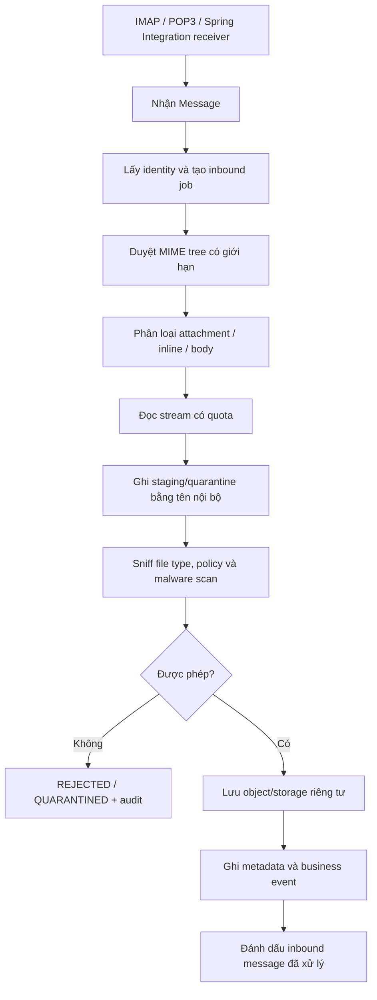

# Xử lý attachment từ thư đến trong Spring Framework Mail

Khi xây dựng ứng dụng tiếp nhận email, việc đọc nội dung thư không chỉ dừng ở Subject, người gửi hoặc phần body. Một thư đến có thể chứa hóa đơn PDF, ảnh chụp, bảng tính, văn bản, tệp nén, thư đính kèm dạng `.eml` hoặc nhiều tài nguyên inline dùng để hiển thị HTML. Những phần này thường được đóng gói bằng **MIME** (*Multipurpose Internet Mail Extensions*), đôi khi lồng nhau thành nhiều tầng `multipart/*`.

Để tiếp nhận attachment đúng cách, ứng dụng phải vừa **đọc và phân loại cấu trúc MIME**, vừa **xử lý file không đáng tin cậy**. File có thể bị giả mạo tên, Content-Type, phần mở rộng, encoding; có thể chứa malware, archive bomb, nội dung độc hại hoặc dữ liệu riêng tư. Một triển khai chỉ gọi `part.getFileName()` rồi `Files.copy(...)` vào thư mục public là chưa đủ an toàn.

Trong ngữ cảnh **Spring Framework Mail — Nhận thư và hộp thư**, có một phân biệt quan trọng:

> **`JavaMailSender` chuyên gửi email, không phải API đọc inbox.** Để đọc thư đến, thường sử dụng **Jakarta Mail** (`Session`, `Store`, `Folder`, `Message`, `Part`, `Multipart`) kết nối IMAP/POP3, hoặc tích hợp các thành phần **Spring Integration Mail** dành cho inbound email. Sau khi có `Message`, quá trình đọc MIME attachment dùng các API của Jakarta Mail.

Bài này hướng dẫn từ cấu trúc MIME, cách phát hiện và duyệt attachment, ví dụ code Jakarta Mail, đọc stream có giới hạn, lưu vùng cách ly/quarantine, kiểm tra định dạng và malware, đồng bộ IMAP UID, xử lý retry/idempotency, kiểm thử và vận hành. Các ví dụ dùng **Java 17+**, **Jakarta Mail** (`jakarta.mail.*`) và Spring Boot thế hệ sử dụng Jakarta API; với Spring Framework 5.x cần dùng hệ `javax.mail.*` tương ứng, không trộn hai package.

## 1. Attachment là phần nào trong một email?

Một email có thể có body text thuần, HTML, ảnh inline và file đính kèm cùng lúc. Ví dụ:

```text
MimeMessage
└── multipart/mixed
    ├── multipart/related
    │   ├── multipart/alternative
    │   │   ├── text/plain
    │   │   └── text/html
    │   └── image/png
    │       Content-ID: <brand-logo>
    │       Content-Disposition: inline
    ├── application/pdf
    │   Content-Disposition: attachment
    │   filename="invoice-1042.pdf"
    └── application/vnd.openxmlformats-officedocument.spreadsheetml.sheet
        Content-Disposition: attachment
        filename="items.xlsx"
```

Ở đây:

- `multipart/mixed` thường kết hợp body và các attachment độc lập.
- `multipart/alternative` chứa nhiều bản thể hiện của cùng nội dung (text/plain, text/html).
- `multipart/related` liên kết HTML với tài nguyên như logo CID.
- `Content-Disposition: attachment` thể hiện ý định là file đính kèm.
- `Content-Disposition: inline` thể hiện phần có thể hiển thị trong nội dung.
- `filename` và `Content-Type` là metadata do bên gửi cung cấp, **không đáng tin mặc định**.

Không nên giả định rằng “phần tử đầu là body, phần tử thứ hai là attachment”. Một thư hợp lệ có thể lồng nhiều `Multipart`, đảo thứ tự một số phần hoặc chứa nested `message/rfc822`.

### 1.1. Header tiêu biểu của một file

```text
Content-Type: application/pdf; name="invoice-1042.pdf"
Content-Disposition: attachment; filename="invoice-1042.pdf"
Content-Transfer-Encoding: base64
```

Các header này gợi ý cách client xử lý phần MIME, nhưng không chứng minh byte bên trong thực sự là PDF. Một file thực thi có thể được gửi với `Content-Type: application/pdf`; chỉ tin header là một lỗi bảo mật.

### 1.2. Một MIME part có nhất thiết là attachment không?

Không. Một part có thể là:

| Part | Vai trò thường thấy | Xử lý gợi ý |
|---|---|---|
| `text/plain` | Nội dung đọc được | Trích xuất body khi cần |
| `text/html` | Nội dung HTML | Không thực thi HTML; sanitize nếu cần hiển thị |
| `image/png` + `Content-ID` + inline | Ảnh trong HTML | Tùy policy có thể lưu như inline resource |
| `application/pdf` + attachment | File độc lập | Phân loại attachment và đưa vào pipeline kiểm tra |
| `application/octet-stream` có tên file | File với loại không rõ | Xử lý như dữ liệu không tin cậy |
| `message/rfc822` | Một email đính trong email khác | Có thể xử lý như file hoặc duyệt theo policy |
| `multipart/*` | Container của nhiều phần | Duyệt đệ quy |

Một part có `getDisposition() == null` vẫn có thể là attachment nếu nó có filename và content type phù hợp. Ngược lại, một phần `image/png` có `INLINE` không nhất thiết nên đưa vào danh sách “file người dùng tải xuống”. Việc phân loại phải theo mục tiêu ứng dụng.

## 2. Luồng tiếp nhận attachment nên tách các bước

Một pipeline điển hình:



**Không mở file cho người dùng tải hoặc cho downstream parser xử lý trước khi policy/scan cho phép.** Pipeline phải có khả năng dừng an toàn khi gặp file quá lớn, quá nhiều attachments hoặc lỗi phân tích MIME.

### 2.1. Phạm vi trách nhiệm

**Receiver:** lấy thư, nhận diện folder/UID, quản lý kết nối và retry.

**MIME extractor:** nhận một `Part`, đi qua cấu trúc, trả metadata/file tạm có giới hạn; không quyết định quyền truy cập nghiệp vụ.

**Security scanner/policy:** kiểm tra loại file thật, malware, archive nesting và rule cho phép.

**Storage service:** lưu dữ liệu đã duyệt với ID nội bộ, quyền truy cập, mã hóa, retention.

**Business service:** gắn attachment với ticket, hóa đơn, hồ sơ hoặc workflow đúng tenant/người dùng.

**Acknowledgment:** chỉ đánh dấu message đã xử lý sau khi trạng thái/metadata cần thiết đã được lưu bền vững.

Không đặt tất cả vào một `@Scheduled` method hàng trăm dòng vừa đọc IMAP, vừa ghi tệp, vừa gọi API nghiệp vụ.

## 3. Cấu hình đọc inbox bằng Jakarta Mail

Spring Boot có `spring-boot-starter-mail` để tạo `JavaMailSender`, nhưng nó không tự tạo một “InboxReceiver” tương đương chỉ bằng `spring.mail.host`. Để đọc IMAP, dùng Jakarta Mail `Session`/`Store`/`Folder` hoặc Spring Integration Mail inbound adapter.

### 3.1. IMAP, IMAPS và POP3

| Giao thức | Đặc điểm | Khi nào dùng |
|---|---|---|
| IMAP | Làm việc với folder, flags, trạng thái server | Đồng bộ inbox và xử lý tập trung |
| IMAPS | IMAP qua TLS ngay khi kết nối, thường port 993 | Lựa chọn phổ biến khi server hỗ trợ |
| POP3/POP3S | Trọng tâm lấy messages, ít khả năng folder/flags hơn IMAP | Hệ thống đơn giản/legacy theo yêu cầu server |
| Provider REST API/webhook | Đọc thư/sự kiện bằng API nhà cung cấp | Khi provider hỗ trợ và phù hợp kiến trúc |

Với hệ thống cần lưu UID, không đọc lại các thư đã xử lý và hỗ trợ nhiều folder, IMAP thường thuận tiện hơn POP3.

### 3.2. Ví dụ kết nối IMAPS

```java
package com.example.mail.inbound;

import jakarta.mail.Folder;
import jakarta.mail.Message;
import jakarta.mail.Session;
import jakarta.mail.Store;
import java.util.Properties;

public final class ImapInboxReader {

    public void readInbox(
            String host,
            String username,
            String password) throws Exception {

        Properties p = new Properties();
        p.put("mail.store.protocol", "imaps");
        p.put("mail.imaps.connectiontimeout", "5000");
        p.put("mail.imaps.timeout", "10000");
        p.put("mail.imaps.writetimeout", "10000");
        p.put("mail.imaps.ssl.checkserveridentity", "true");
        p.put("mail.debug", "false");

        Session session = Session.getInstance(p);
        Store store = session.getStore("imaps");
        Folder inbox = null;

        try {
            store.connect(host, 993, username, password);
            inbox = store.getFolder("INBOX");
            inbox.open(Folder.READ_ONLY);

            Message[] messages = inbox.getMessages();
            for (Message message : messages) {
                // Trích xuất metadata và attachments có kiểm soát.
                // Không đưa toàn bộ message vào log.
                inspectIncomingMessage(message);
            }
        } finally {
            if (inbox != null && inbox.isOpen()) {
                inbox.close(false);
            }
            if (store.isConnected()) {
                store.close();
            }
        }
    }

    private void inspectIncomingMessage(Message message)
            throws Exception {
        // Gọi MIME extractor/inbound service của ứng dụng.
    }
}
```

Đây là ví dụ về **quản lý kết nối và tài nguyên**, không phải một polling service production. `getMessages()` có thể trả rất nhiều thư; code thật cần chỉ lấy phạm vi UID chưa xử lý và giới hạn số message trong mỗi lượt. Phương thức `inspectIncomingMessage` là chỗ nối vào pipeline xử lý.

**Không hard-code password.** IMAP provider có thể yêu cầu OAuth2 hoặc app password riêng thay vì mật khẩu đăng nhập. Cần dùng provider-supported authentication, secret manager và connection lifecycle phù hợp. Nếu dùng TLS, kiểm tra chứng chỉ/hostname và không tắt trust checks để “cho chạy được”.

### 3.3. READ_ONLY hay READ_WRITE?

`Folder.READ_ONLY` phù hợp khi muốn đọc và trích xuất mà không tự ý thay đổi flags. Để đánh dấu `SEEN`, thêm flag xử lý hoặc chuyển thư giữa folder, thường phải mở `READ_WRITE` và xác định chính sách acknowledgment.

Không nên tự đặt `SEEN` **trước khi** attachment được lưu bền vững chỉ để tránh đọc lại. Một lỗi scanner/database giữa chừng sẽ làm thư bị bỏ qua vĩnh viễn nếu poller chỉ đọc thư chưa xem.

### 3.4. Không dựa vào message sequence number

`message.getMessageNumber()` chỉ là vị trí trong folder hiện tại, không ổn định khi mailbox thay đổi (thư bị xóa, expunge, move). Để đồng bộ IMAP, ưu tiên identity gồm **mail account + folder + UIDVALIDITY + UID**, hoặc cơ chế provider API ID nếu dùng API.

## 4. Jakarta Mail Part và Multipart

Jakarta Mail dùng interface `Part` làm khái niệm chung cho `Message` và `BodyPart`. Một part có thể là container hoặc dữ liệu.

Các API thường dùng:

```java
Part part = message;

String contentType = part.getContentType();
String disposition = part.getDisposition();
String fileName = part.getFileName();
String[] contentIds = part.getHeader("Content-ID");
int declaredSize = part.getSize();

boolean isMultipart = part.isMimeType("multipart/*");
boolean isPlainText = part.isMimeType("text/plain");
boolean isHtml = part.isMimeType("text/html");
boolean isNestedMail = part.isMimeType("message/rfc822");
```

Các field có thể `null`; `getSize()` có thể trả `-1` nếu kích thước chưa biết. MIME headers đến từ bên ngoài, nên những giá trị này không phải dữ liệu đáng tin về tên/loại/kích thước.

### 4.1. Đừng ép mọi getContent() thành String

Sai:

```java
String body = (String) message.getContent();
```

Nếu thư là `multipart/mixed`, `getContent()` thường trả `Multipart`, không phải `String`. Ép kiểu sẽ lỗi. Với `message/rfc822`, nội dung có thể là một `Message` lồng. Với file nhị phân, không dùng `String` để giữ bytes.

Mô hình:

```java
Object content = part.getContent();

if (content instanceof Multipart multipart) {
    // Duyệt các BodyPart con.
} else if (content instanceof Message nestedMessage) {
    // Thư lồng, xử lý theo policy.
} else if (content instanceof String text) {
    // Body text, với giới hạn độ dài.
} else {
    // Không giả định object là text.
}
```

Khi đã phân loại một part là file nhị phân, **dùng `part.getInputStream()`** để đọc bytes qua stream thay vì đọc toàn bộ vào `byte[]` hay `String`.

## 5. Phân loại attachment, inline resource và body

Một utility khởi đầu:

```java
import jakarta.mail.Part;
import java.util.Locale;

enum PartRole {
    ATTACHMENT,
    INLINE_RESOURCE,
    BODY
}

static PartRole classifyLeaf(Part part) throws Exception {
    String disposition = part.getDisposition();
    String fileName = part.getFileName();
    String[] cid = part.getHeader("Content-ID");
    boolean hasCid = cid != null && cid.length > 0;

    if (disposition != null
            && disposition.equalsIgnoreCase(Part.ATTACHMENT)) {
        return PartRole.ATTACHMENT;
    }

    if (disposition != null
            && disposition.equalsIgnoreCase(Part.INLINE)) {
        return fileName != null || hasCid
                ? PartRole.INLINE_RESOURCE : PartRole.BODY;
    }

    // Nhiều client gửi file có filename nhưng thiếu disposition.
    if (fileName != null && !fileName.isBlank()) {
        return PartRole.ATTACHMENT;
    }

    if (hasCid && !part.isMimeType("text/plain")
            && !part.isMimeType("text/html")) {
        return PartRole.INLINE_RESOURCE;
    }

    return PartRole.BODY;
}
```

Đây là **heuristic nhận diện**, không phải bộ chuẩn hóa MIME cho mọi loại email. Một số thư chứa inline image nhưng không đặt `Content-Disposition` hoặc có file attachment không tên. Tùy nghiệp vụ, nên:

- Ghi nhận disposition/filename/CID/Content-Type thật.
- Có policy riêng cho `inline`, `attachment` và `unknown binary part`.
- Thử với email thực từ các mail clients được hỗ trợ.
- Không đánh dấu một part là “an toàn” chỉ vì role là `BODY`.
- Không đưa HTML/text vào trình duyệt mà không sanitize đúng ngữ cảnh.

### 5.1. Content-Disposition có thể thiếu

Một file có thể có:

```text
Content-Type: application/pdf; name="report.pdf"
Content-Transfer-Encoding: base64
```

không có `Content-Disposition`. Chỉ kiểm tra `Part.ATTACHMENT.equals(part.getDisposition())` sẽ bỏ sót. Cần xem filename, Content-Type và policy.

### 5.2. Inline resource không nhất thiết phải expose cho người dùng

Một email HTML chứa:

```html

```

Part image tương ứng thường dùng `Content-ID`. Nếu ứng dụng lập danh sách file tải xuống, có thể không đưa logo inline vào danh sách; nhưng nếu cần render HTML an toàn, có thể phải lưu/tạo map CID theo policy.

Không tin bất kỳ `cid:...` nào trong HTML là đường dẫn tự động được phép truy xuất. Chỉ liên kết đến những resource đã capture và vượt qua kiểm tra an toàn, đồng thời giới hạn kích thước/loại.

### 5.3. message/rfc822 là trường hợp đặc biệt

Một file `forwarded.eml` có thể được đóng gói với `Content-Type: message/rfc822` và `Content-Disposition: attachment`. Nếu policy muốn cho người dùng tải đúng file `.eml`, hãy xử lý **phần email đính kèm như một file**. Nếu policy muốn khai thác các attachment bên trong email forwarded, có thể duyệt tiếp `Message` lồng.

Không vừa lưu nguyên `.eml` vừa duyệt sâu mọi phần mà không tính giới hạn; một kẻ gửi có thể tạo nhiều tầng thư lồng để gây tiêu tốn CPU/memory. Định nghĩa rõ mode `PRESERVE_EML` và `RECURSE_NESTED` theo use case.

## 6. Những giới hạn bắt buộc khi xử lý MIME

Một parser chạy với dữ liệu email từ Internet phải có giới hạn, không chỉ bắt exception.

| Loại giới hạn | Mục đích | Ví dụ chính sách minh họa |
|---|---|---|
| Tổng bytes decoded attachment của một email | Tránh storage/memory exhaustion | 25 MiB |
| Bytes của một attachment | Ngăn file đơn quá lớn | 15 MiB |
| Tổng số MIME parts | Tránh quá nhiều phần nhỏ | 100 |
| Số attachments | Giảm số file và scan workload | 20 |
| Độ sâu MIME recursion | Tránh nested/multipart abuse | 12 |
| Số nested messages | Tránh `message/rfc822` sâu | Tối đa vài cấp |
| Tổng độ dài text body được giữ | Tránh body text cực lớn | Theo nhu cầu |
| SMTP/IMAP read timeout | Tránh worker treo | Timeout hữu hạn |
| Tổng thời gian xử lý email | Bảo vệ worker SLA | Deadline riêng |
| Kích thước archive sau giải nén | Chống zip bomb | Theo quota |

Các con số trên là **ví dụ**, không phải mặc định Spring/Jakarta Mail. Phải chọn dựa trên nhu cầu nghiệp vụ, quota mail server và tài nguyên thực tế.

### 6.1. Không tin getSize()

`Part.getSize()` có thể không biết hoặc phản ánh số byte encoded/representation theo implementation, không phải lượng dữ liệu đã giải mã cuối cùng. Quyết định an toàn phải dựa trên **số byte thực sự đọc từ stream**, với bộ đếm và ngưỡng.

### 6.2. Giới hạn khi duyệt

Nếu MIME tree có 2000 part rỗng, chỉ giới hạn bytes sẽ chưa đủ. Nếu một thư có 50 cấp lồng nhau, chỉ giới hạn số part cũng chưa đủ. Nên dùng **cả giới hạn độ sâu và số node**.

### 6.3. Tại sao phải tính tổng?

20 attachments, mỗi file 10 MiB, vẫn có tổng 200 MiB. Dù mỗi file nhỏ hơn limit 15 MiB, một message vẫn có thể vượt tổng budget. Khi một part làm tổng vượt giới hạn, dừng xử lý an toàn, ghi trạng thái đã phân loại và dọn staging artifacts theo chính sách.

## 7. Ví dụ hoàn chỉnh: trích xuất file vào quarantine theo stream

Đoạn Java sau nhận một `jakarta.mail.Message` đã được tải từ IMAP, duyệt MIME tree, chỉ ghi các phần được phân loại là attachment/inline resource vào một **thư mục staging riêng tư**. Nó thực hiện:

- Đếm tổng số MIME parts và giới hạn recursion depth.
- Chặn số attachment và kích thước decoded file/tổng bytes.
- Không dùng `getFileName()` làm đường dẫn lưu.
- Tạo tên file nội bộ ngẫu nhiên bằng `Files.createTempFile(...)`.
- Đọc qua `InputStream` với buffer nhỏ thay vì nạp cả file vào heap.
- Tính SHA-256 trên byte thực tế nhận được.
- Xóa file tạm nếu việc đọc thất bại hoặc vượt quota.
- Trả metadata tách biệt với nội dung file.

**Quan trọng:** ví dụ này là **bước cách ly**, **chưa kiểm tra malware** và **chưa cho phép người dùng truy cập file**. Không được hiểu “file đọc thành công” là “file an toàn”.

### 7.1. Bộ trích xuất có giới hạn

```java
package com.example.mail.inbound;

import jakarta.mail.Message;
import jakarta.mail.MessagingException;
import jakarta.mail.Multipart;
import jakarta.mail.Part;
import java.io.IOException;
import java.io.InputStream;
import java.io.OutputStream;
import java.nio.file.Files;
import java.nio.file.Path;
import java.nio.file.StandardOpenOption;
import java.security.MessageDigest;
import java.text.Normalizer;
import java.util.ArrayList;
import java.util.HexFormat;
import java.util.List;
import java.util.Locale;

public final class QuarantineAttachmentExtractor {

    private static final long MAX_FILE_BYTES =
            15L * 1024 * 1024;
    private static final long MAX_TOTAL_BYTES =
            25L * 1024 * 1024;
    private static final int MAX_PARTS = 100;
    private static final int MAX_ATTACHMENTS = 20;
    private static final int MAX_DEPTH = 12;

    private final Path quarantineDir;
    private final List<StagedAttachment> staged =
            new ArrayList<>();

    private long totalBytes;
    private int visitedParts;

    public QuarantineAttachmentExtractor(Path quarantineDir) {
        this.quarantineDir = quarantineDir;
    }

    public List<StagedAttachment> extract(Message message)
            throws Exception {

        // Một extractor instance chỉ xử lý một message.
        if (visitedParts != 0) {
            throw new IllegalStateException(
                    "Extractor instances cannot be reused");
        }

        // quarantineDir do ứng dụng cấu hình và cấp quyền riêng;
        // không được nhận từ sender hoặc file name trong email.
        if (!Files.isDirectory(quarantineDir)) {
            throw new IOException("Quarantine directory unavailable");
        }

        try {
            walk(message, 0);
            return List.copyOf(staged);
        } catch (Exception failure) {
            // Dọn các part đã staging khi toàn email bị từ chối.
            for (StagedAttachment item : staged) {
                try {
                    Files.deleteIfExists(item.quarantinePath());
                } catch (IOException cleanupError) {
                    failure.addSuppressed(cleanupError);
                }
            }
            throw failure;
        }
    }

    private void walk(Part part, int depth) throws Exception {
        if (depth > MAX_DEPTH || ++visitedParts > MAX_PARTS) {
            throw new IOException("MIME complexity limit exceeded");
        }

        // Multipart container: duyệt children, không coi container
        // là binary attachment mặc định.
        if (part.isMimeType("multipart/*")) {
            Object body = part.getContent();
            if (!(body instanceof Multipart multipart)) {
                throw new IOException("Invalid multipart content");
            }
            for (int index = 0;
                    index < multipart.getCount(); index++) {
                walk(multipart.getBodyPart(index), depth + 1);
            }
            return;
        }

        // Một .eml đính kèm được giữ như file; thư lồng khác
        // có thể duyệt tiếp nếu policy ứng dụng cho phép.
        if (part.isMimeType("message/rfc822")
                && !isExplicitAttachment(part)) {
            Object body = part.getContent();
            if (body instanceof Message nested) {
                walk(nested, depth + 1);
            } else {
                throw new IOException("Invalid nested message");
            }
            return;
        }

        PartRole role = classifyLeaf(part);
        if (role == PartRole.BODY) {
            return;
        }

        if (staged.size() >= MAX_ATTACHMENTS) {
            throw new IOException("Too many attachments");
        }
        staged.add(copyToQuarantine(part, role));
    }

    private StagedAttachment copyToQuarantine(
            Part part,
            PartRole role) throws Exception {

        String displayName = safeDisplayName(part.getFileName());
        String mimeType = part.getContentType();
        String cid = firstContentId(part);

        Path file = Files.createTempFile(
                quarantineDir, "mailpart-", ".bin");

        long fileBytes = 0L;
        MessageDigest digest = MessageDigest.getInstance("SHA-256");

        try (InputStream in = part.getInputStream();
             OutputStream out = Files.newOutputStream(
                     file,
                     StandardOpenOption.WRITE,
                     StandardOpenOption.TRUNCATE_EXISTING)) {

            byte[] buffer = new byte[8192];
            int count;
            while ((count = in.read(buffer)) != -1) {
                if (count == 0) {
                    continue;
                }
                if (count > MAX_FILE_BYTES - fileBytes
                        || count > MAX_TOTAL_BYTES - totalBytes) {
                    throw new IOException(
                            "Decoded attachment byte quota exceeded");
                }
                out.write(buffer, 0, count);
                digest.update(buffer, 0, count);
                fileBytes += count;
                totalBytes += count;
            }
        } catch (Exception failure) {
            try {
                Files.deleteIfExists(file);
            } catch (IOException cleanupError) {
                failure.addSuppressed(cleanupError);
            }
            throw failure;
        }

        return new StagedAttachment(
                displayName,
                mimeType,
                role,
                cid,
                file,
                fileBytes,
                HexFormat.of().formatHex(digest.digest()));
    }

    private static boolean isExplicitAttachment(Part part)
            throws MessagingException {
        return Part.ATTACHMENT.equalsIgnoreCase(
                part.getDisposition());
    }

    private static PartRole classifyLeaf(Part part)
            throws MessagingException {

        String disposition = part.getDisposition();
        String filename = part.getFileName();
        boolean hasFilename =
                filename != null && !filename.isBlank();
        boolean hasCid = firstContentId(part) != null;

        if (Part.ATTACHMENT.equalsIgnoreCase(disposition)) {
            return PartRole.ATTACHMENT;
        }
        if (Part.INLINE.equalsIgnoreCase(disposition)) {
            return hasFilename || hasCid
                    ? PartRole.INLINE_RESOURCE
                    : PartRole.BODY;
        }
        if (hasFilename) {
            return PartRole.ATTACHMENT;
        }
        if (hasCid && !part.isMimeType("text/plain")
                && !part.isMimeType("text/html")) {
            return PartRole.INLINE_RESOURCE;
        }

        // Binary part không rõ vai trò vẫn phải được xét;
        // không âm thầm bỏ qua chỉ vì thiếu filename.
        if (!part.isMimeType("text/plain")
                && !part.isMimeType("text/html")) {
            return PartRole.ATTACHMENT;
        }
        return PartRole.BODY;
    }

    private static String firstContentId(Part part)
            throws MessagingException {
        String[] values = part.getHeader("Content-ID");
        if (values == null || values.length == 0) {
            return null;
        }
        String cid = values[0].trim();
        // CID là metadata không đáng tin; chỉ giữ nếu hợp lệ
        // theo policy của ứng dụng.
        return cid.length() <= 200 ? cid : null;
    }

    private static String safeDisplayName(String untrusted) {
        if (untrusted == null || untrusted.isBlank()) {
            return "attachment";
        }
        // Chỉ chuẩn hóa cho hiển thị; không dùng làm storage path.
        String normalized = Normalizer.normalize(
                untrusted, Normalizer.Form.NFC);
        normalized = normalized.replace('\\', '/');
        normalized = normalized.substring(
                normalized.lastIndexOf('/') + 1);

        StringBuilder out = new StringBuilder();
        for (int i = 0; i < normalized.length()
                && out.length() < 120; i++) {
            char c = normalized.charAt(i);
            int type = Character.getType(c);
            if (!Character.isISOControl(c)
                    && type != Character.FORMAT
                    && c != ':'
                    && c != '<'
                    && c != '>'
                    && c != '"'
                    && c != '|') {
                out.append(c);
            }
        }
        String result = out.toString().trim();
        if (result.equals(".") || result.equals("..")
                || result.isBlank()) {
            return "attachment";
        }
        return result;
    }

    public enum PartRole {
        ATTACHMENT,
        INLINE_RESOURCE,
        BODY
    }

    public record StagedAttachment(
            String displayName,
            String declaredContentType,
            PartRole role,
            String contentId,
            Path quarantinePath,
            long sizeBytes,
            String sha256) {
    }
}
```

**Giới hạn của mẫu code:** đây là ví dụ streaming cho các MIME part attachment, không phải hệ thống phòng thủ hoàn chỉnh trước mọi MIME parsing attack. `part.getContent()` ở cấp multipart/nested message vẫn do thư viện phân tích và có thể tiêu thụ tài nguyên trước khi extractor kiểm đếm; ứng dụng cần thêm giới hạn kích thước **toàn raw message ở tầng receiver/server**, timeout, giới hạn worker, khả năng hủy tác vụ và library updates. Body `text/*` chưa được lưu/giới hạn bởi extractor này vì mục đích ví dụ là attachment; nếu ứng dụng còn xử lý HTML/text body, phải giới hạn phần đó riêng.

### 7.2. Dùng extractor

```java
Path stagingRoot = Path.of(
        "/var/private-mail-quarantine");

QuarantineAttachmentExtractor extractor =
        new QuarantineAttachmentExtractor(stagingRoot);

List<QuarantineAttachmentExtractor.StagedAttachment> items =
        extractor.extract(inboundMessage);

for (var item : items) {
    // Gửi metadata và đường dẫn tạm cho scanner/policy.
    // Không trả trực tiếp quarantinePath cho HTTP client.
    scanningQueue.submit(item);
}
```

`scanningQueue` là thành phần application do dự án định nghĩa. `/var/private-mail-quarantine` chỉ là ví dụ trên hệ Unix; khi triển khai, directory phải được tạo/cấp quyền bởi hệ thống quản trị và cô lập khỏi webroot/public static resources.

**Từ lúc extractor trả về đến khi scanner xử lý**, cần có owner/lifecycle của các file tạm: job ID, thời hạn quét, retry, cleanup và quyền truy cập. Nếu producer đưa file path vào queue rồi process chết, không nên để file tồn tại vô thời hạn.

### 7.3. Vì sao lưu tên file ngẫu nhiên?

Nếu sender gửi:

```text
Content-Disposition: attachment;
 filename="../../config/application.yml"
```

đường dẫn lưu vẫn là:

```text
/var/private-mail-quarantine/mailpart-842391.bin
```

Tên từ header chỉ là metadata để hiển thị sau khi kiểm tra, **không bao giờ** trở thành đường dẫn đích trong filesystem. Chức năng download về sau có thể đặt `Content-Disposition` với tên đã sanitize, sau khi xác thực quyền.

### 7.4. SHA-256 dùng để làm gì?

Hash giúp đối chiếu bytes, hỗ trợ phát hiện nội dung trùng nhau và kiểm tra file không bị thay đổi giữa staging–scan–storage. Hash **không chứng minh file an toàn**, vì malware cũng có SHA-256 hợp lệ. Nếu dùng hash để tái sử dụng kết quả scan, phải xét scanner version, policy, thời gian và tenant boundary.

## 8. Những lỗ hổng thường gặp từ filename

`Part.getFileName()` có thể cho một tên do người gửi chọn, ví dụ:

```text
invoice.pdf
../../../../etc/passwd
C:\Windows\System32\example.exe
report.pdf.exe
report.PDF
photo.jpg\u202Egpj.exe
download
CON
file name with newline
```

Ví dụ có ký tự điều khiển/bidi hoặc tên đặc biệt có thể gây nhầm lẫn khi hiển thị, lưu file hoặc viết log. Trên các hệ điều hành khác nhau, ký tự được phép trong filename cũng khác.

### 8.1. Tên hiển thị và tên lưu là hai thứ khác nhau

Nên duy trì:

| Field | Nguồn | Mục đích |
|---|---|---|
| `sourceFileName` | Header từ sender, chưa tin cậy | Chỉ lưu metadata hạn chế, nếu thực sự cần |
| `displayFileName` | Đã sanitize theo policy | Hiển thị cho người dùng |
| `storageObjectKey` | UUID/opaque ID do server tạo | Lưu và truy xuất file |
| `detectedContentType` | Bộ phân loại nội dung | Kiểm tra policy, phục vụ download |
| `sha256` | Tính từ bytes | Integrity và audit |

Không tự gắn phần mở rộng đáng tin chỉ vì MIME header. Nếu file được phát hiện là executable nhưng mang tên `invoice.pdf`, phải từ chối/quarantine theo chính sách, không chỉ đổi tên thành `invoice.exe` rồi cho phép tải.

### 8.2. MIME filename có thể được encode

Tên tệp không phải lúc nào cũng là ASCII đơn giản. Email có thể sử dụng RFC 2231 encoded parameter hoặc các cơ chế encoding cũ để mang tên Unicode. Jakarta Mail có thể giải mã tùy version/cấu hình. Sau khi lấy `getFileName()`, vẫn phải sanitize và kiểm tra control characters; tránh tự decode lặp hoặc tin vào một biến thể header duy nhất.

### 8.3. Không log raw filename

Tên file có thể chứa PII như mã hồ sơ, thông tin sức khỏe, số tài khoản hoặc chuỗi CRLF nhằm giả dòng log. Nếu cần telemetry, ghi `attachmentIndex`, `sizeBytes`, `detectedType`, `failureClass`, không ghi tên gốc bừa bãi.

## 9. Content-Type và phần mở rộng không phải bằng chứng an toàn

Một thư có thể khai báo:

```text
Content-Type: application/pdf
Content-Disposition: attachment; filename="invoice.pdf"
```

nhưng bytes có thể không phải PDF. Vì vậy, một file pipeline nên kết hợp nhiều tín hiệu:

1. Declared Content-Type từ MIME header.
2. Display filename và phần mở rộng sau chuẩn hóa.
3. Detected file type qua file signature/magic bytes hoặc parser an toàn.
4. Chính sách allowlist theo use case.
5. Malware scanning và những kiểm tra định dạng chuyên biệt.
6. Giới hạn kích thước, độ phức tạp và tổng tài nguyên.

Ví dụ tài liệu hóa:

| Declared type | Detected type | Policy minh họa |
|---|---|---|
| `application/pdf` | PDF hợp lệ | Cho đi scan và bước validate PDF |
| `application/pdf` | Windows executable | Từ chối/quarantine |
| `image/png` | PNG hợp lệ | Quét; nếu cần có thể decode/re-encode an toàn |
| `application/zip` | ZIP | Kiểm tra archive budget và từng entry |
| `application/octet-stream` | Unknown | Quarantine và từ chối hoặc manual review |

Một file có magic bytes đúng vẫn có thể độc hại hoặc chứa nội dung được thiết kế để khai thác parser. **Sniffing không thay thế antivirus/AV và cập nhật thư viện.**

### 9.1. Parser không nên chạy trong mail receiver thread

Các thư viện PDF, Office, image parser có bề mặt tấn công riêng. Đừng để một message attacker-controlled khiến thread IMAP listener trực tiếp chạy parser nặng, treo hoặc dùng hết memory. Sau khi staging, có thể đẩy một job sang isolated scanner/processor với:

- CPU/memory/time limits.
- Quyền filesystem/network tối thiểu.
- Không có SMTP/IMAP production secrets.
- Chính sách loại file được phép.
- Theo dõi scanner version và verdict.

Nếu business yêu cầu đọc bảng tính và trích dữ liệu, thực hiện **sau** kiểm tra và trong môi trường hạn chế.

## 10. Quarantine, scanning và storage

Một pipeline an toàn không lưu attachment ngay vào thư mục public hay database “được duyệt” trước khi scan.

### 10.1. State machine của attachment

```text
RECEIVED
   |
   v
STAGED_PRIVATE
   |
   v
SCANNING
   |
   +--> CLEAN --> APPROVED_PRIVATE_STORAGE --> AVAILABLE
   |
   +--> MALICIOUS --> REJECTED / retention theo policy
   |
   +--> SUSPICIOUS --> QUARANTINED / review
   |
   +--> SCAN_FAILED --> RETRY_SCAN hoặc MANUAL_REVIEW
```

Khi scanner unavailable, **fail closed**: chưa cho người dùng tải và không tự chuyển sang trạng thái `CLEAN`. Tùy SLA, có thể chờ scan queue hoặc trả trạng thái pending để workflow tiếp tục về mặt metadata.

### 10.2. Virus scanning không đủ nếu archive phức tạp

ZIP/RAR/7z hoặc Office container có thể mang nested archives. Để chống decompression bombs, cần giới hạn:

- Tổng bytes **sau giải nén**.
- Số file entries và độ sâu archive.
- Tỷ lệ nén bất thường.
- CPU time và memory khi trích xuất.
- Kích thước từng entry.
- File symlinks/hardlinks và archive path traversal.
- Loại file lồng và password-protected archives.

Không tự giải nén từng archive rồi duyệt `../` entries vào filesystem. Nếu cần extract, dùng thư viện được bảo trì, sandbox và resolve path chống Zip Slip; nhiều ứng dụng không cần giải nén mà chỉ cần scan/quarantine nguyên archive.

### 10.3. Macro, active content và file nhạy cảm

Một số định dạng có script/macro hoặc embedded objects. Nếu ứng dụng chỉ cần báo cáo dạng PDF, không nhất thiết cho phép Office macro-enabled documents. Chính sách allowlist nên xuất phát từ nghiệp vụ, không phải blacklist một số phần mở rộng.

Các lựa chọn bổ sung:

- Chuyển đổi nội dung thành định dạng an toàn theo policy (CDR) nếu cần.
- Tạo thumbnail qua decoder/re-encoder trong sandbox.
- Vô hiệu hoạt động active content khi hiển thị preview.
- Lưu file ở bucket/private storage không phục vụ trực tiếp qua webroot.
- Chỉ cung cấp link tải sau khi được cấp quyền.

### 10.4. Tình huống scan lỗi giữa chừng

Nếu scanner timeout:

1. Giữ attachment ở trạng thái `SCAN_FAILED`/`PENDING_RETRY`.
2. Không chuyển file sang available.
3. Retry scan theo backoff, giới hạn số lần và deadline.
4. Nếu hết hạn, áp policy review/từ chối.
5. Dọn file tạm có kiểm soát khi job kết thúc.

Không xem exception của scanner là “không phát hiện virus”.

## 11. Lưu file đã kiểm tra vào private object storage

Sau khi scanner báo đủ điều kiện, ứng dụng có thể ghi vào object storage hoặc filesystem riêng tư với key do server tạo:

```text
tenant-id/inbound-mail/job-id/attachment-id
```

Các thành phần key phải là ID do ứng dụng cấp và xác nhận, không lấy trực tiếp từ filename. Trước khi lưu, kiểm tra tenant ownership; khi lấy về, không chỉ dựa vào việc người dùng biết object key.

### 11.1. Ví dụ metadata lưu bền vững

```sql
CREATE TABLE inbound_attachment (
    id                    UUID PRIMARY KEY,
    inbound_message_id    UUID NOT NULL,
    storage_object_key    VARCHAR(350),
    display_file_name     VARCHAR(180),
    declared_content_type VARCHAR(255),
    detected_content_type VARCHAR(255),
    size_bytes            BIGINT NOT NULL,
    sha256_hex            CHAR(64) NOT NULL,
    part_role             VARCHAR(30) NOT NULL,
    scan_status           VARCHAR(40) NOT NULL,
    scan_engine_version   VARCHAR(100),
    created_at            TIMESTAMPTZ NOT NULL,
    approved_at           TIMESTAMPTZ,
    CHECK (size_bytes >= 0)
);
```

Đây là schema minh họa. Trong production còn cần tenant scope, retention, storage version, job ownership, access control và các trạng thái tương ứng với yêu cầu thật.

### 11.2. Không để object key là filename

Sai:

```java
storage.put(
        "incoming/" + part.getFileName(),
        part.getInputStream());
```

Tốt hơn:

```java
String objectKey = "inbound/"
        + inboundJobId + "/"
        + UUID.randomUUID();

// Chỉ upload sau khi scan và policy cho phép.
storage.putApprovedFile(
        objectKey,
        scannedFile.quarantinePath(),
        scannedFile.detectedContentType());
```

`storage.putApprovedFile` và `scannedFile` là các API do ứng dụng định nghĩa. Không gán loại MIME trong response download chỉ từ declared Content-Type; dùng type đã xác nhận và các header phòng vệ như `X-Content-Type-Options: nosniff` theo kiến trúc web.

### 11.3. Download phải có authorization

Một attachment có thể chứa dữ liệu khách hàng, tài liệu nội bộ hoặc PII. Endpoint tải xuống phải kiểm tra người gọi có quyền với inbound message và tenant liên quan. Nếu dùng signed URL ngắn hạn, phải quản lý lifetime, scope và audit phù hợp.

Đặt object storage là private và tránh public-read ACL theo mặc định. Đừng expose absolute staging path qua JSON.

## 12. Nhận diện một email đến: Message-ID khác IMAP UID

Để xử lý attachment đúng một lần ở tầng nghiệp vụ, không thể chỉ dựa vào một lần poll thành công. IMAP connection có thể đứt, message bị chuyển folder hoặc worker crash. Một thư đã được đọc có thể xuất hiện lại ở lần poll sau.

Các định danh thường gặp:

| Định danh | Ý nghĩa | Rủi ro nếu dùng làm ID duy nhất |
|---|---|---|
| `Message.getMessageNumber()` | Số thứ tự message trong folder khi mở | Thay đổi khi mailbox expunge/move |
| Header `Message-ID` | ID do bên gửi/relay tạo theo RFC 5322 | Có thể thiếu, sai, trùng hoặc bị giả mạo |
| IMAP `UID` | ID message trong một folder | Chỉ duy nhất trong phạm vi folder và UIDVALIDITY |
| IMAP `UIDVALIDITY` | Phiên bản namespace UID của folder | Khi đổi, UID cũ không còn cùng ý nghĩa |
| `inboundMessageId` | ID nội bộ của job tiếp nhận | Dùng để nối attachment/workflow |
| POP3 UIDL | ID do POP3 server cung cấp nếu hỗ trợ | Semantics khác IMAP; phụ thuộc server |

**Đối với IMAP, khóa đồng bộ hợp lý là account + folder + UIDVALIDITY + UID.** Khi message bị chuyển folder, nó có thể có UID khác tại folder đích; ứng dụng cần policy về việc xử lý lại hoặc nối cùng logical email.

### 12.1. Đọc UID bằng UIDFolder

Jakarta Mail có interface `UIDFolder`:

```java
import jakarta.mail.Folder;
import jakarta.mail.Message;
import jakarta.mail.UIDFolder;

Folder folder = store.getFolder("INBOX");
folder.open(Folder.READ_ONLY);

if (!(folder instanceof UIDFolder uidFolder)) {
    throw new IllegalStateException(
            "Folder does not support IMAP UID semantics");
}

long uidValidity = uidFolder.getUIDValidity();

for (Message message : folder.getMessages()) {
    long uid = uidFolder.getUID(message);
    if (uid <= 0) {
        continue;
    }

    InboundIdentity identity = new InboundIdentity(
            accountId, "INBOX", uidValidity, uid);

    inboundJobService.enqueueIfAbsent(identity);
}
```

`accountId`, `InboundIdentity` và `inboundJobService` là thành phần do dự án định nghĩa. Trong production, không nên quét `getMessages()` toàn inbox sau mỗi lượt; hãy giữ checkpoint và chỉ lấy những UID chưa xử lý, kết hợp cơ chế phục hồi khi UIDVALIDITY thay đổi.

### 12.2. Schema inbound identity

```sql
CREATE TABLE inbound_message (
    id                  UUID PRIMARY KEY,
    account_id          UUID NOT NULL,
    folder_name         VARCHAR(255) NOT NULL,
    uid_validity        BIGINT NOT NULL,
    imap_uid            BIGINT NOT NULL,
    mime_message_id     VARCHAR(320),
    processing_state    VARCHAR(40) NOT NULL,
    attempts            INTEGER NOT NULL DEFAULT 0,
    first_seen_at       TIMESTAMPTZ NOT NULL,
    processed_at        TIMESTAMPTZ,
    last_error_class    VARCHAR(100),
    UNIQUE (account_id, folder_name, uid_validity, imap_uid)
);

CREATE INDEX idx_inbound_message_pending
    ON inbound_message (processing_state, first_seen_at);
```

Tất cả bảng, trạng thái và ID là ví dụ ứng dụng. Một hệ thống đa tenant còn cần tenant scope, quyền truy cập account, lease để ngăn nhiều worker xử lý đồng thời, retention và lưu map khi IMAP folder đổi.

### 12.3. Header Message-ID vẫn hữu ích để đối chiếu

```java
String[] headers = message.getHeader("Message-ID");
String mimeMessageId =
        headers != null && headers.length > 0
                ? headers[0] : null;
```

Nhưng đây là header do sender/relay có thể kiểm soát. Không dùng làm bằng chứng danh tính người gửi, không lấy làm authorization token, và không tự xem hai email có cùng header là cùng một bản ghi nghiệp vụ.

### 12.4. Dedupe attachment không chỉ dựa vào hash

Hai email khác nhau có thể đính kèm **cùng một file PDF**. SHA-256 của attachment giống nhau không có nghĩa ứng dụng được bỏ qua một email hoặc chia sẻ object giữa hai tenant. Hash có thể hỗ trợ dedup nội dung lưu trữ, nhưng nghiệp vụ cần giữ liên kết tới **inbound message + attachment part identity + quyền truy cập**.

## 13. Idempotent inbound processing

Một luồng xử lý bền vững:

```text
Poll IMAP UID
    |
    v
INSERT inbound_message IF ABSENT
    |
    v
Claim inbound job / lease
    |
    v
Parse MIME -> quarantine attachments
    |
    v
Scan -> private storage
    |
    v
COMMIT metadata + business outcome
    |
    v
Mark inbound job completed
    |
    v
Optional IMAP Seen/Move acknowledgment
```

### 13.1. Không cần exactly-once IMAP read để có idempotent business outcome

Ứng dụng có thể đọc cùng một message nhiều lần khi reconnect, nhưng unique constraint và job state đảm bảo cùng identity không tự tạo nhiều bản ghi nghiệp vụ/attachment không kiểm soát.

Ví dụ:

```sql
INSERT INTO inbound_message (
    id, account_id, folder_name, uid_validity, imap_uid,
    processing_state, first_seen_at
)
VALUES (
    :id, :account_id, :folder_name, :uid_validity, :uid,
    'PENDING', NOW()
)
ON CONFLICT (
    account_id, folder_name, uid_validity, imap_uid
) DO NOTHING;
```

Sau insert, truy vấn row đã tồn tại theo identity để lấy `inboundMessageId`. Không trả UUID mới được tạo nhưng insert bị conflict; idempotency phải dùng row đã lưu.

### 13.2. Đặt attachment ID riêng

Một message có thể có nhiều file; mỗi file cần ID độc lập:

```text
inboundMessageId=M100
    attachment A1: PDF
    attachment A2: XLSX
    inlineResource R1: PNG logo
```

Khi retry scan attachment A2, không cần tải/scan lại A1 nếu trạng thái A1 đã được ghi bền vững và file còn hợp lệ. Nếu MIME parsing bị lỗi giữa chừng, quyết định re-extract theo policy và làm sạch staging tạm để không bị orphan.

### 13.3. Idempotency cho storage upload

Nếu object store upload thành công nhưng database commit thất bại, lần retry có thể upload trùng. Có thể dùng:

- Một attachment record/ID được tạo trước.
- Object key ổn định theo ID nội bộ và version có chủ đích.
- Conditional put hoặc kiểm tra object tồn tại/metadata theo contract storage.
- Reconciliation job dọn các object không còn reference.

Không dùng filename gốc làm object key để “deduplicate”; cùng tên có thể có nội dung khác và ngược lại.

### 13.4. Xử lý email bị xóa hoặc di chuyển trong lúc đang làm

Trong khoảng từ poll UID đến lúc worker fetch body, mailbox có thể thay đổi. Nếu `UIDFolder.getMessageByUID(uid)` trả `null`, job cần trạng thái ví dụ `SOURCE_NOT_FOUND` hoặc retry ngắn theo policy; không tự gắn nội dung từ message có sequence number giống nhau.

Nếu cần độ bền vững mạnh, có thể tải raw RFC 822 message vào một object store cách ly có giới hạn rồi xử lý từ snapshot nội bộ. Nhưng phải giới hạn raw message size, mã hóa/quyền truy cập và retention vì raw email chứa toàn bộ recipient, body và attachments.

## 14. Đánh dấu SEEN, move hoặc delete lúc nào?

**Đọc một message không có nghĩa đã xử lý xong tất cả attachments.** Quy trình acknowledgment phụ thuộc yêu cầu:

- **`SEEN`:** đánh dấu đã xem; không nhất thiết đồng nghĩa xử lý nghiệp vụ.
- **Custom user flag / keyword:** một số IMAP server hỗ trợ, nhưng không thống nhất ở mọi hệ thống.
- **Move sang folder Processed:** có thể giúp vận hành, nhưng UID có thể thay đổi ở folder đích.
- **Delete/expunge:** có thể làm mất nguồn để retry và audit; cần retention policy.
- **Application checkpoint:** lưu identity, trạng thái và attempts trong DB; thường quan trọng hơn flags.

### 14.1. Đừng dựa vào SEEN làm nguồn sự thật duy nhất

Nếu poller chỉ lấy `UNSEEN`, một người dùng mở thư trong mail client có thể làm ứng dụng bỏ qua nó. Ngược lại, app đọc thư và bị crash trước khi lưu file có thể khiến thư được đánh dấu seen nhưng chưa xử lý.

Nên dùng UID checkpoint/job store để quyết định phải xử lý gì; flags có thể là thông tin phụ trợ.

### 14.2. Đánh dấu sau khi hoàn tất

Ví dụ với folder `READ_WRITE` và identity đã hoàn thành:

```java
import jakarta.mail.Flags;
import jakarta.mail.Folder;
import jakarta.mail.Message;
import jakarta.mail.UIDFolder;

Folder inbox = store.getFolder("INBOX");
inbox.open(Folder.READ_WRITE);

try {
    UIDFolder uidFolder = (UIDFolder) inbox;

    // Xác nhận UIDVALIDITY hiện tại trước khi dùng UID đã lưu.
    if (uidFolder.getUIDValidity() == job.uidValidity()
            && inboundJobStore.isProcessed(job.id())) {

        Message current = uidFolder.getMessageByUID(
                job.imapUid());
        if (current != null) {
            current.setFlag(Flags.Flag.SEEN, true);
        }
    }
} finally {
    if (inbox.isOpen()) {
        inbox.close(false);
    }
}
```

`job` và `inboundJobStore` là thành phần ứng dụng. Cần kiểm tra `UIDFolder` thực sự được hỗ trợ; ví dụ giả định server IMAP. Việc đánh dấu flag có thể thất bại tạm thời sau khi database đã commit; vì vậy acknowledgment cần retry/idempotency, không rollback dữ liệu attachment đã được xử lý.

### 14.3. Có nên xóa thư gốc?

Không tự động xóa ngay sau khi nhận nếu cần audit, tra cứu hoặc retry. Nếu chính sách yêu cầu dọn mailbox, có thể chuyển vào folder riêng hoặc xóa sau thời gian lưu; phải hiểu semantics của server, quota và UID changes.

Với POP3, việc xóa từ server thường có semantics khác IMAP. Không áp nguyên code `SEEN`/UIDVALIDITY cho POP3.

## 15. Spring Integration Mail trong pipeline nhận thư

**Spring Integration Mail** cung cấp các receiver/adapter để đưa email từ POP3/IMAP vào Spring Integration message channels. Một số thành phần thường gặp gồm:

- `ImapMailReceiver` và `Pop3MailReceiver` để lấy thư.
- Các inbound channel adapter và cơ chế polling.
- IMAP IDLE adapter khi server hỗ trợ push notification.
- Các `MessageChannel`/`IntegrationFlow` để đẩy message qua handler.
- Header metadata và các tùy chọn mark-read/peek tùy component/version.

Spring Integration giúp tách inbound transport khỏi processing pipeline, nhưng **không tự thực hiện antivirus, storage authorization hoặc business idempotency**.

### 15.1. Kiến trúc gợi ý

```text
IMAP INBOX
    |
    v
Spring Integration Mail inbound adapter
    |
    v
inboundMailChannel
    |
    v
InboundMessageHandler
    |
    +--> Identity (account/folder/UIDVALIDITY/UID)
    +--> Durable job enqueue
    |
    v
AttachmentProcessingWorker
    +--> MIME traversal
    +--> quarantine -> scan -> private storage
```

Nếu adapter đưa cả thư MIME qua channel, handler phải biết payload là `MimeMessage`, decoded message hay kiểu khác theo adapter configuration. Không ép kiểu theo giả định chỉ dựa trên tên channel.

### 15.2. Polling hay IMAP IDLE?

**Polling**: định kỳ kiểm tra thư mới, dễ quản lý giới hạn batch và job checkpoints, nhưng có độ trễ theo lịch.

**IMAP IDLE**: server thông báo có thay đổi inbox; có thể giảm latency và số lần poll vô ích. Nhưng network disconnect, server timeout và reconnect vẫn xảy ra. IDLE notification không nên thay thế cơ chế liệt kê UID/checkpoint để tránh bỏ sót khi connection gián đoạn.

### 15.3. Mark messages as read trong adapter

Một số receiver có tùy chọn đánh dấu thư đã đọc hoặc giữ nguyên trạng thái. Để an toàn, xác định:

1. Adapter lấy message và đọc bao nhiêu dữ liệu trước khi ack?
2. Thời điểm flag `SEEN` được set khi nào?
3. Nếu handler throw, adapter retry hay mất message?
4. App có durable inbound job/checkpoint độc lập không?
5. Mailbox server hỗ trợ custom flags/move ra sao?

Không bật một tùy chọn “mark as read” rồi coi nó tương đương commit thành công của scanner và database.

### 15.4. Kết nối và credentials

Với Spring Integration, IMAP URL/config có thể chứa thông tin tài khoản. Tránh hard-code hoặc in raw URL nếu nó có password. Ưu tiên cấu hình externalized, secret manager và cơ chế auth hợp lệ; đảm bảo TLS verify và timeout. Không đưa credentials trong exception log.

### 15.5. Không tái sử dụng MimeMessage sau khi folder đã đóng tùy tiện

Một số `MimeMessage` và body parts được backed bởi IMAP protocol streams; truy cập nội dung sau khi `Folder`/`Store` đóng có thể thất bại tùy implementation. Thiết kế rõ lifecycle:

- Trích xuất/capture bytes khi connection/folder còn hợp lệ; hoặc
- Tạo một snapshot raw message/staging file bền vững rồi đóng folder; hoặc
- Dùng API/provider có contract lazy-loading được hiểu rõ.

Không truyền `MimeMessage` từ receiver qua một queue bất đồng bộ rồi đóng IMAP folder ngay, sau đó kỳ vọng mọi attachment stream vẫn đọc được.

## 16. Xử lý body text và HTML đi kèm attachment

Một số workflow, ví dụ tạo ticket từ email, cần lưu cả nội dung thư và các file. Đừng xử lý hai việc độc lập hoàn toàn: **body HTML có thể tham chiếu ảnh inline bằng CID**, và MIME structure có thể chứa plain text + HTML alternative.

### 16.1. Plain text và HTML là hai bản của cùng nội dung

Với `multipart/alternative`:

```text
multipart/alternative
  text/plain
  text/html
```

ứng dụng có thể chọn plain text để indexing/tạo ticket preview, dùng HTML sau khi sanitize để hiển thị nếu cần, hoặc giữ cả hai theo policy. Không coi text/plain và text/html là **hai attachments** chỉ vì chúng là hai MIME body parts khác nhau.

### 16.2. HTML có thể chứa nội dung chủ động

Email HTML là **đầu vào không đáng tin cậy**. Trước khi render trong ứng dụng web:

- Loại bỏ JavaScript, event handlers, form, iframe và nội dung active.
- Giới hạn tag và attribute được phép.
- Kiểm tra/sanitize URL của `href` và `src`.
- Không để HTML điều khiển CSS toàn trang.
- Xử lý remote image theo privacy policy; tránh tự động tải URL attacker-controlled.
- Nếu map CID tới ảnh đã quét, chỉ trả ảnh sau authorization.
- Không dùng raw HTML của người gửi trong trang admin mà không sandbox/sanitize.

Ví dụ anti-pattern:

```java
model.addAttribute("emailBody", rawHtmlFromSender);
// Sau đó render raw HTML không escaping/sanitization.
```

Một email chứa HTML lừa đảo hoặc XSS payload có thể gây rủi ro cho nhân viên xử lý nếu admin tool hiển thị nó trực tiếp. Việc mail client có các biện pháp bảo vệ riêng **không bảo đảm** trang web nội bộ của ứng dụng có cùng mức bảo vệ.

### 16.3. Ảnh CID có thể cần map riêng

Giả sử body có:

```html

```

Và MIME part:

```text
Content-ID: <receipt-photo-1>
Content-Type: image/jpeg
Content-Disposition: inline
```

Nếu ứng dụng muốn hiển thị ảnh:

1. Lấy CID và normalize theo policy.
2. Đọc, quét và lưu part ảnh riêng tư.
3. Tạo map `CID -> approved attachment ID`.
4. Sanitize HTML và thay tham chiếu CID bằng URL ứng dụng có authorization.
5. Không tải remote image hoặc tự động giải quyết `file://`/`data:` từ HTML.

Không dùng `Content-ID` làm tên file/path trực tiếp; nó cũng là metadata do sender cung cấp.

### 16.4. Multipart/related khác multipart/mixed

`multipart/related` mô tả quan hệ giữa body HTML và resource, còn `multipart/mixed` thường chứa các phần độc lập. Một email forwarded hoặc được tạo bởi client cũ có thể lồng theo cách khác; dùng MIME tree và heuristics có kiểm soát thay vì hard-code “part index=1 là file”.

## 17. Security threats đặc thù với thư đến

Không phải mọi attachment bị chặn đều là malware đã biết. Nên nghĩ theo các nhóm:

| Nhóm rủi ro | Ví dụ | Kiểm soát chính |
|---|---|---|
| Path traversal / Zip Slip | `../../secrets` trong tên file/entry | Storage key nội bộ, sandbox extract |
| Malware | Tệp thực thi giả PDF | AV scan và allowlist |
| Macro/script | Office macro-enabled file | Policy loại file, sandbox/CDR |
| Archive bomb | ZIP nhỏ giải nén cực lớn | Quota sau giải nén, depth/count limits |
| Parser exploit | PDF/Image crafted để khai thác thư viện | Cập nhật parser, sandbox, timeout |
| MIME nesting abuse | Multipart sâu/hàng nghìn parts | Giới hạn depth và part count |
| MIME type spoofing | `application/pdf` nhưng bytes không phải PDF | Sniff file signature + policy |
| HTML injection/XSS | HTML gửi tới admin panel | Sanitization và isolation |
| Remote content / SSRF | HTML có image/link tới host nội bộ | Không tự fetch URL; outbound allowlist |
| Sensitive data exposure | File chứa PII | Private storage, encryption, authorization |
| Mailbox denial of service | Hàng chục MB/tệp hoặc hàng nghìn thư | Input quotas, concurrency/rate limits |
| Duplicate processing | IMAP reconnect/UID checkpoint lỗi | Durable identity + idempotency |
| False sender identity | Tên/From giả | Không cấp quyền nghiệp vụ chỉ theo From |

### 17.1. SPF/DKIM/DMARC không thay virus scan

Ngay cả khi một email có xác thực SPF, DKIM, DMARC hợp lệ, attachment vẫn có thể chứa malware hoặc file không được phép. Mail authentication giúp đánh giá nguồn gửi/domain, không xác nhận an toàn của từng byte.

Ngược lại, một email không có chữ ký DKIM không tự động chứng minh file độc hại. Kết hợp sender reputation/allowlist với policy xử lý nội dung, không thay nội dung bằng một điều kiện nhị phân đơn giản.

### 17.2. Không cấp quyền dựa trên header From đơn độc

Một workflow nhận hóa đơn không nên tự động ghi vào tài khoản của công ty A chỉ vì header:

```text
From: invoices@trusted-vendor.example
```

Header From có thể bị giả. Cần xác định kênh tin cậy, authentication results từ gateway, allowlist sender/domain, business reference hoặc bước xác nhận bổ sung theo độ nhạy nghiệp vụ.

Nếu email kích hoạt một hành động tài chính, thanh toán hoặc xuất dữ liệu, không dùng attachment và From email làm bằng chứng duy nhất.

### 17.3. Không tự tải URL trong email

Một mail có thể chứa:

```html

```

Nếu server-side HTML renderer tải ảnh ngay, có thể tạo **SSRF** đến dịch vụ nội bộ. Tương tự, đừng tự mở URL của attachment cloud link từ nguồn không đáng tin trong cùng tiến trình có quyền truy cập mạng nội bộ.

Nếu nghiệp vụ phải tải file qua URL bên ngoài, dùng một download service với scheme/host/IP allowlist, DNS revalidation, redirect policy, byte/time limits và network isolation. Đây là một workflow khác với MIME attachment gắn sẵn trong message.

### 17.4. File encrypted/password-protected

Một ZIP hoặc PDF được mã hóa có thể không quét được nội dung đầy đủ. Không đánh dấu `CLEAN` chỉ vì scanner không đọc được. Policy có thể đưa vào manual review, từ chối, hoặc yêu cầu nguồn gửi cung cấp bản phù hợp qua kênh an toàn.

Không gửi mật khẩu hoặc bí mật giải mã trong logs. Không tự thử password guessing bằng tài nguyên không giới hạn.

## 18. Retry và phân loại lỗi

Một worker nhận thư thường gặp nhiều lỗi:

- Mất IMAP connection.
- Folder không tồn tại hoặc thiếu quyền.
- UID source bị expunge trước khi fetch.
- MIME malformed hoặc encoding không hợp lệ.
- Attachment vượt quota.
- Staging disk đầy hoặc không ghi được.
- Scanner timeout.
- Object storage unavailable.
- Database commit thất bại.
- Business validation không đạt.

Không nên retry tất cả lỗi giống nhau.

### 18.1. Gợi ý taxonomy

```java
public enum InboundFailureClass {
    IMAP_CONNECTION,
    IMAP_AUTHENTICATION,
    SOURCE_MESSAGE_NOT_FOUND,
    MALFORMED_MIME,
    MIME_TOO_COMPLEX,
    ATTACHMENT_TOO_LARGE,
    TOO_MANY_ATTACHMENTS,
    DISALLOWED_FILE_TYPE,
    MALWARE_DETECTED,
    SCANNER_UNAVAILABLE,
    STAGING_IO,
    STORAGE_UNAVAILABLE,
    BUSINESS_VALIDATION,
    UNKNOWN
}
```

Đây là các mã do ứng dụng định nghĩa, không phải enum của Jakarta Mail. Mã lỗi giúp log/metrics rõ mà không cần in toàn bộ exception chứa headers, filenames hoặc bytes.

### 18.2. Retryable hay permanent?

| Lỗi | Cách xử lý điển hình |
|---|---|
| IMAP connection timeout | Retry với backoff/jitter |
| IMAP authentication failed | Cảnh báo cấu hình/credential; tránh retry dồn dập |
| Source UID không còn tồn tại | Đối soát folder/UIDVALIDITY, có thể kết thúc riêng |
| MIME malformed không parse được | Quarantine/message-level reject; không retry vô hạn |
| Attachment vượt kích thước | Từ chối theo policy, ghi lý do |
| Malware detected | Từ chối/quarantine; không chuyển cho downstream |
| Scanner unavailable | Giữ staging pending, retry scan có giới hạn |
| Object storage timeout | Retry storage, đối soát file đã upload |
| Database commit failed | Retry theo idempotency, dọn orphan file |
| Business validation failed | Có thể manual review hoặc permanent failure |

Không bỏ hoàn toàn thư khó xử lý chỉ vì parser lỗi. Hệ thống có thể cần lưu metadata tối thiểu, trạng thái reject và cảnh báo tùy policy; nếu raw message được lưu để forensic, phải có quyền truy cập và retention nghiêm ngặt.

### 18.3. Lỗi giữa stream

Nếu `InputStream.read(...)` ném exception sau khi đã ghi 3 MB vào staging:

1. Đóng stream và output stream.
2. Xóa file temp chưa hoàn chỉnh.
3. Ghi `STAGING_IO` hoặc `MALFORMED_MIME` theo nguyên nhân.
4. Không đưa metadata file đó vào trạng thái `CLEAN`.
5. Quyết định retry nếu dữ liệu nguồn còn và lỗi có thể tạm thời.

Ví dụ extractor ở mục 7 có cleanup trong nhánh exception; production còn cần janitor dọn staging artifacts bị bỏ lại sau process crash.

### 18.4. Đừng giữ IMAP connection khi chờ scanner

Scanner có thể mất vài giây hoặc phút. Một receiver không nên giữ `Folder`/`Store` mở và lock/connection liên tục trong toàn bộ quá trình scan; tốt hơn:

- Fetch bytes vào staging an toàn trong thời gian bounded.
- Ghi durable inbound identity và snapshot cần thiết.
- Đóng IMAP resources.
- Đẩy scan/storage/processing sang worker khác.

Điều này giảm rủi ro connection timeout và cho phép scale độc lập receiver với scanner.

## 19. Capacity planning và backpressure

Nhận mail là một nguồn tải không hoàn toàn do ứng dụng kiểm soát. Một email có thể chứa nhiều files, và scan/parse thường chậm hơn việc lấy metadata.

Các tham số cần giới hạn:

| Tham số | Vai trò |
|---|---|
| Số IMAP messages poll mỗi lượt | Không lấy quá nhiều dữ liệu |
| Số worker đồng thời fetch raw mail | Giới hạn connection/network |
| Số attachments xử lý đồng thời | Giới hạn CPU, RAM và IO |
| Tổng staging bytes | Ngăn đầy đĩa |
| Scanner queue depth | Phát hiện scanner quá tải |
| Tối đa bytes email/attachment | Ngăn payload bất thường |
| Timeout của mỗi bước | Không để job treo vô hạn |
| Retry/backoff | Tránh bão retry khi IMAP/storage lỗi |
| Per-tenant quota | Tránh một tenant dùng hết tài nguyên |

### 19.1. Một bài toán tải minh họa

Nếu hệ thống nhận 30 thư/phút, mỗi thư trung bình hai file, scanner sẽ thấy trung bình 60 file/phút. Nếu scanner chỉ hoàn tất 40 file/phút trong thời gian dài, scan backlog sẽ tăng khoảng 20 file/phút.

Tăng số IMAP pollers không giải quyết bottleneck scanner; nó chỉ đưa thêm file vào staging nhanh hơn. Cần giám sát backlog, điều tiết receiver hoặc tăng scan capacity có kiểm soát.

### 19.2. Backpressure khi staging đầy

Nếu staging disk còn rất ít dung lượng:

- Ngừng nhận thêm các attachment lớn vào vùng tạm.
- Không bỏ qua bước scan để “giải phóng queue”.
- Giữ inbound job trong trạng thái retry/backpressure theo policy.
- Cảnh báo vận hành và dọn orphan files theo lifecycle.
- Không xóa dữ liệu đã được người dùng/ứng dụng xác nhận cần lưu nếu chưa có bản thay thế bền vững.

### 19.3. Không tăng recursion limit tùy tiện

Khi một email hợp lệ bị từ chối vì MIME depth, không nhất thiết tăng MAX_DEPTH từ 12 lên 1000. Cần xem loại mail client tạo ra nó, mức cần thiết của nested messages và tác động tới CPU/memory. Có thể hỗ trợ forwarded emails bằng mode rõ ràng thay vì cho mọi MIME structure sâu vô hạn.

## 20. Observability và logging khi xử lý attachment

Mục tiêu observability là trả lời:

1. Thư đến đã được receiver nhìn thấy chưa?
2. Có tạo inbound job bền vững không?
3. MIME parser trích được bao nhiêu file?
4. Có file nào vượt policy, bị scanner chặn hoặc lưu thất bại?
5. File nào đã available trong private storage?
6. Có retry, duplicate processing hoặc orphan staging file không?

### 20.1. Structured event minh họa

```json
{
  "event": "inbound_attachment_staged",
  "inboundMessageId": "813c4c9a-b5b6-4d33-b478-a7b0376d43cb",
  "attachmentId": "31fa5199-a2dc-4ce2-b35c-29f08a0e91aa",
  "mailboxAlias": "invoices-inbound",
  "partRole": "ATTACHMENT",
  "declaredTypeCategory": "application/pdf",
  "sizeBytes": 148220,
  "processingMs": 215
}
```

Không ghi raw Subject, From, recipient email, filename, Content-ID tùy ý, full MIME header hoặc file bytes vào log tập trung. Những trường này có thể chứa PII hoặc dữ liệu không đáng tin.

### 20.2. Các event nên định nghĩa

```text
inbound_message_discovered
inbound_message_claimed
inbound_mime_parse_started
inbound_attachment_staged
inbound_attachment_policy_rejected
inbound_attachment_scan_completed
inbound_attachment_available
inbound_message_processing_completed
inbound_message_processing_failed
inbound_message_acknowledged
inbound_message_retry_scheduled
```

Tùy quy mô, có thể chọn ít event hơn; quan trọng là **không gọi `processing_completed` ngay sau khi chỉ fetch mail headers**.

### 20.3. Metrics đề xuất

| Metric | Loại | Ý nghĩa |
|---|---|---|
| `mail.inbound.discovered` | Counter | Thư mới được nhận diện |
| `mail.inbound.processed` | Counter | Thư hoàn tất theo định nghĩa |
| `mail.inbound.failed` | Counter | Lỗi theo failure class |
| `mail.inbound.attachments.staged` | Counter | File được staging |
| `mail.inbound.attachments.scanned` | Counter | File đã qua scanner |
| `mail.inbound.attachments.rejected` | Counter | File bị policy/AV từ chối |
| `mail.inbound.attachments.size` | Distribution summary | Phân phối bytes mỗi file |
| `mail.inbound.mime.parts` | Distribution summary | Số parts trên mỗi thư |
| `mail.inbound.processing.duration` | Timer | Thời lượng end-to-end hoặc từng phase |
| `mail.inbound.scan.queue.depth` | Gauge | Backlog scanner |
| `mail.inbound.staging.bytes` | Gauge | Dung lượng staging hiện dùng |
| `mail.inbound.unacked.age` | Gauge | Tuổi thư chưa xử lý |

Nếu metrics export sang Prometheus, không đưa `messageId`, IMAP UID, attachment ID, filename hoặc sender email vào tag vì cardinality cao và có nguy cơ lộ dữ liệu. Chỉ dùng các nhãn có danh mục nhỏ như `mailboxAlias`, `processingPhase`, `failureClass` hoặc `detectedTypeCategory` đã giới hạn.

### 20.4. Chuỗi sự kiện đủ để điều tra

```text
inboundMessageId=M1
  10:00 discovered (IMAP UID 174)
  10:00 claimed
  10:00 MIME parsed: 2 attachments + 1 inline
  10:00 attachment A1 staged
  10:00 attachment A2 staged
  10:00 A1 scan clean
  10:01 A2 scanner unavailable
  10:02 A2 scan retry clean
  10:02 A1/A2 available
  10:02 inbound message completed
  10:03 IMAP flag updated
```

Điều tra theo inbound message ID/attachment ID đã được cấp quyền, không tìm raw sender email trong log nếu hệ thống nghiệp vụ có thể resolve ID an toàn.

## 21. Kiểm thử extractor bằng MIME message trong bộ nhớ

Không cần một mailbox thật để kiểm tra phần lớn thuật toán duyệt MIME. Có thể tạo `MimeMessage` trong JUnit bằng Jakarta Mail, thêm body/attachment rồi truyền vào extractor.

### 21.1. Dependencies

Với ứng dụng Spring Boot đã có mail starter, các thành phần Jakarta Mail thường được cung cấp thông qua starter, còn JUnit có trong Spring Boot test starter:

```groovy
dependencies {
    implementation 'org.springframework.boot:spring-boot-starter-mail'
    testImplementation 'org.springframework.boot:spring-boot-starter-test'
}
```

Nếu dự án nhận thư qua Spring Integration, thêm module mail của Spring Integration với version tương thích dependency management. Không copy dependency `javax.mail` cũ vào ứng dụng Spring Framework 6.x chỉ để làm test fixture.

### 21.2. Tạo email với text và file đính kèm

```java
package com.example.mail.inbound;

import jakarta.activation.DataHandler;
import jakarta.mail.Part;
import jakarta.mail.Session;
import jakarta.mail.internet.MimeBodyPart;
import jakarta.mail.internet.MimeMessage;
import jakarta.mail.internet.MimeMultipart;
import jakarta.mail.util.ByteArrayDataSource;
import java.nio.charset.StandardCharsets;
import java.util.Properties;

final class MimeFixtureFactory {

    private MimeFixtureFactory() {
    }

    static MimeMessage textWithAttachment(
            String sourceFilename,
            byte[] bytes) throws Exception {

        MimeMessage message = new MimeMessage(
                Session.getInstance(new Properties()));

        MimeMultipart mixed = new MimeMultipart("mixed");

        MimeBodyPart text = new MimeBodyPart();
        text.setText("Xin chào, tôi gửi hóa đơn.", "UTF-8");
        mixed.addBodyPart(text);

        MimeBodyPart file = new MimeBodyPart();
        file.setDataHandler(new DataHandler(
                new ByteArrayDataSource(
                        bytes, "application/pdf")));
        file.setFileName(sourceFilename);
        file.setDisposition(Part.ATTACHMENT);
        mixed.addBodyPart(file);

        message.setFrom("sender@example.invalid");
        message.setRecipients(
                jakarta.mail.Message.RecipientType.TO,
                "receiver@example.invalid");
        message.setSubject("Hóa đơn thử nghiệm", "UTF-8");
        message.setContent(mixed);
        message.saveChanges();
        return message;
    }
}
```

Các địa chỉ `example.invalid` là dữ liệu test, không phải người nhận thật. File byte trong fixture có thể là chuỗi giả, vì test extractor đang kiểm tra cách copy/quota chứ không kiểm tra PDF parser hoặc antivirus.

### 21.3. Assert filename không thoát khỏi quarantine

```java
package com.example.mail.inbound;

import static org.junit.jupiter.api.Assertions.*;

import java.nio.charset.StandardCharsets;
import java.nio.file.Files;
import java.nio.file.Path;
import java.util.List;
import org.junit.jupiter.api.Test;
import org.junit.jupiter.api.io.TempDir;

class QuarantineAttachmentExtractorTest {

    @TempDir
    Path quarantineDir;

    @Test
    void storesAttachmentWithGeneratedName() throws Exception {
        byte[] bytes = "PDF fixture bytes".getBytes(
                StandardCharsets.UTF_8);

        var message = MimeFixtureFactory.textWithAttachment(
                "../../private/invoice.pdf",
                bytes);

        var extractor = new QuarantineAttachmentExtractor(
                quarantineDir);

        List<QuarantineAttachmentExtractor.StagedAttachment>
                attachments = extractor.extract(message);

        assertEquals(1, attachments.size());
        var item = attachments.get(0);

        assertEquals("invoice.pdf", item.displayName());
        assertEquals(bytes.length, item.sizeBytes());
        assertEquals(
                quarantineDir.toRealPath(),
                item.quarantinePath()
                        .getParent().toRealPath());
        assertArrayEquals(
                bytes,
                Files.readAllBytes(item.quarantinePath()));
    }
}
```

Test này chứng minh filename trong email **không được dùng làm path lưu**. `@TempDir` tạo một directory do test kiểm soát. Nó không chứng minh file giả là PDF an toàn hoặc malware scanner chạy đúng.

### 21.4. Test giới hạn kích thước

Với test attachment vượt `MAX_FILE_BYTES`:

```java
@Test
void rejectsOversizedDecodedAttachment() throws Exception {
    byte[] bytes = new byte[16 * 1024 * 1024];
    var message = MimeFixtureFactory.textWithAttachment(
            "oversized.bin", bytes);

    var extractor = new QuarantineAttachmentExtractor(
            quarantineDir);

    assertThrows(
            IOException.class,
            () -> extractor.extract(message));

    try (var files = Files.list(quarantineDir)) {
        assertEquals(0L, files.count());
    }
}
```

Ở ví dụ extractor mục 7, file limit là 15 MiB, nên 16 MiB phải bị từ chối. Test giả lập file lớn để xác nhận kỹ thuật copy có quota; nếu chạy nhiều test nặng, có thể thay fixture bằng custom streaming `DataSource` không cần cấp phát toàn bộ byte array.

### 21.5. Test MIME lồng nhau

Nên có fixtures cho:

```text
multipart/mixed
  multipart/alternative
    text/plain
    text/html
  application/pdf (attachment)
```

và:

```text
multipart/related
  multipart/alternative
    text/plain
    text/html
  image/png (inline; Content-ID)
```

Kết quả mong đợi:

- Text body không bị ghi thành attachment.
- PDF được capture đúng bytes và role `ATTACHMENT`.
- Ảnh CID được phân loại `INLINE_RESOURCE` khi policy yêu cầu.
- Không phụ thuộc vào chỉ số part cố định.
- Thư lồng `message/rfc822` tuân theo max depth và policy preserve/recurse.

### 21.6. Test dữ liệu độc hại/biên

Các test quan trọng:

| Input | Assertion |
|---|---|
| Không có `Content-Disposition` nhưng có filename | Vẫn được nhận diện theo policy |
| Filename chứa `../`, `\\` hoặc ký tự điều khiển | Không thoát staging dir |
| Filename rỗng/null | Dùng tên hiển thị dự phòng |
| MIME Content-Type không khớp file bytes | Scanner/type policy từ chối |
| Attachment có size không biết | Stream vẫn bị giới hạn bytes |
| Hơn MAX_PARTS | Parser dừng với lỗi có phân loại |
| Hơn MAX_ATTACHMENTS | Không lưu quá quota |
| MIME tree quá sâu | Không tiếp tục recursion |
| Stream lỗi giữa chừng | File tạm không hoàn chỉnh bị dọn |
| Scanner timeout | File giữ pending, không available |
| Duplicate IMAP UID | Không tạo business job thứ hai |
| Two tenants with same SHA-256 file | Không cấp quyền đọc chéo tenant |

Không cần đưa malware thật vào repository. Nếu kiểm tra luồng AV integration, có thể dùng fixture/test signature được công cụ AV khuyến nghị trong môi trường sandbox được phê duyệt, tránh phát tán mẫu nguy hiểm ra hệ thống khác.

## 22. Kiểm thử tích hợp với một IMAP server thử nghiệm

Unit test MIME traversal không xác nhận hệ thống thật đọc folder và UID đúng cách. Với integration test, sử dụng một mail server test/sandbox hoặc fixture hỗ trợ IMAP, ví dụ một phiên bản GreenMail tương thích Jakarta Mail.

### 22.1. Các bước thực hành

1. Khởi động test IMAP server bằng lifecycle của JUnit/Testcontainers hoặc server trong JVM.
2. Cấu hình tài khoản test riêng, không dùng IMAP production credentials.
3. Đưa email giả có multipart và attachments vào test inbox.
4. Dùng receiver thật kết nối IMAP server test với TLS/auth theo khả năng fixture.
5. Lấy UID/UIDVALIDITY và tạo inbound job.
6. Extract, scan giả theo contract test, lưu vào temp/private test storage.
7. Kiểm tra metadata đúng và job chuyển trạng thái như dự kiến.
8. Poll lại cùng UID, xác nhận không tạo duplicate business outcome.
9. Cố ý gây lỗi scanner, reconnect hoặc restart worker để kiểm tra retry.

### 22.2. Không dùng mailbox thật để test file nguy hiểm

Không gửi attachment độc hại, archive bomb hoặc dữ liệu bí mật tới mailbox/cổng SMTP production để xem phản ứng. Dùng local fixture và sandbox có kiểm soát. Kiểm thử AV/policy cần tách khỏi email delivery production.

### 22.3. Kiểm tra hành vi IMAP UIDVALIDITY

Một số thao tác test server có thể hỗ trợ tạo lại folder/UID namespace. Khi `UIDVALIDITY` thay đổi:

- Old checkpoint không còn dùng để suy luận thư mới/cũ.
- Ứng dụng cần resync/đối soát theo policy.
- Business dedup có thể cân nhắc thêm dấu vết riêng, nhưng không tin raw Message-ID tuyệt đối.
- Không dùng lại UID cũ với UIDVALIDITY mới như cùng identity.

Thực tế IMAP UID/flags và lifecycle phụ thuộc server; hãy kiểm thử với server phù hợp với production khi có khả năng.

## 23. Runbook: chẩn đoán lỗi attachment từ thư đến

### Tình huống A — Email có file nhưng ứng dụng không thấy

Kiểm tra:

1. Receiver có thấy message và đúng folder/account không?
2. UID checkpoint có bỏ qua vì state/flag sai không?
3. MIME có nhiều tầng `multipart/*` chưa được duyệt không?
4. File có disposition null nhưng có filename không?
5. File là `message/rfc822` hoặc image inline thay vì attachment?
6. Parser có fail do malformed headers/encoding không?
7. Attachment có bị policy/quota từ chối, nhưng UI không hiện reason không?
8. File đã staged nhưng scanner chưa xong không?

**Không sửa bằng cách giả định part index=1 là file**. Xem cây MIME trong môi trường test và áp rules theo cấu trúc.

### Tình huống B — File nhận được có tên lạ hoặc trống

Kiểm tra `getFileName()`, encoding RFC 2231/2047 theo version Jakarta Mail, charset, control characters và policy sanitize.

Nếu filename thiếu, hiển thị tên dự phòng như `attachment-1` và đưa loại file được xác nhận vào UI khi phù hợp. Không dùng một đường dẫn tuyệt đối từ sender làm tên lưu.

### Tình huống C — Ảnh inline hiện như attachment

Kiểm tra `Content-Disposition: inline`, `Content-ID` và cây `multipart/related`. Nếu UI muốn render ảnh, phải map CID với resource đã scan và có authorization. Nếu nghiệp vụ chỉ lưu file đính kèm người dùng, nên tách inline resources khỏi danh sách tải xuống.

### Tình huống D — File bị hỏng sau khi lưu

Kiểm tra:

- Có chuyển bytes sang `String` rồi ghi lại không?
- Có đọc `getInputStream()` đúng cách không?
- Có cắt stream vì byte quota hay timeout không?
- Có lưu trước khi output stream flush/close không?
- SHA-256 ở staging và private storage có trùng không?
- Có đụng filename/path khiến file mới ghi đè file cũ không?

Nếu file gốc là base64 encoded MIME, Jakarta Mail `getInputStream()` thông thường cung cấp decoded body bytes theo transfer encoding. Đừng tự base64 decode lần nữa nếu stream đã giải mã, vì sẽ làm hỏng nội dung.

### Tình huống E — Xử lý cùng attachment hai lần

Kiểm tra:

- Có dùng `Message.getMessageNumber()` thay IMAP UID không?
- UIDVALIDITY có đổi không?
- Job store có unique constraint và claim lease không?
- Worker có crash sau upload nhưng trước DB commit không?
- File scan/storage có idempotency theo attachment ID không?
- Có move folder khiến message được nhận diện như message mới không?

Phân biệt duplicate **reading** (được phép xảy ra) với duplicate **business side effect** (phải kiểm soát).

### Tình huống F — Một email làm worker bị treo

Kiểm tra:

- IMAP read timeout và network health.
- MIME depth/part count.
- Attachment size/decoded bytes.
- Archive decompression và parser workload.
- Scanner latency và queue.
- Disk space của quarantine.
- Thread pool exhaustion hoặc deadlock.

Không tăng timeout/heap vô hạn để “chữa” mọi trường hợp. Phải xác định bottleneck và đặt quota, isolation và retry hợp lý.

### Tình huống G — Scanner trả lỗi nhưng file vẫn có thể tải

Đây là lỗi state/authorization nghiêm trọng. Kiểm tra các code paths đã đặt trạng thái `AVAILABLE` trước scan, cache/CDN link public, signed URL đã phát, stale DB reads hoặc downstream jobs bỏ qua status.

Yêu cầu kiến trúc: **chỉ file được policy và scanner chấp thuận mới có quyền xuất hiện ở kênh download**. Nếu đã phát tán file đáng ngờ, áp dụng incident response, audit phạm vi truy cập và chính sách thu hồi.

## 24. Một số hiểu lầm cần tránh

| Hiểu lầm | Điều cần nhớ |
|---|---|
| “JavaMailSender là API nhận inbox” | `JavaMailSender` chủ yếu gửi; nhận qua Jakarta Mail/Integration Mail |
| “Mỗi email chỉ có một attachment ở part 1” | MIME có thể lồng và thay đổi thứ tự |
| “Disposition null thì chắc chắn là body” | Nhiều attachment thiếu disposition |
| “Tên file đã có .pdf nên an toàn” | Filename/extension không đáng tin |
| “Content-Type application/pdf đảm bảo file là PDF” | Sender có thể giả header |
| “getSize() là giới hạn đủ an toàn” | Có thể -1/không phản ánh decoded size |
| “Chỉ cần chặn file exe” | Archive, macro và parser exploits cũng có rủi ro |
| “Ảnh CID lúc nào cũng là file đính kèm cho người tải” | Inline resource có vai trò riêng |
| “getContent() luôn trả String” | Với multipart là Multipart, nested mail có thể là Message |
| “Lưu attachment dưới tên gốc cho tiện” | Path traversal, collision và PII |
| “AV timeout nghĩa là file sạch” | Phải giữ pending/fail closed |
| “Hash SHA-256 chứng minh an toàn” | Hash dùng cho integrity, không phải verdict AV |
| “IMAP message number dùng để dedup lâu dài” | Sequence number không ổn định |
| “SEEN nghĩa là pipeline xử lý xong” | Flag không thay durable business status |
| “Message-ID luôn duy nhất và tin cậy” | Có thể thiếu, trùng, giả hoặc thay |
| “Đã rollback DB thì file staging cũng rollback” | Filesystem/object storage không nằm trong DB transaction |
| “Gmail/Outlook luôn dùng MIME structure giống nhau” | Mail clients/providers có khác biệt |
| “Scanner sạch thì file có thể public” | Vẫn cần authorization, retention và privacy |
| “Một SHA-256 giống nhau cho phép chia sẻ file giữa mọi tenant” | Dedup không thay access control |

## 25. Checklist triển khai xử lý attachment từ thư đến

### Kết nối và đồng bộ

- [ ] Nhận thư bằng Jakarta Mail/IMAP hoặc Spring Integration Mail, không nhầm với JavaMailSender.
- [ ] TLS, authentication, timeout và secret management được cấu hình.
- [ ] Không log IMAP password/access token.
- [ ] IMAP UID/UIDVALIDITY/folder/account được dùng cho checkpoint khi phù hợp.
- [ ] Có unique constraint/idempotent inbound job.
- [ ] Không dựa chỉ vào SEEN hoặc message sequence number.
- [ ] Lifecycle Folder/Store và MIME streams được quản lý.

### Duyệt MIME

- [ ] Duyệt đệ quy `multipart/*` có giới hạn depth/part count.
- [ ] Phân biệt body text, HTML, attachment và inline resources.
- [ ] Xử lý disposition null, filename null và nested `message/rfc822`.
- [ ] Không ép mọi `getContent()` thành String.
- [ ] Không tin declared size/Content-Type/filename.
- [ ] Đọc file nhị phân qua stream, giới hạn decoded bytes.
- [ ] Có ngân sách tổng attachments mỗi message.

### Lưu trữ và bảo mật

- [ ] Dùng tên lưu ngẫu nhiên/opaque, không lấy raw filename làm path.
- [ ] Quarantine directory/private bucket không nằm trong webroot.
- [ ] File vượt quota bị từ chối và dọn staging.
- [ ] MIME type được kiểm tra theo bytes và policy.
- [ ] Malware scan/file validation xảy ra trước khi available.
- [ ] Scanner không hoạt động thì không tự cho phép file.
- [ ] Archive, encrypted file, macro và parser nguy hiểm có policy.
- [ ] Download API kiểm tra authorization theo tenant/message.
- [ ] Cleanup orphan file và retention được lên kế hoạch.

### Vận hành và kiểm thử

- [ ] Có trạng thái riêng cho staging, scanning, rejected, available.
- [ ] Retry với backoff; lỗi permanent không lặp vô hạn.
- [ ] Không mark processed/SEEN trước khi durable outcome được xác nhận.
- [ ] Có giới hạn concurrency và capacity scanner/staging.
- [ ] Metrics đếm attachments/bytes/error/queue wait.
- [ ] Logs dùng internal IDs/failure class, không dump raw MIME.
- [ ] Có test nested MIME, inline CID, malformed filename và quota.
- [ ] Có test duplicate IMAP message, crash/retry và scan failure.
- [ ] Không dùng production inbox hoặc malware thật cho test tự động.

## 26. Câu hỏi thường gặp

**Có thể dùng Spring Framework Mail để nhận attachment không?** Có, nhưng cần dùng đúng thành phần: Jakarta Mail để đọc `Message` và các `Part` từ IMAP/POP3, hoặc Spring Integration Mail để nhận inbound messages. `JavaMailSender` dùng cho luồng gửi, không trực tiếp đọc inbox.

**Attachment từ email khác với file upload HTTP thế nào?** Cả hai đều là dữ liệu không đáng tin, cần quota, scan và storage authorization. Email còn có MIME tree, Content-Disposition, transfer encoding, Content-ID, IMAP UID và vấn đề mail client tương thích.

**Làm sao biết một MIME part là attachment?** Bắt đầu từ `Content-Disposition: attachment`, rồi xem filename/Content-Type và mục đích nghiệp vụ. Đừng bỏ qua part có disposition null nhưng có filename.

**`getFileName()` có đáng tin không?** Không. Nó có thể chứa đường dẫn, control characters, Unicode gây nhầm lẫn hoặc extension giả. Chỉ dùng cho metadata/hiển thị sau sanitize; tên lưu phải do server tạo.

**Có nên dùng `getSize()` để kiểm tra quota?** Không đủ. Giá trị có thể chưa biết hoặc không khớp decoded bytes. Cần đếm số byte thật khi đọc `getInputStream()` và có giới hạn trên toàn message ở receiver.

**Đọc file bằng `part.getInputStream()` hay `part.getContent()`?** Với binary attachment, dùng InputStream để xử lý theo luồng và giới hạn tài nguyên. Với `multipart/*`, `getContent()` thường trả `Multipart` để duyệt children. Với text part, cần xử lý charset và giới hạn body riêng.

**Có cần tự giải mã base64 trước khi lưu không?** Thường không, vì Jakarta Mail `Part.getInputStream()` cung cấp decoded content theo Content-Transfer-Encoding. Không base64-decode một lần nữa trừ khi bạn có contract rõ ràng cho dữ liệu raw chưa decode.

**Vì sao một email có PDF mà code chỉ thấy Multipart?** Vì MIME message chứa nhiều body parts. Cần duyệt `multipart/mixed` hoặc nested `multipart/related`/`alternative`, thay vì ép toàn bộ message content thành String.

**Vì sao ảnh logo bị nhận thành attachment?** Ảnh inline thường là một MIME part có Content-ID và có thể có filename; nhiều clients dùng disposition khác nhau. Tách role `INLINE_RESOURCE` và `ATTACHMENT` theo policy của ứng dụng.

**Inline CID có phải là một URL tải qua Internet không?** Không. `cid:...` tham chiếu một MIME resource trong cùng message; ứng dụng hiển thị HTML cần map tới resource đã capture và được phê duyệt, không biến CID thành filesystem path.

**Nếu mail chứa nested `message/rfc822` thì làm gì?** Có thể lưu như một `.eml` attachment hoặc duyệt tiếp nội dung email lồng, tùy yêu cầu. Luôn giới hạn độ sâu và số parts; nested message vẫn là dữ liệu không đáng tin.

**File không có tên có nên bỏ qua?** Không tự động. Có thể có binary part không filename; cần xem Content-Type, disposition và policy. Nếu capture, dùng tên hiển thị dự phòng và object key nội bộ.

**Có thể chỉ cho phép phần mở rộng .pdf không?** Không đủ. Kiểm tra detected type, malware và độ phức tạp/active content; filename và declared MIME type có thể bị giả mạo.

**Quét virus xong là file hoàn toàn an toàn chưa?** Không thể bảo đảm tuyệt đối. AV chỉ là một lớp phòng vệ; vẫn cần cập nhật parser, sandbox, quotas, authorization, archive policy và xử lý file mới/unknown.

**Nếu scanner bị lỗi, có cho tải file không?** Không theo chính sách fail-closed. Giữ pending/quarantine, retry scan hoặc chuyển manual review; không đánh dấu clean chỉ vì scanner timeout.

**Có nên giải nén mọi ZIP khi nhận thư không?** Chỉ khi nghiệp vụ thực sự cần và có sandbox với giới hạn expanded bytes, file count, recursion, CPU/time và path traversal. Nếu không, giữ nguyên archive và áp policy/scan thích hợp.

**Thư đến có thể chứa link tới file nhưng không có attachment không?** Có. Một URL trong body không phải MIME attachment. Nếu ứng dụng muốn tải file từ URL, đó là workflow download riêng với rủi ro SSRF, redirect, TLS, domain policy và byte limits.

**Có thể lưu attachment trực tiếp vào thư mục static/public không?** Không nên. Lưu vào quarantine/private storage, chỉ công bố qua endpoint có authorization sau khi scan và kiểm tra policy.

**IMAP UID có ổn định vĩnh viễn không?** Nó duy nhất trong phạm vi folder/UIDVALIDITY. Khi UIDVALIDITY thay đổi hoặc message bị chuyển folder, phải xử lý mapping/checkpoint phù hợp.

**Có dùng `Message.getMessageNumber()` để chống trùng không?** Không. Sequence number có thể thay đổi khi mailbox có message bị xóa hoặc expunge.

**Header Message-ID có đáng tin để chống trùng?** Không tuyệt đối. Nó có thể thiếu, bị giả, trùng hoặc thay đổi. Nên dùng IMAP identity và job store; Message-ID chỉ giúp đối chiếu bổ sung.

**Có nên đánh dấu SEEN ngay sau khi đọc headers?** Không nếu SEEN được dùng như acknowledgment xử lý. Chỉ đánh dấu sau khi trạng thái xử lý đã được lưu bền vững; tốt hơn là không dựa chỉ vào SEEN để quyết định việc cần xử lý.

**Nếu người dùng mở thư bằng ứng dụng mail trước poller thì sao?** Flag SEEN có thể đã thay đổi. Hệ thống cần dựa vào UID checkpoint/job state thay vì chỉ lọc UNSEEN.

**Thư đến bị xóa trước khi worker tải attachment thì sao?** Không dùng message sequence number khác để thay thế. Đánh dấu source not found/đối soát theo UID, hoặc dùng snapshot raw message bền vững nếu kiến trúc đã capture từ trước.

**Có thể đóng IMAP Folder rồi xử lý `MimeMessage` sau không?** Phụ thuộc nguồn message và implementation. Một số dữ liệu được tải lazy từ server nên có thể thất bại sau khi folder đóng. Nếu cần async xử lý lâu, snapshot/stage bytes khi connection hợp lệ.

**Cần dùng IMAP IDLE hay polling?** IMAP IDLE có thể giảm latency; polling đơn giản hơn trong một số hệ thống. Cả hai vẫn cần reconnect, checkpoint, idempotency và backpressure.

**Có thể dùng Spring Integration Mail thay cho Jakarta Mail trực tiếp không?** Có. Integration Mail hỗ trợ adapter/channel/flow, còn dữ liệu MIME vẫn cần parse và kiểm soát. Chọn dựa trên kiến trúc ứng dụng, không chỉ số lượng dòng code.

**Tại sao không xử lý scanner ngay trong IMAP poll loop?** Scanner có thể chậm, timeout hoặc bị quá tải, làm giữ connection/worker và giảm throughput. Tách staging và scan qua durable job thường đáng tin cậy hơn.

**Nếu storage upload xong nhưng DB rollback thì sao?** Object upload là side effect ngoài transaction DB. Dùng attachment ID/object key có tính idempotent, đối soát orphan files và cập nhật trạng thái có kiểm soát.

**Có cần lưu file gốc theo thời hạn dài không?** Phụ thuộc business/audit/legal. Nếu lưu raw MIME, nó có thể chứa toàn bộ thư và attachments, cần quyền truy cập/retention nghiêm ngặt. Không giữ vô thời hạn để “tiện debug”.

**Có nên deduplicate file theo SHA-256 không?** Có thể để tối ưu storage, nhưng không thay thế association với inbound message và authorization theo tenant. Hai người có thể gửi cùng nội dung nhưng vẫn là hai giao dịch riêng.

**Khi file vượt quota, có nên bỏ qua file và vẫn xử lý email không?** Phụ thuộc contract nghiệp vụ. Với ticket có nhiều file, có thể đánh dấu email partial/rejected và thông báo rõ; với workflow yêu cầu đủ chứng từ, có thể reject toàn email. Không âm thầm coi email đã xử lý đầy đủ.

**File PDF sạch có thể hiển thị trực tiếp trong admin không?** Nên cân nhắc sandbox viewer, CSP, Content-Disposition phù hợp, không dùng raw HTML/active content và kiểm soát quyền truy cập. Một verdict AV clean không thay thế web security.

**Làm sao phát hiện quá trình xử lý attachment bị lặp?** Theo dõi inbound message ID, IMAP identity, attachment ID, attempts, storage object key và trạng thái scanner. Không chỉ đếm số tệp trên disk.

**Có nên ghi filename và email sender vào log để tìm kiếm nhanh?** Không mặc định. Chúng có thể là PII hoặc chứa chuỗi nhằm gây log injection. Dùng IDs nội bộ và failure class; cho support tra cứu qua hệ thống được phân quyền.

## 27. Tài liệu kỹ thuật liên quan

- **Jakarta Mail API:** `jakarta.mail.Session`, `Store`, `Folder`, `Message`, `Part`, `Multipart`, `BodyPart`, `UIDFolder` và `Flags`.
- **Jakarta Mail Internet:** `MimeMessage`, `MimeBodyPart`, `MimeMultipart` và các kiểu Content-Type/disposition.
- **Spring Framework Mail:** `JavaMailSender` và `MimeMessageHelper` — chủ yếu dùng khi **tạo/gửi** email; cũng hữu ích để dựng MIME test fixtures.
- **Spring Integration Mail:** `ImapMailReceiver`, `Pop3MailReceiver`, polling/IDLE adapters và message channels.
- **RFC 2045–2049 — MIME:** Content-Type, Content-Transfer-Encoding, multipart và body parts.
- **RFC 2183 — Content-Disposition:** ý nghĩa `attachment`/`inline` và filename metadata.
- **RFC 2231 / RFC 2047:** encoding của MIME parameter và header text quốc tế hóa.
- **RFC 2392 — Content-ID URLs:** cú pháp `cid:` tham chiếu inline resources.
- **RFC 3501 / RFC 9051 — IMAP:** folder, UID, UIDVALIDITY và flags, tùy phiên bản giao thức.
- **RFC 1939 — POP3:** các thao tác POP3; UIDL phụ thuộc server.
- **OWASP File Upload Cheat Sheet:** xác thực loại file, filename/path, hạn chế lưu trữ, antivirus/CDR và authorization.
- **OWASP Path Traversal / Zip Slip guidance:** chống đường dẫn độc hại khi lưu/giải nén archive.
- **JUnit 5 / Spring Boot Test / GreenMail / Testcontainers:** tạo MIME fixture và kiểm thử tích hợp IMAP trong môi trường cô lập.
- **Tài liệu nhà cung cấp IMAP/email:** OAuth2, folder semantics, rate limits, attachment size, timeout, quyền truy cập và retention.

---

**Ghi nhớ:** xử lý attachment từ thư đến gồm **đọc MIME đúng cấu trúc** và **bảo vệ hệ thống khỏi file không đáng tin cậy**. Hãy nhận thư bằng Jakarta Mail hoặc Spring Integration Mail, duyệt `multipart/*` có giới hạn, phân biệt body/attachment/inline resource, đọc bytes qua stream có quota, lưu file dưới tên nội bộ trong quarantine, quét và áp policy trước khi chuyển sang private storage. Để không mất hoặc xử lý trùng, gắn email với identity IMAP **account + folder + UIDVALIDITY + UID**, dùng inbound job có trạng thái bền vững và chỉ acknowledgment sau khi kết quả đã được ghi nhận. Không dùng filename, declared Content-Type, SEEN flag hoặc SPF/DKIM như một bảo đảm an toàn thay cho scanning, idempotency và authorization.
