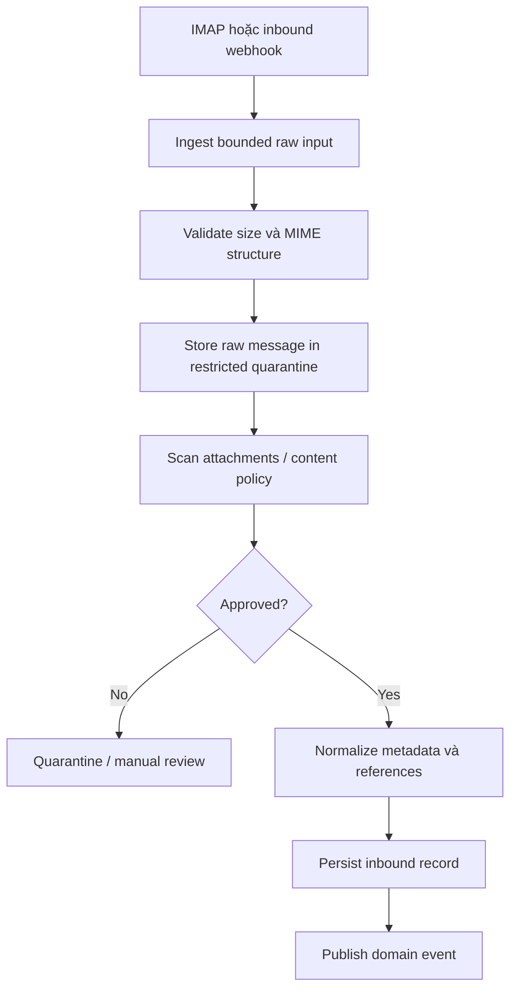

# Khi nào tách module nhận mail khỏi module gửi mail

Trong một ứng dụng **Spring Framework Mail**, khả năng **gửi email** thường xuất hiện trước: ứng dụng tạo nội dung, dựng `MimeMessage` và gọi `JavaMailSender.send(...)` để submit qua SMTP. Khi sản phẩm lớn hơn, nhóm phát triển có thể cần **nhận email**: xử lý thư phản hồi của khách hàng, tiếp nhận tài liệu từ hộp thư, đọc bounce/DSN, mở ticket hỗ trợ, tiếp nhận mã xác thực từ một hệ thống khác hoặc đồng bộ hộp thư dùng chung.

Hai chiều đều liên quan đến email, nhưng **không phải cùng một bài toán kỹ thuật**:

- **Gửi mail (outbound)** bắt đầu từ một ý định nghiệp vụ đáng tin cậy trong ứng dụng, tạo message và chuyển cho SMTP/provider; các vấn đề chính là submission, rate limit, template, retry, sender identity và deliverability.
- **Nhận mail (inbound)** bắt đầu từ dữ liệu bên ngoài không tin cậy, đọc qua IMAP/POP3 hoặc nhận inbound webhook, chuẩn hóa MIME, kiểm tra nguồn và quyền, chống trùng, lưu bền vững và chuyển tới nghiệp vụ phù hợp.

Câu hỏi **“Khi nào tách module nhận mail khỏi module gửi mail?”** không có đáp án đơn giản là “khi có thêm IMAP”. Hệ thống có thể tách **ranh giới module trong cùng ứng dụng** từ rất sớm, nhưng chỉ nên tách thành **tiến trình hoặc dịch vụ triển khai độc lập** khi có lý do cụ thể về bảo mật, tải, vòng đời xử lý, quyền sở hữu dữ liệu, độ tin cậy hoặc tổ chức nhóm.

Bài học này trình bày các tiêu chí quyết định, mô hình kiến trúc từ đơn giản đến độc lập hoàn toàn, hợp đồng dữ liệu giữa inbound/outbound, ví dụ với Spring, Jakarta Mail và Spring Integration, chiến lược chống xử lý trùng, cách bảo vệ hộp thư và luồng nhận attachment, kế hoạch chuyển đổi, kiểm thử và vận hành.

## 1. Phân biệt đúng chiều gửi và chiều nhận

Một email thông thường đi qua các thành phần:

```text
                    OUTBOUND
Business event / HTTP request
            |
            v
      Notification service
            |
            v
     Template + MIME builder
            |
            v
    JavaMailSender / provider API
            |
            v
          SMTP relay
            |
            v
       Recipient mailbox

                    INBOUND
External sender / mail system
            |
            v
       Receiving mail server
            |
            +---- IMAP / POP3 mailbox
            |           |
            |           v
            |      Mail receiver
            |
            +---- Provider inbound webhook
                        |
                        v
                  Mail receiver
                        |
                        v
              Parse / validate / store
                        |
                        v
               Domain processing
```

Các luồng có thể nối lại với nhau: nhận email phản hồi rồi gửi email xác nhận tiếp nhận, nhận bounce để điều chỉnh chính sách gửi, hoặc nhận yêu cầu hỗ trợ và gửi trả lời. Tuy vậy, chúng vẫn cần **ranh giới riêng** vì nguồn tin cậy, kiểu lỗi và dữ liệu cần lưu khác nhau.

### Vai trò của Spring Framework Mail

Trong Spring Framework, API phổ biến như `MailSender`, `JavaMailSender`, `JavaMailSenderImpl` và `MimeMessageHelper` tập trung vào **soạn và gửi thư**. Chúng không cung cấp một dịch vụ đọc hộp thư IMAP/POP3 đầy đủ tương đương chỉ bằng một cấu hình `spring.mail.*`.

Để nhận thư, có thể dùng:

- **Jakarta Mail** trực tiếp để kết nối `Store`, `Folder`, đọc `Message` qua IMAP/POP3.
- **Spring Integration Mail** với các inbound adapters và cơ chế polling hoặc nhận sự kiện tùy protocol/configuration.
- **Provider inbound parse webhook/API** nếu dịch vụ email có khả năng chuyển inbound message thành HTTP event.
- Một dịch vụ nhận thư độc lập chuyên parse, kiểm tra an toàn và phát domain events.

Việc chọn công cụ không tự quyết định ranh giới deployment. Có thể dùng Jakarta Mail trong cùng Spring Boot application, hoặc chạy nó ở worker độc lập.

## 2. Vì sao inbound và outbound khác nhau đáng kể?

| Khía cạnh | Gửi mail (outbound) | Nhận mail (inbound) |
|---|---|---|
| Điểm bắt đầu | Lệnh/sự kiện nghiệp vụ của ứng dụng | Email từ Internet, mailbox hoặc inbound provider |
| Độ tin cậy dữ liệu | Input đã được hệ thống tạo/xác thực ở mức nào đó | MIME, header, body và attachment mặc định không tin cậy |
| Giao thức chính | SMTP submission, có thể HTTP API | IMAP, POP3, inbound SMTP gateway hoặc HTTP webhook |
| Danh tính | Sender profile, domain, quyền Send As | Mailbox owner, external sender, metadata và xác thực nguồn |
| Trạng thái | PENDING, SUBMITTING, SMTP_ACCEPTED, FAILED/UNKNOWN | DISCOVERED, FETCHED, PARSED, STORED, QUARANTINED, PROCESSED |
| Lỗi | Auth SMTP, timeout, provider throttle, content reject | Fetch timeout, UID/checkpoint, MIME malformed, spam/malware, duplicate |
| Tải | Chủ yếu theo tốc độ notification và quota provider | Theo mailbox size, kích thước thư, attachment và tốc độ đến |
| Retry | Có nguy cơ gửi trùng ra ngoài | Có nguy cơ xử lý trùng cùng một thư |
| Dữ liệu nhạy cảm | Email được ứng dụng chủ động tạo | Nội dung tùy ý từ bên ngoài, đôi khi có bí mật/dữ liệu cá nhân |
| Quan sát | Accepted attempts, queue age, bounce | Poll lag, fetch lag, parse errors, quarantine, mailbox checkpoint |
| Quyền hệ thống | Credential gửi mail, quyền gửi từ sender | Credential đọc hộp thư, thư mục, quyền đọc/xóa/đánh dấu |
| Vòng đời | Chấp nhận request đến submission và delivery feedback | Phát hiện thư đến, ingest bền vững, xử lý nghiệp vụ |

Một lỗi ở inbound parser có thể tạo vòng lặp hoặc treo consumer khi gặp một email lỗi; lỗi SMTP gửi có thể do quota provider và làm chậm worker. Nếu không phân biệt, các nhóm theo dõi, retry và recovery sẽ khó vận hành.

## 3. Mức tách thứ nhất: phân chia trách nhiệm ngay trong cùng codebase

**Không cần đợi đến khi có nhiều máy chủ mới tạo ranh giới module.**

Một ứng dụng nhỏ có thể dùng cấu trúc:

```text
application
├── mail
│   ├── outbound
│   │   ├── NotificationService
│   │   ├── MailTemplateRenderer
│   │   ├── SmtpSubmissionGateway
│   │   └── OutboundStatusRepository
│   │
│   ├── inbound
│   │   ├── MailboxPoller
│   │   ├── IncomingMimeParser
│   │   ├── IncomingMailRepository
│   │   └── IncomingMailHandler
│   │
│   └── contracts
│       ├── NotificationRequest
│       ├── IncomingMailAccepted
│       └── MailCorrelation
└── business
    ├── orders
    └── support
```

Ở đây module nghĩa là **ranh giới dependency trong source**, chưa nhất thiết là các Maven/Gradle module vật lý. Có thể là package hoặc một module chính thức tùy độ lớn của dự án.

Nguyên tắc:

- `outbound` không trực tiếp đọc `Folder` IMAP.
- `inbound` không cần biết cách cấu hình SMTP hoặc template renderer gửi.
- Nghiệp vụ không phụ thuộc trực tiếp `jakarta.mail.Message` khi không cần thiết.
- Shared contracts chỉ chứa những kiểu dữ liệu ổn định cần trao đổi.
- Nội dung MIME và credential không được đưa vào package chia sẻ chung chỉ vì tiện.

**Tách logical module sớm thường rẻ hơn tách service muộn.** Nhưng chưa cần thêm network boundary, deployment pipeline hoặc distributed transaction khi hệ thống chưa có nhu cầu.

## 4. Khi nào chưa cần triển khai inbound thành dịch vụ riêng?

Một số trường hợp nên giữ cùng ứng dụng, nhưng tách package/interface:

- Chỉ có **một mailbox nhỏ**, nhận rất ít email.
- Có một scheduler đọc email định kỳ với lưu lượng thấp và có giới hạn rõ.
- Email inbound chỉ phục vụ một tính năng phụ trợ đơn giản.
- Cùng nhóm sở hữu inbound/outbound và triển khai cùng nhịp.
- Không có yêu cầu tách credential/secret nghiêm ngặt ở runtime.
- Bộ nhớ và CPU đủ, MIME parser không gây nguy cơ làm chậm luồng chính.
- Sự cố nhận mail không cần quyền tự động scale/restart riêng.
- Đã có cơ chế tránh xử lý trùng và lưu checkpoint đủ tin cậy.
- Hệ thống chưa có queue/message broker và lợi ích tách deployment chưa bù được chi phí vận hành.

Ví dụ: một ứng dụng nội bộ gửi thông báo và mỗi giờ đọc vài email phản hồi từ một mailbox cố định để tạo comment. Nếu giới hạn input, timeout, retention và lỗi đã kiểm soát, một module inbound chạy trong cùng process có thể phù hợp.

**Không nên lập microservice chỉ vì từ “nhận” khác từ “gửi”.** Cần có ít nhất một áp lực kiến trúc cụ thể và khả năng vận hành service mới.

## 5. Các dấu hiệu rõ ràng nên cân nhắc tách deployment

| Dấu hiệu | Vì sao tạo áp lực tách? | Biện pháp có thể chọn |
|---|---|---|
| Inbound nhận MIME/attachment không tin cậy với khối lượng lớn | Parser, scan và giải nén có thể tốn CPU/heap hoặc chứa payload nguy hiểm | Worker/process riêng và sandbox phù hợp |
| Hàng nghìn mailbox hoặc nhiều tenant | Kết nối IMAP, checkpoint và token refresh cần quản lý riêng | Mailbox ingestion service có scheduling/sharding |
| Inbound cần scale khác outbound | Số lần fetch/parse không liên quan trực tiếp SMTP quota | Scale worker pool độc lập |
| Nhu cầu 24/7 xử lý reply và ticket | Nhịp triển khai/lỗi khác với service gửi campaign | Deployment và SLO riêng |
| Credential đọc có quyền truy cập dữ liệu nhạy cảm cao | Không muốn web/API gửi mail có thể đọc toàn bộ mailbox | Tách secret, IAM và network policy |
| Inbound dùng API provider/webhook public | Cần endpoint xác thực request bên ngoài và rate limit riêng | Ingress service hoặc receiver deployment riêng |
| Một email lỗi có thể làm dừng poller | Failure blast radius lớn | Quarantine, DLQ và process isolation |
| Cần lưu nguyên bản thư để audit pháp lý | Lifecycle/retention/access khác outgoing events | Storage và data ownership riêng |
| Nhiều hệ thống cần dùng inbound events | Cần contract, versioning và fan-out | Event bus và module inbound làm producer |
| Nhóm hỗ trợ khách hàng sở hữu xử lý inbound, nhóm platform sở hữu gửi | Release/ownership khác nhau | Module/service theo bounded context |
| Compliance hoặc data residency yêu cầu tách | Quyền truy cập và vị trí lưu trữ khác | Deployment/storage theo region |
| Mailbox provider có quota/poll limit phức tạp | Cần rate limiting và runbook độc lập | Ingestion coordinator riêng |

Một dấu hiệu chưa đủ để bắt buộc microservice. Ví dụ nhu cầu scale CPU cho parsing có thể giải quyết bằng **worker riêng trong cùng codebase**, không nhất thiết phải tách repository hoặc database ngay.

## 6. Ba mức tách kiến trúc

### Mức A — Cùng ứng dụng, module riêng

```text
                   Spring Boot Application
               +------------------------------+
Business ------>| Outbound module              |--> SMTP
                |                              |
IMAP/HTTP ----->| Inbound module               |--> Business handler
               +------------------------------+
                       Shared deployment
```

**Phù hợp khi:** ít mailbox, traffic vừa phải, cùng nhóm sở hữu và đủ cách ly tài nguyên nội bộ.

Ưu điểm: triển khai dễ, debug đơn giản, không thêm network hop. Nhược điểm: một parser bị treo hoặc worker dùng quá nhiều heap có thể ảnh hưởng cả process; cần kiểm soát executor và scheduling.

### Mức B — Cùng codebase, tiến trình triển khai riêng

```text
                  Shared repository
                         |
          +--------------+--------------+
          |                             |
     Outbound worker                Inbound worker
          |                             |
          v                             v
        SMTP                      IMAP / inbound API
          |                             |
          +--------- Queue / DB --------+
```

**Phù hợp khi:** cần scale, restart, secret hoặc timeout độc lập nhưng chưa cần tách source ownership hoàn toàn.

Có thể có hai Spring Boot applications dùng chung domain contracts hoặc cùng artifact với profile/role cấu hình rõ, nhưng cần bảo đảm mỗi role **không khởi tạo scheduler và credential của role kia**.

### Mức C — Dịch vụ độc lập với API/event contract

```text
   Domain services
         |
         v
  Outbound mail service  -----> SMTP / provider
         ^
         |
      Event bus
         ^
         |
  Inbound mail service   <----- IMAP / provider webhook
         |
         +-----> Inbound storage + attachment quarantine
```

**Phù hợp khi:** khác bounded context, nhiều nguồn inbound, security/compliance tách biệt, năng lực scale lớn và đã có vận hành distributed systems đủ trưởng thành.

Đổi lại, cần event schema versioning, idempotent consumers, correlation IDs, observability xuyên service, queue/broker health và quy trình xử lý failure.

## 7. Những tiêu chí quyết định quan trọng nhất

Có thể dùng sáu câu hỏi theo thứ tự:

1. **Nguồn dữ liệu có khác ranh giới tin cậy không?** Inbound từ Internet luôn cần xử lý như dữ liệu không tin cậy.
2. **Có cần quyền và secret khác nhau không?** Đọc mailbox nhạy cảm khác với quyền submit SMTP.
3. **Tải và cách scale có độc lập không?** IMAP polling, MIME parsing và SMTP sending có bottleneck khác nhau.
4. **Failure của một chiều có được phép ảnh hưởng chiều kia không?** Nếu không, cần cô lập.
5. **Vòng đời và dữ liệu lưu có khác không?** Inbound raw MIME có retention/ownership khác outbound attempts.
6. **Chi phí triển khai phân tán có hợp lý không?** Nếu chưa, module/process isolation có thể đủ.

Nếu phần lớn câu trả lời cho 1–5 là “có” và đội ngũ đã có hạ tầng vận hành, tách inbound thành service thường hợp lý. Nếu mới chỉ có một hộp thư nhỏ và không có vấn đề scale/bảo mật, bắt đầu với module nội bộ sẽ đơn giản hơn.

## 8. Không dùng cùng một API cho nhận và gửi chỉ vì đều là “mail”

Một thiết kế dễ gây rối:

```java
public interface MailService {
    void send(MailMessage message);
    List<MailMessage> receive();
    void delete(String id);
    void markAsRead(String id);
}
```

Interface này trộn:

- Outbound message creation và SMTP submission.
- Inbound mailbox synchronization.
- Quyền sửa trạng thái hộp thư.
- Sự kiện xử lý nội dung từ nguồn bên ngoài.

Hậu quả:

- Business service phụ thuộc trực tiếp mailbox semantics.
- Unit test gửi mail phải mock những API nhận không liên quan.
- Khó tách credential và lifecycle.
- Một tên `MailMessage` dễ che sự khác biệt giữa MIME raw và domain notification.

Nên dùng các port rõ nghĩa:

```java
public interface OutboundMailPort {
    SubmissionResult submit(OutboundMailCommand command);
}

public interface InboundMailSource {
    List<IncomingMailReference> discover(BatchLimit limit);
}

public interface IncomingMailProcessor {
    ProcessingResult ingest(IncomingMailReference reference);
}
```

Các kiểu `SubmissionResult`, `OutboundMailCommand`, `IncomingMailReference` và `BatchLimit` là abstractions của ứng dụng, không phải API dựng sẵn của Spring Framework.

## 9. Định nghĩa hợp đồng giữa inbound và nghiệp vụ

Không nên đẩy nguyên đối tượng `jakarta.mail.Message` từ một consumer sang mọi domain handler:

- Đối tượng có thể lazy-load body/attachment từ `Folder` hoặc `Store`.
- Sau khi đóng mailbox connection, đọc nội dung có thể thất bại.
- Domain handler sẽ bị phụ thuộc IMAP/Jakarta Mail.
- Raw message chứa nhiều dữ liệu chưa được xác minh.
- Object không phù hợp để serialize bền vững qua broker.

Một envelope đã chuẩn hóa:

```java
import java.time.Instant;
import java.util.List;

public record IncomingMailAccepted(
        String inboundId,
        String sourceId,
        String mailboxRef,
        String rfcMessageId,
        String senderAddress,
        String normalizedSubject,
        String textBodyRef,
        String htmlBodyRef,
        List<String> attachmentRefs,
        Instant receivedAt,
        String correlationId
) {
}
```

`textBodyRef`, `htmlBodyRef` và `attachmentRefs` là reference tới storage được quản lý, không phải toàn bộ nội dung nhạy cảm trong event. Tùy ứng dụng, event có thể chỉ chứa `inboundId` và một vài metadata tối thiểu; handler sẽ tải dữ liệu bằng API có authorization.

### Event naming theo bằng chứng

Nên phân biệt:

- `InboundMailDiscovered`: phát hiện có message tại source.
- `InboundMailFetched`: đã tải được nội dung.
- `InboundMailAccepted`: payload được kiểm tra và lưu bền vững.
- `InboundMailQuarantined`: không cho xử lý tự động vì lý do policy/security.
- `InboundMailProcessed`: nghiệp vụ hoàn tất.
- `InboundMailProcessingFailed`: cần retry/manual review.

Không phát `InboundMailProcessed` chỉ vì IMAP cho phép fetch, tương tự như outbound không nên gọi `SMTP_ACCEPTED` là `DELIVERED`.

## 10. Định nghĩa hợp đồng giữa nghiệp vụ và outbound

Inbound module có thể cần **yêu cầu gửi email phản hồi**, nhưng không cần biết SMTP host hoặc template implementation.

Ví dụ event nghiệp vụ:

```text
IncomingMailAccepted
       |
       v
SupportTicketService
       |
       v
TicketCreated
       |
       v
NotificationService
       |
       v
OutboundMailRequested
       |
       v
Outbound mail worker -> SMTP
```

Command gửi:

```java
public record OutboundMailRequested(
        String notificationId,
        String correlationId,
        String recipientRef,
        String senderProfile,
        String templateKey,
        String templateVersion,
        String businessObjectRef
) {
}
```

Cách này bảo vệ hai chiều:

- Inbound không tự “gửi trả lời” khi chưa qua quyết định nghiệp vụ.
- Outbound không cần đọc mailbox hoặc tin raw sender.
- Template được version hóa và renderer nhận dữ liệu đã kiểm tra.
- Notification ID cho phép chống tạo trùng, retry và audit.

Nếu business handler trực tiếp gọi `JavaMailSender.send` ngay khi nhận một email ngoài Internet, chỉ cần attacker gửi nhiều thư là có thể ép ứng dụng gửi mail, tạo vòng lặp hoặc phát tán spam.

## 11. IMAP, POP3 và inbound webhook ảnh hưởng thế nào tới ranh giới?

### IMAP

IMAP thường hỗ trợ quản lý thư mục, flag, đọc theo UID và có thể hỗ trợ cơ chế thông báo thay đổi như IDLE. Hệ thống nhận thư có thể cần:

- Đồng bộ nhiều folder.
- Theo dõi UID và UIDVALIDITY.
- Kiểm soát cờ `SEEN` hoặc chuyển folder theo policy.
- Phân trang/polling có giới hạn.
- Xử lý message bị xóa/di chuyển.
- Giới hạn số kết nối và tốc độ fetch.
- Refresh credential hoặc token.
- Khôi phục sau mất kết nối.

Đây là các trách nhiệm dài hạn rất khác SMTP submission. Khi có nhiều mailbox và trạng thái đồng bộ phức tạp, inbound ingestion nên là module/worker riêng.

### POP3

POP3 thường đơn giản hơn ở mặt thư mục và đồng bộ flag, nhưng vẫn cần:

- Tránh tải lại cùng message mỗi lần poll.
- Theo dõi `UIDL` nếu server hỗ trợ và contract phù hợp.
- Chính sách xóa thư khỏi server hoặc giữ bản gốc.
- Xử lý thư bị đánh dấu xóa nhưng chưa hoàn tất phiên.
- Lưu bản sao an toàn trước khi xóa.
- Cân nhắc trường hợp UIDL/identifier không ổn định hoặc bị tái sử dụng.

Không dùng vị trí message trong mailbox làm ID bền vững. Thứ tự có thể thay đổi khi thư được thêm/xóa.

### Inbound webhook

Một số provider có khả năng nhận email ở phía họ rồi gửi payload/metadata tới HTTP endpoint của ứng dụng. Khi đó trách nhiệm inbound gồm:

- Public endpoint được bảo vệ.
- Xác thực chữ ký/token và chống replay.
- Giới hạn request size và tốc độ.
- Đọc body/multipart/attachment theo provider schema.
- Ghi yêu cầu vào queue/storage trước khi trả ACK theo hợp đồng.
- Xử lý callback trùng, trễ hoặc sai thứ tự.
- Theo dõi thay đổi provider event schema.

Điểm chính: không có IMAP vẫn có **bài toán inbound riêng**. Nếu webhook volume lớn hoặc endpoint nằm ở trust boundary khác, đây là lý do chính đáng để tách receiver.

## 12. UID, UIDVALIDITY và Message-ID không thể thay nhau

Trong hệ thống inbound, cần một khóa idempotency dựa trên **nguồn thực sự**.

| Định danh | Ý nghĩa | Cảnh báo |
|---|---|---|
| IMAP UID | ID của message trong mailbox/folder theo UID semantics | Chỉ có ý nghĩa trong phạm vi folder và UIDVALIDITY |
| IMAP UIDVALIDITY | Xác định thế hệ tập UID của folder | Thay đổi có thể khiến UID cũ không còn cùng nghĩa |
| POP3 UIDL | Dấu nhận dạng message do server cung cấp | Cần kiểm tra hỗ trợ và tính ổn định của server |
| RFC `Message-ID` | Header do phía tạo thư khai báo | Có thể thiếu, trùng, giả mạo hoặc không duy nhất |
| Provider inbound event ID | Định danh callback/provider | Có thể chỉ áp dụng cho một nguồn và retention cụ thể |
| Internal `inboundId` | ID bản ghi ingest trong hệ thống | Dùng làm primary key nội bộ và truy vấn nghiệp vụ |

Một khóa chống ingest trùng cho IMAP có thể dựa trên:

```text
sourceId
+ mailboxId/folder identifier
+ UIDVALIDITY
+ UID
```

Ví dụ uniqueness:

```sql
CREATE TABLE inbound_source_message (
    inbound_id        VARCHAR(64) PRIMARY KEY,
    source_id         VARCHAR(100) NOT NULL,
    mailbox_id        VARCHAR(100) NOT NULL,
    uid_validity      BIGINT NOT NULL,
    message_uid       BIGINT NOT NULL,
    processing_status VARCHAR(40) NOT NULL,
    UNIQUE (
        source_id,
        mailbox_id,
        uid_validity,
        message_uid
    )
);
```

Đây là schema minh họa. Với POP3, webhook hoặc nguồn khác, dùng định danh thích hợp riêng; không ép tất cả vào cột UID IMAP.

**Không lấy header `Message-ID` làm bằng chứng duy nhất rằng hai email là cùng một thư.** Header là dữ liệu từ bên gửi, có thể trùng hoặc bị giả mạo. Tuy nhiên, nó rất hữu ích để liên kết reply thread và điều tra.

## 13. Checkpoint nhận mail phải gắn với xử lý bền vững

Một sai lầm phổ biến:

```text
Poll IMAP
   |
   v
Read message
   |
   v
Mark SEEN immediately
   |
   v
Try to save database
   |
   X process crashes
```

Nếu consumer chỉ đọc thư chưa xem, lần chạy tiếp theo có thể bỏ qua message đã đánh dấu `SEEN` dù chưa được lưu thành công. Trong nhiều mailbox, `SEEN` còn có thể bị người dùng hoặc client khác thay đổi nên không phải checkpoint ổn định cho xử lý máy.

Luồng an toàn hơn:

```text
Discover via source ID / UID
       |
       v
Fetch and parse with bounded resource
       |
       v
Persist inbound record (idempotent)
       |
       v
Commit durable transaction
       |
       v
Dispatch domain processing
       |
       v
Optional mailbox flag/move by policy
```

Nếu process chết trước commit, có thể fetch lại cùng message rồi deduplicate bằng unique key. Nếu chết sau commit, handler có thể xử lý theo at-least-once và tiếp tục từ state bền vững. Không kỳ vọng IMAP flag và database transaction là một thao tác nguyên tử duy nhất.

### Nên đánh dấu SEEN hay chuyển folder?

Đây là chính sách sản phẩm/mailbox:

- `SEEN` là trạng thái hiển thị đối với người dùng và có thể được client khác thay đổi.
- Chuyển sang folder “Processed” có thể phù hợp với mailbox chuyên dụng nhưng phải xử lý khi move thất bại.
- Xóa message cần đặc biệt thận trọng; thường chỉ sau khi nội dung được lưu/retention thỏa policy.
- Dùng bảng ingestion/processing status bền vững làm nguồn sự thật cho ứng dụng.

Không dùng `SEEN` như một distributed lock giữa nhiều worker.

## 14. Ví dụ IMAP ingestion theo batch với Jakarta Mail

Đây là **ví dụ minh họa** cách đọc có giới hạn và lưu source identity. Nó không cố tự hoàn thiện mọi yêu cầu production về lease, reconnect và content security.

```java
import jakarta.mail.Folder;
import jakarta.mail.Message;
import jakarta.mail.MessagingException;
import jakarta.mail.Session;
import jakarta.mail.Store;
import jakarta.mail.UIDFolder;

public final class ImapMailboxIngestor {

    private final IncomingMimeNormalizer normalizer;
    private final IncomingMailRepository repository;

    public ImapMailboxIngestor(
            IncomingMimeNormalizer normalizer,
            IncomingMailRepository repository
    ) {
        this.normalizer = normalizer;
        this.repository = repository;
    }

    public void ingest(
            Session session,
            MailboxConfig config
    ) throws Exception {

        Store store = session.getStore("imaps");
        Folder folder = null;

        try {
            store.connect(
                    config.host(),
                    config.username(),
                    config.password()
            );

            folder = store.getFolder(config.folderName());
            folder.open(Folder.READ_ONLY);

            if (!(folder instanceof UIDFolder uidFolder)) {
                throw new MessagingException(
                        "UID semantics are required"
                );
            }

            long validity = uidFolder.getUIDValidity();
            int total = folder.getMessageCount();
            int batchSize = 50;

            for (int first = 1;
                    first <= total;
                    first += batchSize) {

                int last = Math.min(
                        total,
                        first + batchSize - 1
                );

                Message[] batch =
                        folder.getMessages(first, last);

                for (Message message : batch) {
                    long uid = uidFolder.getUID(message);

                    if (uid <= 0L) {
                        continue;
                    }

                    IncomingMailRecord normalized =
                            normalizer.normalize(
                                    message,
                                    config.sourceId(),
                                    config.mailboxId(),
                                    validity,
                                    uid
                            );

                    repository.insertIfAbsent(normalized);
                }
            }
        } finally {
            if (folder != null && folder.isOpen()) {
                folder.close(false);
            }

            store.close();
        }
    }
}
```

Các kiểu `MailboxConfig`, `IncomingMimeNormalizer`, `IncomingMailRecord` và `IncomingMailRepository` là abstraction của ứng dụng. `insertIfAbsent` phải được triển khai bằng unique constraint/transaction phù hợp — không chỉ check-then-insert trong memory.

**Các điểm cần bổ sung khi triển khai thật:**

1. Pagination theo message number chỉ phục vụ hạn chế một lượt đọc; không dùng message number làm checkpoint bền vững. Nếu mailbox thay đổi trong lúc poll, cần quét/đối chiếu theo UID với trạng thái và rescan phù hợp.
2. Cần xử lý UIDVALIDITY thay đổi để không map UID mới vào message cũ.
3. Parser phải **đọc và sao lưu nội dung cần thiết khi `Folder` còn mở**, vì `Message` có thể lazy-load phần MIME.
4. Cần giới hạn số byte, số attachment, độ sâu MIME, thời gian fetch và concurrency.
5. Không mặc định dùng password tĩnh trong production; có thể cần OAuth2 và secret manager.
6. Không giữ transaction database mở trong toàn bộ quá trình chờ network IMAP nếu có thể tránh.
7. Nếu một message malformed, cần quarantine/failure record và tiếp tục các message khác theo policy; không để một email lỗi chặn toàn bộ mailbox mãi.
8. Nếu nhiều worker cùng poll mailbox, cần một cơ chế lease/shard và idempotency trên storage.
9. Khi close/fetch lỗi, phải ghi nhận và retry có backoff, không tạo reconnect storm.

Ví dụ cố ý mở folder ở `READ_ONLY` để **không tự đánh dấu/xóa thư** trong lúc ingest. Nếu ứng dụng cần sửa mailbox state, làm ở bước riêng sau khi durable ingest đã thành công.

## 15. Khi nào Spring Integration Mail là lựa chọn phù hợp?

**Spring Integration Mail** có thể giúp xây flow inbound kết hợp polling/inbound adapter và message channels, giảm lượng code điều phối trực tiếp ở một số trường hợp.

Một flow ở mức khái niệm:

```text
IMAP / POP3 adapter
          |
          v
  Spring Integration Channel
          |
          v
 MIME normalization/validation
          |
          v
  Durable inbound persistence
          |
          v
   Domain event publisher
```

Lưu ý: message channel của Spring Integration **không mặc định là durable message broker**. Một `DirectChannel` hoặc `QueueChannel` trong bộ nhớ có semantics khác Kafka/RabbitMQ hoặc database outbox. Khi cần phục hồi sau crash, phải xác định chỗ nào đã persist dữ liệu.

Các câu hỏi trước khi chọn adapter:

- Adapter đọc `SEEN`/flag hoặc theo chiến lược nào?
- Poller có cố gắng nhận lại sau lỗi không?
- Có đồng bộ folder/UID theo yêu cầu không?
- Chỉ có một consumer hay có nhiều replica?
- Channel có bền vững qua restart không?
- Content được fetch ở thời điểm nào?
- Error channel có dẫn tới retry nóng hoặc drop message không?
- Có thể kiểm soát attachment size và parser validation trước khi gửi domain event không?

**Spring Integration là công cụ xây flow**, không thay cho thiết kế data ownership, authorization, deduplication và ranh giới security giữa inbound/outbound.

## 16. Một mailbox, nhiều mailbox và vấn đề scale

Với một mailbox đơn lẻ, lịch poll 1–5 phút có thể đủ tùy SLO. Khi số mailbox tăng, bài toán khác hẳn.

Ví dụ:

```text
10,000 mailboxes
× 1 poll per minute
= 10,000 polling operations per minute
```

Đây chỉ là minh họa; số kết nối thực còn phụ thuộc caching, IDLE, provider API và khả năng batch.

Các khó khăn:

- Giới hạn connection và authentication requests per account.
- Refresh nhiều OAuth token và xử lý revoke.
- Mailbox mất kết nối hoặc tạm khóa.
- Cân bằng tải giữa worker.
- Phân quyền mailbox theo tenant.
- Checkpoint riêng cho từng folder.
- Giới hạn độ trễ ingest khi email đến ồ ạt.
- Không cho một mailbox cực lớn làm đói các mailbox khác.

Khi đạt quy mô này, một **inbound mailbox coordinator** quản lý lease/shard, scheduling và quota thường có giá trị. Nó có thể tách deployment khỏi outbound worker, vốn bị giới hạn theo SMTP throughput.

## 17. IMAP IDLE không loại bỏ nhu cầu durability

IMAP IDLE có thể giúp client biết folder có thay đổi mà không liên tục poll ngắn. Tuy nhiên:

- Connection có thể bị ngắt.
- Provider có thể giới hạn số session hoặc thời gian IDLE.
- Thông báo thay đổi không thay thế việc đọc và lưu message.
- Khi reconnect, cần rescan dựa trên checkpoint bền vững.
- Nếu worker crash trước khi lưu, ứng dụng cần phát hiện lại message.
- Dùng nhiều replica vẫn cần ownership/lease của mailbox.

Vì vậy, dù dùng IDLE hay scheduled polling, **cơ chế ingest idempotent và recovery vẫn cần thiết**. Khi inbound có vòng đời connection dài và nhu cầu reconnect riêng, tách nó khỏi HTTP app gửi mail là lựa chọn đáng cân nhắc.

## 18. Ranh giới bảo mật là động lực mạnh để tách inbound

Outbound dùng credential gửi thư; inbound có thể cần credential cho phép đọc hàng nghìn email, attachment và dữ liệu nhạy cảm. Nếu cùng process giữ cả hai loại secret, phạm vi bị ảnh hưởng khi ứng dụng gặp sự cố tăng lên.

Một kiến trúc giảm quyền:

```text
                    OUTBOUND SERVICE
  Notification records ---> SMTP provider
        |
        +-- send-only secret
        +-- no mailbox read permission

                     INBOUND SERVICE
  IMAP / webhook ----------> Quarantine storage
        |
        +-- mailbox read-scoped credentials
        +-- MIME parser restrictions
        +-- no general SMTP send credentials

               Shared business event contract
```

Các biện pháp khi tách:

- Secret store/IAM khác nhau cho inbound và outbound.
- Network egress chỉ tới endpoint cần thiết.
- Inbound webhook ingress có authentication, rate limit, request-size limit.
- Storage lưu raw MIME có quyền chặt hơn storage chứa notification status.
- Attachment quarantine/scan service tách khỏi pipeline nghiệp vụ.
- Không cấp quyền đọc mailbox cho dịch vụ chỉ cần gửi.
- Theo dõi audit: ai truy cập raw email, lúc nào và vì lý do gì.

Tuy nhiên, **tách process không tự đảm bảo an toàn** nếu cả hai vẫn dùng chung credential hoặc cùng database user có toàn quyền. Cần thật sự phân quyền và giảm phạm vi truy cập.

## 19. Mail nhận được mặc định là dữ liệu không đáng tin

Một thư inbound có thể chứa:

- `From` hiển thị giả mạo.
- `Reply-To` trỏ tới địa chỉ không mong muốn.
- HTML có external links/tracking.
- MIME malformed, multipart lồng nhiều cấp.
- Attachment độc hại, archive nén phức tạp hoặc file quá lớn.
- Header cực dài hoặc trường trùng.
- Ký tự Unicode gây nhầm lẫn.
- Nội dung chứa script, HTML injection hoặc công thức CSV.
- Thông tin mật mà ứng dụng không nên log/phát tán lại.

**Không dùng header `From` làm bằng chứng xác thực danh tính người gửi.** SPF, DKIM, DMARC và các tín hiệu từ mail gateway có thể hỗ trợ chính sách tin cậy, nhưng không tương đương một user session đã được xác thực trong ứng dụng.

Nếu email inbound có khả năng kích hoạt thao tác nhạy cảm (duyệt thanh toán, cấp quyền, thay password, xóa dữ liệu), cần kênh xác thực mạnh hơn hoặc xác nhận qua ứng dụng.

### Vì sao parser nên là thành phần tách biệt?

Parser MIME có thể:

- Đọc dữ liệu binary lớn.
- Giải mã content transfer encoding.
- Xử lý nhiều charset lỗi.
- Mở nhiều stream.
- Gặp cấu trúc MIME bất thường.
- Gây áp lực CPU/heap khi xử lý attachment.

Nếu chạy parser phức tạp cùng thread phục vụ API giao dịch hoặc worker gửi OTP, một email độc hại có thể làm giảm khả năng phục vụ. Quota, timeout, memory limit và process isolation giúp giảm blast radius.

## 20. Quarantine và attachment storage

Một pipeline inbound an toàn hơn:



Các bước cụ thể phụ thuộc yêu cầu tổ chức. Điều quan trọng:

- Không tự động mở hoặc thực thi attachment.
- Không fetch external URL từ HTML chỉ để “render preview”.
- Nếu cần trích xuất nội dung từ PDF/Office/archive, giới hạn tài nguyên và cân nhắc worker sandbox.
- File nên có ID/key do server tạo, không lưu trực tiếp theo filename từ email.
- Kiểm tra malware/DLP theo chính sách; không coi scan là bảo đảm tuyệt đối an toàn.
- Có retention, mã hóa lưu trữ và quyền riêng theo loại dữ liệu.
- Nếu content bị cách ly, business handler chỉ nhận trạng thái/metadata an toàn.

Khi khối lượng attachment lớn, inbound và outbound có profile tài nguyên khác nhau. Đây là một lý do mạnh để deploy riêng và đặt heap/CPU/storage limits khác nhau.

## 21. Tránh vòng lặp nhận–gửi vô hạn

Một trường hợp đặc biệt khi hai chiều được kết nối:

```text
Inbound email arrives
       |
       v
Auto-reply sent
       |
       v
Recipient auto-responder sends another mail
       |
       v
Inbound receives reply
       |
       v
Auto-reply again...
```

Một hệ thống email hỗ trợ hoặc ticketing phải xác định **khi nào được tự động phản hồi**.

Biện pháp:

- Không auto-reply mọi thư không điều kiện.
- Phát hiện các dấu hiệu auto-generated message như `Auto-Submitted` khi phù hợp, nhưng không tin header đơn lẻ như bằng chứng bảo mật.
- Xử lý riêng DSN/bounce, vacation reply và mailing-list messages.
- Giới hạn số auto-response theo thread/sender trong một khoảng thời gian.
- Có idempotency key cho hành động phản hồi một inbound message.
- Kiểm tra recipient/address policy trước khi tạo outbound command.
- Có loop-prevention metadata nội bộ và TTL.
- Không trả lại nguyên attachment hoặc nội dung nhạy cảm nếu chưa có quyền.

**Chống vòng lặp phải ở ranh giới nghiệp vụ**, không chỉ trong SMTP adapter. Outbound không thể tự biết một email reply nên được gửi hay không nếu không có context của inbound flow.

## 22. Bounce/DSN có nhất thiết cần một module nhận mail đầy đủ?

Không phải lúc nào cũng vậy. Cần phân biệt:

1. **Delivery events từ provider API/webhook**: có thể chỉ cần một callback handler để cập nhật trạng thái gửi.
2. **DSN/bounce gửi về mailbox**: có thể cần mailbox ingestion và parser riêng.
3. **Thư phản hồi của con người**: cần phân tích thread, nội dung, attachment và routing nghiệp vụ.
4. **Hộp thư hỗ trợ hai chiều**: có thể cần cả inbound normalization và ticket workflow.

Nếu ứng dụng chỉ cần ghi nhận bounce từ provider webhook, một module nhỏ xử lý **verified delivery callback** có thể đủ; chưa cần xây một IMAP receiver service.

Ngược lại, nếu phải đọc mailbox hàng nghìn thư và trích nội dung phản hồi, đó là một inbound capability có vòng đời riêng.

### Tránh nhầm bounce với reply

Bounce/DSN là thông tin về quá trình chuyển phát; reply của người nhận là nội dung trao đổi. Chúng có format, quyền, trạng thái và rủi ro bảo mật khác nhau.

Một inbound dispatcher nên phân loại sơ bộ (sau khi kiểm tra nguồn và parser) rồi chuyển:

```text
Incoming message
       |
       +-- Human reply       -> conversation/ticket handler
       |
       +-- DSN/bounce        -> delivery status handler
       |
       +-- Auto-reply        -> suppression/loop policy
       |
       +-- Unknown/malformed -> quarantine or manual review
```

Không nên coi mọi email vào reply mailbox là một câu trả lời hợp lệ cho một ticket.

## 23. Ghép luồng reply với notification gửi ra

Khi gửi email cho khách hàng, hệ thống có thể lưu:

```text
notificationId
businessObjectRef
recipientRef
sentAt
mimeMessageId
providerMessageId (nếu có)
replyMailboxRoute
```

Khi nhận reply, có thể tham khảo các header:

- `Message-ID`: định danh MIME message hiện tại.
- `In-Reply-To`: tham chiếu message trước.
- `References`: chuỗi các message liên quan.
- `Reply-To`: đích phản hồi mà phía gửi yêu cầu.

Các header này giúp threading nhưng **có thể thiếu, bị sửa hoặc giả mạo**. Nếu dùng địa chỉ reply có token định tuyến (ví dụ alias chứa một mã ngẫu nhiên), mã đó phải có entropy phù hợp, thời hạn/quyền hạn rõ và không trở thành quyền thực hiện hành động nhạy cảm không cần xác nhận.

### Một mô hình matching an toàn hơn

1. Tìm route/alias hoặc thread reference phù hợp.
2. Đối chiếu `In-Reply-To`/`References` khi có.
3. Xem sender có liên quan tới conversation/tenant hay không.
4. Dùng chính sách nghiệp vụ quyết định tự động attach ticket hay cần review.
5. Không dùng subject giống nhau làm bằng chứng duy nhất cùng một conversation.
6. Nếu không chắc, quarantine hoặc tạo ticket chưa xác minh.

Correlation ID của outbound và inbound có thể liên quan nhưng không nhất thiết giống nhau. Có thể tạo **inbound correlation ID** mới rồi lưu `causationId`/`relatedNotificationId` để giữ traceability.

## 24. Ranh giới database khi tách module

Có nhiều mức độ tách dữ liệu:

### Chung database nhưng khác bảng/module

Phù hợp giai đoạn đầu nếu nhóm nhỏ. Tuy vậy, nên có ownership:

```text
outbound_notification
outbound_attempt
outbound_delivery_event

inbound_message
inbound_source_checkpoint
inbound_processing_attempt
inbound_attachment
```

Dùng repository/interface riêng; không cho inbound tự thay `outbound_attempt` bằng SQL tùy ý chỉ vì chung database.

### Database riêng

Phù hợp khi có yêu cầu bảo mật, retention hoặc scale độc lập:

```text
Inbound DB                 Outbound DB
  inbound_message           notification
  mailbox_checkpoint        submission_attempt
  raw_content_ref           delivery_event
       |                          ^
       +------ Event bus ----------+
```

Lúc này không có transaction database duy nhất đi qua cả hai. Cần event publishing bền vững, idempotent consumer và reconciliation.

### Không tạo distributed transaction chỉ để “nối” hai chiều

SMTP, IMAP flags, webhook, broker và database không tham gia một transaction nguyên tử chung. Một thiết kế ổn định hơn thường dùng:

- Local transaction ở database chủ sở hữu.
- Transactional outbox khi phát event ra ngoài.
- Inbox/dedup table ở bên tiêu thụ.
- State machine và retry có giới hạn.
- Bằng chứng theo từng bước, không tuyên bố exactly-once end-to-end.

## 25. Inbox pattern cho inbound và outbox pattern cho outbound

Tên hai pattern nghe gần nhau nhưng phục vụ hai hướng:

| Pattern | Vị trí | Tác dụng |
|---|---|---|
| **Transactional outbox** | Business/outbound producer | Lưu ý định gửi hoặc sự kiện trong transaction trước khi publish/xử lý |
| **Inbox/deduplication table** | Inbound/event consumer | Nhận diện message/event đã được xử lý để tránh side effect lặp |

Luồng:

```text
External inbound source
           |
           v
Inbound transport adapter
           |
           v
Inbox/dedup record + normalized storage
           |
           v
Business event (outbox)
           |
           v
Business handler
           |
           v
Outbound notification (outbox)
           |
           v
SMTP worker
```

Không nên đặt chung trạng thái “received/sent/processed” trong một boolean. Mỗi bước có định danh và bằng chứng riêng.

### At-least-once và tác động nghiệp vụ

Ngay cả khi cùng một email chỉ có một `inbound_message` row nhờ unique constraint, consumer business có thể nhận `IncomingMailAccepted` nhiều lần do broker redelivery.

Nếu mỗi event tạo ticket, cần unique key như `inboundId + actionType` để không tạo nhiều ticket giống nhau. Tương tự, outbound notification phải có idempotency key nghiệp vụ nếu một inbound event có thể được replay.

**Deduplicate ở tầng transport chưa tự đảm bảo các side effect nghiệp vụ không bị lặp.**

## 26. Khi nào nên có event bus ở giữa?

Có thể gọi trực tiếp khi:

- Cùng process.
- Luồng xử lý nhanh và đồng bộ.
- Failure isolation chưa phải yêu cầu lớn.
- Không cần fan-out sang nhiều consumer.

Event bus/broker hữu ích khi:

- Inbound nhận burst lớn, business handler cần xử lý chậm hơn.
- Một email cần chuyển tới nhiều bounded context.
- Các handler triển khai/scale độc lập.
- Cần retry/delay/DLQ theo loại lỗi.
- Inbound endpoint phải ACK nhanh mà không đợi parse/worker lâu.
- Muốn tách raw MIME ingestion khỏi domain decisions.

Tuy nhiên, broker chỉ có ích khi có **durability, backpressure, ordering và idempotency policy** rõ. Một queue RAM trong ứng dụng không phải broker bền vững.

### Event nên nhỏ và an toàn

Không nên đưa 20 MB raw MIME, access token hoặc attachment bytes vào broker khi không cần. Thay vào đó:

```json
{
  "eventId": "evt-inbound-4d1",
  "schemaVersion": 1,
  "inboundId": "inb-801",
  "sourceId": "support-primary",
  "classification": "CUSTOMER_REPLY",
  "contentRef": "inbound-object-801",
  "receivedAt": "2026-11-12T08:30:00Z"
}
```

`contentRef` phải được truy cập theo authorization; việc biết object key không tự cấp quyền đọc. Retention của content storage phải dài đủ cho consumer retry.

## 27. Giới hạn tài nguyên độc lập theo chiều

Đối với outbound, throughput có thể bị giới hạn bởi SMTP provider:

```text
Messages/second
Concurrent SMTP connections
Recipients/day
Message/attachment size
TLS/network latency
```

Đối với inbound, bottleneck có thể là:

```text
Mailbox polling frequency
IMAP connections per account
Fetch bytes/second
MIME parser CPU
Attachment scan throughput
Database write throughput
Quarantine storage
Webhook HTTP request rate
```

Nếu chia chung một executor, burst inbound chứa attachment lớn có thể giữ thread, làm chậm gửi OTP hoặc email giao dịch. Ngay cả trong một process, nên dùng executor và queue riêng:

```text
InboundExecutor (bounded)
  - fetch/normalize
  - attachment scan handoff

OutboundExecutor (bounded)
  - render
  - SMTP submit
```

**Tách executor là mức cô lập thấp nhất**, không tách heap hoặc process. Khi inbound có nguy cơ memory spike lớn, cần process/container isolation hoặc cgroup limits phù hợp.

## 28. Backpressure cho inbound

Giả sử nguồn email tạo 100 thư/phút nhưng parser chỉ xử lý 40 thư/phút. Nếu liên tục fetch rồi giữ nội dung vào bộ nhớ, backlog RAM sẽ tăng.

Một inbound backpressure strategy:

1. Giới hạn số message fetch đồng thời.
2. Giới hạn kích thước raw MIME/attachment.
3. Chỉ ACK webhook sau khi persist yêu cầu đủ bền vững theo contract.
4. Dừng claim/poll thêm khi queue/DB gần đầy.
5. Đặt retry theo lịch với backoff, không vòng lặp fetch nóng.
6. Quarantine poison message.
7. Ưu tiên mailbox hoặc loại event theo SLO.
8. Theo dõi oldest unprocessed message.
9. Nếu nguồn webhook retry, phản hồi HTTP theo contract và tránh làm quá tải worker.
10. Có admission/rate limit để attacker không dùng inbound endpoint làm nguồn DoS.

### IMAP pull và webhook push khác nhau

- IMAP là pull: ứng dụng có thể giảm nhịp poll/fetch khi nghẽn, trong giới hạn mailbox retention/quota.
- Webhook là push: nhà cung cấp có thể retry khi callback không thành công; ứng dụng cần nhanh chóng persist/ACK hoặc phản hồi lỗi rõ theo contract.

Không dùng cùng một cơ chế “sleep 5 giây trong HTTP handler” để điều tiết mọi nguồn. Với webhook, giữ request mở có thể khiến provider timeout và gửi lại, tạo tải lớn hơn.

## 29. Độc lập SLO và vận hành

Một lý do thuyết phục để tách là hai chiều có **mục tiêu chất lượng khác nhau**.

Ví dụ:

| Chỉ số | Outbound | Inbound |
|---|---|---|
| Mục tiêu chính | Thời gian từ notification created đến SMTP accepted | Thời gian từ email xuất hiện tại source đến khi ingest thành công |
| Lỗi quan trọng | Authentication, rate limit, timeout, SMTP reject | IMAP sync lỗi, webhook signature, parser failure, checkpoint lag |
| Backlog | Pending notification, retry queue | Fetched-but-unprocessed, mailbox lag, quarantine |
| Độ trễ | Submit latency/queue wait | Detection lag, fetch latency, parse latency |
| Khôi phục | Retry submission, route failover | Re-poll, replay inbox, reprocess quarantine |
| Dữ liệu cần bảo vệ | Template, recipients, sender secret | Raw MIME, mailbox credentials, attachment |
| Kiểm tra thực tế | SMTP connect/test submission có kiểm soát | Mailbox access/test inbound event có kiểm soát |

Không có lợi nếu cả hai chỉ có metric `mail_failed_total`. Cần tên và nhóm nhãn xác định chiều và giai đoạn.

### Metric gợi ý

```text
mail_outbound_notifications_created_total
mail_outbound_submit_attempts_total
mail_outbound_smtp_accepted_total
mail_outbound_submit_unknown_total
mail_outbound_queue_oldest_age_seconds

mail_inbound_messages_discovered_total
mail_inbound_messages_persisted_total
mail_inbound_parse_failed_total
mail_inbound_quarantined_total
mail_inbound_poll_errors_total
mail_inbound_processing_lag_seconds
```

Các tên chỉ là đề xuất, không phải metric mặc định của Spring. Giữ tags có cardinality thấp như `sourceType`, `route`, `result`, `errorCategory`. Không đưa `mailboxId` số lượng lớn, raw recipient, `Message-ID`, `inboundId` hoặc correlation ID vào metric labels.

## 30. Health check nên tách theo mục tiêu

Outbound health có thể kiểm tra SMTP connectivity thông qua `JavaMailSenderImpl.testConnection()` trong những cấu hình phù hợp. Không dùng `send(...)` trong health endpoint vì sẽ phát email thật mỗi lần được truy vấn.

Inbound health có thể kiểm tra:

- Worker/scheduler còn chạy không.
- Credential mailbox có lỗi lâu dài không.
- Lần poll thành công gần nhất.
- Tuổi checkpoint hoặc lag lớn nhất.
- Webhook ingress có đang lưu event thành công không.
- Quarantine storage/queue còn chỗ không.

**Không cần đọc email thật mỗi lần gọi `/actuator/health`** nếu việc đó gây kết nối/CPU hoặc thay mailbox flags. Có thể dùng snapshot có TTL, probe nền và metric.

### Liveness khác readiness

Một lỗi SMTP bên ngoài không nên mặc định làm liveness của toàn ứng dụng DOWN rồi kích hoạt restart liên tục. Tương tự, một mailbox IMAP bị khóa không nhất thiết khiến HTTP business API phải ngừng nhận traffic.

Khi deploy tách inbound/outbound, các health group có thể phản ánh khả năng xử lý của từng role, thay vì gộp mọi dependency vào một trạng thái duy nhất.

## 31. Tổ chức retry và poison-message handling riêng

### Outbound

Một SMTP attempt có thể:

- `SMTP_ACCEPTED`.
- `KNOWN_REJECTED`.
- `UNKNOWN` khi mất kết quả ở giai đoạn không chắc chắn.

Retry có nguy cơ gửi trùng. Cần quản lý attempt ID, quota, backoff, jitter, deadline và chính sách reconciliation.

### Inbound

Một message có thể:

- Fetch lỗi tạm thời.
- MIME parse lỗi.
- Attachment bị chặn.
- Domain handler thất bại.
- Event publish thất bại.
- Process crash sau persist.

Retry ở inbound có nguy cơ **xử lý trùng**, không nhất thiết gửi trùng ngay. Side effect như tạo ticket, cập nhật trạng thái hoặc gửi auto-reply phải có idempotency.

### Poison message

Một email malformed có thể thất bại mỗi lần parse. Nếu consumer luôn retry cùng message đầu tiên mà không quarantine, nó có thể chặn toàn bộ mailbox.

Chính sách:

1. Ghi loại lỗi và số lần thử.
2. Retry lỗi tạm thời với backoff.
3. Quarantine lỗi parse/security không thể xử lý tự động.
4. Lưu reference và hash/metadata phục vụ điều tra theo retention.
5. Có thao tác reprocess có quyền, có quota.
6. Không log raw attachment hoặc nội dung nhạy cảm.
7. Cho các message khác tiếp tục khi an toàn.

Tách inbound worker giúp circuit breaker/quarantine của nó không tác động trực tiếp tới SMTP sending.

## 32. Phân quyền và nhiều tenant

Trong hệ thống nhiều tenant, cần có các quyết định:

- Tenant nào có quyền kết nối mailbox nào?
- Credential của mailbox được lưu và xoay thế nào?
- Ai được xem raw mail và attachment?
- Một message được route tới tenant dựa trên bằng chứng nào?
- Tenant nào được tạo outbound reply và dùng sender profile nào?
- Có cho phép cross-tenant conversation không?
- Nếu dùng một địa chỉ support chung, ai sở hữu thread?
- Khi offboard tenant, làm gì với raw mail, checkpoint và pending replies?

Không tin hoàn toàn vào địa chỉ `To` hoặc `From` trong raw MIME để quyết định tenant có quyền. Địa chỉ có thể bị alias, forwarding hoặc spoof. Cần mapping nguồn inbound đáng tin cậy, mailbox assignment và business authorization.

Nếu inbound xử lý tenant data nhạy cảm, tách credential/storage/worker theo tenant hoặc nhóm tenant có thể cần thiết. Tuy nhiên, việc tạo một service cho mỗi tenant có thể làm tăng chi phí quá mức; cân nhắc partition/worker pool với isolation phù hợp.

## 33. Data retention khác nhau giữa hai chiều

Outbound thường cần:

- Notification ID.
- Template version hoặc business reference.
- Recipient reference.
- Submission attempt và kết quả.
- Provider event/bounce.
- Audit theo nhu cầu.

Inbound có thể cần:

- Raw MIME hoặc bản chuẩn hóa.
- Attachment đã kiểm tra.
- Source mailbox identity.
- Metadata sender/recipient.
- Trạng thái scan/quarantine.
- Quyền truy cập hội thoại.
- Checkpoint và processing history.

Việc giữ raw email lâu dài có thể tăng yêu cầu privacy, encryption, deletion request và storage cost. Không nên dùng retention của outbound log làm mặc định cho inbound content.

**Tách module không bắt buộc tách data store ngay**, nhưng nên tách chính sách lưu trữ và quyền xem, vì hai chiều có vòng đời dữ liệu khác nhau.

## 34. Một quy tắc phụ thuộc giữa các module

Mô hình dễ bảo trì:

```text
                    Business policy
                    /            \
                   v              v
             Inbound port     Outbound port
                   ^              ^
                   |              |
             IMAP/Webhook      SMTP/API adapter
```

Những nguyên tắc:

- Business layer chỉ biết command/event đã chuẩn hóa.
- Adapter inbound biết Jakarta Mail/HTTP webhook, không quyết định tự động cấp quyền nghiệp vụ.
- Adapter outbound biết SMTP/provider, không quyết định email đến có phải ticket hợp lệ.
- Module chung chứa event schema/IDs, tránh chứa service implementation hoặc raw MIME model.
- Cross-module interaction qua port/event, không đọc trực tiếp table của module kia nếu đã chọn sở hữu dữ liệu riêng.

Nếu inbound cần gửi xác nhận, nó nên phát một **business event** hoặc command cho outbound sau khi nghiệp vụ quyết định, không gọi trực tiếp SMTP trong parsing callback.

## 35. Chuyển từ monolith sang inbound worker riêng như thế nào?

Một kế hoạch chuyển đổi có kiểm soát:

### Bước 1 — Định nghĩa ranh giới source

Tìm mọi nơi đọc IMAP/POP3/webhook, parse MIME, đánh dấu mailbox, gọi business handler và gửi auto-response. Viết sơ đồ luồng thực tế, xác định owner của từng side effect.

### Bước 2 — Tạo model normalized inbound

Thêm `inboundId`, `sourceId`, `sourceMessageKey`, status, content references, error category và metadata cần thiết. Không để domain xử lý trực tiếp `jakarta.mail.Message`.

### Bước 3 — Lưu ingest idempotent

Bảo đảm đọc lại cùng source message không tạo thêm record logic; dùng unique constraint và transaction. Với IMAP, lưu UIDVALIDITY/UID; với webhook, dùng event/source ID phù hợp.

### Bước 4 — Tách parsing khỏi domain side effects

Pipeline nhận chỉ fetch/validate/persist/publish. Business handler tạo ticket/reply theo event và idempotency.

### Bước 5 — Tách executor, quota và timeout

Ngay trong monolith, dùng queue/executor inbound riêng. Đo mức tiêu thụ CPU, heap, network và scan storage.

### Bước 6 — Chạy worker dưới role riêng

Có thể bật inbound scheduler chỉ khi `app.role=inbound` và outbound worker chỉ khi `app.role=outbound`. Cần bảo đảm config chặt, không để mọi replica cùng poll mailbox ngoài ý muốn.

### Bước 7 — Chuyển secret và policy

Inbound worker chỉ nhận quyền mailbox cần thiết. Outbound chỉ giữ send credential. Chia network/secret scope, audit và storage access.

### Bước 8 — Chuyển ownership của checkpoint

Đảm bảo **một cơ chế claim/lease thực sự** kiểm soát worker nào được ingest mỗi mailbox/folder tại một thời điểm, đồng thời vẫn có idempotency nếu ownership thay đổi.

### Bước 9 — Shadow mode có giới hạn

Nếu cần so sánh, có thể chạy receiver mới ở chế độ chỉ đọc/không phát domain side effects và lưu kết quả trong vùng test, với chính sách privacy phù hợp. Không cho hai worker đồng thời tự động gửi reply từ cùng một email.

### Bước 10 — Cutover có kiểm soát

Dừng ingest cũ, bàn giao checkpoint, khởi động mới và theo dõi duplicate/lag. Nếu rollback, dùng checkpoint bền vững, không quay lại theo message sequence number tùy ý.

### Bước 11 — Tách deployment/API rõ ràng

Chỉ khi cần, chuyển inbound thành service độc lập với event schema versioning, monitoring/alerts và runbook.

**Không cố chuyển cả mailbox và luồng SMTP trong một lần thay đổi lớn** khi có thể chia thành các bước nhỏ có khả năng rollback.

## 36. Ví dụ kịch bản nhận email hỗ trợ và gửi xác nhận

Giả sử khách hàng gửi email tới `support@example.org`:

```text
1. Mailbox receiver discovers new message
2. Source identity/UID is checked for deduplication
3. MIME and attachment are normalized securely
4. Inbound message is persisted
5. IncomingMailAccepted event is published
6. Support service matches mailbox/tenant and creates ticket
7. TicketCreated event is published
8. Notification service creates outbound request
9. Outbound worker renders template and submits SMTP
10. Provider event may later report delivery/bounce
```

Ranh giới trách nhiệm:

| Bước | Owner | Điều không nên làm |
|---|---|---|
| 1–4 | Inbound module | Không gửi auto-reply ngay trong IMAP callback |
| 5 | Inbound event publisher | Không phát nội dung raw lớn khi chỉ cần reference |
| 6 | Support/business module | Không tin raw `From` làm bằng chứng user authenticated |
| 7–8 | Business/outbound admission | Không tạo notification trùng khi event được replay |
| 9 | Outbound transport | Không coi SMTP accepted là delivered |
| 10 | Delivery event handler | Không sửa inbound message state tùy tiện |

Nếu một mail chứa malware, inbound có thể quarantine tại bước 3/4; outbound vẫn xử lý các notification giao dịch khác bình thường.

## 37. Kiểm thử ranh giới khi vẫn ở cùng ứng dụng

Từ giai đoạn modular monolith, nên có test xác nhận:

1. Inbound parser không phụ thuộc `JavaMailSender`.
2. Outbound sender không phụ thuộc IMAP `Store`/`Folder`.
3. Message từ IMAP được normalize trước khi ra business layer.
4. Một source UID được ingest hai lần chỉ tạo một inbound record.
5. Một inbound event được deliver hai lần chỉ tạo một business side effect.
6. Handler không gửi reply nếu chưa qua policy.
7. Raw MIME không xuất hiện trong log hoặc metric tags.
8. Lỗi parser không làm dừng worker gửi mail.
9. Lỗi SMTP không khiến IMAP checkpoint bị rollback không cần thiết.
10. Tắt inbound scheduler không ngăn outbound gửi thư.

Có thể dùng unit tests với fake `IncomingMailRepository` và mock `OutboundMailPort`, cùng một số integration tests cho database uniqueness.

### Test về sự phụ thuộc module

Trong dự án lớn, có thể đặt quy tắc kiến trúc (ví dụ bằng ArchUnit nếu dự án dùng) để ngăn package `mail.outbound` import lớp từ `mail.inbound.internal` và ngược lại. Quy tắc này giúp logical boundary không bị xói mòn khi chưa tách deployment.

## 38. Integration test IMAP và provider webhook

### IMAP test

Dùng mail server test hoặc môi trường mailbox test có kiểm soát để:

- Đưa một MIME message vào mailbox.
- Receiver fetch đúng nội dung và metadata.
- Ingest record chỉ một lần khi poll lại.
- Đổi UIDVALIDITY hoặc mô phỏng trạng thái checkpoint không khớp theo khả năng fixture.
- Kiểm tra `READ_ONLY` không đánh dấu/xóa thư.
- Một message lỗi không làm kẹt các message còn lại.
- Khi connection mất, receiver reconnect có backoff.
- Attachment quá lớn bị từ chối/quarantine.

Không dùng mailbox thật của khách hàng trong test CI.

### Provider webhook test

Với inbound webhook:

- Chữ ký hợp lệ được chấp nhận.
- Chữ ký sai hoặc payload bị sửa bị từ chối.
- Duplicate event không xử lý trùng.
- Payload quá lớn không làm cạn bộ nhớ.
- Event thiếu trường bị phân loại/quarantine.
- Khi storage unavailable, HTTP response theo contract để provider retry.
- Handler không trả ACK thành công trước khi có mức durability đã cam kết.

Không giả định tất cả provider dùng cùng schema, algorithm hoặc retry policy.

## 39. Test gửi trả lời và ngăn loop

Một test nghiệp vụ:

```text
Given:
  Inbound message M1 is a normal customer reply
  Conversation has an allowed support policy

When:
  M1 is ingested twice because of broker redelivery

Then:
  One support action is created
  At most one logical outbound acknowledgement is created
  Correlation and causation IDs are persisted
```

Một test khác:

```text
Given:
  Inbound message indicates automatic reply or DSN

When:
  Business handler classifies it

Then:
  Do not send automatic acknowledgement
  Preserve evidence for status/review as policy requires
```

Với mail trigger thao tác nhạy cảm, test còn cần chứng minh thiếu xác thực người gửi hoặc thiếu quyền sẽ **không tạo hành động nghiệp vụ đặc quyền**.

## 40. Kiểm thử khi tách thành deployment độc lập

Ngoài test chức năng, cần test tình huống distributed systems:

| Tình huống | Kết quả mong muốn |
|---|---|
| Inbound worker chết trước persist | Có thể fetch lại source message |
| Worker chết sau persist trước publish event | Outbox/event recovery phát lại được |
| Event được deliver hai lần | Domain idempotent, không tạo ticket/reply trùng |
| SMTP provider bị outage | Outbound queue giữ job; inbound vẫn ingest |
| IMAP provider bị outage | Outbound vẫn gửi notification bình thường |
| Parsing gặp attachment xấu | Quarantine, không làm tràn heap của outbound |
| Hai worker tranh cùng mailbox | Lease/shard và unique key giảm xử lý trùng |
| Checkpoint UIDVALIDITY thay đổi | Reconcile, không map nhầm UID vào thư khác |
| Event schema có version mới | Consumer xử lý tương thích hoặc từ chối có quan sát |
| Broker không hoạt động | Inbound lưu outbox/pending event theo contract |
| Provider webhook bị gửi trùng | Dedupe và cập nhật state một lần |
| Force shutdown | Dừng poll/claim và để job còn lại được recovery |
| Route gửi bị disabled | Business handler vẫn xử lý inbound; outbound defer/fail rõ |
| Raw mail retention hết hạn | Event/handler xử lý theo policy, không dereference file đã xóa một cách im lặng |

Các test này quan trọng hơn việc chỉ assert rằng hai service có thể khởi động riêng.

## 41. Giám sát và runbook khi chia hệ thống

Các dashboard nên tách:

**Inbound**

- Số thư phát hiện/được ingest/được xử lý.
- Lần poll thành công gần nhất theo nhóm mailbox.
- Tuổi thư chưa xử lý lớn nhất.
- Connection errors và auth failures.
- MIME parse failures và quarantine rate.
- Attachment scanning backlog.
- Event publish lag và retry/DLQ.

**Outbound**

- Notification created.
- SMTP attempts accepted/rejected/unknown.
- Queue backlog và oldest age.
- Thời gian submit và throttling.
- Provider delivery/bounce.
- Route availability và quota.

**Giao diện giữa hai module**

- `IncomingMailAccepted` events được phát/tiêu thụ.
- Số event chưa xử lý hoặc dead-lettered.
- Số auto-response được tạo theo chính sách.
- Business side-effect deduplication.
- Correlation từ inbound record tới outbound notification.

### Khi inbound backlog tăng

Kiểm tra source poll/IDLE/webhook, storage, parser, attachment scanner và consumer lag. Không tăng worker gửi SMTP để giải quyết nghẽn ở MIME parser.

### Khi outbound backlog tăng

Kiểm tra SMTP credentials, route quota, 4xx throttling, worker concurrency và retry policy. Không dừng receiver IMAP chỉ vì SMTP provider đang lỗi, trừ khi business policy thực sự yêu cầu.

### Khi xuất hiện mail loop

Tìm inboundId, notificationId, thread references và sender/recipient sequence; tạm dừng auto-response rule liên quan theo quyền vận hành. Không xóa toàn bộ mailbox hoặc queue để xử lý một vòng lặp.

## 42. Chi phí của việc tách dịch vụ cần tính đầy đủ

Tách thành hai dịch vụ mang lại cô lập, nhưng thêm chi phí:

- Hai deployment và cấu hình runtime.
- CI/CD và version compatibility.
- Message broker hoặc API integration.
- Monitoring, trace và incident ownership.
- Secret rotation riêng.
- Retry, DLQ, idempotency và schema migration.
- Distributed data consistency.
- Hạ tầng storage/cache.
- Xử lý incident khi một module UP nhưng tích hợp giữa hai module bị lỗi.

Một nhóm nhỏ với vài email inbound mỗi ngày có thể chưa được lợi từ độ phức tạp này.

### Tiêu chí thực dụng

Nếu tách deployment nhưng vẫn:

- Dùng chung một database user có quyền toàn hệ thống.
- Dùng chung một secret đọc/gửi mailbox.
- Có synchronous calls chằng chịt giữa hai service.
- Một service luôn không thể chạy nếu service kia DOWN.
- Mỗi schema change phải deploy cả hai cùng lúc.

thì lợi ích tách có thể thấp hơn kỳ vọng. **Ranh giới tốt cần tách quyền và contract**, không chỉ tách tên ứng dụng.

## 43. Decision matrix: nên chọn mức nào?

| Điều kiện | Module trong một app | Process/worker riêng | Service độc lập |
|---|---|---|---|
| Một mailbox, traffic nhỏ | Thường phù hợp | Có thể chưa cần | Thường quá phức tạp |
| Inbound parser tiêu thụ nhiều CPU/heap | Hạn chế | Phù hợp | Phù hợp nếu lớn |
| Cần scale độc lập | Hạn chế | Phù hợp | Phù hợp |
| Có yêu cầu secret isolation nghiêm ngặt | Hạn chế nếu cùng process | Tốt hơn | Tốt với IAM/network đúng |
| Nhiều nguồn IMAP/webhook/tenant | Có thể phức tạp | Phù hợp | Đáng cân nhắc |
| Inbound cần SLO riêng | Có thể | Phù hợp | Phù hợp |
| Cùng team và cùng release | Thuận lợi | Thuận lợi | Có chi phí cao hơn |
| Nhiều domain consumer cần inbound events | Có thể | Có thể | Hữu ích |
| Chưa có broker và observability | Đơn giản nhất | Có thể dùng DB | Cần đầu tư thêm |
| Compliance/data residency riêng | Có thể thiếu | Có thể | Thường cần ranh giới mạnh |

Bảng là hướng dẫn, không phải quy tắc cứng. Một doanh nghiệp nhỏ vẫn có thể cần service riêng vì quyền đọc mailbox cực nhạy cảm. Một hệ thống lớn vẫn có thể chọn modular monolith nếu module boundaries, resources và SLO được kiểm soát tốt.

## 44. Những anti-pattern dễ mắc

| Anti-pattern | Vì sao nguy hiểm | Phương án phù hợp hơn |
|---|---|---|
| Gộp inbound và outbound vào một interface khổng lồ | Trộn protocol, quyền và lifecycle | Ports độc lập |
| Raw `jakarta.mail.Message` đi xuyên business layer | Coupling, lazy resource, untrusted input | Normalized DTO và content reference |
| Dùng IMAP `SEEN` làm checkpoint duy nhất | Dễ bỏ sót hoặc xử lý lặp | Source ID + durable inbox/dedup |
| Dùng RFC `Message-ID` làm unique key tuyệt đối | Header có thể thiếu/trùng/giả | Source-specific key và internal inbound ID |
| Gửi auto-reply ngay trong parser | Loop, spam relay, khó audit | Business event → outbound admission |
| Inbound và outbound dùng chung credential | Tăng blast radius | Send-only và mailbox-read roles |
| Parser tải attachment không giới hạn | DoS, OOM | Bounded read, scan, quarantine |
| Nhiều replica cùng poll nhưng không lease | Duplicate work và race flags | Sharding/lease + idempotency |
| Nhận webhook rồi ACK trước khi persist | Mất dữ liệu khi crash | Durable accept trước ACK |
| Retry lỗi parse vô hạn | Poison message chặn mailbox | Quarantine/DLQ |
| Khi SMTP DOWN thì dừng toàn bộ inbound | Mất khả năng ingest không cần thiết | Fail independently |
| Tách microservice nhưng vẫn shared DB tùy ý | Data coupling giữ nguyên | Sở hữu dữ liệu và contract |
| Dùng cùng executor cho attachment parsing và OTP sending | Tăng latency nghiệp vụ quan trọng | Pool và quota riêng |
| Log full raw email trong mọi lỗi | Lộ PII và secret | IDs, error categories, restricted storage |
| Đánh dấu delivered chỉ vì send thành công | Báo sai kết quả gửi | Submission vs delivery states |
| Không phân biệt bounce với human reply | Tạo ticket/auto-reply sai | Classification và policy |

## 45. Checklist trước khi quyết định tách

1. Đã vẽ rõ luồng inbound và outbound, điểm nhận và điểm gửi chưa?
2. Có định nghĩa riêng nguồn dữ liệu không tin cậy của inbound không?
3. Có cần tách credential đọc mailbox và gửi SMTP ở runtime không?
4. Có thống kê CPU/heap, connection, queue lag và SLO của từng chiều chưa?
5. Một parser/attachment lỗi có thể làm chậm luồng gửi quan trọng không?
6. Có nhiều mailbox, tenant, folder hoặc inbound provider không?
7. Có yêu cầu scale/restart độc lập cho worker nhận không?
8. Có contract normalized inbound thay vì truyền raw Jakarta Mail object không?
9. Có source-specific idempotency key và durable checkpoint không?
10. Có chính sách khi UIDVALIDITY/UIDL/webhook ID thay đổi hoặc không sẵn có không?
11. Có xử lý riêng human reply, DSN/bounce, auto-reply và malformed mail không?
12. Có hạn chế auto-response và xác thực nghiệp vụ để tránh spam/loop không?
13. Có giới hạn MIME/attachment, quarantine và retention không?
14. Có outbox/event contract để domain handler yêu cầu gửi phản hồi không?
15. Có đảm bảo không đồng thời phát hai side effect khi event bị replay không?
16. Có xác định ranh giới ownership dữ liệu và privacy/compliance không?
17. Có health/metric/alert/runbook riêng cho inbound và outbound không?
18. Có test failure của một chiều không ảnh hưởng không cần thiết tới chiều còn lại không?
19. Có kế hoạch cutover, shadow mode, rollback và xử lý duplicate không?
20. Lợi ích isolation có lớn hơn chi phí vận hành thêm process/service không?

Nếu chưa thể trả lời những câu hỏi về checkpoint, quyền truy cập và idempotency, **tách process ngay chưa giải quyết gốc vấn đề**. Hãy ổn định contract và state machine trước.

## 46. Ghi nhớ

- **Spring Framework Mail** chủ yếu cung cấp API soạn/gửi email; nhận mailbox là bài toán riêng với Jakarta Mail, Spring Integration Mail hoặc inbound webhook.
- Gửi mail bắt đầu từ ý định nghiệp vụ; nhận mail bắt đầu từ nguồn ngoài không tin cậy. Security và lifecycle vì vậy khác nhau.
- **Tách logical module sớm** là thói quen tốt; **tách deployment** cần lý do đo được về tải, SLO, secret, blast radius, data ownership hoặc tổ chức.
- Không cần microservice cho một mailbox nhỏ nếu package boundaries, timeout và idempotency đã được kiểm soát.
- Khi inbound xử lý attachment nguy hiểm, nhiều mailbox hoặc có yêu cầu isolation mạnh, worker/process/service riêng thường hợp lý.
- IMAP UID chỉ ổn định trong phạm vi folder và UIDVALIDITY; RFC Message-ID không phải khóa unique đáng tin duy nhất.
- Không đánh dấu `SEEN` trước khi lưu bền vững rồi coi đó là cơ chế ACK hoàn chỉnh.
- Không phát raw MIME/attachment vào domain event chỉ vì tiện; dùng normalized metadata và content reference được bảo vệ.
- Inbound phải có bounded fetch/parse, chống trùng, quarantine và retry policy riêng.
- Outbound cần notification ID, attempt ID, SMTP accepted/unknown states và backpressure theo quota provider.
- Dòng nhận → nghiệp vụ → gửi phản hồi phải có event/command và idempotency, tránh auto-response loop.
- DSN/bounce webhook đơn giản chưa chắc cần một IMAP receiver service đầy đủ.
- Tách dịch vụ chỉ thực sự có ích khi quyền, storage, contract và failure ownership cũng được tách rõ.
- Đo lag/error/backlog của từng chiều, kiểm thử crash/replay/duplicate và thiết kế rollback trước khi cutover.

**Kết luận:** Nên tách module nhận mail khỏi module gửi mail **ngay ở mức trách nhiệm và interface**, nhưng chỉ nâng lên tiến trình hoặc dịch vụ độc lập khi sự khác biệt về ranh giới tin cậy, tài nguyên, SLO, dữ liệu hoặc vòng đời đã đủ lớn. Một kiến trúc tốt cho Spring Framework Mail không cố gộp mọi thứ gọi là “email” vào cùng một service. Nó để **inbound tiếp nhận và chuẩn hóa dữ liệu ngoài một cách an toàn, nghiệp vụ quyết định hành động, còn outbound submit thông báo có kiểm soát**, với trạng thái, quyền và khả năng khôi phục độc lập khi cần.
