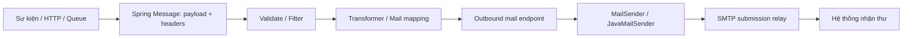
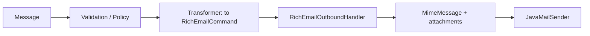
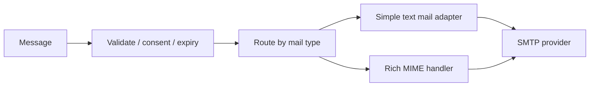

# Chuyển Spring Message thành email

Một hệ thống Spring Boot nhận sự kiện `OrderConfirmed` từ hàng đợi nội bộ. Sự kiện đi vào một `IntegrationFlow` dưới dạng `org.springframework.messaging.Message<OrderConfirmed>`, chứa payload nghiệp vụ và headers để định tuyến. Để gửi email xác nhận, lập trình viên cần biến dữ liệu đó thành thông tin người nhận, người gửi, tiêu đề, phần nội dung và có thể cả tệp đính kèm. Nhưng **Spring Message không phải là email**: một `Message<?>` của Spring Messaging là phong bì trao đổi dữ liệu *trong ứng dụng*, còn `SimpleMailMessage` và `jakarta.mail.internet.MimeMessage` là các dạng thông điệp dành cho việc gửi thư.

Trong Spring Integration, **mail-sending outbound channel adapter** có thể tiếp nhận một số kiểu payload thông dụng rồi chuyển chúng thành email thông qua Spring `MailSender`/`JavaMailSender`. Tuy vậy, **không phải mọi Java object hoặc MIME message đều được tự động chuyển theo cùng một cách**. Với nội dung phức tạp như HTML, plain-text alternative, PDF, hình inline, cần chọn rõ transformer hoặc mail handler thích hợp để tránh gửi một email sai cấu trúc mà test vẫn xanh.

Bài học **“Chuyển Spring Message thành email”**, thuộc chương **Spring Integration Mail** của module **Spring Framework Mail**, trình bày từng bước biến một Spring Integration message thành email outbound an toàn, rõ hợp đồng, có kiểm thử. Trọng tâm là **payload, headers, MailHeaders, transformer, outbound adapter, MIME construction và ranh giới gửi qua SMTP**; các phần về queue, outbox, retry và quan sát giải thích điều gì xảy ra sau khi chuyển đổi.

## 1. Phân biệt ba khái niệm dễ nhầm

| Khái niệm | Package/kiểu thường gặp | Vai trò |
|---|---|---|
| **Spring Message** | `org.springframework.messaging.Message<T>` | Chuyển payload và headers giữa các thành phần Spring Integration |
| **Spring MailMessage** | `org.springframework.mail.MailMessage`, `SimpleMailMessage` | Trừu tượng của email đơn giản, địa chỉ, subject, text |
| **Jakarta Mail Message** | `jakarta.mail.Message`, `MimeMessage` | Email theo định dạng RFC/MIME, multipart, HTML, attachments, headers |

Một Spring Message có thể chứa một `String`:

```java
Message<String> event = MessageBuilder
        .withPayload("Đơn hàng đã được xác nhận.")
        .setHeader("notificationId", "N-101")
        .build();
```

Message này **chưa đủ thông tin để gửi email**: thiếu `To`, `From` và có thể cả `Subject`. Header `notificationId` là metadata phục vụ ứng dụng, không tự trở thành email header `Message-ID`.

Một Spring Message khác có thể chứa một `SimpleMailMessage`:

```java
SimpleMailMessage mail = new SimpleMailMessage();
mail.setTo("lan@example.net");
mail.setFrom("notifications@example.com");
mail.setSubject("Xác nhận đơn hàng");
mail.setText("Đơn hàng của bạn đã được xác nhận.");

Message<SimpleMailMessage> springMessage =
        MessageBuilder.withPayload(mail).build();
```

Lúc này payload đã mang các trường email đơn giản. Một outbound mail adapter của Spring Integration có thể nhận payload kiểu `MailMessage` và chuyển giao cho `MailSender`.

Một Spring Message cũng có thể chứa **dữ liệu nghiệp vụ**:

```java
public record OrderConfirmed(
        String orderId,
        String recipient,
        String customerName) {
}
```

`OrderConfirmed` **không** phải email. Cần ánh xạ rõ ràng từ dữ liệu nghiệp vụ sang email, thường qua một transformer hoặc application service, thay vì dựa vào `toString()` tự động.

### 1.1. Vì sao cùng tên Message gây lỗi?

Đoạn code:

```java
import org.springframework.messaging.Message;
```

khác hẳn:

```java
import jakarta.mail.Message;
```

Loại thứ nhất có `getPayload()`, `getHeaders()`; loại thứ hai có các phương thức email như `getRecipients()` và `getSubject()`.

Khi ví dụ cần cả hai, dùng tên đầy đủ hoặc imports có chủ đích. Không gọi `message.getHeaders()` trên `jakarta.mail.Message`, và không gọi `setSubject()` trên `org.springframework.messaging.Message<?>`.

## 2. Luồng dữ liệu tổng thể



Ví dụ cụ thể:

```text
Spring Message<OrderConfirmed>
    payload.orderId      = "HD-101"
    payload.recipient    = "lan@example.net"
    payload.customerName = "Lan"
    headers.correlationId = "order-HD-101"
             |
             v
Validate + render
             |
             v
Spring Message<SimpleMailMessage>
    payload.to      = "lan@example.net"
    payload.from    = "notifications@example.com"
    payload.subject = "Đã xác nhận đơn HD-101"
    payload.text    = "Xin chào Lan, ..."
             |
             v
Spring Integration mail outbound adapter
             |
             v
MailSender.send(SimpleMailMessage)
             |
             v
SMTP relay
```

Điểm cần nhớ: adapter chuyển dữ liệu thành **yêu cầu gửi**. Việc method `send(...)` trả về không lỗi thường chỉ chứng minh bước submission tới relay đã hoàn tất theo điều kiện của transport, **không chứng minh thư đã tới Inbox**.

## 3. Spring Integration Mail có những thành phần nào?

Các tên chính cần nhận diện:

- `Message<?>`: envelope của Spring Messaging.
- `MessageChannel`: kênh chuyên chở message.
- `DirectChannel`: gọi handler đồng bộ trên thread gửi trong đường đi thông thường.
- `ExecutorChannel`: bàn giao xử lý sang executor, tạo ranh giới bất đồng bộ.
- `QueueChannel`: kênh có khả năng lưu tạm trong memory/channel store theo cấu hình, consumer cần polling.
- `IntegrationFlow`: khai báo một chuỗi các bước xử lý bằng Java DSL.
- `@Transformer`: chuyển payload hoặc message sang dạng khác.
- `@ServiceActivator`: gắn một method/handler vào channel.
- `MailHeaders`: hằng số tên header dành cho mail mapping.
- `MailSendingMessageHandler`: outbound handler của Spring Integration.
- `Mail.outboundAdapter(...)`: Java DSL factory để cấu hình mail outbound handler.
- `MailSender`/`JavaMailSender`: API Spring Mail thực sự gửi thông qua transport.
- `SimpleMailMessage` và `MimeMessageHelper`: xây dựng email text đơn giản hoặc email MIME.

### 3.1. Dependency gợi ý

Với dự án Spring Boot hiện đại có dependency management nhất quán, ví dụ Gradle:

```groovy
dependencies {
    implementation 'org.springframework.boot:spring-boot-starter-integration'
    implementation 'org.springframework.integration:spring-integration-mail'
    implementation 'org.springframework.boot:spring-boot-starter-mail'

    testImplementation 'org.springframework.boot:spring-boot-starter-test'
    testImplementation 'org.springframework.integration:spring-integration-test'
}
```

Không tự gán phiên bản độc lập cho từng thư viện nếu dự án dùng Spring Boot BOM; Spring Integration, Spring Framework và Jakarta Mail phải tương thích. Những dự án cũ có `javax.mail.*` thay vì `jakarta.mail.*`; ví dụ trong bài dùng namespace `jakarta.mail.*` của hệ Spring hiện đại.

> **Lưu ý phiên bản:** Trong Spring Integration 7.x, class handler mới có package `org.springframework.integration.mail.outbound.MailSendingMessageHandler`. Class cũ ở `org.springframework.integration.mail.MailSendingMessageHandler` đã được đánh dấu deprecated từ 7.0. API Java DSL `Mail.outboundAdapter(...)` thường giúp tránh phụ thuộc trực tiếp vào package của class handler; hãy kiểm tra version thực tế của dự án.

### 3.2. Không cần Spring Integration cho mọi email

Nếu một application service đơn giản chỉ cần gọi `JavaMailSender.send()` theo request đồng bộ, Spring Integration có thể không cần thiết. Nó hữu ích khi bạn muốn dùng message channels, filters, transformers, routing, gateway, poller, error flow và orchestration chung.

Không đưa mail adapter vào một luồng phức tạp chỉ để thay một lời gọi method bình thường nếu không có nhu cầu xử lý messages.

## 4. Payload nào được outbound mail adapter hỗ trợ?

Theo cơ chế mail-sending adapter của Spring Integration, có một số nhánh mapping cơ bản:

| Kiểu payload trong Spring Message | Hành vi adapter | Khi nào nên dùng |
|---|---|---|
| `String` | Nội dung trở thành text của một email đơn giản | Thư văn bản, không cần MIME nâng cao |
| `MailMessage`, ví dụ `SimpleMailMessage` | Dùng mail abstraction đã tạo | Khi transformer cần kiểm soát To/From/Subject/Text |
| `byte[]` | Đường xử lý attachment; cần `MailHeaders.ATTACHMENT_FILENAME` | Một attachment đơn giản theo hợp đồng adapter |
| POJO tùy ý | Không nên dựa vào tự chuyển bất kỳ POJO nào | Thêm transformer rõ ràng |
| `MimeMessage` | Không coi là payload tương đương `MailMessage` ở mọi phiên bản/endpoint | Dùng endpoint chuyên biệt gọi `JavaMailSender.send(MimeMessage)` cho MIME phức tạp |

**Đừng cho rằng chỉ cần gửi một `Message<OrderConfirmed>` đến mail channel thì framework tự biết recipient, subject hoặc nội dung cần viết.** Nếu object không phải kiểu được handler mong đợi, nó có thể không được xử lý đúng hoặc gặp lỗi tại runtime.

### 4.1. Với String: nội dung ở payload, địa chỉ ở headers

```text
payload = "Xin chào Lan, đơn hàng đã được xác nhận."

headers:
    mail_to      = "lan@example.net"
    mail_from    = "notifications@example.com"
    mail_subject = "Xác nhận đơn hàng"
```

Ở đây `mail_to`, `mail_from`, `mail_subject` là các key cụ thể do Spring Integration cung cấp qua `MailHeaders`. Đây là lựa chọn gọn cho text-only email.

### 4.2. Với SimpleMailMessage: payload chứa thông tin mail

```java
SimpleMailMessage mail = new SimpleMailMessage();
mail.setTo("lan@example.net");
mail.setFrom("notifications@example.com");
mail.setSubject("Xác nhận đơn hàng");
mail.setText("Xin chào Lan!");

Message<SimpleMailMessage> integrationMessage =
        MessageBuilder.withPayload(mail).build();
```

Adapter không cần tạo subject/to/from từ các header riêng nếu mail object đã chứa chúng. Nhưng nếu Spring Integration Message cũng có các header `MailHeaders.*` trùng field, **các mail headers tương ứng có thể ghi đè giá trị trong MailMessage**. Vì vậy hãy tránh hai nguồn thông tin mâu thuẫn.

### 4.3. Với byte[]: không phải mọi bytes đều là một email

Theo hợp đồng của mail handler, `byte[]` có thể được xử lý như một attachment; phải có header filename phù hợp:

```java
Message<byte[]> attachmentMessage = MessageBuilder
        .withPayload(pdfBytes)
        .setHeader(MailHeaders.TO, "lan@example.net")
        .setHeader(MailHeaders.FROM, "billing@example.com")
        .setHeader(MailHeaders.SUBJECT, "Tệp hóa đơn")
        .setHeader(
                MailHeaders.ATTACHMENT_FILENAME,
                "hoa-don.pdf")
        .build();
```

Đây là ví dụ cho đường attachment đơn giản do framework hỗ trợ, **không phải hợp đồng email đa tệp kèm HTML**. Nếu cần đồng thời nhiều attachments, text/plain, text/html và inline images, nên dùng `MimeMessageHelper` trong một handler chuyên biệt.

Không coi `byte[]` từ một PDF là chuỗi email body, và không dùng `Object.toString()` để biến bytes thành nội dung.

## 5. MailHeaders: header để ánh xạ thông tin thư

Spring Integration định nghĩa `org.springframework.integration.mail.MailHeaders`. Các constant thường dùng:

| Constant | Giá trị header liên quan | Ý nghĩa |
|---|---|---|
| `MailHeaders.TO` | `mail_to` | Người nhận To |
| `MailHeaders.CC` | `mail_cc` | Người nhận Cc |
| `MailHeaders.BCC` | `mail_bcc` | Người nhận Bcc |
| `MailHeaders.FROM` | `mail_from` | Địa chỉ From |
| `MailHeaders.REPLY_TO` | `mail_replyTo` | Địa chỉ Reply-To |
| `MailHeaders.SUBJECT` | `mail_subject` | Subject |
| `MailHeaders.ATTACHMENT_FILENAME` | `mail_attachmentFilename` | Tên attachment trong đường byte[] |
| `MailHeaders.CONTENT_TYPE` | `mail_contentType` | Header liên quan MIME content type trong mapping/metadata |

Có thêm các constants khác phục vụ inbound mail, ví dụ flags, received date, raw headers. Trong bài về **outbound**, không mặc định mọi header được chuyển trực tiếp thành email header.

### 5.1. Spring Message headers không giống MIME headers

Một `MessageHeaders` có thể chứa:

```text
id: <UUID do framework tạo>
timestamp: <thời điểm message được tạo>
correlationId: "order-HD-101"
notificationType: "ORDER_CONFIRMATION"
mail_to: "lan@example.net"
mail_subject: "Xác nhận đơn hàng"
```

Chỉ các header mà component outbound nhận biết hoặc được developer map rõ ràng mới ảnh hưởng email. `correlationId` không tự trở thành `X-Correlation-ID` trong email; `id` của Spring Message không mặc nhiên là `Message-ID` RFC 5322.

**Không copy toàn bộ Spring headers sang MIME headers** vì có thể làm lộ thông tin nội bộ hoặc đưa các giá trị không hợp lệ vào email.

### 5.2. Thứ tự ưu tiên giữa payload và headers

Nếu payload `SimpleMailMessage` có `To = alice@example.net` nhưng integration header `MailHeaders.TO` lại là `bob@example.net`, header của Spring Integration có thể override field mail tương ứng theo mapping adapter.

Điều này có thể gây lỗi bảo mật: một bước enrich headers từ dữ liệu user không tin cậy vô tình đổi recipient đã được application xác minh.

Hướng thiết kế tốt:

- Xác định **một nguồn đáng tin** cho From/To/Subject.
- Nếu cần enrich, làm trước bước đóng gói cuối cùng.
- Không để bước sau tùy tiện overwrite các header nhạy cảm.
- Validate giá trị cuối ngay trước submission.
- Có test cố ý tạo header mâu thuẫn để hiểu contract và chính sách ứng dụng.

### 5.3. Phân biệt content type

`MessageHeaders.CONTENT_TYPE` của Spring Messaging diễn tả content type của payload trong flow. Nó **không phải** API thay thế toàn bộ cấu trúc `Content-Type: multipart/alternative` của MIME.

Ví dụ:

```java
Message<String> message = MessageBuilder
        .withPayload("<p>Xin chào!</p>")
        .setHeader(
                MessageHeaders.CONTENT_TYPE,
                "text/html")
        .build();
```

Không nên mặc định rằng bất kỳ mail outbound adapter nào sẽ tự biến chuỗi này thành một MIME HTML chuẩn với plain-text alternative. Nếu use case cần email HTML, hãy **dựng MIME rõ ràng** bằng `MimeMessageHelper` và kiểm tra phần `text/html` thực tế.

## 6. Ví dụ đơn giản nhất: Spring Message<String> → email text

Một ứng dụng Spring Boot có `JavaMailSender` và Spring Integration Mail dependency có thể khai báo message channel cùng Java DSL outbound adapter.

### 6.1. Cấu hình SMTP submission

```yaml
spring:
  mail:
    host: ${SMTP_HOST}
    port: 587
    protocol: smtp
    username: ${SMTP_USERNAME}
    password: ${SMTP_PASSWORD}
    default-encoding: UTF-8
    properties:
      "[mail.smtp.auth]": true
      "[mail.smtp.starttls.enable]": true
      "[mail.smtp.starttls.required]": true
      "[mail.smtp.ssl.checkserveridentity]": true
      "[mail.smtp.connectiontimeout]": 5000
      "[mail.smtp.timeout]": 10000
      "[mail.smtp.writetimeout]": 10000
```

Ví dụ này phù hợp với provider yêu cầu SMTP AUTH và STARTTLS trên port 587. Provider dùng implicit TLS trên port 465 cần cấu hình transport tương ứng, thường với `mail.smtp.ssl.enable=true`. Địa chỉ và credentials phải đến từ cấu hình bí mật, không hardcode.

### 6.2. IntegrationFlow và outbound adapter

```java
package com.example.mail;

import org.springframework.context.annotation.Bean;
import org.springframework.context.annotation.Configuration;
import org.springframework.integration.channel.DirectChannel;
import org.springframework.integration.dsl.IntegrationFlow;
import org.springframework.integration.mail.dsl.Mail;
import org.springframework.mail.javamail.JavaMailSender;
import org.springframework.messaging.MessageChannel;

@Configuration
public class OutboundMailFlowConfiguration {

    @Bean
    public MessageChannel outboundMail() {
        return new DirectChannel();
    }

    @Bean
    public IntegrationFlow outboundMailFlow(
            MessageChannel outboundMail,
            JavaMailSender mailSender) {

        return IntegrationFlow.from(outboundMail)
                .handle(Mail.outboundAdapter(mailSender))
                .get();
    }
}
```

Đây là cấu hình Java DSL theo mô hình Spring Integration Mail. `DirectChannel` xử lý đồng bộ, nên call gửi message vào channel có thể bị chặn trong lúc SMTP send. Tùy version và cấu hình, hãy kiểm tra signature thực của DSL được dự án quản lý.

### 6.3. Tạo và gửi Spring Message

Một component có thể inject channel:

```java
package com.example.mail;

import org.springframework.integration.mail.MailHeaders;
import org.springframework.messaging.Message;
import org.springframework.messaging.MessageChannel;
import org.springframework.messaging.support.MessageBuilder;
import org.springframework.stereotype.Service;

@Service
public class TextMailPublisher {

    private final MessageChannel outboundMail;

    public TextMailPublisher(MessageChannel outboundMail) {
        this.outboundMail = outboundMail;
    }

    public void sendConfirmation(
            String recipient,
            String orderCode) {

        if (recipient == null || recipient.isBlank()) {
            throw new IllegalArgumentException(
                    "Recipient is required");
        }

        Message<String> mailRequest = MessageBuilder
                .withPayload(
                        "Đơn hàng " + orderCode
                        + " đã được xác nhận.")
                .setHeader(
                        MailHeaders.TO,
                        recipient)
                .setHeader(
                        MailHeaders.FROM,
                        "notifications@example.com")
                .setHeader(
                        MailHeaders.SUBJECT,
                        "Xác nhận đơn hàng " + orderCode)
                .build();

        boolean acceptedByChannel = outboundMail.send(mailRequest);

        if (!acceptedByChannel) {
            throw new IllegalStateException(
                    "Integration channel rejected message");
        }
    }
}
```

Ở đây:

1. `MessageBuilder` tạo `Message<String>`.
2. `MailHeaders.*` cho outbound adapter biết địa chỉ/subject.
3. `outboundMail.send(...)` gửi Spring Message vào integration channel.
4. `Mail.outboundAdapter(mailSender)` dùng Spring Mail transport.

**Tên biến `acceptedByChannel` không có nghĩa SMTP relay đã accepted.** `MessageChannel.send(...)` trả kết quả của việc gửi tới channel theo contract của channel; trên `DirectChannel`, handler có thể ném exception đồng bộ. Với channel bất đồng bộ, kết quả `true` còn ít nói lên trạng thái SMTP hơn.

### 6.4. Đây là “đơn giản”, không phải “hoàn toàn an toàn”

Ví dụ rút gọn chưa có:

- Recipient validation đầy đủ và allowlist/suppression.
- From address theo cấu hình/verified sender identity.
- HTML escaping cho nội dung động.
- Outbox cho gửi sau business commit.
- Retry và idempotency.
- Exception classification theo giai đoạn SMTP.
- Metrics và provider events.

Các phần tiếp theo bổ sung ranh giới xử lý đó. Không gửi trực tiếp email trong transaction nghiệp vụ chỉ vì API channel rất gọn.

## 7. Dùng @MessagingGateway để che chi tiết MessageChannel

Thay vì application service inject trực tiếp `MessageChannel` và tự dựng mọi header, Spring Integration hỗ trợ gateway interface.

### 7.1. Gateway cho text-only email

```java
import org.springframework.integration.annotation.MessagingGateway;
import org.springframework.messaging.Message;

@MessagingGateway(defaultRequestChannel = "outboundMail")
public interface TextEmailGateway {
    void send(Message<String> mailRequest);
}
```

Caller:

```java
Message<String> request = MessageBuilder
        .withPayload("Xin chào Lan!")
        .setHeader(
                MailHeaders.TO,
                "lan@example.net")
        .setHeader(
                MailHeaders.FROM,
                "notifications@example.com")
        .setHeader(
                MailHeaders.SUBJECT,
                "Chào mừng")
        .build();

textEmailGateway.send(request);
```

Gateway có nhiệm vụ làm cho code bên ngoài không cần biết cách phân phối message tới channel; **nó không tự thực hiện transaction outbox** và không biến SMTP thành một tác vụ exactly-once.

### 7.2. Gateway với method arguments

Có thể khai báo gateway dùng payload và headers:

```java
import org.springframework.integration.annotation.Gateway;
import org.springframework.integration.annotation.MessagingGateway;
import org.springframework.messaging.handler.annotation.Header;
import org.springframework.integration.mail.MailHeaders;

@MessagingGateway
public interface SimpleEmailGateway {

    @Gateway(requestChannel = "outboundMail")
    void sendText(
            String body,
            @Header(MailHeaders.TO) String recipient,
            @Header(MailHeaders.SUBJECT) String subject,
            @Header(MailHeaders.FROM) String fromAddress);
}
```

Cách này giúp caller:

```java
simpleEmailGateway.sendText(
        "Xin chào Lan!",
        "lan@example.net",
        "Chào mừng",
        "notifications@example.com");
```

Vì `fromAddress` là method argument trong ví dụ, **không** để request HTTP bất kỳ tự truyền From email chưa được verified. Trong production, gateway wrapper/application service nên lấy From từ trusted config, validate To và policy trước khi gọi gateway.

### 7.3. Vì sao gateway là optional?

Nếu ứng dụng chỉ có một service gọi email một chỗ, gateway có thể là abstraction dư. Nó hữu ích khi muốn định nghĩa endpoint contract rõ và để Spring Integration xử lý message dispatch. Quan trọng vẫn là contract ở ranh giới application.

## 8. Transformer: chuyển payload nghiệp vụ thành MailMessage

Nếu đầu vào là `OrderConfirmed`, cách rõ ràng nhất là xây dựng email trong transformer có tên và hợp đồng cụ thể.

### 8.1. Dữ liệu nghiệp vụ

```java
public record OrderConfirmed(
        String orderCode,
        String recipient,
        String customerName) {
}
```

Dữ liệu này mô tả business event; nó không chứa class của Spring Mail/Jakarta Mail.

### 8.2. Một transformer tạo SimpleMailMessage

```java
package com.example.mail;

import org.springframework.integration.annotation.Transformer;
import org.springframework.mail.SimpleMailMessage;
import org.springframework.stereotype.Component;

@Component
public class OrderConfirmationMailTransformer {

    @Transformer(
        inputChannel = "orderConfirmedChannel",
        outputChannel = "outboundMail")
    public SimpleMailMessage toMail(OrderConfirmed event) {

        if (event.recipient() == null
                || event.recipient().isBlank()) {
            throw new IllegalArgumentException(
                    "Recipient is required");
        }

        SimpleMailMessage mail = new SimpleMailMessage();
        mail.setFrom("notifications@example.com");
        mail.setTo(event.recipient());
        mail.setSubject(
                "Xác nhận đơn hàng " + event.orderCode());
        mail.setText(
                "Xin chào " + event.customerName()
                + ", đơn hàng " + event.orderCode()
                + " đã được xác nhận.");

        return mail;
    }
}
```

Spring Integration có thể nhận return value làm payload của message mới trên output channel. Outbound adapter nhận `SimpleMailMessage` (một `MailMessage`) và gửi.

### 8.3. Lợi ích so với POJO.toString()

Transformer định nghĩa rõ:

- Dữ liệu nào được đưa vào recipient.
- Subject và body được tạo ra sao.
- From là trusted config.
- Hệ thống cần làm gì khi recipient thiếu.
- Khi nào nên template hóa hoặc i18n.
- Kết quả có đúng payload type mà adapter hỗ trợ không.

Ngược lại:

```java
Message<OrderConfirmed> message =
        MessageBuilder.withPayload(event).build();
outboundMail.send(message);
```

không đủ rõ nghĩa để handler suy ra email. Một `ObjectToStringTransformer` chỉ gọi `toString()` phù hợp khi **chính kết quả toString() là nội dung muốn gửi**, không phải mặc định với mọi domain object. `OrderConfirmed[orderCode=..., recipient=...]` là một debug representation, không phải email thân thiện cho người nhận.

### 8.4. Cẩn thận với headers cũ đi theo transformer

Nếu input `Message<OrderConfirmed>` có sẵn header `MailHeaders.TO` do bước upstream gán, header đó có thể được propagate qua một số flow và **ghi đè** To trong `SimpleMailMessage` sau khi transformer tạo.

Đây là lỗi dễ bỏ qua nếu chỉ kiểm tra object transformer trả về mà không kiểm tra message cuối đi tới mail adapter. Một thiết kế tốt:

1. Không đưa untrusted mail headers vào business message.
2. Transformer/adapter tạo recipient từ nguồn tin cậy.
3. Kiểm soát header propagation và overwrite.
4. Khi cần, tạo message mới chỉ với danh sách headers được phép thay vì copy tất cả.
5. Integration test một case mâu thuẫn header/payload để bảo vệ invariant.

## 9. Header enricher: ánh xạ field trong payload thành MailHeaders

Khi email chỉ có text, Spring Integration có thể dùng `HeaderEnricher` để ánh xạ từ payload vào các header mail, rồi chuyển body thành String.

### 9.1. Dữ liệu đầu vào

```java
public record TextMailCommand(
        String to,
        String from,
        String subject,
        String bodyText) {
}
```

### 9.2. Java DSL minh họa

```java
@Bean
public IntegrationFlow textMailMappingFlow(
        JavaMailSender sender) {

    return IntegrationFlow.from("textMailRequests")
            .enrichHeaders(h -> h
                    .headerExpression(
                            MailHeaders.TO,
                            "payload.to")
                    .headerExpression(
                            MailHeaders.FROM,
                            "payload.from")
                    .headerExpression(
                            MailHeaders.SUBJECT,
                            "payload.subject"))
            .transform(
                    TextMailCommand.class,
                    TextMailCommand::bodyText)
            .handle(Mail.outboundAdapter(sender))
            .get();
}
```

Ví dụ cho thấy ba khâu:

1. Input là `Message<TextMailCommand>`.
2. Enricher đưa `to`, `from`, `subject` lên `MailHeaders`.
3. Transformer biến payload thành `String` body, giữ các header có ý nghĩa theo flow.
4. Outbound adapter xử lý text mail.

Cú pháp Java DSL và generic inference có thể khác giữa các version; nếu method reference overload gây lỗi với phiên bản cụ thể, dùng transformer function có kiểu rõ hoặc component `@Transformer`. Nội dung kiến trúc không thay đổi.

### 9.3. Đừng tin payload.from từ nguồn ngoài

Trong ví dụ, `payload.from` được map trực tiếp để giải thích cơ chế. Trong hệ thống thật, nếu `TextMailCommand` đến từ HTTP request không tin cậy, cần **thay bằng verified From** do ứng dụng cấu hình:

```java
.enrichHeaders(h -> h.header(
        MailHeaders.FROM,
        "notifications@example.com",
        true))
```

Tham số overwrite ở DSL có mục đích điều khiển hành vi ghi đè header; phải đối chiếu API phiên bản dự án. Không để client chọn From trái phép hoặc để untrusted header tự ghi đè địa chỉ người gửi.

### 9.4. Enrichment không biến một body thành HTML MIME

Nếu `bodyText` chứa `<b>Xin chào</b>`, sau transform nó vẫn là String. Hãy dùng MIME path riêng nếu muốn email HTML đúng Content-Type và multipart structure.

## 10. Khi nào chọn SimpleMailMessage, khi nào dùng MimeMessage?

| Yêu cầu | `SimpleMailMessage` | `MimeMessage` + `MimeMessageHelper` |
|---|---|---|
| Text thuần | Phù hợp | Phù hợp |
| Subject, To, From | Có | Có |
| Cc, Bcc, Reply-To | Có | Có |
| HTML body với `text/html` | Không phải API mạnh cho MIME HTML | Phù hợp |
| Plain + HTML alternative | Không | Phù hợp |
| File đính kèm nhiều tệp | Không | Phù hợp |
| Inline image/CID | Không | Phù hợp |
| Kiểm soát MIME Content-Type/charset phức tạp | Hạn chế | Phù hợp |
| Một vài header MIME tùy chỉnh | Không phải mục tiêu | Có thể, với validation |
| Gửi bằng mail adapter trực tiếp qua `MailMessage` | Thuận tiện | Cần handler tự dựng/gửi MIME khi phức tạp |

**Nguyên tắc:** dùng đường dễ nhất đáp ứng đúng yêu cầu, nhưng không ép HTML/attachment vào `SimpleMailMessage` rồi hy vọng mail client tự hiểu.

## 11. Chuyển Message<RichEmailCommand> thành MimeMessage: endpoint riêng

Với rich email, cách minh bạch là dùng Spring Integration cho orchestration đến một `@ServiceActivator`, còn service đó dùng `JavaMailSender` dựng và gửi MIME.

### 11.1. Định nghĩa command ở application boundary

```java
package com.example.mail;

import java.util.List;

public record RichEmailCommand(
        String to,
        String subject,
        String plainText,
        String htmlText,
        List<AttachmentData> attachments) {
}

public record AttachmentData(
        String fileName,
        String contentType,
        byte[] bytes) {
}
```

Đây là các record minh họa; mỗi public top-level Java type nên đặt trong file riêng. Với production, cần validation, immutable defensive copies, kích thước/loại file và storage reference cho attachment lớn. Không giữ dữ liệu byte lớn trong Spring Message vô thời hạn.

### 11.2. Handler dùng MimeMessageHelper

```java
package com.example.mail;

import jakarta.mail.MessagingException;
import jakarta.mail.internet.MimeMessage;

import org.springframework.beans.factory.annotation.Value;
import org.springframework.core.io.ByteArrayResource;
import org.springframework.integration.annotation.ServiceActivator;
import org.springframework.mail.javamail.JavaMailSender;
import org.springframework.mail.javamail.MimeMessageHelper;
import org.springframework.stereotype.Component;

@Component
public class RichEmailOutboundHandler {

    private final JavaMailSender sender;
    private final String from;

    public RichEmailOutboundHandler(
            JavaMailSender sender,
            @Value("${app.mail.from}") String from) {

        this.sender = sender;
        this.from = from;
    }

    @ServiceActivator(inputChannel = "richMailRequests")
    public void send(RichEmailCommand command) {
        if (command.to() == null || command.to().isBlank()) {
            throw new IllegalArgumentException(
                    "Recipient is required");
        }

        MimeMessage mime = sender.createMimeMessage();

        try {
            MimeMessageHelper helper =
                    new MimeMessageHelper(
                            mime,
                            true,
                            "UTF-8");

            helper.setFrom(from);
            helper.setTo(command.to());
            helper.setSubject(command.subject());

            if (command.htmlText() == null) {
                helper.setText(command.plainText(), false);
            } else {
                helper.setText(
                        command.plainText(),
                        command.htmlText());
            }

            if (command.attachments() != null) {
                for (AttachmentData attachment
                        : command.attachments()) {
                    helper.addAttachment(
                            attachment.fileName(),
                            new ByteArrayResource(
                                    attachment.bytes()),
                            attachment.contentType());
                }
            }
        } catch (MessagingException ex) {
            throw new IllegalArgumentException(
                    "Cannot prepare MIME email", ex);
        }

        sender.send(mime);
    }
}
```

Phương thức `send(RichEmailCommand)` là outbound endpoint do ứng dụng sở hữu; Spring Integration giao **payload đã unwrap** cho method. `JavaMailSender` được gọi để gửi `MimeMessage` thực. Để dùng với outbox, worker nên quyết định khi nào gọi handler sau commit, không để transaction nghiệp vụ bao network I/O.

### 11.3. Vì sao không gửi MimeMessage payload thẳng vào mail-sending handler?

Một `MimeMessage` của Jakarta Mail không implement Spring `MailMessage`. Mail-sending adapter có các nhánh mapping riêng cho `MailMessage`, `String` và `byte[]`; **không nên giả định bất kỳ `Message<MimeMessage>` nào cũng được adapter đối xử như `JavaMailSender.send(MimeMessage)`** ở mọi phiên bản.

Đường an toàn cho MIME phức tạp là:

```text
Spring Message<RichEmailCommand>
    -> RichEmailOutboundHandler
    -> JavaMailSender.createMimeMessage()
    -> MimeMessageHelper
    -> JavaMailSender.send(MimeMessage)
```

Hoặc tự viết transformer trả MIME rồi nối với **custom handler** nhận MIME rõ kiểu và gọi sender; không cần bắt outbound adapter chuẩn thực hiện điều nó không hứa.

### 11.4. HTML escaping và plain-text alternative

Nếu command chứa dữ liệu không tin cậy, HTML phải được escape theo ngữ cảnh (thường qua template engine có auto-escaping). Không dùng:

```java
String html = "<p>Hello " + userSuppliedName + "</p>";
```

mà không escape; đầu vào có thể chứa HTML/script không mong muốn. Email client không phải trình duyệt hoàn chỉnh nhưng vẫn cần bảo vệ nội dung/link injection.

Một nội dung có `htmlText` nên có plain-text alternative có ý nghĩa, không dùng nguyên markup làm plain text. `helper.setText(plain, html)` tạo cấu trúc MIME alternative phù hợp.

## 12. Mô hình với transformer trước rich mail handler

Với một flow rõ ràng:



Transformer có thể dùng template engine, inventory attachment và configuration:

```java
@Component
public final class InvoiceMailRenderer {

    private final TemplateService templates;

    public InvoiceMailRenderer(TemplateService templates) {
        this.templates = templates;
    }

    @Transformer(
            inputChannel = "invoiceIssuedChannel",
            outputChannel = "richMailRequests")
    public RichEmailCommand toEmail(InvoiceIssued invoice) {
        String plain = templates.renderPlain(invoice);
        String html = templates.renderHtml(invoice);

        return new RichEmailCommand(
                invoice.recipient(),
                "Hóa đơn " + invoice.invoiceNumber(),
                plain,
                html,
                invoice.attachments());
    }
}
```

Các type `TemplateService`/`InvoiceIssued` là abstraction của ứng dụng trong ví dụ; chúng không phải class sẵn của Spring Framework. Phần tạo nội dung nên đảm bảo:

- Template version có thể tái hiện khi retry.
- Subject/recipient được validate.
- Localization rõ locale/timezone.
- HTML output được escape đúng.
- Attachment bytes/ref không thay đổi bất ngờ giữa các attempts.
- Nguồn From đến từ cấu hình verified identity, không từ untrusted event.

## 13. Cách giữ business logic sạch

Không nên cho domain event chứa:

```java
record OrderConfirmed(
        MimeMessage mime,
        MimeMessageHelper helper,
        JavaMailSender sender) {
}
```

Nó gắn domain vào hạ tầng mail, gây khó serialize/retry/test và vi phạm separation of concerns.

Tốt hơn:

```text
Domain:
    OrderConfirmed(orderId, customerId, occurredAt)

Application:
    Resolve approved recipient
    Choose notification purpose/template
    Snapshot intent

Integration:
    Route / filter / transform / channel

Infrastructure:
    MimeMessageHelper / JavaMailSender / provider events
```

Khi chưa cần Spring Integration, application có thể gọi mail port trực tiếp. Khi có nhu cầu flow processing, Spring Integration là lớp orchestration nhưng không trở thành chủ sở hữu domain logic.

## 14. Đồng bộ và bất đồng bộ: kết quả của MessageChannel.send()

### 14.1. DirectChannel

`DirectChannel` chuyển message tới subscriber trên thread của caller theo đường đi đồng bộ. Nếu handler gọi SMTP và bị exception, exception có thể truyền ngược về caller ở cùng chuỗi xử lý.

Lưu ý:

- Call có thể chậm theo SMTP timeouts.
- Nếu caller đang giữ database transaction, có nguy cơ kéo dài locks.
- `send()` trả về không lỗi không có nghĩa delivered vào Inbox.

### 14.2. ExecutorChannel

`ExecutorChannel` chuyển xử lý cho task executor. Caller có thể được bàn giao thành công trong khi SMTP submission diễn ra sau đó trên thread khác.

Rủi ro:

- Exception không nhất thiết trở lại caller.
- Thread pool saturation/rejection cần xử lý.
- Process crash có thể làm mất message nếu chỉ nằm trong memory queue.
- Error publishing phụ thuộc cấu hình error channel/task executor.

Không chọn async chỉ bằng cách thay `DirectChannel` thành `ExecutorChannel` rồi cho rằng đã có reliability giống transactional outbox.

### 14.3. QueueChannel và poller

`QueueChannel` là `PollableChannel`. Consumer endpoint cần poller để lấy message ra. Queue có thể dùng memory store hoặc một `MessageStore` tùy cấu hình, với semantics/độ bền riêng.

Đừng mặc định một QueueChannel trong memory đủ cho email giao dịch quan trọng. Nếu yêu cầu “không mất notification sau process crash”, hãy ghi intent vào outbox chung transaction với business state hoặc sử dụng hệ queue bền vững đã được thiết kế đúng.

### 14.4. Tách phase nghiệp vụ với phase gửi

```text
HTTP confirmation:
    BEGIN DB TX
    update order
    insert mail_outbox
    COMMIT

Later:
    worker claim outbox
    build Spring Message<MailCommand>
    IntegrationFlow -> mail outbound handler
    update submission outcome
```

Transaction database không bao phủ SMTP, nên accepted rồi crash trước cập nhật status vẫn có thể tạo duplicate khi retry. Spring Integration giúp tổ chức flow, **không tự tạo exactly-once external delivery**.


## 15. Xử lý lỗi theo đúng tầng

Một lỗi khi chuyển Spring Message thành email có thể xảy ra trước hoặc sau khi SMTP transport bắt đầu:

1. Payload thiếu trường, dữ liệu không đáp ứng nghiệp vụ.
2. Transformer lỗi khi render template.
3. Mail headers sai hoặc bị untrusted source ghi đè.
4. Dựng MIME thất bại do attachment hoặc cấu trúc.
5. SMTP connect/TLS/AUTH thất bại.
6. SMTP server trả phản hồi từ chối tạm thời hay vĩnh viễn.
7. Client timeout sau `DATA` nhưng relay có thể đã chấp nhận message.
8. Provider accepted rồi sau đó recipient MX trả bounce/deferral.

Không nên gom hết thành một lỗi `MailSendException` “thử lại sau 1 giây”.

### 15.1. DirectChannel và exception đồng bộ

Với `DirectChannel`, subscriber thường xử lý trên thread của caller:

```text
publisher -> DirectChannel -> Transformer
                                  |
                                  v
                            Mail adapter
                                  |
                                  v
                          SMTP exception
                                  |
                                  v
                         caller nhận lỗi
```

Exception ở handler có thể truyền ngược qua chuỗi gọi đồng bộ. Nhưng nếu email đã được relay nhận mà một lỗi phía ứng dụng xảy ra sau đó, rollback database **không thu hồi được email**.

### 15.2. ExecutorChannel, QueueChannel và error channel

Khi xử lý bất đồng bộ:

- Caller thường chỉ biết message được bàn giao cho channel/executor.
- Exception có thể được framework chuyển thành `ErrorMessage` ở error channel nếu đã cấu hình hoặc có cơ chế error publishing tương ứng.
- Một số lỗi vẫn có thể xảy ra ngay khi bàn giao (chẳng hạn executor từ chối task).
- Cách publish error phụ thuộc loại channel, poller và endpoint; không có một cấu hình `errorChannel` tự động bắt mọi lỗi của mọi flow.
- Process crash có thể làm mất message nếu chỉ nằm trong memory queue.

Một error handler có thể quan sát:

```java
import org.springframework.integration.annotation.ServiceActivator;
import org.springframework.messaging.MessagingException;
import org.springframework.messaging.support.ErrorMessage;
import org.springframework.stereotype.Component;

@Component
public class MailErrorObserver {

    @ServiceActivator(inputChannel = "mailErrors")
    public void observe(ErrorMessage error) {
        Throwable failure = error.getPayload();

        if (failure instanceof MessagingException messaging) {
            org.springframework.messaging.Message<?> failed =
                    messaging.getFailedMessage();
            // Lấy correlation ID từ failed message nếu có,
            // tránh log raw MIME body hoặc credential.
        }

        // Đưa lỗi sang classifier/metrics; không retry mù quáng.
    }
}
```

`mailErrors` là tên channel do ứng dụng định nghĩa và phải được nối với error mechanism của flow. Không coi annotation trên đây tự tạo ra cơ chế xử lý cho tất cả channels.

### 15.3. Hai MessagingException khác nhau

| Loại | Ý nghĩa |
|---|---|
| `org.springframework.messaging.MessagingException` | Exception xử lý message của Spring Messaging; có thể mang failed message |
| `jakarta.mail.MessagingException` | Exception khi thao tác email/MIME hoặc transport Jakarta Mail |
| `org.springframework.mail.MailException` | Runtime exception thuộc Spring Mail abstraction |

Khi source code dùng các loại này cùng lúc, nên import có chọn lọc hoặc viết tên đầy đủ để tránh nhầm.

### 15.4. Tạo error taxonomy trung lập

| Category | Ví dụ | Hướng xử lý |
|---|---|---|
| `INVALID_NOTIFICATION` | Thiếu recipient/consent | Không submit |
| `TEMPLATE_ERROR` | Render fail, HTML invalid | Sửa dữ liệu/template |
| `MIME_PREPARATION` | Attachment mất, filename invalid | Không retry SMTP nguyên dạng |
| `AUTHENTICATION` | SMTP 535, token sai | Cảnh báo/sửa secret |
| `TLS_CONFIG` | PKIX hoặc hostname mismatch | Sửa certificate/truststore |
| `TEMPORARY_REJECTION` | Temporary SMTP 4xx có chứng cứ | Retry backoff+jitter |
| `PERMANENT_REJECTION` | Permanent SMTP 5xx | Dừng hoặc sửa nguyên nhân |
| `PROVIDER_RATE_LIMIT` | Quota/rate được xác định | Giảm pace, chờ capacity |
| `SUBMISSION_UNKNOWN` | Timeout sau khi có thể đã gửi message | Reconcile/duplicate-aware retry |
| `DOWNSTREAM_BOUNCE` | Provider event sau accepted | Update suppression/state |

Một lỗi ở `MimeMessageHelper` trước khi gọi SMTP có ý nghĩa khác hẳn lỗi socket sau `DATA`. Classifier tốt giữ lại mức chắc chắn, giai đoạn và provider evidence khi có.

## 16. Validate đầu vào trước khi tới outbound endpoint

Một luồng gửi email không nên tin hoàn toàn vào `MailHeaders` của message đến từ HTTP, queue hoặc đối tác bên ngoài.

### 16.1. Recipient

Yêu cầu:

- Không null, không rỗng.
- Địa chỉ hợp lệ theo validator và policy.
- Thuộc tài khoản/người nhận mà caller có quyền liên hệ.
- Không nằm trong suppression list cho loại notification tương ứng.
- Có consent nếu là email marketing.
- Không chứa ký tự điều khiển làm hỏng header.
- Không phải địa chỉ debug/test vô tình còn sót trong production.

Một địa chỉ parse được bằng `InternetAddress` **không chứng minh mailbox tồn tại** hoặc email được người nhận mong muốn.

### 16.2. From và Reply-To

- Lấy From từ verified sending identity theo tenant/account.
- Không cho request tùy ý đặt `mail_from` thành địa chỉ không được cấp phép.
- Reply-To cũng phải phù hợp chính sách.
- SPF/DKIM/DMARC, envelope sender và From display name có các mục đích riêng; không sửa authentication bằng cách đặt vài header tùy ý.

### 16.3. Subject/body

- Chặn CR/LF/header injection.
- Giới hạn độ dài theo nghiệp vụ.
- Escape HTML theo ngữ cảnh, đặc biệt với dữ liệu người dùng.
- Chỉ dùng template, link host và attachment đã được phê duyệt.
- Không log OTP, token reset password, body hoặc secret.

### 16.4. Bcc

Bcc phục vụ người nhận ẩn; không đưa danh sách Bcc vào body, custom header hoặc logs không bảo vệ. Với email cá nhân hóa, thường tạo notification riêng cho từng recipient. Test thực tế MIME/SMTP behavior thay vì giả định mọi mail client/transport xử lý giống nhau.

### 16.5. Không chuyển mọi Spring header thành MIME header

Một Spring Message có thể chứa `notificationId`, `traceId`, `tenantId` và `correlationId`. Chỉ map các header cần cho email, không copy toàn bộ thành `X-*` email headers. Email headers có thể đến tay recipient và nhiều SMTP relays.

## 17. Unicode và MIME content type

### 17.1. Tiếng Việt cần charset phù hợp

Với `SimpleMailMessage`, `JavaMailSenderImpl`/Spring Mail configuration nên dùng encoding UTF-8. Với MIME:

```java
MimeMessageHelper helper =
        new MimeMessageHelper(message, true, "UTF-8");

helper.setSubject("Hóa đơn đã thanh toán");
helper.setText(
        "Hóa đơn đã được phát hành.",
        "<p>Hóa đơn <strong>đã được phát hành</strong>.</p>");
```

Test nên đọc subject/body đã **decode** qua Jakarta Mail API, không so sánh raw encoded headers.

### 17.2. Một chuỗi HTML không tự thành mail HTML

```java
Message<String> springMessage =
        MessageBuilder.withPayload(
                "<h1>Xin chào!</h1>").build();
```

Đây chỉ là String payload. Nếu đưa vào text-mail adapter, không thể tự khẳng định email sẽ có `Content-Type: text/html`. Để bảo đảm HTML/alternative hợp lệ, dựng `MimeMessage` rõ ràng.

### 17.3. MIME multipart

Một email có plain text, HTML và PDF có thể được tổ chức:

```text
MimeMessage
└── multipart/mixed
    ├── multipart/alternative
    │   ├── text/plain; charset=UTF-8
    │   └── text/html; charset=UTF-8
    └── application/pdf attachment
```

Trong các multipart modes của `MimeMessageHelper`, cấu trúc có thể được lồng thêm `multipart/related` khi có inline resources. Tests nên duyệt theo `MIME type`, disposition/filename chứ không gắn cứng body part index.

## 18. Attachments: dữ liệu và vòng đời

Với attachment nhỏ đã có bytes:

```java
helper.addAttachment(
        "invoice-HD-101.pdf",
        new ByteArrayResource(pdfBytes),
        "application/pdf");
```

Nhưng với file lớn hoặc gửi sau nhiều giờ:

- Đừng giữ bytes trong memory queue quá lâu.
- Lưu reference tới object storage hoặc file bất biến.
- Kiểm tra quyền truy cập theo tenant, kích thước và loại nội dung.
- Stream phải đáp ứng contract mở/đọc lặp lại nếu MIME implementation yêu cầu.
- Không chuyển một `InputStream` đang mở trong Spring Message qua process restart.
- Xử lý tệp mất/không đọc được trước khi SMTP attempt.
- Không tự bỏ attachment bắt buộc rồi coi message vẫn gửi thành công.

Một record để tham chiếu file có thể là:

```java
public record AttachmentRef(
        String objectKey,
        String fileName,
        String contentType,
        long expectedSize,
        String sha256) {
}
```

Hệ thống infrastructure resolve `objectKey` sang nguồn dữ liệu an toàn tại thời điểm gửi; nếu retry cần cùng tài liệu, phải đảm bảo content snapshot/immutability.

## 19. Filters, routing và provider policies

Một Spring Integration flow có thể gồm:



### 19.1. Filter

Khi filter loại message vì recipient suppressed hoặc OTP expired, cần cập nhật business/audit state phù hợp; không âm thầm bỏ một notification quan trọng khiến người vận hành không biết.

### 19.2. Router

Có thể định tuyến:

- `TEXT_ONLY` → `Message<String>` + `MailHeaders`.
- `RICH_MIME` → `RichEmailCommand` + custom handler.
- `NO_SEND` → cancelled/suppressed state.
- `PROVIDER_B` → adapter khác khi provider đáp ứng verification, region, quota và capability.

### 19.3. Quota, rate và concurrency

`DirectChannel` có một handler **không phải** distributed rate limiter. Nếu nhiều threads/pods cùng gửi, vẫn có thể vượt giới hạn account.

Trước khi gọi SMTP:

1. Xác định provider/account, cost theo recipients.
2. Reserve rate/quota capacity theo scope thích hợp.
3. Khi local gate DENIED, hoãn dispatch mà không tăng SMTP attempts.
4. Khi ALLOWED, gửi một attempt.
5. Lưu accepted/rejected/unknown và lịch retry.
6. Theo dõi backlog, quota remaining và provider throttling.

## 20. Outbox: không gửi SMTP trong business transaction

Sai nếu yêu cầu nghiệp vụ cần atomicity:

```java
@Transactional
public void confirmOrder(...) {
    orderRepository.markConfirmed(...);
    mailChannel.send(mailRequest); // Có thể gửi SMTP trước DB commit!
}
```

Nếu SMTP accepted rồi transaction rollback, khách hàng có thể nhận email về một đơn hàng không tồn tại.

Giải pháp transactional outbox:

```text
Business transaction:
    BEGIN
      UPDATE orders SET status = CONFIRMED
      INSERT mail_outbox(
        notification_id,
        business_key,
        payload_snapshot,
        status = PENDING
      )
    COMMIT

After commit:
    Worker claim due outbox
      -> build Spring Message<MailCommand>
      -> IntegrationFlow/Transformer
      -> SMTP handler
      -> persist attempt outcome
```

Với điều kiện business state và outbox thực sự dùng chung database transaction, cả hai commit hoặc rollback cùng nhau. SMTP **không** tham gia transaction đó.

### 20.1. Đừng dùng Spring Message ID làm business idempotency key

Mỗi lần retry, worker có thể tạo Spring `Message<?>` mới với ID mới. Cần giữ:

- `notificationId` bền vững.
- `idempotencyKey` theo event/purpose/recipient.
- `attemptId` cho một transport try.
- `providerReference` nếu được cấp.
- `correlationId` nội bộ để truy vết.

`MessageHeaders.ID` không thay thế idempotency của outbox.

### 20.2. Kết quả UNKNOWN và duplicate risk

Nếu client mất phản hồi sau SMTP `DATA`, server có thể đã accepted. Outbox giúp **không mất ý định gửi**, nhưng không tự bảo đảm exactly-once SMTP submission. Hãy dùng reconciliation khi có thể, hoặc retry với chính sách chấp nhận rủi ro duplicate theo loại notification.

## 21. Unit test transformer

Không cần Spring context để kiểm logic chuyển business payload sang mail content.

```java
import org.junit.jupiter.api.Test;
import org.springframework.mail.SimpleMailMessage;

import static org.assertj.core.api.Assertions.*;

class OrderConfirmationMailTransformerTest {

    private final OrderConfirmationMailTransformer transformer =
            new OrderConfirmationMailTransformer();

    @Test
    void mapsOrderToTextEmail() {
        OrderConfirmed event =
                new OrderConfirmed(
                        "HD-101",
                        "lan@example.net",
                        "Lan");

        SimpleMailMessage mail = transformer.toMail(event);

        assertThat(mail.getTo())
                .containsExactly("lan@example.net");
        assertThat(mail.getSubject())
                .isEqualTo("Xác nhận đơn hàng HD-101");
        assertThat(mail.getText())
                .contains("Lan", "HD-101");
    }
}
```

Test này chỉ kiểm tra transformer, không chứng minh wiring channel hoặc SMTP connection.

## 22. Unit test outbound mapping bằng mock MailSender

Với Spring Integration 7.x, handler outbound có package `org.springframework.integration.mail.outbound`. Ví dụ test:

```java
import org.junit.jupiter.api.Test;
import org.mockito.ArgumentCaptor;
import org.springframework.integration.mail.MailHeaders;
import org.springframework.integration.mail.outbound.MailSendingMessageHandler;
import org.springframework.mail.MailSender;
import org.springframework.mail.SimpleMailMessage;
import org.springframework.messaging.Message;
import org.springframework.messaging.support.MessageBuilder;

import static org.assertj.core.api.Assertions.*;
import static org.mockito.Mockito.*;

class MailHandlerMappingTest {

    @Test
    void mapsStringAndMailHeaders() {
        MailSender sender = mock(MailSender.class);

        MailSendingMessageHandler handler =
                new MailSendingMessageHandler(sender);

        Message<String> request = MessageBuilder
                .withPayload("Xin chào Lan!")
                .setHeader(
                        MailHeaders.TO,
                        "lan@example.net")
                .setHeader(
                        MailHeaders.FROM,
                        "notifications@example.com")
                .setHeader(
                        MailHeaders.SUBJECT,
                        "Chào mừng")
                .build();

        handler.handleMessage(request);

        ArgumentCaptor<SimpleMailMessage> captor =
                ArgumentCaptor.forClass(
                        SimpleMailMessage.class);

        verify(sender, times(1)).send(captor.capture());

        SimpleMailMessage mail = captor.getValue();

        assertThat(mail.getTo())
                .containsExactly("lan@example.net");
        assertThat(mail.getFrom())
                .isEqualTo("notifications@example.com");
        assertThat(mail.getSubject())
                .isEqualTo("Chào mừng");
        assertThat(mail.getText())
                .isEqualTo("Xin chào Lan!");
    }
}
```

Nếu dự án dùng Spring Integration 6.x, handler class ở package `org.springframework.integration.mail` theo dòng API đó. Với 7.x, class cũ tại package này đã deprecated, nên dùng package mới hoặc test thông qua `Mail.outboundAdapter(mailSender)` để giảm phụ thuộc package implementation.

Test chỉ chứng minh mapping và lời gọi mock, không gửi thật.

### 22.1. Test header conflict

Tạo `SimpleMailMessage` với To A nhưng Spring Message có `MailHeaders.TO` là B. Test behavior của adapter, rồi áp dụng policy của ứng dụng để đảm bảo untrusted header không thể override recipient được xác minh.

### 22.2. Test input không hợp lệ

Nếu recipient thiếu hoặc bị suppression, assert application không gửi vào outbound channel. Không chờ SMTP server trả lỗi để xử lý dữ liệu đã biết là sai.

## 23. Test rich MIME bằng real MimeMessage

Với custom `RichEmailOutboundHandler`, dùng mock `JavaMailSender` nhưng trả **MimeMessage thật**:

```java
import jakarta.mail.Session;
import jakarta.mail.internet.MimeMessage;
import java.util.Properties;

when(sender.createMimeMessage()).thenAnswer(
        invocation -> new MimeMessage(
                Session.getInstance(new Properties())));
```

Capture message đã được gửi:

```java
ArgumentCaptor<MimeMessage> captor =
        ArgumentCaptor.forClass(MimeMessage.class);

handler.send(command);
verify(sender).send(captor.capture());

MimeMessage actual = captor.getValue();
actual.saveChanges();

assertThat(actual.getSubject())
        .isEqualTo("Hóa đơn HD-101");
```

Ở đây `command` là `RichEmailCommand` test fixture. Kiểm:

- From, To/Cc/Bcc/Reply-To.
- Subject/UTF-8 đã decode.
- `text/plain` và `text/html`.
- Attachment filename/Content-Type và byte content.
- Inline Content-ID nếu có.
- Không gửi khi attachment bắt buộc lỗi.

Mockito mock `MimeMessage` không dựng MIME structure thực. Chỉ `verify(sender).send(any())` là test quá yếu vì không kiểm nội dung.

### 23.1. Duyệt Multipart đệ quy

Ví dụ helper test:

```java
static String findText(
        jakarta.mail.Part part,
        String mimeType) throws Exception {

    Object content = part.getContent();

    if (part.isMimeType(mimeType)
            && content instanceof String text
            && part.getFileName() == null) {
        return text;
    }

    if (content instanceof jakarta.mail.Multipart multi) {
        for (int i = 0; i < multi.getCount(); i++) {
            String found = findText(
                    multi.getBodyPart(i), mimeType);
            if (found != null) {
                return found;
            }
        }
    }

    return null;
}
```

Không giả định `getBodyPart(0)` là plain text trong mọi multipart modes.

## 24. Integration test với SMTP catcher

Mockito không chứng minh được:

- DNS/TCP/SMTP.
- STARTTLS/TLS certificate chain.
- SMTP AUTH.
- MIME serialization qua transport.
- Remote server accepted message.
- Eventual delivery/Inbox.

Dùng GreenMail, Mailpit hoặc SMTP test server được cấp quyền để kiểm:

1. Spring context tạo `IntegrationFlow` và message channels đúng.
2. Input `Message<String>` đi qua adapter.
3. Email nhận tại SMTP catcher có From/To/Subject/Text.
4. Rich command tạo plain+HTML+PDF đúng.
5. SMTP error/timeout simulation được xử lý theo policy.
6. Không gửi tới hộp thư thật.

Ví dụ profile test **chỉ dùng với local catcher không TLS/AUTH**:

```yaml
spring:
  mail:
    host: localhost
    port: 3025
    username: ""
    password: ""
    properties:
      "[mail.smtp.auth]": false
      "[mail.smtp.starttls.enable]": false
```

Port là minh họa, tùy cấu hình test server. **Không** copy cấu hình tắt TLS/Auth này vào production.

## 25. Metrics: đo message conversion và submission riêng

Một pipeline gửi mail có thể quan sát:

| Metric | Ý nghĩa |
|---|---|
| `mail_intents_created_total` | Ý định gửi được commit |
| `mail_transform_failures_total` | Dữ liệu/template không chuyển được |
| `mail_integration_messages_total` | Spring messages qua một channel |
| `mail_submission_attempts_total` | Số transport attempts |
| `mail_submission_duration_seconds` | Độ trễ SMTP |
| `mail_submission_results_total` | Accepted/rejected/unknown |
| `mail_outbox_pending_count` | Backlog |
| `mail_outbox_oldest_age_seconds` | Tuổi intent đang chờ |
| `mail_delivery_events_total` | Provider events sau submission |

**Đừng gộp Spring message count, SMTP attempt count và delivered count**; chúng là các đơn vị/ranh giới khác nhau.

### 25.1. Những ID không giống nhau

- Spring `MessageHeaders.ID`: ID của integration message.
- `notificationId`: business intent.
- `attemptId`: một lần thử gửi.
- `Message-ID`: email header.
- `providerMessageId`: reference do provider cấp.

Đừng dùng tên `messageId` không phân biệt để lưu mọi loại ID.

### 25.2. Metric labels

Dùng provider, notification type, result/error category với tập giá trị giới hạn. Không dùng recipient address, notification UUID, subject, raw SMTP reply hoặc attachment filename làm metric labels.

### 25.3. Accepted chưa phải delivered

`MailSender.send(...)` thành công chỉ nói về kết quả submission theo transport. Downstream bounce/delivery event cần được xử lý qua nguồn khác; JavaMailSender không tự phát hiện Inbox.

## 26. Những sai lầm thường gặp

1. **Nhầm `org.springframework.messaging.Message<?>` với `jakarta.mail.Message`.** Hai kiểu có vai trò khác nhau.
2. **Đưa POJO thẳng vào mail adapter.** `toString()` debug không phải template email.
3. **Quên `MailHeaders.TO`.** Text payload không chứa recipient.
4. **Tưởng `MessageHeaders.CONTENT_TYPE=text/html` đủ tạo MIME HTML.** Cần MIME body đúng.
5. **Đẩy `MimeMessage` trực tiếp vào adapter text-mail.** Không dựa vào conversion không được bảo đảm.
6. **Cho MailHeaders không đáng tin ghi đè To/From.** Có thể gửi sai người.
7. **Copy toàn bộ Spring headers sang email.** Có thể lộ thông tin nội bộ.
8. **Dùng From tùy ý từ request.** Có nguy cơ spoofing/policy reject.
9. **Dùng String với HTML markup rồi kỳ vọng mail client render.** Dùng MimeMessageHelper.
10. **Gửi attachment lớn qua memory QueueChannel.** Có thể hết RAM, không phục hồi.
11. **Giữ stream mở trong message qua async flow.** Retry có thể đọc EOF/stream đóng.
12. **Coi DirectChannel là rate limiter.** Nhiều threads vẫn có thể gửi đồng thời.
13. **Coi QueueChannel memory là transactional outbox.** Không có atomic commit với DB.
14. **Gọi SMTP trong @Transactional business method.** SMTP không rollback.
15. **Tin `MessageChannel.send()` nghĩa delivered.** Chỉ là kết quả channel, phụ thuộc mode.
16. **Giả định errorChannel tự bắt mọi exception.** Synchronous/async behavior khác.
17. **Retry mọi MessagingException.** MIME/data errors không giống SMTP temp errors.
18. **Retry ngay sau timeout sau DATA.** Có nguy cơ duplicate.
19. **Dùng Spring Message ID làm idempotency key.** Không ổn định qua retries.
20. **Không dùng UTF-8 và test decoded text.** Email tiếng Việt có thể hỏng.
21. **Chỉ mock `send(any())`.** Không kiểm From/To/Subject/body.
22. **Mock MimeMessage thay vì dùng object thật.** Không thấy cấu trúc MIME.
23. **Không kiểm tra package API theo version.** Handler đổi package/deprecation ở 7.x.
24. **Trộn accepted với delivered trong dashboard.** Số liệu có thể đánh lừa.
25. **Không test negative paths.** Thiếu recipient/consent, template lỗi, attachment mất.

## 27. Bài tập thực hành

### Bài 1 — Ba kiểu Message

So sánh `Message<String>` của Spring Messaging, `SimpleMailMessage` và `MimeMessage` theo package, trách nhiệm và API.

### Bài 2 — Text-only outbound

Tạo `Message<String>` có `MailHeaders.TO`, `FROM`, `SUBJECT` rồi gửi qua `DirectChannel` và `Mail.outboundAdapter(mailSender)`.

### Bài 3 — @MessagingGateway

Viết gateway cho text mail và gọi từ application service. Nêu ý nghĩa kết quả gateway return.

### Bài 4 — Transformer OrderConfirmed

Chuyển `OrderConfirmed` thành `SimpleMailMessage`; kiểm subject, To và body bằng unit test.

### Bài 5 — Header Enricher

Từ `TextMailCommand`, enrich `MailHeaders` và transform payload thành `String`; xác định rủi ro nếu From đến từ HTTP request.

### Bài 6 — Header precedence

Khi SimpleMailMessage To=A, header MailHeaders.TO=B, hãy kiểm hành vi mapping và thiết kế policy chặn ghi đè.

### Bài 7 — HTML MIME

Viết handler dùng `MimeMessageHelper` tạo `text/plain` + `text/html`. Giải thích vì sao String markup không đủ.

### Bài 8 — Attachment

Đính kèm PDF bằng `ByteArrayResource` và kiểm MIME part filename, Content-Type, bytes.

### Bài 9 — UTF-8

Đặt subject tiếng Việt và From display name có dấu; assert giá trị decoded, không so raw MIME bytes.

### Bài 10 — Inline CID

Thêm logo inline và HTML `cid:logo`; mô tả cấu trúc MIME related/alternative.

### Bài 11 — QueueChannel

Thiết kế poller cho QueueChannel và giải thích sự khác nhau với durable DB outbox.

### Bài 12 — ExecutorChannel error

Mô phỏng SMTP exception trong async handler, cấu hình error publication và quan sát ErrorMessage.

### Bài 13 — MessagingException packages

Phân biệt `org.springframework.messaging.MessagingException`, `jakarta.mail.MessagingException`, `org.springframework.mail.MailException`.

### Bài 14 — Business transaction

Chứng minh nguy cơ gửi SMTP trước commit và viết luồng outbox + worker sau commit.

### Bài 15 — Idempotency

Worker tạo Spring Message mới mỗi retry. Hãy chỉ ra business key bền vững cần lưu thay vì dùng `MessageHeaders.ID`.

### Bài 16 — Timeout sau DATA

Thiết kế `UNKNOWN` và phương án reconciliation/duplicate-aware retry.

### Bài 17 — Quota

Hai workers cùng gửi qua một SMTP account giới hạn 100 recipients/phút; thiết kế shared limiter trước adapter.

### Bài 18 — Unit test adapter

Mock MailSender, capture SimpleMailMessage sinh từ Message<String>, assert recipient, from, subject và text.

### Bài 19 — Real MimeMessage test

Mock JavaMailSender, stub `createMimeMessage()` trả real MimeMessage, capture và assert MIME alternative/attachment.

### Bài 20 — SMTP catcher

Dùng một server kiểm thử để xác minh wiring IntegrationFlow, SMTP submission và content, không gửi email tới người thật.

### Bài 21 — Metrics

Thiết kế counters cho transform failures, attempts, accepted và provider delivery events; phân biệt ba ranh giới.

### Bài 22 — Security

Một client gửi header `mail_from=ceo@external.example` và `mail_bcc=attacker@example.net`. Thiết kế validation/overwrite để chặn spoofing và rò dữ liệu.

### Bài 23 — Provider routing

Text-only qua SMTP A, invoice PDF qua SMTP B; thiết kế router vẫn đảm bảo verified sender identity, quota và required attachment.

### Bài 24 — Review code

Một IntegrationFlow nhận `Message<InvoiceIssued>` và nối thẳng `Mail.outboundAdapter(sender)`. Viết lại thành validation + renderer + RichEmailCommand + MIME handler, rồi đề xuất các test tương ứng.

## 28. Ghi nhớ và tài liệu tham khảo

Khi **chuyển Spring Message thành email** trong Spring Integration Mail:

1. Spring `Message<?>` là **payload + headers nội bộ**, không phải email MIME.
2. `MailHeaders.TO`, `FROM`, `SUBJECT`, `CC`, `BCC` và `REPLY_TO` giúp adapter nhận metadata cho email đơn giản.
3. `String` payload phù hợp **text-only** khi có headers đúng.
4. `SimpleMailMessage` là Spring `MailMessage` dùng cho email text; header tương ứng có thể override field, cần kiểm soát.
5. `byte[]` có thể đi qua nhánh attachment của adapter khi có `MailHeaders.ATTACHMENT_FILENAME`, không dùng nó cho email nhiều phần phức tạp.
6. Payload POJO cần transformer rõ ràng, không dựa vào `toString()` debug.
7. HTML, plain-text alternative, attachments và inline images cần `MimeMessage` được dựng qua handler thích hợp.
8. `MessageHeaders.CONTENT_TYPE` không tự biến String thành MIME multipart.
9. `Mail.outboundAdapter(mailSender)` và `@ServiceActivator` cung cấp cách nối outbound endpoint vào flow.
10. `DirectChannel` thường đồng bộ; `ExecutorChannel`/`QueueChannel` có quy tắc bàn giao và lỗi khác, không tự tạo durability.
11. Không gửi SMTP trong business transaction khi cần transactional outbox; lưu intent rồi dispatch sau commit.
12. Phân biệt preparation errors, SMTP rejections và submission outcome unknown.
13. Spring Message ID không phải business idempotency key.
14. Test transformer riêng, adapter mapping bằng captor, MIME bằng real MimeMessage, transport bằng SMTP test server.
15. Dùng UTF-8, validation, HTML escaping, suppression/consent và TLS hostname verification.
16. Xác minh API/package của Spring Integration theo version; ở dòng 7.x handler chính nằm trong `org.springframework.integration.mail.outbound`.

Tài liệu tham khảo:

- [Spring Integration — Mail Support](https://docs.spring.io/spring-integration/reference/mail.html): outbound adapter và mail header mapping.
- [Spring Integration API — MailHeaders](https://docs.spring.io/spring-integration/api/org/springframework/integration/mail/MailHeaders.html).
- [Spring Integration API — MailSendingMessageHandler (7.x)](https://docs.spring.io/spring-integration/api/org/springframework/integration/mail/outbound/MailSendingMessageHandler.html).
- [Spring Integration — Java DSL](https://docs.spring.io/spring-integration/reference/dsl/java-dsl.html): IntegrationFlow, transformer, handler.
- [Spring Integration — Channel](https://docs.spring.io/spring-integration/reference/channel.html): DirectChannel, QueueChannel, executor semantics.
- [Spring Framework — Email](https://docs.spring.io/spring-framework/reference/integration/email.html): MailSender, JavaMailSender, MimeMessageHelper.
- [Spring Boot — Sending Email](https://docs.spring.io/spring-boot/reference/io/email.html): spring.mail properties.
- [Spring Messaging — Message API](https://docs.spring.io/spring-framework/docs/current/javadoc-api/org/springframework/messaging/Message.html): payload và MessageHeaders.
- [Jakarta Mail](https://jakarta.ee/specifications/mail/): MIME, Multipart và Part.
- [RFC 5321 — SMTP](https://www.rfc-editor.org/rfc/rfc5321), [RFC 5322 — Message Format](https://www.rfc-editor.org/rfc/rfc5322), [RFC 2045 — MIME](https://www.rfc-editor.org/rfc/rfc2045).

**Chuyển Spring Message thành email là bài toán chọn đúng kiểu dữ liệu và đúng endpoint.** Với email text, `Message<String>` cùng `MailHeaders` đi qua mail outbound adapter thường đủ. Với sự kiện nghiệp vụ, transformer diễn đạt rõ người nhận/nội dung. Với HTML và attachments, một MIME handler chuyên biệt tạo cấu trúc đúng hơn việc dựa vào conversion ngầm. Kết hợp validation, outbox, error classification và kiểm thử đúng tầng giúp flow gửi mail vừa rõ ràng vừa vận hành được khi SMTP hoặc hệ thống bất đồng bộ gặp sự cố.

