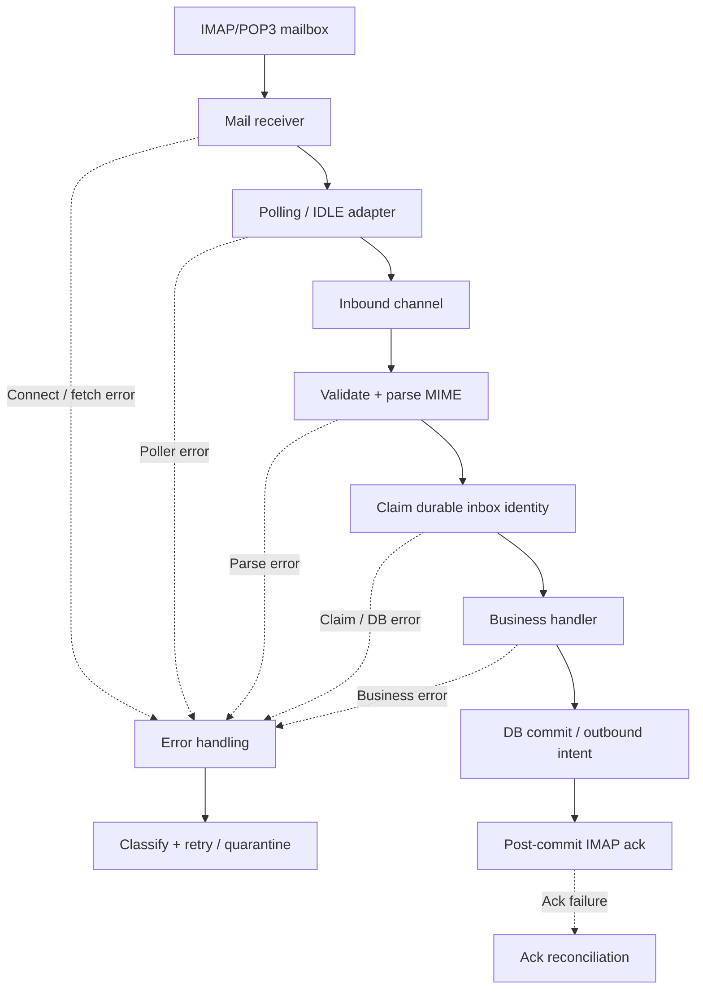
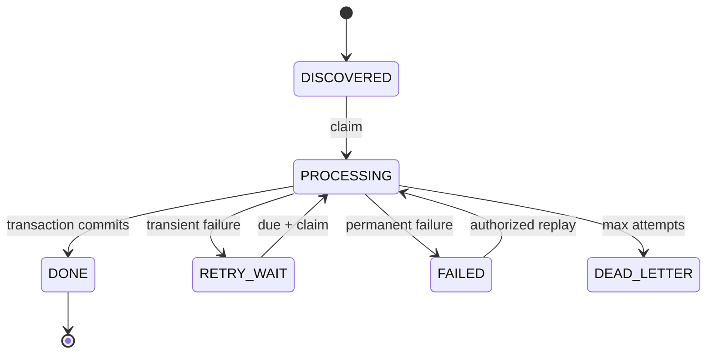
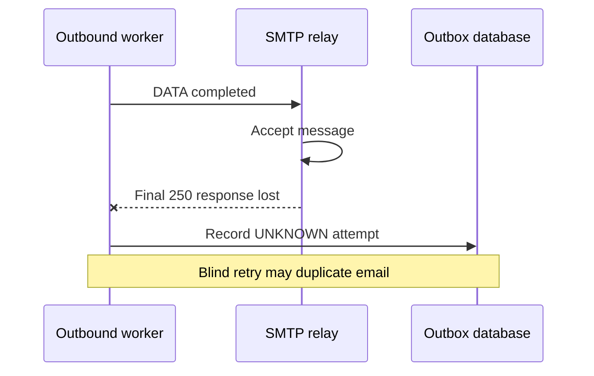

# Xử lý lỗi trong Integration flow

Khi xây dựng chức năng nhận hoặc gửi email bằng **Spring Integration Mail**, việc nối `ImapMailReceiver`, `MailReceivingMessageSource`, message channel và business handler thường khá gọn. Nhưng hệ thống chỉ thực sự đáng tin cậy khi xác định được **lỗi xảy ra ở bước nào, ai nhận lỗi, có nên retry, email đã bị đánh dấu đã đọc hay chưa, và liệu thao tác nghiệp vụ có bị thực hiện lặp lại hay không**.

Một email có thể đã được đọc từ IMAP nhưng thất bại khi parse MIME; có thể parse thành công nhưng không lưu được database; hoặc database đã commit nhưng một HTTP API khác timeout. Các lỗi này cần hành động khác nhau. Nếu cấu hình `errorChannel` không đúng, một exception có thể chỉ xuất hiện trong scheduler log; nếu retry không có giới hạn, một email “poison” có thể chiếm hết worker; nếu đánh dấu thư đã xử lý trước khi commit, một lỗi có thể làm mất thông điệp.

**Xử lý lỗi trong Integration flow** vì vậy không chỉ là thêm một khối `try/catch` quanh handler. Nó là một thiết kế end-to-end giữa **nguồn thư, channel, endpoint, error message, retry, state bền vững và acknowledgment**.

Bài viết nằm trong chương *Spring Integration Mail* của Spring Framework Mail, dùng Java 21, Spring Framework 6.x, Spring Integration 6.x / Spring Boot 3.x và Jakarta Mail. Các ví dụ về inbox, repository và notification ID là minh họa; API có thể khác nhẹ theo phiên bản được khóa trong dự án. Mục tiêu là hiểu đúng nguyên tắc để triển khai flow có thể kiểm soát, quan sát và phục hồi sau lỗi.

> **Nguyên tắc:** Lỗi của một email không được làm mất dấu xử lý, không tạo side effect trùng, và không khiến toàn bộ mailbox ngừng tiến triển. Một `ErrorMessage` chỉ là tín hiệu kỹ thuật; trạng thái có thể retry hay đã DONE phải được lưu và cập nhật theo hợp đồng nghiệp vụ.

## 1. Bản đồ một flow nhận thư



Các pha có trách nhiệm khác nhau:

| Pha | Ví dụ lỗi | Nơi xử lý phù hợp |
|---|---|---|
| Kết nối nguồn | IMAP AUTH, TLS, socket timeout | Poller/adapter error handling, circuit breaker theo mailbox |
| Fetch message | Folder đóng, UID không còn, network reset | Scan retry/checkpoint, không tạo business failure giả |
| Parse/validate | MIME malformed, charset sai, attachment quá lớn | Handler error classification, quarantine/dead-letter |
| Dedupe/claim | Unique conflict, database unavailable | Inbox repository và retry theo lease |
| Nghiệp vụ | Invoice invalid, thiếu quyền, DB conflict | Transaction/service error policy |
| Side effect ngoài | HTTP timeout, SMTP send fail | Outbox, provider retry/idempotency/reconciliation |
| ACK mailbox | Không set được SEEN hoặc MOVE | Retry acknowledgment, **không xử lý lại nghiệp vụ** |

Điểm cần nhớ: không phải lỗi nào cũng đã gắn với một email cụ thể. Một lỗi IMAP AUTH có thể xảy ra **trước khi có `Message<?>`**, nên error handler không được giả định luôn tìm thấy `failedMessage` hoặc UID.

## 2. Hiểu đúng error propagation trong Spring Integration

Spring Integration truyền các object `org.springframework.messaging.Message<?>` qua các channel và endpoint. Cách exception được chuyển đi phụ thuộc **channel đồng bộ hay bất đồng bộ** và **loại endpoint khởi tạo xử lý**.

### 2.1. Flow đồng bộ qua DirectChannel

Với một `DirectChannel`, subscriber xử lý ngay trên thread gửi:

```text
caller thread
  -> DirectChannel.send(message)
     -> handler.handleMessage(message)
        -> throws exception
  <- exception propagates to caller
```

Một exception trong handler thường truyền ngược qua call stack cho sender. **Đừng giả định mọi lỗi đồng bộ tự động được gửi tới global `errorChannel`**. Nếu caller là polling endpoint, poller có thể có `ErrorHandler` và publish một `ErrorMessage`. Nếu caller là code Java trực tiếp hoặc một gateway, chính caller/gateway contract quyết định cách xử lý.

### 2.2. Flow bất đồng bộ qua ExecutorChannel

Với `ExecutorChannel` hoặc channel sử dụng executor, việc gửi và xử lý có thể chạy trên hai thread:

```text
producer thread -> enqueue/submit task -> return

executor worker -> subscriber.handleMessage(...)
                     -> exception
                     -> error handling path
```

Lỗi từ worker không tự quay trở lại thread producer đã return. Spring Integration có cơ chế publish `ErrorMessage` qua error channel khi endpoint/task được cấu hình tương ứng; error channel có thể lấy từ header `errorChannel` của message hoặc từ default/global error channel theo context.

Việc một exception có vào được kênh lỗi hay không phải được kiểm chứng tại **ranh giới thực tế**. Không xem một cấu hình error channel như bảo đảm rằng bất kỳ đoạn Java `CompletableFuture`, thread tự tạo hoặc API ngoài nào cũng được nó bao phủ.

### 2.3. Polling endpoint

Poller chủ động gọi message source và chuyển message vào flow. Lỗi trong một polling cycle có thể xuất hiện ở:

- `receive()`: chưa lấy được mail.
- Handler downstream chạy đồng bộ: đã có message nhưng xử lý thất bại.
- Scheduler/executor: không thể schedule hoặc task bị từ chối.

Poller có thể cấu hình `ErrorHandler`/error channel để thông báo. Nhưng **lỗi xảy ra trước khi fetch message không nhất thiết có UID/Message-ID để retry theo message**; cần phân loại theo scope mailbox/poller.

### 2.4. IMAP IDLE adapter

IMAP IDLE liên tục quan sát thay đổi mailbox và giao message khi có thư. Khi network reset, server ngắt IDLE hoặc reconnect, adapter có thể phải phục hồi session. Các thông báo lỗi/exception trong cơ chế IDLE được xử lý theo endpoint và error channel tương ứng với phiên bản Spring Integration Mail.

Không suy ra IDLE đem lại exactly-once delivery. Reconnect có thể khiến message được thấy lại. Dù dùng polling hay IDLE, handler phải có khóa dedupe và logic idempotency như nhau.

### 2.5. Phân biệt lỗi và kết quả nghiệp vụ

Một email có nội dung không hợp lệ đôi khi là **business rejection được dự kiến**, không nhất thiết phải ném exception để poller retry mãi. Chẳng hạn hóa đơn trùng đã được xử lý:

```text
duplicate IMAP UID -> ALREADY_DONE -> no-op/optional ack
```

Đây là kết quả bình thường, không phải sự cố hệ thống. Một email bị xác định độc hại:

```text
untrusted MIME -> QUARANTINED -> audit -> no business effect
```

Đây có thể là kết quả có kiểm soát sau validation. Chỉ dùng exception khi nó giúp thể hiện đúng failure contract.

## 3. ErrorMessage là gì?

Trong Spring Messaging, `org.springframework.messaging.support.ErrorMessage` là một message chứa **`Throwable` làm payload**. Khi lỗi được đưa vào Spring Integration error flow, handler nhận object này và quyết định route/record/recover.

Ví dụ:

```java
import org.springframework.messaging.Message;
import org.springframework.messaging.MessagingException;
import org.springframework.messaging.support.ErrorMessage;

public void inspect(ErrorMessage error) {
    Throwable failure = error.getPayload();

    if (failure instanceof MessagingException messaging) {
        Message<?> failedMessage = messaging.getFailedMessage();
        // Có thể null, tùy nơi lỗi phát sinh.
    }

    Message<?> originalMessage = error.getOriginalMessage();
    // Có thể không có khi lỗi xảy ra trước khi nhận thư.
}
```

`ErrorMessage.getOriginalMessage()`, nếu có, cung cấp ngữ cảnh gốc; `MessagingException.getFailedMessage()` có thể chứa message bị lỗi. **Không dựa vào việc các field này luôn có mặt.** Nếu exception đã bị wrap nhiều tầng, có thể cần duyệt cause chain hoặc dùng correlation metadata do ứng dụng tự truyền theo flow.

### 3.1. Ba loại dữ liệu cần tách khi ghi lỗi

| Loại | Ví dụ | Cách dùng |
|---|---|---|
| Lỗi kỹ thuật | Exception class, failed component, phase | Phân loại transient/permanent |
| Danh tính message | mailbox ID, UIDVALIDITY, UID, inbox row ID | Retry/claim/ack đúng message |
| Danh tính nghiệp vụ | tenant ID, invoice ID, notification ID | Đảm bảo idempotency/không lặp side effect |

Các dữ liệu này không tự xuất hiện đầy đủ chỉ vì có `ErrorMessage`. Một flow production nên tạo envelope/headers an toàn sau khi nhận được stable IMAP identity và persist nó trước khi thực hiện side effects quan trọng.

### 3.2. ErrorMessage không phải email MIME

Tên gần giống nhưng không được nhầm:

- `jakarta.mail.Message` / `MimeMessage`: email nhận từ mailbox hoặc sắp gửi.
- `org.springframework.messaging.Message<?>`: message nội bộ của Spring Integration.
- `org.springframework.messaging.support.ErrorMessage`: message **báo lỗi** chứa Throwable.

Một integration message có thể có payload là `MimeMessage`, DTO nghiệp vụ hoặc bản tham chiếu stored content. Error flow không nên cast mọi payload sang `MimeMessage`, đặc biệt khi lỗi xảy ra ở poller hoặc khi payload đã được transform thành DTO.

## 4. Kênh lỗi: errorChannel toàn cục và kênh riêng

Spring Integration có convention cho error channel; trong một số cấu hình, `errorChannel` toàn cục là kênh xử lý lỗi mặc định. Nhưng sử dụng một kênh riêng cho inbound mail có thể giúp tách lỗi IMAP khỏi lỗi order/payment hoặc outbound SMTP.

### 4.1. Định nghĩa mailErrorChannel

```java
package com.example.mail.inbound;

import org.springframework.context.annotation.Bean;
import org.springframework.context.annotation.Configuration;
import org.springframework.integration.channel.DirectChannel;
import org.springframework.messaging.MessageChannel;

@Configuration(proxyBeanMethods = false)
public class MailErrorChannelConfiguration {

    @Bean(name = "mailErrorChannel")
    public MessageChannel mailErrorChannel() {
        return new DirectChannel();
    }
}
```

Với `DirectChannel`, error handler chạy đồng bộ khi error message được publish. Đây là một lựa chọn có kiểm soát cho ví dụ. Trong hệ thống thật, có thể chọn `PublishSubscribeChannel`, `ExecutorChannel` hoặc kênh bền vững tùy yêu cầu; cần hiểu backpressure, số subscriber và error propagation của từng loại.

### 4.2. Đăng ký handler cho ErrorMessage

```java
package com.example.mail.inbound;

import org.springframework.integration.annotation.ServiceActivator;
import org.springframework.messaging.support.ErrorMessage;
import org.springframework.stereotype.Component;

@Component
public final class InboundMailErrorHandler {

    private final InboundFailureRecorder recorder;

    public InboundMailErrorHandler(InboundFailureRecorder recorder) {
        this.recorder = recorder;
    }

    @ServiceActivator(inputChannel = "mailErrorChannel")
    public void handle(ErrorMessage error) {
        recorder.record(error);
    }
}
```

`InboundFailureRecorder` là application service cần tự triển khai. Nó phải phân loại lỗi, lấy identifier an toàn nếu có và cập nhật trạng thái bền vững theo chính sách. **Không chỉ gọi `logger.error(...)` rồi coi đã hoàn tất xử lý retry.**

### 4.3. Cấu hình poller error channel

Một cấu hình DSL minh họa:

```java
import java.time.Duration;

import org.springframework.context.annotation.Bean;
import org.springframework.integration.dsl.IntegrationFlow;
import org.springframework.integration.dsl.Pollers;
import org.springframework.integration.mail.MailReceivingMessageSource;

@Bean
IntegrationFlow inboundMailFlow(
        MailReceivingMessageSource mailSource) {

    return IntegrationFlow
            .from(mailSource,
                    spec -> spec.poller(
                            Pollers.fixedDelay(Duration.ofSeconds(10))
                                    .maxMessagesPerPoll(20)
                                    .errorChannel("mailErrorChannel")))
            .channel("inboundMailProcessing")
            .get();
}
```

Ví dụ giả định đã tạo bean `mailSource` (bằng IMAP/POP3 receiver được cấu hình đúng) và subscriber của `inboundMailProcessing`. Method names/DSL options có thể thay đổi theo phiên bản Spring Integration, nên khóa version và điều chỉnh khi tích hợp thực tế. Điểm cần học là **chỉ rõ error path ở poller** thay vì tin mọi lỗi sẽ tự đến một handler.

Với IMAP IDLE adapter, endpoint không được điều khiển bằng poller như trên; cần dùng đúng adapter configuration và error-channel capability tương ứng.

### 4.4. Header errorChannel

Spring Messaging định nghĩa header `errorChannel` để message có thể chỉ ra error destination trong các đường xử lý hỗ trợ. Nó có thể chứa tên channel hoặc channel object tùy API/convention.

Nhưng header này **không phải lệnh bắt mọi exception trong JVM**. Nếu code tự tạo thread và bỏ qua exception, hoặc một synchronous handler ném exception thẳng tới caller, header không tự biến lỗi thành `ErrorMessage`. Cần hiểu component publish exception nào và đặt test vào ranh giới đó.

### 4.5. Lỗi trong chính error handler

Nếu error handler cũng ném exception khi ghi database, hệ thống có thể xuất hiện secondary error hoặc làm poller log mà không ghi được failure state. Vì thế:

- Error handler phải hạn chế phụ thuộc nặng và có timeouts.
- Phân loại những lỗi có thể retry khi recorder/storage tạm unavailable.
- Không recursion vô hạn bằng cách gửi lại `ErrorMessage` vào chính channel lỗi.
- Có fallback telemetry/alert khi không ghi được failure state.
- Không coi log-only fallback là một bảo đảm đã lưu job bền vững.

Nếu lỗi xảy ra trước khi identity được persist, cần poll lại mailbox/checkpoint; nếu lỗi sau khi đã persist, retry dựa trên durable inbox row thay vì chỉ dựa vào error channel RAM.

## 5. Phân loại lỗi trước khi chọn retry

Một `ErrorMessage` không có nghĩa mọi lỗi có thể phục hồi bằng cách gọi handler lại. Hãy phân loại theo **bước xử lý, tính tạm thời, phạm vi và bằng chứng về side effect**.

| Nhóm | Ví dụ | Phạm vi | Hành động thường phù hợp |
|---|---|---|---|
| `MAILBOX_CONNECTION` | IMAP/POP3 AUTH fail, DNS, TLS | Cả mailbox/account | Backoff kết nối, cảnh báo secret/TLS |
| `MAILBOX_FETCH` | Socket reset khi đọc folder/body | Scan hoặc message | Retry fetch theo UID/checkpoint |
| `MIME_INVALID` | MIME malformed, charset không hợp lệ | Message | Quarantine, không retry vô hạn |
| `MIME_OVERSIZE` | File/message vượt policy | Message | Reject/quarantine, không tải lại vô hạn |
| `SECURITY_REJECTED` | Sender giả mạo, attachment nguy hiểm | Message/tenant | Dừng xử lý, audit, không side effect |
| `BUSINESS_INVALID` | Invoice ID sai, thiếu trường bắt buộc | Message/business key | FAILED/DEAD_LETTER, cần sửa nguồn |
| `BUSINESS_DUPLICATE` | Invoice đã commit theo business key | Business | No-op idempotent, có thể ACK |
| `DB_TRANSIENT` | Deadlock, DB tạm unavailable | Infrastructure | Retry có backoff sau rollback |
| `DOWNSTREAM_TRANSIENT` | HTTP 503, SMTP 4xx tạm | External service | Retry qua outbox, tránh giữ worker |
| `DOWNSTREAM_UNKNOWN` | Timeout sau side effect có thể thành công | Business/external | Reconcile hoặc idempotency key |
| `ACK_FAILED` | Set SEEN/MOVE sau DB commit thất bại | Mailbox/message | Retry ACK; không chạy lại business |
| `UNCLASSIFIED` | Exception chưa nhận diện | Chưa biết | Ghi trạng thái an toàn + alert |

Một lỗi authentication diện rộng không nên tăng attempt count cho hàng chục nghìn email chưa từng fetch. Ngược lại, một thư malformed không nên làm cả mailbox bị pause. Đúng **scope** là điều kiện để retry an toàn.

### 5.1. Một result model trung gian

```java
package com.example.mail.inbound;

public enum InboundErrorCategory {
    MAILBOX_CONNECTION,
    MAILBOX_FETCH,
    MIME_INVALID,
    MIME_OVERSIZE,
    SECURITY_REJECTED,
    BUSINESS_INVALID,
    BUSINESS_DUPLICATE,
    DB_TRANSIENT,
    DOWNSTREAM_TRANSIENT,
    DOWNSTREAM_UNKNOWN,
    ACK_FAILED,
    UNCLASSIFIED
}

public record InboundFailureDecision(
        InboundErrorCategory category,
        boolean retryable,
        boolean requiresManualReview,
        String safeReasonCode
) {}
```

Adapter/handler có thể lưu thêm attempt ID, inbox row ID và stage để giải thích quyết định. Không đặt raw `exception.getMessage()` vào `safeReasonCode` vì exception có thể chứa địa chỉ email, token, URL nhạy cảm hoặc thông tin máy chủ.

### 5.2. Classifier theo context thay vì theo tên exception đơn lẻ

Cùng một `IOException` có thể biểu thị:

- Đọc body từ IMAP bị reset: nên fetch lại theo UID.
- Đọc attachment staged trên object storage: nên retry xử lý job.
- Ghi file đính kèm ra vùng đĩa đầy: có thể cần pause worker/infrastructure.
- Kết nối external API bị cắt sau khi API đã nhận request: có thể UNKNOWN.

Vì vậy classifier cần thêm **stage** và metadata đã được xác thực. Không tự suy trạng thái accepted/failed của external side effect từ `SocketTimeoutException`.

### 5.3. Không bao phủ mọi lỗi bằng catch(Exception) rồi return

Đoạn code:

```java
try {
    businessProcessor.process(mail);
} catch (Exception failure) {
    logger.warn("Ignored mail failure", failure);
    return;
}
```

có thể làm adapter coi handler đã xử lý bình thường, khiến luồng ACK/SEEN tiếp tục và không có retry. Nếu business transaction chưa commit, email có thể bị mất khỏi luồng xử lý.

Cách tốt hơn là **đưa failure qua một đường có hợp đồng**: rollback transaction, lưu RETRY_WAIT/FAILED có điều kiện hoặc ném exception để error flow có đủ cơ hội xử lý. Chỉ trả bình thường khi lỗi đã được xử lý thành một trạng thái bền vững hợp lệ.

## 6. Retry ở đúng tầng: poller, handler, message hay external side effect?

“Bật retry cho toàn flow” nghe đơn giản nhưng có thể gây nhiều tác dụng phụ ngoài ý muốn. Phân biệt:

- **Poller connection retry:** mở lại Store/Folder khi IMAP không sẵn sàng; không có message identity.
- **Message fetch retry:** lấy lại cùng UID khi đọc body/attachment lỗi.
- **Handler retry:** chạy lại một bước parse/transform/business đã xác định.
- **Durable inbox retry:** chạy lại job ở lần polling/scheduling sau, qua restart.
- **Downstream retry:** gửi lại request tới database/HTTP/SMTP có idempotency riêng.
- **ACK retry:** cập nhật Seen/Move sau khi nghiệp vụ đã commit.

Một retry tầng handler không tự thực hiện được tất cả các việc khác.

### 6.1. Retry đồng bộ ngắn bằng RequestHandlerRetryAdvice

Spring Integration có `RequestHandlerRetryAdvice` giúp retry invocation của một message handler khi xảy ra exception. Nó dựa trên Spring Retry để xác định số lần thử, backoff và recovery callback.

Ví dụ bean policy:

```java
package com.example.mail.inbound;

import org.springframework.context.annotation.Bean;
import org.springframework.integration.handler.advice.RequestHandlerRetryAdvice;
import org.springframework.retry.backoff.ExponentialBackOffPolicy;
import org.springframework.retry.policy.SimpleRetryPolicy;
import org.springframework.retry.support.RetryTemplate;

public class MailRetryConfiguration {

    @Bean
    RequestHandlerRetryAdvice mailShortRetryAdvice() {
        RetryTemplate retryTemplate = new RetryTemplate();

        SimpleRetryPolicy retryPolicy = new SimpleRetryPolicy(3);
        ExponentialBackOffPolicy backOff =
                new ExponentialBackOffPolicy();
        backOff.setInitialInterval(250L);
        backOff.setMultiplier(2.0);
        backOff.setMaxInterval(2000L);

        retryTemplate.setRetryPolicy(retryPolicy);
        retryTemplate.setBackOffPolicy(backOff);

        RequestHandlerRetryAdvice advice =
                new RequestHandlerRetryAdvice();
        advice.setRetryTemplate(retryTemplate);
        return advice;
    }
}
```

Trong đoạn này, 3 lần nghĩa là **tổng số attempts** theo policy ví dụ, không phải “3 lần retry thêm sau attempt ban đầu”. Interval chỉ phục vụ retry ngắn, có kiểm soát; không phải policy dài hàng giờ cho một hộp thư chứa hàng triệu messages.

**Lưu ý quan trọng:** `SimpleRetryPolicy(3)` dạng này có thể retry nhiều loại exception nếu không cấu hình phân loại. Production cần chỉ retry lỗi được phép, không retry validation/security/permanent errors. Không dùng bean ví dụ này không chỉnh sửa cho mọi handler.

### 6.2. Gắn advice vào endpoint

Ví dụ Java DSL cho một handler:

```java
import org.springframework.context.annotation.Bean;
import org.springframework.integration.dsl.IntegrationFlow;
import org.springframework.integration.handler.advice.RequestHandlerRetryAdvice;

@Bean
IntegrationFlow inboundProcessingFlow(
        InboundMessageHandler handler,
        RequestHandlerRetryAdvice mailShortRetryAdvice) {

    return IntegrationFlow
            .from("inboundMailProcessing")
            .handle(handler,
                    spec -> spec.advice(mailShortRetryAdvice))
            .get();
}
```

Trong ví dụ, `InboundMessageHandler` là một bean triển khai Spring Messaging `MessageHandler` hoặc được adapt phù hợp với overload `handle(...)` của phiên bản DSL. Advice chain gắn với **handler endpoint**, không tự retry lỗi xảy ra trước đó trong IMAP receiver khi chưa có message. Nếu handler là một service method có cấu trúc khác, chọn overload DSL/annotation tương ứng.

### 6.3. Recovery khi hết attempts

Nếu retry của advice đã dùng hết budget, cần quyết định cách chuyển lỗi:

1. Ném lại để đi vào error path của caller/poller (phụ thuộc flow semantics).
2. Dùng recovery callback phù hợp để publish error sang channel.
3. Chuyển inbox row RETRY_WAIT/FAILED/DEAD_LETTER trong transaction an toàn.

Spring Integration có `ErrorMessageSendingRecoverer` dùng với recovery callback trong một số cấu hình:

```java
import org.springframework.integration.handler.advice.ErrorMessageSendingRecoverer;
import org.springframework.messaging.MessageChannel;

RequestHandlerRetryAdvice advice = new RequestHandlerRetryAdvice();
advice.setRetryTemplate(retryTemplate);
advice.setRecoveryCallback(
        new ErrorMessageSendingRecoverer(mailErrorChannel));
```

Đây là mẫu kết nối recovery callback tới error channel; các class/constructor cần đối chiếu theo Spring Integration version đã chọn khi triển khai. **Rất quan trọng:** recovery callback xử lý exception thành công có thể khiến upstream thấy handler đã hoàn thành. Vì vậy error consumer phải ghi được trạng thái thất bại/retry bền vững và không vô tình kích hoạt ACK như thể business DONE.

### 6.4. Retry ngắn giữ thread chờ

Synchronous advice backoff thường giữ worker trong chuỗi retry. Nếu SMTP/HTTP đã timeout dài hoặc provider yêu cầu chờ nhiều phút, để worker ngủ có thể chiếm hết thread pool.

Nên dùng:

```text
Transient DB conflict:
  at-most few short retries in the same handler

Mailbox connection outage:
  poller reconnect later, circuit breaker per mailbox

External provider rate limit / long retry:
  update nextAttemptAt in durable inbox/outbox, release worker
```

Nếu một side effect có thể đã thành công (timeout outcome UNKNOWN), retry chỉ được thực hiện khi có idempotency key/reconciliation phù hợp.

### 6.5. Không retry toàn flow nếu các bước không thuần

Giả sử:

```text
parse -> insert invoice -> send confirmation -> update status
```

Nếu đặt retry advice bao quanh toàn flow, lỗi ở bước cuối có thể chạy lại cả insert invoice và gửi confirmation. Cần chia thành transaction/idempotent steps:

```text
parse (pure)
  -> business DB transaction + inbox DONE + outbound outbox intent
  -> outbound worker handles SMTP retry
  -> optional IMAP ACK
```

Retry nên bao quanh **đơn vị công việc an toàn để lặp**, không chỉ “đoạn code có thể ném exception”.

## 7. Error channel không thay thế durable inbox

Trong flow nhận thư, một `ErrorMessage` tồn tại trong JVM có thể được publish tới channel. Nhưng JVM có thể crash ngay sau khi publish hoặc trước khi handler ghi lỗi vào database. Nếu cần bảo đảm không mất email, phải có **durable state**.

Một mô hình inbox tối thiểu:

```sql
CREATE TABLE inbound_mail (
    id BIGSERIAL PRIMARY KEY,
    mailbox_id VARCHAR(120) NOT NULL,
    folder_name VARCHAR(255) NOT NULL,
    uid_validity BIGINT NOT NULL,
    imap_uid BIGINT NOT NULL,
    status VARCHAR(24) NOT NULL,
    attempts INTEGER NOT NULL DEFAULT 0,
    lease_token UUID,
    lease_until TIMESTAMPTZ,
    next_attempt_at TIMESTAMPTZ,
    error_category VARCHAR(64),
    last_error_code VARCHAR(80),
    processed_at TIMESTAMPTZ,
    UNIQUE (mailbox_id, folder_name, uid_validity, imap_uid)
);
```

Các column là schema minh họa cho IMAP. POP3 cần khóa `UIDL` theo mailbox (không dùng UIDVALIDITY). Unique index là cần thiết vì hai replicas có thể cùng nhận một message.

### 7.1. State machine đơn giản



Một state machine production có thể thêm ACK_PENDING, QUARANTINED, CANCELLED hoặc các transition khác. Điểm quan trọng là `DONE` nghĩa **business effect đã commit theo hợp đồng**, không chỉ “handler đã được gọi” hoặc “IMAP đã trả message”.

### 7.2. Unique constraint và atomic claim

Khi hai pollers cùng thấy một IMAP UID:

```text
worker A: INSERT inbox identity
worker B: INSERT same identity
DB unique constraint: only one persisted identity
worker A: claim PROCESSING
worker B: claim rejected / sees leased state
```

Chỉ `SELECT` rồi `INSERT` không đủ chống race. Với PostgreSQL, dùng `INSERT ... ON CONFLICT DO NOTHING` hoặc cơ chế tương đương, sau đó claim bằng conditional update/row locking.

### 7.3. Lease token khi nhiều workers

Một worker nên claim row có lease owner/token. Khi ghi DONE hoặc RETRY_WAIT:

```sql
UPDATE inbound_mail
SET status = 'DONE',
    processed_at = NOW(),
    lease_token = NULL,
    lease_until = NULL
WHERE id = :id
  AND status = 'PROCESSING'
  AND lease_token = :leaseToken;
```

Nếu update 0 rows, worker có thể đã mất quyền xử lý. Không ghi đè state của owner mới. Lease bảo vệ state update, **không** thu hồi side effect bên ngoài như HTTP request đã được nhận.

### 7.4. Lỗi handler phải để lại trạng thái có thể phục hồi

Khi exception xuất hiện:

```text
Message key known, inbox row PROCESSING
  -> classify error
  -> if transient: RETRY_WAIT + nextAttemptAt
  -> if permanent: FAILED / QUARANTINED
  -> if poison: DEAD_LETTER
  -> if unknown external outcome: UNKNOWN / reconciliation
```

Nếu ghi failure state thất bại do DB outage, không ACK mailbox; lease hết hạn hoặc scan lại sẽ tạo cơ hội recovery. Đừng coi một log warning đã giải quyết xong lỗi.

## 8. Xác định email nào bị lỗi

Một `ErrorMessage` có thể chứa `failedMessage`, nhưng thông tin đó chưa chắc đủ để tìm lại đúng message từ mailbox. Trong IMAP:

\[
K_{\mathrm{IMAP}} =
(\mathrm{mailboxId},\mathrm{folder},\mathrm{UIDVALIDITY},\mathrm{UID})
\]

Đây là identity kỹ thuật được xác định trong phạm vi folder và UID epoch. Đừng dùng `Message.getMessageNumber()` làm ID bền vững vì sequence number có thể thay đổi khi expunge; đừng chỉ dùng header `Message-ID` vì nó do sender gán, có thể thiếu/trùng/bị giả mạo.

### 8.1. Source identity object

```java
package com.example.mail.inbound;

public record ImapSourceIdentity(
        String mailboxId,
        String folderName,
        long uidValidity,
        long uid
) {}
```

Khi receiver đã mở folder, có thể lấy UID bằng `jakarta.mail.UIDFolder`:

```java
UIDFolder uidFolder = (UIDFolder) folder;
long uidValidity = uidFolder.getUIDValidity();
long uid = uidFolder.getUID(mailMessage);

ImapSourceIdentity identity = new ImapSourceIdentity(
        mailboxId, folder.getFullName(), uidValidity, uid);
```

`folder` phải thực sự hỗ trợ UID semantics, và UID phải là giá trị hợp lệ. Không assume POP3 `Folder` có thể cast sang `UIDFolder`: POP3 có UIDL qua implementation-specific support và policy riêng.

### 8.2. Gắn correlation metadata có kiểm soát

Sau khi identity được xác định, một flow có thể chuyển sang payload nội bộ:

```java
public record ReceivedMailReference(
        long inboxRowId,
        ImapSourceIdentity source,
        String stagedContentKey
) {}
```

Thay vì đưa toàn bộ `MimeMessage` qua async queue, lưu reference tới nội dung đã staged và metadata đã persist. Khi lỗi:

```text
error + inboxRowId
  -> load durable row
  -> verify current state and lease
  -> apply retry/dead-letter decision
```

Điều này đặc biệt quan trọng khi handler ở một thread khác, còn IMAP `Folder` đã đóng. Đối tượng Jakarta Mail Message có thể phụ thuộc kết nối Store/Folder; queue một object live rồi đóng session là nguồn lỗi khó tái hiện.

### 8.3. Không bám vào Message-ID như khóa exception

Một `ErrorMessage` có failed Spring Message chứa MIME header `Message-ID` nhưng không có UID. Nếu handler tìm bằng Message-ID, có thể match sai bản thư. Chỉ dùng Message-ID để telemetry/đối chiếu khi đã biết rằng nguồn gửi có semantics phù hợp; để retry mailbox hãy ưu tiên identity từ IMAP/POP3 adapter và durable row.

## 9. Transaction và thời điểm ACK mail server

IMAP `\Seen` hoặc thao tác MOVE/DELETE **không thuộc cùng transaction** với database của Spring. Vì vậy, quyết định thời điểm cập nhật mailbox là then chốt.

Một flow nên có thứ tự:

```text
1. Fetch/discover stable message identity.
2. Claim inbox row (durable, lease).
3. Parse and validate.
4. BEGIN DB transaction:
     - apply idempotent business effect
     - insert outbound outbox intent if needed
     - mark inbound row DONE
   COMMIT
5. Best-effort mailbox acknowledgement: SEEN / MOVE.
```

### 9.1. Đánh dấu SEEN trước commit có thể làm mất email

```text
Set IMAP \Seen
  -> parse content
  -> database insert fails
  -> next poll searches only UNSEEN
  -> message disappears from processing candidates
```

Không coi `UNSEEN` là source of truth. Người dùng hoặc mail client khác có thể thay đổi Seen, và một số hoạt động fetch có thể tác động flags tùy implementation/cấu hình.

### 9.2. Commit DONE trước ACK có thể làm xuất hiện duplicate observation

```text
DB invoice + inbound DONE commit
  -> IMAP set SEEN fails
  -> next poll sees the same UID
  -> load inbox row: DONE
  -> skip business side effect
  -> optionally retry ACK
```

Đây là **hành vi đúng**: chấp nhận việc thấy lại message để bảo vệ nghiệp vụ. Nếu error handler nhận lỗi của ACK, nó phải cập nhật ACK_PENDING hoặc chạy reconciliation, **không chuyển inbox DONE về PROCESSING**.

### 9.3. Ví dụ transaction xử lý nghiệp vụ

```java
package com.example.mail.inbound;

import java.util.UUID;

import org.springframework.stereotype.Service;
import org.springframework.transaction.annotation.Transactional;

@Service
public final class InboundInvoiceTransaction {

    private final InboundMailRepository inbox;
    private final InvoiceRepository invoices;
    private final OutboxRepository outboundOutbox;

    public InboundInvoiceTransaction(
            InboundMailRepository inbox,
            InvoiceRepository invoices,
            OutboxRepository outboundOutbox) {
        this.inbox = inbox;
        this.invoices = invoices;
        this.outboundOutbox = outboundOutbox;
    }

    @Transactional
    public void commit(
            long inboxRowId,
            UUID leaseToken,
            ParsedInvoice invoice) {

        if (!inbox.isOwnedBy(inboxRowId, leaseToken)) {
            throw new StaleInboundLeaseException();
        }

        invoices.insertIfAbsent(
                invoice.tenantId(),
                invoice.externalInvoiceId(),
                invoice.totalAmount());

        outboundOutbox.insertIfAbsent(
                invoice.tenantId(),
                "invoice-accepted:" + invoice.externalInvoiceId(),
                invoice.recipientId());

        int updated = inbox.markDoneIfOwned(
                inboxRowId, leaseToken);

        if (updated != 1) {
            throw new StaleInboundLeaseException();
        }
    }
}
```

Các repository, `ParsedInvoice` và `StaleInboundLeaseException` là abstraction của ứng dụng. Database cần unique business key, ví dụ tenant + external invoice ID, và unique outbox key để không gửi notification trùng. Khi `markDoneIfOwned` fail, exception phải rollback **cả invoice insert và outbox insert**, với điều kiện cả ba repository thực sự cùng transaction manager/resource.

`@Transactional` chỉ có tác dụng qua Spring proxy/transaction infrastructure; self-invocation có thể bypass proxy. Parse MIME/đọc attachment không nên giữ transaction DB mở trong thời gian dài.

### 9.4. Không gọi SMTP ngay giữa transaction inbound

Anti-pattern:

```java
@Transactional
public void processMail(ParsedInvoice invoice) {
    invoiceRepository.save(...);
    javaMailSender.send(...);
    inboxRepository.markDone(...);
}
```

Nếu SMTP relay accepted rồi database rollback, email đã gửi không thể thu hồi. Retry inbound có thể gửi lại. Tốt hơn là commit **outbound intent** cùng invoice + inbound DONE, rồi outbound worker gửi riêng với policy retry/idempotency.

### 9.5. Nếu một message chứa nhiều business commands?

Ví dụ một MIME email có 10 attachment, mỗi attachment là một invoice. Cần quy định atomicity:

- Cả 10 invoice phải commit hoặc rollback cùng nhau?
- Hay mỗi attachment có business key/state riêng và được xử lý độc lập?

Nếu chỉ mark inbox DONE sau khi xử lý được 7/10 nhưng 3 thất bại, retry toàn email có thể xử lý lặp 7 invoice đầu. Chọn transaction hoặc per-item idempotency tương ứng, lưu trạng thái đủ để hồi phục. Không đánh dấu DONE nếu business contract còn công việc chưa hoàn tất.

## 10. Quarantine và dead-letter cho poison messages

Một email malformed hoặc nguy hiểm có thể gây exception mỗi lần poll. Nếu retry vô hạn, một thư có thể chặn hàng đợi và làm metric lỗi tăng không ngừng. Error flow nên hỗ trợ **quarantine** hoặc **dead-letter state**.

### 10.1. Khác retryable với permanent

```text
MIME parse fails due to temporary storage problem:
  RETRY_WAIT + backoff

MIME violates configured max size:
  QUARANTINED + safe reason

Business schema is permanently invalid:
  FAILED / DEAD_LETTER with audit

Repeated DB deadlock:
  RETRY_WAIT until retry budget reached
```

Trong trường hợp file/mime độc hại, không tiếp tục mở hoặc render nội dung chỉ để lấy screenshot/log phục vụ debugging. Lưu evidence đã lọc và file ở khu vực cách ly có quyền truy cập chặt.

### 10.2. Không xóa nguồn trước khi quarantine bền vững

Một flow sai:

```text
read email -> delete from IMAP -> try to store quarantine -> DB fails
```

Nếu thư đã bị expunge, nguồn dữ liệu có thể mất. Quy trình an toàn hơn:

```text
read identity + bounded content
  -> persist quarantine record/staged blob
  -> commit state QUARANTINED
  -> optional IMAP MOVE to quarantine folder
```

Nếu MOVE fail, lần poll sau nhìn thấy trạng thái QUARANTINED và không xử lý nghiệp vụ. Nếu MOVE sang folder khác tạo UID mới, phải có quy tắc nhận diện source/business correlation, không coi UID mới là một command khác.

### 10.3. Operator replay có kiểm soát

Khi sửa parser hoặc rule, operator có thể replay một dead-letter message. Cần:

- Kiểm tra quyền và ghi audit.
- Giữ một replay ID, người yêu cầu, thời gian, nguyên nhân.
- Không bỏ qua validation/authorization vì “đây là replay”.
- Giữ idempotency key và business unique constraint.
- Dùng lease/fencing token để tránh replay đụng worker đang chạy.
- Không tự động replay hàng nghìn thư poison sau khi deploy nếu chưa đánh giá tải.

Replay nên tạo attempt mới trên **cùng inbound identity** hoặc một work item có liên kết rõ, không tùy tiện xóa record DONE/FAILED để hệ thống quên lịch sử.

### 10.4. Lỗi parse cần có ngân sách tài nguyên

Khi nhận MIME, phải giới hạn:

- Tổng bytes message được fetch/stage.
- Số attachment/parts và độ sâu multipart.
- Thời gian parse và tổng processing deadline.
- Kích thước file đã giải nén và tổng bytes trích xuất.
- Content types cho phép, đánh giá thực tế không chỉ header khai báo.
- Tài nguyên antivirus/sandbox và giới hạn file lồng nhau.
- Số job đồng thời từ cùng mailbox/tenant.

Không gọi `readAllBytes()` trên stream attachment không tin cậy không giới hạn. Nếu dùng OCR hoặc virus scan ở service ngoài, kết quả timeout cần có retry/quarantine policy riêng.

## 11. Lỗi mailbox nguồn: khác lỗi trong handler

Lỗi từ `ImapMailReceiver` hoặc POP3 source đôi khi xảy ra trước bất kỳ message nào được tạo. Error flow lúc này phải xử lý theo **mailbox/account scope**.

### 11.1. IMAP authentication failure

```text
Poll: connect mailbox
Server: AUTH rejected
No MimeMessage fetched
```

Hành động:

1. Ghi mailbox ID, error category AUTH, timestamp; không log password.
2. Kiểm tra secret/credential rotation, TLS policy và account restrictions.
3. Tạm dừng hoặc backoff mailbox connection attempts theo policy.
4. Không đánh dấu bất kỳ email nào FAILED, vì chưa có email cụ thể.
5. Sau khi sửa cấu hình, tiếp tục scan từ checkpoint/UID phù hợp.

Không để một account hỏng làm nghẽn tất cả mailbox nếu ứng dụng nhận từ nhiều account.

### 11.2. Timeout khi fetch

Nếu IMAP socket reset khi đọc một UID:

```text
Known mailbox + UID, content not fully staged
  -> record fetch failure
  -> retry UID when connection healthy
  -> do not mark DONE or SEEN as business acknowledgment
```

Nếu server expunge message trong lúc fetch, cần phân loại `SOURCE_GONE` hoặc reconciliation riêng. Không tự tạo business effect từ nội dung chưa parse đầy đủ.

### 11.3. UIDVALIDITY thay đổi

IMAP UID có phạm vi trong **folder và UIDVALIDITY epoch**. Nếu UIDVALIDITY đổi sau migration/restore, cursor cũ không thể áp dụng nguyên xi. Error handler/scan coordinator nên:

- Ghi sự kiện UIDVALIDITY_CHANGED.
- Mở scan epoch mới theo một quy trình kiểm soát.
- Không xóa luôn inbox history của epoch trước.
- Re-discover thư ở epoch mới với identity mới.
- Dùng business idempotency để tránh tác dụng phụ lặp với thư restore.
- Quan sát reprocessing volume và oldest-unprocessed age.

Đây là vấn đề nguồn dữ liệu/checkpoint, không phải một `MessagingException` thông thường có thể sửa bằng retry cùng UID cũ mãi.

### 11.4. POP3 có UIDL, không có SEEN như IMAP

POP3 maildrop thường dùng UIDL để dedupe khi server/provider hỗ trợ. Không cast POP3 Folder sang `UIDFolder` rồi giả định có IMAP UIDVALIDITY. POP3 message sequence number cũng có thể thay đổi sau xóa. Khi lỗi POP3 xảy ra trước khi cleanup, việc giữ thư trên server và durable UIDL table cho phép retry; không thực hiện DELE/QUIT cleanup trước khi business commit.

## 12. Poller tiếp tục hoạt động khi một email lỗi

Một email xấu không nên khiến mọi lượt poll tiếp theo ngừng. Nhưng cách khôi phục phải phân biệt:

- **Processing error per message:** ghi FAILED/RETRY_WAIT, tiếp tục với message khác.
- **Mailbox connection error:** tạm dừng scan mailbox đó có backoff, không đánh dấu tất cả messages xấu.
- **Database unavailable:** không tiếp tục ACK/drop messages; giảm tốc/giám sát chờ DB phục hồi.
- **Global resource overload:** backpressure, hạn chế concurrency/queue, không nhận thêm job vào RAM vô hạn.

Nếu code bắt mọi exception trong vòng lặp rồi continue mà **không** ghi outcome, cùng poison message sẽ bị thử lại ở mỗi poll; log tăng nhưng hệ thống không tiến triển.

### 12.1. Xử lý batch có giới hạn

Giả sử một poll nhận 100 messages. Không nên:

```text
message #1 invalid -> whole batch fails -> 99 messages never reach handler
```

cũng không nên:

```text
message #1 invalid -> catch+swallow, mark whole batch complete
```

Một kiến trúc phù hợp là persist/discover identities độc lập (hoặc batch transaction có thể recovery) rồi claim/process từng inbox row, mỗi row có status/attempts riêng. Nhờ đó lỗi một message không làm mất hoặc chặn các message khác.

### 12.2. Đừng dùng in-memory queue không giới hạn làm nơi giữ mail lỗi

Nếu lỗi downstream làm chậm handler, gửi mọi message vào một `ExecutorChannel` với executor/queue quá lớn có thể làm cạn heap và mất job khi restart. Dùng bounded executor kết hợp durable inbox/outbox; khi đầy, không claim thêm quá số slot hoặc trả work item về trạng thái chờ có deadline.

## 13. Error handling trong outbound mail Integration flow

Spring Integration Mail không chỉ có inbound adapter; ứng dụng còn có thể tạo **outbound flow** đẩy message tới SMTP sender. Đây là một ranh giới lỗi khác:

```text
Business event / outbound outbox
  -> enrich recipients + render template
  -> MailSendingMessageHandler / SMTP adapter
  -> JavaMailSender / Jakarta Mail
  -> SMTP relay
```

Cần phân biệt:

1. **Template/preparation failure:** input thiếu, HTML template không tồn tại, attachment resource lỗi.
2. **SMTP submission failure:** connection, TLS, AUTH, MAIL FROM, RCPT TO, DATA, timeout.
3. **Post-acceptance delivery failure:** relay accepted nhưng downstream trả bounce/deferred/complaint qua event khác.

### 13.1. Spring Mail exception ở outbound flow

Những exception Spring Mail thường gặp gồm:

| Exception | Tín hiệu | Hướng xử lý |
|---|---|---|
| `MailParseException` | Lỗi address/message parse | Validate dữ liệu, tránh retry dữ liệu sai |
| `MailPreparationException` | Lỗi khi dựng message | Sửa template/resource, phân biệt permanent/transient |
| `MailAuthenticationException` | AUTH bị từ chối | Pause account/alert, không retry từng recipient vô hạn |
| `MailSendException` | Một/một số message không gửi được | Kiểm tra cause, provider reply, recipient scope |

Trong Spring Integration, exception có thể được bọc thêm trong `MessagingException` để kèm failed Spring message. Nếu exception xảy ra ở adapter outbound, xử lý bằng `errorChannel`/advice cần dựa vào semantics channel và endpoint tương ứng.

### 13.2. SMTP accepted không đồng nghĩa delivered

`JavaMailSender.send(...)` không ném exception thường nghĩa transport đã hoàn thành theo hợp đồng sender, ví dụ SMTP relay accepted ở cuối DATA. Nó **không** chứng minh thư vào Inbox. Bounce và complaint có thể đến sau qua provider event/webhook.

Không gộp những trạng thái này:

```text
OUTBOUND_QUEUED
OUTBOUND_ATTEMPTING
SUBMISSION_ACCEPTED
SUBMISSION_REJECTED
SUBMISSION_UNKNOWN
DOWNSTREAM_DELIVERED
DOWNSTREAM_BOUNCED
```

Các state chỉ là ví dụ: app có thể dùng tên khác. Điểm cần giữ là phân biệt **submit result** với **delivery result**.

### 13.3. Timeout sau SMTP DATA có thể tạo duplicate



Nếu error flow nhìn mọi `MailSendException` rồi retry ngay, cùng email có thể được gửi hai lần. Cần policy phân loại theo phase/bằng chứng; khi không biết relay đã nhận hay chưa, ghi `UNKNOWN` và cân nhắc duplicate risk. Không suy pha từ `SocketTimeoutException` đơn lẻ nếu không có instrumentation.

### 13.4. Tách outbound retry ra khỏi inbound handler

Một inbound flow nhận email đơn hàng có thể cần gửi xác nhận. Trình tự tốt:

```text
Inbound email
  -> validate/claim
  -> DB transaction:
       save order
       mark inbound DONE
       insert outbound mail intent
  -> commit

Outbound worker
  -> render and SMTP submit
  -> track attempt/retry
```

Khi SMTP outage, inbound order đã commit không bị rollback, và email xác nhận có thể gửi lại qua outbound outbox. Nếu inbound handler trực tiếp gọi SMTP trong transaction, lỗi outbound có thể làm lặp nghiệp vụ inbound hoặc gửi duplicate sau rollback.

### 13.5. Lỗi hàng loạt và từng người nhận

Một outbound message với nhiều recipients có thể được chấp nhận một phần tại RCPT TO. Một exception ở cấp message không có nghĩa tất cả recipients chưa nhận. Nếu nghiệp vụ cần retry chính xác, dùng một notification/recipient hoặc persist per-recipient attempt outcome theo contract của SMTP implementation.

## 14. Gateway: error channel không thay thế HTTP error contract

Khi một controller hoặc application service gọi một Spring Integration **gateway**, luồng có thể đồng bộ hoặc bất đồng bộ. Nếu gateway đồng bộ và downstream handler ném exception, exception có thể quay về gateway caller theo gateway error mapping.

Ví dụ định hướng:

```text
HTTP POST /inbound-actions
  -> messaging gateway
  -> DirectChannel
  -> business service
  -> exception
  -> gateway caller
  -> HTTP error mapping
```

Không luôn đúng khi nói “đã cấu hình global errorChannel nên HTTP sẽ không bao giờ nhận exception”. Cần biết gateway, reply channel, error channel và timeout semantics của đúng endpoint.

### 14.1. Phản hồi HTTP đúng trạng thái

Nếu API chỉ commit inbox/outbox intent thì có thể trả “đã tiếp nhận”, kèm tracking ID; chưa thể nói email đã gửi. Nếu hệ thống không ghi được intent do overload/DB outage, phải trả một lỗi theo contract (ví dụ 503 với retry guidance thích hợp), không trả thành công rồi im lặng bỏ task.

### 14.2. Error channel với asynchronous gateway

Một gateway hoặc flow có async boundary không nhất thiết giao exception qua call stack ban đầu. Cần future/completion signal, error channel hoặc durable status lookup. Nếu client cần biết kết quả lâu dài, một tracking endpoint dựa trên database ổn định hơn là chờ mãi một future trong JVM.

### 14.3. Reply timeout khác business failure

Gateway reply timeout có thể xảy ra khi flow xử lý quá lâu hoặc response bị mất, trong khi side effect đã được commit. Không mặc định retry toàn bộ business operation chỉ vì client timeout. Dùng request idempotency key và status reconciliation.

## 15. Lưu trữ lỗi đáng tin cậy: ErrorMessage là sự kiện, không phải sổ cái

Một error channel có thể có một hoặc nhiều subscribers, nhưng không phải mọi channel có durability. Ví dụ:

- `DirectChannel`: handler xử lý đồng bộ, lỗi handler có thể truyền ngược.
- `PublishSubscribeChannel`: phát tới nhiều subscriber theo cơ chế của channel; cần hiểu lỗi của subscriber.
- `ExecutorChannel`: task được chạy bất đồng bộ, có giới hạn executor/queue và quy tắc xử lý lỗi riêng.
- `QueueChannel`: hàng đợi trong memory trừ khi được cấu hình với store phù hợp; không tự là durable inbox.

Không chuyển tất cả `ErrorMessage` vào một queue RAM không giới hạn rồi xem đó là giải pháp retry. Process crash có thể mất message trong queue và heap có thể cạn khi mail source liên tục lỗi.

### 15.1. Ghi failure state theo phase

Một record có thể gồm:

```text
inboxId          = 9042
mailboxId        = billing-inbound-prod
stage            = MIME_PARSE
category         = MIME_INVALID
attempt          = 3
retryable        = false
nextAttemptAt    = null
status           = DEAD_LETTER
safeReasonCode   = MALFORMED_MULTIPART
occurredAt       = 2026-11-12T09:00:00Z
```

Không lưu `Throwable` bằng Java serialization vào database như một API ổn định. Exception có thể mang object graph lớn, connection references, header/PII, hoặc thay class giữa các phiên bản thư viện. Lưu dữ liệu có schema riêng, một số trace đã redaction khi cần.

### 15.2. Điều kiện để coi lỗi đã được “handled”

Error handler chỉ nên trở về thành công nếu đã:

- Ghi trạng thái nghiệp vụ an toàn, **hoặc**
- Giao công việc cho một storage/queue bền vững theo contract, **hoặc**
- Xác nhận một kết quả không cần retry như ALREADY_DONE, QUARANTINED.

Nếu recorder DB fail và không có fallback bền vững, ném exception/đánh tín hiệu hệ thống thất bại là trung thực hơn so với swallow và mark DONE. Cần bảo đảm poller/adapter không ACK message một cách vô ý trong tình huống này.

### 15.3. Dead-letter nội dung hay tham chiếu?

Lưu toàn bộ email raw MIME/attachment trong dead-letter có thể tăng chi phí và rò rỉ PII. Có thể lưu:

- Mailbox ID và IMAP source identity.
- Staged content reference có ACL và encryption at rest.
- Mã lỗi/phase/attempt count.
- Checksum/fingerprint để phát hiện hỏng content khi lưu.
- Thời hạn retention/quarantine.

Nếu mailbox sẽ xóa thư sớm, chỉ lưu UID mà không stage nội dung có thể khiến replay bất khả thi. Chọn retention và staging theo yêu cầu nghiệp vụ/bảo mật.

## 16. Observability cho Integration flow

Một error flow có ích phải cho operator trả lời được: **message nào lỗi, lỗi ở stage nào, có bị kẹt không, và trạng thái retry/ACK hiện nay là gì**.

| Metric / tín hiệu | Ý nghĩa |
|---|---|
| Poll attempts, success, failure theo mailbox | Mail source có khả dụng không |
| Last successful receive / UID cursor | Có tiếp tục phát hiện thư không |
| Inbound error count theo category/stage | MIME, DB, business hay source đang lỗi |
| ErrorChannel publish/handler failures | Lỗi có bị rơi ở đường báo lỗi không |
| DISCOVERED/PROCESSING/RETRY_WAIT/DONE | Pipeline có tiến triển không |
| Oldest due inbox age | Thư chờ lâu vượt SLA |
| Lease expirations/reclaims | Worker crash hoặc processing quá lâu |
| Retry count và dead-letter rate | Poison messages, downstream instability |
| ACK pending/failed | Mailbox flags chưa nhất quán với DB |
| DB idempotency conflicts | Duplicate observations hoặc business duplicates |
| SMTP submit p95/4xx/5xx/unknown | Outbound integration flow có khỏe không |
| Executor queue depth/rejected submissions | Backpressure đã chạm trần chưa |

### 16.1. Correlation fields

Ví dụ log có cấu trúc:

```text
event=inbound_error_recorded
mailboxId=billing-inbound-prod
folder=INBOX
uidValidity=829311
uid=2048
inboxId=9042
attemptId=IN-3
stage=MIME_PARSE
category=MIME_INVALID
outcome=DEAD_LETTER
```

Không log nguyên `ErrorMessage`/`failedMessage` nếu payload có raw MIME, attachment, token hoặc email cá nhân. Sử dụng inbox ID/attempt ID cho log/tracing, không làm metric label có cardinality cao.

### 16.2. Không alert chỉ vì “đã thấy duplicate”

Một message DONE xuất hiện lại trong poll là điều dự kiến; nó được skip/ack bằng dedupe. Cần phân biệt:

- Duplicate observation: cùng source UID được nhìn lại.
- Duplicate processing attempt: một inbox row có nhiều attempts do retry/recovery.
- Duplicate business effect: cùng command tạo side effect lặp ngoài contract.

Chỉ chỉ số cuối cùng mới là lỗi idempotency nghiêm trọng; hai chỉ số đầu có thể là dấu hiệu để tối ưu nhưng không tự là incident.

### 16.3. Alert khi error handler chính nó thất bại

Một failure recorder unavailable có thể làm cả pipeline không giữ được outcome. Cần theo dõi:

- Error channel handler exception rate.
- Số PROCESSING lease hết hạn.
- Inbox rows không có progress.
- Poller paused/dropped subscriptions.
- Queue/retry backlog tăng.

Nếu DB unavailable, ưu tiên dừng ACK và giảm tốc polling thay vì tiếp tục nhận thư rồi bỏ lỗi; khi DB phục hồi, scan/checkpoint cần cho phép replay có kiểm soát.

## 17. Kiểm thử lớp ErrorMessage handler

Một unit test có thể tự tạo `MessagingException` với failed Spring Message rồi gọi error handler. Điều này kiểm tra **classifier và recorder**, không kiểm chứng poller tự publish error.

Ví dụ:

```java
import static org.junit.jupiter.api.Assertions.*;
import static org.mockito.Mockito.*;

import org.junit.jupiter.api.Test;
import org.springframework.messaging.Message;
import org.springframework.messaging.MessagingException;
import org.springframework.messaging.support.ErrorMessage;
import org.springframework.messaging.support.MessageBuilder;

class InboundMailErrorHandlerTest {

    @Test
    void forwardsFailureWithFailedMessageContext() {
        InboundFailureRecorder recorder =
                mock(InboundFailureRecorder.class);
        InboundMailErrorHandler handler =
                new InboundMailErrorHandler(recorder);

        Message<String> failed = MessageBuilder
                .withPayload("inbox-row-9042")
                .setHeader("inboxRowId", 9042L)
                .build();

        MessagingException failure =
                new MessagingException(
                        failed, "Simulated parsing failure");

        ErrorMessage error = new ErrorMessage(failure);
        handler.handle(error);

        verify(recorder).record(error);
        assertSame(
                failed,
                ((MessagingException) error.getPayload())
                        .getFailedMessage());
    }
}
```

Đây là test boundary của error handler. Test riêng cần xác minh `InboundFailureRecorder.record(...)` phân loại lỗi và lưu đúng state/lease; chỉ `verify(record(error))` không chứng minh transactional safety.

### 17.1. Null failedMessage vẫn phải xử lý

Ví dụ:

```java
ErrorMessage error = new ErrorMessage(
        new IllegalStateException("Mailbox disconnected"));

handler.handle(error);
```

Handler không được throw `NullPointerException` khi không có message context. Với lỗi connection, ghi lỗi ở scope mailbox/endpoint từ context đáng tin nếu có; nếu không có, ghi UNCLASSIFIED và alert thay vì invent UID.

### 17.2. Test classification độc lập

Ví dụ các unit cases:

| Input | Expected decision |
|---|---|
| MIME size vượt policy | Permanent/quarantine, không retry vô hạn |
| Database deadlock | Retryable có backoff |
| Business key đã tồn tại | Idempotent ALREADY_DONE |
| IMAP AUTH rejected | Pause/retry mailbox config, không mark từng message FAILED |
| SMTP accepted nhưng post-commit ACK fail | ACK retry, không replay business |
| Socket timeout sau external request outcome không rõ | UNKNOWN/reconcile |
| Exception không phân loại được | UNCLASSIFIED, cần review |

Đừng test bằng cách so sánh nguyên văn exception message của provider nếu nó không phải contract ổn định. Test category, scope và state transition.

## 18. Integration test: exception có thực sự đi vào kênh lỗi?

Một unit test gọi `handler.handle(error)` không chứng minh flow thực tế sẽ publish ErrorMessage. Cần ít nhất một integration test với Spring context và endpoint configuration dùng trong sản phẩm.

### 18.1. Test synchronous DirectChannel

Kịch bản:

1. Khởi động Spring Integration context với `DirectChannel`, handler cố tình ném exception.
2. Gửi message từ test qua channel.
3. Xác nhận exception quay về caller theo semantics của channel.
4. Không khẳng định errorChannel nhận message nếu không có một component cụ thể được cấu hình để publish lỗi.

Mục tiêu là tránh hiểu lầm “đã có bean mailErrorChannel thì mọi exception sẽ được route vào đó”.

### 18.2. Test polling endpoint

Kịch bản:

1. Cấu hình `MessageSource` test lần đầu trả một message, lần sau trả `null`.
2. Handler nhận message rồi ném exception.
3. Poller đã được cấu hình `errorChannel("mailErrorChannel")`.
4. Test đợi có giới hạn thời gian, xác nhận error subscriber nhận một ErrorMessage.
5. Assert failed-message context khi có, không bắt buộc khi lỗi phát sinh trước lúc receive.
6. Xác nhận flow không âm thầm đánh dấu business DONE.

Trong Spring Integration test infrastructure, có thể dùng message source giả hoặc test binder theo phiên bản đã khóa. Tránh sleep cố định để đoán thời gian poll; sử dụng latch/awaitility với timeout.

### 18.3. Test lỗi xảy ra ngay tại receive()

Một message source giả ném exception trước khi trả message:

```text
poller -> source.receive() throws MailboxConnectionException
```

Kỳ vọng: error path có tín hiệu connection failure, nhưng **không** có inbound identity để mark per-message FAILED. Mailbox được backoff/retry theo policy. Error handler không được null dereference.

### 18.4. Test ExecutorChannel và rejection

Kịch bản:

- Dùng bounded executor, làm worker bận bằng `CountDownLatch`.
- Enqueue tới capacity rồi submit một message nữa.
- Xác nhận rejection có outcome rõ ràng.
- Nếu message đã được persist vào durable inbox, job giữ trạng thái có thể retry; nếu chưa, upstream nhận tín hiệu không tiếp nhận.
- Không cho job biến mất chỉ vì error channel publish cũng bị reject.

Test này phân biệt lỗi **task chưa được nhận vào executor** với lỗi **handler đã chạy rồi thất bại**.

### 18.5. Test retry advice

Dùng handler giả thất bại tạm 2 lần rồi thành công ở lần thứ 3. Với policy maxAttempts=3, assert tổng số attempts và số business effects bằng 1.

Sau đó đổi sang permanent validation failure: classifier không nên retry; dùng exception classification policy thực. Đừng kết luận `SimpleRetryPolicy(3)` mặc định đã phân biệt transient/permanent.

### 18.6. Test recovery callback và ACK

Cho retry advice hết attempts và publish lỗi vào mailErrorChannel. Xác minh:

1. Recorder nhận failure.
2. Inbox row trở thành RETRY_WAIT hoặc FAILED theo policy.
3. Upstream/adapter **không** mark message như business DONE chỉ vì recovery callback trả bình thường.
4. Lần poll sau claim đúng trạng thái và không tạo business effect trùng.

Nếu adapter có cơ chế Seen/Move tự động, phải kiểm tra bằng SMTP/IMAP sandbox hoặc integration test với server test thực; unit test của advice không chứng minh flag semantics.

## 19. Integration test với mailbox thật và crash windows

Để kiểm tra đầy đủ luồng nhận mail, có thể dùng IMAP test server chạy trong JVM hoặc container, ví dụ GreenMail ở phiên bản tương thích Jakarta Mail. Với SMTP test server tương ứng, inject email giả vào mailbox test rồi cho Spring Integration poll.

Một bộ test hữu ích:

| Kịch bản | Kỳ vọng sau poll/restart |
|---|---|
| Một email hợp lệ | Một business effect, inbox DONE |
| Cùng email được poll hai lần | Một business effect, lần sau skip/re-ack |
| Parser ném exception trước business transaction | Không DONE; RETRY_WAIT hoặc quarantine |
| Crash sau claim trước commit | Lease expiry cho phép retry |
| Crash trong business transaction | Toàn bộ DB work rollback |
| Business + DONE commit, ACK IMAP fail | Không chạy lại nghiệp vụ, có thể retry ACK |
| IMAP AUTH fail | Không có per-message failed record giả |
| MIME malformed luôn fail | DEAD_LETTER sau budget, email khác vẫn xử lý |
| Hai replicas cùng nhận UID | Unique constraint/claim cho một worker owner |
| UIDVALIDITY thay đổi | Scan epoch mới, business idempotency bảo vệ side effect |
| Outbound SMTP fail sau inbound DONE | Outbound outbox retry, không replay inbound |

### 19.1. Fault injection ở đúng thời điểm

Nếu muốn test crash **trước database commit**, phải khiến transaction rollback. Nếu muốn test **sau commit, trước IMAP ACK**, xác nhận dữ liệu business và DONE đã thật sự commit rồi mới làm ACK fail. Chỉ stub `mailSender.send(...)` ném exception không chứng minh được độ bền của inbox transaction.

### 19.2. Transaction với Testcontainers

Nếu production dùng PostgreSQL, test unique constraint, row locks và conditional updates tốt nhất bằng PostgreSQL/Testcontainers hoặc database tương đương. In-memory database có thể khác về isolation, `ON CONFLICT` và locking, tạo false positive cho idempotency dưới concurrent load.

### 19.3. Recovery phải đo business effect, không chỉ số lần handler

Trong test có retry, việc handler được gọi 2 hoặc 3 lần có thể bình thường. Assertion quan trọng hơn là:

```text
observed same IMAP UID twice
handler invoked twice because of replay
invoice row count = 1
outbound intent count = 1
inbound status = DONE
```

Nếu chỉ assert `verify(handler, times(1))`, test có thể quá chặt đối với at-least-once processing. Mục tiêu là **effect idempotent**, không phải “code tuyệt đối không bao giờ được chạy lại”.

## 20. Runbook khi error flow không hoạt động như dự kiến

### 20.1. “Handler ném lỗi nhưng mailErrorChannel không nhận gì”

Kiểm tra theo thứ tự:

1. Channel đó là DirectChannel hay ExecutorChannel?
2. Exception đang được ném trên thread nào?
3. Caller là poller, gateway hay code gửi message trực tiếp?
4. Poller/adaptor đã gắn error channel đúng chỗ chưa?
5. Nếu dùng `RequestHandlerRetryAdvice`, exception đã bị recovery callback xử lý và nuốt hay chưa?
6. Có bean subscriber vào channel không?
7. Bean/channel name có đúng và context đang dùng có phải cùng một context không?
8. Có phải lỗi xảy ra trong Java thread/future ngoài control của Spring Integration không?

Nếu lỗi synchronous qua DirectChannel, hãy kiểm tra caller path trước khi mong thấy ErrorMessage.

### 20.2. “Một thư malformed được retry mỗi 10 giây”

Kiểm tra:

- Failure classifier có nhầm permanent thành transient không?
- Có lưu attempt count và DEAD_LETTER không?
- Recovery callback có chỉ log rồi return khiến state không đổi không?
- Poller chỉ tìm UNSEEN và cứ lấy lại cùng email không?
- Có source identity để skip row FAILED/DONE không?

Hướng sửa là thêm terminal outcome/quarantine và durable failure state, không chỉ tăng interval polling.

### 20.3. “Thư SEEN nhưng không tạo nghiệp vụ”

Kiểm tra:

- Receiver có tự mark read khi fetch không?
- Người dùng/client khác có thể đã đánh dấu read không?
- Có thao tác ACK trước DB commit không?
- Có logic dựa duy nhất vào UNSEEN bỏ qua thư thất bại không?
- Có durable inbox row DISCOVERED/PROCESSING/FAILED để recovery không?

Không tự cho rằng SEEN nghĩa DONE. Nếu source còn thư, cần có cơ chế reconciliation ngoài unread-only scan.

### 20.4. “Thư được xử lý trùng sau restart”

Kiểm tra:

- Dedupe metadata chỉ lưu trong RAM?
- Key dùng Message-ID hay UID không kèm UIDVALIDITY/folder?
- Inbox unique constraint có tồn tại ở database production?
- DONE và business transaction có cùng transaction manager không?
- Outbound SMTP có được gọi trực tiếp trước commit không?
- Có external idempotency key ổn định khi retry không?

### 20.5. “Mailbox ngừng nhận thư sau một exception”

Kiểm tra:

- Polling scheduler còn chạy không? Endpoint bị stop/paused?
- Poller error handler có ném exception thứ hai không?
- Mailbox connection/Store có được mở lại sau lỗi không?
- Backoff/circuit breaker có đang OPEN quá lâu?
- Executor queue có đầy hoặc worker treo vì socket timeout không?
- Một message poison có đang chặn batch xử lý tuần tự không?

Không restart ứng dụng liên tục như chiến lược phục hồi duy nhất; cần nhận biết state/lease/checkpoint và cause thực tế.

## 21. Anti-patterns cần tránh

**“Thêm errorChannel là mọi exception được bắt.”** Không; propagation phụ thuộc channel, endpoint và thread boundary.

**“ErrorMessage payload là MIME email.”** Không; payload của ErrorMessage là Throwable.

**“FailedMessage luôn tồn tại.”** Lỗi connect/fetch có thể xảy ra trước khi có Spring message.

**“Swallow exception để poller tiếp tục là an toàn.”** Nếu không ghi outcome bền vững, có thể mất message hoặc retry vô hạn.

**“Retry toàn integration flow giúp tự phục hồi.”** Các bước đã commit hoặc gọi external API có thể chạy lại và tạo duplicate.

**“Ba lần retry nghĩa ba lần thêm.”** Policy maxAttempts thường tính cả attempt ban đầu, theo cấu hình.

**“Recovery callback trả bình thường nghĩa business DONE.”** Không; phải có transaction/state xác nhận.

**“Đánh dấu SEEN trước giúp chống duplicate.”** Có thể làm mất message khi DB commit thất bại.

**“IMAP ACK rollback được bằng @Transactional.”** IMAP server không tự tham gia DB transaction.

**“Dedupe bằng Message-ID là đủ.”** Header do sender gán, có thể thiếu/trùng; IMAP UID scope cần mailbox/folder/UIDVALIDITY.

**“Inbox row tồn tại nghĩa đã xử lý.”** Row có thể DISCOVERED, PROCESSING, RETRY_WAIT hoặc FAILED.

**“Có lease thì API ngoài được gọi exactly once.”** Worker cũ có thể hoàn tất side effect sau khi mất lease.

**“Lỗi SMTP retry phải chạy lại email inbound.”** Outbound intent nên được lưu riêng để retry outbound không lặp inbound business.

**“Timeout nghĩa request chưa thành công.”** Outcome có thể UNKNOWN nếu response bị mất sau side effect.

**“Email malformed thì xóa ngay khỏi mailbox.”** Có thể phá audit/khả năng phục hồi; quarantine/retention theo policy.

**“Một ErrorMessage queue trong RAM là dead-letter queue bền vững.”** JVM crash có thể làm mất toàn bộ queue.

**“IMAP IDLE không cần idempotency.”** Reconnect/replay vẫn có thể trùng.

**“Log toàn bộ ErrorMessage dễ debug nhất.”** Có thể lộ raw MIME, PII, attachments, token và thông tin đăng nhập.

**“Một integration test xanh chứng minh Inbox delivery.”** Mailbox adapter và SMTP relay test không bảo đảm deliverability/Inbox placement.

## 22. Bài thực hành

### Phần A — Phân biệt lỗi synchronous và async

Tạo hai flow giống nhau, một dùng `DirectChannel`, một dùng `ExecutorChannel`. Cho handler ném `IllegalStateException`. Ghi nhận exception ở caller hay được publish tới error handling path nào. Cấu hình explicit error channel và kiểm tra bằng test có timeout.

### Phần B — Tạo mailErrorChannel

Định nghĩa kênh lỗi riêng bằng Spring configuration. Thêm `@ServiceActivator(inputChannel="mailErrorChannel")` nhận `ErrorMessage`, lấy Throwable, `failedMessage` khi có và correlation ID an toàn. Không dump MIME body.

### Phần C — Poller source failure

Tạo message source giả ném `MessagingException` trước khi trả message. Xác nhận error path ghi mailbox-level failure, không tạo inbox row với UID giả và không đánh dấu email FAILED.

### Phần D — Handler retry

Dùng `RequestHandlerRetryAdvice` retry một lỗi DB tạm thời, thành công ở lần thứ 3. Test chính xác attempt count, backoff policy và rằng business effect chỉ commit một lần.

### Phần E — Permanent validation error

Gửi một email có business schema không hợp lệ. Classifier chuyển FAILED/QUARANTINED mà không retry vô hạn. Polling vẫn tiếp tục nhận email hợp lệ kế tiếp.

### Phần F — Durable inbox

Tạo bảng có unique constraint theo mailbox/folder/UIDVALIDITY/UID. Hai worker cố claim cùng identity; chỉ một owner được PROCESSING. Worker còn lại không tạo side effect.

### Phần G — Transaction rollback

Trong một transaction, insert invoice, insert outbound intent và mark inbox DONE. Cố tình ném exception trước commit. Đảm bảo cả ba thay đổi rollback, cho phép retry sau lease expiry.

### Phần H — ACK failed after commit

Cho business + DONE commit thành công rồi gây lỗi set `\Seen`. Poll lại cùng UID. Xác nhận không tạo thêm invoice hoặc outbound intent; chỉ ACK được retry.

### Phần I — Poison MIME

Tạo một MIME message malformed hoặc attachment vượt giới hạn. Test chuyển QUARANTINED/DEAD_LETTER theo policy, không có side effect nghiệp vụ và không làm kẹt tất cả worker.

### Phần J — External timeout

Cho API ngoài chấp nhận request nhưng response bị mất. Ghi UNKNOWN, retry bằng idempotency key ổn định nếu API hỗ trợ hoặc reconcile. Không mù quáng chạy lại cả inbound flow.

### Phần K — Outbound SMTP fail

Inbound email tạo đơn hàng rồi commit outbox email xác nhận. SMTP relay test trả temporary reject. Test inbound vẫn DONE, outbound job RETRY_WAIT và chỉ outbound transport được thử lại.

### Phần L — Error handler unavailable

Làm failure recorder DB tạm unavailable. Xác nhận hệ thống không ACK/đánh DONE giả, có alert/metrics và message có thể được phục hồi từ source/inbox khi database hoạt động lại.

### Phần M — Multiple replicas

Chạy hai pollers cùng một IMAP account. Test duplicate observation không tạo duplicate business effect nhờ unique constraint và atomic claim. Kiểm tra lease expiry khi một worker bị kill.

### Phần N — Metrics và runbook

Tạo dashboard cho mailbox connection errors, handler retries, ErrorMessage publish failures, oldest due age, dead letters, ACK pending, outbound unknown và idempotency conflicts. Viết runbook cho ba incident: mailbox AUTH fail, poison MIME, DB outage.

## 23. Checklist trước khi đưa flow vào production

### Routing và error channels

- Đã xác định mỗi channel synchronous hay asynchronous chưa?
- Có hiểu lỗi từ handler đang đi tới caller, poller hay error channel nào không?
- Poller/IMAP IDLE adapter có đường báo lỗi rõ theo đúng phiên bản đang dùng?
- Error handler có xử lý được trường hợp `failedMessage == null`?
- Có phân biệt mailbox connection error với message processing error?
- Error handler có fallback khi chính database ghi lỗi unavailable không?

### Retry và recovery

- Có classifier tách transient, permanent, security và UNKNOWN không?
- `RequestHandlerRetryAdvice` chỉ bao quanh bước an toàn để lặp không?
- Có giới hạn max attempts, backoff, jitter và tổng thời hạn không?
- Recovery callback có lưu durable state trước khi coi lỗi handled không?
- Có DEAD_LETTER/QUARANTINE cho poison message không?
- Retry dài có lưu `nextAttemptAt` thay vì chiếm worker ngủ không?
- Có xử lý outbound SMTP riêng khỏi inbound transaction không?

### Idempotency và acknowledgment

- Có khóa IMAP theo mailbox/folder/UIDVALIDITY/UID hoặc POP3 UIDL không?
- Có unique constraint/atomic claim và lease/fencing token không?
- Business effect cùng inbox DONE có được commit trong một transaction không?
- External side effects có outbox hoặc idempotency/reconciliation không?
- Có tránh coi SEEN/UNSEEN là kết quả commit không?
- ACK IMAP được thực hiện sau commit và retry độc lập không?
- Lỗi ACK không làm tái xử lý nghiệp vụ đã DONE không?
- Scan/checkpoint/reconciliation có thể phục hồi khi UIDVALIDITY đổi không?

### Security và vận hành

- Có giới hạn MIME size/parts/attachment và processing timeout không?
- Mailbox credentials, OAuth tokens và raw MIME được bảo vệ không?
- Có xác thực nguồn trước khi tạo side effect nhạy cảm không?
- Có tách lỗi của một mailbox/tenant khỏi mailbox/tenant khác không?
- Executor có bounded queue, backpressure và timeout không?
- Có metric error category, retry age, dead letter, ACK pending và duplicate effects không?
- Có integration tests cho handler error, poller failure, crash, restart và concurrency không?
- Retention/staging cho replay có phù hợp chính sách dữ liệu không?

## 24. Kết luận

**Xử lý lỗi trong Spring Integration Mail phụ thuộc trực tiếp vào nơi exception phát sinh và ranh giới xử lý message.** Với DirectChannel, exception thường đi ngược call stack; với asynchronous channel/polling endpoint, có thể được publish thành `ErrorMessage` theo cấu hình error handler/error channel. Vì vậy phải chủ động định nghĩa error path và kiểm chứng bằng integration test, không chỉ tạo một bean tên `errorChannel` rồi kỳ vọng nó tự bắt tất cả lỗi.

**Retry cần đúng phạm vi và đúng đơn vị công việc.** Lỗi IMAP connect ảnh hưởng mailbox; lỗi MIME invalid ảnh hưởng một message; lỗi database tạm thời cần transaction rollback và retry; lỗi ACK sau commit chỉ cần ACK reconciliation. `RequestHandlerRetryAdvice` hữu ích cho retry ngắn ở handler, nhưng retry lâu hoặc side effect có nguy cơ trùng phải dùng durable inbox/outbox, backoff, idempotency key và các trạng thái xử lý rõ ràng.

Cuối cùng, hãy coi `ErrorMessage` là **tín hiệu để bắt đầu recovery**, không phải bản ghi nghiệp vụ bền vững. Một flow đáng tin giữ danh tính message, commit business effect và inbox DONE một cách nguyên tử khi có thể, ACK mailbox sau commit, cách ly poison messages và quan sát được từng lỗi. Mục tiêu là **không bỏ sót email, không tạo side effect lặp ngoài ý muốn và không để một sự cố cục bộ làm đình trệ toàn bộ luồng tích hợp**.


