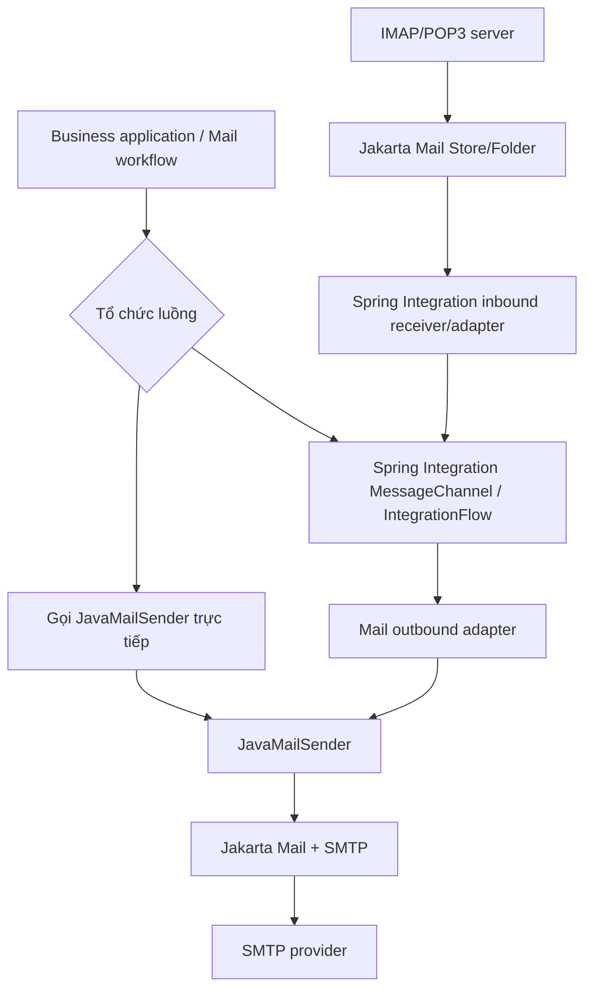
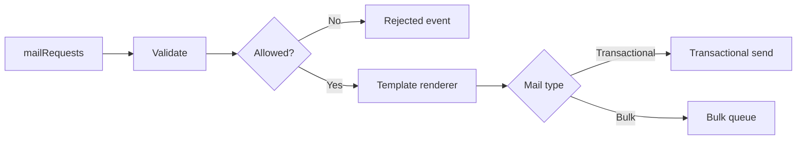
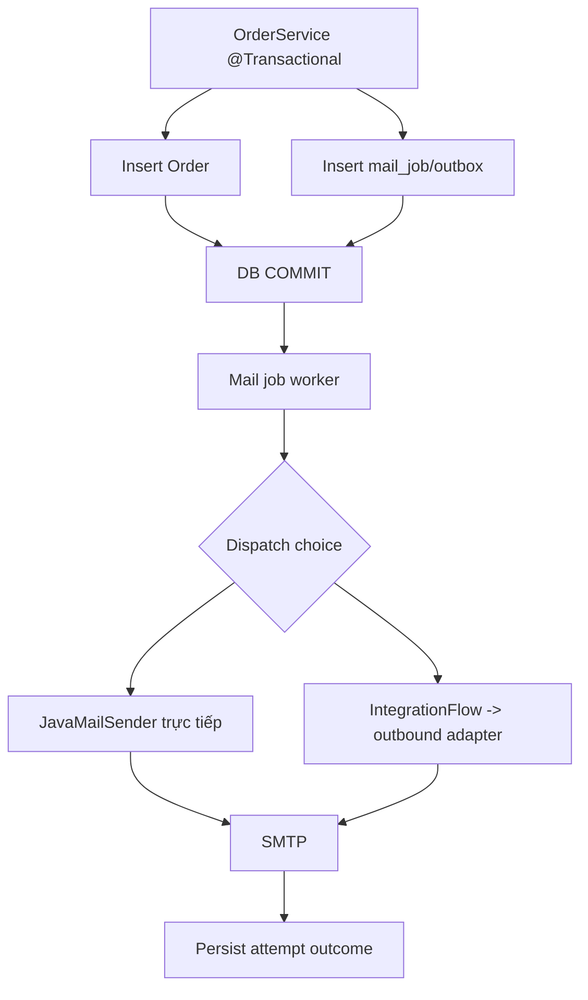
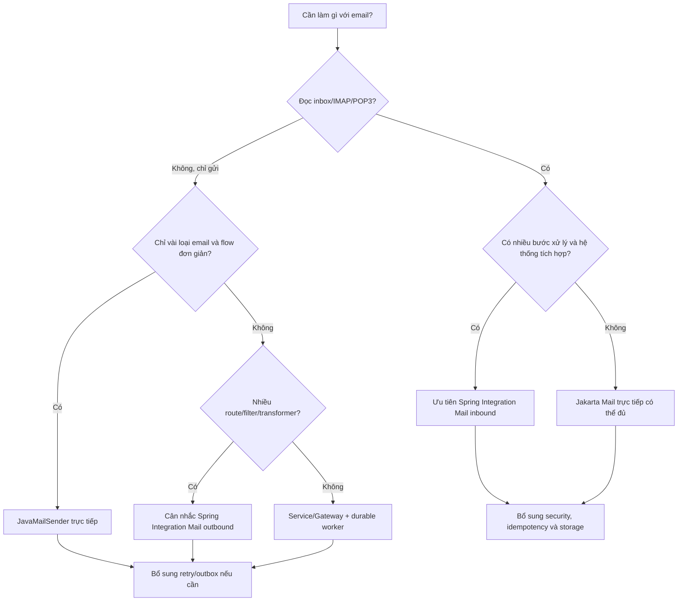

# Phân biệt Spring Integration Mail với JavaMailSender trực tiếp

Trong hệ sinh thái Spring, gửi một email đơn giản thường chỉ cần inject `JavaMailSender`, tạo `SimpleMailMessage` hoặc `MimeMessage` rồi gọi `send(...)`. Nhưng nếu ứng dụng phải **nhận email từ hộp thư, chuyển thông điệp qua nhiều bước xử lý, định tuyến, lọc, biến đổi, gửi bất đồng bộ hoặc nối nhiều hệ thống**, việc gọi một sender trực tiếp trong từng service có thể không còn là mô hình thuận tiện nhất.

**Spring Integration Mail** giúp đưa hoạt động gửi/nhận email vào kiến trúc *Enterprise Integration Patterns* của **Spring Integration**: adapter, message channel, transformer, filter, router, service activator, polling và các flow được mô tả rõ ràng. Nó không phải một SMTP engine khác thay thế toàn bộ Spring Mail. Ở chiều gửi, Spring Integration Mail thường **dùng `JavaMailSender` làm thành phần vận chuyển bên dưới**; điểm khác biệt chính nằm ở **mô hình điều phối**.

> **Quy tắc ngắn:** `JavaMailSender` là API thao tác gửi email ở tầng ứng dụng. Spring Integration Mail là lớp tích hợp đưa email vào/ra các **message flows**, có thể bao gồm IMAP/POP3 receiver, outbound adapter và các thành phần điều phối Spring Integration. Hai lựa chọn có thể được dùng **cùng nhau**.

Bài học này so sánh mục tiêu, abstraction, kiến trúc, code và những ranh giới quan trọng về SMTP, MIME, transaction, concurrency, retry, độ bền và bảo mật; từ đó chỉ ra khi nào nên chọn cách trực tiếp, khi nào nên dùng Integration Mail.

## 1. Phân biệt ngay từ cách gọi API

### 1.1. JavaMailSender trực tiếp

Trong một service thông thường:

```java
@Service
public class WelcomeMailService {

    private final JavaMailSender mailSender;

    public WelcomeMailService(JavaMailSender mailSender) {
        this.mailSender = mailSender;
    }

    public void sendWelcome(String recipient) {
        SimpleMailMessage mail = new SimpleMailMessage();
        mail.setFrom("no-reply@example.org");
        mail.setTo(recipient);
        mail.setSubject("Chào mừng");
        mail.setText("Tài khoản của bạn đã được tạo.");
        mailSender.send(mail);
    }
}
```

Các import chính:

```java
import org.springframework.mail.SimpleMailMessage;
import org.springframework.mail.javamail.JavaMailSender;
import org.springframework.stereotype.Service;
```

Service quyết định khi nào gửi, tự dựng nội dung và gọi transport. Luồng điều khiển rất trực tiếp:

```text
Business service
  -> JavaMailSender
      -> Jakarta Mail / SMTP transport
          -> SMTP server
```

Đối với vài loại email giao dịch, một service nhỏ, hành vi rõ và không cần inbound inbox, mô hình này thường đủ. Không cần thêm message channels chỉ để có một lớp bao quanh `send(...)`.

### 1.2. Spring Integration Mail

Với Spring Integration, tầng nghiệp vụ có thể phát một **Spring Messaging message** vào channel:

```text
Business service
  -> Spring MessageChannel
      -> IntegrationFlow
          -> filter / transformer / router
              -> Mail outbound adapter
                  -> JavaMailSender / SMTP
```

Ở chiều nhận:

```text
IMAP / POP3 mailbox
    -> Mail inbound adapter
        -> Spring MessageChannel
            -> filter / transformer / handler
                -> application processing
```

Điểm khác biệt không phải “JavaMailSender gửi thư, Spring Integration gửi thư nhanh hơn”; đúng hơn là Spring Integration cung cấp **khung kết nối và điều phối thông điệp** giữa các thành phần.

### 1.3. Những từ “message” rất dễ bị nhầm

Trong một dự án kết hợp hai công nghệ, từ `Message` có ít nhất ba ý nghĩa:

| Kiểu dữ liệu | Package | Ý nghĩa |
|---|---|---|
| `org.springframework.messaging.Message<T>` | Spring Messaging | Envelope mang `payload` và `headers` giữa các thành phần Integration |
| `jakarta.mail.Message` | Jakarta Mail | Một thông điệp email theo mô hình mail API |
| `jakarta.mail.internet.MimeMessage` | Jakarta Mail | Email có MIME headers/body/attachments |

Một Spring Integration message có thể **chứa** một `MimeMessage` làm payload. Nhưng bản thân hai đối tượng không phải cùng một loại, không dùng thay nhau chỉ vì cùng được gọi là “message”.

Ví dụ:

```java
MimeMessage mime = javaMailSender.createMimeMessage();

org.springframework.messaging.Message<MimeMessage> integrationMessage =
        MessageBuilder.withPayload(mime)
                .setHeader("mailJobId", "job-100")
                .build();
```

`MessageBuilder` thuộc `org.springframework.messaging.support.MessageBuilder`. Header `mailJobId` chỉ là metadata nội bộ trong Spring Integration flow; nó **không tự động trở thành SMTP/MIME header** nếu adapter không ánh xạ như vậy.

## 2. Bảng so sánh tổng quan

| Tiêu chí | `JavaMailSender` trực tiếp | Spring Integration Mail |
|---|---|---|
| Mục đích chính | Tạo/gửi email từ Java code | Tích hợp email vào message-driven flows |
| Chiều gửi | Có | Có, qua outbound adapter/handler dùng sender |
| Chiều nhận inbox | **Không** cung cấp API receiver | Có inbound adapters/receivers qua IMAP/POP3 |
| Abstraction | Spring Mail + Jakarta Mail | Spring Integration Message/Channel/Flow + Mail |
| Điểm gọi | `mailSender.send(...)` | `MessageChannel.send(...)`, gateway hoặc IntegrationFlow |
| Dựng MIME | `MimeMessageHelper` hoặc mã Jakarta Mail | Có thể vẫn dùng `MimeMessageHelper` hoặc chuyển đổi payload trong flow |
| Filter/router/transformer | Tự viết trong service | Là pattern/thành phần cốt lõi của Integration |
| Async | Dùng `@Async`, executor hoặc queue tự triển khai | Có thể dùng executor channels/async flows |
| Scheduling | Dùng `@Scheduled`/worker riêng | Poller/adapter và scheduling trong Integration |
| Retry | Tự viết hoặc Spring Retry/worker | Có thể tích hợp advice/error channels/retry, vẫn phải thiết kế theo ngữ nghĩa |
| Gửi SMTP | Dựa trên `JavaMailSender` | Outbound adapter thường dựa trên `JavaMailSender` |
| Queue bền vững mặc định | **Không** | **Không chỉ vì có flow/channel** |
| Exactly-once email delivery | Không | Không |
| Transaction database + SMTP atomic | Không | Không |
| Độ phức tạp | Thấp cho use case đơn giản | Cao hơn, đổi lại flow rõ ràng và khả năng nối hệ thống |
| Phù hợp | App gửi vài loại transactional email | Email intake/processing/integration pipeline đa bước |

**Cảnh báo quan trọng:** Spring Integration có những channel và adapter có thể làm việc với broker/persistent store, nhưng **DirectChannel/ExecutorChannel thông thường không tạo durable queue**. Chỉ chuyển từ JavaMailSender sang outbound adapter không có nghĩa mất điện vẫn giữ mọi email đang chờ.

## 3. Spring Framework Mail, Jakarta Mail và Spring Integration Mail nằm ở đâu?

Có thể hình dung thành các lớp:



### 3.1. Jakarta Mail là tầng giao thức và MIME

Jakarta Mail có các abstraction `Session`, `Transport`, `Store`, `Folder`, `Message`, `MimeMessage` và `Multipart`. SMTP thường được dùng để **gửi**; IMAP/POP3 để **đọc hộp thư**.

### 3.2. Spring Mail làm việc với email ở tầng ứng dụng

Spring Framework cung cấp:

- `MailSender` và `JavaMailSender` cho outbound mail.
- `SimpleMailMessage` cho thư văn bản đơn giản.
- `MimeMessageHelper` hỗ trợ HTML, attachment, inline resources, charset và recipient.
- Các `MailException` để chuẩn hóa lỗi ở tầng Spring Mail.

Spring Boot có thể auto-configure `JavaMailSender` khi có starter/dependencies và cấu hình `spring.mail.*` thích hợp. Tuy nhiên, **cấu hình SMTP sender không đồng nghĩa có sẵn IMAP inbox receiver**.

### 3.3. Spring Integration là nền tảng message-driven

Spring Integration đem lại:

- `MessageChannel` chuyển thông điệp giữa các endpoints.
- `IntegrationFlow` khai báo chuỗi xử lý.
- Transformer chuyển payload hoặc metadata.
- Filter kiểm tra điều kiện.
- Router lựa chọn đường đi.
- Service activator gọi nghiệp vụ.
- Inbound/outbound adapters nối tới hệ thống ngoài.
- Error handling, poller, channel interceptors và các tùy chọn điều phối theo phiên bản/cấu hình.

Module **Spring Integration Mail** cung cấp các mail-specific inbound/outbound components trên nền tảng này. Nó không thay thế toàn bộ business service, template engine, mail policy hoặc job store.

### 3.4. Dependency theo trách nhiệm

Trong một dự án Spring Boot dùng Gradle:

```groovy
dependencies {
    // SMTP / MIME helper.
    implementation 'org.springframework.boot:spring-boot-starter-mail'

    // Spring Integration core và Mail adapters.
    implementation 'org.springframework.integration:spring-integration-mail'

    testImplementation 'org.springframework.boot:spring-boot-starter-test'
}
```

Spring Boot dependency management nên quản lý phiên bản phù hợp. Đảm bảo stack Spring Framework 6+/Spring Boot tương ứng dùng `jakarta.mail.*` thay vì trộn thư viện `javax.mail.*` của đời cũ. Spring Integration Mail cũng có thể kéo theo các dependency mail cần thiết; starter mail vẫn hữu ích khi muốn Spring Boot cấu hình `JavaMailSender` và dùng các API Spring Mail trực tiếp.

## 4. Trường hợp một lựa chọn đơn giản là tốt hơn

Giả sử một ứng dụng có hai chức năng:

1. Gửi email xác nhận đơn hàng.
2. Gửi email reset mật khẩu.

Cả hai có nội dung rõ, sử dụng một SMTP provider và không cần đọc inbox hay định tuyến bằng nhiều bước. Dùng service gọi `JavaMailSender` trực tiếp (hoặc một `MailGateway` adapter tự định nghĩa) giúp:

- Dễ đọc luồng điều khiển.
- Ít cấu hình và dependency.
- Dễ mock trong unit test.
- Không đưa vào mô hình channel nếu không giải quyết vấn đề thực tế.
- Dễ xử lý rõ ràng lỗi dựng MIME và lỗi gọi SMTP.

Nếu cần gửi **sau commit**, có thể đặt một outbox/job worker hoặc `@TransactionalEventListener` phù hợp trước sender. Không nhất thiết cần Spring Integration để đạt kiến trúc bất đồng bộ/đáng tin cậy.

Ví dụ:

```text
OrderService
   |
   +-- DB transaction: order + mail_job
   |
   v
MailWorker
   |
   v
MailGateway
   |
   v
JavaMailSender
```

Điều quan trọng là **không gửi SMTP trong database transaction chỉ để tiết kiệm một lớp abstraction**. Việc gửi là external side effect; rollback database không thu hồi email đã submit.

## 5. Khi nào Spring Integration Mail tạo khác biệt rõ?

Các trường hợp thường hợp lý:

1. Ứng dụng **nhận email từ IMAP/POP3** và cần xử lý qua nhiều thành phần.
2. Phải chuyển thư đến thành ticket, hóa đơn, event hoặc request sau các bước lọc và biến đổi.
3. Có nhiều **input/output adapters** như email, HTTP, file, broker và service activators cần kết nối theo một flow thống nhất.
4. Cần polling, IMAP IDLE hoặc message routing có thể cấu hình tương đối nhất quán.
5. Cần chia các flow nghiệp vụ rõ ràng để độc lập xử lý một số nhóm thông điệp.
6. Đội ngũ đã dùng Spring Integration cho các tuyến dữ liệu khác và muốn tái sử dụng patterns/monitoring/operational conventions.

Ví dụ hệ thống hỗ trợ khách hàng:

```text
IMAP inbox support@example.org
  -> Mail inbound adapter
  -> Extract sender/subject/body/attachments
  -> Filter spam/unsupported content
  -> Resolve customer / ticket ID
  -> Route by request type
  -> Create support ticket
  -> Publish acknowledgment email
  -> JavaMailSender outbound
```

Spring Integration giúp tổ chức các phần **adapter → transformer → filter → router → handler** mạch lạc hơn một lớp `InboxPollingService` làm tất cả. Tuy nhiên, các bước xác thực người gửi, scan attachment, phân quyền, xử lý trùng và lưu dữ liệu bền vững vẫn phải được ứng dụng thiết kế rõ ràng.

## 6. Hiểu đúng inbound và outbound

### 6.1. Outbound: gửi từ ứng dụng ra SMTP

`JavaMailSender` trực tiếp:

```text
method call -> sender.send -> SMTP
```

Spring Integration Mail outbound:

```text
MessageChannel -> outbound mail handler -> JavaMailSender -> SMTP
```

Vì cùng có thể dựa trên một sender, cấu hình host, port, TLS/auth, credential và những lỗi SMTP cơ bản vẫn áp dụng. Spring Integration không tự thêm SPF/DKIM/DMARC hoặc làm email “dễ vào Inbox hơn”.

### 6.2. Inbound: đọc từ IMAP/POP3

`JavaMailSender` không có API `readInbox()`. Nếu chỉ dùng Spring Mail trực tiếp, để nhận thư vẫn phải gọi Jakarta Mail `Store`/`Folder` hoặc một thư viện/provider API khác.

Spring Integration Mail inbound cung cấp các components như `ImapMailReceiver`, `Pop3MailReceiver` và inbound adapters để đưa dữ liệu email vào Spring Messaging flow. Một số cấu hình hỗ trợ IMAP IDLE để nhận tín hiệu thay đổi mailbox ít phụ thuộc polling hơn.

### 6.3. Bidirectional workflow không phải “SMTP nhận email”

Một email workflow có thể vừa nhận vừa gửi, nhưng dùng giao thức/tầng khác:

```text
IMAP INBOX -> inbound flow -> application
application -> outbound flow -> SMTP relay
```

Không cấu hình `spring.mail.host` trỏ tới SMTP provider rồi kỳ vọng Spring Integration tự lấy được email gửi tới hộp thư. Inbound cần account, folder, protocol/credentials và lifecycle riêng.

## 7. Ví dụ outbound hoàn chỉnh: JavaMailSender trực tiếp

Giả sử cần gửi email xác nhận đơn hàng dạng plain text + HTML. Với cách trực tiếp:

```java
package com.example.mail.direct;

import jakarta.mail.MessagingException;
import jakarta.mail.internet.MimeMessage;
import org.springframework.mail.javamail.JavaMailSender;
import org.springframework.mail.javamail.MimeMessageHelper;
import org.springframework.stereotype.Service;

@Service
public class DirectOrderMailService {

    private final JavaMailSender mailSender;

    public DirectOrderMailService(JavaMailSender mailSender) {
        this.mailSender = mailSender;
    }

    public void sendConfirmation(
            String recipient,
            String orderNumber,
            String plainText,
            String safeHtml) {

        try {
            MimeMessage mime = mailSender.createMimeMessage();
            MimeMessageHelper helper = new MimeMessageHelper(
                    mime, true, "UTF-8");
            helper.setFrom("no-reply@example.org");
            helper.setTo(recipient);
            helper.setSubject("Xác nhận đơn " + orderNumber);
            helper.setText(plainText, safeHtml);

            mailSender.send(mime);
        } catch (MessagingException ex) {
            throw new IllegalStateException(
                    "Cannot prepare order confirmation", ex);
        }
    }
}
```

**Ý nghĩa:**

- `MimeMessage` và `MimeMessageHelper` là API của Jakarta/Spring Mail.
- `safeHtml` phải do template renderer tạo ra với escaping/sanitization thích hợp; không nối raw user input vào HTML.
- `mailSender.send(mime)` có thể ném `MailException` nếu submission thất bại.
- Gửi thành công chỉ có nghĩa bước SMTP submission hoàn thành theo transport contract; không chứng minh người nhận đã thấy trong Inbox.
- Method chạy đồng bộ nếu caller gọi trực tiếp và không có cơ chế async riêng.

Đây là ví dụ gọn, phù hợp khi application service chủ động thực hiện một yêu cầu gửi. Trong production, nên tách template, sender identity, validation và retry policy thành các thành phần riêng thay vì để một service business ôm tất cả.

### 7.1. Cấu hình SMTP tương ứng

```yaml
spring:
  mail:
    host: ${SMTP_HOST}
    port: 587
    username: ${SMTP_USER}
    password: ${SMTP_PASSWORD}
    properties:
      "[mail.smtp.auth]": true
      "[mail.smtp.starttls.enable]": true
      "[mail.smtp.starttls.required]": true
      "[mail.smtp.connectiontimeout]": 5000
      "[mail.smtp.timeout]": 10000
      "[mail.smtp.writetimeout]": 10000
      "[mail.debug]": false
      "[mail.debug.auth]": false
```

Các giá trị chỉ minh họa với SMTP submission hỗ trợ STARTTLS trên port 587. Với port 465/implicit TLS, provider OAuth2 hoặc API-based service, cần cấu hình theo contract thực. Không lưu SMTP credentials trong source control hoặc log Spring Environment.

## 8. Ví dụ outbound bằng Spring Integration Mail

Thay vì gọi sender ngay trong business service, ta khai báo channel và outbound mail adapter:

```java
package com.example.mail.integration;

import org.springframework.context.annotation.Bean;
import org.springframework.context.annotation.Configuration;
import org.springframework.integration.channel.DirectChannel;
import org.springframework.integration.dsl.IntegrationFlow;
import org.springframework.integration.mail.dsl.Mail;
import org.springframework.mail.javamail.JavaMailSender;
import org.springframework.messaging.MessageChannel;

@Configuration
public class OutboundMailFlowConfiguration {

    @Bean
    public MessageChannel mailOutgoingChannel() {
        return new DirectChannel();
    }

    @Bean
    public IntegrationFlow mailOutboundFlow(
            JavaMailSender mailSender) {

        return IntegrationFlow
                .from("mailOutgoingChannel")
                .handle(Mail.outboundAdapter(mailSender))
                .get();
    }
}
```

Tên package/lớp DSL có thể khác theo nhánh phiên bản Spring Integration đang dùng; ví dụ minh họa API Java DSL hiện đại. Trong một dự án thật, cần dùng dependency/version phù hợp và cấu hình flow theo tài liệu version đó.

### 8.1. Service đưa MimeMessage vào channel

```java
package com.example.mail.integration;

import jakarta.mail.MessagingException;
import jakarta.mail.internet.MimeMessage;
import org.springframework.beans.factory.annotation.Qualifier;
import org.springframework.mail.javamail.JavaMailSender;
import org.springframework.mail.javamail.MimeMessageHelper;
import org.springframework.messaging.Message;
import org.springframework.messaging.MessageChannel;
import org.springframework.messaging.support.MessageBuilder;
import org.springframework.stereotype.Service;

@Service
public class ChannelOrderMailService {

    private final JavaMailSender sender;
    private final MessageChannel outgoing;

    public ChannelOrderMailService(
            JavaMailSender sender,
            @Qualifier("mailOutgoingChannel") MessageChannel outgoing) {
        this.sender = sender;
        this.outgoing = outgoing;
    }

    public boolean submitToFlow(
            String recipient,
            String subject,
            String content,
            String mailJobId) throws MessagingException {

        MimeMessage mime = sender.createMimeMessage();
        MimeMessageHelper helper =
                new MimeMessageHelper(mime, false, "UTF-8");
        helper.setFrom("no-reply@example.org");
        helper.setTo(recipient);
        helper.setSubject(subject);
        helper.setText(content, false);

        Message<MimeMessage> request =
                MessageBuilder.withPayload(mime)
                        .setHeader("mailJobId", mailJobId)
                        .build();

        return outgoing.send(request);
    }
}
```

Với `DirectChannel` như trên, handler thường chạy trên caller thread; exception từ outbound handler có thể được truyền về caller. Giá trị boolean của `send(...)` là kết quả chuyển thông điệp qua channel, **không phải delivery receipt** của SMTP provider.

Nếu thay `DirectChannel` bằng channel sử dụng executor/queue, lời gọi `send(...)` có thể trả về trước khi SMTP chạy; ý nghĩa của "thành công" thay đổi. Đừng đặt tên API `sendEmailDelivered()` chỉ vì `MessageChannel.send` trả `true`.

### 8.2. Chỗ nào là Spring Integration?

Trong ví dụ trên:

- `DirectChannel` là Spring Integration channel.
- `IntegrationFlow` định nghĩa đường xử lý.
- `Mail.outboundAdapter(mailSender)` đóng vai trò message handler của email.
- `MessageBuilder` tạo Spring Messaging envelope.
- `JavaMailSender` vẫn tạo `MimeMessage` và thực hiện SMTP submission.

Nếu chỉ có một channel nối thẳng tới mail adapter, so với gọi `JavaMailSender` trực tiếp, lợi ích có thể nhỏ. Spring Integration phát huy khi flow có filter, transformer, router, nhiều input/output hoặc conventions dùng chung.

### 8.3. Header trong flow không tự trở thành mail header

`MessageBuilder.withPayload(mime).setHeader("mailJobId", "...")` tạo **Spring header**. Đây là metadata để log/routing trong flow. Nó không phải:

```text
X-Mail-Job-Id: ...
```

nằm trong MIME message. Nếu hệ thống muốn một custom MIME header, cần set nó có chủ đích trên `MimeMessage` hoặc dùng mapping được adapter hỗ trợ, đồng thời xem xét privacy/header injection. Một mail job ID nội bộ thường không cần phát tán ra ngoài.

### 8.4. Nên tạo MIME ở đâu?

Có hai cách:

**A. Tạo MIME trước channel:** như ví dụ, service dựng `MimeMessage` rồi đưa vào flow. Phù hợp nếu service chịu trách nhiệm format và flow chủ yếu điều phối.

**B. Đưa domain command/DTO vào channel, dựng MIME trong transformer/handler:** phù hợp nếu muốn flow kiểm soát template/locale/sender identity và mỗi consumer gửi từ cùng pipeline chuẩn.

Ví dụ khái niệm:

```text
MailCommand
    -> validate
    -> select template
    -> render MIME
    -> outbound adapter
```

Khi chọn B, **đừng đẩy raw ORM entity qua async channel** nếu entity có lazy-loaded fields hoặc transaction sắp kết thúc. Tạo event/DTO nhỏ với snapshot hoặc reference rõ, kiểm tra còn hợp lệ trước gửi.

## 9. Thêm filter, transformer và router trong IntegrationFlow

Một luồng có nhiều bước mới thể hiện rõ giá trị của Spring Integration:



Một flow có thể:

1. Kiểm tra yêu cầu gửi có được phép không.
2. Bỏ/định tuyến một yêu cầu không phù hợp.
3. Render body theo template ID/version.
4. Chọn sender theo tenant, locale hoặc mail type.
5. Gửi qua adapter.
6. Phát một outcome event hoặc ghi trạng thái job.

Ví dụ Java DSL ở mức khái niệm:

```java
@Bean
IntegrationFlow validatedMailFlow(
        MailCommandValidator validator,
        MailCommandRenderer renderer,
        MailSendingMessageHandler mailHandler) {

    return IntegrationFlow.from("mailCommands")
            .filter(MailCommand.class,
                    validator::isAllowed)
            .transform(MailCommand.class,
                    renderer::toMimeMessage)
            .handle(mailHandler)
            .get();
}
```

`MailCommand`, `MailCommandValidator`, `MailCommandRenderer` là thành phần ứng dụng cần triển khai; `MailSendingMessageHandler` thuộc Spring Integration Mail. Đoạn code minh họa flow với payload type cụ thể và cần bean/class/import tương ứng theo version.

### 9.1. Filter drop silently có thể làm mất nghiệp vụ

Nếu filter trả `false`, tùy cấu hình/flow thông điệp có thể không đi tiếp. Với mail giao dịch đã được ghi job, đây không thể đồng nghĩa "thành công". Cần quyết định:

- Ghi `REJECTED_BY_POLICY` vào job store.
- Xuất rejected event sang một channel khác.
- Trả lỗi cho caller khi hành vi đó được yêu cầu.
- Ghi reason class an toàn để vận hành.

Không làm mất một email bắt buộc chỉ vì filter không chuyển tiếp, trong khi transaction nghiệp vụ vẫn báo đã xử lý.

### 9.2. Router không tạo sender credentials

Router lựa chọn tuyến dựa trên metadata nghiệp vụ đã kiểm tra, ví dụ `mailType` hoặc `providerAlias`. Provider sender nên được cấu hình riêng, không mutate host/password trên một `JavaMailSenderImpl` singleton khi nhiều messages chạy đồng thời.

### 9.3. Transformer và HTML security

Một transformer dựng MIME vẫn cần:

- Escape dữ liệu người dùng khi render HTML.
- Tạo text/plain fallback nếu phù hợp.
- Giữ charset UTF-8.
- Xác định sender identity/From được phê duyệt.
- Xử lý MIME attachments/inline CID đúng thứ tự.
- Không ghi raw body/OTP/token vào logs.

IntegrationFlow không tự sanitize HTML hoặc quét attachment chỉ vì có bước `transform`.

## 10. Inbound: điểm khác biệt quan trọng nhất

Lý do phổ biến để chọn Spring Integration Mail là **nhận email**. Ở đây `JavaMailSender` không giải quyết yêu cầu:

```text
INBOX folder
  -> fetch messages
  -> inspect MIME
  -> filter
  -> persist ticket/attachment
  -> acknowledge
```

Khi tự viết Jakarta Mail, ứng dụng phải quản lý:

- Kết nối `Store`/`Folder`.
- Polling hoặc IMAP IDLE/reconnect.
- Đọc UID/folder, message flags.
- Trích xuất MIME và attachment.
- Lỗi kết nối, timeout, backoff.
- Đồng bộ trạng thái đã xử lý.

Spring Integration Mail nhận trách nhiệm adapter và chuyển dữ liệu vào message-driven pipeline, giúp tách luồng nhận khỏi business handler. Nó **không tự làm phần cuối** như database transaction, malware scanning hay idempotent ticket creation.

### 10.1. Các thành phần inbound chính

| Thành phần | Vai trò |
|---|---|
| `ImapMailReceiver` | Nhận thư từ IMAP folder |
| `Pop3MailReceiver` | Nhận thư qua POP3 |
| Polling inbound adapter | Định kỳ lấy messages rồi phát vào channel |
| IMAP IDLE inbound adapter | Sử dụng khả năng IDLE của IMAP để phản ứng với thay đổi mailbox |
| `MessageChannel` | Vận chuyển Spring message tới handler |
| Transformer/service activator | Trích nội dung, chuẩn hóa, lưu business state |

API cụ thể có thể khác giữa Spring Integration 5.x/6.x/7.x. Với Jakarta Mail hiện đại, đảm bảo sử dụng cùng hệ package và dependency tương thích.

### 10.2. Polling và IMAP IDLE không giống nhau

**Polling:** một poller chạy theo lịch để tìm message mới. Dễ giới hạn batch, có một độ trễ tối thiểu theo poll interval và tạo request ngay cả khi inbox không đổi.

**IMAP IDLE:** server có thể thông báo thay đổi, giảm thời gian chờ khi có email mới. Nhưng server/người dùng vẫn có thể ngắt kết nối hoặc thay đổi mailbox trong lúc offline. Cần reconnect và đối soát UID/checkpoint.

IMAP IDLE **không phải** queue bền vững với exactly-once acknowledgment. Nó là cơ chế thông báo thay đổi từ mail server.

## 11. Ví dụ nhận thư với Spring Integration Mail

Một flow polling có thể dùng `ImapMailReceiver` và DSL `Mail.imapInboundAdapter(...)`. Ví dụ dưới đây minh họa cấu trúc, trong đó IMAP URL là **cấu hình bên ngoài ứng dụng** và cần được quản lý như secret nếu chứa thông tin đăng nhập.

```java
package com.example.mail.integration;

import org.springframework.beans.factory.annotation.Value;
import org.springframework.context.annotation.Bean;
import org.springframework.context.annotation.Configuration;
import org.springframework.integration.dsl.IntegrationFlow;
import org.springframework.integration.dsl.Pollers;
import org.springframework.integration.mail.ImapMailReceiver;
import org.springframework.integration.mail.dsl.Mail;

@Configuration
public class InboundMailFlowConfiguration {

    @Bean
    ImapMailReceiver inboxReceiver(
            @Value("${app.inbound.imap-url}") String imapUrl) {
        return new ImapMailReceiver(imapUrl);
    }

    @Bean
    IntegrationFlow inboxFlow(
            ImapMailReceiver inboxReceiver,
            InboundMailHandler handler) {

        return IntegrationFlow
                .from(Mail.imapInboundAdapter(inboxReceiver),
                        source -> source.poller(
                                Pollers.fixedDelay(15_000)
                                        .maxMessagesPerPoll(10)))
                .handle(handler, "accept")
                .get();
    }
}
```

Ví dụ dùng Java DSL theo dạng API thông dụng; một số method/constructor/spec có thay đổi giữa các phiên bản Spring Integration, vì vậy khi áp dụng cần đối chiếu chính xác với version được dự án quản lý. `InboundMailHandler` là bean nghiệp vụ do ứng dụng định nghĩa.

### 11.1. Ví dụ handler nhận Spring Messaging message

Khi làm với inbound adapter, hãy xác định **payload type thực** trong cấu hình đang dùng. Tùy receiver và tùy chọn chuyển đổi nội dung, payload có thể là đối tượng Jakarta Mail hoặc một dạng decoded content khác.

Một handler thận trọng:

```java
package com.example.mail.integration;

import jakarta.mail.internet.MimeMessage;
import org.springframework.messaging.Message;
import org.springframework.stereotype.Component;

@Component
public class InboundMailHandler {

    private final InboundMailJobService jobService;

    public InboundMailHandler(InboundMailJobService jobService) {
        this.jobService = jobService;
    }

    public void accept(Message<?> incoming) {
        Object payload = incoming.getPayload();

        if (payload instanceof MimeMessage mime) {
            // Tạo identity + lưu durable job/snapshot có giới hạn.
            jobService.capture(mime, incoming.getHeaders());
            return;
        }

        throw new IllegalArgumentException(
                "Unsupported inbound payload type");
    }
}
```

`InboundMailJobService` là API của ứng dụng. Với những phiên bản có payload wrapper/định dạng khác, điều chỉnh conversion dựa trên contract của inbound adapter. Không coi một cast mẫu là bằng chứng mọi configuration đều trả `MimeMessage`.

### 11.2. Khi nào nên dùng handler làm service activator?

Một service activator thích hợp khi nhiệm vụ rõ ràng: *nhận message, xác nhận metadata, ghi một inbound job*. Không nên để handler giữ kết nối IMAP mở trong nhiều phút rồi tự thực hiện scan PDF, gọi hệ thống bên ngoài và gửi email phản hồi trước khi trả kết quả, trừ khi có SLA/tài nguyên tương ứng.

Một kiến trúc thường bền vững hơn:

```text
Mail inbound adapter
    |
    v
Capture + durable enqueue
    |
    v
Inbound job worker
    +--> MIME extraction
    +--> attachment quarantine / scan
    +--> ticket creation
    +--> acknowledgment job
```

### 11.3. IMAP credentials và URL

Trong một số cấu hình Spring Integration Mail, IMAP receiver dùng URL hoặc các properties chứa credentials. Cần:

- Lấy cấu hình từ secret manager/environment được kiểm soát.
- Không ghi raw IMAP URL khi nó có username/password.
- Không đặt password trong file YAML được commit.
- Bật TLS với hostname/certificate validation; không tắt trust check để tránh lỗi cấu hình.
- Cấu hình read/connect timeout.
- Đặt giới hạn quyền mailbox; không dùng account admin toàn tổ chức nếu chỉ cần đọc một inbox.

Nếu provider yêu cầu OAuth2 hoặc cơ chế xác thực riêng, dùng cách kết nối mà version Jakarta Mail/Spring Integration hỗ trợ; không tự đưa access token vào log, URL được in ra hoặc message headers nội bộ không có kiểm soát.

### 11.4. Đọc inbox bằng Jakarta Mail thuần

Không dùng Spring Integration Mail cũng hoàn toàn có thể nhận thư:

```java
Properties properties = new Properties();
properties.put("mail.store.protocol", "imaps");
properties.put("mail.imaps.connectiontimeout", "5000");
properties.put("mail.imaps.timeout", "10000");
properties.put("mail.imaps.ssl.checkserveridentity", "true");

Session session = Session.getInstance(properties);
Store store = session.getStore("imaps");

Folder inbox = null;
try {
    store.connect(host, 993, username, password);
    inbox = store.getFolder("INBOX");
    inbox.open(Folder.READ_ONLY);

    for (jakarta.mail.Message message : inbox.getMessages()) {
        inboundService.capture(message);
    }
} finally {
    if (inbox != null && inbox.isOpen()) {
        inbox.close(false);
    }
    if (store.isConnected()) {
        store.close();
    }
}
```

Các biến `host`, `username`, `password` và `inboundService` do ứng dụng cung cấp. Đoạn này minh họa API trực tiếp, **chưa có incremental UID polling, backpressure hoặc lifecycle hoàn chỉnh**; khi mailbox lớn, không quét `getMessages()` toàn inbox mỗi lượt.

**Sự khác biệt:** Spring Integration Mail đóng gói phần *ingress adapter + flow*, còn cách Jakarta Mail thuần đòi hỏi bạn tự điều phối polling, handler, error propagation và endpoint lifecycle.

## 12. Vòng đời inbox: Seen, UID và xử lý trùng

Một vấn đề không biến mất khi chuyển sang Spring Integration Mail là **đọc cùng một email nhiều lần**. IMAP IDLE có thể reconnect, polling có thể đọc lại, handler có thể lỗi sau khi ghi nửa chừng.

### 12.1. Message number, Message-ID và UID

| Trường | Dùng để làm gì | Có nên làm durable idempotency key duy nhất? |
|---|---|---|
| `Message.getMessageNumber()` | Vị trí hiện tại trong folder | Không |
| Header `Message-ID` | Đối chiếu MIME message | Không, có thể thiếu/trùng/giả |
| IMAP `UID` | ID message trong một namespace folder | Có, **kèm UIDVALIDITY/folder/account** |
| `UIDVALIDITY` | Phiên bản namespace UID | Phải tham gia key nếu dùng UID |
| Inbound job ID của ứng dụng | Gắn state/attempts/storage | Có cho internal workflow |

Với IMAP, identity bền vững có thể là:

```text
(mailAccountId, folderName, uidValidity, uid)
```

Nếu IMAP folder bị tạo lại và `UIDVALIDITY` đổi, checkpoint phải được xử lý lại theo policy; không dùng một UID đơn lẻ rồi kết luận mãi mãi cùng message.

### 12.2. Không coi flag SEEN là transaction acknowledgment

Ví dụ một inbound adapter đọc email rồi đánh dấu `SEEN`, nhưng business handler chưa kịp tạo ticket vì database lỗi. Nếu lần poll sau chỉ đọc `UNSEEN`, thư có thể bị bỏ qua.

Một thứ tự hợp lý hơn:

1. Xác nhận identity của message.
2. Ghi durable inbound job idempotently.
3. Thực hiện processing theo state machine.
4. Commit kết quả nghiệp vụ/file metadata.
5. Sau đó mới cập nhật flags/move folder nếu cần.

Spring Integration có các tùy chọn liên quan mark-as-read/peek behavior tùy receiver/adapter/version, nhưng **không mặc nhiên đồng bộ được IMAP flags với DB transaction**.

### 12.3. Không giữ MimeMessage lazy sau khi đóng Folder tùy tiện

Một `MimeMessage` đọc qua IMAP có thể phụ thuộc network streams hoặc folder còn mở khi đọc body/attachment. Nếu inbound handler đẩy đối tượng này sang một executor và receiver đóng folder trước khi worker tải file, code có thể thất bại.

Khi cần async/durable processing:

- Lưu snapshot raw RFC822 hoặc các bytes/metadata cần thiết vào private staging theo quota.
- Chỉ publish job ID/reference vào queue.
- Quản lý retention và quyền truy cập raw message.
- Đảm bảo không giữ object live phụ thuộc IMAP connection qua process restart.

Spring Integration Mail không tự làm `MimeMessage` thành immutable durable event.

## 13. SMTP submission, channel send và email delivery là ba mốc khác nhau

Đây là một trong những lỗi vận hành hay gặp nhất khi dùng flow:

```text
Business API
    |
    v
MessageChannel.send(request) ---> accepted by channel?
    |
    v
Mail outbound handler ---------> JavaMailSender.send()
    |
    v
SMTP relay --------------------> SMTP submission accepted?
    |
    v
Recipient system -------------> delivered / deferred / bounced?
    |
    v
Mailbox ----------------------> Inbox / Spam / Quarantine?
```

### 13.1. Với DirectChannel

`DirectChannel` thường chạy subscriber handler trên caller thread. Nếu outbound mail handler thực hiện SMTP ngay, lời gọi channel có thể block và throw lỗi. Nhưng **kết quả không phải delivery receipt**; SMTP vẫn có thể chấp nhận rồi gửi bounce sau.

### 13.2. Với ExecutorChannel

Một executor-backed channel có thể chuyển handler sang thread khác. Lúc này `send(request)` trả về trước khi SMTP hoàn tất. Nếu application đánh dấu `mailJob.status=SUBMITTED` ngay khi `channel.send` trả `true`, nó có thể báo đã gửi một email chưa hề được xử lý.

Đúng hơn:

```text
channel accepted -> ENQUEUED/ACCEPTED_BY_FLOW
SMTP accepted    -> SUBMITTED
provider receipt -> delivery event state
```

### 13.3. Với broker-backed flow

Nếu có broker và durable queue, việc publish vào broker thành công không có nghĩa worker đã submit SMTP. Cần:

- Acknowledgment của broker theo message/consumer.
- Outbox/job status và attempt log.
- Retry khi worker crash.
- Điều kiện đánh dấu `SUBMITTED` sau send thành công.
- Provider delivery/bounce tracking nếu yêu cầu.

Broker có thể giúp tồn tại qua process restart nhưng không làm SMTP tham gia cùng DB transaction nguyên tử.

## 14. Threading, concurrency và backpressure

Chuyển từ direct sender sang IntegrationFlow không tự thay đổi tốc độ SMTP. Phải xác định channel:

| Thành phần | Thực thi điển hình | Điều cần cân nhắc |
|---|---|---|
| Direct sender | Caller thread | HTTP/worker bị block bởi SMTP |
| `DirectChannel` + mail handler | Caller thread | Vẫn có thể block |
| `ExecutorChannel` + mail handler | Worker thread | Executor queue, rejection, MDC propagation |
| `QueueChannel` | Buffered messages được consumer/poller xử lý | Buffer capacity và persistence policy |
| Broker adapter + consumer | Worker độc lập | Ack/retry/visibility/offset semantics |
| IMAP polling inbound adapter | Scheduled poller | Lượng fetch, IMAP connection, idempotency |
| IMAP IDLE inbound adapter | Event-driven mailbox notifications | Reconnect, resync/checkpoint |

### 14.1. DirectChannel không đồng nghĩa async

Đây là sai lầm dễ mắc:

```java
MessageChannel channel = new DirectChannel();
channel.send(mailRequest);
```

Nếu handler gửi SMTP, caller vẫn có thể chờ network. Spring Integration không làm đoạn trên bất đồng bộ chỉ vì có channel.

### 14.2. Executor queue không mặc định bền vững

`ExecutorChannel` có thể dùng `ThreadPoolTaskExecutor` với hàng đợi trong memory. Nếu JVM crash, queued messages chưa gửi có thể mất. Một `QueueChannel` trong memory cũng vậy, trừ khi cấu hình message store bền vững/kiến trúc queue được thiết kế đúng.

Nếu email giao dịch cần reliability, dùng **transactional outbox hoặc durable broker** với acknowledgment phù hợp thay vì chỉ đưa `MimeMessage` vào executor queue.

### 14.3. Cần giới hạn concurrency

Nhiều IntegrationFlow chạy song song có thể dùng chung SMTP provider account. Quota có thể áp theo:

- Tổng số messages/phút.
- Tổng recipients/phút.
- Số kết nối SMTP đồng thời.
- Kích thước message.
- Thời gian gửi tối thiểu giữa các lần.

Executor 100 threads không tạo thêm quota. Nên dùng limiter theo provider/account, queue capacity hữu hạn và backpressure/retry khi bị throttle.

### 14.4. MDC và context propagation

`MDC`/security context gắn với thread và không được bảo đảm tự truyền qua asynchronous channels. Khi worker xử lý mail job, lấy `correlationId`, `mailJobId` từ metadata bền vững, thiết lập logging scope rồi dọn trong `finally`/`MDC.putCloseable`.

Không copy toàn bộ inbound HTTP headers/cookies hoặc security context sang integration messages; có thể làm lộ token và tăng bộ nhớ.

## 15. Error handling: MailException khác Spring Integration error channel

Khi gọi `JavaMailSender` trực tiếp:

```java
try {
    mailSender.send(mime);
} catch (MailException ex) {
    // Phân loại SMTP error và cập nhật job state.
}
```

`MailException` là họ exception của Spring Mail. Những lỗi phổ biến gồm lỗi authentication, kết nối hoặc một phần messages trong batch.

Trong một IntegrationFlow, cần xét thêm **cơ chế truyền lỗi của message flow**:

- Flow đồng bộ có thể throw exception về caller.
- Flow có executor/async boundary thường chuyển lỗi sang cơ chế error handling phù hợp, chẳng hạn error channel hoặc lời gọi advice/recovery handler.
- Polling endpoints cần xử lý exception để không dừng/pause bất ngờ.
- Một ErrorMessage trong Spring Messaging có thể chứa exception và metadata của failed message.

Spring Integration không tự biến mọi exception thành retry an toàn. **Một lỗi SMTP có thể xảy ra sau khi relay đã nhận message**, vì vậy việc tự động gửi lại mà không phân loại có nguy cơ tạo email trùng.

### 15.1. Phân biệt lỗi render và lỗi transport

| Lỗi | Bước xảy ra | Cách xử lý tham khảo |
|---|---|---|
| Template thiếu variable | Render | Dừng hoặc sửa dữ liệu, không tự retry SMTP |
| Invalid recipient address | Prepare/validation | Từ chối theo policy |
| Attachment không tồn tại | Build MIME | Xử lý tài nguyên, không coi là lỗi provider |
| SMTP AUTH failed | Submit | Cảnh báo credential/configuration |
| SMTP 4xx/rate limit | Submit | Backoff/limiter, cân nhắc retry |
| SMTP timeout khi chưa rõ relay nhận chưa | Submit | `UNKNOWN_SUBMISSION` và đối soát |
| Provider bounce sau submit | Post-submission | Cập nhật delivery state, suppression |
| Inbound IMAP timeout | Receive | Reconnect/backoff/checkpoint |
| Inbound attachment bị malware | Process | Quarantine/reject, không retry vô hạn |

### 15.2. Retry advice không thay business idempotency

Spring Integration hỗ trợ các cơ chế advice/interceptor và có thể tích hợp Spring Retry tùy phiên bản/cấu hình. Chúng hữu ích cho một số lỗi tạm thời nhưng không tự kiểm tra:

- Mail job còn hiệu lực hay không.
- Token OTP/reset có hết hạn không.
- SMTP provider có thể đã nhận trước timeout hay chưa.
- Đã có attempt khác đang gửi không.
- Recipient đã unsubscribe hay bị suppression chưa.

Nên đưa **retry decision** của email quan trọng vào job state machine với attempt ID, deadline, backoff và outcome rõ.

### 15.3. Error channel không phải Dead Letter Queue mặc định

Một Spring Integration error channel chuyển lỗi cho subscriber xử lý trong phạm vi flow. Nó không tự động cung cấp:

- Storage bền vững sau process crash.
- Retry counter/next attempt time.
- Business dead-letter state.
- Audit người vận hành đã giải quyết.

Nếu cần DLQ/retry queue, phải triển khai hoặc tích hợp broker/persistent store và quy tắc chuyển trạng thái rõ.

### 15.4. Đừng ghi raw message trong error log

Lỗi trong IntegrationFlow có thể mang thông tin của original Spring message. Nếu payload là `MimeMessage`, nó có thể chứa:

- Địa chỉ người nhận.
- OTP/reset token.
- HTML/text body.
- Attachment metadata hoặc bytes.
- SMTP headers.

Không log toàn bộ `ErrorMessage`/payload/`exception.getMessage()` theo mặc định. Ghi `mailJobId`, `attemptId`, `failureClass`, `providerAlias`, elapsed time và trạng thái đã chuẩn hóa.

## 16. Transaction: điều cả hai giải pháp đều không tự giải quyết

Giả sử:

```java
@Transactional
public void createOrder(PlaceOrderCommand command) {
    orderRepository.save(...);
    outgoingChannel.send(...);
}
```

Một luồng `DirectChannel` có thể gọi SMTP **trước khi database commit**. Nếu transaction rollback sau đó, email đã được submit có thể không thể thu hồi.

Đổi từ `JavaMailSender.send` thành `MessageChannel.send` **không biến SMTP thành tài nguyên tham gia transaction database**.

### 16.1. Có @TransactionalEventListener không đồng nghĩa bền vững

`@TransactionalEventListener(phase = AFTER_COMMIT)` giúp chỉ thực hiện listener sau một commit thành công trong những điều kiện phù hợp. Nhưng nếu JVM crash giữa commit và việc chạy listener/gửi SMTP, job vẫn có thể mất nếu chỉ giữ event trong memory.

Vì vậy, cần chọn theo độ tin cậy:

- **Best effort:** event listener sau commit có thể đủ cho email ít quan trọng.
- **Quan trọng:** transactional outbox hoặc durable queue giúp phục hồi.
- **Phức tạp:** outbox + flow + worker/adapter nếu ứng dụng còn nhiều tuyến xử lý.

### 16.2. Transactional outbox hoạt động với cả hai



Outbox không phụ thuộc việc cuối cùng dùng direct sender hay Spring Integration Mail. Nó giải quyết bài toán **ý định gửi phải được lưu trong cùng transaction nghiệp vụ**.

### 16.3. Mẫu trạng thái outbox tối thiểu

```text
PENDING
   -> PROCESSING
       -> SUBMITTED
       -> RETRY_WAIT -> PROCESSING
       -> UNKNOWN_SUBMISSION
       -> FAILED_PERMANENT
       -> EXPIRED
```

Mỗi job nên có `mailJobId` và `idempotencyKey`. Mỗi lần gửi tạo `attemptId` riêng. Khi provider nhận được message nhưng client mất ACK, outcome có thể không chắc chắn.

Không tự đặt trạng thái `DELIVERED` ngay sau `JavaMailSender.send` hoặc sau `MessageChannel.send`; delivery/bounce có thể đến muộn từ provider.

## 17. Ví dụ tích hợp outbox với JavaMailSender

Đối với use case gửi mail giao dịch:

```java
@Transactional
public UUID placeOrder(PlaceOrderCommand command) {
    Order order = orderRepository.save(
            Order.from(command));

    UUID jobId = UUID.randomUUID();
    mailJobRepository.insertIfAbsent(
            jobId,
            command.businessEventId(),
            "ORDER_CONFIRMATION",
            order.getId());

    return order.getId();
}
```

`insertIfAbsent` là API ứng dụng, cần backed bởi unique constraint theo business event/purpose/recipient. Nếu một event được xử lý lại, không tạo một mail job khác dù UUID mới đã được tính trước khi gọi insert.

Worker:

```java
public void process(ClaimedMailJob claimed) {
    MailJob job = claimed.job();

    if (job.isExpired(clock.instant())) {
        jobStore.markExpiredIfOwned(
                job.id(), claimed.claimToken());
        return;
    }

    UUID attemptId = attemptStore.startAttempt(
            job.id(), claimed.claimToken());

    MimeMessage mime = renderer.render(job);

    try {
        mailSender.send(mime);
        jobStore.markSubmittedIfOwned(
                job.id(), claimed.claimToken(), attemptId);
    } catch (MailException ex) {
        jobStore.recordSubmissionFailure(
                job.id(), claimed.claimToken(), attemptId,
                classify(ex));
    }
}
```

Các lớp store, render, policy và `ClaimedMailJob` được định nghĩa bởi ứng dụng; ví dụ minh họa trách nhiệm, không phải module compile độc lập. Việc claim/finalize cần transaction ngắn và ownership fencing để tránh hai workers cùng xử lý. **Không giữ transaction database mở trong khi chờ SMTP**.

### 17.1. Đưa cùng job qua IntegrationFlow

Nếu cần flow:

```text
Claimed MailJob
  -> load snapshot
  -> Spring Message<MailCommand>
  -> validation / route / template rendering
  -> mail outbound adapter
  -> submission outcome processor
```

Sự khác biệt nằm ở cách **điều phối các bước**, không phải idempotency của SMTP. Job/attempt state vẫn cần được cập nhật bởi thành phần có trách nhiệm sau kết quả thực của outbound mail handler.

### 17.2. Lưu ý atomicity khi gửi sang channel

Nếu publish một integration message sang broker trong khi transaction DB đang commit, cần thiết kế tính nhất quán giữa database và broker (outbox relay, transactional producer theo contract, hoặc cơ chế được kiểm chứng).

Không đơn giản:

```java
@Transactional
void createJobAndPublish() {
    jobRepository.insert(...);
    brokerChannel.send(...);
}
```

rồi cho rằng hai side effects chắc chắn commit/rollback cùng nhau. Spring transaction manager có scope cụ thể; SMTP, database và message broker không mặc nhiên chia sẻ một distributed transaction.

## 18. Điều gì xảy ra khi retry sau crash?

Xét hai tình huống:

**Trường hợp A — Queue trong memory**

```text
Business -> ExecutorChannel -> queued mail task
                              JVM crash
                              task biến mất
```

Nếu API đã trả success mà chưa có bản ghi bền vững, hệ thống không biết cần retry cái gì.

**Trường hợp B — Outbox bền vững**

```text
Business -> DB COMMIT mail_job=PENDING
                              JVM crash
                   worker mới claim PENDING
                   SMTP submit
```

Hệ thống có thể tiếp tục. Nhưng:

```text
worker SMTP submit accepted
      -> JVM crash trước DB markSubmitted
      -> job được claim lại
      -> có thể duplicate
```

**Outbox hỗ trợ at-least-once processing**, không tạo exactly-once delivery. Cần phân loại `UNKNOWN_SUBMISSION` và có retry/đối soát phù hợp.

### 18.1. Có cần dùng IntegrationFlow nếu đã có outbox?

Không bắt buộc. Một worker đọc outbox và gọi direct sender có thể là lựa chọn đơn giản nhất. Thêm IntegrationFlow khi cần:

- Định tuyến phức tạp theo channel.
- Nhiều nguồn event/đầu ra.
- Bộ lọc/transformer tái sử dụng.
- Chuỗi xử lý có instrumentation và handlers độc lập.
- Tích hợp cùng kiến trúc Spring Integration hiện có.

Không thêm layer chỉ vì một kiến trúc “nhiều thành phần” nghe có vẻ đáng tin hơn.

## 19. MIME, template và attachment: khác biệt thực sự là gì?

**Không có hai chuẩn MIME riêng** cho direct sender và Integration Mail. Cả hai vẫn gửi các Internet email messages theo MIME/Jakarta Mail qua provider.

### 19.1. Gửi plain text

Với direct sender:

```java
SimpleMailMessage message = new SimpleMailMessage();
message.setTo("tester@example.invalid");
message.setFrom("no-reply@example.org");
message.setSubject("Thông báo");
message.setText("Đây là nội dung văn bản.");
sender.send(message);
```

Trong Spring Integration, có thể đưa một payload mail phù hợp qua outbound handler/adapter. Nếu dùng `SimpleMailMessage` làm payload, cần kiểm tra contract payload mà version adapter hỗ trợ; không phải mọi custom transformer hay endpoint tự chuyển một string bất kỳ thành MIME hợp lệ.

### 19.2. Gửi HTML

Với `MimeMessageHelper`:

```java
MimeMessage mime = sender.createMimeMessage();
MimeMessageHelper helper =
        new MimeMessageHelper(mime, false, "UTF-8");

helper.setFrom("no-reply@example.org");
helper.setTo("tester@example.invalid");
helper.setSubject("Đơn hàng đã được xác nhận");
helper.setText(
        "Đơn hàng đã được xác nhận.",
        "<p>Đơn hàng đã được <strong>xác nhận</strong>.</p>");
```

Khi dùng outbound Integration adapter, bạn vẫn có thể xây dựng `MimeMessage` này trong transformer rồi chuyển qua channel. Không phải Spring Integration Mail tự xây HTML template hoặc tự sanitize HTML theo policy.

### 19.3. Attachment

```java
MimeMessage mime = sender.createMimeMessage();
MimeMessageHelper helper = new MimeMessageHelper(
        mime, true, "UTF-8");

helper.setFrom("no-reply@example.org");
helper.setTo("tester@example.invalid");
helper.setSubject("Hóa đơn");
helper.setText(
        "Hóa đơn được đính kèm.",
        "<p>Hóa đơn được đính kèm.</p>");

helper.addAttachment(
        "invoice.pdf",
        new ByteArrayResource(pdfBytes),
        "application/pdf");
```

`ByteArrayResource` thuộc Spring Core; `pdfBytes` là dữ liệu đã tạo/được cấp quyền, có size limit. Khi payload lớn, tránh nạp nhiều attachments vào heap cùng lúc; dùng nguồn dữ liệu cho phép stream/re-read đúng contract Jakarta Mail.

Sau đó:

**Direct sender:** gọi `sender.send(mime)`.

**Integration Mail:** chuyển `mime` vào outbound flow và để handler gọi sender.

Trong cả hai trường hợp, phải xác định đúng charset, HTML escaping, Content-Type, CID/attachment, filename và giới hạn provider. Spring Integration không tự loại virus khỏi attachment chỉ vì message đi qua channel.

### 19.4. Nhận attachment

Đây mới là khác biệt đáng kể:

- Direct `JavaMailSender`: không nhận email; cần dùng Jakarta Mail IMAP/POP3.
- Spring Integration Mail inbound: có thể nhận `MimeMessage`/mail content vào flow, rồi handler duyệt `Multipart` và `Part`.

Nhưng phần **MIME parsing, giới hạn bytes, filename sanitization, quarantine/AV scan, storage** vẫn phải được ứng dụng triển khai. Một IMAP adapter đọc thành công không có nghĩa file đính kèm đã an toàn.

## 20. Multi-provider và nhiều loại email

Một ứng dụng có thể dùng:

- Provider A gửi transactional emails.
- Provider B gửi newsletters.
- Provider C làm backup SMTP.
- Một IMAP inbox tiếp nhận phản hồi.

### 20.1. Direct JavaMailSender có làm được không?

Có. Khai báo nhiều bean:

```java
@Bean("transactionalSender")
JavaMailSender transactionalSender(...) {
    // SMTP account A.
}

@Bean("bulkSender")
JavaMailSender bulkSender(...) {
    // SMTP account B.
}
```

Inject theo `@Qualifier` trong các service/gateway và chọn tuyến theo business policy. Không bắt buộc Spring Integration để có nhiều SMTP providers.

### 20.2. Spring Integration lợi thế ở router

Nếu có nhiều nguồn và routing phức tạp:

```text
HTTP events -------+
Scheduled jobs ----+--> mail command flow
Broker events -----+       |
                           v
                   policy / template router
                       /           \
                      v             v
              transactional       bulk
                  |                |
                  v                v
               SMTP A           SMTP B
```

Spring Integration router/filter/splitter/aggregator có thể giúp mô tả rõ đường đi, nhưng phải đảm bảo mỗi output channel có đủ quota, authentication, retry policy và dữ liệu người nhận chính xác.

### 20.3. Khi failover, giữ logical message key

Nếu provider A timeout và chuyển B, **đừng tạo mail job mới** chỉ vì adapter khác. Một logical `messageKey` hoặc `mailJobId` nên được giữ nguyên, trong khi mỗi attempt có `attemptId` và provider ID khác.

```text
mailJobId=J1
  attempt=A1, provider=PRIMARY -> timeout / unknown
  attempt=A2, provider=BACKUP  -> submitted
```

Lưu ý `unknown` có thể có nghĩa provider A đã nhận nhưng client mất acknowledgment; failover ngay có thể gửi trùng. Dù có IntegrationFlow, vấn đề vẫn thuộc retry/idempotency và provider state, không thuộc cú pháp routing.

## 21. Kiểm thử JavaMailSender trực tiếp

### 21.1. Unit test mock boundary

Với service chỉ gọi `SimpleMailMessage`, có thể dùng Mockito:

```java
@Test
void sendsWelcomeToExpectedRecipient() {
    JavaMailSender sender = mock(JavaMailSender.class);
    WelcomeMailService service = new WelcomeMailService(sender);

    service.sendWelcome("alice@example.invalid");

    ArgumentCaptor<SimpleMailMessage> captor =
            ArgumentCaptor.forClass(SimpleMailMessage.class);
    verify(sender).send(captor.capture());

    assertArrayEquals(
            new String[]{"alice@example.invalid"},
            captor.getValue().getTo());
    assertEquals(
            "Chào mừng",
            captor.getValue().getSubject());
}
```

Test này xác nhận sender được gọi với nội dung dự kiến. Nó không kiểm tra kết nối SMTP, email headers do provider tạo hoặc delivery.

### 21.2. Test MIME builder

Khi dùng `MimeMessageHelper`, có thể dựng `MimeMessage` trong memory và kiểm tra:

- `getSubject()`.
- `getRecipients(Message.RecipientType.TO)`.
- MIME structure là `multipart/alternative`, `multipart/related` hoặc `multipart/mixed` theo yêu cầu.
- Charset và inline CID/attachment.
- Nội dung HTML/plain-text.

Nếu mock `JavaMailSender`, `createMimeMessage()` cần được stub trả `MimeMessage` hợp lệ; Mockito mặc định có thể trả null nếu không stub.

## 22. Kiểm thử Spring Integration Mail

Spring Integration thêm ranh giới cần test:

1. Message được chấp nhận vào channel đúng không?
2. Filter có giữ lại hoặc từ chối đúng command không?
3. Transformer có tạo payload MIME đúng không?
4. Router có chọn đúng outbound adapter không?
5. Handler có gọi sender đúng không?
6. Khi handler throw, error flow có ghi trạng thái đúng không?
7. Khi async, test có đợi đến lúc xử lý thực sự hoàn tất không?

### 22.1. Unit test channel + outbound handler

Một `IntegrationFlow` đơn giản có thể được kiểm thử với `JavaMailSender` mock, publish một Spring message vào `mailOutgoingChannel` và dùng Mockito `verify`.

Đối với flow dùng `DirectChannel`, có thể assert synchronously sau `channel.send` khi handler đã chạy. Đối với executor channel, phải dùng đồng bộ hóa có timeout hữu hạn, chẳng hạn `Awaitility` hoặc `CountDownLatch`.

Không dùng `Thread.sleep(1000)` để đoán rằng worker đã xong; trên CI, scheduler và mạng không có thời gian cố định.

### 22.2. Kiểm thử route

Ví dụ các command:

```text
MailCommand(type=TRANSACTIONAL)
  -> transactionalChannel -> sender A

MailCommand(type=BULK)
  -> bulkChannel -> sender B
```

Assertion cần kiểm tra đúng sender được gọi và **không gửi nhầm nội dung/người nhận sang provider khác**. Nếu dùng multi-tenant, tenant identity/allowed sender phải được xác thực ở service boundary, không chỉ tin một header mà external source tự đặt.

### 22.3. Integration test SMTP thật với sink

Mailpit hoặc GreenMail có thể nhận SMTP từ `JavaMailSenderImpl` trong môi trường test, giúp xác minh:

- Kết nối host/port.
- MIME đã được submit.
- From/To/Subject.
- Encoding tiếng Việt.
- HTML/attachment.
- Multi-message batches khi có.

Khi test IntegrationFlow outbound, dùng cùng SMTP sink nhưng publish qua channel. Điều này kiểm tra cả flow wiring và SMTP submission. Không gửi tới provider production trong test và không sử dụng credentials thật.

### 22.4. Inbound integration test

Khi ứng dụng đọc IMAP:

1. Khởi động một IMAP server thử nghiệm phù hợp version Jakarta Mail.
2. Tạo email giả với `text/plain`, `text/html` và file đính kèm.
3. Đưa thư vào INBOX của test account.
4. Khởi động polling/IDLE adapter.
5. Assert inbound handler nhận đúng identity và MIME metadata.
6. Assert durable job được tạo một lần khi poll/reconnect.
7. Gây lỗi scanner/database rồi kiểm tra retry và acknowledgment.

Không dùng mailbox production hoặc gửi malware thật để kiểm thử. Nếu ứng dụng tiếp nhận attachments, scanner policy cần có test riêng.

### 22.5. Không nhầm test hoàn thành channel với test SMTP

Một IntegrationFlow có:

```text
channel -> mock handler
```

chỉ chứng minh flow routing/wiring. Nó không chứng minh `JavaMailSenderImpl` thực sự kết nối tới SMTP. Một bộ test hợp lý có cả unit/flow test và một số integration tests với SMTP sink, tùy rủi ro dự án.

## 23. Quan sát và vận hành

Hai phương án đều cần:

- Structured logging.
- Mail job/attempt status.
- SMTP error classes.
- Queue wait và worker latency.
- Provider rate limit/quota.
- Delivery/bounce events nếu có.

Spring Integration có thể cung cấp thêm các điểm quan sát tại channel/handler/flow, nhưng **metric phù hợp không tự có ý nghĩa nghiệp vụ chính xác nếu không thiết kế**.

### 23.1. Các mốc log

```text
mail_job_created
mail_flow_received
mail_template_rendered
mail_submission_started
mail_submitted
mail_attempt_failed
mail_retry_scheduled
mail_delivery_event
```

`mail_flow_received` nghĩa là integration flow nhận thông điệp. `mail_submitted` chỉ nên ghi sau khi transport đã chấp nhận submission theo contract. `mail_delivery_event` đến từ provider nếu có.

### 23.2. IDs nào nên giữ?

| Identifier | Nguồn | Mục đích |
|---|---|---|
| `correlationId` | Request/workflow | Truy vết nghiệp vụ |
| `mailJobId` | Job store/outbox | Một ý định gửi |
| `attemptId` | Worker | Một lần gọi transport |
| `templateId`/`templateVersion` | Template registry | Nội dung logic |
| MIME `Message-ID` | Jakarta Mail/transport | Đối chiếu thư MIME |
| `providerMessageId` | Provider | Đối chiếu delivery/bounce |
| Integration message ID | Spring Messaging | Theo dõi message trong flow |

**Spring Messaging message ID không phải MIME Message-ID.** Nó nhận diện một Spring `Message<?>` envelope; có thể thay đổi khi tạo/transform message mới và không được dùng làm logical email idempotency key mặc định.

### 23.3. Metrics và cardinality

Đo:

| Metric | Ý nghĩa |
|---|---|
| `mail.jobs.ready` | Độ sâu hàng chờ |
| `mail.jobs.oldest.age` | Job chờ lâu nhất |
| `mail.attempts.total` | Số lần thử gửi |
| `mail.submission.duration` | Thời gian transport |
| `mail.submission.failures` | Lỗi theo nguyên nhân |
| `mail.inbound.received` | Thư nhận qua adapter |
| `mail.inbound.processing.duration` | Thời gian xử lý email đến |
| `mail.integration.channel.errors` | Lỗi tại flow boundary |
| `mail.provider.delivery.events` | Trạng thái từ nhà cung cấp |

Không dùng `mailJobId`, `attemptId`, Integration message ID hay recipient email làm metric tag: cardinality có thể tăng theo từng message và gây tốn tài nguyên. Dùng low-cardinality tags như `mailType`, `providerAlias`, `failureClass` và `flowName`.

## 24. Chọn giải pháp theo nhu cầu: decision matrix

| Nhu cầu | Lựa chọn khởi đầu hợp lý | Vì sao |
|---|---|---|
| Gửi một email xác nhận giao dịch | `JavaMailSender` + service | Đơn giản, rõ ràng |
| Gửi email HTML có attachment | `JavaMailSender` + `MimeMessageHelper` | Không cần Integration chỉ vì MIME phức tạp |
| Gửi sau DB commit | Event listener/outbox + sender | Giải quyết transaction boundary |
| Gửi hàng triệu email trong ngày | Durable queue/outbox + limiter + sender/provider adapter | Throughput/quota/retry quan trọng hơn tên API |
| Một số bước validate và chọn template | Direct service/gateway hoặc IntegrationFlow | Chọn theo độ phức tạp flow hiện có |
| Gửi từ nhiều business systems qua một pipeline | Spring Integration flow hoặc service chuyên trách | Có lợi khi orchestration/routing rõ |
| Nhận email từ IMAP và tạo ticket | Spring Integration Mail inbound hoặc Jakarta Mail trực tiếp | Adapter inbound là khác biệt chính |
| Cần IMAP IDLE/reconnect và event-driven intake | Spring Integration Mail inbound | Có thành phần adapter phù hợp |
| Xử lý email đến rồi gọi nhiều dịch vụ | IntegrationFlow với durable job và handlers | Tách ingestion/processing |
| Chỉ đọc một mailbox nhỏ theo batch | Jakarta Mail trực tiếp có thể đủ | Tránh thêm framework khi chưa cần |
| Đã dùng Spring Integration rộng rãi | Spring Integration Mail | Tái sử dụng conventions/channel monitoring |
| Cần exactly-once SMTP delivery | Không giải pháp nào tự bảo đảm | Cần hiểu provider, idempotency/unknown state |

### 24.1. Cây quyết định



### 24.2. Đừng dùng số dòng code làm tiêu chí duy nhất

Một IntegrationFlow có thể ngắn hơn một service trực tiếp khi có nhiều adapters/routers, nhưng khó debug hơn nếu đội chưa quen Spring Messaging. Ngược lại, một service direct sender có thể ngắn gọn hôm nay nhưng lớn lên thành một class làm mọi thứ khi quy trình thay đổi.

Nên đánh giá:

- Quy mô và số bước integration thực.
- Khả năng vận hành của đội ngũ.
- Khả năng test/debug/tracing.
- Độ tin cậy và nhu cầu durable state.
- Rủi ro migration.
- Dependency và cách quản lý version.
- SLA của email và nhà cung cấp.

## 25. Ví dụ thiết kế hai ứng dụng

### 25.1. Ứng dụng thương mại điện tử

Yêu cầu:

- Gửi xác nhận đơn hàng, hóa đơn, reset password.
- Không đọc inbox.
- Có hàng đợi email vì lưu lượng không ổn định.
- Cần retry và ngăn mất việc khi JVM restart.

Kiến trúc gợi ý:

```text
Order / Account service
    |
    v
Transactional outbox
    |
    v
Mail worker
    |
    +-- load template
    +-- check deadline/suppression
    +-- build MimeMessage
    |
    v
JavaMailSender
    |
    v
SMTP provider
```

**Không cần Spring Integration Mail** nếu flow này đã được orchestration bởi job worker rõ ràng. Khi thêm nhà cung cấp thứ hai, có thể dùng một `MailGateway` với router/adapter tự định nghĩa. Chỉ đưa Spring Integration khi xuất hiện nhu cầu kết nối nhiều message-driven subsystems thực sự.

### 25.2. Ứng dụng helpdesk tiếp nhận email

Yêu cầu:

- Nhận thư từ `support@example.org` qua IMAP.
- Trích nội dung và đính kèm, scan.
- Nhận biết thread/ticket, chống duplicate.
- Định tuyến theo đội hỗ trợ.
- Tự gửi email xác nhận đã tiếp nhận.

Kiến trúc gợi ý:

```text
IMAP support inbox
    |
    v
Spring Integration Mail inbound adapter
    |
    v
Capture durable message identity/job
    |
    v
MIME extraction + quarantine + scan
    |
    v
Ticket creation and routing
    |
    v
Outbox acknowledgment email job
    |
    v
JavaMailSender (direct hoặc Integration outbound)
```

Ở đây **Spring Integration Mail inbound** có lợi vì đóng gói phần kết nối inbox với message flow. Nhưng sau khi tạo ticket, outbound acknowledgment vẫn có thể dùng `JavaMailSender` trực tiếp; không bắt buộc phải sử dụng Integration ở cả hai chiều.

### 25.3. Ứng dụng đồng bộ nhiều giao thức

Yêu cầu:

- Đọc mail, file SFTP và message broker.
- Áp cùng validation/normalization.
- Định tuyến sang ERP/ticket system.
- Gửi mail phản hồi khi một job hoàn tất.

Kiến trúc này có nhiều adapters và chuyển đổi payload. Spring Integration là lựa chọn đáng cân nhắc vì nhất quán về message channels, routers, filters, endpoints và error handling.

Đồng thời phải thiết kế riêng:

- Durable staging và job state.
- Idempotency cho từng nguồn.
- Security boundary và credentials.
- Error classification và DLQ.
- Rate limiting/circuit breaker.
- Tracing xuyên workflow.

## 26. Migration từ JavaMailSender sang Spring Integration Mail

Không nên viết lại tất cả mail code chỉ để “nâng cấp lên Integration”. Một lộ trình an toàn:

### Bước 1 — Xác định boundary ổn định

Trước khi dùng IntegrationFlow, tách domain service khỏi SMTP:

```java
public interface MailGateway {
    void send(MailCommand command);
}
```

`MailCommand` là DTO do dự án định nghĩa, có mail intent, template ID/version và recipient reference. Nếu nội dung có OTP/token, kiểm soát serialization và logging.

### Bước 2 — Giữ implementation direct sender đang hoạt động

```text
MailGateway -> DirectJavaMailGateway -> JavaMailSender
```

Đặt unit/integration tests cho MIME, recipient, Subject, error policy và SMTP sink.

### Bước 3 — Thêm flow cho một use case có lợi ích rõ

Ví dụ một pipeline xử lý phản hồi từ IMAP hoặc flow có nhiều routers. Đừng thay mọi call site ngay.

```text
MailGateway -> IntegrationChannelGateway
                   -> IntegrationFlow
                      -> outbound mail adapter
                         -> same JavaMailSender
```

Đảm bảo cùng sender configuration và sender identity. Đo khác biệt về latency/throughput và số lần submit.

### Bước 4 — Làm rõ contract đồng bộ/bất đồng bộ

Nếu `MailGateway.send(...)` ban đầu chỉ trả về sau SMTP submission, chuyển nó sang executor channel nhưng vẫn trả về ngay sẽ **thay đổi contract**. Cần chọn:

- Giữ synchronous DirectChannel và kết quả phù hợp.
- Đổi API thành `enqueue(...)` hoặc `requestSend(...)` và trả job ID.
- Trả outcome future/promise theo cơ chế thật, không đánh tráo queue acceptance thành delivery.

Đây là vấn đề kiến trúc quan trọng hơn việc thay một annotation.

### Bước 5 — Giữ idempotency/observability

Với migration, giữ cùng:

- `mailJobId` và idempotency key.
- Template version.
- Sender/from và recipient policy.
- Retry/deadline behavior.
- Provider routing.
- Logging correlation.
- Suppression/consent checks.

Không tạo job mới chỉ vì đổi kiểu dispatch. Khi có hai pipelines song song trong canary migration, phải đảm bảo một intent **chỉ có một owner được phép thực hiện SMTP submission**, nếu không có thể gửi trùng.

### Bước 6 — Rollout và fallback có kiểm soát

Quan sát:

- Số jobs enqueue và submitted.
- Queue wait P95/P99.
- SMTP rejection/throttle.
- Lỗi flow/router/handler.
- Duplicates.
- Memory/connection usage.
- Error-channel backlog nếu có.

Nếu fallback từ IntegrationFlow sang direct sender, **không gửi lại toàn bộ những job đã submitted**. Fallback là lựa chọn dispatch cho những job hợp lệ chưa hoàn tất, không phải chức năng resend vô điều kiện.

## 27. Những lỗi thường gặp

| Triệu chứng | Nguyên nhân khả dĩ | Cách xử lý |
|---|---|---|
| Đã thêm spring-integration-mail nhưng không có email gửi | Chưa khai báo outbound flow/handler hoặc channel không có subscriber | Kiểm tra wiring/endpoint lifecycle |
| Không tìm thấy `JavaMailSender` bean | Thiếu cấu hình/starter phù hợp hoặc có nhiều bean gây ambiguity | Khai báo bean rõ và inject đúng qualifier |
| `MessageChannel.send` trả true nhưng người nhận không có thư | Chỉ là channel acceptance; SMTP/delivery chưa xong | Kiểm tra handler, job state, provider events |
| DirectChannel vẫn làm HTTP chậm | Handler chạy cùng caller thread | Dùng durable job/async hợp lý; không chỉ đổi tên channel |
| ExecutorChannel làm mất mail sau restart | Queue memory không bền vững | Outbox/broker/persistent store có ack |
| Flow filter làm mất email quan trọng | Filter drop nhưng job được coi như success | Rejection event/state và error policy rõ |
| Flow gửi mail trùng sau retry | SMTP timeout không chắc server đã nhận | Attempt state/UNKNOWN_SUBMISSION và đối soát |
| Message không đi qua router | Header/selector không trùng hoặc payload chưa normalize | Kiểm tra contract, schema, routing key |
| JavaMailSender gửi đúng nhưng Integration flow lỗi | Message type/handler expectation khác | Kiểm tra payload và adapter version |
| Không phân biệt Spring Message và MimeMessage | Import/type khác nhau | Xem package, envelope/payload |
| IMAP adapter không thấy thư | Sai folder, URL, credentials, flags hoặc polling setup | Kiểm tra receiver config và mailbox rights |
| IMAP email được xử lý hai lần | Không có durable UID identity | UIDVALIDITY + UID + idempotent job |
| IMAP IDLE bỏ sót thư sau reconnect | Dựa vào notification mà không resync | Reconcile/checkpoint theo UID |
| MIME attachment stream lỗi sau khi đóng Folder | Payload còn lazy-loaded qua IMAP | Snapshot/stage khi folder còn sống |
| `SEEN` được set trước khi business commit | ACK quá sớm | Tách durable job và IMAP acknowledgment |
| Error channel không xử lý | Handler/subscriber không được cấu hình như kỳ vọng | Kiểm tra error flow, retry/advice |
| Lỗi xuất hiện ở log nhưng job không retry | ErrorMessage chỉ được log, không cập nhật state | Thiết kế recovery/job store |
| SMTP credentials lộ trong log | Log Environment/IMAP URL/exception thô | Secrets externalized, scrub logs |
| Metrics bùng nổ time series | Gắn recipient/message IDs làm tags | Dùng nhãn hữu hạn |
| Integration flow phức tạp dù nghiệp vụ rất nhỏ | Overengineering | Giữ direct sender/gateway đơn giản |

### 27.1. Chẩn đoán theo từng ranh giới

Khi “Spring Integration Mail không gửi thư”, hãy xác định:

1. Business command đã được tạo chưa?
2. Channel có nhận message chưa?
3. Filter/transformer/router có chuyển tiếp không?
4. Outbound handler có chạy không?
5. `JavaMailSender` có được gọi không?
6. SMTP relay trả success hay exception?
7. Provider có event bounce/deferred sau đó không?

Đừng chỉ tra một log “sent” chung. Mỗi bước có ý nghĩa riêng, cần IDs tương ứng và trạng thái rõ ràng.

### 27.2. Khi “IMAP nhận nhưng không tạo ticket”

Kiểm tra:

- Inbound adapter nhận email đúng mailbox/folder.
- Payload type sau adapter.
- Handler có đọc MIME/charset đúng không.
- Email có attachment bị policy/scan block không.
- Message có UID đã được xử lý trước đó không.
- Database transaction của ticket có commit không.
- Message đã bị SEEN/move trước khi job được tạo bền vững không.

Nếu MIME lỗi, không nhất thiết phải retry vĩnh viễn; có thể đưa message vào quarantine/review với failure class và audit theo policy.

## 28. Bảo mật: không công nghệ nào thay thế được chính sách email

### 28.1. Gửi email

Dù dùng trực tiếp hay Integration Mail, cần:

- SMTP credentials/secret manager và TLS đúng cấu hình provider.
- `From`/sender identity đã được xác minh.
- SPF/DKIM/DMARC và quy tắc alignment theo domain.
- Kiểm tra recipient trước khi gửi.
- Escape dữ liệu người dùng khi render HTML.
- Không đặt OTP, reset token, mật khẩu hoặc PII vào log.
- Giới hạn attachment size và số lượng.
- Rate limiting, suppression/consent và unsubscribe khi áp dụng.
- Quản lý lỗi SMTP và trạng thái sau submission.

IntegrationFlow không tự ký DKIM, quản lý domain reputation hay bảo đảm thư vào Inbox.

### 28.2. Nhận email

Với IMAP/POP3 inbound, cần bổ sung:

- Quản lý quyền truy cập mailbox và credentials.
- Không tin `From` hoặc tên người gửi để cấp quyền nghiệp vụ.
- MIME parsing có depth/part/byte limits.
- Quarantine và malware scan cho attachments.
- Không lưu file theo raw filename từ email.
- Chống path traversal, zip bomb, parser exploit.
- Sanitize HTML khi hiển thị trong web application.
- Không tự fetch remote image/link từ email nếu thiếu SSRF controls.
- Private object storage và authorization khi tải file.
- Retention và xóa dữ liệu theo chính sách.

Một `ImapMailReceiver` đọc thư thành công **không chứng minh thư hoặc attachment đó an toàn**.

### 28.3. Quyền của các endpoints và channels

Spring Integration channels là thành phần nội bộ ứng dụng, nhưng dữ liệu đi vào có thể đến từ HTTP, broker hoặc email bên ngoài. Đừng cho một external header `providerAlias=admin` hoặc `tenantId=...` tự định đoạt route đến sender có quyền cao hơn.

Tại boundary, kiểm tra:

- Identity nguồn.
- Payload schema/size.
- Authorization của tenant, sender identity và recipient.
- Allowed routes.
- Business idempotency key.
- Dữ liệu nào được phép truyền vào Spring message headers.

Nếu chuyển integration message qua distributed broker, áp dụng authentication/encryption/ACL của broker và tránh xuất payload nhạy cảm sang các topics không có phân quyền.

## 29. Checklist trước khi chọn hoặc triển khai

### Nếu dùng JavaMailSender trực tiếp

- [ ] Có `JavaMailSender` bean được inject rõ ràng.
- [ ] SMTP host/port/TLS/auth và timeout đúng môi trường.
- [ ] Subject, recipient, MIME, charset và template được tạo đúng.
- [ ] Không gửi SMTP trong transaction database dài.
- [ ] Có outbox/job store nếu không được phép mất ý định gửi.
- [ ] Retry theo job/attempt, không gửi lại mù quáng.
- [ ] Có giới hạn concurrency và provider quota.
- [ ] Có test mock sender và SMTP sink.

### Nếu dùng Spring Integration Mail outbound

- [ ] Đã xác định lợi ích của channel/filter/transformer/router.
- [ ] Flow có outbound mail handler được nối đúng channel.
- [ ] Biết chính xác payload type mà adapter nhận.
- [ ] Phân biệt DirectChannel với asynchronous channel.
- [ ] Không xem channel acceptance là SMTP submission.
- [ ] Error handling và retry không làm mất mail job state.
- [ ] Nếu cần durability, có outbox/broker/persistent store thật.
- [ ] Mỗi job/attempt có IDs và outcome rõ.
- [ ] Không log raw Spring Message payload nếu chứa MIME/body.
- [ ] Có test channel wiring, route, error flow và SMTP sink.

### Nếu dùng Spring Integration Mail inbound

- [ ] IMAP/POP3 protocol và credentials được cấu hình an toàn.
- [ ] Polling/IDLE có reconnect và resync policy.
- [ ] Biết payload type, MIME/body loading và Folder lifecycle.
- [ ] Không dựa chỉ vào `SEEN` hoặc message sequence number.
- [ ] Có durable identity theo UID/UIDVALIDITY khi dùng IMAP.
- [ ] Không xử lý duplicate business side effect khi reconnect.
- [ ] Attachment được giới hạn/quarantine/scan trước khi công bố.
- [ ] Không chặn IMAP receiver quá lâu bằng heavy parser/AV scan.
- [ ] Có backpressure khi scanner/storage/database chậm.
- [ ] Có test với test IMAP server và malformed MIME fixtures.

### Cho cả hai

- [ ] Quyền truy cập, secret management và retention được định nghĩa.
- [ ] Logs tách flow accepted, SMTP submitted và provider delivery.
- [ ] Không gắn per-message IDs vào metric labels.
- [ ] Sự cố có thể được tra cứu bằng correlation/job/attempt IDs.
- [ ] Có quy trình manual review/incident response khi mail không gửi hoặc attachment bị chặn.

## 30. Câu hỏi thường gặp

**Spring Integration Mail có thay thế JavaMailSender không?** Không theo nghĩa transport. Ở chiều gửi, outbound mail handler thường sử dụng `JavaMailSender`. Spring Integration bổ sung abstraction điều phối và inbound/outbound adapters.

**Dùng Spring Boot starter mail đã có Spring Integration Mail chưa?** Không nên giả định. `spring-boot-starter-mail` chủ yếu hỗ trợ gửi SMTP/MIME và auto-configuration sender. Nếu muốn Spring Integration Mail, cần module Spring Integration phù hợp cùng flow/adapter configuration.

**Vậy hai công nghệ có thể dùng cùng một dự án?** Có. Một ứng dụng có thể dùng Spring Integration Mail để nhận IMAP, xử lý workflow, rồi dùng direct `JavaMailSender` hoặc outbound mail adapter để gửi phản hồi.

**Nếu chỉ gửi email xác nhận đơn hàng thì nên dùng cái nào?** Thường bắt đầu bằng `JavaMailSender`/`MimeMessageHelper` và một gateway/service rõ ràng. Thêm outbox nếu cần reliability; không cần Spring Integration chỉ vì muốn gửi một message.

**Spring Integration Mail có gửi email nhanh hơn không?** Không có bảo đảm mặc định. Throughput phụ thuộc SMTP provider, network, connection behavior, batching, concurrency và quota. Channel/flow có thể tổ chức tải nhưng cũng thêm overhead.

**Có dùng JavaMailSender để đọc inbox không?** Không. Đọc thư dùng Jakarta Mail `Store`/`Folder`, Spring Integration Mail inbound adapters hoặc provider API.

**Spring Integration Mail đọc IMAP hay SMTP?** Inbound mail thường qua IMAP/POP3. SMTP là giao thức submit/relay mail, không phải API đọc IMAP folder.

**Spring Integration Mail có xử lý attachments tự động không?** Adapter có thể đưa MIME message/content vào flow, nhưng policy trích xuất, scan, lưu file và authorization vẫn do application chịu trách nhiệm.

**`MimeMessageHelper` chỉ dùng với JavaMailSender trực tiếp?** Không. Bạn vẫn có thể dùng nó để dựng `MimeMessage` trước khi đưa payload vào một IntegrationFlow outbound.

**Integration Message khác MIME Message thế nào?** Spring `Message<T>` là một envelope có payload/headers; `MimeMessage` là biểu diễn email Internet. MIME có thể nằm bên trong payload nhưng IDs và headers của hai lớp không tự tương đương.

**Có nên chuyển mọi DTO thành MimeMessage trước channel?** Không bắt buộc. Có thể để transformer dựng MIME. Chọn nơi chịu trách nhiệm rõ ràng cho template, validation và sender identity.

**MessageChannel.send trả true có nghĩa mail đã gửi?** Không nói chung. Nó phản ánh hành vi nhận/chuyển thông điệp qua channel. Với async flow, SMTP có thể chưa chạy; với sync flow, cũng không có nghĩa mail đã được giao vào mailbox.

**DirectChannel có xử lý bất đồng bộ không?** Thông thường không: handler chạy trên caller thread. Muốn async cần channel/executor hoặc một cơ chế queue có chủ đích.

**ExecutorChannel có lưu mail qua restart không?** Không mặc định. Nếu backing queue trong memory, process crash có thể làm mất task.

**Có phải QueueChannel lúc nào cũng bền vững?** Không. Cần cấu hình store/broker bền vững đúng ngữ nghĩa và quy trình acknowledgment.

**Spring Integration Mail có tự retry lỗi SMTP không?** Không thể giả định. Có thể cấu hình retry advice/error handling, nhưng phải định nghĩa trường hợp được retry và quản lý idempotency/unknown outcomes.

**Có thể dùng `@Async` thay Spring Integration Mail?** Có cho một số bài toán chạy bất đồng bộ đơn giản. Nhưng `@Async` không cung cấp IMAP inbound adapter và cũng không tạo durable job queue mặc định.

**Có thể dùng `@TransactionalEventListener(AFTER_COMMIT)` thay outbox không?** Với best effort, listener sau commit có thể đủ. Khi cần không mất job qua crash, dùng một cơ chế bền vững như outbox.

**Dùng IntegrationFlow có làm SMTP tham gia DB transaction không?** Không. SMTP là external side effect; một transaction database rollback không thu hồi email đã submit.

**Tại sao Spring Integration Mail thích hợp với helpdesk?** Vì giúp đưa email từ IMAP vào channels/flows, nối các bước lọc, chuyển đổi, routing và ticket creation; tuy nhiên phải thêm durable identity và attachment security.

**IMAP IDLE có bảo đảm không bỏ sót thư không?** Không tự nó. Cần reconnect/resync và checkpoint theo UID; notifications có thể bị bỏ lỡ khi mất kết nối.

**Có nên dựa vào SEEN để đánh dấu email đã xử lý?** Không dùng làm nguồn trạng thái nghiệp vụ duy nhất. Ứng dụng nên lưu inbound job ID, UID/folder/UIDVALIDITY và processing outcome.

**Header Message-ID có thay thế UID không?** Không. Header Message-ID có thể thiếu, giả hoặc trùng. IMAP UID có scope folder/UIDVALIDITY; mỗi loại phục vụ mục đích khác.

**Nếu cần đọc thư đến và quét file PDF thì Spring Integration đã đủ chưa?** Chưa. Bạn cần MIME parser với resource limits, quarantine, scanner, storage và quyền truy cập. Adapter chỉ là một phần của pipeline.

**Có nên dùng Spring Integration Mail cho một mailbox rất nhỏ?** Có thể, đặc biệt nếu hệ thống đã dùng Integration. Nếu chỉ đọc vài email theo lịch và processing đơn giản, Jakarta Mail trực tiếp cũng có thể là lựa chọn hợp lý.

**Nếu app dùng nhiều nhà cung cấp SMTP thì bắt buộc có IntegrationFlow router?** Không. Có thể dùng gateway tự viết chọn trong nhiều `JavaMailSender` beans. IntegrationFlow có lợi khi tuyến xử lý nhiều bước hoặc nhiều adapters.

**Có thể gửi một email tới nhiều recipients để giảm số lần gọi sender?** Có thể về mặt MIME/SMTP, nhưng cần xét quyền riêng tư, cá nhân hóa, Bcc/envelope và quota. Không gom hóa đơn/OTP riêng của nhiều người thành một email chung.

**Sao mail flow vẫn bị throttling dù đã dùng Integration?** Vì nhà cung cấp vẫn có quota. Cần global rate limiter/bounded concurrency, backoff và monitoring, không chỉ thêm channels.

**Lỗi trong async flow được nhìn thấy ở đâu?** Tùy channel/endpoint và error configuration. Xem error channel/advice/logging có cấu trúc, và đừng đồng nhất lỗi đã log với job đã được retry bền vững.

**Nên test bằng mock hay SMTP thật?** Kết hợp theo tầng: mock cho business/route, SMTP sink như Mailpit hoặc GreenMail cho submission/MIME, IMAP test server cho inbound. Không dùng credentials/provider production cho automated test.

**Có nhất thiết phải rewrite mã trực tiếp khi đưa Spring Integration vào?** Không. Có thể giữ `JavaMailSender` adapter, thêm IntegrationFlow chỉ ở ranh giới cần orchestration, rồi migration từng phần với contract/monitoring rõ.

**Một hệ thống lớn có thể không dùng Spring Integration Mail không?** Có. Hệ thống có thể tổ chức email pipeline bằng outbox, broker, workers và direct provider adapters. Chọn giải pháp theo nhu cầu tích hợp và năng lực vận hành, không dựa vào quy mô tên gọi.

## 31. Tài liệu kỹ thuật liên quan

- **Spring Framework Email:** `MailSender`, `JavaMailSender`, `JavaMailSenderImpl`, `SimpleMailMessage`, `MimeMessageHelper` và `MailException`.
- **Spring Integration Core:** `MessageChannel`, `DirectChannel`, `ExecutorChannel`, `QueueChannel`, `IntegrationFlow`, endpoints, pollers, filters, routers, transformers và service activators.
- **Spring Integration Mail:** `ImapMailReceiver`, `Pop3MailReceiver`, IMAP polling/IDLE inbound adapters, mail outbound adapter và `MailSendingMessageHandler`.
- **Spring Messaging:** `org.springframework.messaging.Message<T>`, `MessageHeaders`, `MessageBuilder` và error messages.
- **Jakarta Mail:** `MimeMessage`, `Multipart`, `Part`, `Store`, `Folder`, `UIDFolder`, `Transport` và SMTP/IMAP protocols.
- **Spring Boot Configuration:** `spring.mail.*`, externalized configuration, bean injection, `@Qualifier` và testing profiles.
- **Spring Transaction Management:** `@Transactional`, `@TransactionalEventListener`, event phases và transactional outbox.
- **Spring Retry / Spring Integration advice:** retry strategy, error channels, exception classification và recovery.
- **Micrometer / OpenTelemetry:** instrumentation, queue/SMTP metrics, trace propagation và tag cardinality.
- **Testcontainers / Mailpit / GreenMail:** cô lập SMTP/IMAP integration tests.
- **RFC 5321/5322, MIME RFC 2045–2049, IMAP RFC 3501/9051:** semantics của email transport, header, body và mailbox synchronization.
- **OWASP Logging / File Upload Cheat Sheets:** bảo vệ dữ liệu nhạy cảm, attachment validation, storage và log injection.

---

**Ghi nhớ:** lựa chọn giữa **`JavaMailSender` trực tiếp** và **Spring Integration Mail** là lựa chọn **tầng điều phối**, không phải hai SMTP protocols cạnh tranh. Nếu chỉ cần tạo và submit email từ ứng dụng, `JavaMailSender` thường đủ đơn giản. Nếu cần **đọc IMAP/POP3 inbox hoặc nối nhiều hệ thống qua channels, filters, transformers, routers và adapters**, Spring Integration Mail có lợi rõ rệt. Trong cả hai phương án, phải thiết kế độc lập **MIME security, transaction/outbox, retry/idempotency, acknowledgment, provider quotas, observability và bảo vệ dữ liệu**; không đồng nhất việc channel nhận một message với việc SMTP đã submit hoặc email đã được giao tới Inbox.
