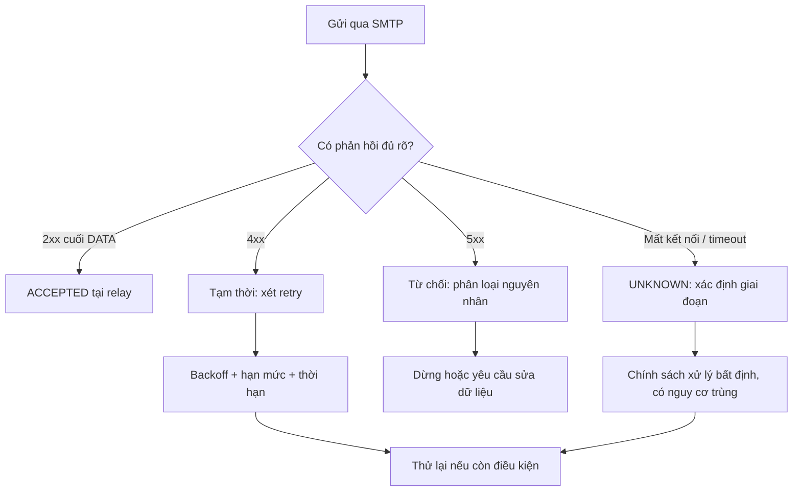
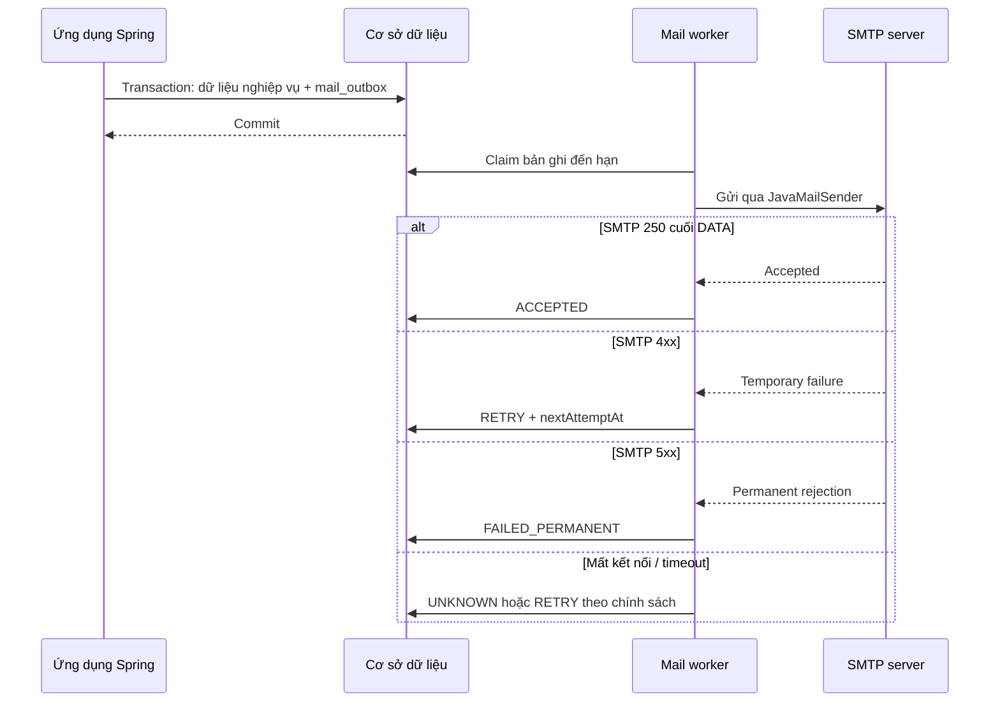
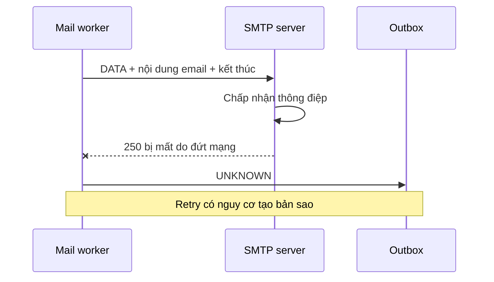

# Lỗi tạm thời và chiến lược thử lại trong SMTP

Một ứng dụng Spring có thể tạo email hoàn toàn hợp lệ nhưng vẫn không gửi được ngay lần đầu. Máy chủ SMTP có thể quá tải, hộp thư nhận đang đầy, kết nối mạng bị ngắt, DNS có sự cố ngắn hạn hoặc nhà cung cấp đang giới hạn tốc độ. Nếu coi mọi lỗi là thất bại vĩnh viễn, hệ thống sẽ bỏ lỡ những email đáng lẽ có thể gửi thành công sau vài phút. Nếu thử lại quá nhanh hoặc vô hạn, hệ thống có thể tạo thêm tải, làm xấu danh tiếng gửi và phát sinh những email trùng lặp.

Bài học này tập trung vào **lỗi tạm thời (transient failure) và cách thử lại (retry) đúng trong SMTP**, áp dụng khi gửi thư bằng Spring Framework Mail, đặc biệt qua `JavaMailSender`. Nội dung phân biệt tín hiệu từ giao thức SMTP, lỗi truyền tải, trạng thái chưa chắc chắn, chiến lược backoff, lưu bền vững yêu cầu gửi và cách vận hành một worker gửi email an toàn.

> **Nguyên tắc đầu tiên:** Mã phản hồi SMTP cho biết máy chủ đã trả lời thế nào đối với một lệnh cụ thể. Nó không tự bảo đảm rằng toàn bộ email đã đến hộp thư người nhận. Một lệnh `JavaMailSender.send(...)` trả về bình thường thường chỉ cho thấy thư đã được SMTP server chấp nhận ở chặng gửi mà ứng dụng quan sát.

## 1. SMTP phân biệt lỗi tạm thời và lỗi vĩnh viễn như thế nào?

### 1.1. Đọc chữ số đầu của mã SMTP

SMTP dùng mã phản hồi gồm ba chữ số. Trong bối cảnh gửi email:

| Nhóm mã | Ý nghĩa khái quát | Cách ứng dụng nên hiểu |
|---|---|---|
| `2xx` | Lệnh được chấp nhận/thành công | Tiếp tục phiên hoặc ghi nhận kết quả ở đúng giai đoạn |
| `3xx` | Cần thêm thông tin hay dữ liệu để tiếp tục | Đây chưa phải lỗi gửi; tiếp tục hội thoại SMTP |
| `4xx` | **Transient negative completion**: tạm thời không thực hiện được lệnh | Có khả năng thử lại, sau khi phân loại và chờ phù hợp |
| `5xx` | **Permanent negative completion**: lệnh bị từ chối về mặt giao thức | Thường không lặp lại nguyên yêu cầu; cần sửa nguyên nhân hoặc chính sách riêng |

Từ *temporary* ở đây có nghĩa máy chủ không khẳng định yêu cầu sẽ luôn thất bại. Nó **không có nghĩa** cứ retry ngay lập tức sẽ thành công. Ngược lại, `5xx` không đồng nghĩa phải xóa toàn bộ công việc mà không ghi lý do: có thể cần sửa địa chỉ nhận, domain, chính sách xác thực hoặc cấu hình ứng dụng trước khi tạo một lần gửi mới.

### 1.2. Một số mã thường gặp

| Mã | Tình huống thường gặp | Quyết định ban đầu |
|---|---|---|
| `421` | Dịch vụ không sẵn sàng; máy chủ có thể đóng kết nối | Thử lại sau, giảm tốc độ, kiểm tra sức khỏe provider |
| `450` | Hộp thư không sẵn sàng tạm thời hoặc bị từ chối tạm thời | Lên lịch thử lại theo chính sách |
| `451` | Máy chủ gặp lỗi xử lý tạm thời | Retry có backoff; theo dõi tỷ lệ lỗi |
| `452` | Thiếu tài nguyên/lưu trữ, vượt giới hạn tạm thời | Giảm tải và thử lại sau; kiểm tra quota |
| `454` | Xác thực hoặc TLS không sẵn sàng tạm thời, tùy ngữ cảnh máy chủ | Phân biệt gián đoạn ngắn hạn với cấu hình sai |
| `550` | Hộp thư không tồn tại hoặc yêu cầu bị policy từ chối (phụ thuộc thông báo) | Không retry mù quáng; xác định lý do cụ thể |
| `551` / `553` | Địa chỉ nhận/định tuyến hoặc cú pháp địa chỉ không được chấp nhận | Sửa dữ liệu hoặc định tuyến trước khi gửi lại |
| `552` | Vượt dung lượng lưu trữ hay giới hạn nhận theo cách máy chủ phân loại | Thường là từ chối vĩnh viễn ở lệnh hiện tại; không tự chuyển sang retry chỉ vì nói đến quota |

Mô tả là các ví dụ thường gặp, không phải ánh xạ một-một giữa mã và nguyên nhân nghiệp vụ. Một số nhà cung cấp dùng mã SMTP hoặc thông báo bổ sung theo chính sách riêng. Nên lưu **mã SMTP thực tế, mã mở rộng nếu có, giai đoạn bị lỗi và loại nguyên nhân đã chuẩn hóa**.

### 1.3. Enhanced Status Code bổ sung thông tin

Bên cạnh mã ba chữ số, máy chủ có thể trả về mã trạng thái mở rộng dạng `X.Y.Z`, chẳng hạn:

```text
451 4.3.0 Temporary local problem - please try later
450 4.2.2 Mailbox temporarily over quota
550 5.1.1 Recipient address rejected: user unknown
```

Chữ số đầu `4` hoặc `5` trong enhanced code tiếp tục gợi ý tính tạm thời hoặc vĩnh viễn; phần sau thường giúp hiểu nhóm vấn đề như địa chỉ, mailbox, hệ thống mail, mạng hay policy. Không nên suy luận chỉ từ câu tiếng Anh phía sau mã: thông báo văn bản thay đổi giữa nhà cung cấp và có thể được bản địa hóa.

**Điểm phân biệt quan trọng:** `450 4.2.2` có thể đủ cơ sở để retry theo chính sách; `550 5.1.1` báo địa chỉ không tồn tại thường cần dừng gửi tới địa chỉ đó và ghi nhận để xử lý dữ liệu.

## 2. Lỗi xảy ra ở bước nào của cuộc hội thoại SMTP?

Một lần gửi thường đi qua những bước rút gọn sau:

```text
Client                         SMTP server
  |---- EHLO -------------------->|
  |<--- 250 ... ------------------|
  |---- STARTTLS (nếu dùng) ----->|
  |<--- 220 ... ------------------|
  |---- AUTH (nếu cần) ---------->|
  |<--- 235 ... ------------------|
  |---- MAIL FROM:<sender> ----->|
  |<--- 250 ... ------------------|
  |---- RCPT TO:<recipient> ---->|
  |<--- 250 ... ------------------|
  |---- DATA -------------------->|
  |<--- 354 ... ------------------|
  |---- Header, body, CRLF . ---->|
  |<--- 250 Queued as ... --------|
  |---- QUIT -------------------->|
```

Đây chỉ là sơ đồ minh họa; TLS, AUTH và các lệnh mở rộng phụ thuộc máy chủ. Khi đã nhận `354`, client gửi nội dung thư và dòng kết thúc theo quy tắc SMTP. Nếu sau phần dữ liệu, server trả `250`, server đã **chấp nhận trách nhiệm xử lý thư ở bước đó**. Điều này vẫn chưa xác nhận thư đã tới hộp thư cuối cùng.

Vị trí lỗi quyết định ý nghĩa của retry:

- **Trước `MAIL FROM`**: có thể là lỗi kết nối, DNS, TLS, xác thực hoặc giới hạn máy chủ. Thường chưa có nội dung thư nào được chấp nhận.
- **Tại `RCPT TO`**: một người nhận có thể bị từ chối trong khi người khác được chấp nhận. Phải theo dõi theo người nhận hoặc ít nhất giữ được tập người nhận thành công/thất bại.
- **Trước khi gửi hết `DATA`**: thư thường chưa được server xác nhận; vẫn cần xem trạng thái kết nối và cách thư viện báo lỗi.
- **Sau khi gửi xong `DATA` nhưng trước khi nhận `250`**: **trạng thái không chắc chắn**. Server có thể đã nhận thư nhưng phản hồi bị mất. Retry có thể tạo bản sao.
- **Sau `250` ở cuối `DATA`**: provider đã chấp nhận. Không gửi lại chỉ vì chưa thấy sự kiện delivered; chờ cơ chế phản hồi/bounce của provider.



## 3. Phân biệt lỗi giao thức, lỗi kết nối và lỗi nội dung

Không phải mọi exception do Spring Mail báo đều là SMTP 4xx.

| Nhóm lỗi | Ví dụ | Có nên retry? |
|---|---|---|
| **Tạm thời, có xác nhận** | SMTP `451`, `452`, `421`, provider tạm ngừng | Có, nếu thư còn giá trị và chưa vượt ngân sách |
| **Hạ tầng có thể hồi phục** | DNS lỗi tạm thời, mất mạng, connection reset, socket timeout | Có thể, nhưng kiểm tra giai đoạn để nhận biết nguy cơ gửi trùng |
| **Lỗi xác thực/cấu hình** | Sai mật khẩu SMTP, sai host, chứng chỉ TLS không tin cậy | Thường cần sửa cấu hình; retry vô hạn không giải quyết được |
| **Dữ liệu/thông điệp không hợp lệ** | Email thiếu recipient, template lỗi, header không hợp lệ | Sửa input/template; không retry mù quáng |
| **Người nhận bị từ chối vĩnh viễn** | `550 5.1.1` user unknown | Dừng với recipient đó; có thể đưa vào suppression |
| **Không xác định đã chấp nhận hay chưa** | Timeout sau khi gửi `DATA` | Cân nhắc nguy cơ trùng; ưu tiên đối chiếu nếu provider hỗ trợ |

Khi một email có nhiều địa chỉ trong To/Cc/Bcc, thư viện hoặc máy chủ có thể chấp nhận một phần. Nếu retry toàn bộ danh sách, người đã được nhận có thể nhận hai lần. Đối với hệ thống đòi hỏi theo dõi chính xác, nên gửi **mỗi bản ghi giao hàng cho một recipient** hoặc dùng API và kết quả từng recipient của nhà cung cấp.

## 4. Spring Mail biểu diễn lỗi gửi ra sao?

### 4.1. Phân tầng exception

Trong Spring Framework Mail, những kiểu lỗi thường cần biết gồm:

- `MailException`: kiểu cha của lỗi trong abstraction Spring Mail.
- `MailSendException`: xảy ra khi gửi thất bại; trong một số trường hợp có thông tin từng message qua `getFailedMessages()`.
- `MailAuthenticationException`: lỗi xác thực email server.
- `MailPreparationException`: không thể chuẩn bị message trước khi gửi.
- `MailParseException`: không thể phân tích/tạo message hợp lệ.
- `MailException.getCause()` hoặc các exception Jakarta Mail bên dưới: có thể chứa nguyên nhân SMTP và mã phản hồi chi tiết.

Không có quy tắc đáng tin cậy kiểu `catch (MailException) { retry(); }`. Ví dụ, nếu template sai, thử lại 100 lần chỉ sinh ra 100 lần lỗi giống nhau.

Với ứng dụng dùng Jakarta Mail, nguyên nhân có thể đi qua `jakarta.mail.MessagingException` và chuỗi `getNextException()`. Những exception SMTP chuyên biệt phụ thuộc mail provider và phiên bản thư viện. Một số provider có kiểu exception chứa `returnCode` hoặc `address`, nhưng **không nên ép mọi deployment phải có cùng implementation** chỉ để phân loại một lỗi.

### 4.2. Đưa lỗi từ adapter sang ngôn ngữ nghiệp vụ

Thay vì để worker hiểu sâu mọi loại exception, tạo một ranh giới:

```text
JavaMailSender / SMTP provider
    |
    v
SmtpTransportAdapter
    |-- lấy SMTP reply code (nếu thực sự có)
    |-- nhận biết giai đoạn lỗi và recipient
    |-- nhận biết lỗi TLS/config/auth/MIME
    |-- đánh dấu kết quả không chắc chắn
    v
DeliveryOutcome
    |-- ACCEPTED
    |-- TEMPORARY_REJECTION
    |-- PERMANENT_REJECTION
    |-- INVALID_MESSAGE
    |-- CONFIGURATION_ERROR
    |-- UNKNOWN
    v
RetryPolicy + Outbox Worker
```

Ví dụ kiểu dữ liệu **minh họa**, độc lập với provider:

```java
public enum DeliveryKind {
    ACCEPTED,
    TEMPORARY_REJECTION,
    PERMANENT_REJECTION,
    INVALID_MESSAGE,
    CONFIGURATION_ERROR,
    UNKNOWN
}

public record DeliveryOutcome(
        DeliveryKind kind,
        Integer smtpReplyCode,
        String enhancedStatus,
        String safeErrorCode
) {}
```

Một quy tắc phân loại cơ bản từ **mã SMTP đã được trích xuất đáng tin cậy** có thể viết:

```java
public static DeliveryKind classifySmtpReply(int smtpCode) {
    if (smtpCode >= 400 && smtpCode <= 499) {
        return DeliveryKind.TEMPORARY_REJECTION;
    }
    if (smtpCode >= 500 && smtpCode <= 599) {
        return DeliveryKind.PERMANENT_REJECTION;
    }
    return DeliveryKind.UNKNOWN;
}
```

Đây là **bước đầu**, không phải toàn bộ chính sách. Cần xử lý riêng lỗi xác thực, TLS, dữ liệu, limit của nhà cung cấp và tình huống nhiều người nhận. Không chuyển một thông báo exception chứa chuỗi "450" thành trạng thái `TEMPORARY_REJECTION` bằng regex đơn giản: số trong thông báo có thể là port, message ID hoặc thông tin không liên quan.

### 4.3. Một dịch vụ gửi với JavaMailSender

Ví dụ gửi **một người nhận mỗi lần** để dễ gắn một kết quả cho một yêu cầu:

```java
package com.example.mail;

import org.springframework.mail.SimpleMailMessage;
import org.springframework.mail.javamail.JavaMailSender;
import org.springframework.stereotype.Service;

@Service
public class SmtpMailGateway {

    private final JavaMailSender sender;

    public SmtpMailGateway(JavaMailSender sender) {
        this.sender = sender;
    }

    public void sendPlainText(
            String from,
            String recipient,
            String subject,
            String body
    ) {
        SimpleMailMessage mail = new SimpleMailMessage();
        mail.setFrom(from);
        mail.setTo(recipient);
        mail.setSubject(subject);
        mail.setText(body);
        sender.send(mail);
    }
}
```

Đoạn code trên làm đúng một việc: yêu cầu SMTP gửi email. Nó chưa cung cấp retry, cơ sở dữ liệu, deduplication, mã lỗi hay monitoring. Đó là những trách nhiệm của tầng điều phối gửi và adapter phân loại lỗi.

## 5. Thiết kế retry: chờ bao lâu, thử mấy lần?

### 5.1. Vì sao không retry ngay?

Nếu một SMTP server đang trả `421` vì quá tải, 10.000 worker lập tức kết nối lại có thể kéo dài sự cố. Cách retry tốt phải tạo khoảng nghỉ, trải tải theo thời gian, giảm lưu lượng khi provider báo giới hạn và **có điểm dừng**.

Một chính sách hoàn chỉnh cần trả lời:

1. **Lỗi nào được thử lại?** Chỉ lỗi tạm thời hoặc một số kết quả chưa chắc chắn đã được cho phép.
2. **Lần thử mới diễn ra khi nào?** Dùng backoff và jitter.
3. **Tối đa bao nhiêu lần?** Ngân sách số lần thử rõ ràng.
4. **Tối đa trong bao lâu?** Giới hạn tuổi thông báo hoặc thời gian từ lần đầu.
5. **Thông báo còn giá trị không?** Không gửi OTP hết hạn hoặc lời nhắc sự kiện đã qua.
6. **Provider có yêu cầu giới hạn tốc độ không?** Tuân thủ quota, rate limit và khoảng nghỉ nếu provider cung cấp.
7. **Sau khi hết giới hạn thì đi đâu?** Chuyển trạng thái cần can thiệp, ghi metric và có quy trình xử lý.

### 5.2. Fixed delay, exponential backoff và jitter

**Fixed delay** luôn chờ cùng một khoảng, dễ hiểu nhưng dễ đồng bộ hàng loạt worker.

**Exponential backoff** tăng khoảng nghỉ sau mỗi lần thất bại:

\[
d_n = \min(d_{\max}, d_{\text{base}} \times 2^{n-1})
\]

Trong đó `n` là **số lần thất bại đã ghi nhận**, bắt đầu từ 1; `d_base` là khoảng chờ ban đầu và `d_max` là trần thời gian.

**Jitter** thêm ngẫu nhiên để các worker không cùng gửi lại đúng một thời điểm. Với *full jitter*, thời gian chờ có thể chọn trong khoảng từ 0 đến `d_n`; với *equal jitter*, có thể chọn từ `d_n / 2` đến `d_n` để tránh một số yêu cầu retry quá sớm. Cả hai đều là lựa chọn triển khai, không phải tính năng SMTP tự động.

Ví dụ một chính sách minh họa (chưa tính jitter):

| Thất bại thứ | Backoff từ lúc phát hiện lỗi |
|---|---:|
| 1 | 1 phút |
| 2 | 2 phút |
| 3 | 4 phút |
| 4 | 8 phút |
| 5 | 16 phút |
| 6 trở đi | Tối đa 30 phút |

Ví dụ này **không** nói phải gửi mãi tới khi thành công. Giả sử đặt `maxAttempts = 8`, khi lần thử thứ tám thất bại thì chuyển sang trạng thái cuối cùng; không lên lịch lần thứ chín. Với email xác minh chỉ còn hiệu lực trong 10 phút, giới hạn thời gian có thể kết thúc sớm hơn giới hạn lần thử.

### 5.3. Mẫu mã tính backoff có giới hạn

Ví dụ sau tính thời gian chờ với *equal jitter*; nó **không tự gọi SMTP**:

```java
package com.example.mail;

import java.time.Duration;
import java.util.concurrent.ThreadLocalRandom;

public final class RetryDelay {

    private static final long BASE_MS = Duration.ofMinutes(1).toMillis();
    private static final long MAX_MS = Duration.ofMinutes(30).toMillis();

    private RetryDelay() {}

    // failedAttempts >= 1: số lần gửi đã thất bại.
    public static Duration afterFailure(int failedAttempts) {
        if (failedAttempts < 1) {
            throw new IllegalArgumentException("failedAttempts must be >= 1");
        }

        long capped = BASE_MS;
        for (int i = 1; i < failedAttempts && capped < MAX_MS; i++) {
            capped = Math.min(MAX_MS, capped * 2);
        }

        long lowerBound = capped / 2;
        long randomized = ThreadLocalRandom.current()
                .nextLong(lowerBound, capped + 1);
        return Duration.ofMillis(randomized);
    }
}
```

Với `failedAttempts = 1`, lịch thử lại được chọn trong khoảng 30–60 giây; lần kế tiếp 60–120 giây; đến trần 15–30 phút. Để dễ kiểm thử, hệ thống production có thể tiêm một nguồn sinh số ngẫu nhiên và `Clock`, tránh phụ thuộc vào thời gian thật trong unit test.

**Lưu ý về rate limit:** một số API mail provider có header `Retry-After`, còn SMTP có thể trả `421` hoặc `451` cùng hướng dẫn trong thông điệp. Chỉ dựa vào các cơ chế mà provider thực sự cam kết. Không coi một khoảng chờ xuất hiện trong chuỗi thông báo tự do là hợp đồng có thể parse ổn định.

## 6. Retry ở đâu trong ứng dụng Spring?

### 6.1. Retry ngắn trong bộ nhớ

Spring Retry cung cấp các cơ chế như `RetryTemplate` và `@Retryable` (khi đã thêm dependency và bật cấu hình tương ứng). Chúng có thể hữu ích khi thao tác rất ngắn, vẫn nằm trong ngữ cảnh được kiểm soát và việc chậm thêm vài giây được chấp nhận.

Tuy nhiên, nếu một request HTTP đang chờ gửi email, retry vài lần với delay lớn sẽ làm request lâu hoặc timeout. Quan trọng hơn, retry trong bộ nhớ **không bảo đảm khôi phục khi JVM bị dừng**. Một hệ thống thông báo quan trọng nên lưu ý định gửi và lịch thử lại vào kho bền vững.

### 6.2. Outbox bền vững là lựa chọn cho thông báo quan trọng

Một thiết kế thường dùng:



Các trạng thái tối thiểu có thể là:

| Trạng thái | Ý nghĩa |
|---|---|
| `PENDING` | Ý định gửi đã lưu, chưa tới lượt xử lý |
| `PROCESSING` | Worker đã claim và có lease |
| `RETRY` | Được phép gửi lại từ `next_attempt_at` |
| `ACCEPTED` | SMTP relay đã chấp nhận thư |
| `FAILED_PERMANENT` | Lỗi không nên thử lại nguyên bản |
| `EXHAUSTED` | Lỗi có thể retry nhưng đã hết lần thử/thời hạn |
| `UNKNOWN` | Không khẳng định được SMTP đã chấp nhận hay chưa; cần chính sách riêng |

**Không đặt tên `DELIVERED` cho `ACCEPTED`**. Nếu provider hỗ trợ delivery event thì có thể bổ sung trạng thái `DELIVERED`/`BOUNCED` riêng, được cập nhật bởi nguồn dữ liệu phản hồi khác.

### 6.3. Phác thảo cấu trúc dữ liệu

Ví dụ mô hình lưu trữ mang tính minh họa:

```sql
CREATE TABLE mail_outbox (
    id UUID PRIMARY KEY,
    business_key VARCHAR(200) NOT NULL UNIQUE,
    recipient VARCHAR(320) NOT NULL,
    template_id VARCHAR(100) NOT NULL,
    template_payload TEXT NOT NULL,
    status VARCHAR(32) NOT NULL,
    attempts INTEGER NOT NULL DEFAULT 0,
    next_attempt_at TIMESTAMP NULL,
    lease_owner VARCHAR(100) NULL,
    lease_until TIMESTAMP NULL,
    last_smtp_code INTEGER NULL,
    last_error_category VARCHAR(100) NULL,
    accepted_at TIMESTAMP NULL,
    created_at TIMESTAMP NOT NULL,
    updated_at TIMESTAMP NOT NULL
);
```

Các trường có mục đích riêng:

- `business_key` giúp tránh tạo nhiều **ý định gửi** từ cùng sự kiện nghiệp vụ.
- `attempts` đếm số lượt gửi thực tế được bắt đầu, không phải số lần job scheduler chạy.
- `next_attempt_at` cho phép worker xử lý lần thử tiếp theo mà không giữ thread ngủ.
- `lease_owner` và `lease_until` cho phép claim có thời hạn, phục hồi khi worker chết.
- `last_smtp_code` và `last_error_category` giúp điều tra theo mã lỗi mà không cần log nội dung email.
- `accepted_at` ghi thời điểm SMTP server chấp nhận; không được tự coi là thời điểm người dùng nhận thư.

Đối với ứng dụng gửi cho nhiều người, chọn `business_key` theo cả sự kiện và người nhận, chẳng hạn `invoice-123:recipient-456`, hoặc có một bảng giao hàng riêng cho từng recipient. Không nên có một dòng duy nhất đại diện cho mọi người nhận khi kết quả retry cần chính xác từng địa chỉ.

### 6.4. Worker xử lý vòng đời bản ghi

Pseudo-code cho một worker:

```text
FOR each due item claimed atomically:
    if item.expired or attempts >= maxAttempts:
        mark EXHAUSTED
        continue

    increment attempts and commit short claim transaction

    outcome = smtpAdapter.send(item)     // Network I/O outside DB lock

    if outcome == ACCEPTED:
        mark ACCEPTED
    else if outcome == TEMPORARY_REJECTION:
        if attempts >= maxAttempts or item.expired:
            mark EXHAUSTED
        else:
            mark RETRY and next_attempt_at = now + backoff(attempts)
    else if outcome == PERMANENT_REJECTION:
        mark FAILED_PERMANENT
    else if outcome == UNKNOWN:
        apply duplicate-aware uncertain-outcome policy
    else:
        mark actionable failure and alert if needed
```

Trong triển khai có nhiều worker, thao tác chọn bản ghi và gắn lease cần **nguyên tử**. PostgreSQL có thể dùng `FOR UPDATE SKIP LOCKED`; database khác cần cơ chế tương đương. Đừng giữ transaction database mở xuyên suốt thời gian đợi SMTP: giữ khóa lâu làm nghẽn worker khác và có thể khiến lock timeout.

Khi worker cập nhật kết quả, nên dùng **fencing/ownership condition** để bảo đảm chỉ worker đang nắm lease hợp lệ có quyền đổi trạng thái. Nếu lease đã hết hạn và worker khác claim, một worker cũ thức dậy muộn không nên ghi đè kết quả mới.

## 7. Vấn đề khó nhất: server có thể đã nhận thư nhưng client không biết

Xét tình huống:

1. Worker gửi phần `DATA` của email.
2. SMTP server xử lý xong và chấp nhận thư.
3. Đường mạng bị ngắt trước khi client nhận được `250`.
4. `JavaMailSender` báo lỗi I/O/timeout.
5. Worker không thể phân biệt chắc chắn hai khả năng: thư đã được chấp nhận hoặc chưa.

Nếu worker retry, người nhận **có thể nhận hai email**. Nếu worker bỏ qua, người nhận **có thể không nhận email nào**.



Đây là giới hạn cơ bản của giao tiếp phân tán. Một unique constraint trên outbox chỉ ngăn tạo bản ghi trùng, **không biến SMTP thành exactly-once**. Header `Message-ID` giống nhau cũng không bảo đảm mọi mail server sẽ tự loại bản sao.

Các cách giảm ảnh hưởng:

1. Tạo **idempotency key ở tầng nghiệp vụ** khi ghi outbox, ví dụ `password-reset-request:<requestId>:<recipientId>`.
2. Nếu dùng mail provider có **API hỗ trợ idempotency key**, tận dụng theo hợp đồng của API đó. SMTP chuẩn không định nghĩa khóa idempotency áp dụng xuyên các lần gửi.
3. Lưu kết quả và provider message ID khi lấy được; dùng status API/provider event để đối chiếu trước khi retry các trường hợp không chắc chắn nếu nhà cung cấp hỗ trợ.
4. Với thư có rủi ro cao nếu trùng (mã khuyến mại dùng một lần, giao dịch có hậu quả), làm cho **hành động phía ứng dụng** có idempotency: hai email chứa cùng một link cũng chỉ cho phép một tác động nghiệp vụ.
5. Đặt giới hạn thử lại riêng cho `UNKNOWN`, cân nhắc đẩy vào hàng cần can thiệp tùy mức độ quan trọng và độ khẩn cấp.

Lựa chọn cuối cùng phụ thuộc yêu cầu nghiệp vụ: với email xác nhận quan trọng, *có thể trùng* đôi khi chấp nhận được hơn *có thể mất*; với thư marketing, có thể ưu tiên không làm phiền người nhận. Quyết định cần được ghi rõ thành chính sách, không ẩn trong `catch (Exception)`.

## 8. Cấu hình SMTP để retry có thể kiểm soát

### 8.1. Đặt timeout rõ ràng

Trong ứng dụng Spring Boot, cấu hình các timeout để worker không bị treo vô hạn khi server hoặc mạng có vấn đề:

```yaml
spring:
  mail:
    host: ${SMTP_HOST}
    port: ${SMTP_PORT:587}
    username: ${SMTP_USERNAME}
    password: ${SMTP_PASSWORD}
    default-encoding: UTF-8
    properties:
      mail:
        smtp:
          auth: true
          starttls:
            enable: true
            required: true
          connectiontimeout: 5000
          timeout: 10000
          writetimeout: 10000
```

- `mail.smtp.connectiontimeout` giới hạn thời gian chờ mở kết nối.
- `mail.smtp.timeout` giới hạn thời gian chờ đọc phản hồi socket.
- `mail.smtp.writetimeout` giới hạn thời gian chờ ghi dữ liệu.

Các giá trị là **mili giây** và chỉ là ví dụ. Chọn thời gian phù hợp với mạng, kích thước email, SLA và timeout của hệ thống phía trước. Quá thấp gây timeout giả; quá cao làm worker bị chiếm lâu. Những timeout này không phải là chính sách retry và không xác định email đã được chấp nhận sau một lỗi socket.

Cấu hình bảo mật cần đúng hợp đồng provider. Ví dụ trên dành cho STARTTLS cổng 587; nếu dùng implicit TLS cổng 465, cấu hình SSL tương ứng theo provider. Không tắt xác minh chứng chỉ để xử lý lỗi TLS.

### 8.2. Không bỏ qua giới hạn toàn hệ thống

Retry đúng từng email vẫn có thể gây quá tải tổng thể nếu hàng triệu email cùng đến hạn. Cần thiết kế thêm:

- Giới hạn số email gửi mỗi giây/phút cho từng tài khoản/provider.
- Giới hạn số kết nối SMTP đang hoạt động; điều tiết concurrency của worker.
- Điều phối ưu tiên theo loại thư: thông báo bảo mật thường không nên chờ sau một chiến dịch marketing lớn.
- Circuit breaker hoặc tạm ngừng gửi khi provider đang lỗi diện rộng, tránh hàng loạt kết nối thất bại.
- Hàng đợi/chính sách riêng cho recipient/domain liên tục bị throttling, nếu provider có khuyến cáo.
- Quản lý tuổi thông báo: không đẩy thư xác thực đã hết hạn chỉ vì hệ thống vừa khôi phục.

Backoff cho từng bản ghi và **rate limit toàn hệ thống** là hai tầng khác nhau. Jitter phân tán thời điểm retry nhưng không thay thế quota điều phối toàn cục.

## 9. Đo và quan sát retry trong production

Một log có ích cần liên kết được việc thử gửi với bản ghi outbox, nhưng không tiết lộ nội dung thư hoặc bí mật:

```json
{
  "event": "smtp_delivery_attempt",
  "notificationId": "b7810b2e-1457-4359-af5d-61ad96316e33",
  "attempt": 3,
  "recipientReference": "recipient-42",
  "provider": "primary-smtp",
  "result": "TEMPORARY_REJECTION",
  "smtpCode": 451,
  "enhancedStatus": "4.3.0",
  "nextRetrySeconds": 247,
  "durationMs": 1328
}
```

Tránh ghi SMTP password, mã xác thực, dữ liệu nhạy cảm trong body, token URL hoặc địa chỉ email đầy đủ vào log phổ biến. Thông điệp lỗi do provider trả về cũng có thể chứa địa chỉ nhận hoặc nội dung cần được che/mã hóa trước khi lưu.

| Chỉ số | Dùng để phát hiện |
|---|---|
| `mail_send_attempts_total{outcome,provider}` | Lỗi tạm thời và lỗi vĩnh viễn tăng bất thường |
| `mail_retry_scheduled_total{reason}` | Có quá nhiều lần thử lại hay một nguyên nhân chiếm ưu thế |
| `mail_outbox_due_count` | Số thông báo đáng lẽ đã được xử lý |
| `mail_outbox_oldest_due_age_seconds` | Backlog tồn tại quá lâu |
| `mail_retry_exhausted_total` | Nhiều yêu cầu hết ngân sách retry |
| `mail_smtp_latency_seconds` | Lệnh SMTP đang chậm, dễ gây timeout dây chuyền |
| `mail_unknown_outcome_total` | Nguy cơ gửi trùng hoặc thất lạc đang tăng |

Chỉ dùng nhãn metric có **cardinality thấp**, ví dụ provider, loại lỗi, template nhóm; không dùng `emailAddress` hoặc `notificationId` làm label Prometheus. Những ID đó thuộc log/tracing có chính sách lưu trữ phù hợp.

Một cảnh báo hữu ích không chỉ nhìn số lỗi. Nếu SMTP trả `451` trong 30 giây rồi phục hồi, cơ chế retry có thể xử lý tốt. Nhưng nếu backlog tăng liên tục, bản ghi cũ nhất quá SLA, hoặc lỗi xác thực tăng đột ngột sau khi rotate credential, cần can thiệp.

## 10. Thử nghiệm các tình huống quan trọng

Mailpit hoặc SMTP test server giúp kiểm tra định dạng và đường gửi cơ bản. Để kiểm tra retry, cần thêm SMTP stub cho phép **cố ý trả mã lỗi hoặc ngắt kết nối đúng giai đoạn**.

| Kịch bản | Điều cần chứng minh |
|---|---|
| SMTP trả `451` ngay tại `RCPT TO` | Worker ghi lỗi tạm thời, không coi là đã gửi, lên lịch retry |
| SMTP trả `550 5.1.1` | Worker ngừng retry địa chỉ không tồn tại, lưu lý do |
| SMTP trả `421` hàng loạt | Rate limit/backoff giúp giảm tải, không bùng nổ retry |
| Sai SMTP password | Lỗi được phân loại thành vấn đề cấu hình/cảnh báo, không thử vô hạn |
| Timeout khi mở kết nối | Worker lưu trạng thái có thể retry, không khóa database lâu |
| Ngắt mạng sau khi gửi xong DATA | Worker đánh dấu trạng thái bất định; không kết luận chắc chắn chưa gửi |
| Nhiều recipient, một người bị từ chối | Không gửi lại tràn lan cho người đã được chấp nhận |
| Worker crash sau khi claim | Lease hết hạn, bản ghi có thể được worker khác xử lý theo chính sách |
| Hai worker lấy cùng thời điểm | Chỉ một worker claim được một bản ghi trong một lease hợp lệ |
| Email đã hết hạn trong hàng chờ | Worker dừng gửi, không đẩy thông tin đã vô giá trị |
| Đạt maxAttempts | Bản ghi chuyển `EXHAUSTED`, có log/metric phục vụ xử lý |

Nếu dùng integration test với database, nên thử cả trường hợp transaction nghiệp vụ rollback: không được xuất hiện outbox không đi kèm nghiệp vụ đã commit. Với email chứa nhiều trường dữ liệu, kiểm tra sự ổn định của bản mẫu qua lần retry để tránh việc cùng một yêu cầu gửi ra nội dung khác nhau ngoài ý muốn.

## 11. Ví dụ xuyên suốt: email xác nhận đơn hàng

Giả sử hệ thống tạo đơn hàng `ORDER-1042` và cần gửi xác nhận tới người mua.

**Bước 1 — Ghi ý định gửi.** Khi transaction lưu đơn hàng commit, nó cũng lưu một outbox có `business_key = order-confirmation:ORDER-1042:customer-7`, `status = PENDING`, `attempts = 0`.

**Bước 2 — Worker gửi lần đầu.** Worker claim bản ghi, render email và gọi `JavaMailSender.send(...)`. SMTP server trả `451 4.3.0`. Adapter phân loại `TEMPORARY_REJECTION`. Worker ghi `attempts = 1`, `status = RETRY`, `next_attempt_at = now + RetryDelay.afterFailure(1)`.

**Bước 3 — Worker gửi lại khi đến hạn.** SMTP trả `250` sau phần dữ liệu. Worker ghi `attempts = 2`, `status = ACCEPTED`, `accepted_at` và mã định danh từ provider nếu có.

**Bước 4 — Phản hồi sau gửi.** Nếu provider hỗ trợ webhook delivery/bounce, một thành phần khác nhận sự kiện để ghi kết quả phát thư. Nếu không có phản hồi này, hệ thống chỉ khẳng định `ACCEPTED`.

**Biến thể A — Lỗi vĩnh viễn:** nếu lần đầu nhận `550 5.1.1`, worker ghi `FAILED_PERMANENT` và báo nghiệp vụ/phòng vận hành theo yêu cầu, không tự retry mãi.

**Biến thể B — Server đã nhận nhưng mất phản hồi:** nếu timeout sau `DATA`, worker không có đủ bằng chứng để ghi `ACCEPTED` hay `TEMPORARY_REJECTION`. Nó chuyển sang xử lý `UNKNOWN` theo chính sách cho phép gửi lại có giới hạn, đối chiếu provider hoặc can thiệp thủ công.

**Biến thể C — Đơn hàng bị tạo lại do request HTTP retry:** database unique trên `business_key` chặn việc thêm một outbox thứ hai cho cùng thông báo. Điều đó xử lý trùng ở đầu vào nhưng không xóa được khả năng trùng ở ranh giới SMTP như biến thể B.

## 12. Bài thực hành

Xây dựng một ứng dụng Spring Boot có SMTP giả lập và một worker gửi email có khả năng retry. Hoàn thành theo các mốc:

1. **Gửi cơ bản:** cấu hình `spring-boot-starter-mail`, `JavaMailSender` và một SMTP test server. Gửi email văn bản tới một recipient thử nghiệm.
2. **Phân loại lỗi:** bổ sung adapter trả `DeliveryOutcome`. Thử các phản hồi `451`, `421`, `550` và lỗi xác thực; lưu mã lỗi đã chuẩn hóa.
3. **Lưu lịch gửi:** thêm bảng `mail_outbox`, ghi một ý định gửi trong transaction nghiệp vụ và để worker xử lý sau.
4. **Lập lịch retry:** áp dụng exponential backoff có jitter, `maxAttempts`, deadline và trạng thái `EXHAUSTED`.
5. **Khôi phục sự cố:** chủ động dừng worker sau khi claim, kiểm tra lease hết hạn và một worker khác có thể tiếp tục xử lý.
6. **Xử lý kết quả không chắc chắn:** giả lập mất kết nối sau khi gửi DATA; giải thích vì sao không thể khẳng định "chưa gửi", rồi lựa chọn chính sách tránh tác động nghiệp vụ trùng.
7. **Quan sát:** thêm log với `notificationId`, các metric cho attempts/retries/exhausted/unknown và cảnh báo khi hàng chờ quá lâu.

Khi hoàn thành, hãy trả lời được ba câu hỏi cho mọi bản ghi: **tại sao lần gửi trước thất bại, khi nào và có nên thử lại, và ta thực sự biết gì về việc máy chủ SMTP đã chấp nhận email**. Đó là nền tảng để xây dựng chiến lược retry đáng tin cậy thay vì chỉ đặt một vòng lặp quanh `JavaMailSender.send()`.
