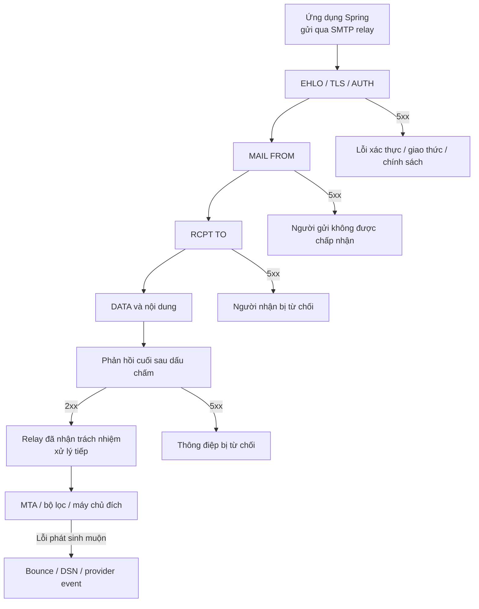
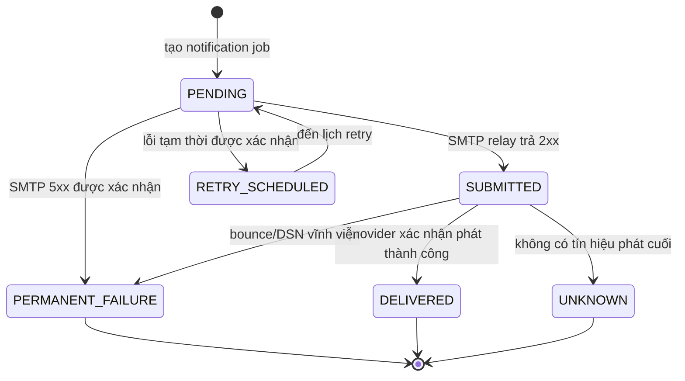

# SMTP: Lỗi vĩnh viễn do địa chỉ, chính sách hoặc nội dung

Trong hệ thống gửi email bằng Spring Framework Mail, không phải mọi lỗi đều có thể khắc phục bằng cách thử lại. Máy chủ SMTP có thể **từ chối vĩnh viễn một thao tác gửi** vì địa chỉ người nhận không hợp lệ, vì chính sách bảo mật/cho phép gửi, hoặc vì nội dung thông điệp vi phạm giới hạn và quy tắc của máy chủ nhận. Nhóm phản hồi **5xx** trong SMTP báo hiệu loại thất bại này.

Hiểu đúng lỗi vĩnh viễn giúp ứng dụng tránh hai hậu quả: gửi lại vô hạn một thư chắc chắn bị từ chối và đánh đồng mọi thông báo "550" với "email người nhận không tồn tại". Bài học trình bày cách đọc mã SMTP, xác định lỗi phát sinh ở bước nào, phân biệt ba nhóm nguyên nhân, rồi chuyển chúng thành cách xử lý phù hợp trong ứng dụng Spring.

## 1. “Vĩnh viễn” nghĩa là gì trong SMTP?

SMTP là giao thức trao đổi lệnh và phản hồi giữa bên gửi với máy chủ nhận. Phản hồi có **mã ba chữ số**; chữ số đầu tiên cho biết nhóm kết quả:

| Nhóm | Ý nghĩa | Ví dụ | Cách ứng xử |
| --- | --- | --- | --- |
| `2xx` | Lệnh được chấp nhận | `250 OK` | Tiếp tục hoặc ghi nhận thành công của bước hiện tại |
| `3xx` | Máy chủ chờ thêm dữ liệu | `354 Start mail input` | Gửi dữ liệu theo yêu cầu |
| `4xx` | Lỗi tạm thời | `451 Requested action aborted` | Có thể xếp hàng và thử lại theo chính sách |
| **`5xx`** | **Lỗi vĩnh viễn đối với thao tác hiện tại** | `550 Requested action not taken` | Không lặp lại y nguyên một cách mù quáng |

Từ **vĩnh viễn** không có nghĩa lỗi sẽ tồn tại đến hết đời. Một địa chỉ bị gõ sai có thể được sửa; miền gửi bị chặn có thể được mở; thông điệp quá lớn có thể được thu nhỏ. Nó có nghĩa là **máy chủ đã cho biết không nên tự động thử lại cùng lệnh với cùng điều kiện**, vì việc đợi thêm một khoảng ngắn không được kỳ vọng sẽ giải quyết vấn đề.

Đừng nhầm mã trạng thái SMTP `5xx` với HTTP `5xx`: trong HTTP, lỗi máy chủ 5xx thường làm người lập trình nghĩ đến retry; trong SMTP, nhóm 5xx mô tả **thất bại vĩnh viễn của yêu cầu SMTP hiện tại**.

### Mã SMTP ba chữ số và enhanced status code

Nhiều máy chủ gửi phản hồi có hai lớp:

```text
550 5.1.1 Recipient address rejected: User unknown
│   │
│   └── Enhanced status code: class.subject.detail
└────── Mã phản hồi SMTP ba chữ số
```

Trong `5.1.1`: chữ số đầu `5` là lỗi vĩnh viễn; phần `1` thuộc nhóm lỗi **địa chỉ**; phần `1` chỉ một tình huống chi tiết trong nhóm. Enhanced status code giúp phân loại rõ hơn, nhưng server không nhất thiết luôn phát mã này hoặc dùng đúng cùng chuỗi thông báo. Thông điệp bằng chữ là gợi ý để điều tra, không phải giao diện lập trình ổn định.

| Enhanced status nhóm | Ý nghĩa khái quát | Ví dụ tình huống |
| --- | --- | --- |
| `5.1.x` | Địa chỉ, tuyến gửi hoặc hộp thư đích ở cấp địa chỉ | Hộp thư không tồn tại, địa chỉ sai |
| `5.2.x` | Trạng thái mailbox | Hộp thư bị vô hiệu hóa hoặc nhận thư bị hạn chế |
| `5.3.x` | Hệ thống thư | Thông điệp vượt giới hạn kích thước của hệ thống |
| `5.4.x` | Mạng hoặc định tuyến | Không có tuyến hợp lệ trong trường hợp lỗi được coi là vĩnh viễn |
| `5.5.x` | Giao thức | Cú pháp hoặc lệnh SMTP không được chấp nhận |
| `5.6.x` | Nội dung và định dạng media | Định dạng MIME/nội dung không chuyển đổi hoặc xử lý được |
| `5.7.x` | Bảo mật và chính sách | Không được phép relay, vi phạm chính sách gửi hoặc xác thực |

**Không phân loại chỉ theo ba chữ số.** Một máy chủ có thể dùng `550` cho cả "user unknown" (`5.1.1`) và "blocked by policy" (`5.7.1`). Hãy kết hợp: mã ba chữ số, enhanced status code nếu có, nội dung chẩn đoán, lệnh SMTP bị từ chối và nơi tạo phản hồi.

## 2. Lỗi xuất hiện ở bước nào trong phiên SMTP?

Một phiên SMTP cơ bản gồm `EHLO`, `MAIL FROM`, `RCPT TO`, `DATA` và phản hồi cuối khi máy chủ đã nhận xong nội dung thư. Cùng một loại email có thể bị từ chối ở các bước khác nhau:



Các phản hồi 5xx ở từng bước có phạm vi khác nhau:

- **Ở `AUTH` hoặc giai đoạn submission:** tài khoản SMTP không được phép đăng nhập hoặc dùng sai phương thức; ứng dụng có thể nhận lỗi ngay trước khi gửi người nhận.
- **Ở `MAIL FROM`:** máy chủ không chấp nhận envelope sender, miền gửi, tuyến relay hoặc chính sách liên quan đến người gửi.
- **Ở `RCPT TO`:** lỗi thường gắn với **từng người nhận**. Một địa chỉ có thể bị từ chối trong khi địa chỉ khác vẫn được chấp nhận trong cùng phiên.
- **Sau `DATA`:** máy chủ đã có header/body để quét và có thể từ chối **toàn bộ giao dịch truyền thông điệp** vì nội dung hoặc chính sách. Máy chủ cũng có thể từ chối vì địa chỉ/chính sách ở thời điểm này.
- **Sau khi relay đã trả `250`:** việc giao đến MTA tiếp theo diễn ra sau đó. Lỗi vĩnh viễn có thể đến dưới dạng **Delivery Status Notification (DSN)**, bounce hoặc sự kiện từ nhà cung cấp, thay vì exception trong lời gọi `JavaMailSender.send(...)`.

Lỗi không liên quan đến phản hồi SMTP cũng có thể xảy ra, chẳng hạn DNS timeout, mất kết nối TCP, TLS handshake lỗi hoặc lỗi phân tích địa chỉ trong thư viện. Những lỗi đó **không tự động là SMTP 5xx**, ngay cả khi cuối cùng email không được gửi.

## 3. Nhóm 1: Lỗi vĩnh viễn do địa chỉ

Lỗi địa chỉ phát sinh khi máy chủ không xác định được hoặc không chấp nhận đường phát thư tới địa chỉ trong SMTP envelope. Ví dụ thường gặp là sai tên hộp thư, miền không tồn tại, mailbox đã bị vô hiệu hóa hoặc không nhận email.

### 3.1. Địa chỉ người nhận không tồn tại

Phản hồi minh họa:

```smtp
C: MAIL FROM:<bounces@shop.example>
S: 250 2.1.0 Sender OK
C: RCPT TO:<alcie@company.example>
S: 550 5.1.1 <alcie@company.example>: Recipient address rejected: User unknown
```

Ứng dụng thực sự muốn gửi cho `alice@company.example`, nhưng giá trị truyền đi là `alcie@company.example`. Máy chủ nhận từ chối tại `RCPT TO`. Gửi lại cùng địa chỉ lỗi thường vẫn nhận `550 5.1.1`.

Cách xử lý phù hợp:

1. Ghi lại trạng thái thất bại cho **đúng địa chỉ** được máy chủ từ chối.
2. Ngừng retry tự động cho địa chỉ đó cho đến khi có chỉnh sửa hoặc bằng chứng mới.
3. Cho phép người dùng sửa địa chỉ hoặc xác minh bằng kênh khác.
4. Không tự đoán và thay `alcie` thành `alice`, vì đó có thể là địa chỉ của người khác.

### 3.2. Cú pháp địa chỉ không đúng

Một chuỗi như `alice@@company.example` sai cú pháp. Lỗi có thể bị Jakarta Mail/ứng dụng từ chối **trước khi kết nối**, hoặc được máy chủ SMTP phản hồi, chẳng hạn:

```smtp
S: 553 5.1.3 Bad recipient address syntax
```

Xác thực đầu vào trong Spring nên bắt được những lỗi cú pháp rõ ràng để báo sớm cho người dùng. Tuy nhiên, **đúng cú pháp không đồng nghĩa hộp thư tồn tại**. Các cách đoán tính hợp lệ qua regex đơn giản, tra MX một lần hoặc thử lệnh SMTP `RCPT TO` đều không thể bảo đảm khả năng phát thư thực tế.

### 3.3. Miền không nhận email hoặc không có đích hợp lệ

Nếu miền không tồn tại, không có tuyến nhận thư hợp lệ, hoặc công bố **Null MX** để tuyên bố không nhận email, MTA thường không thể giao thư. Kết quả có thể xuất hiện ở log của relay dưới dạng lỗi vĩnh viễn hoặc DSN, thay vì trực tiếp tại `RCPT TO` của ứng dụng Spring.

Ví dụ thông báo phát muộn:

```text
Final-Recipient: rfc822; alice@no-mail.example
Action: failed
Status: 5.4.4
Diagnostic-Code: smtp; No valid mail route for recipient domain
```

Đây là cấu trúc minh họa của các trường DSN; mã và cách diễn đạt cụ thể phụ thuộc máy chủ gửi báo cáo. Khi điều tra, hãy kiểm tra cả lỗi DNS tạm thời: DNS timeout/SERVFAIL có thể là trường hợp retry được, khác với xác nhận miền/đường đi không tồn tại.

### 3.4. Hộp thư bị vô hiệu hóa hoặc không nhận thư

Máy chủ có thể trả `550` với enhanced status thuộc `5.2.x` hoặc `5.7.x` khi hộp thư bị khóa, không được phép nhận thư từ nguồn đó hoặc chính sách của tổ chức cấm phát đến tài khoản. Đừng suy ra "không tồn tại" từ chữ số `550` khi thông báo ghi "mailbox disabled" hay "recipient restricted".

## 4. Nhóm 2: Lỗi vĩnh viễn do chính sách

Lỗi chính sách xuất hiện khi máy chủ **có thể hiểu địa chỉ và nhận dữ liệu**, nhưng quyết định không cho phép thao tác theo quy tắc vận hành hoặc bảo mật. Enhanced status thường thuộc nhóm `5.7.x`; nhiều sản phẩm dùng `550 5.7.1`, `554 5.7.1` hoặc các chi tiết mã khác.

### 4.1. Không có quyền relay

```smtp
C: RCPT TO:<alice@other.example>
S: 554 5.7.1 Relay access denied
```

Trường hợp điển hình: ứng dụng kết nối tới một SMTP server không cho phép tài khoản/mạng hiện tại chuyển thư đến miền ngoài. Vấn đề nằm ở **quyền relay hoặc cấu hình máy chủ submission**, không thể kết luận hộp thư `alice` không tồn tại.

Cần xem:

- Ứng dụng có kết nối đến **đúng** SMTP submission host và cổng do nhà cung cấp chỉ định không?
- Có bật SMTP AUTH khi nhà cung cấp yêu cầu không? Tài khoản có quyền gửi cho sender/domain này không?
- Máy chủ có cho phép gửi đến miền ngoài hoặc gửi từ nguồn mạng hiện tại không?
- Có chính sách hạn chế địa chỉ `MAIL FROM`, danh tính đăng nhập và `From:` không?

Không được "sửa" lỗi này bằng cách bật open relay hoặc tắt cơ chế xác thực trên máy chủ.

### 4.2. SPF, DKIM và DMARC không đạt chính sách phía nhận

Ví dụ phản hồi:

```smtp
S: 550 5.7.1 Message rejected due to sender authentication policy
```

Máy chủ nhận có thể đánh giá:

- **SPF:** IP của MTA gửi có được phép gửi theo miền của envelope sender hoặc HELO phù hợp không?
- **DKIM:** chữ ký trên một số header và body có xác minh được với khóa DNS của miền ký không?
- **DMARC:** kết quả SPF hoặc DKIM có **pass** và **alignment** với miền `From:` hiển thị theo chính sách DMARC không?

Thất bại SPF không tự động đồng nghĩa DMARC thất bại nếu DKIM hợp lệ và aligned; điều tương tự đúng theo chiều ngược lại. Một máy chủ nhận có thể từ chối vì DMARC, danh tiếng IP, điều kiện danh tính hoặc bộ lọc riêng. **Spring Mail gửi qua SMTP**, còn cấu hình ký DKIM, SPF DNS, DMARC và IP gửi thường liên quan đến hạ tầng/nhà cung cấp mail.

Hướng khắc phục là kiểm tra xác thực miền gửi, cấu hình nhà cung cấp, bản ghi DNS, tên miền trong `From:` và envelope sender, thay vì gửi lại y nguyên. Nếu dùng dịch vụ SMTP ngoài, cần cấu hình domain authentication theo hướng dẫn của dịch vụ đó.

### 4.3. Danh tiếng gửi, chống spam và chính sách tổ chức

MTA cũng có thể từ chối vì nguồn IP/domain nằm trong danh sách chặn, đặc điểm giống spam/phishing, vi phạm chính sách danh sách thư, thiếu TLS bắt buộc hoặc gửi đến người nhận mà bên gửi không được phép liên hệ. Một số tình huống được đánh mã `4xx` để tạm hoãn, một số trả **5xx**.

Khi nhận lỗi chính sách:

1. Đọc thông tin cụ thể đi kèm mã, URL chính sách hoặc ID sự cố nếu có.
2. Kiểm tra xác thực domain, quyền gửi, danh tiếng, danh sách người nhận hợp lệ và nội dung thư.
3. Liên hệ quản trị viên nhà cung cấp/miền nhận bằng bằng chứng tối thiểu nếu cần.
4. Chỉ thử gửi lại khi điều kiện bị từ chối đã thay đổi; áp dụng giới hạn tốc độ để tránh bị đánh dấu lạm dụng.

Một số máy chủ cố ý không tiết lộ chính sách chi tiết để tránh bị lợi dụng. Không nên khẳng định nguyên nhân chắc chắn chỉ từ thông báo chung "blocked".

## 5. Nhóm 3: Lỗi vĩnh viễn do nội dung

Khác với lỗi địa chỉ thường xuất hiện ở `RCPT TO`, lỗi nội dung thường chỉ được xác định **sau khi máy chủ đã nhận header/body** tại `DATA`, hoặc tại các kiểm tra kích thước được công bố trước đó.

### 5.1. Email vượt kích thước tối đa

```smtp
C: EHLO app.shop.example
S: 250-mail.company.example
S: 250 SIZE 10485760
C: MAIL FROM:<notification@shop.example> SIZE=15728640
S: 552 5.3.4 Message size exceeds fixed maximum message size
```

Trong ví dụ, máy chủ quảng bá giới hạn `10 MiB` qua SMTP `SIZE`, còn bên gửi định truyền thư `15 MiB`. Máy chủ có thể từ chối tại `MAIL FROM` khi thấy tham số `SIZE` vượt giới hạn; một máy chủ khác có thể từ chối sau khi nhận dữ liệu. Không nên coi mọi `552` là mailbox đầy, vì nội dung enhanced status và thời điểm phản hồi mới cho biết ngữ cảnh.

Với attachment, kích thước email trên đường truyền **thường lớn hơn** kích thước file gốc do MIME/Base64 và metadata. File 8 MiB có thể làm thư vượt hạn mức gần 10 MiB. Hướng xử lý là giảm kích thước, nén hợp lý, tách tệp hoặc thay bằng liên kết tải có kiểm soát.

### 5.2. Định dạng MIME hoặc encoding không được chấp nhận

Email HTML, attachment và các ký tự quốc tế được đóng gói theo MIME. Một máy chủ có thể từ chối thông điệp không hợp lệ hoặc media không xử lý được:

```smtp
S: 554 5.6.0 Message content rejected: unsupported media format
```

Ví dụ về vấn đề cần xem xét là header MIME hỏng, charset/Content-Transfer-Encoding không phù hợp, cấu trúc multipart không hợp lệ, hoặc địa chỉ quốc tế yêu cầu khả năng SMTPUTF8 mà máy chủ tiếp nhận không hỗ trợ. Không phải mọi máy chủ đều dùng mã giống nhau; cần dựa vào chính phản hồi và log.

Spring thường giúp lập cấu trúc MIME thông qua `MimeMessageHelper`, nhưng ứng dụng vẫn phải cung cấp dữ liệu/kiểu nội dung đúng và tránh tự nối raw MIME sai quy tắc.

### 5.3. Attachment hoặc nội dung bị chính sách chặn

```smtp
S: 554 5.7.1 Message rejected: attachment type prohibited
```

Ví dụ: file thực thi bị cấm, mẫu nội dung bị nhận diện là độc hại, URL đáng ngờ, thông tin nhạy cảm vi phạm DLP (Data Loss Prevention), hoặc tài liệu có mật khẩu không được gateway cho phép. Đây là **từ chối vì nội dung theo chính sách**, nên có thể mang mã `5.7.x` thay vì `5.6.x`.

Giải pháp tùy nguyên nhân: thay định dạng được phép, loại bỏ nội dung không cần thiết, chia sẻ tài liệu qua kênh bảo mật phù hợp hoặc làm việc với quản trị viên. Không nên hướng dẫn người dùng né bộ lọc an ninh; hãy điều chỉnh quy trình gửi cho đúng chính sách.

### So sánh nhanh các kiểu lỗi nội dung

| Nguyên nhân | Phản hồi minh họa | Đầu mối khắc phục |
| --- | --- | --- |
| Quá giới hạn kích thước | `552 5.3.4` | Tính cả overhead MIME, giảm dung lượng |
| MIME/encoding lỗi | `554 5.6.0` | Kiểm tra cấu trúc MIME, charset, khả năng SMTP |
| Attachment bị cấm | `554 5.7.1` | Đổi cách chia sẻ tài liệu theo chính sách |
| Nội dung bị nhận diện spam/phishing | `550 5.7.1` | Rà thông điệp, nguồn gửi, xác thực miền và chính sách |
| Thư không thỏa chính sách bảo mật | `550/554 5.7.x` | Kiểm tra quy tắc cụ thể của máy chủ nhận |

Các phản hồi trong bảng là **ví dụ**, không phải ánh xạ cố định được mọi máy chủ áp dụng.

## 6. Đọc transcript SMTP để xác định đúng phạm vi thất bại

### Ví dụ A: Một địa chỉ bị từ chối ở RCPT TO

```smtp
S: 220 smtp.provider.example ESMTP
C: EHLO application.shop.example
S: 250 smtp.provider.example
C: MAIL FROM:<bounces@shop.example>
S: 250 2.1.0 OK
C: RCPT TO:<alice@company.example>
S: 250 2.1.5 OK
C: RCPT TO:<missing@company.example>
S: 550 5.1.1 Recipient unknown
C: DATA
S: 354 Continue
C: From: notification@shop.example
C: To: alice@company.example
C: Subject: Example
C:
C: Hello
C: .
S: 250 2.0.0 Queued
```

Ở ví dụ này, máy chủ nhận **chấp nhận Alice** và **từ chối missing**. Thông điệp sau `DATA` chỉ được chấp nhận cho người nhận đã được cho phép trong giao dịch. Nếu hệ thống gửi cho nhiều người cùng lúc, phải có dữ liệu trạng thái **theo từng người nhận**; không thể gán toàn bộ danh sách là thất bại hay thành công chỉ vì một mã `250` cuối.

Thư viện SMTP client có thể quyết định dừng, tiếp tục hay gửi một phần khi có recipient bị từ chối, tùy cấu hình như `mail.smtp.sendpartial` và hành vi thư viện. Transcript minh họa **khả năng của giao thức**, không khẳng định `JavaMailSender` sẽ luôn phát cùng chuỗi lệnh trong mọi cấu hình.

### Ví dụ B: Tất cả người nhận hợp lệ nhưng DATA bị từ chối

```smtp
C: MAIL FROM:<bounces@shop.example>
S: 250 OK
C: RCPT TO:<alice@company.example>
S: 250 OK
C: DATA
S: 354 Start mail input
C: From: notification@shop.example
C: To: alice@company.example
C: Subject: Report
C: MIME-Version: 1.0
C: Content-Type: application/octet-stream
C:
C: [message data]
C: .
S: 554 5.7.1 Message rejected by content policy
```

`250` tại `RCPT TO` **không phải** xác nhận đã phát thành công. Khi máy chủ trả `554` sau dấu chấm kết thúc `DATA`, giao dịch chuyển thư bị từ chối. Lúc này tìm kiếm lỗi ở kích thước, định dạng, bộ lọc nội dung và chính sách máy chủ nhận sẽ hợp lý hơn việc mặc định địa chỉ người nhận sai.

### Ví dụ C: Relay đã nhận thư, nhưng lỗi xuất hiện ở hop kế tiếp

```text
10:00  Spring -> SMTP relay : 250 2.0.0 queued as Q123
10:02  SMTP relay -> MX đích : 550 5.1.1 User unknown
10:03  Relay sinh DSN/bounce gửi về envelope sender
```

Lời gọi `JavaMailSender.send()` vào lúc 10:00 có thể đã kết thúc bình thường. Lỗi vĩnh viễn lúc 10:02 nằm ở **kết quả giao thư bất đồng bộ**. Ứng dụng chỉ biết được nếu có cơ chế nhận bounce, webhook hoặc truy vấn trạng thái từ nhà cung cấp.

Trong một số hệ thống có bộ lọc sau khi nhận thư, relay hoặc máy chủ đích có thể chấp nhận bằng `250` rồi kiểm duyệt, cách ly hoặc phát hiện lỗi. Vì vậy cần phân biệt các trạng thái **submitted, accepted by destination, delivered, bounced, quarantined**; SMTP `250` của relay đầu tiên không bảo đảm thư đến inbox.

## 7. Khi dùng Spring Framework Mail, lỗi xuất hiện dưới dạng nào?

Trong Spring, `JavaMailSender` là API gửi thư qua SMTP. Với Spring Boot, cấu hình thông dụng dùng starter mail và `spring.mail.*`; với Spring Framework thuần, ứng dụng thường tự cấu hình `JavaMailSenderImpl`.

Ví dụ cấu hình submission của ứng dụng:

```yaml
spring:
  mail:
    host: smtp.provider.example
    port: 587
    username: ${SMTP_USERNAME}
    password: ${SMTP_PASSWORD}
    properties:
      mail:
        smtp:
          auth: true
          starttls:
            enable: true
            required: true
          connectiontimeout: 5000
          timeout: 10000
          writetimeout: 10000
```

Khi ứng dụng gửi email, các lỗi có thể được ánh xạ sang những ngoại lệ thuộc họ `org.springframework.mail.MailException`. Một số loại thường gặp:

| Biểu hiện tại ứng dụng | Ngoại lệ Spring có thể gặp | Hướng điều tra |
| --- | --- | --- |
| Không kết nối hoặc không có SMTP server phù hợp | `MailSendException` hoặc ngoại lệ liên quan quá trình gửi | Network, DNS, TLS, host/port |
| SMTP AUTH bị từ chối | `MailAuthenticationException` | Tài khoản, mật khẩu, chính sách provider |
| Sai cú pháp/thông điệp không tạo được | `MailParseException` hoặc lỗi Jakarta Mail nằm trong cause | Dữ liệu đầu vào, MIME, thư viện |
| Máy chủ trả `550/554/552` khi gửi | Thường được bọc trong `MailSendException` và cause phụ thuộc mail provider | Phản hồi SMTP, enhanced status, lệnh bị từ chối |

**Không suy ra `MailSendException` = lỗi 5xx**. Nó cũng có thể bao bọc timeout, mất kết nối và lỗi khác. Và **không suy ra không có exception = thư đã được phát đến mailbox**.

### Ví dụ xử lý lỗi lúc submission

```java
import org.springframework.mail.MailAuthenticationException;
import org.springframework.mail.MailException;
import org.springframework.mail.MailSendException;
import org.springframework.mail.SimpleMailMessage;
import org.springframework.mail.javamail.JavaMailSender;

public class NotificationEmailSender {
    private final JavaMailSender sender;

    public NotificationEmailSender(JavaMailSender sender) {
        this.sender = sender;
    }

    public void submit(String to, String subject, String body) {
        SimpleMailMessage message = new SimpleMailMessage();
        message.setFrom("notification@shop.example");
        message.setTo(to);
        message.setSubject(subject);
        message.setText(body);

        try {
            sender.send(message);
            // Chỉ xác nhận đã submit thành công tới SMTP server hiện tại.
            recordSubmitted(to);
        } catch (MailAuthenticationException e) {
            // Lỗi vận hành/cấu hình: cần sửa thông tin xác thực.
            recordNeedsConfigurationFix(to, e);
        } catch (MailSendException e) {
            // Ghi nhận thất bại và chuyển cho lớp phân loại dựa trên
            // SMTP response/cause/provider event thực tế.
            recordSendFailure(to, e);
        } catch (MailException e) {
            recordSendFailure(to, e);
        }
    }

    private void recordSubmitted(String to) {
        // Cập nhật trạng thái submission trong hệ thống nghiệp vụ.
    }

    private void recordNeedsConfigurationFix(String to, Exception cause) {
        // Ghi lỗi cấu hình, tạo cảnh báo vận hành thích hợp.
    }

    private void recordSendFailure(String to, Exception cause) {
        // Lưu lỗi kỹ thuật có kiểm soát, tránh lộ địa chỉ và body trong log.
    }
}
```

Ví dụ tập trung vào **ranh giới trách nhiệm**. Ứng dụng thực tế nên tách việc gửi, lưu kết quả và quyết định retry thành các thành phần rõ ràng. Nếu yêu cầu phát thư tin cậy, có thể dùng outbox/queue để lưu job trước khi gửi.

Lưu ý về ngoại lệ: Jakarta Mail và SMTP transport implementation có thể cung cấp thêm mã trả lời SMTP và thông tin từng địa chỉ không gửi được, nhưng cấu trúc cause và loại exception cụ thể khác nhau theo thư viện và phiên bản. Không viết thuật toán nghiệp vụ dựa vào chuỗi tiếng Anh `contains("user unknown")` hoặc mặc định mọi exception đều mang mã SMTP. Nên lấy **mã phản hồi có cấu trúc** từ SMTP provider/adapter hoặc API event của nhà cung cấp khi có, lưu bản gốc để hỗ trợ điều tra.

### Một luồng xử lý trạng thái có thể dùng trong sản phẩm



`DELIVERED` chỉ được ghi khi có bằng chứng theo định nghĩa của nhà cung cấp (thường là máy chủ đích đã nhận hoặc hệ thống nhà cung cấp xác nhận delivery), không phải khi chính Spring gọi `send()` thành công. Tên trạng thái và logic có thể tùy hệ thống; điểm mấu chốt là lưu thông tin đủ để biết **đã gửi lên relay** hay **đã giao tới đích**.

## 8. Nên xử lý ba nhóm lỗi vĩnh viễn như thế nào?

Mỗi nhóm lỗi cần một quyết định nghiệp vụ riêng:

| Nhóm | Ví dụ tín hiệu | Hành động phù hợp | Retry tự động cùng payload? |
| --- | --- | --- | --- |
| Địa chỉ | `550 5.1.1`, `553 5.1.3` | Đánh dấu người nhận không gửi được, yêu cầu sửa/xác minh | **Không**, khi chưa sửa địa chỉ |
| Chính sách quyền relay | `554 5.7.1 Relay access denied` | Sửa SMTP host, quyền và xác thực | **Không**, cho tới khi sửa cấu hình/quyền |
| Chính sách xác thực miền | `550 5.7.1` liên quan SPF/DKIM/DMARC | Kiểm tra DNS, alignment, danh tính gửi | **Không**, cho tới khi hạ tầng gửi được sửa |
| Nội dung / kích thước | `552 5.3.4` | Giảm kích thước, thay cách gửi attachment | **Không**, cho tới khi sửa nội dung |
| Nội dung / bộ lọc an ninh | `554 5.7.1` | Tuân thủ policy, xử lý nội dung hoặc xin hỗ trợ | **Không**, cho tới khi nguyên nhân được xử lý |
| Lỗi tạm thời đối chứng | `451 4.x.x` | Xếp lịch retry có backoff và giới hạn | **Có thể**, theo retry policy |

Nếu chỉ có thông tin "gửi thất bại" mà **không có mã/nguồn lỗi**, chưa thể đánh dấu permanent. Trạng thái hợp lý là `UNKNOWN` hoặc `NEEDS_INVESTIGATION` cho đến khi có thêm bằng chứng. Đặc biệt, timeout sau khi truyền xong dữ liệu có thể khiến relay **đã nhận thư** nhưng ứng dụng không thấy phản hồi; retry thiếu kiểm soát có thể tạo email trùng.

### Đừng biến bounce thành vòng lặp

Khi MTA đã chấp nhận thư và sau đó phát hiện lỗi, nó có thể gửi DSN về **envelope sender** (return-path), vốn có thể khác header `From:` mà người nhận nhìn thấy. Một cách quản trị là cấu hình địa chỉ bounce chuyên dụng trên dịch vụ gửi và xử lý event theo danh tính thông điệp.

Thiết kế xử lý bounce nên:

- Liên kết sự kiện với **message ID/provider ID và recipient** tương ứng.
- Phân biệt hard bounce (`5.x.x`) với soft bounce (`4.x.x`) khi có dữ liệu đáng tin.
- Cập nhật trạng thái theo **người nhận**, nhất là email gửi cho nhiều địa chỉ.
- Tránh gửi lại cho hard bounce bị xác minh nếu chưa có sửa đổi hoặc người nhận xác nhận lại.
- Chống xử lý sự kiện trùng; xác minh nguồn webhook/sự kiện và tránh tin hoàn toàn vào email bounce không xác thực.
- Không tạo email báo lỗi vô hạn khi thông báo lỗi cũng không phát được; trong SMTP, DSN thường dùng reverse-path rỗng `MAIL FROM:<>` để tránh vòng lặp.

Không nên coi mọi email nằm trong inbox "bounces" là chứng cứ tuyệt đối, vì nội dung bounce có thể bị giả mạo, thiếu trường hoặc bị chuyển tiếp.

## 9. Thiết kế retry phù hợp với SMTP

Một hệ thống gửi mail thường có retry ở **hai tầng**:

1. **Ứng dụng Spring → SMTP relay:** ứng dụng có thể retry khi không kết nối được hoặc khi submission bị từ chối tạm thời, nhưng cần phân biệt timeout không rõ kết quả và lỗi 5xx chắc chắn.
2. **SMTP relay/MTA → miền nhận:** sau khi relay đã nhận thư, chính relay thường quản lý mail queue và retry cho lỗi 4xx ở các hop tiếp theo. Ứng dụng không nên phát lại cùng thư chỉ vì chưa thấy nó xuất hiện ngay trong inbox.

Đối với lỗi vĩnh viễn đã xác nhận:

```text
Nhận kết quả gửi
    |
    +-- SMTP 2xx tại relay --> SUBMITTED, chờ provider/DSN nếu cần
    |
    +-- SMTP 4xx rõ ràng --> RETRY_SCHEDULED theo backoff
    |
    +-- SMTP 5xx rõ ràng --> PERMANENT_FAILURE và lưu reason
    |
    +-- network timeout/unknown --> UNKNOWN, cần cơ chế chống trùng
    |
    +-- bounce 5.x.x sau submission --> cập nhật PERMANENT_FAILURE
```

Backoff thường tăng dần và có giới hạn tổng thời gian/số lần thử; chính sách retry nên đi kèm queue id, correlation id và idempotency strategy. **Mã 5xx không được giải quyết bằng cách tăng số lần retry**. Việc retry chỉ nên mở lại khi điều kiện đã thay đổi: địa chỉ sửa, chính sách được gỡ chặn, nội dung được thay, hoặc có bằng chứng server trả mã sai tạm thời.

Với thông điệp chứa nhiều người nhận, nên tạo job hoặc kết quả theo từng recipient, vì một địa chỉ có thể nhận `250` và địa chỉ khác nhận `550`. Dữ liệu theo recipient cũng giúp tránh gửi lại cho những người đã nhận thành công khi một người khác thất bại.

## 10. Chẩn đoán lỗi vĩnh viễn từ log và provider event

Giả sử người dùng báo "Spring không gửi được email". Bắt đầu bằng **bằng chứng gần nguồn lỗi nhất**, không đoán nguyên nhân từ tên exception:

1. **Xác định thời điểm và địa chỉ bị ảnh hưởng:** notification ID, người nhận (cần che bớt khi đưa vào log chung), miền nhận, SMTP relay đang dùng.
2. **Xác định nguồn phát sinh lỗi:** ứng dụng tạo MIME, SMTP submission, MTA trung gian, MX của miền nhận hay bộ lọc sau khi đã chấp nhận thư.
3. **Lấy phản hồi đầy đủ:** mã SMTP (ví dụ `550`), enhanced status (`5.1.1` hoặc `5.7.1`), lời giải thích, SMTP command, queue ID/provider ID.
4. **Phân nhóm:** địa chỉ, chính sách, nội dung hoặc chưa đủ dữ liệu.
5. **Chọn biện pháp sửa:** cập nhật người nhận, quyền relay, DNS/xác thực miền, MIME/kích thước hoặc liên hệ quản trị viên.
6. **Gửi thử có kiểm soát sau khi sửa**, ghi rõ phiên bản thông điệp và trạng thái của từng người nhận.

Một bản ghi nội bộ hợp lý:

```json
{
  "notificationId": "noti-2026-0051",
  "recipientDomain": "company.example",
  "smtpRelay": "smtp.provider.example",
  "phase": "RCPT_TO",
  "smtpReplyCode": 550,
  "enhancedStatusCode": "5.1.1",
  "category": "INVALID_RECIPIENT",
  "providerMessageId": null,
  "deliveryState": "PERMANENT_FAILURE",
  "retryEligible": false
}
```

Đây là một **mô hình log minh họa**, không phải cấu trúc do Spring tự sinh. Trong môi trường thực tế cần tuân thủ chính sách bảo vệ dữ liệu: tránh lưu body, password, SMTP AUTH credential hoặc toàn bộ email người dùng trong log thông thường.

### Bảng tra cứu theo hiện tượng

| Triệu chứng thấy được | Điều cần làm rõ | Hướng điều tra trước |
| --- | --- | --- |
| `550 5.1.1` trong `RCPT TO` | Đúng người nhận và đúng domain chưa? | Dữ liệu người nhận, trạng thái mailbox |
| `550 5.7.1` ở `MAIL FROM` | Máy chủ có cho phép sender/relay này không? | Danh tính gửi, SMTP AUTH, chính sách |
| `554 5.7.1` sau `DATA` | Bị bộ lọc nội dung hay xác thực miền? | Nội dung, header, DKIM/DMARC, thông báo gateway |
| `552 5.3.4` | Mail size thực tế vượt ngưỡng nào? | Kích thước MIME sau encoding, attachment |
| `553 5.1.3` | Có lỗi cú pháp envelope address không? | Địa chỉ được truyền qua SMTP, encoding/SMTPUTF8 |
| Spring `MailSendException` nhưng không có mã 5xx | Có thực sự là lỗi SMTP vĩnh viễn không? | Cause chain, timeout, DNS, TLS, log relay |
| Spring thành công, vài phút sau nhận bounce | Relay nào phát bounce, recipient nào thất bại? | DSN, provider event, queue ID, MX đích |

Các thông báo phản hồi khác nhau giữa các nhà cung cấp. Có thể một địa chỉ không tồn tại bị che dưới thông báo "policy violation" để chống lộ danh sách người dùng; cần tôn trọng giới hạn bằng chứng và không cố dò danh sách hộp thư bằng SMTP.

## 11. Ba tình huống thực tế để suy luận

### Tình huống A: Địa chỉ bị gõ sai trong trang đăng ký

Ứng dụng gửi mã xác nhận cho `anhn@company.example`, trong khi người dùng muốn `anh@company.example`. SMTP relay trả `250` khi submit, vài phút sau provider phát event `bounce` với `550 5.1.1`.

**Kết luận vận hành:** mã 5xx đến **sau** submission. Đánh dấu địa chỉ lỗi và yêu cầu người dùng xác nhận/sửa địa chỉ; không gửi lại cùng chuỗi hàng chục lần. Đừng thay email dựa vào suy đoán của hệ thống.

### Tình huống B: Ứng dụng đổi `From:` sang miền mới

Nhóm phát triển đổi header `From:` thành `billing@new-brand.example`, nhưng cấu hình xác thực của nhà cung cấp vẫn gắn với miền cũ. Một số miền nhận báo `550 5.7.1` với thông tin chính sách sender authentication.

**Kết luận vận hành:** cần kiểm tra SPF/DKIM/DMARC và alignment của miền mới, cũng như domain verification tại SMTP provider. Chỉ chỉnh số lần retry trong ứng dụng Spring không làm miền mới được xác thực.

### Tình huống C: Gửi báo cáo PDF vượt giới hạn

Spring tạo email HTML kèm tệp PDF lớn. SMTP server từ chối `552 5.3.4`, còn một email chỉ chứa chữ đến cùng recipient lại thành công.

**Kết luận vận hành:** ưu tiên kiểm tra kích thước email thực tế sau MIME encoding và giới hạn provider/miền nhận. Giảm kích thước hoặc cung cấp đường dẫn tải phù hợp; không phân loại địa chỉ người nhận là "không tồn tại".

## 12. Câu hỏi tự kiểm tra

1. **Một lỗi `550` có luôn nghĩa là mailbox không tồn tại?** Không. Cần xem enhanced status, thông báo, bước SMTP và nguồn phát phản hồi. `550 5.1.1` và `550 5.7.1` có ý nghĩa rất khác nhau.
2. **Tại sao một lệnh `JavaMailSender.send()` thành công vẫn có hard bounce?** Vì relay đã chấp nhận thư ở hop đầu tiên; lỗi vĩnh viễn có thể xuất hiện khi MTA phát đến máy chủ nhận, sau khi ứng dụng đã kết thúc lời gọi.
3. **Khi nào nên retry tự động?** Chủ yếu khi có lỗi tạm thời được xác định hoặc trạng thái không rõ đã có thiết kế chống trùng; không retry vô hạn cùng thông điệp bị trả SMTP 5xx.
4. **Tại sao `RCPT TO` được chấp nhận không bảo đảm thông điệp được phát?** Vì còn bước `DATA`, phản hồi sau `DATA`, các hop MTA và quá trình phát vào mailbox.
5. **Một file 9 MiB có chắc nằm trong hạn mức thư 10 MiB?** Không. MIME/Base64 làm tăng kích thước thông điệp thực tế, cộng thêm header và cấu trúc multipart.
6. **`554 5.7.1` sau `DATA` nên kiểm tra gì trước?** Thông báo của gateway, chính sách nội dung/attachment, xác thực domain và các bằng chứng liên quan, không suy ra đơn thuần là sai địa chỉ.

## Kết luận

**Lỗi SMTP vĩnh viễn là tín hiệu 5xx của một thao tác đang bị từ chối**, với nguyên nhân có thể thuộc **địa chỉ (`5.1.x`/`5.2.x`), chính sách (`5.7.x`) hoặc nội dung (`5.3.x`/`5.6.x` và đôi khi `5.7.x`)**. Cần đọc cả phản hồi, thời điểm từ chối và nguồn phát sinh để quyết định đúng. Trong Spring Framework Mail, lỗi khi submit có thể xuất hiện qua `MailException`, còn hard bounce từ các hop sau thường phải thu thập riêng. Một hệ thống gửi mail tin cậy cần lưu trạng thái theo người nhận, tách "relay đã nhận" khỏi "đã phát", sửa nguyên nhân gốc của 5xx và chỉ gửi lại khi điều kiện đã thay đổi.
