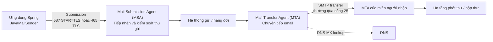
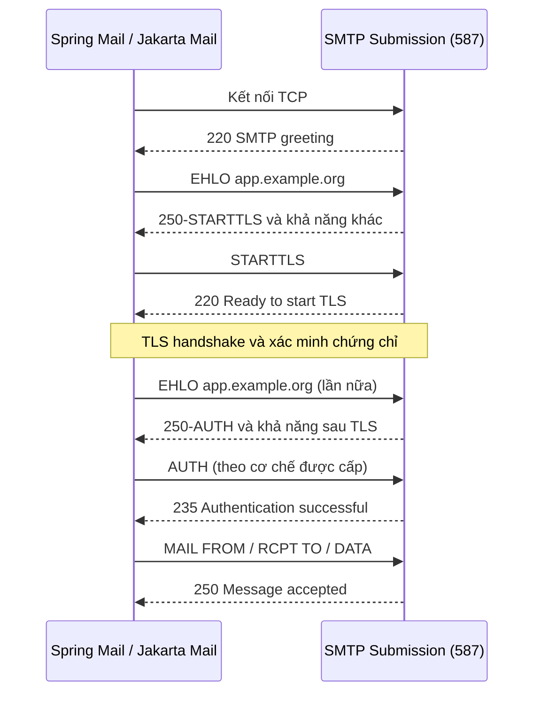
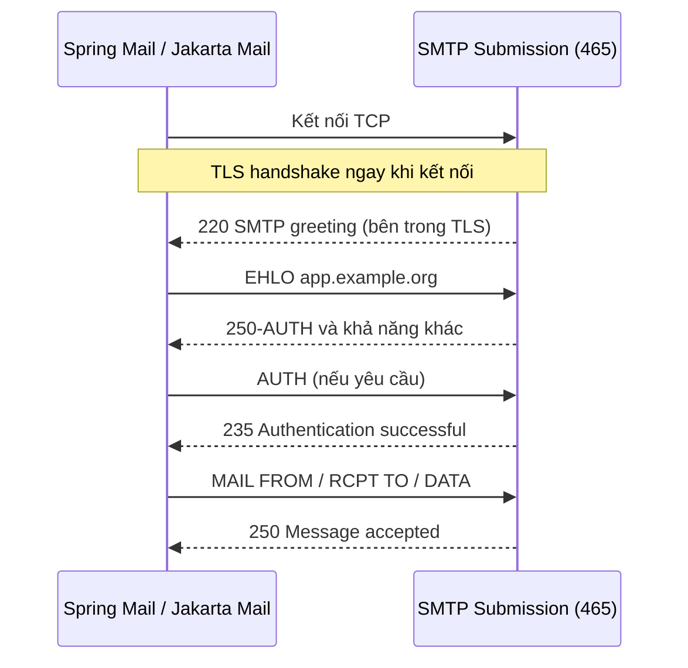

# Submission port và khác biệt với cổng SMTP truyền thống

Khi cấu hình ứng dụng Spring gửi email, ba cổng thường xuất hiện trong tài liệu là **25, 587 và 465**. Cả ba đều liên quan đến SMTP, nhưng chúng phục vụ những **chặng giao tiếp khác nhau** của hệ thống email. Chọn sai cổng có thể khiến ứng dụng không kết nối được, không xác thực được, đàm phán TLS thất bại hoặc bị máy chủ từ chối chuyển tiếp thư.

Trong phần lớn ứng dụng nghiệp vụ, Spring Mail hoạt động như một **SMTP client** để nộp email gửi đi cho dịch vụ của tổ chức hoặc nhà cung cấp. Kết nối đó gọi là **mail submission**; cổng tiêu chuẩn thường dùng là **587 với STARTTLS**, hoặc **465 với TLS ngay khi kết nối**, tùy cấu hình mà nhà cung cấp công bố. **Cổng 25** chủ yếu phục vụ việc chuyển email giữa các máy chủ SMTP (mail transfer).

## 1. Phân biệt nộp thư (submission) và chuyển tiếp thư (relay)

Hai hành động đều nói chuyện bằng SMTP, nhưng điểm xuất phát, trách nhiệm và yêu cầu bảo mật khác nhau.



**Submission** là quá trình ứng dụng hoặc mail client gửi thư đến máy chủ được chỉ định để hệ thống đó chuyển phát tiếp. Máy chủ tiếp nhận vai trò này gọi là **Mail Submission Agent (MSA)**. MSA thường xác thực ứng dụng, áp dụng giới hạn gửi, kiểm tra quyền sử dụng địa chỉ người gửi và chấp nhận hoặc từ chối thông điệp.

**Transfer/relay** là quá trình một máy chủ thư (MTA) chuyển thư đến máy chủ thư khác, ví dụ máy chủ của công ty gửi thư đến máy chủ tiếp nhận của miền `example.net`. Hệ thống này thường tra cứu bản ghi DNS MX của miền nhận và dùng SMTP qua **cổng 25**.

Các vai trò MSA và MTA có thể chạy trên cùng một máy hoặc trong cùng nền tảng gửi email. Sự khác biệt nằm ở **chức năng của kết nối**, không nhất thiết ở số lượng máy chủ vật lý.

### Cổng mạng không phải tên giao thức riêng biệt

Cổng 25, 587 và 465 đều có thể sử dụng các lệnh SMTP như `EHLO`, `MAIL FROM`, `RCPT TO` và `DATA`. Sự khác biệt quan trọng là **cổng dành cho loại giao tiếp nào** và **TLS được bắt đầu ra sao**.

Không nên suy ra rằng “SMTP = 25, SMTPS = 465, còn 587 là một giao thức khác”. `SMTP` là giao thức ứng dụng; `STARTTLS` và `implicit TLS` là hai cách thiết lập một kênh mã hóa cho phiên SMTP. Các quy tắc xác thực và chuyển tiếp được xác định thêm bởi chính sách của máy chủ.

## 2. So sánh cổng 25, 587 và 465

| Tiêu chí | Cổng **25** | Cổng **587** | Cổng **465** |
|---|---|---|---|
| Vai trò phổ biến | SMTP **mail transfer** giữa các MTA | SMTP **message submission** đến MSA | SMTP **message submission** đến MSA |
| Tên dịch vụ thường gặp | `smtp` | `submission` | `submissions` |
| Kiểu kết nối ban đầu | SMTP thông thường | SMTP thông thường | **TLS ngay từ byte đầu tiên của phiên** |
| Cách dùng TLS | STARTTLS nếu hỗ trợ và chính sách cho phép/yêu cầu | **STARTTLS**; ứng dụng nên yêu cầu bắt buộc | **Implicit TLS**, không cần bước STARTTLS |
| Xác thực client | Không nhất thiết có SMTP AUTH trong luồng MTA–MTA | Thường yêu cầu SMTP AUTH hoặc cơ chế cấp quyền tương đương | Thường yêu cầu SMTP AUTH hoặc cơ chế cấp quyền tương đương |
| Ai thường khởi tạo | MTA của miền gửi | Ứng dụng, mail client, hệ thống thông báo | Ứng dụng, mail client, hệ thống thông báo |
| Máy chủ đích được chọn | Theo định tuyến thư, thường dựa vào DNS MX | **MSA cố định** do nhà cung cấp chỉ định | **MSA cố định** do nhà cung cấp chỉ định |
| Có nên mặc định dùng cho ứng dụng Spring gửi thư? | **Không** | **Có**, nếu nhà cung cấp hỗ trợ | **Có**, nếu nhà cung cấp yêu cầu/hỗ trợ |

### Cổng 25: SMTP truyền thống cho vận chuyển thư

Cổng 25 gắn với trao đổi SMTP giữa các máy chủ thư theo kiến trúc Internet. MTA bên gửi có thể tra DNS MX để tìm máy chủ nhận của miền đích, rồi kết nối đến cổng 25 của máy chủ đó.

Ví dụ, mail server của `example.org` muốn chuyển thư cho `an@example.net` sẽ tìm MX của `example.net` và tiếp tục phiên SMTP tới máy chủ đích. Trong ngữ cảnh này, danh tính máy chủ và quyết định có nhận thư hay không chịu các chính sách của phía tiếp nhận; không nhất thiết sử dụng tài khoản email cá nhân với SMTP AUTH.

STARTTLS cũng **có thể được dùng trên cổng 25**. Nói “25 luôn không mã hóa” là không chính xác. Tuy nhiên, chính sách TLS giữa các MTA có thể khác kết nối submission: một số tuyến cho phép mã hóa theo khả năng, trong khi các tuyến có chính sách bảo mật chặt hơn yêu cầu TLS thích hợp. Việc dùng TLS trên cổng 25 không biến kết nối đó thành dịch vụ submission cho ứng dụng.

Nhiều môi trường đám mây hoặc ISP chặn/giới hạn kết nối đi ra cổng 25 để giảm thư rác. Đây là một lý do thực tiễn khiến ứng dụng gửi thư trực tiếp từ cổng 25 không đáng tin cậy, ngoài vấn đề định tuyến và quản trị uy tín miền gửi.

### Cổng 587: SMTP submission với STARTTLS

Cổng 587 được chuẩn hóa cho việc **nộp thư từ client đến MSA**. Client thường:

1. Mở kết nối TCP đến hostname/cổng submission do nhà cung cấp cấp.
2. Gửi `EHLO` và đọc các khả năng máy chủ công bố.
3. Gửi `STARTTLS` để nâng cấp kết nối đang có lên TLS.
4. Hoàn tất TLS handshake và **gửi lại `EHLO`**.
5. Thực hiện xác thực nếu máy chủ yêu cầu (thường `SMTP AUTH`).
6. Gửi envelope và nội dung thư bằng `MAIL FROM`, `RCPT TO`, `DATA`.

Trên cổng 587, cấu hình ứng dụng nên **yêu cầu STARTTLS** và từ chối tiếp tục khi không thể thiết lập TLS. Nếu chỉ bật tính năng STARTTLS nhưng cho phép kết nối rơi về plaintext, client có thể gửi dữ liệu mà không có mức bảo vệ dự kiến.

### Cổng 465: SMTP submission với implicit TLS

Với cổng 465, client **thực hiện TLS handshake ngay khi kết nối TCP được mở**, sau đó mới trao đổi lệnh SMTP bên trong kênh đã mã hóa. Chế độ này thường được gọi là **implicit TLS** hay **submissions**; trong nhiều tài liệu hoặc giao diện cũ còn có tên “SMTPS” hoặc “SSL/TLS”.

Để cấu hình đúng, client phải bật chế độ SMTP over TLS từ lúc khởi tạo kết nối. Nếu dùng cấu hình 587 (chờ banner SMTP plaintext trước khi gửi STARTTLS) để kết nối vào máy chủ 465 chỉ nhận implicit TLS, hai phía có thể chờ nhau hoặc đóng kết nối.

**TLS hiện đại khác với SSL lỗi thời**: tên thuộc tính `mail.smtp.ssl.enable` của Jakarta Mail được giữ theo lịch sử API, nhưng cấu hình đó bật cơ chế TLS ngay khi kết nối, không có nghĩa ứng dụng nên sử dụng giao thức SSL cũ.

### Cổng 2525 và các cổng khác

Một số nhà cung cấp hỗ trợ cổng **2525** như phương án thay thế khi 587 không khả dụng trong môi trường mạng cụ thể. Cổng này **không phải cổng submission tiêu chuẩn chung**; không thể mặc định mọi máy chủ email đều hỗ trợ. Đặc tính TLS và AUTH của cổng thay thế phải theo tài liệu nhà cung cấp.

## 3. Vì sao cần một submission port riêng?

Nếu ứng dụng có thể dùng SMTP, tại sao không gửi thẳng đến các MTA qua cổng 25? Việc tách submission giúp hệ thống triển khai chính sách rõ ràng tại ranh giới giữa **ứng dụng được phép tạo thư** và **hạ tầng có trách nhiệm vận chuyển thư**.

| Nhu cầu | Vai trò của MSA trong kết nối submission |
|---|---|
| Chỉ cho phép đúng ứng dụng gửi thư | Xác thực hoặc nhận dạng client, kiểm tra quyền gửi |
| Kiểm soát địa chỉ người gửi | Kiểm tra tài khoản có được phép sử dụng `From` / envelope sender hay miền gửi hay không |
| Bảo vệ thông tin đăng nhập và nội dung trên đường truyền | Áp dụng TLS và chính sách xác thực |
| Hạn chế lạm dụng | Giới hạn tốc độ, kích thước email, số người nhận, quota, phát hiện hành vi bất thường |
| Quản lý vận hành gửi thư | Đưa thư vào hệ thống queue, phản hồi lỗi, cung cấp mã truy vết hoặc sự kiện nhà cung cấp |
| Giữ ứng dụng đơn giản | Ứng dụng cấu hình một endpoint MSA, không tự quản lý MX, retry MTA, DNS và danh tiếng IP gửi |

Các chính sách cụ thể có thể khác nhau giữa dịch vụ SMTP nội bộ, dịch vụ gửi email giao dịch và tài khoản email thông thường. SMTP AUTH là cách phổ biến để xác thực submission nhưng không phải cơ chế duy nhất: một MSA nội bộ cũng có thể kiểm soát bằng mạng tin cậy, danh tính kết nối hoặc cách cấp quyền khác.

**Ranh giới cam kết:** khi MSA trả mã `250` sau `DATA`, nó đã **chấp nhận trách nhiệm xử lý thư tiếp theo** theo chính sách của hệ thống. Điều đó **không đồng nghĩa** email đã được phát đến hộp thư cuối cùng. Việc chuyển thư, xử lý hoãn gửi, bounce và lọc thư rác xảy ra ở các chặng sau.

## 4. Xem trực tiếp hai kiểu thiết lập kết nối

### Luồng 587: SMTP rồi nâng cấp bằng STARTTLS



Ví dụ hội thoại SMTP đã lược bớt chi tiết, dùng giá trị giả:

```text
S: 220 smtp.provider.example ESMTP
C: EHLO application.example.org
S: 250-smtp.provider.example
S: 250-STARTTLS
S: 250 SIZE 10485760
C: STARTTLS
S: 220 2.0.0 Ready to start TLS
   [TCP connection duoc nang cap thanh TLS va xac minh chung chi]
C: EHLO application.example.org
S: 250-smtp.provider.example
S: 250 AUTH PLAIN LOGIN
   [Client va server hoan tat SMTP AUTH; khong hien credentials]
S: 235 2.7.0 Authentication successful
C: MAIL FROM:<notifications@example.org>
S: 250 2.1.0 Ok
C: RCPT TO:<receiver@example.net>
S: 250 2.1.5 Ok
C: DATA
S: 354 End data with <CRLF>.<CRLF>
C: From: notifications@example.org
C: To: receiver@example.net
C: Subject: Welcome
C:
C: Your account is ready.
C: .
S: 250 2.0.0 Queued as ABC123
```

Điểm quan trọng là `EHLO` **sau khi nâng cấp TLS**: các khả năng của server có thể thay đổi, chẳng hạn chỉ công bố `AUTH` sau khi kết nối đã được bảo vệ. Các byte dùng cho SMTP AUTH thực tế do thư viện SMTP xử lý và không nên sao chép vào log.

### Luồng 465: TLS trước, SMTP sau



Hai luồng đều có thể tạo ra một **phiên SMTP được bảo vệ bằng TLS**. Chúng khác nhau ở thời điểm TLS bắt đầu:

- **587 + STARTTLS:** bắt đầu bằng SMTP, sau đó thương lượng nâng cấp lên TLS trong cùng kết nối.
- **465 + implicit TLS:** tạo kết nối TLS trước, tất cả trao đổi SMTP bắt đầu sau TLS handshake.

SMTP AUTH là bước **chứng minh quyền gửi**, còn TLS là cơ chế **bảo vệ kênh truyền**. Có TLS không tự động nghĩa là client đã được phép gửi từ mọi địa chỉ; có tài khoản SMTP cũng không tự động bảo đảm dữ liệu được mã hóa nếu cấu hình TLS sai.

## 5. Cấu hình submission port trong Spring Framework Mail

Spring cung cấp `JavaMailSender` để gửi email qua Jakarta Mail. Ứng dụng không cần tự viết lệnh `EHLO`, `STARTTLS` hay `DATA`; thư viện SMTP sẽ thực hiện chúng dựa trên cấu hình.

Với Spring Boot sử dụng mail starter, các thuộc tính `spring.mail.*` có thể cấu hình SMTP client. Với ứng dụng Spring Framework không dùng Boot, có thể tạo bean `JavaMailSenderImpl` và đặt các thuộc tính Jakarta Mail tương tự.

### A. Cấu hình Spring Boot: cổng 587 + STARTTLS

Thêm dependency mail starter khi chưa có:

```groovy
dependencies {
    implementation 'org.springframework.boot:spring-boot-starter-mail'
}
```

`application.yml`:

```yaml
spring:
  mail:
    host: ${SMTP_HOST}
    port: 587
    username: ${SMTP_USERNAME}
    password: ${SMTP_PASSWORD}
    properties:
      "[mail.smtp.auth]": true
      "[mail.smtp.starttls.enable]": true
      "[mail.smtp.starttls.required]": true
      "[mail.smtp.ssl.checkserveridentity]": true
      "[mail.smtp.connectiontimeout]": 5000
      "[mail.smtp.timeout]": 10000
      "[mail.smtp.writetimeout]": 10000

app:
  mail:
    from: ${SMTP_FROM}
```

Các thuộc tính đáng chú ý:

| Thuộc tính | Ý nghĩa |
|---|---|
| `spring.mail.host` | Endpoint MSA do nhà cung cấp cung cấp, **không phải MX của mỗi người nhận** |
| `spring.mail.port: 587` | Cổng mail submission theo STARTTLS |
| `spring.mail.username`, `password` | Thông tin để thư viện thực hiện SMTP AUTH nếu máy chủ yêu cầu |
| `mail.smtp.auth=true` | Bật cơ chế SMTP AUTH phía client |
| `mail.smtp.starttls.enable=true` | Cho phép gửi lệnh STARTTLS |
| `mail.smtp.starttls.required=true` | Không tiếp tục khi STARTTLS không được hỗ trợ hoặc thất bại |
| `mail.smtp.ssl.checkserveridentity=true` | Kiểm tra hostname trong chứng chỉ TLS của máy chủ |
| `mail.smtp.connectiontimeout` | Giới hạn thời gian mở kết nối TCP, đơn vị mili giây |
| `mail.smtp.timeout` | Giới hạn thời gian chờ đọc dữ liệu từ SMTP server |
| `mail.smtp.writetimeout` | Giới hạn thời gian ghi dữ liệu lên kết nối |

Giá trị `SMTP_HOST`, `SMTP_USERNAME`, `SMTP_PASSWORD` và `SMTP_FROM` là ví dụ về biến môi trường. Thực tế phải lấy từ cấu hình môi trường hoặc nơi quản lý secrets; đừng commit thông tin đăng nhập thật vào repository.

Kết hợp `starttls.enable=true` và `starttls.required=true` đặc biệt có ý nghĩa: client yêu cầu tạo kênh TLS đúng cách thay vì chấp nhận gửi thông điệp trong một phiên plaintext nếu server không cho nâng cấp.

### B. Cấu hình Spring Boot: cổng 465 + implicit TLS

Với nhà cung cấp chỉ định cổng 465 và TLS ngay khi kết nối:

```yaml
spring:
  mail:
    host: ${SMTP_HOST}
    port: 465
    username: ${SMTP_USERNAME}
    password: ${SMTP_PASSWORD}
    properties:
      "[mail.smtp.auth]": true
      "[mail.smtp.ssl.enable]": true
      "[mail.smtp.ssl.checkserveridentity]": true
      "[mail.smtp.connectiontimeout]": 5000
      "[mail.smtp.timeout]": 10000
      "[mail.smtp.writetimeout]": 10000
```

Ở đây `mail.smtp.ssl.enable=true` yêu cầu transport bắt đầu bằng TLS. Không cần sử dụng STARTTLS trong ví dụ này. Lựa chọn **465 hoặc 587 dựa trên endpoint được nhà cung cấp hỗ trợ**, không có lý do phải thay đổi cổng chỉ vì muốn email “bảo mật hơn”: cả hai cách đều có thể dùng TLS an toàn nếu được cấu hình và xác minh chứng chỉ đúng.

Nếu server chỉ hỗ trợ 587 + STARTTLS mà client lại dùng 465 + implicit TLS, kết nối thường thất bại vì không khớp cách khởi tạo phiên. Ngược lại cũng vậy.

### C. Spring Framework thuần: cấu hình `JavaMailSenderImpl`

Khi không dùng Spring Boot tự cấu hình:

```java
package com.example.mail;

import java.util.Properties;
import org.springframework.context.annotation.Bean;
import org.springframework.context.annotation.Configuration;
import org.springframework.mail.javamail.JavaMailSender;
import org.springframework.mail.javamail.JavaMailSenderImpl;

@Configuration
public class MailConfiguration {

    @Bean
    JavaMailSender javaMailSender() {
        JavaMailSenderImpl sender = new JavaMailSenderImpl();
        sender.setHost(System.getenv("SMTP_HOST"));
        sender.setPort(587);
        sender.setUsername(System.getenv("SMTP_USERNAME"));
        sender.setPassword(System.getenv("SMTP_PASSWORD"));
        sender.setDefaultEncoding("UTF-8");

        Properties props = sender.getJavaMailProperties();
        props.put("mail.smtp.auth", "true");
        props.put("mail.smtp.starttls.enable", "true");
        props.put("mail.smtp.starttls.required", "true");
        props.put("mail.smtp.ssl.checkserveridentity", "true");
        props.put("mail.smtp.connectiontimeout", "5000");
        props.put("mail.smtp.timeout", "10000");
        props.put("mail.smtp.writetimeout", "10000");
        return sender;
    }
}
```

Ví dụ này giả định môi trường đã cấp đủ biến cấu hình và thư viện Jakarta Mail tương thích. Trong hệ thống thực tế, nên inject cấu hình đã được kiểm tra và dùng nơi quản lý secrets thay cho đọc biến môi trường rải rác. Cấu hình ở dạng Java hay YAML không làm thay đổi vai trò của kết nối: ứng dụng vẫn nộp email cho MSA qua cổng 587.

### D. Gửi thư bằng `JavaMailSender`

Sau khi cấu hình, mã gửi thư **không cần biết đang dùng 587 hay 465**; việc kết nối nằm trong lớp transport:

```java
package com.example.mail;

import org.springframework.beans.factory.annotation.Value;
import org.springframework.mail.SimpleMailMessage;
import org.springframework.mail.javamail.JavaMailSender;
import org.springframework.stereotype.Service;

@Service
public class AccountMailService {

    private final JavaMailSender mailSender;
    private final String fromAddress;

    public AccountMailService(
            JavaMailSender mailSender,
            @Value("${app.mail.from}") String fromAddress) {
        this.mailSender = mailSender;
        this.fromAddress = fromAddress;
    }

    public void sendWelcomeMessage(String recipient) {
        SimpleMailMessage message = new SimpleMailMessage();
        message.setFrom(fromAddress);
        message.setTo(recipient);
        message.setSubject("Chào mừng bạn");
        message.setText("Tài khoản của bạn đã được kích hoạt.");
        mailSender.send(message);
    }
}
```

`SimpleMailMessage` phù hợp với email dạng text. Với HTML, tệp đính kèm, nội dung đa phần hoặc các yêu cầu MIME khác, sử dụng `MimeMessage` và `MimeMessageHelper`. Dù tạo loại thư nào, `JavaMailSender` vẫn sử dụng MSA và cổng được cấu hình.

**Lưu ý về phiên bản:** ví dụ Java dùng Spring Mail API. Với Spring Framework 6+ / Boot 3+, lớp MIME nâng cao thường sử dụng `jakarta.mail`; với Spring Framework 5 / Boot 2, các import MIME cũ có thể dùng `javax.mail`. Việc chọn cổng submission độc lập với khác biệt namespace này.

## 6. Phân biệt bốn khái niệm thường bị nhầm

### 6.1. Cổng SMTP khác địa chỉ `From`

`spring.mail.host` và `spring.mail.port` xác định **đến MSA nào**. Địa chỉ `From:` cho biết **ai hiển thị là người gửi** trong thông điệp; SMTP envelope có `MAIL FROM` để phục vụ quá trình vận chuyển và phản hồi lỗi. Chọn đúng cổng không đồng nghĩa tài khoản đã được phép dùng mọi giá trị `From`.

Ví dụ: ứng dụng đăng nhập với `smtp-user@example.org` nhưng đặt `From: billing@other-domain.test`. MSA có thể từ chối vì tài khoản không có quyền gửi thay miền đó. Lỗi này liên quan đến **authorization/policy**, không nhất thiết do chọn sai port.

### 6.2. Submission thành công khác email đã đến inbox

Một đoạn gửi email qua Spring có thể chạy xong khi MSA chấp nhận thông điệp. Sau đó hạ tầng gửi tiếp tục xử lý; thư có thể bị tạm hoãn, bounce, đưa vào spam hoặc bị lọc ở máy chủ đích. Không nên diễn giải `mailSender.send()` trả về bình thường thành “người nhận đã mở thư”.

### 6.3. TLS khác SMTP AUTH

- **TLS**: bảo vệ dữ liệu đang truyền giữa hai endpoint và hỗ trợ xác minh server.
- **SMTP AUTH**: xác thực danh tính client để MSA quyết định cấp quyền submission.
- **Kiểm tra quyền `From`**: chính sách xem danh tính vừa xác thực có được phép sử dụng địa chỉ/miền gửi cụ thể hay không.

Mỗi lớp giải quyết một vấn đề riêng. Một kết nối TLS an toàn vẫn có thể nhận phản hồi `535` vì sai tài khoản, hoặc `550` vì địa chỉ gửi không được chấp thuận.

### 6.4. Submission có TLS khác đảm bảo mã hóa đầu cuối

TLS của ứng dụng đến MSA bảo vệ **chặng truyền giữa hai phía**. Email có thể đi qua nhiều MTA trước khi đến người nhận. Bảo vệ cho các chặng sau tùy chính sách và khả năng TLS của các máy chủ; bản thân SMTP submission qua TLS không phải cơ chế mã hóa đầu cuối nội dung email. Nếu cần bí mật đầu cuối, phải có giải pháp mã hóa nội dung phù hợp ở lớp ứng dụng/thư.

## 7. Chẩn đoán lỗi thường gặp khi chọn sai port

| Hiện tượng | Khả năng thường gặp | Cách tiếp cận |
|---|---|---|
| `Connection refused` | Sai hostname/port, server không mở listener, firewall chặn | Đối chiếu đúng endpoint của nhà cung cấp, kiểm tra kết nối TCP |
| `Connection timed out` | Mạng chặn cổng hoặc endpoint không phản hồi | Kiểm tra chính sách mạng, route, DNS, timeout và cổng được hỗ trợ |
| Chờ lâu hoặc SSL handshake thất bại khi dùng 465 | Client đang chờ banner SMTP plaintext hoặc cấu hình implicit TLS sai | Bật `mail.smtp.ssl.enable=true` trên 465 |
| `530 Must issue a STARTTLS command first` | MSA yêu cầu TLS trước AUTH hoặc gửi dữ liệu | Bật STARTTLS cho 587 và yêu cầu TLS bắt buộc |
| `535 Authentication failed` | Sai secret/tài khoản, cơ chế AUTH không phù hợp, quyền tài khoản hạn chế | Kiểm tra thông tin xác thực và hướng dẫn SMTP AUTH của nhà cung cấp |
| `550 Relay denied` / `554 Relay access denied` | Client không được phép gửi đến người nhận, thiếu xác thực hoặc quyền relay | Kiểm tra AUTH, sender authorization và chính sách MSA |
| `SSLHandshakeException` / chứng chỉ không hợp lệ | Tên host không khớp chứng chỉ, chứng chỉ hết hạn hoặc trust chain lỗi | Sửa endpoint/chứng chỉ/trust; không tắt xác minh TLS để xử lý nhanh |
| Thử gửi qua 25 bị chặn ở môi trường cloud | Nhà mạng/nền tảng giới hạn outbound TCP 25 | Chuyển sang endpoint submission 587/465 được cấp |
| MSA trả `250` nhưng người dùng chưa nhận email | Thư đang queue, bị reject sau đó, bounce, lọc spam hoặc chính sách miền | Tra trạng thái nhà cung cấp, queue ID, sự kiện delivery/bounce |

Không có một mã SMTP nào luôn quy về một nguyên nhân duy nhất. Cần đọc **toàn bộ phản hồi và thời điểm phát sinh lỗi**: lỗi ở giai đoạn kết nối TCP, TLS handshake, AUTH, lệnh `MAIL FROM`/`RCPT TO` hay sau `DATA` dẫn đến hướng xử lý khác nhau.

### Kiểm tra kết nối 587 và 465

Trên môi trường có `openssl`, có thể kiểm tra phần thương lượng TLS bằng lệnh:

```bash
# 587: bắt đầu SMTP, rồi thực hiện STARTTLS
openssl s_client -starttls smtp -connect smtp.example.org:587 \
  -servername smtp.example.org

# 465: TLS ngay khi kết nối
openssl s_client -connect smtp.example.org:465 \
  -servername smtp.example.org
```

Đây là lệnh chẩn đoán cơ chế TLS, **không phải** lệnh gửi email hoặc xác thực SMTP hoàn chỉnh. Thay `smtp.example.org` bằng endpoint nhà cung cấp cấp và đối chiếu chứng chỉ với hostname thực. Không gửi thông tin đăng nhập qua một phiên không được xác minh, và không coi kết nối TLS thành công là bằng chứng thư đã nộp hay đã phát thành công.

Trong môi trường chỉ có PowerShell, lệnh `Test-NetConnection smtp.example.org -Port 587` có thể cho biết có kết nối TCP được hay không, nhưng **không chứng minh STARTTLS, SMTP AUTH hay submission hoạt động**.

## 8. Chọn cổng theo từng tình huống

| Tình huống | Lựa chọn phù hợp | Lý do |
|---|---|---|
| Ứng dụng Spring Boot gửi email giao dịch qua SMTP provider | **587 + STARTTLS** nếu được hỗ trợ | Đây là cổng submission tiêu chuẩn, phù hợp với SMTP AUTH và chính sách MSA |
| Provider công bố endpoint `submissions` trên 465 | **465 + implicit TLS** | Đáp ứng đúng kiểu kết nối TLS của dịch vụ |
| Ứng dụng gửi qua hạ tầng mail nội bộ yêu cầu relay từ IP cụ thể | Theo **endpoint và cổng nội bộ được quản trị cấp** | Có thể khác 587/465; cần làm theo chính sách của hệ thống |
| Mail server chuyển thư đến MX của các miền ngoài | **25** | Đây là luồng SMTP server-to-server |
| Provider hỗ trợ 2525 để vượt hạn chế kết nối 587 | **2525** nếu được hướng dẫn rõ ràng | Cổng thay thế theo nhà cung cấp, không phải chuẩn chung |
| Test ứng dụng bằng Mailpit/MailHog chạy local | Cổng SMTP listener của công cụ (ví dụ **1025**) | Môi trường giả lập riêng, không phải cổng Internet chuẩn |
| Dịch vụ gửi email qua HTTP API thay vì SMTP | Không cần cổng SMTP submission ở client | Sử dụng HTTPS API và bộ SDK tương ứng |

Khi chưa rõ phải chọn cổng nào, hãy bắt đầu từ **tài liệu SMTP submission của nhà cung cấp**: đúng hostname, port, chế độ bảo mật, loại credential, tài khoản/miền gửi được phép và các giới hạn tần suất. Không chọn cổng chỉ dựa vào tên “SMTP” trong giao diện cấu hình.

## 9. Thiết kế an toàn và ổn định trong sản xuất

Một cấu hình submission hoạt động tốt không dừng ở việc mở được socket:

1. **Chọn chế độ TLS đúng cổng.** Trên 587, bật và yêu cầu STARTTLS; trên 465, bật implicit TLS. Kiểm tra tên và chuỗi tin cậy của chứng chỉ.
2. **Tách secrets khỏi mã nguồn.** Cấp credential theo môi trường, xoay vòng khi cần, không ghi password, access token hoặc transcript AUTH vào log.
3. **Giới hạn thời gian chờ.** Thiết lập connection/read/write timeout để thread gửi thư không bị treo vô hạn khi MSA mất kết nối.
4. **Chọn chính sách retry theo nguyên nhân.** Lỗi mạng và phản hồi SMTP `4xx` thường có thể retry có backoff; `5xx` hoặc lỗi xác thực, sai địa chỉ cần sửa nguyên nhân, không lặp vô hạn.
5. **Tránh gắn kết quả SMTP với giao dịch nghiệp vụ một cách quá chặt.** Với hệ thống có lượng thư lớn, dùng hàng đợi/outbox và worker gửi thư; ghi nhận trạng thái submission riêng với delivery.
6. **Theo dõi delivery bằng sự kiện phù hợp.** Nếu cần biết email được phát hay bounce, tích hợp callback/webhook hoặc báo cáo của nhà cung cấp. Thành công ở `JavaMailSender.send()` là mốc submission.
7. **Tôn trọng chính sách email của miền gửi.** SPF, DKIM, DMARC và uy tín gửi ảnh hưởng việc chặng sau tiếp nhận email; SMTP AUTH thành công không thay thế các cơ chế này.

Đặc biệt với retry: nếu MSA đã nhận email nhưng mạng đứt trước khi ứng dụng đọc phản hồi `250`, ứng dụng có thể không biết thư đã được tiếp nhận. Retry ngay có nguy cơ tạo bản sao. Hệ thống nên ghi mã tác vụ, quản lý số lần gửi và trạng thái nhà cung cấp khi có, đồng thời thiết kế nghiệp vụ chịu được khả năng gửi trùng.

## 10. Câu hỏi thường gặp

**Cổng 587 có bắt buộc sử dụng TLS không?** Cổng 587 dành cho submission, nhưng việc server công bố STARTTLS và có yêu cầu xác thực/TLS cụ thể còn phụ thuộc dịch vụ. Với ứng dụng sản xuất cần kênh bảo mật, nên **cấu hình client yêu cầu STARTTLS**, không dựa vào cơ chế tự nâng cấp tùy chọn.

**Cổng 465 có lỗi thời không?** Cổng 465 từng có lịch sử thay đổi đăng ký và cách sử dụng; hiện **implicit TLS submission trên 465** đã được mô tả trong RFC 8314. Đây là lựa chọn hợp lệ khi nhà cung cấp hỗ trợ.

**Cổng 25 có luôn không mã hóa hoặc luôn nguy hiểm không?** Không. Server-to-server SMTP trên 25 có thể dùng STARTTLS, thậm chí yêu cầu TLS theo chính sách. Tuy nhiên, đó thường là luồng **mail transfer**, không phải lựa chọn mặc định cho ứng dụng Spring nộp thư.

**Có thể thử cả 587 và 465 cho đến khi một cổng hoạt động không?** Nên tra cứu chính xác cấu hình từ nhà cung cấp. Chỉ đổi số cổng mà không đổi giữa STARTTLS và implicit TLS thường gây lỗi handshake, khiến việc điều tra khó hơn.

**Nếu đổi từ 587 sang 465, có phải sửa code `mailSender.send()` không?** Thường không. Đổi endpoint/cổng và các thuộc tính TLS đúng chế độ trong `JavaMailSender`; mã tạo và gửi email có thể giữ nguyên.

**Nếu cổng 587 mở mà gửi vẫn thất bại, có phải do firewall không?** Không nhất thiết. Kết nối TCP thành công mới là bước đầu: ứng dụng còn phải đàm phán TLS, xác thực, được cấp quyền gửi, truyền thông điệp và nhận phản hồi của MSA.

**Có thể gửi trực tiếp từ Spring đến MX của người nhận không?** Có thể xây dựng hệ thống chuyển phát SMTP riêng, nhưng khi đó ứng dụng hoặc dịch vụ do bạn vận hành phải đảm nhận trách nhiệm MTA (định tuyến, queue/retry, chống lạm dụng, uy tín IP và kiểm soát lỗi). Với hầu hết ứng dụng nghiệp vụ, nộp thư cho MSA là phương án đơn giản và phù hợp hơn.

## 11. Chuẩn và thuật ngữ để tham khảo

Các tên chuẩn giúp đối chiếu khi làm việc với nhà cung cấp SMTP:

- **RFC 5321 — Simple Mail Transfer Protocol:** mô tả nền tảng SMTP và việc trao đổi thư giữa hệ thống SMTP.
- **RFC 6409 — Message Submission for Mail:** mô tả vai trò MSA và submission, sử dụng cổng 587.
- **RFC 3207 — SMTP Service Extension for Secure SMTP over Transport Layer Security:** mô tả lệnh STARTTLS trong SMTP.
- **RFC 4954 — SMTP Service Extension for Authentication:** mô tả SMTP AUTH.
- **RFC 8314 — Cleartext Considered Obsolete: Use of Transport Layer Security (TLS) for Email Submission and Access:** mô tả định hướng bảo vệ TLS cho submission, bao gồm implicit TLS trên cổng 465.

Các RFC này mô tả giao thức và mô hình tổng quát. Vẫn cần áp dụng tài liệu của nhà cung cấp cho hostname, port, phương thức AUTH và yêu cầu bảo mật thực tế.

---

**Ghi nhớ khi cấu hình Spring Mail:** `587 + STARTTLS` hoặc `465 + implicit TLS` dành cho **ứng dụng nộp thư đến MSA**; `25` chủ yếu dành cho **MTA chuyển thư đến MTA**. Chọn đúng cổng phải đi cùng đúng chế độ TLS, xác thực/quyền gửi và cách theo dõi kết quả submission. MSA trả lời chấp nhận thư chưa đồng nghĩa thư đã đến inbox người nhận.
