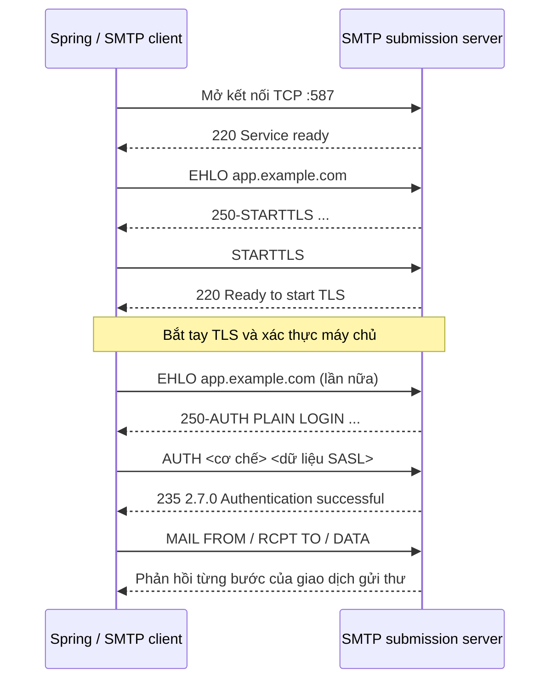
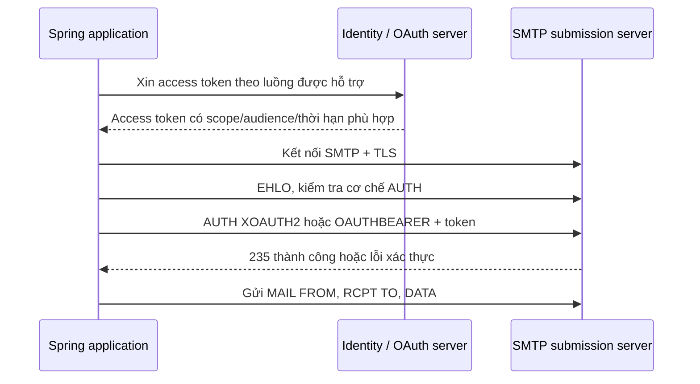

# SMTP AUTH và các cơ chế xác thực

## 1. SMTP AUTH giải quyết vấn đề gì?

**SMTP AUTH** là phần mở rộng của **Simple Mail Transfer Protocol (SMTP)** cho phép SMTP client xác thực với SMTP server trước khi sử dụng những quyền mà server yêu cầu danh tính, đặc biệt là **gửi thư ra ngoài qua dịch vụ SMTP submission**. SMTP AUTH được mô tả trong RFC 4954 và sử dụng các cơ chế xác thực theo khuôn khổ **SASL** (Simple Authentication and Security Layer).

Ví dụ, ứng dụng Spring Boot cần gửi email xác nhận đơn hàng từ `notifications@example.com` đến một địa chỉ bên ngoài. Máy chủ SMTP không nên cho mọi client trên Internet sử dụng mình như một máy chủ chuyển tiếp thư tự do (**open relay**). Thay vào đó, máy chủ có thể yêu cầu client xác thực và chỉ cho phép tài khoản đã xác thực gửi thư trong phạm vi chính sách được cấp.

```text
Spring Boot application
      |
      | SMTP submission + STARTTLS/implicit TLS + AUTH
      v
Mail Submission Agent (MSA)
      |  1. Xác minh danh tính client
      |  2. Kiểm tra quyền gửi và chính sách
      |  3. Chấp nhận thông điệp nếu hợp lệ
      v
Mail Transfer Agent (MTA)
      |
      | SMTP chuyển thư giữa các máy chủ
      v
Máy chủ thư của miền người nhận
      |
      v
Mailbox đích
```

Trong sơ đồ, SMTP AUTH thuộc **bước xác thực client khi gửi thư**. Việc máy chủ chấp nhận một tài khoản SMTP không chứng minh địa chỉ `From` thuộc về tài khoản đó, không bảo đảm email đến Inbox và không xác nhận người nhận đã đọc thư. Các chính sách cấp quyền gửi, chống giả mạo và phát thư là những lớp khác nhau.

### Phân biệt bốn khái niệm dễ nhầm

| Khái niệm | Câu hỏi được giải quyết | Ví dụ |
|---|---|---|
| **SMTP AUTH** | Client nào đang yêu cầu gửi email? | Tài khoản ứng dụng xác thực với submission server |
| **TLS** | Kênh truyền có được mã hóa và xác minh đúng máy chủ không? | STARTTLS trên cổng 587 |
| **Ủy quyền gửi (authorization)** | Danh tính đã xác thực được phép gửi từ địa chỉ/domain nào? | Chỉ tài khoản dịch vụ được gửi từ `notifications@example.com` |
| **SPF, DKIM, DMARC** | Miền gửi được xác thực/đánh giá như thế nào tại phía nhận? | MX đích kiểm tra bản ghi SPF, chữ ký DKIM và chính sách DMARC |

SMTP AUTH không thay thế SPF, DKIM hay DMARC. Ngược lại, một email có DKIM hợp lệ cũng không có nghĩa ứng dụng đã sử dụng SMTP AUTH khi submit thư.

## 2. SMTP AUTH nằm ở đâu trong một phiên SMTP?

SMTP client mở kết nối, gửi `EHLO` để nhận danh sách khả năng của server. Nếu server hỗ trợ xác thực, phản hồi `EHLO` có thể có dòng dạng `250-AUTH PLAIN LOGIN` hoặc các cơ chế khác. Client chọn **một cơ chế server hỗ trợ** và thực hiện lệnh `AUTH` trước khi gửi nội dung thư theo chính sách máy chủ.

Quy trình điển hình với cổng 587:



**Vì sao phải gửi `EHLO` lần nữa sau STARTTLS?** Sau khi thiết lập TLS, client phải loại bỏ tập khả năng đã biết trước đó và gửi `EHLO` mới. Server có thể chỉ quảng bá cơ chế AUTH khi kết nối đã được bảo vệ, hoặc thay đổi chính sách theo trạng thái TLS. Thấy `AUTH` trong phản hồi trước TLS không có nghĩa nên gửi thông tin xác thực ngay lúc đó.

Lệnh tổng quát:

```text
AUTH <mechanism> [initial-response]
```

`mechanism` là tên cơ chế SASL, chẳng hạn `PLAIN` hay `XOAUTH2`. Một số cơ chế dùng dữ liệu ban đầu (**initial response**), một số cần các vòng thử thách và phản hồi. Server có thể trả `334` để yêu cầu dữ liệu tiếp theo, `235` khi xác thực thành công, hoặc phản hồi lỗi khi không chấp nhận.

> **Không đưa username/password, token hoặc payload AUTH thật vào tài liệu, log hay ảnh chụp màn hình.** Chuỗi Base64 trong phiên AUTH chỉ là một cách biểu diễn byte; Base64 **không phải mã hóa bảo mật**.

## 3. SMTP AUTH sử dụng SASL như thế nào?

SASL là khuôn khổ cho phép giao thức ứng dụng thương lượng và thực hiện **cơ chế xác thực**. SMTP cung cấp lệnh `AUTH`; SASL định nghĩa dữ liệu mà client và server trao đổi theo cơ chế đã chọn.

Có hai khái niệm danh tính trong SASL:

- **Authentication identity (`authcid`)**: danh tính chứng minh quyền truy cập, ví dụ tài khoản SMTP của ứng dụng.
- **Authorization identity (`authzid`)**: danh tính mà client muốn thực hiện hành động thay mặt, nếu cơ chế và chính sách cho phép. Trường này có thể bỏ trống; server phải quyết định quyền tương ứng.

Ví dụ một dịch vụ đăng nhập dưới tài khoản `mailer-service` nhưng cần gửi thay mặt một hộp thư được ủy quyền. Xác thực thành công chỉ cho biết client đã chứng minh được danh tính theo cơ chế đã chọn; quyền gửi từ một địa chỉ cụ thể vẫn là quyết định của server.

Các cơ chế có thể khác nhau ở cách chứng minh danh tính, yêu cầu đối với server, khả năng hỗ trợ OAuth, độ mạnh bảo mật và việc cần TLS. Client không thể tùy tiện gửi tên cơ chế không nằm trong danh sách server hỗ trợ rồi kỳ vọng server tự chuyển đổi.

## 4. Cơ chế `PLAIN`: đơn giản nhưng phải có TLS

`PLAIN` là cơ chế SASL phổ biến. Nó truyền ba thành phần theo cấu trúc byte:

```text
authzid NUL authcid NUL password
```

Trong đó `NUL` là byte `0x00`, không phải bốn ký tự `N`, `U`, `L` và dấu cách. Nếu bỏ trống `authzid`, dữ liệu bắt đầu bằng byte NUL. Toàn bộ chuỗi byte có thể được biểu diễn bằng Base64 để đặt vào lệnh SMTP.

Với tên đăng nhập `mailer@example.com` và mật khẩu giả định, cấu trúc **trước khi Base64 hóa** là:

```text
\0mailer@example.com\0<password>
```

Đây là ký pháp minh họa: `\0` tượng trưng cho một byte NUL, `<password>` là placeholder, không phải mật khẩu thật.

Một trao đổi ở mức giao thức:

```text
C: AUTH PLAIN <base64-cua-NUL-username-NUL-password>
S: 235 2.7.0 Authentication successful
```

Server cũng có thể dùng nhịp thử thách/phản hồi thay vì nhận dữ liệu ngay trên dòng `AUTH`.

**Bảo mật:** `PLAIN` không tự che giấu password khỏi bên nghe lén. Base64 có thể giải mã trực tiếp. Vì thế, chỉ sử dụng PLAIN trên một kết nối TLS được bảo vệ đúng cách; bật kiểm tra chứng chỉ máy chủ và yêu cầu TLS thay vì chấp nhận tự động hạ cấp xuống kênh không mã hóa. Trong môi trường doanh nghiệp, việc dùng password cố định còn phụ thuộc chính sách MFA và quyền truy cập của nhà cung cấp.

## 5. Cơ chế `LOGIN`: phổ biến trong tương thích cũ

`LOGIN` được nhiều SMTP server và client hỗ trợ như một cơ chế xác thực thực tế, đặc biệt với các hệ thống SMTP truyền thống. Client gửi username và password ở hai lần phản hồi; từng giá trị thường được Base64 hóa.

Ví dụ phiên giao tiếp minh họa:

```text
C: AUTH LOGIN
S: 334 VXNlcm5hbWU6
C: <base64-cua-username>
S: 334 UGFzc3dvcmQ6
C: <base64-cua-password>
S: 235 2.7.0 Authentication successful
```

Hai chuỗi thử thách ở ví dụ trên giải mã thành `Username:` và `Password:`. Chúng giúp hình dung luồng, nhưng không nên coi nội dung thử thách là quy tắc bắt buộc cho mọi triển khai. Cũng như PLAIN, Base64 **không bảo vệ mật khẩu**: phải dùng TLS và không ghi dữ liệu phản hồi AUTH vào log.

`LOGIN` thường được xem là cơ chế tương thích lịch sử; khi chọn cấu hình mới, cần ưu tiên khả năng được server hỗ trợ, yêu cầu bảo mật hiện hành và phương pháp cấp thông tin xác thực của nhà cung cấp.

## 6. Các cơ chế challenge-response: `CRAM-MD5`, `SCRAM` và các lựa chọn khác

Không phải cơ chế SMTP AUTH nào cũng gửi password trực tiếp dưới dạng Base64. Một số cơ chế dùng thử thách do server phát ra và phản hồi có tính toán mật mã.

### `CRAM-MD5`

Trong `CRAM-MD5`, server gửi một **challenge**. Client tính phản hồi dựa trên challenge và bí mật dùng chung bằng HMAC-MD5, rồi gửi tên người dùng cùng giá trị tính toán. Mật khẩu gốc không được gửi trực tiếp qua đường truyền.

```text
C: AUTH CRAM-MD5
S: 334 <base64-challenge>
C: <base64-username-va-HMAC-MD5-response>
S: 235 2.7.0 Authentication successful
```

Đây là cơ chế cũ và có giới hạn về thuật toán, cách quản lý bí mật và khả năng tích hợp chính sách bảo mật hiện đại. Không nên chọn CRAM-MD5 chỉ vì thấy nó không gửi mật khẩu theo đúng dạng password thuần; cần xem yêu cầu bảo mật và danh sách cơ chế mà máy chủ thực tế hỗ trợ.

### `SCRAM-SHA-256` và họ SCRAM

**SCRAM** (Salted Challenge Response Authentication Mechanism) dùng trao đổi challenge-response với dẫn xuất khóa từ mật khẩu, salt và thông số lặp. `SCRAM-SHA-256` dùng SHA-256, có thiết kế hiện đại hơn các cơ chế legacy. Một số biến thể có hậu tố `-PLUS` gắn xác thực với kênh TLS bằng cơ chế **channel binding** nhằm giảm rủi ro chuyển tiếp phiên xác thực. Tuy nhiên, việc hỗ trợ SCRAM trên SMTP server và thư viện client **không phổ biến đồng đều** như PLAIN hoặc các cơ chế của nhà cung cấp. Chỉ cấu hình khi cả hai phía thực sự hỗ trợ.

### `GSSAPI` và `NTLM`

`GSSAPI` thường xuất hiện trong môi trường tích hợp Kerberos hoặc hạ tầng xác thực doanh nghiệp. `NTLM` có thể gặp trong các hệ thống Microsoft cũ hoặc môi trường tương thích đặc thù. Đây không phải lựa chọn mặc định cho một ứng dụng Spring Boot gửi email qua SMTP provider công cộng. Việc có cơ chế trên danh sách SMTP AUTH không tự đảm bảo JavaMailSender có thể sử dụng nếu chưa có cơ chế SASL/provider và cấu hình tương ứng.

## 7. Xác thực bằng OAuth 2.0: `XOAUTH2` và `OAUTHBEARER`

Nhiều hệ thống email hỗ trợ gửi thư bằng **access token** thay cho việc cấp password lâu dài của mailbox cho ứng dụng. Client trước hết lấy token từ hệ thống cấp quyền qua một luồng OAuth 2.0 được nhà cung cấp chấp nhận; sau đó đưa token vào cơ chế SASL mà SMTP server hỗ trợ.

Hai tên thường gặp:

- **`XOAUTH2`**: cơ chế được một số nhà cung cấp triển khai rộng rãi; payload thường chứa danh tính người dùng và token bearer trong một cấu trúc do cơ chế quy định.
- **`OAUTHBEARER`**: cơ chế SASL dựa trên OAuth bearer token được chuẩn hóa trong RFC 7628; định dạng trao đổi khác XOAUTH2.

**Hai cơ chế không thể thay thế cho nhau chỉ bằng cách đổi tên**. Client và server phải hiểu đúng định dạng, audience, scope và chính sách token của nhà cung cấp. Một access token dùng để gọi REST API bất kỳ cũng không đương nhiên được SMTP server chấp nhận.

Luồng tổng quát:



**Ưu điểm:** hạn chế việc ứng dụng giữ password mailbox, có thể cấp quyền theo phạm vi, thu hồi hoặc giới hạn thời hạn token. **Chi phí vận hành:** cần cấp quyền ban đầu đúng cách, làm mới token trước khi hết hạn, bảo vệ refresh token hoặc secret của ứng dụng, xử lý lỗi thu hồi/quyền và tránh dùng token cho sai máy chủ.

Token vẫn là **thông tin nhạy cảm**: ai nắm được bearer token còn hiệu lực có thể có quyền hành động trong phạm vi token. OAuth không thay thế TLS, kiểm soát quyền hay bảo vệ log.

### Lựa chọn OAuth khác nhau tùy nhà cung cấp

Một số nhà cung cấp chỉ cho phép SMTP AUTH theo hình thức OAuth hoặc chỉ cho phép basic authentication đối với tài khoản/môi trường nhất định. Có nhà cung cấp yêu cầu quyền gửi thay mặt tài khoản hoặc scope đặc biệt. Các điều kiện còn có thể thay đổi theo chính sách của tổ chức, cấu hình tenant, MFA và việc bật/tắt SMTP AUTH. Hãy dựa trên tài liệu của **SMTP server thực tế** để chọn tên cơ chế và luồng cấp token; đừng suy luận từ việc ứng dụng đã đăng nhập OAuth thành công ở một dịch vụ khác.

## 8. So sánh các cơ chế xác thực SMTP

| Cơ chế | Dữ liệu chứng minh danh tính | Điểm cần chú ý | Mức phổ biến/định hướng dùng |
|---|---|---|---|
| `PLAIN` | Username/password trong payload SASL được Base64 hóa khi truyền trong SMTP | Bắt buộc bảo vệ bằng TLS; dễ tích hợp | Phổ biến trên submission server |
| `LOGIN` | Username rồi password qua các vòng phản hồi | Cơ chế tương thích cũ; Base64 không phải mã hóa | Phổ biến trong nhiều SMTP server truyền thống |
| `CRAM-MD5` | Phản hồi HMAC-MD5 theo challenge | Cơ chế cũ; cân nhắc chính sách mật mã hiện hành | Có thể gặp trên hệ thống legacy |
| `SCRAM-SHA-256` | Proof dựa trên salted password và challenge | Cần hỗ trợ cụ thể ở cả client/server; biến thể `-PLUS` có channel binding | Không đồng đều giữa SMTP provider |
| `XOAUTH2` | Access token theo định dạng triển khai XOAUTH2 | Token có thời hạn/scope, cần làm mới; không đồng nhất với OAUTHBEARER | Gặp ở các nhà cung cấp hỗ trợ SMTP OAuth |
| `OAUTHBEARER` | OAuth bearer token theo cơ chế SASL chuẩn | Đúng định dạng RFC 7628; cần provider hỗ trợ | Tùy máy chủ và thư viện |
| `GSSAPI` | Vé/xác thực qua hệ thống GSSAPI, thường là Kerberos | Hạ tầng danh tính và cấu hình phức tạp | Môi trường doanh nghiệp |

Không có quy tắc “cơ chế có tên dài hơn luôn an toàn hơn”. Sự an toàn phụ thuộc cả **TLS, quản lý tài khoản/token, chính sách máy chủ, phân quyền gửi, thư viện client** và cách vận hành.

## 9. Cổng 25, 587, 465 và mối quan hệ với TLS

Ba cổng SMTP thường gặp phục vụ các mục đích khác nhau:

| Cổng | Cách sử dụng thường gặp | Kết nối bảo mật |
|---|---|---|
| **25** | SMTP relay giữa các MTA; đôi khi dùng nội bộ theo cấu hình | Có thể hỗ trợ STARTTLS; không mặc định yêu cầu client AUTH khi MX nhận thư |
| **587** | **Message submission** từ ứng dụng/MUA tới SMTP server | Thường mở SMTP rồi nâng cấp bằng STARTTLS và thực hiện AUTH |
| **465** | Submission sử dụng **implicit TLS** | Bắt tay TLS ngay khi mở kết nối, sau đó mới trao đổi lệnh SMTP |

Với **STARTTLS** trên cổng 587, trước tiên client kết nối SMTP rõ văn bản để thương lượng nâng cấp, sau đó bắt tay TLS; dữ liệu xác thực chỉ được truyền khi kênh bảo vệ đã thiết lập và xác minh. Với **implicit TLS** trên cổng 465, TLS bắt đầu trước cả banner SMTP. Không dùng lẫn chế độ cho hai cổng theo thói quen; phải theo cấu hình của server.

Ví dụ phân biệt:

```text
# Submission có STARTTLS
Host: smtp.example.com
Port: 587
TLS:  STARTTLS required
AUTH: enabled

# Submission có implicit TLS
Host: smtp.example.com
Port: 465
TLS:  implicit SSL/TLS enabled
AUTH: enabled
```

**TLS và SMTP AUTH là hai việc khác nhau:** TLS mã hóa kênh và xác thực máy chủ theo chứng chỉ; AUTH xác thực danh tính của SMTP client. Một server có thể yêu cầu cả hai; một inbound MX nhận mail từ các MTA trên Internet thường không yêu cầu mọi MTA gửi phải biết username/password SMTP.

### Tránh cấu hình TLS cho phép hạ cấp

Chỉ cấu hình `starttls.enable=true` có thể khiến ứng dụng vẫn tiếp tục phiên SMTP nếu server không quảng bá STARTTLS, tùy triển khai thư viện và cấu hình. Nếu dịch vụ yêu cầu TLS, hãy bật thêm **`starttls.required=true`** và cấu hình xác minh chứng chỉ/tên máy chủ thích hợp. Không vô hiệu hóa kiểm tra chứng chỉ chỉ để xử lý lỗi kết nối, vì điều đó mở đường cho giả mạo server và lộ thông tin xác thực.

## 10. Cấu hình SMTP AUTH với Spring Framework Mail

Spring Framework cung cấp `JavaMailSender`; Spring Boot thường tự cấu hình `JavaMailSenderImpl` khi có starter mail và các điều kiện cấu hình phù hợp. Các thuộc tính `spring.mail.*` xác định máy chủ, tài khoản và các property truyền xuống Jakarta Mail.

### Ví dụ 1: username/password trên cổng 587 với STARTTLS

```yaml
spring:
  mail:
    host: smtp.example.com
    port: 587
    username: ${SMTP_USERNAME}
    password: ${SMTP_PASSWORD}
    properties:
      mail.smtp.auth: true
      mail.smtp.starttls.enable: true
      mail.smtp.starttls.required: true
      mail.smtp.ssl.checkserveridentity: true
      mail.smtp.connectiontimeout: 5000
      mail.smtp.timeout: 10000
      mail.smtp.writetimeout: 10000
```

Trong ví dụ:

1. `username` và `password` là thông tin xác thực lấy từ biến môi trường hoặc nguồn secret được quản lý; không ghi thông tin thật vào Git.
2. `mail.smtp.auth=true` yêu cầu SMTP transport dùng xác thực khi kết nối đến submission server.
3. `mail.smtp.starttls.enable=true` cho phép nâng cấp SMTP lên TLS; `required=true` yêu cầu việc nâng cấp thành công để tiếp tục.
4. `mail.smtp.ssl.checkserveridentity=true` yêu cầu kiểm tra tên máy chủ theo chứng chỉ TLS trong cấu hình JavaMail/Jakarta Mail tương ứng.
5. Các timeout tính bằng **mili giây**, giúp hạn chế việc kết nối hoặc gửi kéo dài không giới hạn.

Không nhất thiết phải ép `mail.smtp.auth.mechanisms` nếu server và client có cơ chế mặc định tương thích. Khi cần kiểm soát cơ chế, có thể đặt danh sách được phép theo chính sách, ví dụ:

```yaml
spring:
  mail:
    properties:
      mail.smtp.auth.mechanisms: PLAIN LOGIN
```

Danh sách này phải phù hợp những cơ chế server thực sự hỗ trợ. Nếu chính sách chỉ cho PLAIN qua TLS thì có thể chỉ đặt `PLAIN`; tránh bật cơ chế chỉ để “thử tất cả”. Thuộc tính cấu hình cụ thể có thể phụ thuộc phiên bản Jakarta Mail đang dùng.

### Ví dụ Java gửi email qua `JavaMailSender`

```java
import org.springframework.mail.SimpleMailMessage;
import org.springframework.mail.javamail.JavaMailSender;
import org.springframework.stereotype.Service;

@Service
public class AccountNotificationService {
    private final JavaMailSender mailSender;

    public AccountNotificationService(JavaMailSender mailSender) {
        this.mailSender = mailSender;
    }

    public void sendWelcome(String recipient) {
        SimpleMailMessage message = new SimpleMailMessage();
        message.setFrom("notifications@example.com");
        message.setTo(recipient);
        message.setSubject("Welcome");
        message.setText("Your account is ready.");

        mailSender.send(message);
    }
}
```

`JavaMailSender.send()` sử dụng SMTP transport với cấu hình ở trên, nên logic nghiệp vụ không cần tự viết lệnh `EHLO`, `STARTTLS` hoặc `AUTH`. Thư viện chịu trách nhiệm đàm phán theo giao thức. `send()` thành công trong mô hình SMTP submission có nghĩa là server đã chấp nhận giao dịch gửi tương ứng; chưa phải xác nhận người nhận đã đọc email.

### Ví dụ 2: dùng implicit TLS trên cổng 465

Khi SMTP server yêu cầu kết nối TLS ngay từ đầu:

```yaml
spring:
  mail:
    host: smtp.example.com
    port: 465
    username: ${SMTP_USERNAME}
    password: ${SMTP_PASSWORD}
    properties:
      mail.smtp.auth: true
      mail.smtp.ssl.enable: true
      mail.smtp.ssl.checkserveridentity: true
      mail.smtp.connectiontimeout: 5000
      mail.smtp.timeout: 10000
      mail.smtp.writetimeout: 10000
```

Ở đây `mail.smtp.ssl.enable=true` yêu cầu implicit TLS. Cấu hình 465 này có thể không dùng `STARTTLS`; chọn một kiểu kết nối theo thông số máy chủ. Đừng dùng chế độ implicit TLS lên cổng đang chờ SMTP banner rõ văn bản vì hai phía có thể chờ nhau và gây timeout.

## 11. Ví dụ tích hợp `XOAUTH2` với Jakarta Mail

Với nhà cung cấp hỗ trợ XOAUTH2, **access token** được đưa vào SMTP authentication thay cho password cố định. Mã bên dưới mô tả cách cấu hình transport khi đã có token hợp lệ từ một thành phần cấp token riêng:

```java
import org.springframework.mail.SimpleMailMessage;
import org.springframework.mail.javamail.JavaMailSenderImpl;

public final class OAuthSmtpExample {
    public void submit(String accessToken, String recipient) {
        JavaMailSenderImpl sender = new JavaMailSenderImpl();
        sender.setHost("smtp.example.com");
        sender.setPort(587);
        sender.setUsername("mailer@example.com");
        sender.setPassword(accessToken);

        var properties = sender.getJavaMailProperties();
        properties.put("mail.smtp.auth", "true");
        properties.put("mail.smtp.starttls.enable", "true");
        properties.put("mail.smtp.starttls.required", "true");
        properties.put("mail.smtp.ssl.checkserveridentity", "true");
        properties.put("mail.smtp.auth.mechanisms", "XOAUTH2");

        SimpleMailMessage message = new SimpleMailMessage();
        message.setFrom("mailer@example.com");
        message.setTo(recipient);
        message.setSubject("OAuth SMTP test");
        message.setText("Example message sent using an OAuth access token.");
        sender.send(message);
    }
}
```

Đây là **ví dụ tối giản về transport**, không triển khai cấp hoặc làm mới OAuth token. `setPassword(accessToken)` chỉ là cách thư viện Jakarta Mail đang dùng cung cấp credential cho cơ chế XOAUTH2 đã được chọn; điều đó không có nghĩa token là mật khẩu tài khoản. Cần xác nhận phiên bản Jakarta Mail hỗ trợ XOAUTH2 và server có quảng bá cơ chế này. Token phải có scope/audience/quyền gửi đúng tài khoản, còn hiệu lực và được cấp qua quy trình an toàn.

Trong ứng dụng thực tế, nên tách `TokenProvider` khỏi lớp gửi mail, quản lý làm mới token theo thời hạn và dùng cấu hình theo từng thông tin nhận dạng. **Không thay `password` trên một `JavaMailSenderImpl` singleton đang được nhiều luồng sử dụng** khi mỗi luồng cần token/tài khoản khác nhau; nếu cần đa tài khoản hoặc token thay đổi liên tục, hãy thiết kế transport/sender theo phạm vi thích hợp để tránh rò quyền và race condition.

## 12. Mã phản hồi SMTP AUTH và cách xử lý lỗi

Một số phản hồi có thể gặp trong quá trình xác thực:

| Mã ví dụ | Ngữ nghĩa thường gặp | Điều cần kiểm tra |
|---|---|---|
| `235 2.7.0` | Xác thực thành công | Sau đó mới tiếp tục giao dịch gửi theo chính sách |
| `334` | Server yêu cầu thêm dữ liệu SASL | Client phải phản hồi đúng định dạng cơ chế; không ghi payload vào log |
| `535 5.7.8` | Thông tin xác thực không được chấp nhận | Sai secret, token hết hạn, tài khoản bị khóa, quyền hoặc cơ chế không phù hợp |
| `530 5.7.0` | Server yêu cầu xác thực hoặc điều kiện bảo mật trước thao tác | Kiểm tra đã bật AUTH, TLS và đúng cổng submission chưa |
| `504 5.5.4` | Cơ chế hoặc tham số AUTH không được hỗ trợ trong ngữ cảnh phản hồi | Kiểm tra `EHLO` và cơ chế được phép |
| `454 4.7.0` | Sự cố xác thực tạm thời | Retry có kiểm soát sau khi xem trạng thái dịch vụ |

Các **enhanced status code** và câu chữ là ví dụ thường gặp; từng server có thể trả mã hoặc thông điệp khác. Đừng ánh xạ cứng mọi lỗi `535` thành “mật khẩu sai”: nó có thể phát sinh từ chính sách MFA, chặn SMTP AUTH, scope OAuth hoặc tài khoản không được phép sử dụng giao thức.

### `AuthenticationFailedException` và `MailException`

Trong Spring Mail, lỗi gửi thường được biểu diễn qua các lớp con của `org.springframework.mail.MailException`, chẳng hạn `MailAuthenticationException` khi xác thực thất bại, hoặc `MailSendException` khi quá trình gửi có lỗi. Tùy transport, lỗi gốc có thể nằm trong ngoại lệ Jakarta Mail lồng bên trong. Cần xem **nguyên nhân, thời điểm và phản hồi SMTP** để phân biệt:

1. **Sai thông tin xác thực/cơ chế:** phải sửa cấu hình hoặc quyền; retry ngay bằng cùng secret nhiều lần có thể gây khóa tài khoản.
2. **Token hết hạn:** có thể xin token mới theo luồng được ủy quyền rồi gửi lại có kiểm soát.
3. **Lỗi mạng trước khi server chấp nhận `DATA`:** có thể retry, nhưng phải xác định kết quả giao dịch ở mức quan sát được.
4. **Mất kết nối ở thời điểm server có thể đã chấp nhận toàn bộ thư:** trạng thái submission có thể **không chắc chắn**; retry có nguy cơ sinh thư trùng.
5. **AUTH thành công nhưng `MAIL FROM` bị từ chối:** nhiều khả năng vấn đề nằm ở quyền gửi từ địa chỉ, recipient policy hoặc quota, không nhất thiết ở credential.

Nếu ứng dụng cần trạng thái gửi bền vững, ghi lại request ID, recipient, sự kiện thành công/thất bại và mã phản hồi đã được làm sạch. Tránh log `Authorization`, Base64 SASL payload, OAuth access token, refresh token, password, header nhạy cảm và nội dung thư.

## 13. Lỗi cấu hình thường gặp khi tích hợp Spring Mail

### `535 Authentication credentials invalid`

Khả năng thường gặp: username/password sai; dùng password thường khi nhà cung cấp yêu cầu app password hoặc OAuth; SMTP AUTH đã bị tắt ở tài khoản/tenant; token không đúng scope; server từ chối tài khoản vì chính sách bảo mật. Cần kiểm tra thông số và chính sách của nhà cung cấp. Việc đăng nhập được qua giao diện webmail **không chứng minh** cùng thông tin đó được phép dùng SMTP AUTH.

### `530 Authentication required`

Ứng dụng đã gửi `MAIL FROM` hoặc lệnh gửi khác khi server muốn xác thực trước. Kiểm tra `mail.smtp.auth=true`, `spring.mail.username`, secret và `EHLO` có quảng bá AUTH sau TLS hay không. Đảm bảo ứng dụng đang kết nối đúng submission endpoint chứ không phải nhầm sang một cổng relay có chính sách khác.

### Server không quảng bá `AUTH`

Có thể đang kết nối nhầm host/cổng, server chỉ hiện `AUTH` sau STARTTLS, hoặc hạ tầng đã vô hiệu SMTP AUTH. Không cố gửi `AUTH` bằng cách đoán nếu server không quảng bá cơ chế tương ứng. Hãy kiểm tra endpoint, TLS, cấu hình tài khoản và quyền truy cập.

### `STARTTLS required` hoặc lỗi bắt tay TLS

Kiểm tra cổng 587 và 465, chứng chỉ, tên host, chuỗi tin cậy, phiên bản TLS và sự can thiệp của proxy/firewall. Tránh “khắc phục” bằng cách tắt xác minh chứng chỉ hoặc gửi password trên kênh rõ văn bản. Nếu cấu hình `mail.smtp.starttls.required=true`, thất bại khi TLS không sẵn sàng là hành vi bảo vệ mong muốn.

### AUTH thành công nhưng email vẫn không được gửi

SMTP server có thể từ chối ở giai đoạn `MAIL FROM`, `RCPT TO` hoặc `DATA` do chưa có quyền gửi từ địa chỉ được chọn, địa chỉ không hợp lệ, quota, giới hạn gửi hoặc chính sách nội dung. Cũng có trường hợp server chấp nhận thư và đưa vào queue nhưng việc phát thư về sau thất bại. **`235` chỉ xác nhận AUTH; `250` sau `DATA` mới xác nhận server đã chấp nhận thông điệp trong giao dịch SMTP đó.**

## 14. Vận hành SMTP AUTH an toàn cho ứng dụng Spring

Một thiết kế gửi mail đáng tin cậy cần những lớp bảo vệ gắn với phạm vi sử dụng SMTP AUTH:

1. **Dùng tài khoản dịch vụ chuyên biệt:** ưu tiên tài khoản/ủy quyền phục vụ gửi mail, tránh chia sẻ mật khẩu mailbox của con người với ứng dụng.
2. **Cấp quyền tối thiểu:** giới hạn địa chỉ `From`, domain, phạm vi gửi và quota nếu SMTP provider hỗ trợ. Xác thực thành công không nên tự động cho quyền gửi thay mọi địa chỉ.
3. **Bảo vệ thông tin xác thực:** lưu secret bằng secret manager hoặc cơ chế triển khai có kiểm soát; xoay secret, thu hồi token và bảo vệ refresh token đúng chính sách.
4. **Bảo vệ kênh truyền:** yêu cầu TLS, kiểm tra chứng chỉ và tên máy chủ, không fallback sang plaintext đối với các cơ chế có password hoặc bearer token.
5. **Quản lý OAuth theo thời hạn:** refresh token trước khi access token hết hạn, xử lý thu hồi quyền và tránh lặp vô hạn khi lỗi xác thực là vĩnh viễn.
6. **Chống lạm dụng:** rate limit theo tài khoản, kiểm soát số người nhận, theo dõi lỗi đăng nhập và cảnh báo khi credential bị dùng bất thường.
7. **Giữ lịch sử sự kiện đủ dùng:** lưu request ID và lỗi đã được làm sạch; không bật SMTP debug chứa AUTH payload trong môi trường có dữ liệu thật nếu chưa được kiểm soát và che thông tin nhạy cảm.
8. **Theo dõi kết quả phát thư riêng:** SMTP AUTH thành công chỉ là một điều kiện để gửi, không thay thế việc theo dõi queue, bounce, DSN hoặc provider webhook.

### Luồng chẩn đoán sự cố ngắn gọn

```text
Kết nối được SMTP server?
  |-- Không --> Kiểm tra host, cổng, DNS, firewall, timeout
  |
  `-- Có --> TLS bắt tay và xác minh chứng chỉ thành công?
               |-- Không --> Kiểm tra STARTTLS/implicit TLS, truststore, hostname
               |
               `-- Có --> Server quảng bá AUTH phù hợp sau EHLO?
                            |-- Không --> Kiểm tra endpoint và chính sách SMTP AUTH
                            |
                            `-- Có --> AUTH nhận 235?
                                         |-- Không --> Kiểm tra credential/token/scope/quyền
                                         |
                                         `-- Có --> MAIL FROM/RCPT TO/DATA thành công?
                                                      |-- Không --> Kiểm tra sender policy, quota, recipient
                                                      `-- Có --> Theo dõi queue/delivery riêng
```

## 15. Kết luận kiến trúc

**SMTP AUTH xác thực SMTP client với máy chủ gửi thư bằng một cơ chế SASL mà hai bên cùng hỗ trợ.** `PLAIN` và `LOGIN` phổ biến trong các tích hợp username/password nhưng cần TLS; các cơ chế challenge-response như CRAM-MD5/SCRAM có đặc điểm khác nhau; OAuth qua XOAUTH2/OAUTHBEARER cho phép dùng access token theo chính sách của nhà cung cấp. Trong Spring Framework Mail, `JavaMailSender` và các thuộc tính `spring.mail.*` đảm nhiệm giao tiếp SMTP và thiết lập cơ chế tương ứng.

Điều cần giữ rõ khi thiết kế hệ thống là **ba mốc khác nhau**: `235` xác thực client thành công; phản hồi thành công sau `DATA` nghĩa là SMTP server đã chấp nhận thư; việc thư thực sự được phát đến mailbox cần quan sát hạ tầng chuyển/phát thư. Phân biệt các mốc này giúp cấu hình đúng bảo mật, chẩn đoán lỗi chính xác và báo trạng thái gửi mail trung thực.
