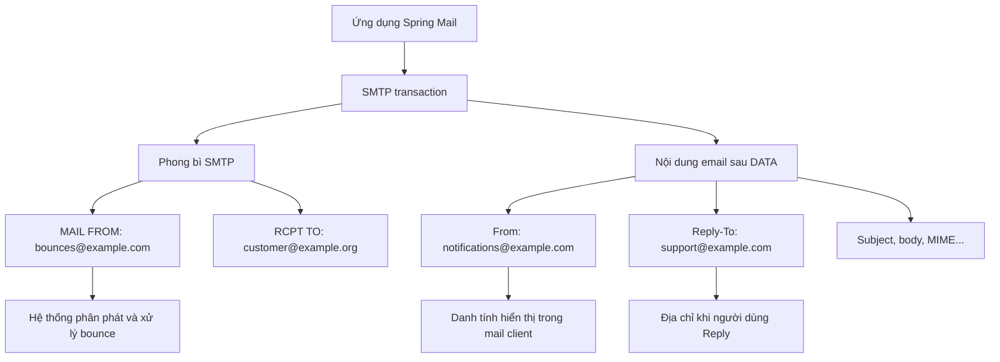

# Envelope sender khác với From hiển thị

Trong một email gửi qua **Spring Framework Mail**, địa chỉ được người nhận nhìn thấy ở dòng **From** không nhất thiết là địa chỉ mà giao thức SMTP sử dụng để báo lỗi phân phát. Hai địa chỉ này thuộc hai lớp thông tin khác nhau:

- **Envelope sender** (còn gọi là *SMTP reverse-path*, *MAIL FROM*, hoặc *bounce address*) nằm trong **phong bì SMTP**, được khai báo bằng lệnh `MAIL FROM`.
- **Header From** nằm **bên trong nội dung thông điệp email** theo định dạng Internet Message Format; ứng dụng và ứng dụng đọc mail hiển thị nó như tên/người gửi của thư.

Sự khác biệt này quan trọng khi cấu hình dịch vụ gửi thư, xử lý email bị trả lại (*bounce*), kiểm tra SPF/DMARC và tìm nguyên nhân email đến được máy chủ SMTP nhưng không tới hộp thư đích.

## 1. Một email có thể có nhiều địa chỉ mang ý nghĩa khác nhau

Xét một thông báo đăng ký tài khoản:

| Thông tin | Ví dụ | Chức năng |
|---|---|---|
| **Envelope sender** | `bounces@example.com` | Địa chỉ trong lệnh SMTP `MAIL FROM`; nơi hệ thống vận chuyển mail có thể gửi thông báo lỗi phân phát (*delivery status notification*). |
| **Header From** | `My App <notifications@example.com>` | Danh tính tác giả/người gửi hiển thị cho người đọc. |
| **Reply-To** | `support@example.com` | Địa chỉ mà phần mềm đọc mail thường điền khi người dùng bấm **Reply**. |
| **Envelope recipient** | `customer@example.org` | Địa chỉ trong lệnh SMTP `RCPT TO`; được server sử dụng để chuyển thư. |
| **Header To** | `Customer <customer@example.org>` | Thông tin người nhận hiển thị trong phần đầu email. |
| **Return-Path** | `<bounces@example.com>` | Header thường do hệ thống **phân phát cuối cùng** thêm vào để ghi nhận reverse-path đã dùng trong quá trình vận chuyển. |

Ở ví dụ trên, người nhận thấy **My App** trong danh sách thư. Nếu bấm **Reply**, ứng dụng mail gửi phản hồi tới `support@example.com`. Nếu thư bị từ chối sau khi máy chủ SMTP đã chấp nhận, thông báo lỗi phân phát có thể được gửi tới `bounces@example.com`.

**Không nên đồng nhất** `MAIL FROM` với header `From:` chỉ vì hai địa chỉ đôi khi giống nhau. Chúng có thể được đặt bằng hai cơ chế riêng biệt và phục vụ hai mục đích khác nhau.

### Các tên gọi dễ gây nhầm lẫn

- **`MAIL FROM`**: lệnh SMTP tạo *reverse-path* của một giao dịch gửi thư. Đây là **envelope sender**, không phải header.
- **`From:`**: header mô tả tác giả của email, thường được ứng dụng đọc mail hiển thị nổi bật.
- **`Sender:`**: một **header khác** mô tả tác nhân gửi thực tế thay mặt tác giả trong những trường hợp cần thiết; nó **không phải** `MAIL FROM`. Không nên dùng `Sender:` để cố đổi bounce address.
- **`Reply-To:`**: header chỉ định nơi người đọc gửi thư trả lời; không quyết định nơi hệ thống gửi bounce.
- **`Return-Path:`**: dấu vết của envelope sender khi thư đã được phân phát; thông thường hệ thống nhận cuối cùng thêm vào. Ứng dụng không nên tự đặt header này để thay thế `MAIL FROM`.

## 2. SMTP truyền envelope sender ở đâu?

SMTP truyền **phong bì** trước khi truyền **nội dung thư**. Ví dụ dưới đây đã lược bỏ lời chào, STARTTLS, xác thực và một số phản hồi để tập trung vào sự khác nhau giữa `MAIL FROM` và `From:`:

```text
C: MAIL FROM:<bounces@example.com>
S: 250 2.1.0 Sender OK

C: RCPT TO:<customer@example.org>
S: 250 2.1.5 Recipient OK

C: DATA
S: 354 Start mail input

C: From: My App <notifications@example.com>
C: To: Customer <customer@example.org>
C: Reply-To: support@example.com
C: Subject: Xac nhan dang ky
C: MIME-Version: 1.0
C: Content-Type: text/plain; charset=UTF-8
C:
C: Tai khoan cua ban da duoc tao.
C: .
S: 250 2.0.0 Queued for delivery
```

Các dòng bắt đầu bằng `C:` và `S:` minh họa dữ liệu client/server trao đổi. Trong phiên SMTP thực, lệnh `DATA` kết thúc bởi chuỗi CRLF, dấu chấm, CRLF; thư viện mail tự xử lý chi tiết này.

Hãy chú ý trình tự:

1. `MAIL FROM:<bounces@example.com>` được gửi **trước** `DATA`, là một lệnh của giao thức vận chuyển.
2. `From: My App <notifications@example.com>` được gửi **sau** `DATA`, như một header nằm trong email.
3. Máy chủ có thể áp dụng những chính sách riêng cho reverse-path và header From.
4. Phản hồi `250` sau `DATA` có nghĩa máy chủ đã **chấp nhận thư để xử lý tiếp**, chưa bảo đảm thư đã vào Inbox.

Một cách nhìn trực quan:



Cùng một nội dung email có thể được gửi đến nhiều recipient trong phong bì (nhiều `RCPT TO`). Ví dụ, người nhận `Bcc` thường có trong phong bì SMTP nhưng không hiện trong header `To:` mà những người nhận khác đọc được. Đây cũng là minh họa cho việc **phong bì và header không phải một bản sao của nhau**.

## 3. Vì sao phải tách envelope sender và header From?

### 3.1. Nhận email bị trả lại (bounce)

Giả sử một ứng dụng gửi 10.000 email thông báo với header From:

```text
From: "Dịch vụ Khách hàng" <notifications@example.com>
```

Trong khi đó, dịch vụ xử lý lỗi phân phát dùng một mailbox hoặc endpoint riêng:

```text
MAIL FROM:<bounces@example.com>
```

Khi máy chủ nhận phát hiện hộp thư không tồn tại, quota đầy hoặc lỗi chuyển tiếp sau khi đã chấp nhận email, nó có thể gửi **Delivery Status Notification (DSN)** tới địa chỉ reverse-path. Hệ thống gửi dùng thông tin đó để cập nhật trạng thái, giảm gửi lại đến địa chỉ hỏng và hỗ trợ vận hành.

Lưu ý hai tình huống khác nhau:

- **Từ chối ngay trong giao dịch SMTP:** Ví dụ `RCPT TO` bị từ chối với mã `550`. Ứng dụng hoặc nhà cung cấp gửi thư nhận lỗi ngay trên phiên SMTP; có thể chưa có một email bounce riêng.
- **Đã chấp nhận, sau đó không phân phát được:** Hệ thống thư có thể gửi một DSN tới envelope sender. Việc DSN có được tạo và tới nơi hay không còn phụ thuộc chính sách, bộ lọc và cách nhà cung cấp xử lý bounce.

Vì vậy, đặt bounce address đúng giúp theo dõi lỗi **sau khi** máy chủ submission trả về thành công. Tuy nhiên, chỉ đặt một địa chỉ bounce không tự động tạo hệ thống giám sát bounce; địa chỉ đó phải có cơ chế tiếp nhận và xử lý thật.

### 3.2. Tách danh tính giao tiếp với hạ tầng kỹ thuật

Người nhận có thể biết thương hiệu qua `From: notifications@example.com` và trả lời qua `Reply-To: support@example.com`. Đội vận hành thư lại cần gom bounce ở `bounces@example.com`. Mỗi địa chỉ có nhiệm vụ riêng.

Nhà cung cấp gửi mail cũng có thể yêu cầu địa chỉ envelope dùng miền con chuyên dụng, ví dụ `bounce.mail.example.com`, hoặc tự thay đổi reverse-path để lập danh sách phản hồi và đối chiếu từng lần gửi. Đó là lý do header From và `Return-Path` quan sát được trong mailbox có thể khác nhau.

### 3.3. Hạn chế vòng lặp khi tạo thư báo lỗi

SMTP còn hỗ trợ **null reverse-path**:

```text
MAIL FROM:<>
```

Đây là cách gửi điển hình cho **thư thông báo trạng thái phân phát** nhằm tránh một DSN không gửi được lại tạo thêm DSN mới vô hạn. Không dùng `MAIL FROM:<>` làm cấu hình mặc định cho các email nghiệp vụ thông thường; khi đó khả năng nhận và theo dõi bounce có thể mất đi.

## 4. Spring Framework Mail ánh xạ hai loại địa chỉ như thế nào?

Spring cung cấp `JavaMailSender`, `SimpleMailMessage`, `MimeMessage` và `MimeMessageHelper` để xây dựng và gửi thư. Việc lựa chọn địa chỉ **envelope** được thực hiện ở tầng SMTP transport của Jakarta Mail/nhà cung cấp mail, còn header **From** được đặt trên đối tượng thông điệp.

### 4.1. `setFrom(...)` thay đổi header From

Ví dụ với ứng dụng Spring Boot có `spring-boot-starter-mail`:

```java
import org.springframework.mail.SimpleMailMessage;
import org.springframework.mail.javamail.JavaMailSender;
import org.springframework.stereotype.Service;

@Service
public class AccountNotificationService {
    private final JavaMailSender mailSender;

    public AccountNotificationService(JavaMailSender mailSender) {
        this.mailSender = mailSender;
    }

    public void sendWelcome(String recipient) {
        SimpleMailMessage message = new SimpleMailMessage();
        message.setFrom("notifications@example.com");
        message.setReplyTo("support@example.com");
        message.setTo(recipient);
        message.setSubject("Chào mừng bạn");
        message.setText("Tài khoản của bạn đã được tạo.");

        mailSender.send(message);
    }
}
```

Ở đây:

- `message.setFrom("notifications@example.com")` đặt **header From** trên thư.
- `message.setReplyTo("support@example.com")` đặt **header Reply-To**.
- `message.setTo(recipient)` đặt người nhận ở cấp thông điệp; thư viện gửi mail sử dụng thông tin recipient để tạo lệnh `RCPT TO`.
- Không có lời gọi nào trong `SimpleMailMessage` trên đây trực tiếp thiết lập một envelope sender riêng.

Nếu không cấu hình envelope sender cụ thể, SMTP provider thường suy ra địa chỉ từ các thông tin có sẵn, bao gồm header From. Do đó trong môi trường đơn giản, `MAIL FROM` và `From:` có thể trùng nhau. **Trùng nhau theo mặc định không có nghĩa chúng là cùng một trường dữ liệu.**

### 4.2. `mail.smtp.from` dùng để chỉ định envelope sender

Với SMTP provider Jakarta Mail thông dụng, thuộc tính **`mail.smtp.from`** được dùng làm địa chỉ cho lệnh `MAIL FROM`. Trong Spring Boot, có thể truyền thuộc tính này qua `spring.mail.properties`:

```yaml
# application.yml
spring:
  mail:
    host: smtp.example.net
    port: 587
    username: ${SMTP_USERNAME}
    password: ${SMTP_PASSWORD}
    properties:
      "[mail.smtp.auth]": true
      "[mail.smtp.starttls.enable]": true
      "[mail.smtp.starttls.required]": true
      "[mail.smtp.from]": bounces@example.com
      "[mail.smtp.connectiontimeout]": 5000
      "[mail.smtp.timeout]": 5000
      "[mail.smtp.writetimeout]": 5000
```

Khi kết hợp cấu hình trên với `AccountNotificationService`:

| Tầng | Giá trị được dùng |
|---|---|
| Header From | `notifications@example.com` từ `message.setFrom(...)` |
| Header Reply-To | `support@example.com` từ `message.setReplyTo(...)` |
| SMTP `MAIL FROM` | `bounces@example.com` từ `mail.smtp.from` |
| SMTP `RCPT TO` | Giá trị `recipient` được truyền vào phương thức gửi |

`spring.mail.properties` chỉ có nhiệm vụ chuyển các property tới mail session/transport. Tên `mail.smtp.from` là **thuộc tính SMTP của mail provider**, không phải phương thức `setFrom(...)` và cũng không phải thuộc tính riêng có tên `spring.mail.from`.

**Chú ý phạm vi cấu hình:** `mail.smtp.from` ở ví dụ này áp dụng cho các thư gửi qua cùng cấu hình SMTP/session. Nếu ứng dụng phục vụ nhiều khách hàng hoặc cần bounce address khác nhau cho từng thư, không nên thay đổi một property dùng chung ngay trước mỗi lần gửi vì các yêu cầu gửi đồng thời có thể ảnh hưởng lẫn nhau.

Các cách thiết kế cho nhu cầu đó gồm dùng sender/session riêng cho từng cấu hình, hoặc khả năng đặt envelope sender **trên từng thông điệp** do SMTP provider hỗ trợ (chẳng hạn API `SMTPMessage#setEnvelopeFrom(...)` của provider phù hợp). API provider-specific phụ thuộc phiên bản thư viện và làm mã nguồn phụ thuộc vào triển khai, nên phải chọn chủ động sau khi xác định stack mail đang dùng.

### 4.3. Nếu sử dụng `MimeMessageHelper` thì sao?

`MimeMessageHelper` hỗ trợ nhiều phần MIME, HTML và attachment, nhưng `helper.setFrom(...)` vẫn đặt **header From**:

```java
import jakarta.mail.MessagingException;
import jakarta.mail.internet.MimeMessage;
import org.springframework.mail.javamail.JavaMailSender;
import org.springframework.mail.javamail.MimeMessageHelper;

public void sendHtmlMail(JavaMailSender sender, String recipient)
        throws MessagingException {
    MimeMessage mime = sender.createMimeMessage();
    MimeMessageHelper helper = new MimeMessageHelper(mime, "UTF-8");

    helper.setFrom("notifications@example.com", "My App");
    helper.setReplyTo("support@example.com");
    helper.setTo(recipient);
    helper.setSubject("Xác nhận tài khoản");
    helper.setText("<p>Tài khoản của bạn đã được tạo.</p>", true);

    sender.send(mime);
}
```

Nếu SMTP session đồng thời có `mail.smtp.from=bounces@example.com`, envelope sender của giao dịch vẫn có thể là `bounces@example.com`. Việc chuyển từ `SimpleMailMessage` sang `MimeMessageHelper` không tự thay đổi khái niệm này.

## 5. Return-Path là gì và vì sao không tự sửa header này?

Một email đã được phân phát có thể hiển thị phần header thô như sau:

```text
Return-Path: <bounces@example.com>
Received: from ... by ...
From: My App <notifications@example.com>
Reply-To: support@example.com
To: customer@example.org
Subject: Xac nhan tai khoan
```

`Return-Path:` thường phản ánh reverse-path mà hệ thống phân phát đã dùng. Nó hữu ích khi xem thông tin gốc của email để kiểm tra địa chỉ bounce. Tuy nhiên:

1. Header `Return-Path:` **không phải** lệnh `MAIL FROM`.
2. Header này thường được **máy chủ phân phát cuối cùng** ghi lại, không phải thứ ứng dụng phải tự nhét vào nội dung ban đầu.
3. Trong quá trình chuyển tiếp, dịch vụ thư có thể viết lại envelope sender bằng cơ chế như SRS, VERP hoặc định tuyến riêng; `Return-Path` ở đích vì thế có thể không còn đúng bằng địa chỉ ứng dụng đã gửi từ đầu.
4. Thêm `Return-Path:` thủ công vào `MimeMessage` **không bảo đảm** thay đổi lệnh `MAIL FROM` trong SMTP.

Nếu mục tiêu là chọn nơi nhận bounce, hãy cấu hình **reverse-path thực sự** trên SMTP transport hoặc theo cách do dịch vụ gửi thư quy định.

## 6. Envelope sender liên quan SPF, DKIM và DMARC thế nào?

Địa chỉ trong phong bì không chỉ dành cho bounce; nó còn có vai trò trong **xác thực nguồn gửi**.

### SPF: kiểm tra nguồn gửi theo danh tính SMTP

Với các thư SMTP thông thường có reverse-path không rỗng, SPF kiểm tra xem IP gửi có được phép gửi thay cho **miền của envelope sender** hay không. Ví dụ:

```text
MAIL FROM:<bounces@mail.example.com>
From: notifications@example.com
```

Ở ví dụ này, SPF có thể đánh giá miền `mail.example.com`, còn phần mềm đọc mail hiển thị `notifications@example.com`. Với null reverse-path, SPF có quy tắc xử lý riêng dựa trên danh tính HELO/EHLO.

**SPF pass không tự động xác minh rằng header From cũng thuộc cùng miền.** Đây là một phần nguyên nhân cần DMARC.

### DKIM: chữ ký cho nội dung và các header được chọn

DKIM kiểm chứng chữ ký email bằng miền ký `d=`. Tùy hệ thống, miền DKIM có thể là miền tổ chức hoặc miền do dịch vụ gửi mail vận hành. Việc Spring tạo một `MimeMessage` không có nghĩa thư đã được DKIM ký; công việc này thường do SMTP provider hoặc mail gateway đảm nhiệm.

### DMARC: xác thực có liên kết với header From

DMARC lấy **miền trong header From** làm danh tính tham chiếu, rồi xét kết quả SPF hoặc DKIM có **alignment** (liên kết miền) với header From hay không.

Ví dụ:

| Header From | Envelope sender | Hệ quả về DMARC |
|---|---|---|
| `notify@example.com` | `bounce@example.com` | Hai miền giống nhau; nếu SPF pass, yếu tố alignment SPF có thể thỏa. |
| `notify@example.com` | `bounce@mail.example.com` | Miền con có thể thỏa alignment theo chế độ *relaxed*; còn tùy chính sách và miền tổ chức. |
| `notify@example.com` | `bounce@provider.invalid` | SPF có thể pass cho miền nhà cung cấp nhưng không alignment với `example.com`; DMARC vẫn có thể pass nếu có **DKIM hợp lệ và aligned**. |

Bởi vậy, khi tách envelope sender với header From, cần phối hợp cấu hình SPF, DKIM, DMARC với nhà cung cấp. Việc một SMTP server cho phép gửi thông điệp chưa bảo đảm hệ thống thư đích sẽ tin tưởng hoặc phân phát thông điệp đó.

## 7. Đặt envelope sender trong các tình huống thực tế

### Trường hợp A: Thông báo đơn giản

Một ứng dụng nhỏ dùng:

```text
MAIL FROM:<notifications@example.com>
From: notifications@example.com
Reply-To: support@example.com
```

Ưu điểm là cấu hình ít, dễ hiểu. Nếu cần theo dõi bounce, mailbox `notifications@example.com` phải được vận hành và xử lý các phản hồi phù hợp; không nên mặc định coi đó là một mailbox chỉ gửi.

### Trường hợp B: Gửi nhiều email và cần quản lý bounce

Một hệ thống gửi thông báo có thể dùng:

```text
MAIL FROM:<bounce-queue@mail.example.com>
From: "My App" <notifications@example.com>
Reply-To: support@example.com
```

Một mail service riêng tiếp nhận và xử lý DSN/bounce, rồi gắn lỗi với từng thông báo đã gửi. Cách gắn ID có thể dựa trên dữ liệu trong provider event, mã thông điệp, địa chỉ VERP hoặc các cơ chế liên kết khác tùy nền tảng.

Không nên suy luận rằng chỉ cần `mail.smtp.from` là đủ để ánh xạ tất cả bounce đến một yêu cầu nghiệp vụ cụ thể. Một địa chỉ dùng chung chỉ xác định nơi tiếp nhận, còn **tương quan với từng email** là việc riêng cần thiết kế.

### Trường hợp C: Dịch vụ SMTP quản lý Return-Path thay ứng dụng

Một số nền tảng gửi email cung cấp miền bounce riêng, miền con để xác minh, hoặc tính năng *custom MAIL FROM / custom Return-Path*. Khi sử dụng những dịch vụ đó, địa chỉ thực sự xuất hiện trong phiên SMTP hoặc trong `Return-Path` ở người nhận có thể do cấu hình của nhà cung cấp quyết định.

Khi gặp chênh lệch, hãy đối chiếu tài liệu và log của nhà cung cấp, không chỉ nhìn header From trong mã nguồn Java.

## 8. Các hiểu nhầm thường gặp

| Hiểu nhầm | Cách hiểu đúng |
|---|---|
| “Gọi `message.setFrom(...)` là đã cấu hình bounce address.” | `setFrom(...)` đặt header From. Cần xem SMTP provider chọn `MAIL FROM` thế nào. |
| “`Reply-To` là nơi nhận bounce.” | `Reply-To` phục vụ thao tác người đọc trả lời; DSN được định tuyến dựa trên reverse-path. |
| “Thêm header `Return-Path:` là đổi envelope sender.” | `Return-Path` là header dấu vết khi phân phát; phải đổi địa chỉ SMTP envelope bằng cấu hình transport/provider. |
| “Nếu `send(...)` không ném lỗi thì email đã tới Inbox.” | SMTP server có thể mới chỉ chấp nhận để chuyển tiếp; vẫn có thể bị bounce, delay hoặc spam. |
| “SPF pass thì DMARC chắc chắn pass.” | DMARC còn cần alignment với header From; DKIM có thể là con đường khác để đạt DMARC pass. |
| “Máy chủ nhận thấy `From` đẹp nên chấp nhận gửi.” | Hệ thống thư có thể kiểm tra envelope, nguồn IP, SPF/DKIM/DMARC, giới hạn và chính sách chống giả mạo. |

## 9. Cách quan sát và xử lý sự cố

Khi cần xác định ứng dụng đang gửi gì, hãy kiểm tra dữ liệu ở **đúng lớp**:

1. **Tại ứng dụng:** Xem phần mã đặt `setFrom(...)`, `setReplyTo(...)` và cấu hình SMTP `mail.smtp.from`. Không log password, token hay nội dung email nhạy cảm.
2. **Tại máy chủ SMTP:** Kiểm tra log hoặc công cụ SMTP test để thấy lệnh `MAIL FROM` và `RCPT TO` thực sự; đối chiếu với header bên trong `DATA`.
3. **Tại mailbox nhận:** Nếu thư tới nơi, xem nguồn gốc thư để tìm `From:`, `Reply-To:`, `Return-Path:`, kết quả SPF/DKIM/DMARC và các `Received:` header.
4. **Tại dịch vụ gửi:** Khi thư không tới người nhận, kiểm tra message ID, event chấp nhận, chuyển tiếp, deferral, bounce hoặc suppression. Nếu có bounce, xác định hạ tầng xử lý địa chỉ reverse-path đã được cấu hình.

Có thể dùng một máy chủ SMTP thử nghiệm/công cụ bắt thư trong môi trường phát triển để quan sát riêng **SMTP envelope** và **message header**. Đừng chỉ đọc phần giao diện Inbox, bởi nhiều ứng dụng email chỉ hiển thị header From mà ẩn envelope.

Một lưu ý về bảo mật: xác thực thành công với SMTP server **không mặc nhiên cấp quyền sử dụng bất kỳ header From nào**. Nhiều dịch vụ yêu cầu domain hoặc địa chỉ From đã được xác minh; một số dịch vụ sẽ từ chối hoặc viết lại địa chỉ gửi. Cần tuân thủ chính sách của hệ thống gửi và cấu hình xác thực miền phù hợp.

## 10. Tóm lược luồng và kiến thức cần nhớ

Khi Spring Mail gửi thông báo, mã ứng dụng tạo một đối tượng thư với các header như `From:` và `Reply-To:`. SMTP transport mở kết nối tới máy chủ thư, gửi `MAIL FROM` để khai báo **envelope sender**, sau đó gửi `RCPT TO` và `DATA` chứa header/body. Máy chủ nhận thư tiếp tục quá trình chuyển tiếp hoặc phân phát.

- **Envelope sender = `MAIL FROM`:** địa chỉ phục vụ vận chuyển và trả lỗi phân phát; có thể được đặt qua `mail.smtp.from`.
- **Header From = `From:`:** danh tính hiển thị; được đặt bằng `SimpleMailMessage.setFrom(...)` hoặc `MimeMessageHelper.setFrom(...)`.
- **Reply-To = `Reply-To:`:** nơi người đọc gửi phản hồi; không quyết định bounce.
- **Return-Path = `Return-Path:`:** header được hệ thống phân phát thêm để ghi dấu reverse-path; không thay cho lệnh SMTP.
- **SPF/DMARC:** có thể sử dụng hai danh tính miền khác nhau và cần cấu hình alignment phù hợp.
- **SMTP đã chấp nhận thư** là trạng thái khác với **email đã được phân phát thành công**.

Trong thiết kế gửi email có thể vận hành lâu dài, hãy chọn rõ **ai là danh tính hiển thị**, **ai nhận câu trả lời**, **ai tiếp nhận bounce** và **hệ thống nào sẽ theo dõi trạng thái phân phát**. Khi những vai trò đó được xác định, sự khác nhau giữa envelope sender và header From trở thành một công cụ thiết kế hữu ích thay vì một nguồn lỗi khó tìm.
