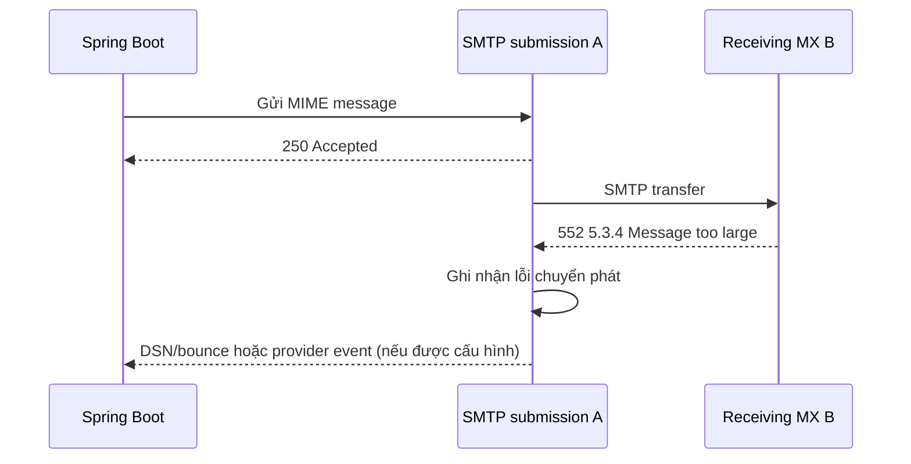

# Kích thước thư, giới hạn dòng và giới hạn máy chủ

Một ứng dụng Spring Boot dùng `JavaMailSender` gửi email kèm tệp PDF 20 MiB. Tệp đính kèm được phép tải lên ứng dụng, kết nối SMTP hoạt động, tài khoản gửi cũng xác thực thành công. Thế nhưng máy chủ trả về `552 5.3.4 Message size exceeds fixed maximum message size`. Tại sao tệp 20 MiB lại có thể vượt giới hạn 25 MiB của dịch vụ gửi thư?

Vấn đề nằm ở chỗ **kích thước tệp gốc không bằng kích thước email được vận chuyển qua SMTP**. Nội dung email phải có header, phần thân, cấu trúc MIME và thường phải mã hóa tệp nhị phân thành văn bản an toàn để truyền. Ngoài giới hạn tổng dung lượng, SMTP còn quy định **giới hạn độ dài dòng** và **giới hạn độ dài lệnh**. Mỗi máy chủ trung gian cũng có thể áp dụng chính sách riêng.

Bài học này giải thích các giới hạn đó trong ngữ cảnh **Spring Framework Mail**, cách chúng tương tác với MIME, cách nhận diện phản hồi lỗi từ máy chủ và cách phòng tránh lỗi gửi email quá lớn.

## 1. Ba tầng giới hạn cần phân biệt

Khi đánh giá một email có gửi được hay không, cần phân biệt ba tầng:

| Tầng | Giới hạn điển hình | Hệ quả đối với ứng dụng |
|---|---|---|
| **Giao thức SMTP / định dạng email** | Độ dài dòng dữ liệu, lệnh SMTP, biểu diễn dòng và ký tự | Email phải có định dạng hợp lệ, kể cả khi tổng dung lượng nhỏ. |
| **Khả năng và chính sách của máy chủ gửi** | Dung lượng thư tối đa, số người nhận, yêu cầu xác thực, hạn mức gửi, quota | Máy chủ submission có thể từ chối thư tại thời điểm gửi. |
| **Máy chủ nhận và các chặng trung gian** | Giới hạn MIME/message riêng, quota hộp thư, bộ lọc nội dung và tệp đính kèm | Một email đã được server gửi chấp nhận vẫn có thể bị từ chối ở chặng sau. |

Ví dụ, ứng dụng gửi qua máy chủ A chấp nhận tối đa 30 MiB, nhưng tên miền người nhận qua cổng lọc B chỉ chấp nhận 20 MiB. **Giới hạn thực tế của đường chuyển phát là giới hạn do những hệ thống trên đường đi áp dụng**, không đơn giản là cấu hình của Spring Boot.

Đồng thời, “kích thước thư” có thể được đo bằng nhiều cách khác nhau:

- **Kích thước file trên đĩa:** số byte thực của `report.pdf`.
- **Kích thước MIME:** toàn bộ thông điệp sau khi có header, phần thân, multipart boundary, phần đính kèm đã mã hóa và các ký tự xuống dòng.
- **Kích thước trao đổi SMTP:** số octet truyền trong dữ liệu thông điệp; chịu quy tắc SMTP DATA hoặc extension được thỏa thuận.
- **Dung lượng/giới hạn sản phẩm:** nhà cung cấp có thể công bố “tệp đính kèm tối đa” hoặc “message tối đa” với cách tính riêng. Phải đọc đúng đơn vị và phạm vi mà tài liệu của họ công bố.

**Octet** là một nhóm 8 bit, thông thường tương đương một byte. Giới hạn SMTP thường được mô tả bằng octet, không phải số ký tự Unicode mà Java đếm trong `String.length()`.

## 2. Giới hạn dòng của SMTP

### 2.1. Một dòng dữ liệu email tối đa bao nhiêu?

Trong SMTP cơ bản, giới hạn một **dòng văn bản truyền qua SMTP** là **1.000 octet bao gồm cặp kết thúc dòng CRLF** (`\r\n`). Vì CRLF chiếm 2 octet, một dòng nội dung thông thường có thể chứa tối đa **998 octet trước CRLF**. Quy tắc xử lý dấu chấm ở đầu dòng trong SMTP là trường hợp đặc biệt được giải thích ở phần sau.

Thư có dung lượng chỉ vài kilobyte vẫn có thể không hợp lệ nếu chứa một dòng liên tục quá dài:

```text
Hợp lệ về nguyên tắc:
  998 octet nội dung + CRLF (2 octet) = 1000 octet

Không hợp lệ trong SMTP DATA cổ điển:
  2000 octet nội dung liên tục + CRLF
```

Ví dụ dễ gặp:

- Một email HTML được minify thành một dòng cực dài.
- Một chuỗi JSON hoặc token dài được chèn nguyên vẹn vào phần thân.
- Một phần tệp nhị phân được mã hóa nhưng không được ngắt dòng.
- Một thư viện tự tạo header rồi nối nội dung mà không tuân theo quy tắc folding.

**Không nên tự ý chèn dấu xuống dòng vào mọi đoạn văn bản.** Với URL, chữ ký số, nội dung máy có thể phân tích hoặc những đoạn dữ liệu định dạng cố định, việc ngắt dòng tùy tiện có thể thay đổi nội dung. MIME cung cấp các cách mã hóa phù hợp để bảo toàn dữ liệu.

### 2.2. CRLF, giới hạn header và folding

SMTP sử dụng cặp ký tự **CRLF** (carriage return + line feed, `\r\n`) để kết thúc dòng trong giao thức. Một dấu `\n` riêng lẻ trong chuỗi Java không đồng nghĩa là một dòng SMTP hợp lệ được gửi trực tiếp lên dây; thư viện email sẽ chịu trách nhiệm biểu diễn thông điệp theo chuẩn.

Đối với **header của thông điệp**, RFC 5322 còn quy định:

- Mỗi dòng header **không vượt quá 998 ký tự**, không tính CRLF.
- Các dòng header **nên tối đa 78 ký tự** để dễ hiển thị và tương thích.
- Có thể **fold** header bằng cách ngắt tại CRLF rồi bắt đầu dòng tiếp theo bằng khoảng trắng hoặc tab; phía nhận **unfold** các dòng đó khi phân tích header.

Ví dụ header được gấp dòng:

```text
Subject: Thông báo về trạng thái xử lý yêu cầu
 và những bước tiếp theo dành cho người dùng
```

Ví dụ trên chỉ minh họa cú pháp gấp dòng. Với tiêu đề chứa tiếng Việt, thực tế các thư viện MIME còn có thể dùng cơ chế mã hóa header (ví dụ encoded-word) hoặc hỗ trợ quốc tế hóa được thương lượng phù hợp. **Không nên tự ghép các dòng `Subject:` bằng nối chuỗi thô**; hãy để Jakarta Mail/MIME xử lý mã hóa và gấp dòng.

Số ký tự RFC 5322 và số octet SMTP không phải lúc nào cũng giống nhau khi có Unicode. Các trường hợp cần SMTPUTF8 hoặc 8BITMIME có quy tắc thỏa thuận riêng; dù hỗ trợ ký tự 8 bit, **không vì thế mà mọi giới hạn độ dài dòng tự biến mất**.

### 2.3. Lệnh SMTP cũng có giới hạn

Ngoài `DATA`, một dòng lệnh SMTP cơ bản có giới hạn **512 octet, bao gồm CRLF**. Ví dụ:

```text
EHLO app.example.com
MAIL FROM:<notifications@example.com>
RCPT TO:<buyer@example.net>
DATA
QUIT
```

Các extension SMTP có thể bổ sung tham số và giới hạn liên quan theo đặc tả riêng. Ứng dụng không nên cố nhét hàng trăm địa chỉ, thông tin nghiệp vụ hay payload JSON vào một lệnh SMTP.

Phân biệt:

- `MAIL FROM` / `RCPT TO` là **lệnh giao thức**.
- `From:` / `To:` / `Subject:` là **header trong nội dung thông điệp**.
- Cả hai có giới hạn riêng; sửa phần header không tự làm thay đổi phong bì SMTP.

### 2.4. Dấu chấm đầu dòng và kết thúc DATA

Khi gửi bằng lệnh `DATA`, SMTP sử dụng dòng chỉ chứa dấu chấm (`.`) để báo **kết thúc thông điệp**:

```text
C: DATA
S: 354 End data with <CRLF>.<CRLF>
C: Hello
C: ..This line originally started with one dot
C: Goodbye
C: .
S: 250 2.0.0 Queued
```

Đây là cơ chế **dot-stuffing**: nếu dòng dữ liệu ban đầu bắt đầu bằng dấu chấm, phía gửi thêm một dấu chấm khi vận chuyển; phía nhận loại bỏ dấu chấm thêm khi khôi phục thông điệp. Giới hạn dòng SMTP được định nghĩa có tính tới quy tắc đặc biệt này.

`JavaMailSender` và transport SMTP của Jakarta Mail tự thực hiện framing/dot-stuffing khi gửi qua `DATA`. **Không tự chèn dấu chấm bổ sung vào body của `MimeMessage`**, vì làm vậy có thể tạo nội dung sai.

## 3. Giới hạn kích thước tổng của một thông điệp

### 3.1. SMTP có giới hạn toàn cục 10 MB hoặc 25 MB không?

**Không.** Các giá trị như 10 MB, 20 MB, 25 MB hay 50 MB thường là **giới hạn dịch vụ**, không phải một con số dung lượng tối đa chung được SMTP áp dụng cho mọi hệ thống.

Máy chủ có thể giới hạn dung lượng vì:

- Dung lượng hàng đợi và bộ nhớ đệm.
- Ngân sách mạng, thời gian giữ kết nối và chi phí xử lý.
- Phòng chống thư rác, tệp đính kèm độc hại hoặc lạm dụng.
- Chính sách áp dụng cho từng tài khoản gửi, nhóm người nhận hay tên miền.
- Quota mailbox, gateway lọc nội dung hoặc chính sách doanh nghiệp.

Một email có thể được máy chủ SMTP gửi chấp nhận nhưng vẫn bị cổng lọc ở miền người nhận từ chối sau đó. Không nên xem kết quả `send()` thành công là bảo đảm thư đã được phát đến Inbox.

### 3.2. Extension SMTP SIZE (RFC 1870)

Extension **SIZE** cho phép máy chủ công bố giới hạn dung lượng và cho phép phía gửi dự báo kích thước thông điệp trước khi truyền toàn bộ dữ liệu.

Sau lệnh `EHLO`, máy chủ có thể trả:

```text
C: EHLO app.example.com
S: 250-smtp.example.com
S: 250-SIZE 26214400
S: 250-8BITMIME
S: 250 HELP
```

Trong ví dụ, `26214400` là **26.214.400 octet = 25 MiB**. Không nên đọc thành “25 MB hệ thập phân”:

- **1 MB** (decimal) = 1.000.000 byte.
- **1 MiB** (binary) = 1.048.576 byte.
- **25 MiB** = 26.214.400 byte, còn **25 MB** = 25.000.000 byte.

Khi máy chủ hỗ trợ SIZE, máy khách có thể thông báo kích thước dự kiến bằng tham số `SIZE` của `MAIL FROM`:

```text
C: MAIL FROM:<notifications@example.com> SIZE=28700000
S: 552 5.3.4 Message size exceeds fixed maximum message size
```

Ở đây thư dự kiến khoảng 28,7 triệu octet, vượt giới hạn máy chủ đã công bố, nên máy chủ có thể từ chối **trước khi nhận DATA**. Nếu không biết trước kích thước hoặc không sử dụng tham số SIZE, máy chủ vẫn có quyền từ chối khi nhận hoặc sau khi xử lý dữ liệu thực tế.

Một vài điểm quan trọng:

1. `SIZE` mô tả số octet của **thông điệp truyền đi**, gồm các header và phần thân được mã hóa, không đơn thuần là kích thước file đính kèm.
2. Máy chủ có thể công bố extension `SIZE` mà không kèm con số giới hạn cố định; `250-SIZE` vẫn cho biết khả năng hỗ trợ extension.
3. Extension SIZE là **cơ chế thương lượng hữu ích**, không có nghĩa mọi máy chủ đều công bố hoặc thực thi mức dung lượng giống nhau.
4. Con số dự báo phải phù hợp dữ liệu thực sự sẽ chuyển; thêm chữ ký, footer, file hoặc thay đổi MIME có thể làm tổng kích thước tăng.
5. Một máy chủ khác ở các chặng sau có thể áp dụng giới hạn thấp hơn.

### 3.3. Kích thước được tính trên phần nào?

Khi gửi email kiểu MIME, kích thước cần xét gồm:

```text
Message
├── Header: From, To, Subject, Date, MIME-Version, Content-Type, ...
├── Dòng trống phân cách header và body
└── Body
    └── multipart/mixed (nếu có tệp đính kèm)
        ├── Phần text/plain hoặc text/html
        ├── MIME boundaries, headers của từng phần
        ├── Attachment A (đã transfer-encode)
        └── Attachment B (đã transfer-encode)
```

Tệp gốc sẽ có thêm **Content-Type**, **Content-Disposition**, tên tệp, ranh giới MIME, các ký tự kết thúc dòng và thường là **base64**. Phần `DATA` của SMTP còn có framing và dot-stuffing theo giao thức; cách tính SIZE phải tuân theo định nghĩa của extension và không được cộng bừa mọi byte framing vào tổng message.

Đối với một email có nhiều người nhận trong cùng một lần chuyển phát, **kích thước MIME không được nhân lên theo số người nhận trong một giao dịch SMTP**. Tuy nhiên, nếu nhà cung cấp tách email thành nhiều bản gửi riêng, quota dịch vụ và lưu lượng tổng cộng có thể thay đổi theo cách triển khai.

## 4. Vì sao tệp đính kèm làm thư lớn hơn dự kiến?

### 4.1. Base64 làm tăng dung lượng

Vì SMTP truyền thống được thiết kế quanh dữ liệu văn bản có giới hạn, MIME thường dùng **base64** để biến dữ liệu nhị phân thành ký tự ASCII.

Cứ **3 byte dữ liệu gốc** được biểu diễn thành **4 ký tự base64**; với phần đệm và việc ngắt dòng, tổng dung lượng tăng. MIME base64 thông thường xuống dòng sau tối đa **76 ký tự**. CRLF cũng chiếm thêm 2 byte cho mỗi dòng.

Với tệp có kích thước \(N\) byte, có thể ước lượng:

1. Số ký tự base64: \(B = 4 \times \lceil N/3 \rceil\).
2. Số byte CRLF thêm vào: xấp xỉ \(2 \times \lceil B/76 \rceil\).
3. Tổng phần dữ liệu đính kèm đã mã hóa: khoảng \(B + 2 \times \lceil B/76 \rceil\) byte, chưa tính header của phần MIME và các boundary.

Với tệp lớn, hệ số xấp xỉ là:

\[
\frac{4}{3} \times \frac{78}{76} \approx 1{,}3684
\]

Tức là **tệp nhị phân có thể chiếm khoảng 136,8% dung lượng ban đầu** khi gửi dưới dạng base64 có ngắt dòng MIME; đây là ước lượng, không phải hằng số chính xác cho mọi email.

| Tệp gốc | Phần base64 MIME ước tính | Ghi chú |
|---:|---:|---|
| 1 MiB | Khoảng 1,37 MiB | Chưa cộng header/boundary. |
| 10 MiB | Khoảng 13,68 MiB | Thư còn phần thân và metadata. |
| 20 MiB | Khoảng 27,37 MiB | Có thể vượt giới hạn 25 MiB. |
| 25 MiB | Khoảng 34,21 MiB | Vượt xa giới hạn thông điệp 25 MiB. |

Vì vậy câu “SMTP cho phép tối đa 25 MiB thì có thể đính kèm file 25 MiB” là sai nếu 25 MiB là **giới hạn của toàn bộ email đã mã hóa**.

### 4.2. HTML, Unicode và encoding cũng ảnh hưởng

Không phải mọi phần của email đều có cùng hệ số 136,8%.

- **`text/plain` ASCII ngắn:** có thể đi dưới dạng 7-bit, gần với số byte gốc.
- **`text/html`:** cấu trúc HTML, inline CSS, link dài, hình ảnh nhúng có thể làm nội dung lớn hơn; ảnh `cid:` được đính kèm như một phần MIME.
- **`quoted-printable`:** phù hợp một số loại văn bản có phần lớn ký tự ASCII, nhưng cách escape ký tự và xuống dòng cũng làm tăng byte.
- **`base64` cho văn bản UTF-8:** nội dung phải tính theo số **byte UTF-8 trước khi mã hóa**, không phải theo số ký tự.
- **Header quốc tế hóa:** subject, tên hiển thị và tên tệp có thể phải mã hóa/gấp dòng, thêm nhiều byte hơn dự kiến.

Ví dụ chuỗi Java `"Đơn hàng"` có `String.length()` tính theo đơn vị mã UTF-16, trong khi thông điệp có thể được mã hóa thành **nhiều byte UTF-8** rồi tiếp tục dùng transfer encoding. Không dùng `text.length()` làm thước đo giới hạn SMTP.

### 4.3. Một email có nhiều tệp

Nếu gửi 3 tệp, mỗi tệp 6 MiB, chỉ tổng dung lượng gốc đã là 18 MiB. Sau base64, riêng phần đính kèm xấp xỉ **24,63 MiB**, chưa tính body, header và MIME. Nếu máy chủ chỉ cho phép 25 MiB, phần “dư” còn rất ít; đây là tình huống có nguy cơ bị từ chối khi thêm logo, chữ ký hoặc HTML.

Nên thiết kế **biên an toàn** khi đặt ngưỡng nội bộ, thay vì cấu hình bằng đúng con số tối đa được quảng cáo.

## 5. Máy chủ từ chối thư quá lớn như thế nào?

SMTP có mã phản hồi ba chữ số; khi có hỗ trợ enhanced status codes, phản hồi có thể kèm mã dạng `X.Y.Z`. Một số tình huống:

### 5.1. Từ chối trước khi truyền nội dung

```text
C: EHLO app.example.com
S: 250-smtp.example.com
S: 250-SIZE 10485760
S: 250 HELP
C: MAIL FROM:<alerts@example.com> SIZE=14500000
S: 552 5.3.4 Message size exceeds fixed maximum message size
```

Ưu điểm: tránh truyền một lượng dữ liệu lớn mà chắc chắn bị từ chối theo giới hạn đã công bố.

### 5.2. Từ chối khi/đến cuối bước DATA

```text
C: MAIL FROM:<alerts@example.com>
S: 250 2.1.0 OK
C: RCPT TO:<recipient@example.net>
S: 250 2.1.5 OK
C: DATA
S: 354 Start mail input
C: [Header, body va attachment da ma hoa]
C: .
S: 552 5.3.4 Message too large for this server
```

Máy chủ có thể đợi đến khi đã nhận đủ dữ liệu mới biết kích thước thực tế hoặc mới áp dụng một số kiểm tra. Ứng dụng gửi có thể đã tốn thời gian và băng thông dù thư bị từ chối.

### 5.3. Mã phản hồi liên quan nhưng không đồng nghĩa

| Phản hồi | Cách diễn giải |
|---|---|
| `552 5.3.4` | Thường thể hiện thông điệp vượt giới hạn kích thước cố định. |
| `552 5.2.2` | Có thể liên quan quota hoặc dung lượng mailbox; phải đọc enhanced code và ngữ cảnh. |
| `452 4.3.1` | Không đủ dung lượng/tài nguyên tạm thời trong một số tình huống. |
| `451 4.x.x` | Lỗi xử lý tạm thời; không tự động kết luận do kích thước. |
| `550 5.7.1` / `554 5.7.1` | Có thể là chính sách hoặc phân quyền, ví dụ chặn loại tệp; không nhất thiết do tổng byte. |
| `500` / `501` hoặc lỗi cú pháp | Có thể xuất hiện khi lệnh/giao thức không hợp lệ; phải xem vị trí và phản hồi thực tế. |

**Không nên phân loại mọi `552` thành “email quá lớn”.** Ngữ nghĩa phụ thuộc mã trạng thái mở rộng, thời điểm xảy ra lỗi và thông báo cụ thể của server. Mã `4xx` thường chỉ lỗi tạm thời, còn `5xx` thường chỉ lỗi lâu dài cho lần gửi đó; retry phải bám vào nguyên nhân và chính sách.

### 5.4. Từ chối tại máy chủ nhận

Một luồng điển hình:



Ứng dụng có thể hoàn tất `send(...)` với kết quả thành công ở chặng A, nhưng thất bại do **giới hạn của B** được báo về sau bằng bounce/DSN hoặc sự kiện từ nhà cung cấp. Điều này có nghĩa **xử lý kích thước trước gửi** và **theo dõi lỗi chuyển phát sau gửi** là hai trách nhiệm bổ sung cho nhau.

## 6. CHUNKING, BINARYMIME và 8BITMIME có loại bỏ giới hạn không?

SMTP có các extension mở rộng cách vận chuyển thông điệp:

| Extension | Ý nghĩa chính | Điều không nên suy ra |
|---|---|---|
| **8BITMIME** | Cho phép truyền nội dung 8 bit ở các phần phù hợp khi máy chủ hỗ trợ và định dạng thông điệp hợp lệ. | Không có nghĩa dữ liệu nhị phân tùy ý hoặc dòng cực dài được phép. |
| **SMTPUTF8** | Mở rộng hỗ trợ địa chỉ/header quốc tế hóa trong điều kiện được thương lượng. | Không làm biến mất giới hạn kích thước tổng và chính sách server. |
| **CHUNKING** | Dùng lệnh `BDAT` để chuyển thông điệp theo các khối có độ dài khai báo thay cho terminator `DATA` thông thường. | Không tự động có nghĩa mọi kiểu dữ liệu nhị phân đều hợp lệ. |
| **BINARYMIME** | Kết hợp cơ chế truyền phù hợp để gửi phần nội dung MIME nhị phân khi máy chủ hỗ trợ. | Không bảo đảm tất cả chặng tiếp theo hỗ trợ; vẫn có thể bị giới hạn SIZE/quota. |

Không thể chỉ thấy chữ “CHUNKING” trong `EHLO` mà kết luận tệp có thể gửi không giới hạn, không mã hóa hoặc bỏ qua mọi ràng buộc dòng. **Quy tắc cụ thể phụ thuộc các extension thực sự được hai bên thương lượng**, cách tạo MIME và từng hệ thống trung gian.

Với ứng dụng Spring Boot gửi email Internet thông thường, lựa chọn có tính tương thích cao thường là **MIME chuẩn, tệp đính kèm base64, SMTP submission với TLS**, thay vì tự điều khiển lệnh `BDAT` hoặc cố ép định dạng nhị phân đặc biệt.

## 7. Tích hợp Spring Framework Mail và kiểm soát kích thước

### 7.1. Spring Mail chịu trách nhiệm gì?

Trong ứng dụng Spring Boot, dependency thông dụng:

```groovy
dependencies {
    implementation 'org.springframework.boot:spring-boot-starter-mail'
}
```

Spring cung cấp abstraction `JavaMailSender` để tạo/gửi email qua Jakarta Mail. Khi cần attachment, HTML hoặc nội dung multipart, thường dùng `MimeMessage` cùng `MimeMessageHelper`.

Ví dụ cấu hình SMTP submission:

```yaml
spring:
  mail:
    host: ${MAIL_HOST}
    port: 587
    username: ${MAIL_USERNAME}
    password: ${MAIL_PASSWORD}
    properties:
      mail:
        smtp:
          auth: true
          starttls:
            enable: true
            required: true
          connectiontimeout: 5000
          timeout: 10000
          writetimeout: 10000
```

Các biến môi trường phải được cung cấp bởi môi trường triển khai. Các timeout là **thời gian chờ kết nối/đọc/ghi**, không phải giới hạn kích thước thư. Nếu SMTP server yêu cầu implicit TLS trên cổng 465, phải thay cấu hình TLS tương ứng, không chỉ đổi cổng.

**Cần tránh nhầm cấu hình:**

- `spring.servlet.multipart.max-file-size` và `spring.servlet.multipart.max-request-size` kiểm soát **HTTP upload** vào ứng dụng Spring MVC khi sử dụng cấu hình servlet multipart.
- `spring.codec.max-in-memory-size` liên quan một số tình huống xử lý dữ liệu trong stack reactive, không phải giới hạn MIME gửi SMTP.
- Spring Boot **không có một thuộc tính chuẩn `spring.mail.max-size` giúp áp chung giới hạn kích thước SMTP của mọi provider**. Ứng dụng phải tự áp chính sách gửi phù hợp, đồng thời để SMTP server ra quyết định cuối.

Việc một upload HTTP 20 MiB được chấp nhận **không chứng minh** email chứa file đó được hạ tầng SMTP chấp nhận.

### 7.2. Ví dụ gửi attachment có kiểm soát dung lượng

Giả sử dịch vụ gửi báo cáo cho phép tệp PDF tối đa 12 MiB và áp ngưỡng email MIME nội bộ 20 MiB. Các con số này là **ví dụ chính sách ứng dụng**, phải điều chỉnh theo provider và người nhận thực tế.

```java
import jakarta.mail.MessagingException;
import jakarta.mail.internet.MimeMessage;
import org.springframework.core.io.FileSystemResource;
import org.springframework.mail.javamail.JavaMailSender;
import org.springframework.mail.javamail.MimeMessageHelper;
import org.springframework.stereotype.Service;

import java.io.IOException;
import java.io.OutputStream;
import java.nio.charset.StandardCharsets;
import java.nio.file.Files;
import java.nio.file.Path;

@Service
public class ReportMailService {

    private static final long MIB = 1024L * 1024L;
    private static final long MAX_ATTACHMENT_BYTES = 12L * MIB;
    private static final long MAX_MESSAGE_BYTES = 20L * MIB;

    private final JavaMailSender mailSender;

    public ReportMailService(JavaMailSender mailSender) {
        this.mailSender = mailSender;
    }

    public void sendReport(String recipient, Path report)
            throws IOException, MessagingException {

        if (!Files.isRegularFile(report)) {
            throw new IllegalArgumentException("Report must be a regular file");
        }

        long attachmentSize = Files.size(report);
        if (attachmentSize > MAX_ATTACHMENT_BYTES) {
            throw new IllegalArgumentException("Attachment exceeds local limit");
        }

        MimeMessage message = mailSender.createMimeMessage();
        MimeMessageHelper helper =
                new MimeMessageHelper(message, true, StandardCharsets.UTF_8.name());

        helper.setFrom("reports@example.com");
        helper.setTo(recipient);
        helper.setSubject("Báo cáo tháng");
        helper.setText("Vui lòng xem báo cáo PDF đính kèm.", false);
        helper.addAttachment("monthly-report.pdf", new FileSystemResource(report));

        // Lưu thay đổi MIME trước khi ước lượng số byte sẽ được serialize.
        message.saveChanges();
        ByteCounter counter = new ByteCounter();
        message.writeTo(counter);
        if (counter.bytes() > MAX_MESSAGE_BYTES) {
            throw new IllegalArgumentException("Encoded email exceeds local limit");
        }

        mailSender.send(message);
    }

    private static final class ByteCounter extends OutputStream {
        private long count;

        @Override
        public void write(int value) {
            count++;
        }

        @Override
        public void write(byte[] value, int offset, int length) {
            count += length;
        }

        long bytes() {
            return count;
        }
    }
}
```

Ví dụ sử dụng `MimeMessage.writeTo(OutputStream)` để đếm số byte của **bản MIME được tuần tự hóa** mà không cần giữ toàn bộ email trong `ByteArrayOutputStream`. Với `FileSystemResource`, attachment có thể mở stream để đọc khi tuần tự hóa rồi tiếp tục mở lại khi gửi.

Đây là **bước kiểm tra nội bộ trước khi gửi**, với một số giới hạn:

- `writeTo(...)` có thể cần đọc toàn bộ file, nên quá trình **đo kích thước và gửi** sẽ tốn thêm I/O. Với file lớn, cân nhắc tính kích thước qua metadata + ước lượng có biên an toàn hoặc spool dữ liệu để tránh xử lý lặp quá nhiều lần.
- Nội dung MIME có thể thay đổi khi transport/provider thêm hoặc điều chỉnh header; số byte đo trước khi gửi là **ước lượng cho bản tuần tự hóa hiện tại**, không phải cam kết mọi chặng xử lý cùng kích thước.
- Tệp có thể thay đổi giữa lúc đo và lúc gửi nếu do tiến trình khác quản lý. Với yêu cầu chặt chẽ, nên sử dụng tệp bất biến/snapshot được quản lý.
- Nếu dùng `InputStreamSource` cho attachment, nguồn dữ liệu cần có khả năng cung cấp **stream mới** khi Jakarta Mail đọc lại; tránh nguồn chỉ đọc được một lần.
- Bảo đảm đường dẫn file được phép truy cập; không lấy đường dẫn tùy ý từ request người dùng mà không kiểm tra quyền và phạm vi.
- Sau tất cả kiểm tra local, **SMTP server và từng chặng nhận vẫn là nơi quyết định thư có được chấp nhận hay không**.

Trong hệ thống production, cũng nên tránh gửi tệp quá lớn khi đang giữ một HTTP request của người dùng. Có thể đưa yêu cầu vào hàng đợi và gửi qua worker, đồng thời cập nhật trạng thái rõ ràng.

### 7.3. Có thể dùng `MimeMessage.getSize()` để kiểm tra không?

Không nên coi `MimeMessage.getSize()` là cách xác định chắc chắn tổng byte SMTP. API này **có thể trả `-1` khi kích thước không biết**, hoặc kết quả không phản ánh đầy đủ các bước tạo/serialize MIME và xử lý thực tế. Số ký tự của body hay kích thước của tệp gốc cũng không đủ.

Nếu cần độ chính xác trước gửi ở mức ứng dụng, hãy làm việc với **byte của bản MIME đã serialize** hoặc một quy trình spool có thể đo và kiểm soát. Nếu chỉ cần kiểm tra nhanh, có thể dùng **ước lượng theo từng phần** và đặt ngưỡng thấp hơn trần provider để có biên an toàn.

### 7.4. Theo dõi lỗi gửi với Spring

`JavaMailSender.send(...)` có thể ném các ngoại lệ thuộc họ `MailException`, chẳng hạn `MailSendException` khi giao thức gửi gặp lỗi. Trong một số trường hợp, nguyên nhân sâu hơn nằm ở các exception của Jakarta Mail hoặc SMTP transport.

Quy tắc xử lý:

1. Ghi nhận **lần gửi**, mã lỗi SMTP (nếu lấy được), thời điểm, provider và thông tin chẩn đoán đã làm sạch dữ liệu nhạy cảm.
2. Phân biệt lỗi kích thước lâu dài như `552 5.3.4` với timeout, mất kết nối hoặc lỗi tài khoản.
3. Với thư quá lớn, **giảm kích thước/chuyển sang đường dẫn tải**; không retry y nguyên vô hạn.
4. Với lỗi tạm thời, retry có kiểm soát, exponential backoff và giới hạn số lần.
5. Trường hợp server submission chấp nhận nhưng máy chủ nhận từ chối về sau, tiếp nhận bounce/DSN hoặc sự kiện của provider để cập nhật trạng thái.

Không log nguyên nội dung email, token, mật khẩu SMTP hay file đính kèm chỉ để chẩn đoán lỗi dung lượng.

## 8. Thiết kế chính sách kích thước trong ứng dụng

### 8.1. Đặt ngưỡng nội bộ theo toàn bộ message

Một chiến lược thực tế là:

1. **Xác định ngưỡng thấp nhất đã biết** từ nhà cung cấp gửi và các loại người nhận dự kiến.
2. Phân biệt hạn mức **tệp riêng lẻ**, **tổng tệp đính kèm** và **toàn bộ thông điệp**.
3. Tính thêm encoding, MIME, subject/header, nội dung HTML, ảnh nhúng và biên dự phòng.
4. Từ chối sớm yêu cầu vượt chính sách với thông báo người dùng có thể hiểu được.
5. Theo dõi kết quả SMTP và bounce sau gửi; điều chỉnh ngưỡng khi gặp các chính sách thực tế của hệ thống nhận.

Ví dụ chính sách:

| Loại giới hạn | Giá trị minh họa | Mục đích |
|---|---:|---|
| File đính kèm riêng lẻ | 12 MiB | Tránh gửi file quá lớn ngay từ đầu. |
| Tổng file đính kèm gốc | 15 MiB | Hạn chế số file dù từng file đều hợp lệ. |
| Tổng MIME sau mã hóa | 20 MiB | Giữ biên an toàn so với provider 25 MiB. |
| Thời gian xử lý công việc gửi | Theo SLA của hệ thống | Tránh chặn request đồng bộ quá lâu. |

Đây không phải các giới hạn do RFC hay Spring mặc định. Con số thích hợp cần xuất phát từ nghiệp vụ và chính sách dịch vụ.

### 8.2. Khi email quá lớn, nên làm gì?

Thông thường có những phương án:

- **Giảm kích thước nội dung:** tối ưu HTML, giảm ảnh nhúng không cần thiết, xuất PDF ở mức phù hợp.
- **Nén file khi được phép:** hữu ích với tài liệu dạng text; ít hiệu quả với JPEG, video hoặc nhiều định dạng vốn đã nén.
- **Gửi liên kết tải an toàn:** đưa file vào object storage và gửi email chứa link có thời hạn, yêu cầu quyền truy cập, có kiểm soát download.
- **Tách nội dung theo nghiệp vụ:** gửi các tài liệu ở những thông báo có mục đích riêng; tránh tách một file lớn thành nhiều email tùy tiện chỉ để lách giới hạn.
- **Dùng kênh phân phối khác:** với dữ liệu lớn, API/file transfer phù hợp hơn email.

Đối với tài liệu có thông tin nhạy cảm, liên kết tải nên có thời hạn, phân quyền, khả năng thu hồi và nhật ký truy cập. Chỉ cần gửi email chứa link **không có nghĩa tài liệu tự động trở nên an toàn** nếu link công khai vô thời hạn.

### 8.3. Không cố vượt giới hạn của hệ thống nhận

Nếu SMTP server trả lỗi kích thước hoặc chính sách tệp, không nên tự động đổi đuôi file, mã hóa lại tùy tiện hoặc gửi nhiều bản để vượt bộ lọc. Những hành vi đó có thể làm giảm khả năng phát thư, tăng số thư rác và vi phạm chính sách hệ thống nhận.

Đối với email giao dịch, trải nghiệm người dùng nên hiển thị “Tệp vượt giới hạn gửi email; vui lòng sử dụng liên kết tải” hoặc yêu cầu giảm dung lượng, thay vì retry thất bại không có điểm dừng.

## 9. Chẩn đoán khi email gửi thất bại

Để chẩn đoán đúng, hãy lần theo nơi xảy ra lỗi:

| Dấu hiệu | Nguyên nhân khả dĩ | Hướng kiểm tra |
|---|---|---|
| SMTP từ chối ngay ở `MAIL FROM ... SIZE=...` | Kích thước dự báo vượt giới hạn công bố | Đọc `EHLO SIZE`, so sánh **byte MIME**, không chỉ byte file. |
| `552 5.3.4` sau `DATA` | Máy chủ đo kích thước thực và từ chối | Kiểm tra attachment base64, header, MIME boundary và ngưỡng server. |
| `500/501` hoặc lỗi format khi gửi body | Dòng/lệnh không hợp lệ, có thể quá dài | Kiểm tra thư được dựng bằng thư viện MIME, folding, CRLF, mã hóa từng phần. |
| Chỉ thất bại ở một số tên miền người nhận | Chính sách của MX/gateway đích thấp hơn hoặc khác | Kiểm tra DSN/bounce và chính sách nhận của tên miền đó. |
| File 18 MiB gửi thất bại dù trần 20 MiB | MIME/base64 làm vượt trần tổng message | Ước lượng hoặc đo bản MIME đã serialize. |
| Không gửi được một loại attachment dù file nhỏ | Bộ lọc loại file hoặc chính sách bảo mật | Đọc mã/trả lời SMTP và tài liệu provider; không giả định do SIZE. |
| Upload lên ứng dụng thất bại trước khi gửi | Giới hạn HTTP multipart hoặc reverse proxy | Kiểm tra cấu hình web/proxy, chưa liên quan SMTP. |
| Gửi vào provider thành công nhưng nhận bounce | Bị từ chối ở chặng sau | Theo dõi bounce/DSN/event của provider, đối chiếu người nhận và mã lỗi. |

Khi cần xem SMTP trace, Jakarta Mail có chế độ debug transport, nhưng **phải kiểm soát nơi ghi và loại dữ liệu lộ ra**. Trace có thể chứa địa chỉ email, metadata, nội dung hoặc thông tin nhạy cảm khác; không bật debug tràn lan trên production và không gửi log nguyên bản ra nơi công khai.

## 10. Bài tập tình huống

### Tình huống A: 20 MiB PDF trên server giới hạn 25 MiB

Ứng dụng gửi một PDF 20 MiB kèm thư HTML ngắn. SMTP server công bố:

```text
250-SIZE 26214400
```

Hãy xác định:

1. Số `26214400` tính theo byte hay ký tự?
2. Phần attachment sau base64 MIME xấp xỉ bao nhiêu MiB?
3. Kết quả nào hợp lý hơn: cho rằng còn dư 5 MiB, hay dự báo vượt hạn mức?
4. Nếu có nhu cầu gửi tài liệu này thường xuyên, giải pháp thay thế nào phù hợp?

**Gợi ý:** chỉ tính riêng base64 MIME của PDF đã khoảng 27,37 MiB, chưa có phần thân và header.

### Tình huống B: HTML chỉ 30 KiB nhưng vẫn bị từ chối

Một chương trình tự tạo MIME và đưa toàn bộ HTML vào một dòng dài, không dùng encoding hoặc folding phù hợp.

Hãy giải thích vì sao email **không lớn về tổng byte** vẫn có thể vi phạm giao thức. Nên sửa ở lớp dựng nội dung và MIME hay tăng giới hạn tổng message của SMTP server?

### Tình huống C: Submission chấp nhận, người nhận báo không thấy email

`JavaMailSender.send(...)` hoàn thành bình thường. Sau 2 phút, nhà cung cấp gửi event bounce `552 5.3.4` từ MX của người nhận.

Hãy phân biệt:

- Trạng thái của lời gọi gửi ban đầu.
- Trạng thái chuyển phát ở chặng sau.
- Dữ liệu cần lưu để đối chiếu bounce với email cụ thể.
- Cách hệ thống nên thông báo và tránh retry vô ích.

### Tình huống D: 8BITMIME và CHUNKING

Máy chủ công bố hỗ trợ `8BITMIME` và `CHUNKING`. Một lập trình viên kết luận: “Từ nay có thể gửi bất kỳ dữ liệu nhị phân nào với dòng dài 10.000 byte và file không giới hạn”.

Hãy giải thích vì sao kết luận đó sai, dựa trên sự khác biệt giữa encoding, framing, hỗ trợ BINARYMIME và giới hạn/chính sách của máy chủ.

## 11. Ghi nhớ

- **Giới hạn dòng SMTP cơ bản** là **1.000 octet bao gồm CRLF**; giới hạn một dòng lệnh SMTP cơ bản là **512 octet bao gồm CRLF**. Header email có thêm quy tắc độ dài và folding.
- **Giới hạn tổng kích thước** do từng máy chủ/provider quyết định; extension **SIZE** (RFC 1870) giúp công bố và dự báo kích thước, nhưng không thay thế giới hạn ở các chặng sau.
- **Tệp đính kèm 20 MiB có thể trở thành khoảng 27,37 MiB** sau mã hóa base64 MIME, chưa tính phần còn lại của email. Vì thế kích thước file gốc không đủ để dự đoán kết quả.
- **Spring `JavaMailSender` gửi MIME message**, còn ứng dụng chịu trách nhiệm chính sách dung lượng trước gửi, xử lý lỗi SMTP, và tiếp nhận bounce/DSN nếu thất bại đến sau.
- **MIME chuẩn, đo/ước lượng byte với biên an toàn và sử dụng liên kết tải cho file lớn** thường là hướng phù hợp hơn cố vượt giới hạn server.

### Tài liệu giao thức để đọc sâu

- **RFC 5321 – Simple Mail Transfer Protocol:** mô hình SMTP, lệnh, `DATA`, quy tắc dòng và giới hạn truyền.
- **RFC 5322 – Internet Message Format:** header, độ dài dòng và folding.
- **RFC 1870 – SMTP Service Extension for Message Size Declaration:** extension `SIZE`.
- **RFC 2045 – MIME Part One:** transfer encoding, base64, quoted-printable và cách biểu diễn MIME.
- **RFC 6152 – SMTP Service Extension for 8-bit MIME Transport:** `8BITMIME`.
- **RFC 3030 – SMTP Service Extensions for Transmission of Large and Binary MIME Messages:** `CHUNKING` và `BINARYMIME`.

Với hệ thống Spring Boot cụ thể, luôn kết hợp tài liệu giao thức với **hướng dẫn giới hạn message/attachment của nhà cung cấp SMTP đang sử dụng**; giới hạn vận hành do provider công bố có thể khác số liệu minh họa trong bài.
