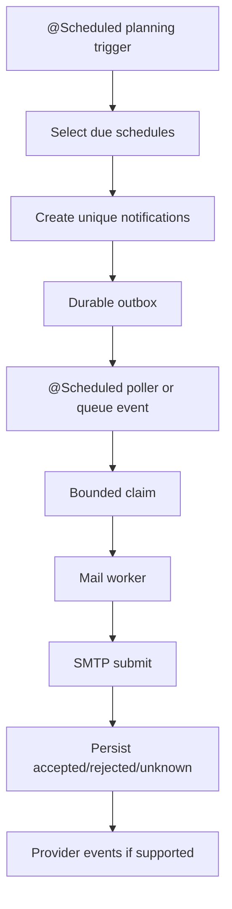

# @Scheduled và giới hạn của tác vụ định kỳ

Trong **Spring Framework Mail**, không phải email nào cũng cần gửi ngay khi có HTTP request. Ứng dụng có thể cần gửi báo cáo lúc 08:00, nhắc lịch hẹn trước 30 phút, lập thông báo công nợ đầu tháng, gửi email tổng hợp mỗi tuần hoặc kiểm tra hàng đợi gửi thư sau mỗi vài giây. Spring Framework cung cấp `@Scheduled` để gọi một phương thức theo lịch, nhưng annotation này có phạm vi cụ thể.

**`@Scheduled` là cơ chế kích hoạt công việc trong vòng đời Spring application, không phải hàng đợi bền vững, không tự lưu những lần chạy bị lỡ và không bảo đảm email được gửi đúng một lần.** Một scheduler có thể hoạt động đúng theo cấu hình nhưng SMTP provider vẫn chậm hoặc từ chối, ứng dụng đang restart vào thời điểm cần gửi, hay ba replica cùng tạo ba bản email.

Bài học giải thích `fixedDelay`, `fixedRate` và `cron`, time zone và thread pool; giới hạn về thời gian chạy, multi-instance, restart, exception và shutdown; cách kết hợp scheduler với outbox, idempotency, worker, retry/backpressure; đồng thời đưa ra ví dụ Java/YAML/SQL, kiểm thử và các quyết định kiến trúc thực tế.

## 1. Đặt scheduler vào đúng bước của mail pipeline

Có ba thiết kế dễ gặp.

**Cách đơn giản: gửi trực tiếp trong lịch**

```text
@Scheduled
    |
    v
Render template
    |
    v
JavaMailSender.send(...)
    |
    v
SMTP relay
```

Cách này có thể chấp nhận cho một vài email nội bộ không quan trọng. Tuy nhiên, khi process chết trước hoặc trong lượt gửi, ý định gửi có thể mất; việc retry và chống gửi trùng cũng khó kiểm soát.

**Cách đáng tin cậy hơn: lập notification rồi giao worker**

```text
@Scheduled trigger
    |
    v
Find due business occurrences
    |
    v
Insert unique notification
    |
    v
Durable outbox / queue
    |
    v
Bounded mail worker
    |
    v
JavaMailSender.send(...)
    |
    v
Persist SMTP attempt outcome
    |
    v
Provider delivery events (if supported)
```

**Cách dùng scheduler như poller**

```text
Business service -> durable outbox
                         |
                         v
                 @Scheduled polling
                         |
                         v
                 Claim due jobs
                         |
                         v
                       Worker
                         |
                         v
                        SMTP
```

Trong hai mô hình cuối, `@Scheduled` chỉ **đánh thức** phần việc cần làm; database hoặc broker mới là nơi giữ trạng thái công việc.

### Những câu hỏi cần phân biệt

- **Đến lịch chưa?** Do schedule/planner quyết định.
- **Yêu cầu gửi đã được ghi nhận bền vững chưa?** Do outbox/queue quyết định.
- **Worker đã thử gửi chưa?** Do attempt log quyết định.
- **SMTP server đã chấp nhận message chưa?** Do kết quả transport quyết định.
- **Mail đã phân phát tới phía người nhận chưa?** Cần nguồn bằng chứng downstream như provider event/DSN nếu có.
- **Người nhận đã thấy/đọc thư chưa?** Không thể suy ra từ `@Scheduled` hoặc `JavaMailSender.send`.

## 2. Bật @Scheduled với @EnableScheduling

Ví dụ một ứng dụng Spring Boot:

```java
import org.springframework.boot.SpringApplication;
import org.springframework.boot.autoconfigure.SpringBootApplication;
import org.springframework.scheduling.annotation.EnableScheduling;

@SpringBootApplication
@EnableScheduling
public class MailApplication {

    public static void main(String[] args) {
        SpringApplication.run(MailApplication.class, args);
    }
}
```

Bean kích hoạt:

```java
import org.springframework.scheduling.annotation.Scheduled;
import org.springframework.stereotype.Component;

@Component
public class OutboxPollTrigger {

    private final MailDispatchCoordinator coordinator;

    public OutboxPollTrigger(
            MailDispatchCoordinator coordinator
    ) {
        this.coordinator = coordinator;
    }

    @Scheduled(fixedDelay = 5_000)
    public void poll() {
        coordinator.offerAvailableWork();
    }
}
```

`MailDispatchCoordinator` là service do ứng dụng định nghĩa. Ở đây method không trực tiếp gửi một chiến dịch email lớn; nó chỉ kiểm tra và dispatch công việc trong giới hạn capacity.

Để một `@Scheduled` hoạt động:

- Bean phải được Spring quản lý/đăng ký trong application context phù hợp.
- Scheduling phải được bật.
- Method scheduled thông thường không có tham số; kết quả trả về không tự trở thành job receipt.
- Cần xác nhận bean được tạo đúng một lần; nhiều contexts hoặc registrations có thể làm task chạy ngoài dự kiến.
- Khi test chỉ tạo object bằng `new`, annotation không tự tạo scheduling infrastructure.
- Lịch và logic nghiệp vụ nên tách nhau để dễ kiểm thử.

## 3. fixedDelay, fixedRate và cron khác nhau thế nào?

| Hình thức | Ý nghĩa | Khi nào cân nhắc |
|---|---|---|
| `fixedDelay` | Chờ một khoảng từ lúc **lần chạy trước kết thúc** | Poll outbox hoặc công việc maintenance |
| `fixedRate` | Nhắm tới các mốc tính từ lúc **lần chạy bắt đầu** | Kiểm tra nhanh theo nhịp ổn định |
| `cron` | Kích hoạt tại các mốc lịch cụ thể | Báo cáo hằng ngày/tuần/tháng |
| `initialDelay` | Trì hoãn trước lượt đầu | Khởi động có kiểm soát |

### fixedDelay

```java
@Scheduled(fixedDelay = 30_000)
public void pollPendingMail() {
    dispatchCoordinator.offerAvailableWork();
}
```

Nếu method chạy 8 giây, scheduler chờ thêm khoảng 30 giây sau khi nó kết thúc:

```text
Start A ---- run 8s ---- End A
                           |
                           +-- wait 30s -- Start B
```

`fixedDelay` phù hợp với poller đồng bộ có thời gian xử lý ngắn và biến động. Nhưng nếu method chỉ nộp task vào `@Async` rồi trả về ngay, thời gian chờ không tính đến lúc SMTP gửi xong.

### fixedRate

```java
@Scheduled(fixedRate = 30_000)
public void refreshMailRoutingSnapshot() {
    routingSnapshot.refresh();
}
```

Scheduler nhắm tới các nhịp bắt đầu cách nhau 30 giây. Nếu method mất lâu hơn chu kỳ, lượt tiếp theo có thể bị trễ tùy khả năng scheduler/executor. Không được suy ra “mỗi 30 giây tạo đúng một email” hay “mọi lượt đều được lưu bền vững”.

### cron

```java
@Scheduled(
    cron = "0 0 8 * * MON-FRI",
    zone = "Asia/Ho_Chi_Minh"
)
public void planWeekdayDigest() {
    digestPlanner.materializeDueNotifications();
}
```

Cron diễn đạt **mốc 08:00 các ngày thứ Hai tới thứ Sáu** theo time zone được chỉ rõ. Nó không bảo đảm email đến inbox vào đúng 08:00.

## 4. Cron của Spring thường có sáu trường

```text
┌──────────── giây
│ ┌────────── phút
│ │ ┌──────── giờ
│ │ │ ┌────── ngày trong tháng
│ │ │ │ ┌──── tháng
│ │ │ │ │ ┌── ngày trong tuần
│ │ │ │ │ │
* * * * * *
```

| Biểu thức | Thời điểm |
|---|---|
| `0 */5 * * * *` | Mỗi 5 phút |
| `0 0 8 * * *` | 08:00 mỗi ngày |
| `0 30 9 * * MON-FRI` | 09:30 từ thứ Hai tới thứ Sáu |
| `0 0 0 1 * *` | Đầu mỗi tháng |
| `0 0 18 * * FRI` | 18:00 thứ Sáu |

Cron Unix thường dùng năm trường. Không sao chép biểu thức từ Linux crontab mà không đối chiếu cú pháp Spring; đặc biệt khi một cron sai có thể tạo hàng chục nghìn email.

Một số biểu thức nâng cao như `L`, `W` hoặc `#` có quy tắc riêng, cần được xác minh với version Spring tương ứng và có test các thời điểm biên.

### Đưa lịch ra cấu hình

```java
@Scheduled(
    cron = "${mail.digest.cron:0 0 8 * * *}",
    zone = "${mail.digest.zone:Asia/Ho_Chi_Minh}"
)
public void planDigest() {
    digestPlanner.plan();
}
```

Cú pháp property placeholder của Spring cho phép lấy biểu thức cron và múi giờ từ cấu hình triển khai.

```yaml
mail:
  digest:
    cron: "0 0 8 * * *"
    zone: Asia/Ho_Chi_Minh
```

Spring cho phép cron đặc biệt `-` để vô hiệu hóa một trigger có cấu hình thông qua placeholder:

```yaml
mail:
  digest:
    cron: "-"
```

Chú ý: thay property ở runtime **không mặc định khiến annotation `@Scheduled` lập tức được đăng ký lại**. Nếu người dùng cần thay đổi lịch thường xuyên, nên lưu schedule state và có cơ chế reschedule rõ ràng.

## 5. Time zone là một phần của nghiệp vụ

“Gửi lúc 08:00” cần biết 08:00 ở đâu:

- Time zone của server?
- UTC?
- Time zone của tenant?
- Time zone do từng người nhận chọn?

Nếu không chỉ định `zone`, cron có thể được diễn giải theo default time zone của scheduler/runtime. Một thay đổi server region có thể làm giờ gửi lệch đi.

Ví dụ:

```java
@Scheduled(
    cron = "0 0 8 * * *",
    zone = "Asia/Ho_Chi_Minh"
)
public void planAtEightInVietnam() {
    planner.planDue();
}
```

### Nhiều người dùng, nhiều múi giờ

Nếu người dùng ở Việt Nam, Nhật Bản và Đức đều muốn digest vào 08:00 **giờ địa phương**, không thể dùng một cron 08:00 cho tất cả.

Nên lưu:

```text
mail_schedule
  schedule_id
  recipient_ref
  zone_id
  local_hour
  local_minute
  next_due_at (UTC instant)
  enabled
```

Một poller thức dậy định kỳ rồi tìm `nextDueAt <= now`. Planner tính lần kế tiếp theo `ZoneId` và business policy, chứ không tạo một `@Scheduled` annotation cho mỗi người dùng.

## 6. DST và những thời điểm không tồn tại

Ở nhiều vùng trên thế giới có chuyển đổi daylight saving time (DST), cùng một local time có thể không tồn tại hoặc xuất hiện hai lần.

Ví dụ người dùng chọn 02:30 mỗi ngày:

- Vào ngày đồng hồ nhảy từ 01:59 lên 03:00, 02:30 có thể không tồn tại.
- Vào ngày đồng hồ lùi, một giờ địa phương có thể được lặp lại.

Hệ thống phải chốt chính sách:

1. Bỏ occurrence bị mất.
2. Dời tới thời điểm hợp lệ tiếp theo.
3. Dùng quy tắc theo UTC.
4. Khi giờ lặp, chỉ tạo một notification theo business date.
5. Ghi log/audit về occurrence bị điều chỉnh.

`@Scheduled` tự diễn giải thời điểm cron, nhưng không quyết định được ý nghĩa nghiệp vụ “đúng một bản mỗi ngày” cho toàn bộ các time zones.

Các test nên có ngày nhuận, cuối tháng, cuối năm, DST, thay đổi zone của người dùng và ứng dụng downtime qua mốc due.

## 7. Scheduler thread không phải SMTP worker

Trong cấu hình Spring Boot thông thường với `ThreadPoolTaskScheduler`, pool có thể nhỏ, thường chỉ một thread nếu chưa chỉnh; phiên bản/framework configuration hoặc virtual thread mode có thể khác.

Nếu scheduled method gửi rất nhiều thư đồng bộ:

```text
08:00 cron starts
       |
       v
Render 2,000 emails
       |
       v
SMTP calls, each waits for network
       |
       v
Cron method runs many minutes
       |
       v
Other scheduled tasks may start late
```

Nên giữ trigger nhẹ:

- Tìm công việc đến hạn.
- Tạo/persist một batch nhỏ.
- Dispatch những job có slot xử lý.
- Trả quyền điều khiển scheduler nhanh.
- Để worker pool khác đảm nhiệm SMTP network I/O.

### Cấu hình thread pool scheduler

Với Spring Boot auto-configuration tương ứng:

```yaml
spring:
  task:
    scheduling:
      pool:
        size: 2
      thread-name-prefix: mail-schedule-
```

Đây không phải giải pháp tăng SMTP throughput. Khi provider chỉ cho 10 submissions/giây, thêm scheduler threads có thể chỉ tạo thêm áp lực.

## 8. @Async không bảo đảm durability

Có thể cấu hình `@Scheduled` và `@Async`, nhưng cần hiểu:

- `@Scheduled` kích hoạt method.
- `@Async` có thể nộp công việc cho một executor khác khi qua cơ chế interception phù hợp.
- Method trigger trả về trước khi SMTP gửi xong.
- Lần trigger sau có thể tới khi công việc cũ vẫn chạy.
- Executor RAM có thể đầy và từ chối task.
- Khi process chết, task đang chờ trong RAM có thể mất.
- Exception async không mặc định trở thành một job retry bền vững.

Ví dụ có rủi ro:

```java
@Async("mailExecutor")
@Scheduled(fixedRate = 5000)
public void sendPending() {
    sendThousandsOfMessages();
}
```

Nếu xử lý mất 60 giây, nhiều lượt có thể chồng lấn trong executor; nếu không có atomic claim, chúng có thể thử cùng notification.

**`@Async` không thay thế outbox, lease, rate limit và idempotency.**

## 9. fixedRate không tự có hoặc tự tránh overlap trong mọi trường hợp

Giả sử công việc chạy 70 giây nhưng chu kỳ là 60 giây:

```text
fixedDelay 60s:
  run 70s -> wait 60s -> next run

fixedRate 60s:
  target starts at 0s, 60s, 120s...
  actual start may be delayed by execution resources
```

Không nên khẳng định `fixedRate` luôn chạy chồng lấn: với một registration đồng bộ và scheduler thông thường, những lượt chậm có thể được xử lý tuần tự. Tuy nhiên, các nguồn overlap khác vẫn tồn tại:

- Method có nhiều `@Scheduled` registrations.
- `@Async` tạo tác vụ nền.
- Nhiều beans/application contexts.
- Nhiều replica.
- Operator chạy thủ công cùng job.
- Worker reclaim job sau lease expiry.

Phòng vệ cho mail quan trọng là **business occurrence key + unique constraint + atomic claim**, không chỉ dựa vào việc không thấy overlap trên một máy.

## 10. Nhiều replica có thể kích hoạt cùng một lịch

Ví dụ Kubernetes Deployment có ba replicas:

```text
08:00 Pod A executes @Scheduled
08:00 Pod B executes @Scheduled
08:00 Pod C executes @Scheduled

All create the same daily digest.
```

Nếu mỗi replica tự xây MIME và gọi `send`, người nhận có thể nhận ba bản.

### Các lựa chọn

| Cách | Lợi ích | Giới hạn |
|---|---|---|
| Một scheduler role riêng | Đơn giản | Cần failover khi role chết |
| Database unique occurrence key | Ngăn tạo trùng logical notification | Không tự chống trùng SMTP attempt |
| Distributed lock/lease | Điều phối trigger | Lock expiry và stale owner |
| Scheduler chuyên trách | Có ownership rõ | Thêm deployment |
| Quartz clustered/JDBC job store | Hỗ trợ lịch bền vững/misfire theo cấu hình | Vẫn cần idempotent side effects |
| Kubernetes CronJob | Tiến trình theo lịch độc lập | Vẫn cần chính sách missed run và idempotency |

`synchronized` hoặc `ReentrantLock` trong JVM không điều phối được các replicas khác. Một giải pháp như ShedLock có thể phối hợp bằng shared lock store, nhưng vẫn có vấn đề lock hết hạn khi job chưa xong hoặc crash sau SMTP accepted.

## 11. @Scheduled không tự chạy bù những lịch bị lỡ

Ví dụ:

```text
07:59 application stops during deployment
08:00 cron should create digest
08:05 application starts

Plain @Scheduled:
  may simply wait for the next scheduled occurrence
```

Các scheduled registrations sống cùng Spring application context, không mặc định ghi lại từng tick bền vững. Muốn xử lý missed occurrence phải có **schedule state** hoặc một durable scheduler với misfire policy được chốt.

Không nên để một email có nghĩa vụ nghiệp vụ bị bỏ qua chỉ vì deploy đúng giờ.

## 12. Catch-up bằng due state trong database

Một mô hình:

```text
digest_schedule
  schedule_id
  recipient_ref
  zone_id
  next_due_at
  last_occurrence_key
  enabled
```

Scheduler chạy mỗi phút:

1. Tìm schedule có `nextDueAt <= now`.
2. Xác định occurrence còn cần xử lý.
3. Insert một notification với dedupe key duy nhất.
4. Cập nhật `nextDueAt` theo policy.
5. Commit.
6. Worker gửi từ outbox.

Sau restart, những schedule quá hạn vẫn được tìm lại. Tuy nhiên, **catch-up không phải cứ gửi tất cả email cũ**. Với OTP hoặc nhắc lịch đã quá hạn, nên chuyển `EXPIRED`. Với báo cáo, có thể gộp; với hóa đơn bắt buộc có thể phải gửi bù.

## 13. Business occurrence, logical notification và SMTP attempt

Đừng đồng nhất ba đơn vị:

| Đơn vị | Ví dụ |
|---|---|
| **Occurrence** | Digest của ngày 12/11 cho recipient A |
| **Notification** | Bản ghi ý định gửi digest đó |
| **Attempt** | Một lần SMTP submission của notification |

Một occurrence có thể được planner kiểm tra nhiều lần. Một notification có thể bị worker thử gửi nhiều lần. Điều cần đảm bảo trước hết là **mỗi occurrence chỉ có một logical notification** khi sản phẩm yêu cầu như vậy.

Một dedupe key:

```text
scheduleId + recipientRef + businessDate + templateType
```

Ví dụ:

```text
digest-42:recipient-19:2026-11-12:daily-summary
```

Không sinh một random UUID mới rồi dùng nó làm business dedupe key mỗi lần cron tick.

## 14. Dùng unique constraint thay vì check-then-insert

Schema outbox minh họa:

```sql
CREATE TABLE mail_outbox (
    id                 VARCHAR(64) PRIMARY KEY,
    dedupe_key         VARCHAR(255) NOT NULL UNIQUE,
    recipient_ref      VARCHAR(128) NOT NULL,
    notification_type  VARCHAR(64) NOT NULL,
    due_at             TIMESTAMP NOT NULL,
    expires_at         TIMESTAMP NULL,
    next_attempt_at    TIMESTAMP NOT NULL,
    status             VARCHAR(32) NOT NULL,
    attempts           INTEGER NOT NULL DEFAULT 0,
    claim_token        VARCHAR(64),
    lease_until        TIMESTAMP NULL,
    created_at         TIMESTAMP NOT NULL
);

CREATE INDEX ix_mail_outbox_dispatch
    ON mail_outbox (status, next_attempt_at, due_at);
```

Kiểu timestamp, retention, payload reference và indexes cần điều chỉnh theo database thực tế.

Hai replicas có thể đồng thời thấy một key chưa tồn tại. Vì vậy:

```text
SELECT existsByDedupeKey(K)
then INSERT(K)
```

không đủ ngăn race. Một **unique database constraint** cộng xử lý conflict rõ ràng mới là lớp bảo vệ thực tế.

Lưu ý: constraint ngăn tạo **logical notification trùng**, không tự ngăn duplicate SMTP submissions sau crash/retry.

## 15. Tách planner, outbox và worker

Một kiến trúc đề xuất:



- Planner chịu trách nhiệm **due/expiry/idempotent materialization**.
- Dispatcher chịu trách nhiệm **capacity và ownership**.
- Worker chịu trách nhiệm **MIME/SMTP**.
- Attempt repository chịu trách nhiệm **kết quả đã biết và không chắc chắn**.
- Provider event handler chịu trách nhiệm **delivery/bounce bằng chứng downstream**.

Cách này vẫn có thể chạy trong một Spring Boot process lúc đầu; khi tải tăng, tách worker deployment mà không viết lại business planning.

## 16. Ví dụ @Scheduled planner với Clock

```java
import java.time.Clock;
import org.springframework.scheduling.annotation.Scheduled;
import org.springframework.stereotype.Component;

@Component
public class DueMailPlanningTrigger {

    private final Clock clock;
    private final DueMailPlanningService planner;

    public DueMailPlanningTrigger(
            Clock clock,
            DueMailPlanningService planner
    ) {
        this.clock = clock;
        this.planner = planner;
    }

    @Scheduled(
        fixedDelayString = "${mail.planning.poll-delay-ms:60000}"
    )
    public void tick() {
        planner.materializeDueNotifications(
                clock.instant(),
                200
        );
    }
}
```

`DueMailPlanningService` do ứng dụng định nghĩa, thực hiện trong các transaction phù hợp:

- Chọn một batch occurrence đến hạn.
- Kiểm tra subscription và consent.
- Tạo dedupe key.
- Insert notification unique.
- Cập nhật `nextDueAt`.
- Không gọi SMTP.

Cấu hình Clock:

```java
import java.time.Clock;
import org.springframework.context.annotation.Bean;
import org.springframework.context.annotation.Configuration;

@Configuration
public class TimeConfiguration {

    @Bean
    public Clock clock() {
        return Clock.systemUTC();
    }
}
```

Dùng Clock inject giúp test ổn định và tránh nhiều method dùng thời gian “hiện tại” khác nhau khi gần nửa đêm.

## 17. Ví dụ scheduled poller cho outbox

```java
import org.springframework.scheduling.annotation.Scheduled;
import org.springframework.stereotype.Component;

@Component
public class MailOutboxPollingTrigger {

    private final MailDispatchCoordinator coordinator;

    public MailOutboxPollingTrigger(
            MailDispatchCoordinator coordinator
    ) {
        this.coordinator = coordinator;
    }

    @Scheduled(
        fixedDelayString = "${mail.outbox.poll-delay-ms:5000}",
        initialDelayString = "${mail.outbox.initial-delay-ms:10000}"
    )
    public void poll() {
        coordinator.offerAvailableWork();
    }
}
```

Coordinator cần biết có bao nhiêu worker permits còn trống, chỉ claim số job tương ứng, giữ job PENDING nếu executor không nhận, và không tạo queue RAM vô hạn.

Đặc biệt, đừng claim 10.000 database jobs rồi đưa vào một executor capacity 100. Lease có thể hết hạn trước khi job bắt đầu SMTP, khiến worker khác claim lại và gây duplicate.

## 18. Không giữ transaction mở trong khi gửi SMTP

Một anti-pattern:

```java
@Scheduled(fixedDelay = 5000)
@Transactional
public void sendPending() {
    for (MailJob job : repository.findPending()) {
        mailSender.send(buildMime(job));
        repository.markSent(job.id());
    }
}
```

Nhược điểm:

- Database lock/connection bị giữ trong thời gian SMTP network I/O.
- SMTP submission không tham gia database transaction.
- Rollback sau exception không thu hồi thư đã được relay nhận.
- Nếu batch có 100 job và job thứ 80 lỗi, trạng thái trước đó có thể bị rollback.
- Query có thể lấy quá nhiều việc.
- Nhiều replica có thể tranh cùng record.

Tốt hơn:

```text
Transaction A:
  atomic claim bounded jobs
  set claimToken and leaseUntil
COMMIT

Outside transaction:
  render MIME and submit via SMTP

Transaction B:
  update attempt result if claimToken matches
COMMIT
```

Nếu dùng `@Transactional` ở các service method, cần chú ý Spring proxy semantics: gọi nội bộ một method annotated trong cùng instance không nhất thiết qua transaction interceptor như kỳ vọng.

## 19. Atomic claim, lease và phục hồi nhiều worker

Một flow:

```text
PENDING / RETRY_SCHEDULED
         |
         v
Atomic claim
         |
         v
PROCESSING + claimToken + leaseUntil
         |
         v
SMTP attempt
         |
    +----+----+
    |    |    |
accepted reject unknown
```

Một số database như PostgreSQL hỗ trợ `FOR UPDATE SKIP LOCKED` trong transaction để giảm tranh chấp khi chọn job; cú pháp và isolation khác nhau theo database.

Không dùng SELECT pending rồi UPDATE không có điều kiện và coi là atomic.

**Lease hết hạn** cho phép worker mới nhận job khi worker cũ chết. Nhưng nếu worker cũ đang bị pause GC và sau đó tiếp tục gửi, có thể có hai attempts. Claim token/version hạn chế stale worker ghi đè trạng thái DB, nhưng không thể thu hồi một SMTP request đã ra ngoài.

Cần lease renewal, timeout, attempt history và retry policy phù hợp với rủi ro gửi trùng.

## 20. JavaMailSender.send thành công không đồng nghĩa delivered

Ví dụ:

```java
MimeMessage message = mailSender.createMimeMessage();

MimeMessageHelper helper =
        new MimeMessageHelper(message, false, "UTF-8");

helper.setFrom("notifications@example.org");
helper.setTo("customer@example.net");
helper.setSubject("Báo cáo định kỳ");
helper.setText("Báo cáo của bạn đã sẵn sàng.");

mailSender.send(message);
```

Khi SMTP transport trả về thành công, thông thường ứng dụng chỉ có bằng chứng **SMTP submission tới next-hop server đã được chấp nhận**, không phải:

- Message đã đến inbox.
- Recipient đã mở/đọc.
- Phần HTML/attachment đã hiển thị.
- Mail không thể bounce về sau.

Đặt trạng thái như `SMTP_ACCEPTED`; nếu provider có webhook/DSN, ghi delivery/bounce ở tầng khác. Không đánh dấu `DELIVERED` ngay sau lời gọi `send`.

## 21. Phân loại lỗi SMTP và unknown outcome

`MailException` có thể xảy ra do AUTH, TLS, connect timeout, recipient rejection, provider throttling hoặc mất kết nối.

Một tình huống khó:

```text
Worker                       SMTP relay
  |---- message DATA ---------->|
  |                              |
  |                         accepts message
  |                              |
  X<---- final reply lost -------|
  |
  v
Timeout / MailException
```

Worker không chắc server đã nhận thư hay chưa. Retry ngay có thể tạo bản trùng.

| Outcome | Ý nghĩa | Hướng xử lý |
|---|---|---|
| `SMTP_ACCEPTED` | Transport xác nhận submit | Không retry vì thiếu delivery event |
| `KNOWN_REJECTED` | Có bằng chứng server từ chối | Retry/sửa lỗi theo loại |
| `UNKNOWN` | Không rõ có accepted không | Reconcile/controlled retry |
| `EXPIRED` | Job hết hạn nghiệp vụ | Không gửi |
| `CANCELLED` | Job bị hủy | Không gửi |

Classifier cần xét cause chain/SMTP stage/provider response khi có. Không coi mọi exception là bằng chứng email chắc chắn chưa gửi.

## 22. @Scheduled không tự cung cấp retry/backoff

Một cách làm nguy hiểm:

```java
@Scheduled(fixedRate = 1000)
public void retryAllFailures() {
    for (MailJob job : repository.findAllFailed()) {
        mailSender.send(buildMime(job));
    }
}
```

Nếu SMTP provider đang throttling hoặc credential sai, job có thể retry liên tục, tạo **retry storm**.

Một retry policy cần:

1. Phân loại known failure / unknown.
2. Giới hạn max attempts.
3. Backoff tăng dần với jitter.
4. Lưu `nextAttemptAt`.
5. Áp dụng provider quota và retry hint phù hợp.
6. Kiểm tra deadline/expiry.
7. Giữ notification ID, tạo attempt ID mới.
8. Có attempt history và error category.
9. Đưa job vượt giới hạn vào trạng thái final/DLQ/manual review.
10. Không retry message đã accepted chỉ vì chưa có webhook delivered.

Ví dụ:

```text
Attempt 1 -> temporary reject -> next after ~30 seconds
Attempt 2 -> temporary reject -> next after ~60 seconds
Attempt 3 -> temporary reject -> next after ~120 seconds
Attempt 4 -> stop or escalate by policy
```

Giá trị chỉ minh họa; Spring Mail không quy định một lịch backoff áp dụng cho mọi provider.

## 23. Poll due jobs phải có giới hạn

Một query minh họa chỉ để nhận diện due jobs:

```sql
SELECT id
FROM mail_outbox
WHERE status IN ('PENDING', 'RETRY_SCHEDULED')
  AND due_at <= CURRENT_TIMESTAMP
  AND next_attempt_at <= CURRENT_TIMESTAMP
ORDER BY next_attempt_at, created_at
LIMIT 50;
```

Đây **chưa** là giải pháp atomic claim cho nhiều worker. Phải kết hợp transaction/lock/conditional update.

Không chọn mọi bản ghi pending không giới hạn rồi nhét vào executor RAM. Scheduler polling nhanh hơn chỉ tăng số lần query, không tăng hạn mức SMTP.

## 24. Backpressure với email định kỳ

Một cron tạo 50.000 email mỗi giờ, nhưng provider chỉ nhận 10 email/giây. Thời gian tối thiểu để submit 50.000 email (không retry, không overhead):

\[
\frac{50\,000}{10} = 5\,000\text{ giây}
\]

Khoảng **83 phút 20 giây**. Nếu cứ mỗi giờ lại tạo thêm 50.000 jobs, backlog tăng vô hạn khi nguồn cung không đổi.

Các giới hạn phải thiết kế riêng:

| Giới hạn | Ý nghĩa |
|---|---|
| Scheduler interval | Tần suất kiểm tra due work |
| Queue capacity | Số task chờ trong RAM |
| Worker concurrency | Số SMTP attempts đồng thời |
| Provider rate limit | Số submissions/recipients trong một giây |
| Provider quota | Tổng lượng mail theo giờ/ngày |
| Outbox admission | Số/dung lượng pending có thể lưu |
| Business deadline | Mail còn hợp lệ đến khi nào |

Tăng số scheduler threads hoặc giảm poll interval không loại bỏ provider quota. Với nhiều replicas dùng chung provider, cần rate limiter phối hợp toàn cục hoặc budget per-instance rõ.

## 25. Priority và fairness

Nếu có 40.000 newsletter đang chờ, OTP không nên bị kẹt sau tất cả chúng.

Có thể chia:

- **Critical transactional:** OTP, reset password, quota riêng và TTL ngắn.
- **Normal transactional:** biên nhận, xác nhận đơn, retry bền vững.
- **Digest/reminder:** lịch nghiệp vụ, có thể expire/gộp khi trễ.
- **Bulk marketing:** rate limit và khả năng pause.

Không để client tự tùy ý gán mọi job là `priority=CRITICAL`. Backend quyết định theo notification type, quyền và policy. Cần có fairness để một tenant không chiếm toàn bộ capacity.

## 26. Hủy lịch và hết hạn

Ví dụ:

- Cuộc hẹn bị hủy.
- OTP không còn hiệu lực.
- Báo cáo được thay bằng bản mới.
- Người dùng unsubscribe.
- Người nhận đổi giờ gửi.
- Sender profile hoặc tenant bị vô hiệu hóa.

Mỗi job nên có `dueAt`, `expiresAt` và điều kiện gửi theo nghiệp vụ. Worker kiểm tra trước khi gọi SMTP. Nếu đã hết hạn, chuyển `EXPIRED` hoặc `CANCELLED` thay vì cố gửi.

Hủy schedule **không thu hồi được email đã SMTP accepted**. Cần định nghĩa hành vi với các notification chưa submit và đang in-flight.

## 27. Lịch động theo user không nên là hàng nghìn annotations

`@Scheduled` thích hợp với một số trigger cấu hình tĩnh. Nếu mỗi recipient có giờ gửi riêng, nên lưu lịch trong database:

```text
scheduleId
recipientRef
zoneId
localDeliveryTime
nextDueAt
enabled
```

Một poller tìm due rows rồi lập notification unique. Spring có `TaskScheduler`/`Trigger` để đăng ký tác vụ động theo code, nhưng scheduled future trong memory vẫn không tự trở thành durable job.

Khi người dùng đổi lịch, phải chốt policy:

- Hủy occurrence cũ hay giữ?
- Giờ mới có hiệu lực từ ngày nào?
- Có audit schedule version không?
- Deduplication key có đổi không?
- Notification đã accepted có xử lý khác không?

Không chỉ thay cron string rồi coi mọi trạng thái cũ đã đúng.

## 28. Graceful shutdown

Khi process nhận SIGTERM:

1. Ngừng claim việc mới.
2. Dừng admission tới executor sắp đóng.
3. Cho in-flight SMTP attempts hoàn tất trong hạn.
4. Persist outcome nếu còn quyền ownership.
5. Cho job chưa hoàn tất được recovery từ outbox.
6. Sau restart, planner xử lý missed occurrences theo policy.

Có thể dùng:

```java
executor.setWaitForTasksToCompleteOnShutdown(true);
executor.setAwaitTerminationSeconds(25);
```

Nhưng những cấu hình này **không bảo đảm RAM queue tồn tại qua SIGKILL, OOM hoặc mất điện**. Outbox bền vững và lease/retry là lớp phục hồi cần thiết.

## 29. Observability tách scheduler và transport

Các metric gợi ý:

| Metric | Câu hỏi |
|---|---|
| `mail_schedule_trigger_total` | Scheduler đã kích hoạt bao nhiêu lượt? |
| `mail_schedule_trigger_failure_total` | Có lỗi trigger/planner không? |
| `mail_schedule_duration_seconds` | Trigger có chậm không? |
| `mail_notification_created_total` | Có bao nhiêu notifications được lập? |
| `mail_outbox_pending` | Bao nhiêu jobs đang chờ? |
| `mail_outbox_oldest_age_seconds` | Job lâu nhất chờ bao lâu? |
| `mail_send_attempt_total` | Bao nhiêu SMTP attempts? |
| `mail_send_accepted_total` | Bao nhiêu attempts accepted? |
| `mail_send_failure_total` | Bao nhiêu known failures? |
| `mail_send_unknown_total` | Bao nhiêu outcomes không chắc chắn? |
| `mail_provider_delivered_total` | Bao nhiêu delivered events nếu provider hỗ trợ? |

Các tên là đề xuất, không phải toàn bộ metric tự có của Spring Mail.

Một hệ thống có thể có scheduler tick đều nhưng worker chết. Vì vậy **tick thành công không chứng minh mail đang được xử lý**. Dashboard phải thể hiện backlog, tuổi queue, accepted throughput và lỗi provider.

Không đưa notification ID, recipient, email body hoặc raw error message vào metric labels; các thông tin chi tiết thuộc log/database với quyền truy cập phù hợp.

## 30. Health và bảo mật lịch gửi

Không nên gộp SMTP external dependency vào liveness rồi khiến ứng dụng restart liên tục khi provider outage. Với outbox, ứng dụng vẫn có thể nhận yêu cầu nghiệp vụ và chờ provider phục hồi.

Health của mail pipeline nên xét:

- Scheduler còn kích hoạt không?
- Planner còn tạo due jobs không?
- Worker có nhận job không?
- Backlog và oldest age ra sao?
- SMTP connectivity có lỗi không?
- Outbox storage có còn hoạt động không?

Không gọi `JavaMailSender.send` trong health endpoint để “kiểm tra”, vì mỗi lần probe có thể gửi email thật. Khi cần, dùng connectivity probe như `JavaMailSenderImpl.testConnection()` theo config thích hợp.

Bảo vệ:

- Cron config và endpoint “run now” bằng authentication/authorization.
- Có audit và rate limit khi gửi lại hàng loạt.
- Chỉ chọn recipient có consent/quyền.
- Lấy SMTP secrets từ secret manager.
- Không log OTP/reset token, full MIME hoặc attachment.
- Có kill switch/pause campaign khi cấu hình sai.

## 31. Test logic với Clock.fixed

Thay vì chờ cron thật trong CI, tách logic planner:

```java
import java.time.Clock;

public final class PlanningTick {

    private final Clock clock;
    private final DueMailPlanningService planner;

    public PlanningTick(
            Clock clock,
            DueMailPlanningService planner
    ) {
        this.clock = clock;
        this.planner = planner;
    }

    public void execute() {
        planner.materializeDueNotifications(
                clock.instant(), 200
        );
    }
}
```

JUnit 5 + Mockito:

```java
import static org.mockito.Mockito.*;
import java.time.Clock;
import java.time.Instant;
import java.time.ZoneOffset;
import org.junit.jupiter.api.Test;

@Test
void planningTickUsesFixedTime() {
    Instant now = Instant.parse("2026-11-12T01:00:00Z");
    Clock clock = Clock.fixed(now, ZoneOffset.UTC);

    DueMailPlanningService planner =
            mock(DueMailPlanningService.class);

    PlanningTick tick = new PlanningTick(clock, planner);
    tick.execute();

    verify(planner).materializeDueNotifications(
            now, 200
    );
    verifyNoMoreInteractions(planner);
}
```

`DueMailPlanningService` là interface của ứng dụng. Test này kiểm tra method truyền đúng thời gian và batch size, không cần SMTP thật hoặc sleep nhiều giây.

## 32. Bộ test về thời điểm và occurrence

Các case cần có:

- Ngay trước `dueAt`.
- Đúng `dueAt`.
- Sau `dueAt`.
- Cùng occurrence được planner đọc nhiều lần.
- Hai replicas lập cùng occurrence đồng thời.
- Application downtime qua giờ gửi rồi catch-up.
- DST: giờ không tồn tại và giờ bị lặp.
- Ngày nhuận, cuối tháng và cuối năm.
- Người dùng đổi `ZoneId` hoặc giờ gửi.
- Subscription bị hủy.
- Notification hết hạn trước khi worker bắt đầu.
- Manual run đồng thời với scheduled run.

Một invariant:

```text
Given same schedule + business date + recipient
When planner is invoked N times
Then only one logical outbox notification exists
```

Cần test unique constraint ở database thực/tương thích để chứng minh concurrency; một mock repository trong JVM không đủ.

## 33. Bộ test về SMTP, queue và recovery

| Tình huống | Kỳ vọng |
|---|---|
| SMTP accepted | Attempt = SMTP_ACCEPTED, không báo delivered |
| AUTH reject | Error category rõ, không retry nóng |
| SMTP 4xx tạm thời | Backoff theo chính sách |
| Timeout không rõ | UNKNOWN, không khẳng định chắc rejected |
| Render template lỗi | Không gọi SMTP |
| Executor đầy | Job còn bền vững hoặc admission reject rõ |
| Retry nhiều lần | Một notification, nhiều attempt IDs |
| Worker chết trước submit | Job phục hồi từ outbox |
| Worker chết sau DATA | Cân nhắc duplicate risk |
| Provider webhook delivered | Cập nhật delivery evidence riêng |
| Job expired/cancelled | Không gửi |
| Backlog lớn | Giới hạn batch, concurrency và queue age metrics |
| Two replicas | Không tạo hai notifications cho cùng occurrence |

Dùng Mockito, fake sender hoặc SMTP test server. Không dùng credentials SMTP production trong automated tests.

### Test @Scheduled registration

Một số lỗi cấu hình chỉ xuất hiện khi chạy Spring context:

- Quên `@EnableScheduling`.
- Bean không được scan.
- Cron bị disabled bằng `-`.
- Cron/zone invalid.
- Nhiều instances của bean.
- Scheduler thread bị block.

Test component có thể xác minh bean/registration và invocation với một scheduler hoặc latch được kiểm soát. Tránh `Thread.sleep` rồi đòi đúng số tick tuyệt đối trên CI.

## 34. Khi nào nên dùng công cụ khác?

| Nhu cầu | Hướng phù hợp |
|---|---|
| Poll outbox vài giây một lần | `@Scheduled(fixedDelay)` |
| Một email nội bộ ít quan trọng mỗi tuần | `@Scheduled(cron)` trực tiếp có thể đủ |
| Email giao dịch phải phục hồi sau restart | `@Scheduled` + durable outbox/worker |
| Mỗi user có lịch riêng | Database `nextDueAt` + poller/durable scheduler |
| Misfire policy và clustered triggers phức tạp | Quartz JDBC JobStore hoặc tương đương |
| Batch lớn và pipeline nhiều bước | Batch/job processing riêng, scheduler chỉ trigger |
| Tiến trình chạy theo lịch trong Kubernetes | CronJob có concurrency/missed-run policy |
| Quota provider chung nhiều replicas | Distributed rate limiter + workers |

Ngay cả Quartz/CronJob/managed scheduler cũng **không làm SMTP exactly-once**. Các công cụ đó cải thiện trigger/recovery, còn outbound attempt vẫn là side effect ngoài transaction.

## 35. Runbook: đến giờ nhưng chưa thấy email

**Bước 1 — Kiểm tra lịch:** cron, zone, enabled flag, bean registration, lần tick gần nhất, deployment/restart đúng mốc.

**Bước 2 — Kiểm tra planner:** occurrence có được nhận ra không, unique key conflict có hợp lệ không, subscription/consent còn hiệu lực không.

**Bước 3 — Kiểm tra outbox:** dueAt, nextAttemptAt, status, expiresAt, backlog, lease.

**Bước 4 — Kiểm tra worker:** available permits, claim rate, executor rejection, worker shutdown.

**Bước 5 — Kiểm tra SMTP:** AUTH, TLS, timeout, quota, 4xx/5xx, unknown outcome.

**Bước 6 — Kiểm tra delivery:** SMTP accepted không chứng minh inbox; tham khảo provider event/bounce/quarantine khi có.

**Bước 7 — Gửi bù nếu phù hợp:** kiểm tra TTL, trạng thái accepted/unknown, duplicate risk và quyền mass resend.

Không đơn giản chạy lại toàn bộ cron bằng endpoint công khai hoặc gửi lặp tất cả jobs đang PENDING.

## 36. Những sai lầm thường gặp

| Sai lầm | Hệ quả | Cách sửa |
|---|---|---|
| Cron trực tiếp gửi hàng nghìn thư | Block scheduler, khó khôi phục | Planner/outbox/worker |
| Nhiều replicas không dedupe | Gửi trùng | Business occurrence unique key |
| Tin fixedRate là đúng giờ tuyệt đối | Trễ/chồng lấn khi tải | Due state và SLO |
| Không chỉ định zone | Lệch giờ giữa môi trường | ZoneId rõ |
| Dùng `Instant.now()` rải rác | Test flaky | Inject Clock |
| Không có catch-up | Missed runs khi restart | Persist nextDueAt |
| Queue RAM vô hạn | OOM/mất task khi crash | Bounded queue + durable storage |
| Transaction ôm SMTP | Lock lâu, rollback không thu hồi mail | Claim/send/finalize |
| Chỉ dùng `@Async` | Task không bền vững | Outbox |
| Retry mọi exception ngay | Retry storm/duplicate | Classifier + backoff |
| Đánh dấu delivered sau send | Báo sai | SMTP_ACCEPTED, delivery events riêng |
| Không có expiry | Gửi email lỗi thời | TTL/cancel policy |
| Chỉ đo scheduler ticks | Không thấy worker kẹt | Backlog + attempt metrics |
| Cluster lock bằng synchronized | Không chặn replicas khác | Shared lease/DB constraint |
| Test với SMTP thật | Flaky và gửi mail ngoài ý muốn | Fake SMTP/test server |

## 37. Checklist triển khai

1. Định nghĩa lịch nghiệp vụ, dueAt và expiresAt.
2. Chọn đúng fixedDelay/fixedRate/cron.
3. Cron có sáu trường và zone tường minh.
4. Có policy cho DST, ngày nghỉ và missed runs.
5. Kiểm tra `@EnableScheduling` và bean registration.
6. Không làm network SMTP dài trong scheduler thread.
7. Lịch quan trọng có schedule state và outbox bền vững.
8. Có dedupe key với unique constraint.
9. Có atomic claim/lease và check ownership.
10. Không giữ transaction trong SMTP I/O.
11. Giới hạn batch, executor queue, concurrency và provider rate.
12. Retry với backoff, jitter, max attempts và deadline.
13. Phân biệt accepted/rejected/unknown.
14. Không gửi job đã hết hạn/hủy.
15. Có pause/kill switch, audit và quyền chạy thủ công.
16. Secrets và PII được bảo vệ.
17. Metric tách scheduler, planner, outbox, SMTP, delivery.
18. Alert theo oldest-age, missed due work, failure/unknown.
19. Test với Clock cố định, time zone, DST và concurrent planning.
20. Test crash/recovery và graceful shutdown.
21. Có runbook resend có kiểm soát.
22. Dù dùng durable scheduler khác, vẫn xử lý SMTP ambiguity.

## 38. Ghi nhớ

- **`@Scheduled` chỉ kích hoạt công việc**, không tự lưu job bền vững hoặc bảo đảm thư đã đến inbox.
- `fixedDelay` tính từ completion; `fixedRate` nhắm tới nhịp start; `cron` mô tả mốc lịch cụ thể.
- Cron Spring thông dụng có sáu trường; time zone phải được quy định rõ.
- Một scheduled method chậm có thể làm trì hoãn các công việc dùng chung scheduler.
- `@Async` không biến queue RAM thành durable queue và có thể tạo overlap.
- Mỗi replica có scheduler riêng; cần idempotency/coordination.
- Lịch bị lỡ trong downtime không tự chạy bù nếu chỉ dùng annotation.
- Unique occurrence key tránh tạo logical notification trùng, không bảo đảm không có duplicate SMTP attempt.
- Email quan trọng cần outbox, claim/lease, retry state, bounded workers và backpressure.
- SMTP submission không tham gia database transaction; rollback không thể thu hồi message đã accepted.
- Timeout có thể để lại outcome không chắc chắn.
- SMTP accepted không đồng nghĩa delivered/inbox/read.
- Per-user scheduling cần lưu ZoneId và nextDueAt.
- Cần theo dõi backlog và deadlines, không chỉ số scheduler ticks.
- Kiểm thử nên tập trung vào time, idempotency, crash, multi-replica và provider outages.

**Kết luận:** `@Scheduled` hữu ích để **đánh thức công việc định kỳ** trong Spring Framework Mail. Với các email quan trọng, hãy để scheduler xác định *công việc đến hạn*; dùng **schedule state, outbox, worker có backpressure, idempotency, retry theo chính sách và quan sát kết quả SMTP** để không mất yêu cầu gửi khi ứng dụng chậm, restart hoặc nhiều instances cùng hoạt động.
