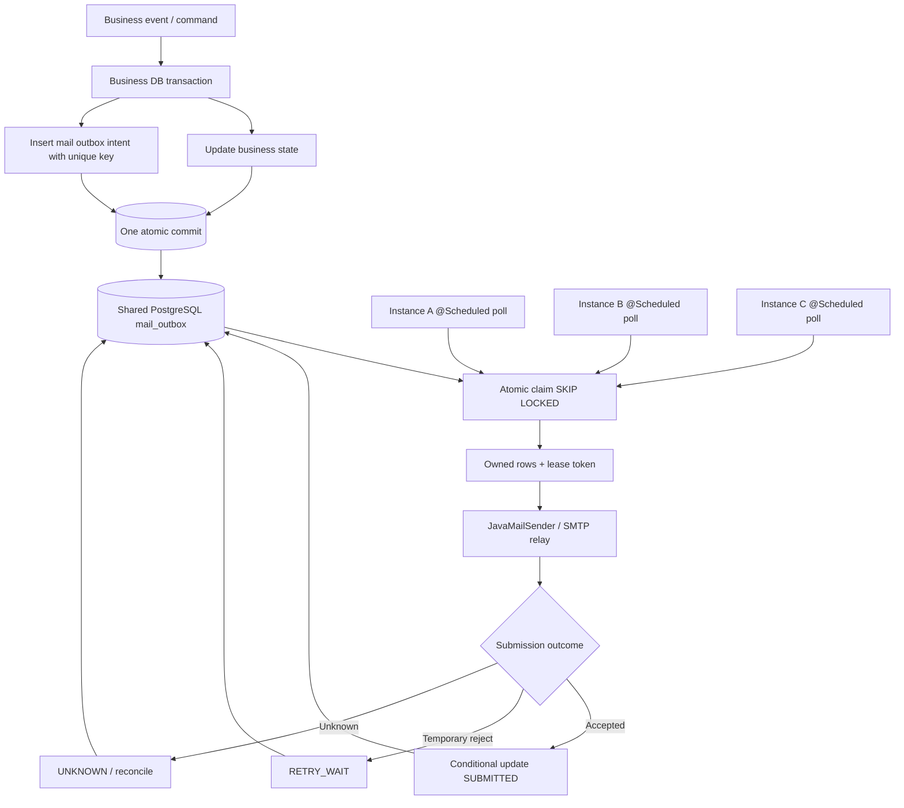

# Tránh chạy trùng khi có nhiều instance

Một ứng dụng Spring Boot dùng `@Scheduled` để quét bảng các email đến hạn và gọi `JavaMailSender`. Lúc đầu chỉ có một instance nên mỗi phút công việc chạy một lần. Khi hệ thống mở rộng thành ba pods để tăng tính sẵn sàng, cả ba đều khởi động scheduler. Đúng 09:00, cả ba cùng đọc một danh sách email `PENDING`, cùng tạo `MimeMessage` rồi gửi. Khách hàng có thể nhận ba email hóa đơn giống nhau, mặc dù mỗi instance đều hoạt động “đúng” theo code của nó.

Bài toán **tránh chạy trùng khi có nhiều instance**, thuộc chương **Lập lịch gửi** trong module **Spring Framework Mail**, không chỉ là thêm một cái khóa quanh method `@Scheduled`. Một hệ thống gửi mail thực tế cần phân biệt **job chạy trùng**, **cùng notification được tạo nhiều lần**, **nhiều worker xử lý cùng một outbox row**, và **SMTP relay có thể chấp nhận cùng thư hơn một lần**. Mỗi loại trùng lặp có mức độ bảo đảm và giải pháp khác nhau.

Bài học này đi từ mô hình lỗi cơ bản, chọn công cụ khóa cluster/scheduler, đến kiến trúc **transactional outbox + atomic claim + lease/fencing + idempotency**, rồi kiểm thử PostgreSQL với nhiều worker, theo dõi vận hành và xử lý các cửa sổ lỗi không thể loại bỏ hoàn toàn ở ranh giới SMTP.

## 1. Vì sao @Scheduled chạy trên từng instance?

Trong Spring, `@Scheduled` đăng ký công việc với scheduler **bên trong application context của mỗi JVM**. Nếu cùng một ứng dụng chạy ở ba instances, ba application contexts thường đăng ký ba lần lịch giống nhau.

```java
import org.springframework.scheduling.annotation.EnableScheduling;
import org.springframework.scheduling.annotation.Scheduled;
import org.springframework.stereotype.Component;

@Component
public class MailSchedule {

    @Scheduled(cron = "0 * * * * *", zone = "UTC")
    public void sendDueMail() {
        // Quét các email đến hạn và gửi.
    }
}
```

Giả sử cả ba instances đang chạy:

```text
09:00:00 UTC
   |
   +-- instance A: sendDueMail()
   |
   +-- instance B: sendDueMail()
   |
   +-- instance C: sendDueMail()
```

Không có gì trong annotation này cho phép ba JVM mặc nhiên biết nhau hoặc bầu một leader. `@Scheduled` giải quyết *khi nào method của instance này nên chạy*, không cung cấp **distributed mutual exclusion**.

### 1.1. Cùng lịch, nhiều process

| Bối cảnh | Có thể xảy ra gì? |
|---|---|
| Một JVM, một `@Scheduled` đăng ký một lần | Method chạy theo scheduler của JVM; vẫn cần hiểu overlap với cấu hình trigger/executor |
| Hai JVM cùng dùng một database | Hai method cùng chạy; đọc cùng dữ liệu nếu không có claim |
| Ba Kubernetes replicas | Mỗi pod có scheduler riêng nếu cùng bật scheduling |
| Rolling deployment | Pod cũ và mới có thể cùng chạy trong thời gian giao nhau |
| Autoscaling | Pod mới tham gia lịch, tăng cơ hội tranh công việc |
| Restart sau crash | Job có thể chạy lại, bỏ lỡ một mốc, hoặc bắt đầu song song tùy cơ chế lịch |
| Nhiều app instances không chia sẻ state | Không có ràng buộc “một lần trên toàn cluster” nếu thiếu cơ chế phối hợp |

### 1.2. Local locks không phải distributed locks

Các cách sau chỉ điều phối trong **một process**:

```java
private final Object lock = new Object();

@Scheduled(fixedDelay = 60_000)
public void poll() {
    synchronized (lock) {
        // Chỉ khóa các threads cùng object/JVM.
    }
}
```

Tương tự:

- `synchronized`.
- `ReentrantLock`.
- `AtomicBoolean inProgress`.
- Static flag trong class.
- Một `ThreadPoolTaskScheduler` chỉ có một worker.
- `@Async` hoặc giới hạn thread pool cục bộ.

Chúng có thể hữu ích để tránh overlap **trong một JVM**, nhưng không khóa các process khác, không tồn tại sau restart, và không bảo đảm một email chỉ được gửi một lần.

### 1.3. @Scheduled(fixedDelay) khác cron

- `fixedDelay`: trong cùng đăng ký task, đợi một khoảng sau khi lần chạy trước kết thúc rồi bắt đầu lần tiếp.
- `fixedRate`: lên lịch theo khoảng thời gian đều; tùy scheduler/executor, execution có thể bị trì hoãn hoặc có các tương tác concurrency cần thiết kế.
- `cron`: kích hoạt ở những mốc lịch cụ thể, có timezone; mỗi instance đánh giá lịch riêng.

Cả ba kiểu đều **không tự biến thành một scheduler toàn cluster**.

## 2. “Chạy trùng” có ít nhất bốn tầng khác nhau

Cần gọi đúng tên vấn đề trước khi chọn giải pháp.

| Tầng | Ví dụ duplicate | Biện pháp trọng tâm |
|---|---|---|
| **Schedule trigger** | Ba pods cùng chạy method mỗi phút | Leader election hoặc distributed job lock nếu thật sự cần một runner |
| **Tạo notification intent** | Một business event tạo ba outbox rows | Unique business/idempotency key + transaction |
| **Claim công việc** | Hai workers cùng lấy một outbox row | Atomic claim trên DB/queue, row lock, lease và fencing token |
| **SMTP submission** | Provider đã nhận nhưng worker crash trước khi ghi `SUBMITTED`, sau đó retry | Reconciliation/provider idempotency khi có; quản lý outcome `UNKNOWN` và rủi ro duplicate |

**Một distributed lock quanh `@Scheduled` thường chỉ xử lý tầng đầu tiên.** Nếu scheduler leader crash và worker khác xử lý lại email đã được SMTP chấp nhận, vẫn có thể duplicate. Ngược lại, nếu mỗi worker claim outbox row bằng một thao tác atomic trong DB, nhiều scheduler cùng đánh thức worker **không nhất thiết là vấn đề**: chúng có thể chia việc an toàn.

### 2.1. Một lần job khác một lần email

Giả sử lúc 10:00 một job quét 10.000 hóa đơn. Dù toàn cluster chỉ một job bắt đầu, job đó vẫn có thể:

1. Gửi thành công 3.000 thư.
2. Crash.
3. Được retry.
4. Quét lại toàn bộ 10.000 thư.
5. Gửi trùng 3.000 thư nếu không có per-notification state.

Vì vậy yêu cầu nghiệp vụ “không gửi trùng email” cần ràng buộc ở **notification identity và attempt state**, không chỉ ở job-level.

### 2.2. Một event có thể tạo nhiều notification hợp lệ

Ví dụ một sự kiện `InvoiceIssued` tạo hai email hợp lệ:

- Email cho khách hàng.
- Email bản sao cho kế toán.

Không nên dùng `eventId` duy nhất làm unique key của mọi mail, vì sẽ chặn nhầm email thứ hai. Key cần phản ánh business scope như **event + purpose + recipient identity + channel**, hoặc quy tắc tương đương theo nghiệp vụ.

## 3. Mục tiêu bảo đảm thực tế là gì?

Ba mục tiêu dễ bị trộn lẫn:

**At-most-once scheduling:** cố tránh hai runners thực hiện cùng một job trong một thời điểm. Đổi lại, nếu runner chết sai lúc, có thể không xử lý hết.

**At-least-once processing:** việc chưa hoàn thành được xử lý lại sau lỗi. Tốt cho durability, nhưng cùng một item có thể được thử lại nhiều lần.

**Exactly-once business effect:** yêu cầu mỗi hiệu ứng nghiệp vụ logic chỉ được ghi nhận một lần trong một phạm vi rõ. Với database, có thể dùng unique key và transaction để đạt idempotency của **tạo intent**. Với external SMTP delivery, không thể suy luận một bảo đảm exactly-once chỉ từ local SQL transaction.

### 3.1. “Một row, một worker tại một thời điểm” là mục tiêu có điều kiện

Database claim và lease có thể bảo đảm tại thời điểm claim, chỉ một worker sở hữu **lease hiện hành** trên row. Nhưng nếu worker A ngừng phản hồi rồi lease hết hạn, worker B có thể claim lại trong khi A vẫn đang gửi SMTP vì network bị treo. Hai workers có thể đều gọi SMTP.

Đây là lý do cần:

- Lease dài hơn send timeout hợp lý, có margin.
- Fencing token khi cập nhật database.
- Heartbeat/gia hạn lease nếu công việc kéo dài.
- Giới hạn số attempts và phân loại `UNKNOWN`.
- Provider idempotency/reconciliation nếu có.
- Chính sách nghiệp vụ chấp nhận hoặc chặn duplicate khi không chắc chắn.

**Lease không phải một giao thức giao dịch hai pha với SMTP.**

### 3.2. Đừng hứa “email chắc chắn chỉ đến một lần”

SMTP relay không tham gia transaction của PostgreSQL. Nếu client gửi xong `DATA` nhưng mất response, hệ thống có thể không biết server đã nhận chưa. Một retry có thể tạo message thứ hai. `Message-ID` ổn định hữu ích cho trace nhưng không phải cơ chế dedup được toàn bộ SMTP servers bắt buộc thực thi.

Mục tiêu kỹ thuật khả thi hơn là: **không mất intent**, **không tạo intent trùng**, **không claim cùng item một cách không kiểm soát**, **giảm và phát hiện retry duplicate**, và **xử lý sự bất định theo policy**.

## 4. Các chiến lược chống chạy trùng trong cluster

Có ba nhóm giải pháp phổ biến, giải quyết những vấn đề hơi khác nhau.

| Giải pháp | Phù hợp với | Điểm mạnh | Giới hạn cần nhớ |
|---|---|---|---|
| **Distributed scheduler/job lock** | Một job nhỏ cần chỉ một runner | Ít sửa logic `@Scheduled` | Không tự chống duplicate từng email khi retry/crash |
| **Quartz clustered JDBC JobStore** | Lịch phức tạp, nhiều triggers, misfire/recovery | Scheduler có metadata bền vững và phối hợp cluster | Cần cấu hình cluster/database đúng; job effect vẫn cần idempotency |
| **Shared outbox + atomic row claim** | Nhiều email độc lập, scale nhiều workers | Mỗi worker nhận các rows khác nhau, tăng throughput | Lease, timeout, retry, outcome unknown vẫn phải thiết kế |
| **Distributed queue + consumer group** | Luồng sự kiện/dispatch đã có broker bền vững | Chia việc theo consumer, retry/prefetch | Broker redelivery thường là at-least-once; vẫn cần idempotency |
| **Một scheduler instance riêng** | Hệ nhỏ, đơn giản, có HA được xử lý ngoài ứng dụng | Dễ vận hành ban đầu | Là điểm lỗi đơn nếu không có leader/failover; không tự xử lý restart giữa chừng |

### 4.1. Chọn theo công việc thật

- Nếu scheduler chỉ gọi **một thao tác maintenance** ngắn mỗi giờ, distributed job lock có thể đủ.
- Nếu cần **đúng thời điểm các lịch phức tạp, misfire, calendar, job metadata bền vững**, Quartz cluster có thể phù hợp.
- Nếu mục tiêu là **gửi hàng nghìn notification intents**, thường nên để nhiều workers poll cùng bảng và claim từng row một cách atomic. Không cần mọi workers chờ một global lock giữ suốt batch SMTP.
- Nếu dùng Kafka/RabbitMQ, thiết kế phải tính đến ACK, redelivery, visibility timeout, broker state và idempotent consumer.

**Không cần dùng tất cả các công nghệ cùng lúc.** Một hệ thống nhỏ có thể bắt đầu với PostgreSQL outbox và một worker; cùng mô hình này có thể mở rộng thành nhiều workers mà không đổi business contract.

## 5. Kiến trúc khuyến nghị cho Spring Mail đa instance



Điểm quan trọng là **cả ba instances được phép chạy poller**. Database xử lý phân quyền claim row bằng transaction, không phải bằng một `boolean isRunning` riêng từng instance.

### 5.1. Phân tách hai loại transaction

1. **Business transaction:** update domain state và insert notification intent vào outbox.
2. **Worker claim/result transactions:** claim row và ghi kết quả của attempt.

SMTP send ở **ngoài database transaction đang giữ row lock**. Không giữ `SELECT ... FOR UPDATE` lock xuyên một cuộc gọi network 30 giây.

### 5.2. Bảng outbox là nguồn sự thật bền vững

Ở hệ này, `@Scheduled` chỉ là đồng hồ đánh thức worker. Nếu một tick bị bỏ lỡ nhưng rows vẫn còn `PENDING` trong database, tick sau hoặc instance khác có thể xử lý.

Trái lại, nếu dùng cron tick để trực tiếp tạo và gửi email mà không lưu intent, mất tick/mất process có thể đồng nghĩa mất notification.

## 6. Thiết kế schema cho notification được lập lịch

Ví dụ PostgreSQL:

```sql
CREATE TABLE mail_outbox (
    id UUID PRIMARY KEY,
    idempotency_key VARCHAR(240) NOT NULL,
    notification_type VARCHAR(80) NOT NULL,
    recipient_address VARCHAR(320) NOT NULL,
    sender_address VARCHAR(320) NOT NULL,
    subject VARCHAR(500) NOT NULL,
    plain_text TEXT NOT NULL,
    status VARCHAR(32) NOT NULL,
    due_at TIMESTAMPTZ NOT NULL,
    expires_at TIMESTAMPTZ NULL,
    next_attempt_at TIMESTAMPTZ NULL,
    attempt_count INTEGER NOT NULL DEFAULT 0,
    claim_token UUID NULL,
    lease_until TIMESTAMPTZ NULL,
    submitted_at TIMESTAMPTZ NULL,
    created_at TIMESTAMPTZ NOT NULL DEFAULT CURRENT_TIMESTAMP,
    updated_at TIMESTAMPTZ NOT NULL DEFAULT CURRENT_TIMESTAMP,
    last_error_category VARCHAR(80) NULL,
    CONSTRAINT uq_mail_outbox_intent UNIQUE (idempotency_key),
    CONSTRAINT ck_mail_outbox_status CHECK (
        status IN (
            'PENDING', 'PROCESSING', 'RETRY_WAIT',
            'SUBMITTED', 'UNKNOWN',
            'FAILED_PERMANENT', 'EXPIRED'
        )
    ),
    CONSTRAINT ck_attempts_nonnegative CHECK (attempt_count >= 0)
);

CREATE INDEX ix_mail_outbox_due
ON mail_outbox (status, next_attempt_at, due_at, created_at);

CREATE INDEX ix_mail_outbox_lease
ON mail_outbox (status, lease_until);
```

Schema trên là ví dụ giáo dục cho text-only email; production có thể lưu `payload_snapshot`/template version, HTML, attachment references, tenant/provider account, recipient identity, audit trail và lịch sử attempts. Không được để nội dung để gửi lại chỉ tồn tại trong Java object tạm.

### 6.1. Các trạng thái chính

| Status | Ý nghĩa |
|---|---|
| `PENDING` | Intent đã commit và chưa bắt đầu gửi |
| `PROCESSING` | Có một worker đang giữ claim/lease |
| `RETRY_WAIT` | Attempt trước bị lỗi có thể retry, chờ tới `next_attempt_at` |
| `SUBMITTED` | SMTP relay/provider đã accepted theo response quan sát được |
| `UNKNOWN` | Kết quả submission không rõ, cần reconciliation hoặc policy riêng |
| `FAILED_PERMANENT` | Không được retry cùng dữ liệu/cấu hình theo policy |
| `EXPIRED` | Thông báo không còn giá trị để gửi, ví dụ OTP quá hạn |

`SUBMITTED` **không đồng nghĩa `DELIVERED`**. Nếu cần trạng thái delivery/bounce, lưu luồng provider events và dữ liệu per-recipient riêng.

### 6.2. Cột thời gian có vai trò riêng

- `created_at`: lúc intent được ghi.
- `due_at`: không được gửi trước thời điểm này.
- `next_attempt_at`: thời điểm retry sau failure hoặc local rate deferral.
- `lease_until`: thời điểm quyền claim hết hiệu lực.
- `expires_at`: sau mốc này notification không còn hợp lệ.
- `submitted_at`: lúc có accepted submission chắc chắn theo app.

Không dùng một cột `scheduled_at` cho cả lịch gửi, retry, expiry và lease. Các mốc này có business semantics khác nhau.

### 6.3. Unique key chống tạo intent trùng

Nếu một đơn hàng chỉ được gửi một email xác nhận tới một recipient identity:

```text
order-confirmation:<order-id>:<recipient-key>
```

Nếu một job mỗi ngày tạo bản tóm tắt:

```text
daily-summary:<tenant-id>:<schedule-occurrence-id>:<recipient-key>
```

Hãy tránh `UUID.randomUUID()` cho `idempotency_key` nếu mục đích là chặn duplicate business events. UUID ngẫu nhiên vẫn thích hợp làm surrogate `id` hoặc `attempt_id`.

## 7. Tạo intent một lần với unique constraint

Kiểm tra `SELECT` rồi `INSERT` **không đủ** dưới concurrency:

```text
Instance A: SELECT key K -> chưa có
Instance B: SELECT key K -> chưa có
Instance A: INSERT K
Instance B: INSERT K -> race
```

Đặt unique constraint trong database rồi dùng insert-if-absent, ví dụ PostgreSQL:

```sql
INSERT INTO mail_outbox (
    id, idempotency_key, notification_type,
    recipient_address, sender_address,
    subject, plain_text,
    status, due_at, expires_at
)
VALUES (
    :id, :idempotencyKey, :notificationType,
    :recipient, :sender,
    :subject, :plainText,
    'PENDING', :dueAt, :expiresAt
)
ON CONFLICT (idempotency_key) DO NOTHING;
```

Khi nhiều instances cùng tạo một logical intent, chỉ một row được commit với cùng key. Nhưng **đừng quên payload consistency**:

- Nếu same key được gửi lại với cùng payload, có thể coi là retry idempotent.
- Nếu same key nhưng recipient/subject/body khác, không nên âm thầm chấp nhận khác biệt.
- Có thể lưu `payload_hash` hoặc version và phát hiện xung đột semantic.
- Unique key không tự ngăn một key sai phạm vi làm mất notification hợp lệ.

### 7.1. Business event và outbox cùng transaction

```java
@Service
public class ConfirmOrderService {

    private final OrderRepository orders;
    private final MailOutboxWriter outbox;

    public ConfirmOrderService(
            OrderRepository orders,
            MailOutboxWriter outbox) {
        this.orders = orders;
        this.outbox = outbox;
    }

    @Transactional
    public void confirm(UUID orderId, UUID recipientId) {
        boolean changed = orders.confirmIfNew(orderId);

        if (changed) {
            outbox.insertIfAbsent(
                    "order-confirmation:" + orderId + ":" + recipientId,
                    /* stable mail content snapshot */);
        }
    }
}
```

`OrderRepository` và `MailOutboxWriter` là ports do ứng dụng định nghĩa trong ví dụ, không phải Spring API. Điểm cần kiểm chứng: cả hai dùng **cùng database resource/transaction manager**, không có `REQUIRES_NEW` làm outbox commit riêng và không gửi SMTP trong transaction này.

## 8. Phân biệt khóa một job và khóa từng email

Một global lock có thể ngăn ba instances chạy cùng một **job**, nhưng nó không giải quyết per-email claim dưới crash và retry. Hãy nhìn ví dụ:

```text
09:00 Instance A chiếm scheduler lock.
09:00 A gửi email #1, #2, #3.
09:01 A crash khi gửi #4.
09:02 Lock hết hạn, instance B chiếm lock.
09:02 B quét lại danh sách #1 ... #N.
```

Nếu query chỉ dựa vào `due_at <= now()` mà không dựa vào status/atomic claim, B có thể gửi lại #1–#3.

### 8.1. Global job lock phù hợp khi nào?

Nó hữu ích nếu job:

- Cập nhật một bảng tổng hợp theo lịch.
- Tạo một lô intent từ một nguồn dữ liệu và không muốn nhiều runners cùng làm công việc đắt.
- Gọi một API không cho concurrency và đã có idempotency theo từng item.
- Thực hiện tác vụ bảo trì duy nhất.

Với dispatch hàng loạt, lock quá dài khiến chỉ một pod làm tất cả công việc, hạn chế throughput và khả năng phục hồi. Một DB queue chia rows thường hợp lý hơn.

### 8.2. Leader election không thay idempotency

Leader có thể thay đổi do network partition, lease expiry hoặc rolling deployment. Nếu leader cũ chưa dừng hẳn mà leader mới tiếp tục làm việc, vẫn có thể có overlap. Các hiệu ứng quan trọng cần fencing/idempotency ở lớp dữ liệu, không chỉ tin một biến `isLeader`.

## 9. Distributed scheduler lock với ShedLock

ShedLock là thư viện thường dùng để khóa những Spring scheduled tasks chạy trên nhiều instances bằng shared lock provider (chẳng hạn JDBC). Đây là **tùy chọn**, không phải một phần mặc định của `@Scheduled` hay Spring Mail.

Sơ đồ:

```text
Instance A ----┐
Instance B ----+--> Shared lock row: "mail-discovery"
Instance C ----┘              |
                      one runner acquires
                               |
                               v
                         execute scheduled job
```

### 9.1. Ý tưởng cấu hình

Một cấu hình JDBC điển hình có bảng khóa tương ứng:

```sql
CREATE TABLE shedlock (
    name VARCHAR(64) NOT NULL PRIMARY KEY,
    lock_until TIMESTAMP(3) NOT NULL,
    locked_at TIMESTAMP(3) NOT NULL,
    locked_by VARCHAR(255) NOT NULL
);
```

Cấu hình API cụ thể phụ thuộc version ShedLock. Mô hình thường gồm:

```java
@Configuration
@EnableScheduling
@EnableSchedulerLock(defaultLockAtMostFor = "PT5M")
public class ClusterSchedulingConfiguration {
}

@Component
public class MailDiscoveryJob {

    @Scheduled(cron = "0 * * * * *", zone = "UTC")
    @SchedulerLock(
            name = "mailDiscoveryJob",
            lockAtMostFor = "PT5M",
            lockAtLeastFor = "PT0S")
    public void discover() {
        // Tạo intent/schedule work, không nhất thiết gửi SMTP.
    }
}
```

Cần dependency và imports ShedLock tương thích với Spring Boot version; ví dụ trên thể hiện ý nghĩa annotation, không khẳng định Spring Boot tự cung cấp `@SchedulerLock`.

### 9.2. lockAtMostFor không phải một deadline SMTP

- `lockAtMostFor` là cơ chế an toàn khi instance chết mà không giải phóng lock.
- Nếu job chạy **lâu hơn lockAtMostFor**, instance khác có thể lấy lock khi job cũ vẫn đang chạy.
- `lockAtLeastFor` có thể giúp giảm việc chạy lại quá sớm trong một số lịch ngắn, nhưng không bảo đảm đúng mỗi fire time.
- Khi có clock skew, nên dùng cơ chế dựa trên thời gian database nếu provider hỗ trợ và phù hợp.
- Nếu không lấy được lock, lần scheduler tick có thể bị **bỏ qua**, không nhất thiết được xếp hàng để chạy sau.

Do đó cần đo thời gian chạy thực, đặt timeout và chọn TTL có margin. Không đặt lock TTL rất ngắn chỉ để “tăng throughput”.

### 9.3. Không dùng ShedLock để hứa exactly-once send

Thư viện này chủ yếu bảo vệ **scheduled method invocation**, không giao dịch cùng SMTP relay. Nếu cần at-least-once durable processing và tránh duplicate intent, vẫn cần outbox/idempotency/claim.

## 10. Quartz clustered scheduler

Quartz phù hợp khi có nhiều jobs, lịch phức tạp, trạng thái trigger và misfire/recovery cần bền vững.

Trong chế độ cluster, các nodes có thể chia sẻ **JDBC JobStore** và phối hợp việc lấy triggers. Phải cấu hình đúng để cùng cluster:

- Dùng JDBC JobStore, **không** dùng in-memory RAMJobStore cho mục tiêu clustering.
- Dùng schema Quartz nhất quán.
- Bật clustering theo cấu hình version đang dùng.
- Mỗi node có instance identity hợp lệ.
- Đồng bộ clocks và xác định misfire/recovery semantics.
- Không để các app độc lập vô tình dùng chung bảng scheduler cùng tên mà khác contract.

Ví dụ Spring Boot properties về mặt ý tưởng:

```yaml
spring:
  quartz:
    job-store-type: jdbc
    properties:
      org.quartz.jobStore.isClustered: true
      org.quartz.scheduler.instanceId: AUTO
```

Các thuộc tính bổ sung về job store implementation, schema, misfire và thread pool cần đối chiếu Spring Boot/Quartz version và database production. Không bật clustering chỉ bằng một flag mà bỏ qua datasource/schema.

### 10.1. Quartz giải quyết gì?

Quartz có thể đảm bảo job scheduling/trigger acquisition được phối hợp giữa các nodes theo contract của Quartz cluster.

Nhưng:

- Một job có thể được recovery/re-execute sau crash.
- Misfire có nhiều lựa chọn xử lý.
- Side effect đã xảy ra ở SMTP không rollback cùng trigger state.
- Nếu mỗi job gửi 10.000 emails trực tiếp, retry job có thể gửi trùng.

Vẫn nên dùng **stable occurrence ID** và unique outbox keys. Quartz quản lý *khi nào tạo/cấp việc*; outbox quản lý *việc gửi nào đã được yêu cầu và đang ở trạng thái nào*.

### 10.2. Khi không cần Quartz

Nếu ứng dụng chỉ có một poller mỗi vài giây để quét mail `due_at <= CURRENT_TIMESTAMP`, một `@Scheduled` đơn giản trên mỗi pod và atomic DB claim có thể đủ. Thêm Quartz vì sợ `@Scheduled` chạy trùng đôi khi là giải pháp nặng hơn yêu cầu.

## 11. Claim từng outbox row bằng PostgreSQL SKIP LOCKED

Đây là phần then chốt khi có nhiều workers cùng quét công việc đến hạn.

### 11.1. Anti-pattern: SELECT rồi UPDATE riêng

Sai:

```java
List<MailOutbox> due = repository.findPendingDue(now);

for (MailOutbox item : due) {
    item.setStatus(PROCESSING);
    repository.save(item);
    sender.send(...);
}
```

Nếu hai instances cùng query trước khi status được commit:

```text
A: SELECT N-101 status=PENDING
B: SELECT N-101 status=PENDING
A: UPDATE status=PROCESSING
B: UPDATE status=PROCESSING
A: SMTP send N-101
B: SMTP send N-101
```

Câu lệnh update chỉ đổi status mà không kiểm ownership không chứng minh độc quyền.

### 11.2. Atomic claim bằng một transaction ngắn

PostgreSQL cung cấp `FOR UPDATE SKIP LOCKED` để nhiều workers cạnh tranh lấy các rows khác nhau thay vì chặn nhau trên row đã khóa. Có thể dùng CTE chọn due rows rồi update `PROCESSING` trong cùng SQL statement:

```sql
WITH due AS (
    SELECT id
    FROM mail_outbox
    WHERE
      (
        (
          status IN ('PENDING', 'RETRY_WAIT')
          AND COALESCE(next_attempt_at, due_at)
              <= CURRENT_TIMESTAMP
        )
        OR (
          status = 'PROCESSING'
          AND lease_until < CURRENT_TIMESTAMP
        )
      )
      AND due_at <= CURRENT_TIMESTAMP
      AND (expires_at IS NULL OR expires_at > CURRENT_TIMESTAMP)
    ORDER BY
        COALESCE(next_attempt_at, due_at),
        created_at,
        id
    LIMIT :batchSize
    FOR UPDATE SKIP LOCKED
)
UPDATE mail_outbox AS m
SET
    status = 'PROCESSING',
    claim_token = :newClaimToken,
    lease_until = CURRENT_TIMESTAMP
                  + (:leaseSeconds * INTERVAL '1 second'),
    attempt_count = attempt_count + 1,
    updated_at = CURRENT_TIMESTAMP
FROM due
WHERE m.id = due.id
RETURNING
    m.id,
    m.idempotency_key,
    m.recipient_address,
    m.sender_address,
    m.subject,
    m.plain_text,
    m.attempt_count,
    m.claim_token,
    m.lease_until;
```

Cú pháp trên là **PostgreSQL-specific**. Không copy `SKIP LOCKED` sang mọi database mà không kiểm syntax và transaction semantics.

### 11.3. Vì sao CTE + UPDATE giúp tránh claim trùng?

Trong cùng transaction:

1. Chọn rows đủ điều kiện.
2. Lấy row locks đối với rows được chọn.
3. Workers khác dùng `SKIP LOCKED` sẽ bỏ qua các rows đang bị khóa.
4. Cập nhật trạng thái và token trước commit.
5. Trả các rows thuộc quyền xử lý cho worker.

Sau commit, các rows đã là `PROCESSING` nên truy vấn mới bình thường không claim lại trước khi lease hết hạn.

### 11.4. Điều cần nhớ về SKIP LOCKED

- `SKIP LOCKED` hữu ích cho queue-like tables, nhưng không cho một snapshot nhất quán đầy đủ của toàn bảng.
- Trong quá trình concurrency, một worker có thể bỏ qua row đang khóa và lấy row khác; đây là hành vi mong muốn để tăng throughput.
- `ORDER BY` không bảo đảm fairness tuyệt đối khi nhiều workers, locks, retries và priorities.
- Nếu claim batch rất lớn, một worker có thể giữ nhiều items chưa gửi trong khi lease của items cuối gần hết hạn.
- Cần indexes theo status/due/lease và đo contention.
- Không giữ transaction row lock trong lúc gọi SMTP.

### 11.5. Lease token cho từng lần claim

Ví dụ ở trên dùng `:newClaimToken` cho toàn **batch**. Điều này vẫn có thể dùng để kiểm `(id, claim_token)`, nhưng token phải là giá trị mới, khó đoán, không tái sử dụng giữa các lần claim. Nếu cần audit/heartbeat rất chi tiết, có thể gán token riêng từng item bằng cơ chế phù hợp.

**Lease token không tự ngăn hai SMTP sends đã bắt đầu.** Nó giúp ngăn một worker cũ cập nhật **database state** sau khi row đã được người khác claim lại.

## 12. Điều kiện update khi worker hoàn thành

Sau khi SMTP relay xác nhận chấp nhận một message, worker chỉ được đánh dấu `SUBMITTED` nếu token của nó còn là token hiện tại.

```sql
UPDATE mail_outbox
SET
    status = 'SUBMITTED',
    submitted_at = CURRENT_TIMESTAMP,
    claim_token = NULL,
    lease_until = NULL,
    updated_at = CURRENT_TIMESTAMP
WHERE id = :id
  AND status = 'PROCESSING'
  AND claim_token = :claimToken;
```

Ứng dụng phải kiểm `affectedRows`:

- `1`: update outcome đã được ghi.
- `0`: row không còn thuộc claim đó; có thể đã được reclaim hoặc chuyển trạng thái, cần ghi conflict/diagnostic chứ không override.

Tương tự khi temporary failure:

```sql
UPDATE mail_outbox
SET
    status = 'RETRY_WAIT',
    next_attempt_at = :nextAttemptAt,
    last_error_category = :errorCategory,
    claim_token = NULL,
    lease_until = NULL,
    updated_at = CURRENT_TIMESTAMP
WHERE id = :id
  AND status = 'PROCESSING'
  AND claim_token = :claimToken;
```

### 12.1. Không đòi lease_until > now trong mọi completion update

Nếu lease hết hạn nhưng chưa ai reclaim, worker có thể vẫn là owner theo token. Một lựa chọn là cho phép update nếu token còn đúng (như ví dụ). Một hệ khác có thể từ chối mọi completion sau expiry và yêu cầu reconciliation.

Cả hai cần thiết kế rõ ràng. Điểm quan trọng nhất là **không ghi đè token mới** sau khi ownership chuyển sang worker khác.

### 12.2. Đếm attempts đúng

Trong claim SQL phía trên, `attempt_count` tăng lúc claim, nghĩa là “số lần được cấp quyền xử lý”, chưa chắc đã mở SMTP connection. Nếu metric cần **SMTP attempts thật**, nên tăng và lưu attempt record ngay trước khi gọi transport thay vì đồng nhất claim với attempt.

Đây là quyết định instrumentation quan trọng khi rate limiter có thể từ chối sau claim. Không để một notification bị local quota gate hoãn mà bị tính là SMTP failure.

### 12.3. Expired items

Một notification có `expires_at <= CURRENT_TIMESTAMP` không được claim như một email hợp lệ mới. Cần cleanup/state transition sang `EXPIRED` bằng transaction riêng có policy rõ, ví dụ OTP đã hết hạn.

Không gửi OTP đã vô hiệu chỉ vì job bị trễ sau failover.

## 13. Spring worker: poller vẫn chạy trên mọi instance

Một implementation minh họa ở tầng điều phối:

```java
package com.example.mail;

import java.util.List;
import org.springframework.scheduling.annotation.Scheduled;
import org.springframework.stereotype.Component;

@Component
public class ScheduledMailDispatcher {

    private final MailClaimRepository claims;
    private final MailSubmissionPort submission;
    private final MailAttemptResultRepository results;

    public ScheduledMailDispatcher(
            MailClaimRepository claims,
            MailSubmissionPort submission,
            MailAttemptResultRepository results) {
        this.claims = claims;
        this.submission = submission;
        this.results = results;
    }

    @Scheduled(fixedDelayString = "${mail.poll.delay-ms:2000}")
    public void dispatchDue() {
        List<ClaimedMail> batch = claims.claimDue(20);

        for (ClaimedMail claimed : batch) {
            dispatchOne(claimed);
        }
    }

    private void dispatchOne(ClaimedMail mail) {
        try {
            submission.submitOnce(mail);
            int changed = results.markSubmitted(
                    mail.id(), mail.claimToken());

            if (changed == 0) {
                // Đã mất ownership trước khi lưu result:
                // không tự khẳng định exactly-once.
                results.reportStaleCompletion(
                        mail.id(), mail.claimToken());
            }
        } catch (DefinitelyTemporaryMailException ex) {
            results.scheduleRetryIfOwned(
                    mail.id(), mail.claimToken(), ex);
        } catch (SubmissionOutcomeUnknownException ex) {
            results.markUnknownIfOwned(
                    mail.id(), mail.claimToken(), ex);
        } catch (DefinitelyPermanentMailException ex) {
            results.markPermanentFailureIfOwned(
                    mail.id(), mail.claimToken(), ex);
        }
    }
}
```

Các interface `MailClaimRepository`, `MailSubmissionPort`, `MailAttemptResultRepository`, `ClaimedMail` và exception types là **abstractions do ứng dụng tự định nghĩa**, không phải built-in Spring classes. Ví dụ chỉ nhằm làm rõ trách nhiệm; production phải xử lý exception chưa phân loại, thread interruption, shutdown và retry với cách không mất work.

### 13.1. Không đặt @Transactional bao toàn bộ dispatchDue()

Không viết:

```java
@Transactional
@Scheduled(fixedDelay = 2000)
public void dispatchDue() {
    List<ClaimedMail> batch = claimRows();
    for (ClaimedMail item : batch) {
        javaMailSender.send(...); // Network trong transaction dài.
    }
}
```

Điều này giữ SQL locks/connections qua SMTP, dễ block workers khác. SMTP không thể rollback cùng PostgreSQL. Transaction boundary nên ở **claimDue** và **result updates**, không bao quanh send.

### 13.2. Repository claim là transaction ngắn

Ví dụ với Spring JDBC:

```java
@Repository
public class MailClaimRepository {

    private final NamedParameterJdbcTemplate jdbc;

    public MailClaimRepository(
            NamedParameterJdbcTemplate jdbc) {
        this.jdbc = jdbc;
    }

    @Transactional
    public List<ClaimedMail> claimDue(int batchSize) {
        UUID token = UUID.randomUUID();

        MapSqlParameterSource params =
                new MapSqlParameterSource()
                        .addValue("batchSize", batchSize)
                        .addValue("leaseSeconds", 90)
                        .addValue("newClaimToken", token);

        return jdbc.query(CLAIM_SQL, params, (rs, i) ->
                new ClaimedMail(
                        rs.getObject("id", UUID.class),
                        rs.getObject("claim_token", UUID.class),
                        rs.getString("recipient_address"),
                        rs.getString("sender_address"),
                        rs.getString("subject"),
                        rs.getString("plain_text")));
    }

    private static final String CLAIM_SQL = """
        -- Đặt câu SQL CTE UPDATE ... RETURNING
        -- đã giới thiệu ở phần 11 tại đây.
        """;
}
```

Imports: `java.util.List`, `java.util.UUID`, `org.springframework.jdbc.core.namedparam.NamedParameterJdbcTemplate`, `MapSqlParameterSource`, `org.springframework.stereotype.Repository` và `org.springframework.transaction.annotation.Transactional`.

`ClaimedMail` là record/DTO có các trường ở constructor trên. `CLAIM_SQL` là placeholder chỉ tới SQL đầy đủ của phần 11, không được chạy literal comment-only trong ứng dụng thật.

Một service gọi `claimDue()` qua Spring bean proxy, sử dụng cùng `DataSource` và transaction manager phù hợp. Nếu tự `new MailClaimRepository(...)` hoặc gọi `@Transactional` qua self-invocation không đi qua proxy trong mô hình thường dùng, transaction có thể không được áp dụng như kỳ vọng.

### 13.3. Mỗi lần poll nên claim bao nhiêu?

Nếu một item cần đến 20 giây SMTP send mà batch size là 100, batch xử lý tuần tự có thể mất hơn 30 phút. Lease 90 giây của items phía cuối sẽ hết hạn trước khi đến lượt chúng, dẫn đến reclaim và duplicate.

Cần chọn:

- Batch size nhỏ theo concurrency thực.
- Lease đủ dài cho khoảng xử lý dự kiến.
- Claim vừa đủ cho slots worker đang sẵn sàng.
- Thực hiện SMTP attempts song song có giới hạn nếu cần.
- Gia hạn lease trên các items vẫn đang xử lý.
- Có deadline/timeout cho mỗi SMTP attempt.
- Theo dõi lease expiration và stale completion.

Không claim 1.000 rows chỉ vì SQL trả được 1.000 rows trong một lần.

## 14. Khi lease hết hạn: recovery và fencing

Một lease giúp job tiếp tục khi owner chết:

```text
09:00 A claims row N-101
      status=PROCESSING
      token=Ta
      lease_until=09:02

09:01 A bị treo, không phản hồi

09:02 B claims expired N-101
      token=Tb
      lease_until=09:04

09:02:10 A bất ngờ hoạt động lại
      gửi SMTP và update với token=Ta
      update affectedRows=0

09:02:20 B có thể cũng gửi SMTP
```

Token làm update của A bị từ chối, nhưng **không thể thu hồi một SMTP request mà A đã gửi**. Nếu broker/provider không có idempotency, đôi khi cả A và B có thể tạo hai accepted submissions.

### 14.1. Heartbeat/gia hạn lease

Với công việc dài, worker có thể gia hạn:

```sql
UPDATE mail_outbox
SET lease_until = CURRENT_TIMESTAMP
                  + (:extraSeconds * INTERVAL '1 second'),
    updated_at = CURRENT_TIMESTAMP
WHERE id = :id
  AND status = 'PROCESSING'
  AND claim_token = :claimToken;
```

Nếu affectedRows=0, worker đã mất ownership. Nếu SMTP chưa bắt đầu, nên dừng. Nếu SMTP đã bắt đầu, không nhất thiết có thể abort sạch; cần ghi outcome/reconcile.

### 14.2. Timeout phải ăn khớp với lease

Ví dụ ứng dụng cấu hình:

```properties
spring.mail.properties.mail.smtp.connectiontimeout=5000
spring.mail.properties.mail.smtp.timeout=10000
spring.mail.properties.mail.smtp.writetimeout=10000
```

Đây là các SMTP socket timeouts minh họa (đơn vị milliseconds trong Jakarta Mail properties), **không phải giới hạn cứng cho toàn bộ một send operation** khi DNS, retry nội bộ, payload và nhiều message/recipient làm thời gian thay đổi.

Lease nên được chọn dựa trên **observed worst-case duration, batch scheduling và safety margin**. Nếu cần processing hàng phút, có heartbeat/claim renewal thay vì đặt một TTL quá ngắn.

### 14.3. Fencing bằng token và version

Một `claim_token` ngẫu nhiên mới mỗi lần claim thường đủ để chặn stale DB updates khi kiểm kết hợp `id`. Một số hệ thống dùng `fencing_version` tăng đơn điệu và buộc mọi writers kiểm version mới nhất.

Cần phân biệt:

- **DB fencing:** chặn worker cũ sửa database sau khi mất quyền.
- **External side-effect fencing:** SMTP server thường không hiểu token của bạn, nên không chặn được request cũ ở phía SMTP.

Không gọi “đã có fencing token thì không thể gửi trùng nữa” nếu external service không xác thực fencing token.

## 15. Đảm bảo schedule occurrence không tạo intent trùng

Đến đây, worker claim đã ổn hơn, nhưng một lịch định kỳ có thể tạo **nhiều notification intents** cho cùng một sự kiện nếu cả ba pods cùng chạy job tạo lô email.

Ví dụ job gửi báo cáo ngày cho mỗi tenant vào 08:00 UTC. Mỗi occurrence cần stable identity:

```text
daily-report:<tenant-id>:<2026-11-12>:<recipient-id>
```

Lưu ý:

- Nếu một occurrence chỉ gửi đúng một lần, key chứa scheduled occurrence identity.
- Nếu có bản sửa báo cáo cần gửi lại có chủ đích, dùng purpose/version mới theo business decision.
- Không dùng `Instant.now()` tại thời điểm từng pod chạy làm key, vì các pods khác nhau vài milliseconds tạo key khác nhau.
- Nếu schedule chạy theo timezone địa phương và có DST, occurrence ID phải được định nghĩa rõ.

### 15.1. Đừng chỉ khóa scheduler tick

```java
@Scheduled(cron = "0 0 8 * * *", zone = "UTC")
public void scheduleReports() {
    // Nếu 3 pods cùng chạy, sẽ tạo ba rows nếu không unique key.
}
```

Ngay cả khi thêm ShedLock, cần unique constraint để giữ invariant nếu lock hết hạn, restart hoặc code path khác cũng tạo report.

### 15.2. Chọn nguồn schedule truth

Nếu một job bị bỏ lỡ lúc 08:00 vì toàn cluster downtime, `@Scheduled` khi hệ thống bật lại lúc 08:15 không mặc nhiên chạy bù occurrence đã mất theo mọi cấu hình.

Để có catch-up đáng tin:

1. Lưu schedule definitions và last-processed occurrence trong database.
2. Khi poll, tìm các occurrences đến hạn nhưng chưa được materialize.
3. Tạo intents bằng unique keys trong transaction.
4. Đánh dấu occurrence đã materialize sau khi các intents được tạo đúng.
5. Hạn chế catch-up burst và đánh giá expiry.
6. Cho phép operator re-run an toàn theo policy.

Khi này, `@Scheduled` chỉ đánh thức logic tìm **missed occurrences**, chứ không phải nguồn dữ liệu duy nhất về những công việc đáng ra phải xảy ra.

## 16. Cẩn thận với bảng “job đã chạy”

Một cách đơn giản:

```sql
INSERT INTO scheduled_job_run(
    job_name, scheduled_slot
)
VALUES (:name, :slot)
ON CONFLICT DO NOTHING;
```

Nếu row được insert rồi commit **trước khi job tạo intents**, và process crash giữa hai việc:

```text
09:00 Insert run marker: COMMIT
09:00 Process crash
09:01 Recovery thấy marker đã tồn tại
09:01 Skip job
=> Không tạo notifications, dù run marker nói "đã chạy".
```

**Unique run marker chỉ chặn duplicate admission; không tự bảo đảm hoàn tất công việc.**

### 16.1. Hai phương án an toàn hơn

**Phương án A — Cùng transaction:**

- Insert run marker.
- Tạo toàn bộ intents cho occurrence.
- Mark materialization complete.
- Commit cùng transaction.

Phù hợp nếu số lượng intents vừa phải và transaction không quá lớn. Không gọi SMTP trong transaction này.

**Phương án B — Durable run state machine:**

- `PENDING`/`RUNNING` với lease.
- Cursor/checkpoint của batch.
- `COMPLETED` chỉ khi materialization đúng.
- Reclaim after timeout.
- Mỗi recipient intent có unique key để repeated batches không sinh trùng.

Phù hợp với các chiến dịch lớn không thể tạo hàng triệu email trong một transaction.

### 16.2. Một ví dụ schema occurrence

```sql
CREATE TABLE scheduled_mail_occurrence (
    job_name VARCHAR(150) NOT NULL,
    occurrence_key VARCHAR(150) NOT NULL,
    status VARCHAR(30) NOT NULL,
    claim_token UUID NULL,
    lease_until TIMESTAMPTZ NULL,
    created_at TIMESTAMPTZ NOT NULL,
    completed_at TIMESTAMPTZ NULL,
    PRIMARY KEY (job_name, occurrence_key)
);
```

Đối với `RUNNING` bị crash, worker khác có thể reclaim theo lease rồi tiếp tục tạo intents idempotently. Bảng này giải quyết **materialization status**, không thay thế mail_outbox cho SMTP attempts.

### 16.3. Re-run có chủ đích

Operator có thể cần chạy lại báo cáo ngày vì template sai. Nếu business muốn gửi một phiên bản sửa, không nên xóa unique key cũ để giả lập một lần gửi mới. Tạo correction purpose hoặc version riêng có audit, để phân biệt **duplicate ngoài ý muốn** với **resend được phê duyệt**.


## 17. Timezone, DST và identity của một lịch gửi

Một hệ thống nhiều instances có thể chạy ở các máy với timezone hoặc đồng hồ không đồng nhất. Nếu dùng “giờ địa phương của máy” để xác định occurrence, hai pods có thể tạo hai keys khác nhau cho cùng sự kiện hoặc bỏ qua một mốc khi đổi giờ mùa hè.

### 17.1. Luôn xác định zone trong lịch nghiệp vụ

Với lịch “08:00 mỗi ngày theo giờ của khách hàng”, cần biết:

- Timezone IANA, ví dụ `Asia/Ho_Chi_Minh`.
- Local date/time người dùng đã chọn.
- Chính sách cho ngày có giờ không tồn tại hoặc xuất hiện hai lần vì DST.
- Mốc thực thi dưới dạng `Instant`/UTC.
- Occurrence identity ổn định qua retries và restart.

Nếu cron nội bộ chạy theo UTC:

```java
@Scheduled(cron = "0 0 8 * * *", zone = "UTC")
public void wakeDailyMailScheduler() {
    // Chỉ đánh thức quá trình tìm occurrences đã đến hạn.
}
```

thì 08:00 UTC **không đồng nghĩa 08:00 cho mọi khách hàng**. Với scheduling theo timezone của từng user, nên materialize `due_at` theo zone của user, rồi poll theo UTC/database time.

### 17.2. Tách định danh occurrence khỏi thời điểm job thực sự chạy

Ví dụ scheduled occurrence:

```text
job_name: DAILY_RECAP
tenant_id: tenant-A
local_date: 2026-11-12
timezone: Asia/Ho_Chi_Minh
occurrence_key: tenant-A:DAILY_RECAP:2026-11-12
due_at_utc: 2026-11-12T01:00:00Z
```

Nếu pod A đến 08:00:01 và pod B đến 08:00:03, cả hai vẫn dùng **cùng occurrence key**, không phải hai thời điểm thực chạy làm key.

Khi có lịch cho một timezone có DST, occurrence key có thể phải chứa offset/occurrence index hoặc một immutable schedule occurrence ID nếu business cho phép **hai lần chạy** ở giờ bị lặp; không tự mặc định tất cả lịch DST chạy đúng một lần.

### 17.3. Clock skew gây lỗi ở cả job lock và lease

Nếu instance A cho rằng hiện tại là 09:00:10 và B cho rằng 08:59:40:

- Một pod có thể tưởng lease đã hết.
- Một pod có thể materialize occurrence sớm.
- Retry deadline không nhất quán.
- Logs khó đối chiếu.

Đối với các phép quyết định `due_at`, `lease_until` trong PostgreSQL, dùng `CURRENT_TIMESTAMP`/DB clock trong cùng transaction là một cách giảm ảnh hưởng clock skew giữa application pods. Với transaction dài, `CURRENT_TIMESTAMP` ở PostgreSQL được cố định theo lúc transaction bắt đầu; **đây là một lý do bổ sung để giữ claim transaction ngắn**. Một số hệ dùng `clock_timestamp()` khi cần thời gian thực ngay tại statement, nhưng phải thiết kế nhất quán.

### 17.4. Monotonic vs wall clock

- `Instant`/UTC thích hợp lưu schedule, deadline và audit across processes.
- `System.nanoTime()` hoặc timer monotonic thích hợp đo elapsed duration **trong một JVM**.
- Không dùng nanosecond counter của process A để so trực tiếp với process B.
- Không dùng `LocalDateTime.now()` không kèm timezone cho một occurrence toàn cluster.

## 18. Misfire, downtime và bắt kịp lịch bị lỡ

“Không chạy trùng” không có nghĩa “được phép bỏ lịch”. Nếu cả ba pods down lúc gửi email, khả năng tạo/sắp xếp công việc sau khi hệ thống trở lại rất quan trọng.

### 18.1. Một cron tick bị bỏ qua

```text
07:59 application chạy bình thường
08:00 tất cả instances down
08:15 hệ thống khởi động
```

Một method `@Scheduled(cron="0 0 8 * * *")` đơn thuần không tự có durable record rằng công việc của 08:00 cần bù. Lần chạy kế tiếp có thể là ngày hôm sau tùy cấu hình.

### 18.2. Poll bảng schedule/occurrence

Một phương án bền vững:

```sql
SELECT job_name, occurrence_key, due_at
FROM scheduled_mail_occurrence
WHERE status IN ('PENDING', 'RETRY_WAIT')
  AND due_at <= CURRENT_TIMESTAMP
ORDER BY due_at
LIMIT 100;
```

Nếu nhiều nodes cùng đọc, cần claim/lock cho occurrence tương tự mail outbox, hoặc transaction insert/upsert idempotently cho lô intent.

Có hai layers:

- **Occurrence processing:** tạo đúng các intent cần có.
- **Outbox dispatch:** gửi các intent đó khi đến hạn.

Đừng trộn logic tạo recipient list và SMTP send trong một transaction dài.

### 18.3. Catch-up policy phải phù hợp nghiệp vụ

Không phải mọi mail bị trễ đều nên gửi bù:

| Loại mail | Khi lịch bị lỡ |
|---|---|
| OTP/reset password | Nếu token hết hạn, không gửi token cũ |
| Hóa đơn | Thường cần gửi bù, có audit và cảnh báo SLA |
| Daily summary | Có thể gửi bù hoặc gộp theo business rule |
| Reminder lịch hẹn | Nếu lịch hẹn đã qua, có thể bỏ/đổi nội dung |
| Marketing promotion | Có thể hết thời gian chiến dịch; đừng flush mù quáng |
| Security alert | Có thể cần kênh thay thế nếu quá muộn |

Phải định nghĩa `expires_at`, cancellation và catch-up semantics trước khi implement.

### 18.4. Giới hạn backlog burst sau downtime

Nếu hệ thống down 8 giờ, hàng triệu intents có thể đến hạn cùng lúc. Khi khôi phục:

- Chỉ claim số rows phù hợp capacity.
- Dùng rate/quota limiter toàn provider account.
- Ưu tiên transactional và time-sensitive.
- Giới hạn concurrency.
- Không quét toàn bảng bằng một transaction rất lớn.
- Theo dõi queue age/oldest due và projected drain time.

Không lấy việc một pod có scheduler lock làm lý do cho phép pod đó gửi vượt quota.

## 19. Transaction boundaries cho job, claim và submission

Một thiết kế có ba loại transaction:

| Transaction | Thao tác | Có SMTP network call? |
|---|---|---|
| **Business / intent creation** | Update domain + insert outbox | **Không** |
| **Claim / lease** | Chọn rows đến hạn, update PROCESSING + token | **Không** |
| **Result / retry update** | Update status theo id+token, ghi attempt | **Không** |

SMTP send nằm **giữa** claim và result transaction. Đây không phải vì transaction không cần, mà vì SMTP không tham gia database transaction và network I/O không nên giữ row lock.

### 19.1. Commit claim trước khi gọi SMTP

Nếu worker query rows `FOR UPDATE` rồi gọi SMTP trước khi commit claim, những điều này có thể xảy ra:

- Connection/row locks bị giữ quá lâu.
- Worker khác chờ hoặc skip row bất thường.
- SMTP có thể accepted rồi DB transaction rollback.
- Retry sau crash làm người dùng nhận mail trùng.

Commit claim nhanh, sau đó gửi, rồi commit kết quả trong transaction khác.

### 19.2. Lỗi database sau SMTP acceptance

```text
1. Worker claim N-101 và commit PROCESSING.
2. SMTP relay trả accepted.
3. DB tạm unavailable khi update SUBMITTED.
4. Worker crash.
5. Lease hết hạn.
6. Worker khác reclaim và retry.
```

Đây là **crash window giữa external side effect và result commit**. Không thể loại bỏ hoàn toàn chỉ bằng `@Transactional`, `SKIP LOCKED` hay ShedLock.

Có thể giảm rủi ro bằng:

- Provider API hỗ trợ idempotency khi có contract rõ.
- Lưu provider reference và reconcile.
- Deadline/lease policy phù hợp.
- Quarantine `UNKNOWN` trong trường hợp không có evidence.
- Chính sách riêng cho transactional/marketing mail.
- Phát hiện potential duplicates và audit.

### 19.3. Không nuốt exception rồi tự commit sai

Nếu code bắt mọi exception và đánh dấu `SUBMITTED` để “thoát queue”, sẽ mất email chưa gửi. Ngược lại, nếu code đánh dấu `RETRY_WAIT` cho timeout outcome unknown rồi retry vô hạn, có thể gửi trùng nhiều lần.

Thành công phải được định nghĩa theo **provider acceptance evidence**, không theo ý muốn làm sạch bảng.

## 20. Trạng thái SMTP và chính sách retry

### 20.1. Accepted khác Delivered

`JavaMailSender.send(...)` không ném exception thường nói về kết quả submission tới SMTP relay ở ranh giới đó. Relay có thể accepted nhưng email vẫn bounce/delay ở MX phía sau.

Không đánh dấu notification `DELIVERED` chỉ vì `send()` thành công; nên dùng `SUBMITTED` hoặc `ACCEPTED_BY_RELAY`.

### 20.2. Temporary rejection

Ví dụ SMTP server trả `451` hoặc `421` tạm thời. Cần xem giai đoạn lệnh, enhanced status code và provider diagnostics. Không coi **mọi** `4xx` đều là rate limit, nhưng temporary rejection thường được xử lý bằng backoff/retry có giới hạn sau khi xác minh phù hợp.

Trạng thái:

```text
PENDING -> PROCESSING -> RETRY_WAIT
                              |
                              +-- next_attempt_at due
                                      |
                                      v
                                  PROCESSING
```

Một retry là **một attempt mới cho cùng intent**, không phải một outbox row mới.

### 20.3. Permanent rejection

Nếu recipient không hợp lệ hoặc policy từ chối vĩnh viễn, không retry cùng dữ liệu vô hạn. Có thể đưa `FAILED_PERMANENT` và cập nhật suppression khi có bằng chứng phù hợp.

Không nhầm permanent failure ở submit với bounce phát sinh sau khi relay đã accepted.

### 20.4. Timeout trước hoặc sau DATA

| Giai đoạn | Kết luận có thể đưa ra |
|---|---|
| TCP connect không thành công và chắc chắn chưa gửi mail commands | Thường chưa có submission |
| AUTH thất bại trước DATA | Không nên retry như lỗi mạng ngẫu nhiên |
| RCPT TO bị từ chối rõ | Recipient acceptance theo response cụ thể |
| Timeout sau khi truyền DATA, chưa nhận final reply | **UNKNOWN**: relay có thể đã accepted |
| Nhận 250 sau DATA | Relay đã accepted submission theo SMTP reply |
| Provider webhook delivered tới sau đó | Có evidence downstream delivery theo contract provider |

Thư viện có thể bọc exceptions, vì vậy classifier phải căn cứ evidence thực, không đoán giai đoạn từ exception class đơn lẻ.

### 20.5. Một message nhiều recipients

Một SMTP submission có thể có partial recipient acceptance. Đừng coi toàn batch là success/failure nhị phân rồi retry tất cả recipients. Với mail giao dịch, mô hình một notification intent cho một recipient thường dễ idempotency, quota, suppression và audit.

## 21. Idempotency ở ranh giới provider

Một số ESP HTTP APIs có request idempotency key; có thể gửi cùng key ở các retries của **cùng notification**, theo phạm vi/tời hạn provider công bố.

Nhưng cần phân biệt:

- **Application idempotency:** DB unique constraint ngăn tạo intent trùng.
- **Worker claim uniqueness:** atomically giới hạn quyền xử lý một outbox row.
- **Provider idempotency:** chỉ tồn tại nếu API/provider thực sự hỗ trợ và còn trong thời hạn.
- **Recipient deduplication:** mailbox/SMTP servers không có bảo đảm chung rằng cùng `Message-ID` chỉ được phát một bản.

### 21.1. Cùng key không đồng nghĩa được dedup giữa nhiều providers

Provider A và B không chia sẻ cùng bảng idempotency. Nếu A accepted nhưng client timeout, gửi cùng key sang B vẫn có thể tạo hai emails.

### 21.2. Message-ID giúp trace

Có thể tạo một RFC `Message-ID` ổn định khi cần correlation, nhưng phải hợp lệ cú pháp và tương thích hệ thống; đừng dùng raw business ID/PII để lộ thông tin. **Message-ID không phải khóa phân tán**.

### 21.3. Chính sách theo mức độ quan trọng

Ví dụ:

- OTP: expire đúng thời hạn, có thể chọn không retry nếu outcome unknown để tránh hai mã nhầm lẫn, tùy UX.
- Invoice: cần hoàn thành, có thể reconcile provider trước khi retry.
- Marketing: nếu outcome unknown, tránh duplicate làm phiền người nhận; ưu tiên evidence.
- Security alert: đôi khi cần nhiều kênh và có thể chấp nhận duplicate được kiểm soát.

Không có một chính sách exactly-once bằng local SQL cho tất cả tình huống.

## 22. Tổ chức concurrency và capacity cho nhiều workers

Nếu có 10 pods, mỗi pod claim 100 rows, hệ thống có thể có 1.000 items `PROCESSING` cùng lúc. Nếu provider chỉ cho 5 SMTP connections, một lượng lớn claims sẽ chờ, leases hết hạn và bị reclaim.

### 22.1. Giới hạn batch theo available worker slots

Một chính sách:

```text
Per instance:
    worker slots = 4
    claim batch <= 4 rows
    max SMTP attempts concurrently = 4

Cluster:
    provider account active submissions <= configured limit
    recipient units/sec <= provider safe rate
```

Nếu provider limit áp dụng toàn account, một semaphore `4` trong mỗi JVM chưa đủ. Cần distributed admission/gate hoặc dispatcher tập trung.

### 22.2. Đừng “claim trước để dành”

Nếu worker có capacity 4 mà claim 1.000 rows, nó giữ quyền xử lý đối với 996 rows chưa bắt đầu. Khi lease hết, các pods khác reclaim và có thể tạo duplicate nếu worker cũ vẫn có queue nội bộ.

Claim vừa đủ, hoặc chia batch nhỏ và xác nhận deadline/lease của từng row.

### 22.3. Fairness và starvation

Nếu queue ưu tiên theo `created_at` và marketing batch có một triệu rows, OTP mới có thể bị chờ quá lâu. Có thể:

- Tách queue hoặc priority classes.
- Reserved capacity cho transactional email.
- Weighted fair scheduling theo tenant.
- Per-provider/account quotas.
- Đo oldest pending age theo notification type.
- Dùng claim query/index phù hợp để tránh quét toàn bảng.

`SKIP LOCKED` không tự bảo đảm fairness; nó chỉ giải quyết tranh row locks theo cơ chế cụ thể.

## 23. Khi nào dùng broker thay vì polling DB?

Kafka, RabbitMQ hoặc các queue dịch vụ cũng có thể phân phối scheduled work.

### 23.1. Queue/broker có thể giúp

- Consumer groups phân chia messages.
- Retry, dead-letter và delayed delivery theo nền tảng.
- Worker scale mà không tự viết polling query.
- Một số hệ có partition assignment và ordering policies.

### 23.2. Nhưng broker không làm SMTP exactly-once

Mô hình thường:

```text
Broker delivers notification N-101
    -> worker calls SMTP
    -> SMTP accepts
    -> worker crashes before ACK
    -> broker redelivers N-101
    -> SMTP could accept again
```

Cần:

- Idempotent consumer.
- Durable state theo notification ID.
- ACK sau khi state/side-effect policy xử lý hợp lệ.
- Duplicate-aware recovery.
- Không tạo notification mới khi redelivery.

Kể cả một broker hỗ trợ “exactly-once” cho một phần xử lý bên trong broker, bảo đảm đó **không tự trải qua SMTP relay**.

### 23.3. Chọn mô hình đơn giản phù hợp tải

Nếu ứng dụng đã có PostgreSQL và mail volume vừa phải, outbox + `SKIP LOCKED` có thể đủ, dễ audit và tương thích business transaction. Với throughput rất lớn, hệ có thể cần broker và adapter riêng. Quyết định dựa trên throughput, SLA, recovery, vận hành và độ phức tạp thực, không chỉ dựa trên tên công nghệ.

## 24. Kiểm thử concurrency với PostgreSQL thật

Mục tiêu là chứng minh **hai instance/threads không claim cùng một row trong cùng thời điểm** và trạng thái được bảo vệ trước race. Mock repository không thể xác nhận locking/transaction semantics của PostgreSQL.

### 24.1. Môi trường test

Có thể dùng:

- Spring Boot integration test.
- PostgreSQL Testcontainers.
- Migration schema tương thích production.
- `JdbcTemplate`/repository thật.
- Hai thread với transactions/connection độc lập.
- Fake `MailSubmissionPort` để không gửi email thật.

Nếu test dùng H2 trong khi production dùng PostgreSQL `SKIP LOCKED`, có thể bỏ sót khác biệt isolation và SQL syntax.

### 24.2. Tránh @Transactional trên test method

Một test `@Transactional` thường được Spring Test rollback khi kết thúc. Nếu service/repository cùng tham gia test transaction, có thể:

- Đọc dữ liệu chưa commit rồi tưởng đã commit.
- Không cho hai threads thấy cùng dữ liệu như production.
- Tranh locks theo hành vi khác dự kiến.
- Không kiểm được effect sau commit.

Với test claim concurrency, hãy để repository tự tạo/commit transaction thực, sau đó query lại trạng thái từ transaction độc lập.

### 24.3. Test hai workers claim khác rows

Giả sử setup có hai `PENDING` rows đã commit. Đoạn mã sau minh họa test logic:

```java
@Test
void twoWorkersClaimDifferentRows() throws Exception {
    UUID firstId = insertPendingMail("N-101");
    UUID secondId = insertPendingMail("N-102");

    ExecutorService pool =
            Executors.newFixedThreadPool(2);
    CountDownLatch start = new CountDownLatch(1);

    try {
        Callable<List<ClaimedMail>> claimOnce = () -> {
            if (!start.await(5, TimeUnit.SECONDS)) {
                throw new IllegalStateException(
                        "Start timeout");
            }
            return repository.claimDue(1);
        };

        Future<List<ClaimedMail>> a =
                pool.submit(claimOnce);
        Future<List<ClaimedMail>> b =
                pool.submit(claimOnce);

        start.countDown();

        List<ClaimedMail> claimed = new ArrayList<>();
        claimed.addAll(a.get(10, TimeUnit.SECONDS));
        claimed.addAll(b.get(10, TimeUnit.SECONDS));

        Set<UUID> ids = claimed.stream()
                .map(ClaimedMail::id)
                .collect(Collectors.toSet());

        assertThat(ids).containsExactlyInAnyOrder(
                firstId, secondId);
        assertThat(claimed).hasSize(2);
        assertThat(ids).hasSize(2);
    } finally {
        start.countDown();
        pool.shutdownNow();
    }
}
```

Các helper `insertPendingMail(...)` và `repository` là fixture ứng dụng; dùng imports `java.util.*`, `java.util.concurrent.*`, `java.util.stream.Collectors` và AssertJ. Test yêu cầu hai rows sẵn sàng, không bị expiry/quota gate hoặc test khác tranh.

### 24.4. Một lỗi timing cần hiểu

`CountDownLatch` làm hai threads bắt đầu gần nhau, **không chứng minh chúng cùng đến statement `SELECT FOR UPDATE` đúng một nanosecond**. Để ép kiểm chứng row lock race, dùng barrier/hook tại đúng DB boundary hoặc test hai transactions giữ locks có chủ đích.

Không kết luận “mọi race đã được loại bỏ” chỉ vì một test chạy một lần và xanh.

### 24.5. Chạy nhiều vòng không thay mô hình đúng

Stress test 100–1.000 vòng có thể phát hiện race hiếm, nhưng correctness vẫn phải dựa trên ràng buộc DB, transaction isolation, conditional updates và state machine. Một test ngẫu nhiên không chứng minh mathematical exactly-once.

## 25. Test lease expiry và stale worker

Một kịch bản quan trọng:

1. Insert một outbox row `PENDING`.
2. Worker A claim → token `Ta`.
3. Dùng DB-controlled time/test hook để làm lease expire.
4. Worker B claim lại → token `Tb`.
5. A cố `markSubmitted(id, Ta)` → affected rows `0`.
6. B `markSubmitted(id, Tb)` → affected rows `1`.
7. DB cuối cùng `SUBMITTED`, token cleared.

### 25.1. Test SQL theo token, không theo PID

Không chỉ assert trường `worker_id` khác nhau. Owner cần được nhận diện bằng **token của từng lần claim**. Một instance có thể khởi động lại với cùng tên hoặc cùng pod name, nhưng claim cũ không được quyền update row đã reclaim.

### 25.2. Test khi A gửi SMTP sau lease expiry

Dùng fake port ghi nhận sends:

- A được phép bắt đầu send rồi bị treo.
- Lease A hết hạn.
- B claim lại và thử gửi.
- A tỉnh dậy và attempt result update bị từ chối.

Test này cho thấy **DB state protected** nhưng fake port có thể ghi nhận **hai submissions**. Đây là giới hạn cần tài liệu hóa chứ không phải test phải “ép” chỉ một fake call trong mọi tình huống.

### 25.3. Test heartbeat

- Khi token còn đúng, renew lease thành công.
- Khi token đã thay, renew trả 0.
- Không renew vô hạn nếu worker đang kẹt quá deadline.
- Nếu thread bị interrupt/shutdown, xử lý stop/cleanup có policy rõ.
- Heartbeat phải không giữ database transaction xuyên SMTP I/O.

## 26. Test creation idempotency và scheduled occurrences

### 26.1. Hai scheduler cùng tạo một intent

Cho A và B cùng materialize cùng occurrence và recipient với key K:

```text
daily-report:tenant-A:2026-11-12:user-U1
```

Sau khi hai transactions kết thúc:

- Chỉ có một outbox row với key K.
- Payload/recipient đúng business version.
- Không có transaction nào tạo thêm row với key random.
- Nếu request trùng có payload khác, hệ thống cảnh báo mismatch thay vì sửa nội dung lặng lẽ.

### 26.2. Crash sau run marker

Test lỗi:

- Tạo run marker/đánh dấu `RUNNING`.
- Crash/rollback trước khi tạo intents.
- Recovery phải nhận diện incomplete occurrence.
- Nếu run marker và intent cùng transaction, kiểm cả hai cùng rollback.
- Nếu dùng state machine/lease, after expiry instance B tiếp tục tạo intents.
- Kết quả cuối cùng không mất và không nhân đôi intents.

### 26.3. Hai business effects cùng transaction

Nếu confirmation event tạo outbox intent, gây exception sau insert nhưng trước commit rồi assert:

- Business state rollback.
- Outbox insert rollback.

Tách khỏi SMTP test. Không dùng mock JDBC/DataSource để “chứng minh” atomic commit.

### 26.4. DST/zone tests

Cho schedule theo timezone có DST, tạo test cho:

- Giờ không tồn tại do spring-forward.
- Giờ lặp do fall-back.
- Local date boundary khác UTC date.
- Pod timezone khác nhau.
- Re-run cùng occurrence sau restart.
- Catch-up cho missed occurrence.

Expected behavior phải xuất phát từ business policy, không từ ngẫu nhiên implementation của `LocalDateTime.now()`.

## 27. Test crash, provider outcome và hồi phục

| Điểm crash | State trước crash | Điều cần kiểm chứng |
|---|---|---|
| Trước insert outbox | Chưa có intent | Event được retry không mất |
| Sau insert nhưng trước business commit | Transaction chưa commit | Rollback cả business + intent |
| Sau commit intent, trước claim | `PENDING` | Pod khác có thể claim |
| Sau claim commit, trước SMTP call | `PROCESSING` | Lease recovery; không mất intent |
| Trong khi SMTP send | `PROCESSING` | Timeout, UNKNOWN hoặc policy hợp lý |
| Sau SMTP accepted, trước result commit | `PROCESSING` | Duplicate risk khi recovery; không nói exactly-once |
| Sau `SUBMITTED` commit | `SUBMITTED` | Poller không claim lại |
| Sau provider delivered event, trước webhook ACK | Delivery event partially processed | Idempotent event dedup |
| Trong lúc lock holder crash | Scheduled lock còn TTL | Cluster tiếp tục sau timeout theo semantics |
| Trong khi Quartz occurrence incomplete | Trigger metadata bền vững | Misfire/recovery policy phù hợp |

### 27.1. Dùng fake SMTP thay vì gửi mail thật

Test concurrency và crash thường cần điều khiển chính xác khi send bắt đầu/kết thúc. Một fake `MailSubmissionPort` có latch hoặc barrier dễ mô phỏng:

- Accepted ngay.
- Temporary reject.
- Permanent reject.
- Timeout trước call.
- Accepted rồi client không nhận response.
- Treo lâu hơn lease.
- Crash sau provider accepted.

Không cần gửi hàng trăm email tới recipient thật để kiểm tra distributed lock.

### 27.2. Test SMTP adapter riêng

Dùng SMTP catcher/test server để kiểm:

- MIME được dựng đúng To/From/subject/UTF-8.
- TLS/AUTH theo test profile phù hợp.
- `JavaMailSender.send` ném lỗi khi server từ chối.
- Timeout được phân loại theo bằng chứng.
- Không retry duplicate recipients trong partial failure.

Một SMTP catcher không tự chứng minh idempotency/atomicity của PostgreSQL; đó là hai tầng test khác nhau.

## 28. Quan sát: phát hiện trùng và bảo vệ SLA

Không chỉ log “job started” trên mỗi pod; một dashboard cần tách **job scheduling**, **outbox processing** và **SMTP outcomes**.

### 28.1. Metrics gợi ý

| Metric | Ý nghĩa |
|---|---|
| `mail_schedule_trigger_total` | Số lần lịch đánh thức từng instance |
| `mail_schedule_lock_acquired_total` | Số lần giành được job lock (nếu dùng) |
| `mail_schedule_lock_skipped_total` | Số lần bỏ tick vì lock do nơi khác giữ |
| `mail_occurrence_materialized_total` | Occurrences đã tạo intents bền vững |
| `mail_intents_created_total` | Unique intents mới |
| `mail_intent_conflicts_total` | Trùng key hoặc payload conflict |
| `mail_claims_total` | Rows đã claim thành công |
| `mail_claim_conflicts_total` | Claim/conditional update thất bại nếu có |
| `mail_lease_expired_total` | Lease hết hạn và cần recovery |
| `mail_stale_completion_total` | Worker cũ không còn token nhưng cố update |
| `mail_submission_attempts_total` | Transport calls thực |
| `mail_submission_unknown_total` | Outcome không xác định |
| `mail_outbox_pending_count` | Backlog |
| `mail_outbox_oldest_due_age_seconds` | Tuổi row đã đến hạn nhưng chưa xử lý |
| `mail_time_to_submission_seconds` | Intent commit → relay accepted |
| `mail_provider_throttles_total` | Provider rate-limit/rejection |
| `mail_duplicate_suspicions_total` | Các trường hợp có dấu hiệu repeated submission |

### 28.2. Đừng coi ba job triggers là ba emails

Nếu ba pods đều poll mỗi phút và hai pods claim 0 rows, thì:

```text
schedule_trigger_total += 3
mail_claims_total += N
mail_submission_attempts_total += N
```

Lượng trigger cao **không nhất thiết là bug** khi kiến trúc cho phép parallel workers. Cảnh báo theo nguy cơ duplicate claim, stale completions, unexpected repeated attempts và SLO, không dựa duy nhất vào số lần `@Scheduled` chạy.

### 28.3. Tránh high-cardinality metrics

Không dùng recipient email, notification UUID, claim token hoặc raw SMTP response làm Prometheus labels.

Dùng labels giới hạn giá trị: `provider`, `notification_type`, `result`, `error_category`, `instance_group`. Correlation IDs/claim tokens nằm trong structured logs hoặc database audit có quyền truy cập phù hợp.

### 28.4. Detect duplicate theo identity

Một query audit có thể tìm các intent keys trùng trong bảng lịch sử attempts hoặc event store. Nhưng vì `mail_outbox.idempotency_key` đã unique, query `GROUP BY idempotency_key HAVING COUNT(*) > 1` trên bảng đó luôn bị constraint ngăn.

Cần tìm dấu hiệu duplicate ở **attempts table**:

```sql
SELECT notification_id,
       COUNT(*) AS attempted_count
FROM mail_submission_attempt
WHERE started_at >= CURRENT_TIMESTAMP - INTERVAL '1 day'
GROUP BY notification_id
HAVING COUNT(*) > 1;
```

Đây chỉ là **tín hiệu retry**, không chứng minh duplicate sai: một notification có thể cần nhiều attempts do temporary failure. Phải xem outcomes và giai đoạn gửi để xác định có nhiều accepted submissions hay không.

### 28.5. Alert có ý nghĩa

- Nhiều `lease_expired`/`stale_completion` so với baseline.
- `PENDING` quá hạn trong khi nhiều workers đang online.
- Time-to-submission của OTP vượt SLO.
- Provider throttles tăng cùng lúc workers tăng.
- `UNKNOWN` tăng sau network incident.
- Occurrence chưa materialize dù đã quá deadline.
- Scheduler lock kéo dài bất thường; không thấy một lần successful materialization.
- Dấu hiệu một notification có hai accepted attempts cần điều tra.

## 29. Runbook khi phát hiện email bị gửi trùng

### Bước 1 — Xác định “trùng” ở tầng nào

- Có hai `notification_intent` khác IDs nhưng cùng business key?
- Có một outbox row với nhiều SMTP attempts?
- Có hai accepted attempts được provider ghi nhận?
- Người nhận báo hai bản email nhưng provider chỉ có một submission?
- Có hai events/notifications khác business purpose nhưng nội dung trông giống nhau?

Không xóa dữ liệu khi chưa phân biệt duplicate business event và duplicate transport submission.

### Bước 2 — Truy dấu identity

Thu thập:

```text
business event ID
notification ID
idempotency key + purpose + recipient identity
scheduled occurrence key
attempt IDs
claim tokens and lease timestamps
provider/account
SMTP/provider references
worker instance + app version
timestamps in UTC
```

Không dùng raw email address làm metric label; xem dữ liệu qua audit có quyền.

### Bước 3 — Kiểm tra cơ chế claim

- Cả hai workers có claim cùng row không?
- Có dùng `SELECT` rồi `UPDATE` ngoài transaction không?
- Có unique constraint không?
- Có kiểm `WHERE claim_token=:token` trên result update không?
- Batch size có quá lớn so với lease không?
- Có instances dùng database khác nhau không?
- Clock skew và lease expiration có bất thường không?

### Bước 4 — Kiểm tra SMTP crash window

Nếu một row có hai attempts nhưng không có hai claims đồng thời, có thể là retry sau:

- Timeout sau DATA.
- Worker crash sau accepted.
- DB result update fail.
- Provider event/reference đến chậm.

Không sửa bằng cách “bỏ mọi retries”: điều đó có thể làm mất email quan trọng. Cần outcome-aware retry và reconciliation.

### Bước 5 — Khoanh vùng ảnh hưởng và giảm tải

- Tạm dừng campaign không cấp thiết nếu duplicate đang tăng.
- Giảm worker concurrency nếu lease expiry xảy ra vì backlog.
- Điều chỉnh lease/timeout/batch size có kiểm soát.
- Không chạy lại toàn bộ job không có idempotency.
- Kiểm tra provider quota, suppression và recipient complaint.
- Nếu thực sự cần dừng dispatch, ưu tiên giữ durable intents để khôi phục sau.

### Bước 6 — Hậu kiểm

Đánh giá lại:

- Invariant cho mỗi schedule occurrence/recipient.
- DB schema và unique constraint.
- Atomic claim và token.
- Retry/UNKNOWN policy.
- Clock/timezone.
- Metrics và alert.
- Quy trình re-run thủ công.
- Coverage của concurrent/crash tests.

## 30. Runbook khi lịch không chạy hoặc email không được gửi

Không phải vấn đề nào cũng là duplicate. Nếu sau khi thêm distributed lock người dùng không nhận email:

1. Scheduler có thực sự được kích hoạt trên instances không?
2. Có một node giữ lock quá lâu không?
3. `lockAtMostFor`/lease có đang chặn takeover không?
4. Occurrence đã đến hạn nhưng chưa materialize?
5. Outbox `PENDING` đã commit và query due đúng chưa?
6. Poller có bị pause vì quota/provider outage?
7. Có rows `PROCESSING` với lease đã hết hạn?
8. Batch claim có skip mọi rows do status/next_attempt_at sai?
9. Timezone/cron và DST có tạo due_at sai?
10. Có consent/suppression/expiry hợp lệ khiến không gửi?
11. SMTP đã accepted nhưng provider delivery event bị trì hoãn?
12. Worker có dừng vì exception chưa được xử lý?

Một global lock giữ quá lâu có thể làm **lỡ job**, trong khi một outbox poller thiếu claim có thể làm **trùng email**. Hai failure modes cần đo và xử lý riêng.

## 31. Những sai lầm phổ biến

### 31.1. Nghĩ @Scheduled chạy đúng một lần toàn cluster

Mỗi instance có scheduler riêng. Cần lựa chọn coordination hoặc atomic work claiming.

### 31.2. Dùng synchronized/static flag cho nhiều pods

Chúng chỉ điều phối trong JVM.

### 31.3. Thêm @Async rồi nghĩ hết trùng

Async chỉ đổi nơi chạy, không tạo distributed lock hoặc idempotency.

### 31.4. Dùng một global lock cho toàn bộ 100.000 emails

Giữ lock lâu, khó failover, giới hạn throughput; cân nhắc DB claim từng row.

### 31.5. Coi ShedLock là exactly-once email delivery

Lock chỉ kiểm soát scheduled method; SMTP không tham gia DB transaction.

### 31.6. Đặt lockAtMostFor ngắn hơn thời gian job thực tế

Holder còn chạy khi lock expired, node khác có thể bắt đầu lại.

### 31.7. Bỏ qua missed cron occurrence

Downtime có thể khiến không chạy bù. Cần durable occurrence/catch-up nếu nghiệp vụ đòi hỏi.

### 31.8. Chỉ INSERT run marker rồi commit trước khi làm việc

Crash sau marker làm mất công việc nếu recovery coi marker = completed.

### 31.9. Dùng SELECT pending rồi UPDATE riêng

Hai workers có thể đọc cùng row. Dùng atomic claim transaction.

### 31.10. Không đặt UNIQUE(idempotency_key)

Application-only check không bảo vệ concurrency và duplicate event redelivery.

### 31.11. Dùng UUID.randomUUID() làm logical idempotency key mỗi lần

Mỗi retry được xem là intent mới. Dùng key ổn định theo business identity/occurrence.

### 31.12. Claim 1.000 rows nhưng chỉ xử lý tuần tự từng row

Lease của items chưa gửi có thể hết trước khi đến lượt. Claim theo available slots.

### 31.13. Không kiểm claim token khi lưu result

Worker cũ có thể ghi đè trạng thái worker mới.

### 31.14. Tưởng fencing token chặn được SMTP gửi trùng

Token chỉ chặn stale DB writes nếu relay không hỗ trợ kiểm token.

### 31.15. Gọi SMTP trong transaction giữ row lock

Làm nghẽn DB và không tạo atomicity với SMTP.

### 31.16. Coi send() trả về là Delivered

Chỉ có evidence submission ở relay; downstream có thể bounce.

### 31.17. Retry mọi SMTP 4xx/timeout như nhau

Rate-limit, permanent errors và timeout outcome unknown cần policy khác nhau.

### 31.18. Retry ngay khi SMTP timeout sau DATA

Provider có thể đã nhận, gây duplicate.

### 31.19. Dùng Message-ID như khóa exactly-once

SMTP không bắt buộc deduplicate theo Message-ID.

### 31.20. Dùng local time không rõ timezone làm occurrence key

Các pods và DST có thể làm key không ổn định, tạo trùng hoặc bỏ sót.

### 31.21. Không kiểm payload consistency khi conflict

Cùng idempotency key nhưng nội dung khác có thể che lỗi dữ liệu.

### 31.22. Đặt status SUBMITTED khi DB update chưa commit

Không có durable evidence; process crash có thể dẫn đến retry.

### 31.23. Lấy một test latch thành chứng minh mọi race

Latch không ép đúng điểm tranh lock; cần DB semantics, stress và targeted interleavings.

### 31.24. Dùng H2 để xác minh PostgreSQL SKIP LOCKED

Khác biệt cú pháp/locking có thể gây test xanh giả.

### 31.25. @Transactional trên test khiến đọc uncommitted data

Service có thể không commit như production. Test transaction boundaries thật.

### 31.26. Không theo dõi stale completions/lease expiry

Duplicate symptom có thể xảy ra âm thầm; cần metrics và audit.

### 31.27. Chạy lại toàn bộ job bằng tay không có key

Operator-triggered rerun có thể tạo hàng nghìn intents trùng. Dùng stable occurrence keys và audit.

### 31.28. Tăng pods khi bottleneck là provider quota

Nhiều workers hơn chỉ tạo thêm attempts thất bại và lease contention.

### 31.29. Dùng provider SDK idempotency mà không hiểu TTL/scope

Cùng key sau TTL hoặc giữa accounts/providers có thể vẫn gửi hai lần.

### 31.30. Xóa outbox PROCESSING để “giải phóng queue”

Có thể mất trạng thái/hồ sơ về attempts đang hoặc đã được accepted. Khôi phục qua lease/state machine có kiểm soát.

## 32. Bài tập thực hành

### Bài 1 — Ba pods cùng @Scheduled

Vẽ timeline ba pods chạy `@Scheduled(cron="0 * * * * *")`. Chỉ ra vì sao cùng một due row có thể bị gửi ba lần.

### Bài 2 — Local vs distributed lock

So sánh `synchronized`, `ReentrantLock`, một scheduler thread và distributed DB lock. Nêu phạm vi bảo vệ của từng cơ chế.

### Bài 3 — Bốn tầng duplicate

Liệt kê job trigger duplicate, intent creation duplicate, row claim duplicate và SMTP submission duplicate. Đề xuất ràng buộc riêng cho từng tầng.

### Bài 4 — Outbox schema

Tạo `mail_outbox` có unique idempotency key, due_at, status, claim token, lease_until, next_attempt_at và attempt_count.

### Bài 5 — Unique intent

Hai instances cùng xử lý một `OrderConfirmed` với cùng business key. Dùng PostgreSQL `ON CONFLICT DO NOTHING` để bảo đảm chỉ một intent row được insert.

### Bài 6 — Payload mismatch

Hai events dùng cùng key nhưng subject/recipient khác. Thiết kế detection thay vì silently bỏ bản thứ hai.

### Bài 7 — Claim concurrency

Viết query `FOR UPDATE SKIP LOCKED` lấy 10 outbox rows và đánh dấu `PROCESSING` trong transaction ngắn.

### Bài 8 — Conditional update

Viết SQL update `SUBMITTED` với `WHERE id AND claim_token`. Test affectedRows khi token stale.

### Bài 9 — Lease expiry

A claim rồi treo; B claim lại sau timeout. Chứng minh A không thể update DB state với token cũ.

### Bài 10 — SMTP side effect

Nếu A và B đều gửi mail dù A mất claim, giải thích vì sao fencing token không thể hoàn tác SMTP sends.

### Bài 11 — Batch và lease

Một SMTP attempt có thể mất 20 giây, batch 100 rows xử lý tuần tự, lease 90 giây. Giải thích rủi ro và thiết kế lại batch size/concurrency/heartbeat.

### Bài 12 — ShedLock

Thiết kế một job `@Scheduled` với `@SchedulerLock`. Nêu khác biệt giữa `lockAtMostFor`, `lockAtLeastFor` và per-row idempotency.

### Bài 13 — Quartz cluster

Phân biệt Quartz JDBC JobStore clustering với `@Scheduled` trên ba JVM. Giải thích vì sao recovery vẫn cần idempotent effects.

### Bài 14 — Missed occurrence

Tất cả instances down lúc 08:00, khởi động lại lúc 08:15. Thiết kế durable schedule occurrence và catch-up.

### Bài 15 — Marker crash window

Insert `scheduled_job_run` rồi crash trước khi tạo emails. Chứng minh tại sao unique marker không đồng nghĩa completed và sửa bằng transaction hoặc state machine.

### Bài 16 — Timezone/DST

Một tenant lên lịch 08:00 local mỗi ngày. Thiết kế due_at UTC và occurrence key ổn định qua pods có timezone khác nhau.

### Bài 17 — Transaction boundaries

Chỉ ra ba transactions: business/intent, claim, result. Giải thích vì sao SMTP call nằm ngoài row-lock transaction.

### Bài 18 — Temporary rejection

Một provider trả `451` được xác minh là temporary. Thiết kế `RETRY_WAIT`, backoff+jitter và same notification ID.

### Bài 19 — Unknown result

Worker mất kết nối sau SMTP DATA. Vì sao không thể chắc chắn chưa gửi? Thiết kế reconciliation và duplicate-aware policy.

### Bài 20 — Provider idempotency

ESP API chỉ giữ idempotency keys trong 24 giờ. Trình bày hành vi khi retry ngày thứ ba và khi failover sang ESP khác.

### Bài 21 — Testcontainers

Dùng PostgreSQL Testcontainers, tạo hai due rows, chạy hai threads claim với batch size 1. Assert nhận hai IDs khác nhau.

### Bài 22 — Test stale owner

Cho worker A token `Ta`, worker B token `Tb` sau expiry; assert A update 0 rows và B update 1 row.

### Bài 23 — Test rollback

Trong transaction cập nhật business state rồi insert mail intent, ném exception trước commit. Assert cả hai rollback.

### Bài 24 — Test double acceptance

Fake SMTP ghi nhận accepted rồi giả lập DB result update fail. Recover lease và thực hiện retry để chỉ ra duplicate risk; đề xuất chính sách UNKNOWN.

### Bài 25 — Test quota

Cho 10 pods với 5 available SMTP connections toàn account. Thiết kế distributed concurrency/rate admission trước send.

### Bài 26 — Dashboard

Tạo các metrics: due backlog, lease expiry, stale completion, claims/s, attempts/s, unique submitted/s, unknown count và oldest due age.

### Bài 27 — Incident runbook

Người nhận báo hai hóa đơn giống nhau sau rolling deployment. Xác định thứ tự kiểm logs, tokens, attempts, provider accepted IDs và unique keys.

### Bài 28 — Recovery drill

Tắt đột ngột pod đang giữ lease, xác nhận pod khác tiếp tục xử lý mà không mất intent, đồng thời tài liệu hóa khả năng duplicate SMTP acceptance.

### Bài 29 — Re-run báo cáo ngày

Operator cần gửi bản báo cáo ngày đã sửa. Thiết kế một correction notification có version mới và audit, không xóa idempotency key cũ để ép gửi lại mù quáng.

### Bài 30 — Chọn chiến lược

So sánh ba phương án: ShedLock quanh cron, Quartz clustered JobStore và nhiều `@Scheduled` workers dùng `SKIP LOCKED` cho workload gửi 100.000 emails. Chọn cách phù hợp theo SLA, throughput, recovery và vận hành.

## 33. Checklist triển khai production

Trước khi bật thêm replica cho mail dispatch:

- [ ] Đã phân biệt mục tiêu lock job với chống tạo intent và claim trùng.
- [ ] Business transaction ghi outbox intent cùng domain state khi cần atomicity.
- [ ] Có stable `idempotency_key` và unique constraint database.
- [ ] Có quy tắc phát hiện same-key/different-payload.
- [ ] Schedule occurrence có identity bền vững và policy cho missed ticks.
- [ ] Due/expiry/retry timestamps có timezone rõ và được lưu UTC.
- [ ] Worker claim bằng DB transaction atomic hoặc broker semantics tương đương.
- [ ] Mỗi claim có token/lease hoặc ownership mechanism rõ.
- [ ] Result update kiểm đúng owner/fencing token.
- [ ] Không giữ row lock/DB transaction xuyên SMTP send.
- [ ] Batch size phù hợp worker slots và lease duration.
- [ ] SMTP connection/read/write timeouts và shutdown behavior được cấu hình.
- [ ] Có phân loại temporary/permanent/unknown outcomes.
- [ ] Retry trên **cùng intent**, không tạo outbox row mới.
- [ ] Không đồng nhất SMTP accepted với delivered.
- [ ] Provider quota/rate/concurrency được giới hạn toàn account/cluster.
- [ ] Có metrics cho backlog, lease expiration, stale completion và UNKNOWN.
- [ ] Có integration test với PostgreSQL thật và ít nhất hai workers/threads.
- [ ] Có failure tests cho crash trước/sau SMTP và DB commit.
- [ ] Có runbook re-run và điều tra duplicate gửi.
- [ ] Secret, verified sender identity, TLS và suppression được kiểm soát.
- [ ] Không tuyên bố exactly-once SMTP delivery khi chưa có contract hỗ trợ.

## 34. Tổng kết và tài liệu tham khảo

Đối với bài toán **tránh chạy trùng khi có nhiều instance** của Spring Framework Mail:

1. **`@Scheduled` chạy trong từng instance**, không phải scheduler duy nhất trên toàn cluster.
2. `synchronized`/`ReentrantLock` chỉ bảo vệ trong JVM; dùng distributed coordination nếu cần một job runner.
3. **ShedLock** hữu ích cho job-level lock; **Quartz clustered JDBC JobStore** hữu ích cho persistent scheduling/misfire; cả hai không tự loại duplicate SMTP submission.
4. Với nhiều email độc lập, **outbox + atomic row claim + lease/fencing** thường linh hoạt và dễ scale hơn giữ một global lock xuyên toàn bộ batch.
5. **Unique business key trong database** chặn tạo notification intent trùng khi nhiều schedulers cùng materialize occurrence.
6. `SELECT pending` rồi `UPDATE` tách rời không đủ; dùng transactional claim, ví dụ PostgreSQL `FOR UPDATE SKIP LOCKED`.
7. **Claim token** ngăn stale workers ghi đè state, nhưng không ngăn external SMTP side effect nếu owner cũ vẫn chạy.
8. **Lease duration** phải phù hợp SMTP timeouts, batch size và khả năng heartbeat; lease quá ngắn làm tăng rủi ro reclaim.
9. Không gọi SMTP trong transaction giữ row lock, cũng không gửi trước business commit nếu cần transactional outbox.
10. Cron tick không phải durable schedule occurrence; missed runs cần catch-up/state machine nếu business yêu cầu.
11. Occurrence key phải ổn định qua nhiều pods, timezone, DST và restart.
12. SMTP accepted không đồng nghĩa delivered, và timeout sau `DATA` có thể là `UNKNOWN`.
13. **Không thể suy ra exactly-once delivery chỉ từ local DB locks hoặc Message-ID**; khi cần, dùng provider idempotency theo hợp đồng và reconciliation.
14. Kiểm thử nhiều workers bằng database thật, fault injection, stale token và crash windows, không chỉ verify mock methods.
15. Theo dõi queue age, lease expiry, stale completion, accepted throughput, unknown count, provider quotas và SLA để phát hiện lỗi trước khi người nhận báo trùng.

Tài liệu tham khảo kỹ thuật:

- [Spring Framework — Scheduling](https://docs.spring.io/spring-framework/reference/integration/scheduling.html): `@Scheduled`, `@EnableScheduling`, cron và scheduling semantics.
- [Spring Framework — Transaction Management](https://docs.spring.io/spring-framework/reference/data-access/transaction.html): transaction boundaries và rollback.
- [Spring Framework — Email](https://docs.spring.io/spring-framework/reference/integration/email.html): `JavaMailSender` và MIME construction.
- [Spring Boot — Sending Email](https://docs.spring.io/spring-boot/reference/io/email.html): `spring.mail.*`, timeouts.
- [PostgreSQL — Explicit Locking](https://www.postgresql.org/docs/current/explicit-locking.html): row-level locks và concurrency.
- [PostgreSQL — SELECT](https://www.postgresql.org/docs/current/sql-select.html): `FOR UPDATE SKIP LOCKED`.
- [PostgreSQL — INSERT](https://www.postgresql.org/docs/current/sql-insert.html): unique constraints và `ON CONFLICT`.
- [Quartz Scheduler Documentation](https://www.quartz-scheduler.org/documentation/): JDBC JobStore, clustering, triggers, misfire/recovery.
- [ShedLock project documentation](https://github.com/lukas-krecan/ShedLock): distributed scheduled-task locks và lock TTL semantics.
- [Testcontainers — PostgreSQL](https://java.testcontainers.org/modules/databases/postgres/): integration testing với database thật.
- [RFC 5321 — SMTP](https://www.rfc-editor.org/rfc/rfc5321): SMTP transaction và reply codes.
- [RFC 3463 — Enhanced Mail System Status Codes](https://www.rfc-editor.org/rfc/rfc3463): lỗi tạm thời/vĩnh viễn.
- **Transactional Outbox pattern:** cùng business transaction lưu intent bền vững, dispatch bất đồng bộ.
- **Idempotent Consumer pattern:** xử lý redelivery/duplicate commands một cách an toàn.
- **Micrometer/Prometheus documentation:** metrics cho claim, attempts, backlog và lịch gửi.

**Cách chống trùng hiệu quả không phải buộc toàn bộ cluster chỉ có một pod được “chạy scheduler”.** Hãy biến công việc gửi email thành những notification intents có identity bền vững, để nhiều instances cùng đánh thức và tranh claim một cách atomic. Khóa schedule khi thật sự cần một runner, nhưng vẫn giữ unique keys, transaction boundaries, leases, fencing và retry semantics cho từng email. Như vậy hệ thống có thể mở rộng mà không nhân đôi công việc một cách mất kiểm soát, đồng thời trung thực về những cửa sổ lỗi SMTP không thể bảo đảm exactly-once chỉ bằng khóa database.

