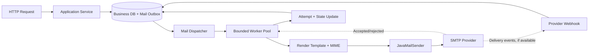
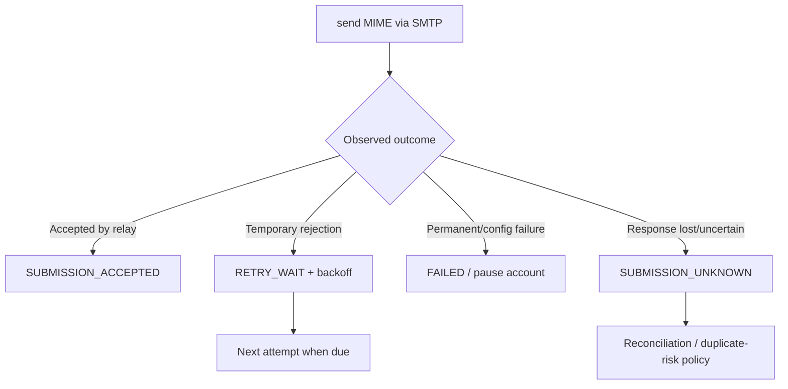
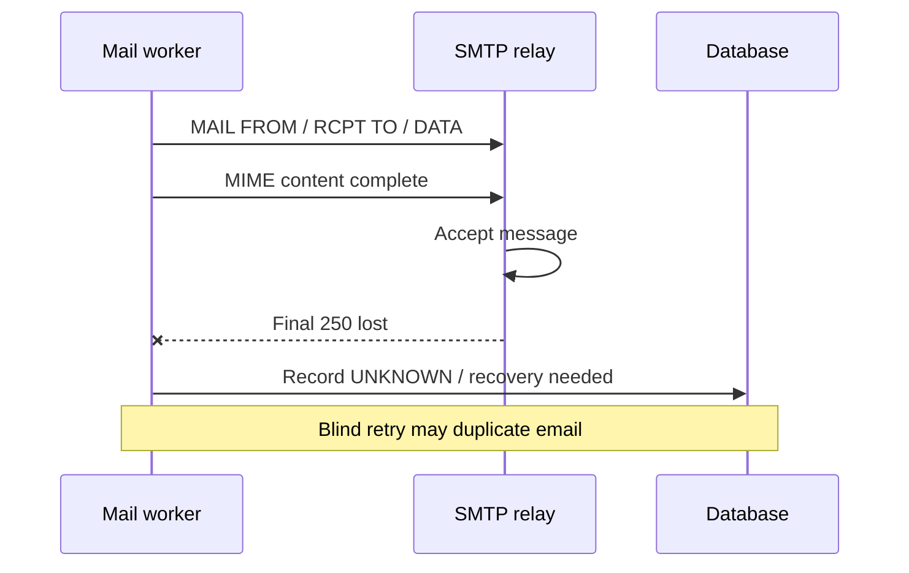

# Worker gửi mail tách khỏi request thread

Trong một ứng dụng Spring Framework Mail, chức năng “đăng ký tài khoản”, “đặt hàng” hay “phát hành hóa đơn” thường kích hoạt email. Cách triển khai dễ nhất là xây `MimeMessage` rồi gọi `JavaMailSender.send(...)` ngay bên trong HTTP controller hoặc service đang xử lý request. Nhưng gửi email là **I/O phụ thuộc SMTP relay, DNS, mạng, TLS, xác thực và giới hạn nhà cung cấp**. Một lần gửi có thể mất hàng giây hoặc thất bại dù nghiệp vụ chính đã hoàn thành.

Một mẫu thiết kế production quan trọng là **tách worker gửi mail khỏi request thread**: request chỉ ghi nhận ý định gửi ở nơi bền vững, trả response theo đúng hợp đồng API; worker độc lập lấy công việc đến hạn, tạo MIME, gửi SMTP, xử lý retry và cập nhật trạng thái. Giữa hai phía phải có ranh giới giao dịch, điều phối và idempotency rõ ràng.

Đây không chỉ là thao tác thêm `@Async`. Mục tiêu là đảm bảo:

- HTTP latency không phụ thuộc vào thời gian SMTP trả lời.
- Email intent không bị mất khi process restart hoặc deploy.
- Business transaction không bị giữ mở trong lúc kết nối SMTP.
- Khi SMTP lỗi/throttle, worker có thể retry mà không làm hỏng giao dịch đã commit.
- Nhiều worker/replica không xử lý một job đồng thời ngoài chủ đích.
- Mỗi lần gửi có trạng thái quan sát được; không hứa “đã nhận email” khi mới enqueue.
- Lỗi ở mail provider không được kéo sập các request hoặc dịch vụ không liên quan.

Bài học **Worker gửi mail tách khỏi request thread** thuộc chương *Mẫu thiết kế production* của Spring Framework Mail. Ví dụ dùng Java 21, Spring Framework 6.x / Spring Boot 3.x, Jakarta Mail, PostgreSQL và SMTP test server. Chúng minh họa kiến trúc và các API có thể cần điều chỉnh cho dependency/version của dự án; SQL hướng tới PostgreSQL, không mặc định chạy nguyên xi trên mọi database.

## 1. Vì sao không gửi SMTP trực tiếp trong request?

Giả sử API tạo đơn hàng:

```java
@PostMapping("/orders")
public ResponseEntity<OrderResponse> create(
        @RequestBody CreateOrderRequest request) {

    Order order = orderService.create(request);
    emailService.sendConfirmation(order);
    return ResponseEntity.ok(OrderResponse.from(order));
}
```

Nếu `emailService.sendConfirmation(...)` gọi `JavaMailSender.send(...)` đồng bộ, thời gian phản hồi HTTP gần bằng:

\[
T_{\mathrm{request}} \approx
T_{\mathrm{validation}} +
T_{\mathrm{database}} +
T_{\mathrm{render}} +
T_{\mathrm{SMTP}} +
T_{\mathrm{overhead}}
\]

Ở đây, `T_SMTP` có thể thay đổi mạnh. Một relay chậm hoặc socket timeout làm request kéo dài, giữ web thread và có thể gây 504 tại gateway. Người dùng có thể bấm gửi lại vì không biết đơn hàng đã được tạo, dẫn đến **request duplicate** không liên quan đến SMTP nhưng do latency SMTP gây ra.

### 1.1. Gửi trong @Transactional còn nguy hiểm hơn

```java
@Transactional
public Order createOrder(CreateOrderCommand command) {
    Order order = orders.save(new Order(command));
    mailSender.send(buildConfirmation(order));
    return order;
}
```

Các rủi ro:

1. Transaction database giữ connection/lock trong lúc chờ SMTP.
2. SMTP có thể accepted email nhưng transaction DB rollback sau đó; người nhận thấy thư xác nhận của một đơn hàng không tồn tại.
3. Database commit có thể thành công nhưng HTTP response mất, client retry tạo đơn hàng/email khác nếu không có request idempotency.
4. SMTP lỗi khiến transaction nghiệp vụ rollback theo policy dù **ý định tạo đơn hàng** có thể hoàn toàn hợp lệ.

SMTP không tham gia ACID transaction của database. `@Transactional` không thể thu hồi email sau khi relay accepted. Một try/catch đơn giản cũng không biến email thành một phần của DB transaction.

### 1.2. Chỉ tạo thread mới không giải quyết được bài toán

Một phương án thường gặp:

```java
new Thread(() -> mailSender.send(message)).start();
return ResponseEntity.accepted().build();
```

Nó có thể giúp HTTP trả nhanh nhưng có các vấn đề nghiêm trọng:

- Thread được tạo không giới hạn, dễ vượt tài nguyên.
- Task tồn tại trong RAM; JVM crash làm mất công việc.
- Không có trạng thái, retry budget hoặc audit.
- Không điều phối quota SMTP.
- Có thể giữ tham chiếu tới request/session/transaction đã đóng.
- Exception không được đưa về caller và có thể không được xử lý đúng.

Với production, đừng dùng thread tự tạo cho tác vụ gửi mail cần bảo đảm.

## 2. Ba kiến trúc và mức độ tin cậy

| Mô hình | Request có chờ SMTP? | Công việc tồn tại qua restart? | Retry/quan sát |
|---|---|---|---|
| Gửi đồng bộ trong request | Có | Không cần queue, nhưng request phải chờ | Lỗi trả về request, dễ gây timeout |
| `@Async` với executor in-memory | Không, nếu proxy/submit hoạt động | **Không tự bảo đảm** | Cần tự quản lý exception, queue, retry |
| Transactional outbox + mail worker | Không | Có nếu DB commit thành công | Có state/lease/attempts và lịch retry |
| Message broker + worker | Không | Tùy durable broker/ack/publisher semantics | Tốt nếu cấu hình đúng, vẫn cần idempotency |

Mẫu trọng tâm của bài là **transactional outbox + bounded mail worker**. Đây là cách phù hợp khi email liên quan đến nghiệp vụ quan trọng và cần khôi phục sau crash. Với thông báo best-effort ít quan trọng, một executor in-memory có giới hạn có thể đủ, nhưng phải chấp nhận khả năng mất task và có contract rõ ràng.

### 2.1. @Async hữu ích nhưng không thay thế durability

```java
@Service
public class AsyncMailService {

    private final JavaMailSender sender;

    public AsyncMailService(JavaMailSender sender) {
        this.sender = sender;
    }

    @Async("mailExecutor")
    public CompletableFuture<Void> sendAsync(MimeMessage message) {
        sender.send(message);
        return CompletableFuture.completedFuture(null);
    }
}
```

Để `@Async` hoạt động cần bật asynchronous method execution bằng `@EnableAsync` hoặc cấu hình tương ứng; call phải đi qua Spring proxy, không phải self-invocation kiểu `this.sendAsync(...)`. Có thể có exception lúc submit nếu executor bị từ chối và exception xảy ra trong task được phản ánh qua future. Nhưng **email chưa được lưu bền vững** chỉ vì method trả `CompletableFuture`.

Đừng trả `200 OK - email delivered` ngay sau khi `sendAsync(...)` được gọi. Tốt nhất có trạng thái `QUEUED` / `SUBMISSION_PENDING` được xác định rõ trong hệ thống.

### 2.2. Broker cũng cần ranh giới commit

Nếu service thực hiện:

```text
DB commit order
  -> publish event to RabbitMQ/Kafka
```

vẫn có cửa sổ crash **sau DB commit, trước publish**, làm mất event email. Ngược lại, publish trước DB commit có thể khiến worker gửi thư về đơn hàng rollback. Transactional outbox giải quyết **ghi ý định cùng transaction nghiệp vụ**; một relay có thể publish outbox tới broker sau commit. Broker consumer vẫn cần dedupe vì redelivery có thể xảy ra sau mất acknowledgment.

## 3. Kiến trúc production đề xuất



Luồng cụ thể:

1. Client gửi HTTP request với dữ liệu nghiệp vụ và, khi phù hợp, request idempotency key.
2. Application service validate và **trong cùng database transaction** tạo business record và outbox intent.
3. DB commit hoàn tất. API trả order/notification ID, trạng thái “đã tiếp nhận để gửi”.
4. Dispatcher đọc các outbox rows đến hạn, claim từng batch với lease/fencing token.
5. Worker load dữ liệu cần thiết, render template, dựng MIME và gọi SMTP relay qua `JavaMailSender`.
6. Worker ghi attempt result và chuyển trạng thái notification với điều kiện lease/attempt.
7. Nếu temporary failure, đặt `nextAttemptAt`; nếu permanent, đưa FAILED/DEAD_LETTER theo policy.
8. Nếu provider có webhook downstream, xử lý độc lập với kết quả submission.

Điểm mấu chốt: **không có một transaction bao trùm HTTP, DB và SMTP**. Thay vào đó có các transaction DB ngắn, side effect ngoài database được theo dõi bằng attempt và recovery.

## 4. Hợp đồng API: “tiếp nhận” khác “gửi thành công”

Một API tạo đơn hàng có thể trả thông tin business và notification:

```text
POST /orders
Idempotency-Key: req-3d4f-test

HTTP/1.1 201 Created
Content-Type: application/json

{
  "orderId": "ORDER-1042",
  "notificationId": "MAIL-8821",
  "emailStatus": "QUEUED"
}
```

HTTP 201 ở đây nghĩa **đơn hàng được tạo**, không phải email đã tới người nhận. Với API chuyên yêu cầu gửi mail và xử lý bất đồng bộ, HTTP `202 Accepted` cùng tracking ID có thể phù hợp:

```text
POST /notifications/email
HTTP/1.1 202 Accepted

{
  "notificationId": "MAIL-8821",
  "status": "QUEUED",
  "statusUrl": "/notifications/MAIL-8821"
}
```

Status endpoint có thể trả:

```text
QUEUED -> SENDING -> SUBMISSION_ACCEPTED
                  -> RETRY_WAIT -> SENDING
                  -> FAILED / DEAD_LETTER
                  -> SUBMISSION_UNKNOWN
```

Nếu provider cung cấp delivery event, có thể có trạng thái downstream riêng. **`SUBMISSION_ACCEPTED` không đồng nghĩa `DELIVERED_TO_INBOX`**. Một SMTP `250` sau DATA cho biết relay accepted tại mốc đó, chưa khẳng định mailbox đích đã nhận hay email vào Inbox/Spam.

### 4.1. Idempotency cho request

Nếu client timeout sau khi DB commit, nó có thể retry `POST /orders`. API phải kiểm soát trùng nghiệp vụ bằng unique idempotency key đã xác thực và scope đúng, ví dụ `(tenant_id, request_id)`. Outbox intent nên có một **business event key**:

```text
order-created:tenant-5:ORDER-1042
```

Khi request lặp, trả cùng order/notification nếu idempotency contract cho phép, không insert hai outbox rows.

Idempotency key cần có **scope, expiry policy, payload consistency check**: cùng key nhưng request payload khác không được lặng lẽ coi là cùng yêu cầu.

### 4.2. Không để client tự chọn SMTP provider tùy ý

Provider account, sender identity, email template và recipient policy nên được chọn bởi server dựa trên tenant và quyền đã xác thực. Nếu chấp nhận provider ID từ JSON không kiểm tra, một user có thể yêu cầu gửi qua credential của tenant khác.

## 5. Mô hình dữ liệu outbox

Một schema PostgreSQL minh họa:

```sql
CREATE TABLE mail_outbox (
    id UUID PRIMARY KEY,
    tenant_id VARCHAR(100) NOT NULL,
    business_event_key VARCHAR(240) NOT NULL,
    template_key VARCHAR(120) NOT NULL,
    template_version VARCHAR(50) NOT NULL,
    recipient_ref VARCHAR(160) NOT NULL,
    payload_ref VARCHAR(300) NOT NULL,
    state VARCHAR(32) NOT NULL,
    attempt_count INTEGER NOT NULL DEFAULT 0,
    next_attempt_at TIMESTAMPTZ NOT NULL DEFAULT NOW(),
    expires_at TIMESTAMPTZ,
    lease_owner VARCHAR(120),
    lease_token UUID,
    lease_until TIMESTAMPTZ,
    accepted_at TIMESTAMPTZ,
    last_error_category VARCHAR(80),
    created_at TIMESTAMPTZ NOT NULL DEFAULT NOW(),
    updated_at TIMESTAMPTZ NOT NULL DEFAULT NOW(),
    UNIQUE (tenant_id, business_event_key),
    CONSTRAINT ck_mail_outbox_state CHECK (
      state IN ('QUEUED','SENDING','RETRY_WAIT',
                'SUBMISSION_ACCEPTED','SUBMISSION_UNKNOWN',
                'FAILED','DEAD_LETTER','EXPIRED')
    )
);

CREATE INDEX ix_mail_outbox_due
ON mail_outbox (next_attempt_at, created_at)
WHERE state IN ('QUEUED', 'RETRY_WAIT');
```

Đây là mẫu schema để giải thích; production cần xác định cột bắt buộc, indexes cho reclaim lease và retention. Nên lưu thêm bảng `mail_attempt` để không ghi đè mọi lịch sử vào một dòng:

```sql
CREATE TABLE mail_attempt (
    id UUID PRIMARY KEY,
    outbox_id UUID NOT NULL REFERENCES mail_outbox(id),
    attempt_number INTEGER NOT NULL,
    provider_id VARCHAR(100),
    started_at TIMESTAMPTZ NOT NULL,
    completed_at TIMESTAMPTZ,
    outcome VARCHAR(50),
    safe_error_code VARCHAR(80),
    provider_message_id VARCHAR(240),
    UNIQUE (outbox_id, attempt_number)
);
```

### 5.1. Tại sao lưu recipient_ref và payload_ref?

Nếu lưu cả object `MimeMessage`/attachment bytes trong một closure hoặc hàng đợi RAM, memory có thể tăng rất mạnh. Outbox có thể giữ **immutable intent/DTO** hoặc reference tới dữ liệu cần render, trong database/object storage có quyền truy cập phù hợp. Worker tạo message khi tới lượt xử lý.

Tuy nhiên, tham chiếu tới dữ liệu thay đổi cũng gây lỗi: email hóa đơn cần phản ánh dữ liệu tại thời điểm phát hành. Có thể lưu **snapshot nghiệp vụ đã kiểm soát** hoặc payload versioned/immutable, không đơn giản đọc lại trạng thái đơn hàng hiện tại rồi gửi nội dung khác.

### 5.2. PII, secret và retention

Recipient address, địa chỉ hóa đơn, token xác minh, attachment và nội dung email có thể là dữ liệu nhạy cảm:

- Hạn chế quyền xem outbox theo tenant/service account.
- Mã hóa dữ liệu lưu trữ phù hợp.
- Không đưa raw body/OTP/token vào log hoặc metric labels.
- Xác định TTL/retention/scrubbing cho payload và attempt history.
- Không lưu mật khẩu SMTP trong outbox row; lấy qua secret management ở worker.

## 6. Transaction ghi nghiệp vụ và ý định gửi

Đặt logic này trong application service, không để controller tự gọi hai repository không có transaction:

```java
package com.example.productionmail;

import java.time.Clock;
import java.time.Instant;
import java.util.UUID;

import org.springframework.stereotype.Service;
import org.springframework.transaction.annotation.Transactional;

@Service
public final class OrderApplicationService {

    private final OrderRepository orders;
    private final MailOutboxRepository outbox;
    private final Clock clock;

    public OrderApplicationService(
            OrderRepository orders,
            MailOutboxRepository outbox,
            Clock clock) {
        this.orders = orders;
        this.outbox = outbox;
        this.clock = clock;
    }

    @Transactional
    public CreatedOrder create(CreateOrderCommand command) {
        Order order = orders.insertIdempotently(command);

        UUID mailId = outbox.insertIfAbsent(
                order.tenantId(),
                "order-created:" + order.id(),
                "ORDER_CONFIRMED",
                "v2",
                order.customerRef(),
                order.immutableConfirmationPayloadRef(),
                Instant.now(clock));

        return new CreatedOrder(order.id(), mailId, "QUEUED");
    }
}
```

`OrderRepository`, `MailOutboxRepository`, `CreateOrderCommand`, `Order` và `CreatedOrder` là các abstraction nghiệp vụ do ứng dụng định nghĩa. `insertIfAbsent(...)` phải có backing unique constraint và trả về ID của row cũ khi event đã tồn tại, không tự tạo UUID mới rồi trả một ID không được lưu.

Các thao tác tạo order và ghi outbox phải nằm trong **cùng database/transaction manager** để bảo đảm:

| Tình huống | Kết quả |
|---|---|
| Transaction rollback | Không có order mới, không có mail intent mới |
| Transaction commit | Order và mail intent cùng bền vững |
| Client không nhận response sau commit | Retry request idempotent có thể trả lại order và outbox ID cũ |
| SMTP outage ngay sau commit | Order vẫn tồn tại, outbox tiếp tục chờ |

`@Transactional` dựa trên Spring proxy trong cấu hình thông thường; self-invocation có thể bypass proxy. Không kéo SMTP call hoặc object storage download dài vào transaction. Các thao tác bên ngoài transaction phải có giao thức và retry riêng.

### 6.1. Dùng @TransactionalEventListener AFTER_COMMIT có đủ không?

Một lựa chọn phổ biến:

```java
@TransactionalEventListener(phase = TransactionPhase.AFTER_COMMIT)
public void onOrderCreated(OrderCreated event) {
    mailSender.send(...);
}
```

Cách này giúp tránh gửi trước khi order commit, nhưng **không tự bền vững**: process có thể chết sau commit và trước hoặc giữa lúc listener chạy. Nếu gửi lỗi, event cũng không tự tồn tại để retry qua restart. AFTER_COMMIT hữu ích làm **tín hiệu đánh thức dispatcher**, nhưng nguồn sự thật vẫn nên là outbox đã commit.

Cách này giúp tránh gửi trước khi order commit, nhưng **không tự bền vững**: process có thể chết sau commit và trước hoặc giữa lúc listener chạy. Nếu gửi lỗi, event cũng không tự tồn tại để retry qua restart. AFTER_COMMIT hữu ích làm **tín hiệu đánh thức dispatcher**, nhưng nguồn sự thật vẫn nên là outbox đã commit.

## 7. Worker không đọc và gửi bừa mọi row QUEUED

Khi worker chạy một mình, vòng lặp `SELECT...WHERE state=QUEUED` rồi `send(...)` có vẻ đủ. Nhưng production thường có nhiều replica, scheduler có thể overlap, worker có thể chết giữa chừng và DB query có thể race.

Mẫu đúng cần phân biệt:

1. **Discover:** có công việc chờ.
2. **Claim:** một worker sở hữu tạm thời công việc bằng cập nhật nguyên tử.
3. **Attempt:** một lần gọi SMTP có ID và kết quả riêng.
4. **Commit outcome:** cập nhật kết quả có kiểm tra lease/attempt.
5. **Recovery:** khi worker chết hoặc outcome chưa rõ, không để job bị kẹt vô hạn.

### 7.1. Vì sao SELECT rồi UPDATE là chưa đủ?

```text
Worker A: SELECT row MAIL-8821 where state=QUEUED
Worker B: SELECT row MAIL-8821 where state=QUEUED
Worker A: UPDATE state=SENDING
Worker B: UPDATE state=SENDING
Worker A: SMTP send
Worker B: SMTP send
```

Nếu không có locking/conditional claim, hai workers có thể cùng gửi. Một `synchronized` Java chỉ bảo vệ một JVM và không giải quyết race giữa các pods.

### 7.2. Claim bằng FOR UPDATE SKIP LOCKED

PostgreSQL có thể chọn một row đến hạn và claim trong một transaction ngắn:

```sql
WITH candidate AS (
    SELECT id
    FROM mail_outbox
    WHERE state IN ('QUEUED', 'RETRY_WAIT')
      AND next_attempt_at <= NOW()
      AND (expires_at IS NULL OR expires_at > NOW())
    ORDER BY next_attempt_at ASC, created_at ASC
    LIMIT 1
    FOR UPDATE SKIP LOCKED
)
UPDATE mail_outbox AS job
SET state = 'SENDING',
    lease_owner = :workerId,
    lease_token = :leaseToken,
    lease_until = NOW() + INTERVAL '2 minutes',
    attempt_count = attempt_count + 1,
    updated_at = NOW()
FROM candidate
WHERE job.id = candidate.id
RETURNING job.*;
```

Đây là ví dụ **cho PostgreSQL**. Token là UUID mới cho mỗi lần claim, do worker tạo; `:workerId` là ID của instance. Trong cùng transaction claim cần lưu `mail_attempt` với attempt number mới, hoặc thực hiện cơ chế đảm bảo claim+attempt creation atomically. Với database khác, cú pháp/locking có thể thay đổi.

`SKIP LOCKED` giúp hai worker không đứng chờ cùng một row đang bị lock; nó không bảo đảm fairness tuyệt đối hay exactly-once external side effects. SQL chỉ claim các row chưa được xử lý hoặc retry đến hạn. Việc reclaim các job `SENDING` hết lease cần **quy trình riêng** vì kết quả SMTP có thể chưa rõ.

### 7.3. Không giữ DB lock khi gửi SMTP

Không làm:

```text
BEGIN transaction
SELECT FOR UPDATE order/outbox
JavaMailSender.send(...)   <-- có thể mất nhiều giây
UPDATE status
COMMIT
```

Điều này giữ connection/row locks và tăng deadlock, đồng thời vẫn không làm SMTP rollback được.

Tốt hơn:

```text
Transaction A (short): claim + create attempt -> COMMIT

SMTP call outside transaction

Transaction B (short): write attempt outcome + state -> COMMIT
```

Nếu process crash giữa A và B, dữ liệu attempt/lease vẫn tồn tại cho recovery; đổi lại, có một **uncertain outcome window** cần xử lý thận trọng.

### 7.4. Cập nhật state bằng fencing token

Sau khi SMTP thành công:

```sql
UPDATE mail_outbox
SET state = 'SUBMISSION_ACCEPTED',
    accepted_at = NOW(),
    lease_owner = NULL,
    lease_token = NULL,
    lease_until = NULL,
    updated_at = NOW()
WHERE id = :outboxId
  AND state = 'SENDING'
  AND lease_token = :leaseToken;
```

Nếu số row cập nhật là 0, worker có thể không còn sở hữu lease. Không được ghi đè trạng thái của worker khác. Một transaction outcome cũng nên ghi result tương ứng vào `mail_attempt` theo attempt ID, với kiểm tra ownership/transition và chính sách conflict.

**Fencing chỉ bảo vệ thao tác ghi database**. Worker cũ có thể vẫn đang thực hiện SMTP sau khi mất lease; do đó fencing không tự ngăn email bị gửi hai lần. Cần timeout, lease dài phù hợp, heartbeat có điều kiện, recovery policy và đánh giá duplicate risk.

### 7.5. Lease duration chọn như thế nào?

Lease phải đủ dài so với expected attempt processing time nhưng không khiến recovery quá chậm. Cần tính:

- Render template và tải attachment.
- SMTP connect, TLS/AUTH, DATA, read/write timeouts.
- JVM pauses và network delay.
- Thời gian cập nhật DB result.
- Kịch bản heavy attachment.

Ví dụ lease 2 phút với SMTP read timeout 10 giây có thể hợp lý cho payload nhỏ, nhưng không phải con số mặc định. Với job lớn, có thể cần heartbeat gia hạn lease bằng token, hoặc giới hạn attempt deadline/attachment size. **Không cho một worker gia hạn lease mà không kiểm tra token**.

## 8. Dispatcher giới hạn số job in-flight

Nếu outbox có 100.000 row, không thể claim cả 100.000 rồi submit vào executor chứa 8 workers. Khi nhiều job bị claim nhưng chưa có thread chạy, lease có thể hết hạn trong hàng đợi và job bị xử lý lặp.

Dispatcher phải giới hạn số job được claim dựa trên slots thực tế. Một cách minh họa là dùng `Semaphore` kết hợp executor bounded.

### 8.1. Bounded executor riêng cho mail

```java
package com.example.productionmail;

import java.util.concurrent.ThreadPoolExecutor;

import org.springframework.context.annotation.Bean;
import org.springframework.context.annotation.Configuration;
import org.springframework.core.task.AsyncTaskExecutor;
import org.springframework.scheduling.annotation.EnableScheduling;
import org.springframework.scheduling.concurrent.ThreadPoolTaskExecutor;

@Configuration(proxyBeanMethods = false)
@EnableScheduling
public class MailWorkerConfiguration {

    @Bean(name = "mailWorkerExecutor")
    AsyncTaskExecutor mailWorkerExecutor() {
        ThreadPoolTaskExecutor executor =
                new ThreadPoolTaskExecutor();

        executor.setThreadNamePrefix("mail-worker-");
        executor.setCorePoolSize(4);
        executor.setMaxPoolSize(4);
        executor.setQueueCapacity(16);
        executor.setRejectedExecutionHandler(
                new ThreadPoolExecutor.AbortPolicy());
        executor.initialize();

        return executor;
    }
}
```

Các giá trị 4 threads/16 queued chỉ là **ví dụ**, cần đo SMTP latency và quota nhà cung cấp trước khi chọn. `AbortPolicy` làm rõ trường hợp quá tải: task bị từ chối thay vì âm thầm bỏ. Không dùng `DiscardPolicy` cho email nghiệp vụ.

Với `ThreadPoolTaskExecutor`, khi `queueCapacity > 0`, sau khi đủ core workers, executor thường enqueue trước khi tăng trên core tới max size. Vì vậy `core=4, max=100, queue=100000` có thể khiến queue tăng rất lâu trước khi thread thứ 5 xuất hiện. Không thiết kế capacity chỉ dựa trên `maxPoolSize`.

### 8.2. Dispatcher với permit

```java
package com.example.productionmail;

import java.util.Optional;
import java.util.concurrent.Semaphore;

import org.springframework.core.task.AsyncTaskExecutor;
import org.springframework.core.task.TaskRejectedException;
import org.springframework.scheduling.annotation.Scheduled;
import org.springframework.stereotype.Component;

@Component
public final class MailDispatcher {

    private final Semaphore slots = new Semaphore(4);
    private final MailOutboxClaims claims;
    private final MailAttemptWorker worker;
    private final AsyncTaskExecutor mailWorkerExecutor;

    public MailDispatcher(
            MailOutboxClaims claims,
            MailAttemptWorker worker,
            AsyncTaskExecutor mailWorkerExecutor) {
        this.claims = claims;
        this.worker = worker;
        this.mailWorkerExecutor = mailWorkerExecutor;
    }

    @Scheduled(fixedDelayString = "${app.mail.poll-delay-ms:500}")
    public void pollDueJobs() {
        while (slots.tryAcquire()) {
            ClaimedMailJob claim;
            try {
                Optional<ClaimedMailJob> next = claims.claimOne();
                if (next.isEmpty()) {
                    slots.release();
                    break;
                }
                claim = next.get();
            } catch (RuntimeException claimFailure) {
                slots.release();
                throw claimFailure;
            }

            try {
                mailWorkerExecutor.execute(() -> {
                    try {
                        worker.process(claim);
                    } finally {
                        slots.release();
                    }
                });
            } catch (TaskRejectedException rejected) {
                slots.release();
                claims.releaseForRetry(
                        claim.id(), claim.leaseToken());
                break;
            }
        }
    }
}
```

`MailOutboxClaims`, `MailAttemptWorker` và `ClaimedMailJob` là các abstraction dự án phải triển khai. `claimOne()` thực hiện transaction ngắn như phần trước; `releaseForRetry(...)` phải update có điều kiện lease token để không reset job của worker mới.

Đoạn code minh họa nguyên tắc **reserve slot → claim → submit → finally release**. Trong production còn cần:

- Xử lý rõ nếu `releaseForRetry` thất bại: lease recovery và alert.
- Đảm bảo executor không dùng policy silently discard hoặc CallerRuns ngoài dự tính.
- Chống overlap của nhiều lần scheduler trong một instance khi cần.
- Dừng claim khi shutdown bắt đầu.
- Kiểm soát việc task bị hủy trước khi `Runnable` chạy: permit và lease phải được thu hồi/recovery.
- Giảm poll frequency khi không có quota hoặc database đang chậm.

Semaphore là giới hạn **trong một JVM**, không phải giới hạn SMTP toàn cluster. Các pod khác có thể đồng thời claim job khác trong cùng outbox; global SMTP limits cần xử lý riêng.

### 8.3. Phân biệt capacity của worker và queue

Trong ví dụ semaphore có 4 permits nên tại một thời điểm chỉ có tối đa 4 claimed/in-flight jobs từ dispatcher đó. Dù executor có queue 16, hàng đợi thường không cần chứa nhiều job nếu tất cả tasks đều do dispatcher này tạo. Điều này là **chủ đích**: chờ dài hạn nằm trong database, không nằm ở JVM heap.

Nếu nhiều thành phần dùng chung executor, semaphore riêng của một dispatcher không đủ để bảo đảm executor không bị lấp bởi nguồn khác. Nên dùng mail-only executor và giới hạn riêng các nguồn gửi.

## 9. Worker thực hiện một attempt có kiểm soát

Một worker nên thực hiện một chu trình ngắn, rõ trạng thái:

```text
ClaimedMailJob(outboxId, attemptId, leaseToken)
  -> verify ownership/current policy
  -> resolve immutable payload reference
  -> validate template / sender / recipient / TTL
  -> compose MimeMessage
  -> apply provider rate/concurrency permit
  -> JavaMailSender.send(...)
  -> classify result: ACCEPTED, TEMPORARY, PERMANENT, UNKNOWN
  -> commit attempt result and outbox transition
```

Tách ba trách nhiệm:

- **Composer:** tạo nội dung MIME từ dữ liệu đáng tin, không mở socket SMTP.
- **Transport:** chọn provider và gửi, trả kết quả kỹ thuật.
- **Outcome recorder:** cập nhật attempt/outbox bằng transaction và fencing token.

### 9.1. Interfaces minh họa

```java
package com.example.productionmail;

import java.util.UUID;

public record ClaimedMailJob(
        UUID id,
        UUID attemptId,
        UUID leaseToken,
        int attemptNumber
) {}

public interface MailOutboxClaims {
    java.util.Optional<ClaimedMailJob> claimOne();
    void releaseForRetry(UUID id, UUID leaseToken);
}

public interface MailAttemptWorker {
    void process(ClaimedMailJob claimed);
}

public enum MailAttemptCategory {
    SUBMISSION_ACCEPTED,
    TEMPORARY_FAILURE,
    PERMANENT_FAILURE,
    UNKNOWN_OUTCOME
}
```

Thông tin `attemptNumber`, attempt ID và lease token nên được persist khi claim; không sinh lại ngẫu nhiên trong worker rồi không lưu. Một số implementation chọn cách claim batch; nguyên tắc ownership và transaction vẫn tương tự.

### 9.2. Đơn vị xử lý là một notification, không phải một HTTP request

Request có thể tạo nhiều email intents, ví dụ khách nhận hóa đơn và người quản lý nhận cảnh báo. Mỗi notification nên có identity/trạng thái riêng. Một job lỗi không nên làm rollback toàn bộ đơn hàng hay khiến các email khác phải gửi lại.

Với email nhiều recipients trong cùng MIME message, SMTP có thể chấp nhận một phần ở `RCPT TO`. Nếu cần retry per recipient chính xác, thiết kế một intent cho mỗi recipient hoặc lưu outcome của từng người nhận; đừng mặc định cả batch đều failed khi có một `MailSendException`.

### 9.3. Worker có thể nằm trong cùng deployment nhưng tách thread

“Tách khỏi request thread” có nhiều mức độ:

1. **Cùng process, executor riêng:** dễ triển khai nhưng request và worker cùng chia CPU/heap/lifecycle.
2. **Cùng codebase, deployment worker riêng:** chạy profile/command riêng, có thể scale/tắt độc lập.
3. **Service mail worker riêng qua broker/outbox:** cô lập mạng/tài nguyên mạnh hơn, có thêm chi phí vận hành.

Không nhất thiết microservice ngay từ đầu. Quan trọng là **ranh giới durable intent và không gọi SMTP từ request thread**; khi lưu lượng tăng, có thể tách deployment mà không đổi API contract.

## 10. Composer tạo MIME độc lập với HTTP request

Một worker có thể chạy vài phút hoặc vài giờ sau HTTP request. Vì vậy nó không được phụ thuộc vào:

- `HttpServletRequest`, web session hoặc response.
- Request-scoped Spring bean đã hết vòng đời.
- Entity JPA lazy-load sau khi transaction request đã đóng.
- `SecurityContextHolder` hoặc MDC của request thread.
- Một `InputStream` mở tạm trong controller.
- File upload tạm có thể bị xóa ngay sau request.

Intent phải chứa đủ dữ liệu bền vững và được phân quyền để worker **tái tạo cùng nội dung cần gửi**. Với nhiều loại mail, cần version template/payload để rollout không làm email chờ backlog bất ngờ thay đổi.

### 10.1. Ví dụ MimeMessageHelper trong worker

```java
package com.example.productionmail;

import jakarta.mail.MessagingException;
import jakarta.mail.internet.MimeMessage;

import org.springframework.core.io.ByteArrayResource;
import org.springframework.mail.javamail.JavaMailSender;
import org.springframework.mail.javamail.MimeMessageHelper;

public final class OrderConfirmationComposer {

    private final JavaMailSender sender;
    private final OrderMailTemplateRenderer templates;

    public OrderConfirmationComposer(
            JavaMailSender sender,
            OrderMailTemplateRenderer templates) {
        this.sender = sender;
        this.templates = templates;
    }

    public MimeMessage compose(OrderMailPayload payload)
            throws MessagingException {

        MimeMessage message = sender.createMimeMessage();
        MimeMessageHelper helper =
                new MimeMessageHelper(message, true, "UTF-8");

        helper.setFrom("orders@example.test");
        helper.setTo(payload.recipientEmail());
        helper.setSubject(templates.subject(payload));
        helper.setText(
                templates.plainText(payload),
                templates.html(payload));

        if (payload.hasReceipt()) {
            byte[] pdf = payload.receiptPdfBytes();
            helper.addAttachment(
                    "receipt.pdf",
                    new ByteArrayResource(pdf),
                    "application/pdf");
        }

        return message;
    }
}
```

`OrderMailPayload` và `OrderMailTemplateRenderer` là các abstraction minh họa. Đoạn code dùng `ByteArrayResource` vì fixture nhỏ/dễ hiểu; với file lớn, worker nên dùng resource/stream supplier có thể **mở lại stream ở lần đọc khác**, giới hạn kích thước và memory. Không lưu `byte[]` PDF lớn cho hàng nghìn task trong queue.

### 10.2. Xác thực dữ liệu khi job được gửi

Một notification có thể đã nằm trong outbox lâu; trước khi gửi cần kiểm tra policy:

- Địa chỉ người nhận có hợp lệ/có quyền được gửi loại thư này?
- Với marketing, consent/unsubscribe/suppression hiện hành còn cho phép?
- Với OTP, mã có còn hạn không? Không gửi mã hết hạn.
- Sender From/domain có được provider cho phép?
- Template ID/version và locale có tồn tại không?
- Dữ liệu chèn HTML đã được escape/sanitize đúng context?
- Tài liệu đính kèm có thuộc tenant và vẫn được phép tải không?

Với invoice đã phát hành, nội dung có thể cần cố định ở thời điểm business commit. Với mailing list marketing, consent có thể cần kiểm tra **tại lúc dispatch**. Hai loại policy khác nhau; không đơn giản “cứ lưu snapshot mọi thứ” hoặc “luôn đọc current state”.

### 10.3. Đưa dữ liệu đầu vào về dạng DTO ổn định

Nếu worker đọc JPA `Order` trực tiếp từ một ID rồi render template, nó có thể phụ thuộc cấu trúc bảng mới sau deploy và lazy relationships không mở. Một cách bền vững là dùng payload schema versioned:

```text
payloadVersion = 2
orderId        = ORDER-1042
recipientRef   = CUSTOMER-51
locale         = vi-VN
currency       = VND
issuedAt       = ...
receiptRef     = object-store://tenant-5/receipt/...
templateKey    = ORDER_CONFIRMED
templateVersion= v2
```

Tên URI minh họa, không phải URL tải công khai. Reference phải được kiểm soát bằng authorization theo tenant; worker dùng service identity và audit để truy cập blob, không cần giữ token web session cũ.

### 10.4. Html injection và bí mật

Không ghép tên người dùng chưa escape trực tiếp vào HTML:

```java
String html = "<p>Hello " + customerName + "</p>";
```

Trước khi render, dùng template engine escape đúng context, lọc các URL/domain được phép và tránh đưa OTP/password/link reset vào log. Nội dung email tồn tại ngoài hệ thống nên cần data minimization, nhất là email có attachment chứa thông tin tài chính.

### 10.5. Tách render failure khỏi SMTP failure

Nếu template không tồn tại hoặc PDF source không đọc được, SMTP chưa được gọi. Worker nên ghi:

```text
TEMPLATE_NOT_FOUND (permanent until deployment/config fixed)
ATTACHMENT_READ_TEMPORARY (may retry)
ATTACHMENT_TOO_LARGE (message policy)
SMTP_AUTH_FAILED (provider account)
SMTP_TEMPORARY_REJECTION (provider temporary)
```

Không gom mọi exception thành `MAIL_SEND_FAILED` rồi gửi lại liên tục. Phân loại đúng stage giúp tránh retry một request đã sai từ đầu.

## 11. Cấu hình JavaMailSender cho worker

Spring Boot có thể auto-configure một `JavaMailSenderImpl` khi đủ dependency/configuration và không có bean tùy biến ghi đè. Trong worker, có thể dùng cấu hình:

```yaml
spring:
  mail:
    host: smtp.example.test
    port: 587
    username: ${MAIL_SMTP_USER}
    password: ${MAIL_SMTP_PASSWORD}
    properties:
      "[mail.smtp.auth]": "true"
      "[mail.smtp.starttls.enable]": "true"
      "[mail.smtp.starttls.required]": "true"
      "[mail.smtp.ssl.checkserveridentity]": "true"
      "[mail.smtp.connectiontimeout]": "5000"
      "[mail.smtp.timeout]": "10000"
      "[mail.smtp.writetimeout]": "10000"
app:
  mail:
    poll-delay-ms: 500
```

Đây là ví dụ SMTP submission qua STARTTLS; hostname, port, credentials và TLS mode phải theo provider cụ thể. Không dùng `starttls.required=false` hoặc tắt kiểm tra certificate trong production chỉ để test chạy.

### 11.1. Timeout có vai trò gì?

- `mail.smtp.connectiontimeout`: giới hạn thời gian thiết lập socket.
- `mail.smtp.timeout`: read timeout.
- `mail.smtp.writetimeout`: write timeout theo implementation.

Chúng giúp tránh giữ một worker quá lâu khi network treo. Nhưng **không phải một deadline tổng** bao trùm DNS, template rendering, attachment download, nhiều SMTP command và database updates. Worker's SLA còn phải xét job timeout/TTL, lease và shutdown grace period.

### 11.2. Sender đồng bộ là bình thường trong worker

Không cần làm `JavaMailSender.send(...)` bất đồng bộ bằng mọi giá. Worker đã được thực thi trên mail executor/thread riêng; gọi SMTP **đồng bộ bên trong worker** giúp ghi nhận kết quả và xử lý exception rõ ràng. Đây là một mẫu hợp lệ:

```text
request thread -> DB outbox commit -> return

mail worker thread -> JavaMailSender.send(...) [blocking]
                     -> record result -> release thread
```

Điểm cần giới hạn là số worker/connection, không phải cố biến SMTP thành non-blocking mà client library không hỗ trợ trực tiếp.

### 11.3. Một JavaMailSender không nhất thiết là connection pool

`JavaMailSenderImpl` giúp gửi qua SMTP nhưng không đồng nghĩa có một pool kết nối được quản lý tự động với giới hạn provider. Các thao tác có thể tạo/connect/close transport theo từng lần gửi. Muốn tối ưu connection reuse/batch cần xem implementation và transaction semantics của Jakarta Mail, và không tự giả định số worker = số socket cố định.

Nếu gửi số lượng lớn, throughput phải được đo theo connection setup/TLS/transfer/provider quota. Không tăng số threads cho tới khi biết bottleneck.

## 12. Kết quả SMTP: accepted, rejected và unknown

Một worker cần hiểu:



### 12.1. Primary SMTP reply code

| Nhóm | Ví dụ | Định hướng |
|---|---|---|
| 2xx | `250` sau DATA | Relay accepted submission |
| 3xx | `354` trước DATA | Chỉ được bắt đầu gửi data, chưa accepted |
| 4xx | `421`, `451` | Thường tạm thời, retry/backoff theo provider policy |
| 5xx | `550`, `552`, `554` | Thường từ chối; cần phân biệt sender/recipient/message |

Enhanced status code như `5.1.1`, `5.7.1` hoặc `4.7.0` và pha SMTP (AUTH, MAIL FROM, RCPT TO, DATA) giúp hiểu chính xác hơn. Không suppress recipient chỉ vì mọi lỗi `550`: `550 5.7.1` có thể là sender/relay permission, không phải địa chỉ người nhận hỏng.

### 12.2. Spring Mail exception

`JavaMailSender` có thể ném các exception thuộc `org.springframework.mail.MailException`, trong đó thường gặp:

- `MailAuthenticationException`: lỗi AUTH.
- `MailSendException`: lỗi transport khi gửi một hoặc nhiều messages.
- `MailParseException`: lỗi phân tích address/message.
- `MailPreparationException`: lỗi khi chuẩn bị MIME.

Nested Jakarta Mail `MessagingException` có thể chứa `cause` và `nextException`; một số implementation có subclass giữ SMTP reply code/failed addresses. Không nên dùng `exception.getMessage().contains("451")` như classifier toàn cục. Tầng transport adapter nên chuẩn hóa mã lỗi có cấu trúc khi có, có fallback an toàn khi không đủ bằng chứng.

### 12.3. Cửa sổ không chắc chắn sau DATA



Nếu worker mất phản hồi sau DATA, relay có thể đã accepted; không thể kết luận chắc chắn NOT_SENT. Retry qua cùng relay hoặc provider khác có thể khiến người nhận nhận hai thư.

`Message-ID` trong MIME hoặc idempotency key ở outbox **không bảo đảm** hai SMTP relays tự deduplicate. Một số email HTTP API hỗ trợ idempotency key theo contract riêng; khi dùng, phải hiểu scope/thời hạn key. SMTP chuẩn không có exactly-once delivery.

### 12.4. Record attempt result với database transaction ngắn

Một outcome recorder có thể nhận:

```java
public record MailAttemptResult(
        MailAttemptCategory category,
        String providerId,
        String safeErrorCode,
        String providerMessageId
) {}
```

Sau SMTP call, ghi:

```text
attempt.outcome = SUBMISSION_ACCEPTED
outbox.state = SUBMISSION_ACCEPTED
outbox.acceptedAt = now
```

hoặc:

```text
attempt.outcome = TEMPORARY_FAILURE
outbox.state = RETRY_WAIT
outbox.nextAttemptAt = now + backoff
```

với điều kiện lease token/attempt ID còn phù hợp. Nếu DB update thất bại sau SMTP accepted, hệ thống có thể chưa lưu được success; đó là một nguyên nhân khác tạo **UNKNOWN recovery** dù SMTP call hoàn tất trước khi ghi DB.

### 12.5. Không retry nguyên message khi recipient thất bại một phần

Một MIME message gửi nhiều recipients có thể có:

```text
RCPT TO A -> 250
RCPT TO B -> 550
RCPT TO C -> 451
```

Tùy SMTP client/provider policy, một phần recipients có thể accepted. Với mail cá nhân hóa, một notification/recipient giúp status và retry chính xác hơn. Nếu dùng batch, cần lưu per-recipient outcome và hiểu cấu hình `mail.smtp.sendpartial` của implementation khi áp dụng.

## 13. Retry đúng nghĩa: không giữ thread ngủ để chờ

Một retry loop nguy hiểm:

```java
while (!sent) {
    try {
        sender.send(message);
        sent = true;
    } catch (MailException failure) {
        Thread.sleep(60_000);
    }
}
```

Nó giữ worker thread suốt thời gian chờ, không có max attempts, không phân loại permanent failure và khi provider bị lỗi hàng loạt sẽ gây retry storm.

Tốt hơn:

1. Mỗi worker thực hiện **một attempt**.
2. Classifier xác định temporary/permanent/unknown và scope.
3. Với temporary, ghi `RETRY_WAIT` và `nextAttemptAt`.
4. Giải phóng worker, không giữ thread ngủ.
5. Dispatcher chỉ claim lại khi đến hạn và còn quota.
6. Khi quá retry budget/TTL, chuyển FAILED/DEAD_LETTER hoặc EXPIRED phù hợp.

### 13.1. Backoff theo số attempts

Ví dụ giả định:

```text
Attempt 1: 451 -> retry after ~30s
Attempt 2: 451 -> retry after ~60s
Attempt 3: 451 -> retry after ~120s
Attempt 4: 451 -> retry after ~240s
Attempt 5: exhausted budget -> DEAD_LETTER
```

Jitter (biến thiên ngẫu nhiên có giới hạn) giúp tránh tất cả jobs thức dậy cùng một lúc. Nếu provider chỉ định thời điểm quota window/retry-after có thể tin cậy, nên đưa vào scheduling. Không dùng cùng retry profile cho OTP hạn 5 phút và hóa đơn cần tồn tại lâu dài.

### 13.2. Thiết kế RetryPolicy theo category

```java
public enum RetryDisposition {
    RETRY_LATER,
    STOP_PERMANENT,
    PAUSE_PROVIDER,
    RECONCILE_UNKNOWN
}

public interface MailRetryPolicy {
    RetryDisposition classify(
            MailAttemptResult result,
            int attemptNumber);
}
```

Ví dụ:

| Error category | Action |
|---|---|
| SMTP temporary 4xx đã xác minh | RETRY_LATER với backoff |
| AUTH credentials sai | PAUSE_PROVIDER / operator action |
| Sender domain chưa verify | STOP/Pause sender route, không suppress recipient |
| Recipient invalid rõ ràng | STOP_PERMANENT/suppression có kiểm soát |
| Attachment vượt limit | STOP_PERMANENT hoặc thay content theo business policy |
| Timeout sau DATA | RECONCILE_UNKNOWN |
| DNS failure trước kết nối | Có thể RETRY_LATER/failover có điều kiện |
| Template missing do deploy | Pause/alert để sửa template, không spam retries |

Không phải mọi 4xx hay 5xx đều có nghĩa giống nhau giữa các providers. Nếu thiếu bằng chứng, phân loại `UNCLASSIFIED` và dùng policy thận trọng thay vì cố gán permanent recipient failure.

### 13.3. Replay thủ công

Khi một job vào DEAD_LETTER, operator có thể replay sau khi sửa template/permission. Replay phải:

- Có authorization và audit.
- Giữ nguyên notification identity/business key.
- Sinh attempt ID mới có quan hệ với lịch sử.
- Tôn trọng TTL, consent/suppression và quota hiện hành.
- Không bỏ qua UNKNOWN outcome hoặc side effect duplicate risk.
- Không tự xóa outbox row cũ để “bắt đầu sạch” nếu điều đó phá audit.

## 14. Worker recovery sau crash

Một job có thể ở `SENDING` khi JVM chết. Không mặc định trạng thái đó đồng nghĩa “SMTP chưa nhận”. Cần mô hình recovery:

```text
SENDING + lease not expired
    -> another worker skips

SENDING + lease expired
    -> recovery/reconciliation policy
    -> maybe RETRY_WAIT, SUBMISSION_UNKNOWN or manual review
```

### 14.1. Bảng crash windows

| Thời điểm crash | Dữ liệu tồn tại | Recovery phù hợp |
|---|---|---|
| Trước outbox commit | Không có intent bền vững | Client retry theo request idempotency |
| Sau outbox commit, trước claim | QUEUED | Worker khác claim bình thường |
| Sau claim, trước SMTP connect | SENDING có lease | Có thể retry khi có bằng chứng chưa submit |
| Trong SMTP transaction | SENDING, attempt incomplete | Kết quả có thể chưa chắc; kiểm tra phase/bằng chứng |
| Sau DATA accepted, trước lưu result | SENDING, relay có thể đã nhận | UNKNOWN/reconciliation, nguy cơ duplicate |
| Sau result commit ACCEPTED, trước response HTTP | ACCEPTED trong DB | Status endpoint trả trạng thái; không gửi lại |
| Sau ACCEPTED nhưng chưa nhận webhook | Submission known, downstream unknown | Theo dõi event riêng, không resend vì chưa thấy Inbox |

### 14.2. Reaper cho lease hết hạn

Một scheduled recovery job có thể tìm `SENDING AND lease_until < NOW()`. Nhưng thay vì chuyển tất cả về QUEUED ngay, nên:

1. Kiểm tra attempt record và pha gần nhất được ghi.
2. Nếu chưa hề bắt đầu SMTP và có bằng chứng đáng tin, requeue.
3. Nếu kết quả có thể accepted mà chưa ghi DB, chuyển `SUBMISSION_UNKNOWN` hoặc trạng thái needs-reconciliation.
4. Nếu provider có lookup API theo provider message ID, thực hiện reconciliation khi an toàn.
5. Khi không thể biết chắc, quyết định retry theo duplicate tolerance của nghiệp vụ.

Đặt một thời điểm recovery và giới hạn kiểm tra; đừng để lease hết hạn là lý do để một worker khác ngay lập tức gửi song song khi worker cũ vẫn đang truyền DATA.

### 14.3. Heartbeat không biến SMTP thành exactly-once

Worker có thể gia hạn lease khi đang xử lý dài. Nhưng nếu worker bị treo/network partition và heartbeat fail, worker khác có thể claim trong khi SMTP attempt cũ vẫn tiếp tục ở OS/network layer. Dùng timeout/deadline, fencing state và policy khi outcome unknown; heartbeat chỉ giảm khả năng claim nhầm, không loại bỏ mọi duplicate.

## 15. Backpressure: request nhanh không có nghĩa hệ thống đủ capacity

Giả sử API tạo 80 notifications mỗi giây, còn mail workers chỉ gửi được 30 emails mỗi giây. API vẫn có thể phản hồi nhanh vì chỉ ghi DB, nhưng outbox backlog tăng khoảng 50 jobs mỗi giây.

Trong điều kiện đơn giản:

\[
\frac{\Delta Q}{\Delta t}
\approx \lambda_{\mathrm{new}} - \mu_{\mathrm{worker}}
\]

Với `λ_new = 80/s` và `μ_worker = 30/s`, sau 10 phút backlog tăng xấp xỉ:

\[
50\times600 = 30.000\ \text{jobs}
\]

Không có thread nào bị block ở HTTP SMTP call nữa, nhưng hệ thống vẫn đang **quá tải**. Tách worker làm overload có thể được hấp thụ và kiểm soát; không làm năng lực SMTP vô hạn.

### 15.1. Nhiều loại backpressure

- **API admission control:** từ chối hoặc hạn chế yêu cầu không thể đảm bảo SLA.
- **Durable queue/outbox:** ghi ý định gửi để xử lý sau.
- **Dispatcher claim cap:** không claim quá số job còn slot.
- **Executor bound:** số worker/queue RAM hữu hạn.
- **Provider rate limiter:** giới hạn messages/recipients/requests theo thời gian.
- **Provider connection semaphore:** giới hạn SMTP connections đang hoạt động.
- **Business TTL:** bỏ qua notification hết hiệu lực khi chờ lâu.

Các cơ chế này không thay thế nhau. `maxPoolSize=8` không bảo đảm dưới 20 messages/giây nếu mỗi attempt rất nhanh; ngược lại limiter 20/s không bảo đảm chỉ có tối đa 8 kết nối khi relay chậm.

### 15.2. Concurrency sizing theo latency

Với các giả định ổn định, Little's law cho pha gửi:

\[
L = \lambda W
\]

Nếu muốn 15 attempts/giây, mỗi attempt giữ worker trung bình 0,4 giây, concurrency bận trung bình xấp xỉ:

\[
15 \times 0,4 = 6\ \text{attempts}
\]

Đây là điểm khởi đầu để đo, **không phải số worker mặc định**. Cần xem SMTP p95/p99, CPU render, PDF attachment, provider concurrent connections, số replicas và headroom. Dùng throughput của **attempts**, không chỉ số notification SENT, vì retry cũng tiêu thụ tài nguyên.

### 15.3. Không cố tăng maxPoolSize khi provider đang throttle

Nếu SMTP relay trả rate limit hoặc 421 do quá nhiều connection, tăng worker có thể tăng tỷ lệ lỗi và kéo dài cooldown. Phản ứng phù hợp thường là giảm tốc, tạm dừng theo quota window, hoặc scale theo hạn mức đã được phê duyệt.

## 16. Giới hạn SMTP rate và connection ở cấp provider

Một provider có thể áp dụng nhiều giới hạn:

| Loại quota | Đơn vị | Hướng kiểm soát |
|---|---|---|
| Concurrent SMTP sessions | Connection đồng thời | Semaphore/connection cap |
| Messages per second | Messages/s | Token bucket / rate limiter |
| Recipients per second | Recipients/s | Limiter theo số recipients |
| Daily quota | Messages/recipients trong window | Durable quota accounting, scheduling |
| Max MIME size | Bytes sau encoding | Validate trước dispatch |
| Sender/account limit | Tài khoản/domain/region | Limiter theo account, routing policy |

Các quota và đơn vị phải lấy từ nhà cung cấp/tài khoản hiện hành, không copy số trong tutorial thành cấu hình production. Nếu có 5 pods, mỗi pod cho phép 8 active SMTP calls, tổng lý thuyết đã lên tới 40, có thể vượt limit chung của account.

### 16.1. Limiter trước lời gọi send

Thiết kế logic:

```text
dispatcher has eligible job
  -> account/tenant policy check
  -> wait until quota permits are available without occupying worker
  -> claim job near execution time
  -> acquire connection permit
  -> send SMTP with bounded timeout
  -> release permit in finally
```

Trong thực tế phải xử lý atomicity của quota booking/claim, nhất là khi nhiều pods dùng shared account. Không giữ hàng nghìn worker chờ rate token. Limiter có thể thuộc dispatcher hoặc một lớp transport, nhưng cần rõ ai được quyền bắt đầu attempt và khi nào permit hết hạn.

### 16.2. Rate limiter phải tính toàn cluster khi quota dùng chung

Một token bucket trong mỗi JVM không tự tôn trọng quota cấp provider account. Lựa chọn:

- Distributed token bucket/atomic counter có recovery policy.
- Dispatcher riêng quản lý từng account.
- Phân chia quota tĩnh cho mỗi replica khi replica count có giới hạn.
- Broker topic/partition theo provider account với consumer concurrency phù hợp.

Không dùng thay đổi IP/account để né hạn chế chống spam hoặc policy của nhà cung cấp. Nếu quota quá thấp, cần giãn lịch hoặc tăng quota chính thức.

### 16.3. Mục tiêu latency của từng loại mail

| Loại mail | Đặc điểm | Worker scheduling |
|---|---|---|
| OTP/verification | TTL ngắn, cần dispatch sớm | Priority có giới hạn, skip expired, tạo mã mới khi cần |
| Thông báo bảo mật | Cần đáng tin, chống storm | Dedupe và quota riêng |
| Hóa đơn/biên nhận | Bền vững, audit, attachment | Outbox retry, policy dài hơn |
| Marketing | Cho phép giãn theo lịch, cần consent | Throttle/segment, không chiếm hết capacity transactional |

Không nên đặt mọi email marketing trước OTP chỉ vì FIFO outbox có hàng trăm nghìn rows. Có thể tách worker lanes, provider accounts hoặc fair scheduling; vẫn phải tôn trọng global quota của provider.

### 16.4. Deadline và expiration

Một OTP có TTL 5 phút, nhưng queue delay 7 phút, thì gửi OTP cũ là lỗi trải nghiệm và có thể gây rủi ro bảo mật. Worker kiểm tra `expiresAt` ngay trước submission; khi quá hạn, mark `EXPIRED`, không gửi.

Đối với hóa đơn, không tự xóa sau 5 phút. Mỗi message type cần policy riêng về TTL, retry budget và escalation.

## 17. Đa tenant và chống một nguồn chiếm hết workers

Nếu một tenant enqueue 50.000 email chiến dịch, tenant khác cần gửi 2 email hóa đơn, FIFO chung có thể khiến hóa đơn chờ quá lâu. Một hệ thống có thể:

1. Tách transactional và bulk outbox lanes.
2. Dành reserved capacity/priority cho email quan trọng.
3. Đặt per-tenant rate/concurrency limits.
4. Áp dụng round-robin hoặc weighted fair selection.
5. Giới hạn retries của tenant bị lỗi, không làm mọi tenant khác đói worker.
6. Tách provider account nếu được phép và có chính sách rõ ràng.

Khi tạo worker pools riêng, phải cộng tổng concurrency trên **tất cả pools và replicas**. Không vì tách thành bốn executor, mỗi cái 10 threads, mà vô tình tăng trần SMTP connection lên 40.

### 17.1. Data isolation khi worker không còn request context

Worker thường chạy bằng service identity, không có principal HTTP. Vì vậy:

- Tenant ID phải được lấy từ row đã được validate/authorization khi enqueue.
- Repository query và object storage lookup phải scoped theo tenant.
- Không để worker chọn From/recipient/attachment từ input tự do không kiểm tra.
- Không dựa vào `SecurityContextHolder` của request cũ.
- Có correlation ID để truy vết nhưng không dùng nó như authentication.

Nếu dùng MDC để log tenant/job ID, luôn restore/remove trong `finally` để dữ liệu của task trước không rò rỉ sang task kế tiếp của cùng thread.

## 18. Worker deployment riêng và graceful shutdown

Khi traffic tăng, có thể chạy cùng ứng dụng dưới hai vai trò:

```text
Web deployment:
  - Handles HTTP requests
  - Writes business tables + outbox
  - Does not run SMTP poller

Mail worker deployment:
  - Polls mail_outbox
  - Uses SMTP credentials/network access
  - Can scale independently
  - Exposes health/metrics, not public HTTP API by default
```

Có thể dùng Spring profiles/conditional configuration hoặc hai entrypoints cùng codebase. Ví dụ:

```java
@Configuration(proxyBeanMethods = false)
@Profile("mail-worker")
@EnableScheduling
public class MailWorkerProfileConfiguration {
    // Mail dispatcher/worker beans được bật tại worker deployment.
}
```

Đây là cơ chế bật bean minh họa. Trong production, kiểm tra worker-only beans, scheduler và SMTP secrets không bị bật ngoài ý muốn ở web pods. Web pods có thể không cần quyền egress tới SMTP; điều này giúp cô lập rủi ro.

### 18.1. Shutdown có nhiều trạng thái

Khi SIGTERM hoặc shutdown bình thường:

1. Đánh dấu instance **không nhận claim mới**.
2. Dừng scheduler/poller một cách có kiểm soát.
3. Cho attempts đang chạy có thời gian hoàn thành, bounded theo shutdown grace period.
4. Ghi attempt result nếu có thể.
5. Khi grace period kết thúc, các job chưa hoàn tất vẫn còn trong outbox/lease để recovery.

Spring `ThreadPoolTaskExecutor` có những tùy chọn liên quan graceful shutdown như chờ task hoàn tất hoặc await termination, nhưng chúng **không bảo đảm** khi OS kill, máy mất điện, JVM OOM hoặc process crash.

### 18.2. Không drain một RAM queue quá lớn

Nếu executor chứa 10.000 tasks chờ và mỗi attempt mất 1 giây, shutdown có thể mất quá lâu. Đặt queue RAM nhỏ và chỉ claim khi có capacity; backlog lớn nằm ở database. Khi process dừng, những job QUEUED vẫn còn nguyên.

### 18.3. Rolling deployment và schema/template versioning

Trong rolling deploy, worker bản mới có thể xử lý outbox row tạo từ phiên bản web cũ. Vì vậy:

- Payload format có version.
- Template version được lưu hoặc ánh xạ có chính sách.
- Migration database tương thích đọc/ghi giữa các phiên bản.
- Không tự xóa template cũ khi vẫn còn job queued dùng nó.
- Có rollback path cho worker nếu serialization/renderer mới gây lỗi.

Đây là lý do outbox không chỉ là một bảng chứa subject/body: nó là một contract giữa producer và worker có thể chạy ở các thời điểm khác nhau.

## 19. Virtual threads có giúp gì không?

Java 21 hỗ trợ virtual threads, làm giảm chi phí giữ nhiều đơn vị blocking I/O trong một số tình huống. Nhưng:

- SMTP provider vẫn có quota connection/rate.
- TLS, MIME encoding, attachment bytes vẫn dùng CPU/memory/bandwidth.
- Task trong RAM vẫn không bền vững.
- External side effects vẫn không transactional với DB.
- Retry storm vẫn xảy ra nếu không có limiter.

Nếu chọn virtual-thread-per-task, phải thiết kế semaphore/admission control riêng. Không dùng “virtual threads có thể tạo rất nhiều” làm lý do bỏ qua bounded concurrency, rate limiter hoặc outbox.

### 19.1. Khi nào cần tối ưu I/O?

Trước khi thay executor hoặc viết transport custom, đo:

- SMTP p50/p95/p99 latency.
- Tỷ lệ thời gian connect/TLS/DATA.
- Kích thước MIME/attachment.
- CPU, GC, heap và socket counts.
- Tỷ lệ 4xx/throttle.
- DB claim/query throughput.

Nếu bottleneck nằm ở provider quota, thay platform threads bằng virtual threads không làm quota tăng.

## 20. Observability: từ request ID tới SMTP attempt

Một hệ thống đáng tin cần nối được:

```text
HTTP requestId
  -> businessEventKey
  -> outbox notificationId
  -> attemptId (providerId)
  -> SMTP accepted/rejected/unknown
  -> downstream event (if available)
```

Không sử dụng địa chỉ email làm primary correlation key trong logs công khai. Các ID nội bộ có thể liên kết được dữ liệu mà không cần log raw body, OTP, attachment.

### 20.1. Các metric nên có

| Nhóm | Metric | Câu hỏi |
|---|---|---|
| API | Request latency / 201/202/4xx/5xx | Web có còn nhanh khi SMTP outage? |
| Outbox | QUEUED/RETRY_WAIT/SENDING counts | Backlog đang ở đâu? |
| Outbox | Oldest due age | Email có bị trễ quá SLA? |
| Dispatcher | Claims/s, claim conflicts | Có đang tiến triển/cạnh tranh không? |
| Worker | Active threads, queue size, rejection | Capacity có chạm trần? |
| Transport | SMTP attempt duration p50/p95/p99 | Relay chậm đến mức nào? |
| Transport | Accepted/temp/permanent/unknown counts | Loại failure nào tăng? |
| Provider | Rate permits denied, concurrent sessions | Quota nào bão hòa? |
| Recovery | Expired leases / unknown attempts | Crash/timeout có tăng? |
| Delivery | Bounce/deferred/complaint events | Sau accepted còn vấn đề gì? |
| JVM | Heap, GC, CPU, thread count | Payload/queue có làm cạn tài nguyên? |

### 20.2. Log có cấu trúc

```text
event=mail_attempt_started
notificationId=MAIL-8821
attemptId=ATT-2
providerId=primary
tenantGroup=transactional

event=mail_attempt_result
notificationId=MAIL-8821
attemptId=ATT-2
outcome=TEMPORARY_FAILURE
smtpCategory=RATE_LIMITED
nextAttemptAt=2026-11-12T15:10:00Z
```

Tránh in raw MIME, attachment, SMTP AUTH exchange, password, link reset hay địa chỉ người nhận đầy đủ. Không dùng notification/attempt ID làm Prometheus label vì cardinality lớn; dùng trong logs/traces.

### 20.3. Alert theo tác động, không chỉ theo số lỗi

Alert khi:

- Oldest due job vượt SLA trong nhiều phút.
- Không có claim dù tồn tại job đến hạn.
- Retry/throttle rate tăng và không giảm.
- Nhiều SENDING lease expired, UNKNOWN outcomes.
- SMTP AUTH/TLS lỗi diện rộng theo provider account.
- DEAD_LETTER tăng hoặc có poison template.
- Executor rejection liên tục.
- Web API bị ảnh hưởng vì mail code vẫn dùng request thread.

Không alert nghiêm trọng cho một recipient invalid đơn lẻ nếu đó là kết quả nghiệp vụ dự kiến.

## 21. Kiểm thử kiến trúc request/worker, không chỉ test template

Một unit test xác nhận subject đúng chưa đủ để nói mẫu thiết kế hoạt động. Cần kiểm thử các **ranh giới**: request không gọi SMTP, outbox có cùng transaction với nghiệp vụ, worker claim an toàn, attempt thực sự dùng SMTP, và crash/retry không làm mất hoặc nhân bản side effects trái contract.

### 21.1. Test request không gọi JavaMailSender

Trong kiến trúc đã tách, `OrderApplicationService.create(...)` không nên inject `JavaMailSender`. Một unit test có thể chứng minh:

- Khi gọi create order, repository ghi một business record và một outbox intent.
- Không có lời gọi `send(...)` nào trong request path.
- Trả order ID + notification ID và trạng thái QUEUED.
- Lặp request cùng idempotency key không tạo intent thứ hai.

Ví dụ một test có Mockito để kiểm tra interaction của service:

```java
import static org.junit.jupiter.api.Assertions.*;
import static org.mockito.Mockito.*;

import java.time.Clock;
import java.time.Instant;
import java.time.ZoneOffset;
import java.util.UUID;

import org.junit.jupiter.api.Test;

class OrderApplicationServiceTest {

    @Test
    void createsOrderAndEmailIntentWithoutCallingSmtp() {
        OrderRepository orders = mock(OrderRepository.class);
        MailOutboxRepository outbox = mock(MailOutboxRepository.class);

        Clock clock = Clock.fixed(
                Instant.parse("2026-11-12T09:00:00Z"),
                ZoneOffset.UTC);

        UUID mailId = UUID.randomUUID();
        CreateOrderCommand command = fakeOrderCommand();
        Order order = fakeSavedOrder();

        when(orders.insertIdempotently(command)).thenReturn(order);
        when(outbox.insertIfAbsent(
                anyString(), anyString(), anyString(), anyString(),
                anyString(), anyString(), any(Instant.class)))
                .thenReturn(mailId);

        OrderApplicationService service =
                new OrderApplicationService(orders, outbox, clock);

        CreatedOrder result = service.create(command);

        assertEquals(mailId, result.mailId());
        assertEquals("QUEUED", result.emailStatus());
        verify(orders).insertIdempotently(command);
        verify(outbox).insertIfAbsent(
                anyString(), anyString(), anyString(), anyString(),
                anyString(), anyString(), any(Instant.class));
    }
}
```

`fakeOrderCommand()`, `fakeSavedOrder()` và các record accessor là fixture/application contract phải triển khai tương ứng. Unit test trên chỉ xác nhận interaction, **không** chứng minh database transaction/unique constraint; bài kiểm tra đó cần integration test với DB thật.

Một kiểm tra kiến trúc hữu ích khác: request service/module **không có dependency trực tiếp vào SMTP sender**, còn chỉ worker component có quyền gọi transport.

### 21.2. Transaction test với database thật

Dùng PostgreSQL/Testcontainers hoặc database production-equivalent:

1. Tạo order và outbox intent cùng một transaction.
2. Cố tình throw exception trước commit.
3. Xác nhận **không có order và không có outbox row** sau rollback.
4. Lặp với commit thành công; xác nhận có cả hai.
5. Gửi lại cùng request idempotency key; xác nhận số order/outbox row không tăng.
6. Gửi cùng key với payload khác; assert response lỗi theo API contract.

Lưu ý: nếu test method chính nó có `@Transactional` và framework rollback cuối test, khó kiểm chứng trạng thái **đã commit** từ một transaction bên ngoài. Cần thiết kế setup/assert phù hợp với transaction boundary thực tế.

### 21.3. Claim concurrency test

Với hai workers:

```text
Both workers begin together
One eligible outbox row
Both call claimOne()
Expected: exactly one returns a lease
Other returns empty (or different row)
```

Test có thể dùng `CountDownLatch` để bắt đầu gần đồng thời, PostgreSQL row locking/unique constraint và deadline rõ. Không test race bằng cách dùng `Thread.sleep(100)` rồi hy vọng hai worker chạy cùng lúc. Khi load cao, cần test batch claim không claim vượt in-flight capacity.

### 21.4. Test SMTP thật với sandbox

Một integration test dùng `JavaMailSenderImpl` trỏ tới GreenMail hoặc Mailpit test server. Ví dụ rút gọn:

```java
import static org.junit.jupiter.api.Assertions.*;

import com.icegreen.greenmail.util.GreenMail;
import com.icegreen.greenmail.util.ServerSetup;
import org.junit.jupiter.api.Test;
import org.springframework.mail.javamail.JavaMailSenderImpl;

class MailTransportSmtpIT {

    @Test
    void sendsMessageToControlledSmtpRelay() throws Exception {
        GreenMail smtp = new GreenMail(
                new ServerSetup(
                        0, "127.0.0.1", ServerSetup.PROTOCOL_SMTP));

        smtp.start();
        try {
            JavaMailSenderImpl sender = new JavaMailSenderImpl();
            sender.setHost("127.0.0.1");
            sender.setPort(smtp.getSmtp().getPort());
            sender.setDefaultEncoding("UTF-8");
            sender.getJavaMailProperties().put(
                    "mail.smtp.connectiontimeout", "3000");
            sender.getJavaMailProperties().put(
                    "mail.smtp.timeout", "5000");

            var message = sender.createMimeMessage();
            var helper = new org.springframework.mail.javamail
                    .MimeMessageHelper(message, false, "UTF-8");
            helper.setFrom("no-reply@example.test");
            helper.setTo("recipient@example.test");
            helper.setSubject("Xác nhận đơn hàng");
            helper.setText("Email test, không phải đơn hàng thật.");

            sender.send(message);

            assertTrue(smtp.waitForIncomingEmail(5000, 1));
            assertEquals(1, smtp.getReceivedMessages().length);
            assertEquals(
                    "Xác nhận đơn hàng",
                    smtp.getReceivedMessages()[0].getSubject());
        } finally {
            smtp.stop();
        }
    }
}
```

Đây là bài test SMTP **trên server test có socket thật**, không gửi tới người dùng thật. Chọn GreenMail version hỗ trợ Jakarta Mail cho Spring Boot 3; API/constructor cần đối chiếu dependency đã khóa. Test xác nhận relay test nhận email, không chứng minh Inbox placement tại provider production.

### 21.5. Tách unit test khỏi integration test

Unit test `MimeMessageHelper` có thể capture message bằng Mockito `ArgumentCaptor` để kiểm tra To/Subject/HTML, nhưng mock `JavaMailSender` **không mở kết nối SMTP**. Integration test với real sender mới kiểm tra socket/protocol/MIME serialization. Cả hai đều có chỗ đứng; không cần chạy SMTP sandbox cho mọi phép assert text đơn giản.

## 22. Failure-injection test matrix

Nên kiểm thử không chỉ “gửi thành công”, mà cả failure windows:

| Tình huống | Trạng thái/hiệu ứng mong đợi |
|---|---|
| SMTP down khi API tạo order | API vẫn commit order+outbox, không chờ SMTP |
| DB rollback trong create | Không có order mới, không có mail intent |
| HTTP response lost sau commit | Retry cùng idempotency key không tạo email intent trùng |
| Crash sau outbox commit trước claim | Job vẫn QUEUED và được worker mới lấy |
| Hai pods claim một job | Chỉ một owner có lease hợp lệ |
| Crash sau claim trước SMTP | Lease recovery có kiểm soát |
| SMTP AUTH fail | Pause account, không retry từng job vô hạn |
| SMTP 451 tạm thời | RETRY_WAIT + backoff, worker được giải phóng |
| SMTP 550 5.1.1 recipient invalid | Không retry nguyên xi, suppression theo policy |
| SMTP 550 5.7.1 sender not authorized | Không suppress recipient; sửa sender/account |
| Attachment source không đọc được | Stage-specific failure, không đánh accepted |
| Render template lỗi | Retry/stop theo nguồn lỗi, SMTP không được gọi |
| SMTP 250 accepted, DB update success | Attempt + outbox SUBMISSION_ACCEPTED |
| SMTP accepted, DB update fails | Recovery/UNKNOWN risk, không tuyên bố chắc NOT_SENT |
| Mất phản hồi cuối sau DATA | UNKNOWN, failover theo duplicate-risk policy |
| Thư đã accepted nhưng webhook bounce | Cập nhật downstream event, không đổi quá khứ thành “không submit” |
| Job chờ vượt OTP TTL | EXPIRED, không gửi mã cũ |
| Executor đầy | Không làm mất durable intent, không fallback sang HTTP SMTP call |
| Process hard kill | Outbox tồn tại; lease/reaper/reconciliation |
| Provider quota hết | Giãn dispatch, không tạo retry storm |

### 22.1. Test chịu lỗi cần xác nhận số side effects

Một retry test có thể gọi handler hai lần mà vẫn đúng nếu chỉ một email business intent được tạo. Với SMTP, vì exactly-once không được bảo đảm, hãy phân biệt số attempts và số notifications:

```text
notificationCount = 1
smtpAttemptCount  = 2
businessOrderCount= 1
```

Nhưng nếu attempt đầu có UNKNOWN outcome, số email cuối cùng ở inbox người nhận có thể là 1 hoặc 2. Test phải phản ánh giới hạn quan sát được, không gán guarantee không có bằng chứng.

### 22.2. Test shutdown và deploy

Trong worker deployment:

1. Enqueue nhiều jobs.
2. Cho một số jobs chuyển SENDING.
3. Gửi shutdown signal có grace period.
4. Xác nhận dispatcher dừng claim mới.
5. Jobs QUEUED vẫn còn trong DB.
6. Jobs đang xử lý có outcome được ghi nếu hoàn tất; nếu không, lease recovery không mất intent.
7. Khởi động worker mới và assert backlog tiến triển theo policy.

Nếu test chỉ gọi executor.shutdown() và chờ hết tasks, nó chưa mô phỏng crash. Cần test kill process/timeout có kiểm soát khi yêu cầu độ tin cậy cao.

### 22.3. Test rate/concurrency không cần gửi mail thật

Để kiểm tra limiter, có thể dùng virtual clock/token bucket và một fake transport giữ socket permit bằng latch. Assert:

- Không vượt simultaneous attempts được phép.
- Không vượt rate trên khoảng thời gian.
- Với nhiều replicas dùng chung account, quota toàn cluster được tôn trọng.
- Khi không có permit, outbox row vẫn pending, không mất.
- Khi có quota trở lại, dispatcher tiến triển mà không gửi dồn vượt burst policy.

Một localhost SMTP sandbox rất nhanh có thể giúp kiểm tra transport, nhưng không thay thế limiter test hoặc quota thật của provider.

## 23. Migrate từ send trong controller sang worker

Để thay đổi hệ thống đang chạy, không nhất thiết phải dựng microservice ngay. Một lộ trình giảm rủi ro:

### Giai đoạn 1 — Tách composer và transport

Đưa logic email ra khỏi controller:

```text
Controller -> ApplicationService
ApplicationService -> MailIntentWriter
Worker -> Composer -> Transport
```

Tách nơi dựng nội dung khỏi nơi mở SMTP socket để test độc lập. Nếu hệ thống đang dùng `SimpleMailMessage`, có thể giữ composer text-only trước rồi nâng dần MIME/attachment.

### Giai đoạn 2 — Tạo outbox schema và unique business key

Tạo bảng outbox, attempt history, các index due/lease, retention và một trạng thái chuẩn. Trong giai đoạn chuyển tiếp, **không bật song song hai cơ chế gửi cho cùng event** nếu chưa có dedupe/feature flag bảo vệ.

### Giai đoạn 3 — Ghi intent trong business transaction

Thay lời gọi SMTP đồng bộ trong request bằng một insert outbox trong cùng transaction. Xác minh API vẫn trả business response đúng nhưng email status là QUEUED, không phải SENT.

### Giai đoạn 4 — Bật worker số lượng nhỏ

Chạy một worker hoặc một deployment với concurrency thấp và SMTP sandbox/staging account. Đo:

- Độ trễ HTTP trước/sau.
- Thời gian từ enqueue tới accepted.
- Số attempts, retry, dead-letter và unknown.
- SMTP quota và connection usage.
- Outbox oldest due age.

Sau đó nâng concurrency theo kết quả đo, không nâng thẳng lên số thread lớn.

### Giai đoạn 5 — Thử failure cases

Cố tình dừng SMTP test server, làm DB update fail và kill worker giữa attempt. Đảm bảo intent không mất và có chính sách khi outcome unknown. Test rollback/duplicate theo business contract.

### Giai đoạn 6 — Cô lập deployment và bí mật

Nếu workload đủ lớn, tạo mail-worker deployment riêng. Web pods chỉ được ghi DB/outbox; worker pods có SMTP secrets và egress tương ứng. Scale worker theo backlog, oldest age và quota provider; không chỉ theo CPU.

### Giai đoạn 7 — Rollout có guardrail

Canary một nhóm tenant/notification types. Giữ routing rõ để cùng event không được gửi bởi cả code cũ và code mới. Có khả năng pause worker mà không mất outbox. Quan sát bounce/throttle, retry, accepted và tình trạng thông báo trễ trước khi mở rộng.

### Giai đoạn 8 — Dọn mã đồng bộ cũ

Sau khi xác nhận worker route đã chịu tải ổn định, xóa lời gọi SMTP trực tiếp trong request, xóa các executor/batch scheduler trùng chức năng, cập nhật runbook/API contract và kiểm tra không còn fallback vô ý chạy SMTP trên HTTP thread khi executor bị đầy.

## 24. Runbook khi production có sự cố

### 24.1. “API vẫn nhanh nhưng khách không nhận email”

Kiểm tra:

1. Outbox row có được tạo và commit không?
2. `QUEUED`/`RETRY_WAIT` có đang tăng? Oldest due age là bao nhiêu?
3. Worker deployment/scheduler có hoạt động không?
4. Có claim được job không hay DB/lease bị khóa?
5. SMTP attempts bị AUTH, TLS, rate limit hay connection timeout?
6. Có `SUBMISSION_ACCEPTED` nhưng chưa có downstream event không?
7. Provider có bounce/complaint/suppression policy?

Không trả lời khách “đã giao tới Inbox” chỉ vì outbox là SENT/ACCEPTED.

### 24.2. “Outbox có hàng nghìn SENDING bị kẹt”

Kiểm tra lease expiry, worker liveness, DB update error và SMTP attempts cuối. Không reset tất cả SENDING về QUEUED một cách mù quáng: có thể có emails đã được accepted nhưng chưa ghi status. Tạo recovery decisions theo bằng chứng.

### 24.3. “Provider trả 421/451 liên tục”

Xem quota messages/giây và concurrent connections của account, số replicas/threads, provider health và retry storm. Giảm rate, thêm backoff/jitter, tạm pause bulk, không nâng max workers theo bản năng.

### 24.4. “Một đơn hàng nhận hai email xác nhận”

Kiểm tra:

- Business event key và unique outbox constraint.
- Request retries cùng/different idempotency key.
- Hai dispatcher có cùng claim một row không.
- Lease timeout/reclaim và fencing token.
- SMTP timeout sau DATA hoặc DB ack failure.
- Failover giữa providers và provider message IDs.
- Có code gửi SMTP cũ và worker mới cùng chạy không.

Không vội kết luận do SMTP provider gửi trùng khi chưa xem attempt history và request/idempotency logs.

### 24.5. “Worker tiêu thụ hết memory”

Xem queued task count, attachment byte arrays, MIME object size, DB batch size, GC và stack/thread count. Không load toàn bộ 100.000 outbox rows thành Java objects rồi mới filter; claim nhỏ theo capacity và stream attachment khi cần. Giảm payload giữ trong RAM queue.

## 25. Các lỗi thiết kế thường gặp

**“Chỉ cần thêm @Async.”** `@Async` giúp đổi thread nhưng task nằm trong RAM có thể mất khi restart; không có retry và audit bền vững nếu không tự thiết kế.

**“AFTER_COMMIT listener bảo đảm không mất email.”** Có cửa sổ crash sau DB commit trước khi listener chạy; lưu outbox cùng business transaction mới bảo vệ intent.

**“Có broker thì không cần outbox.”** Nếu DB commit và broker publish không có cơ chế phối hợp, event vẫn có thể bị mất; consumer phải xử lý redelivery.

**“Giữ SMTP trong @Transactional thì email rollback được.”** SMTP không phải thành viên của database transaction.

**“Queue executor càng lớn càng an toàn.”** Queue RAM lớn tăng heap usage, latency và mất task khi process chết; backlog bền vững nên nằm trong database.

**“maxPoolSize=100 nghĩa sẽ có 100 workers.”** Với bounded queue, executor thường enqueue sau core workers trước khi tăng trên core.

**“Unique outbox key và lease bảo đảm exactly-once SMTP.”** Unique key bảo vệ business intent, lease bảo vệ ownership tạm thời; cả hai không giải quyết accepted-before-ack window.

**“Timeout nghĩa provider chưa nhận.”** Sau DATA, outcome có thể UNKNOWN. Không chuyển thẳng về QUEUED để gửi lại khi chưa đánh giá duplicate risk.

**“CallerRunsPolicy luôn tốt.”** Nó có thể đưa công việc SMTP trở lại HTTP request thread khi executor đầy.

**“Tăng số pod là tăng tốc SMTP.”** Nếu dùng chung provider account, tăng pods có thể làm vượt quota connection/rate.

**“Worker có thể dùng HttpServletRequest hoặc InputStream cũ.”** Những object này có vòng đời theo request; cần durable payload/reference và service identity.

**“Mock JavaMailSender chứng minh đường gửi thật.”** Mock không kết nối SMTP; cần integration test với sender thật và SMTP test server.

**“SMTP accepted nghĩa là email nằm trong Inbox.”** Submission, downstream delivery và Inbox placement là những mốc khác nhau.

## 26. Thực hành

### A. Tách request khỏi SMTP

Tạo một endpoint đặt hàng gọi SMTP đồng bộ, đo p95 khi relay chậm. Thay bằng ghi transactional outbox; đo HTTP latency và trạng thái QUEUED sau response.

### B. Rollback và idempotency

Trong một transaction tạo order + outbox, cố ý rollback rồi xác nhận không còn bản ghi. Gửi lại cùng request idempotency key, xác nhận chỉ một order và một intent.

### C. Concurrent claim

Cho hai worker cùng claim một row bằng PostgreSQL. Chỉ một worker nhận lease; worker còn lại không gọi SMTP cho row đó. Dùng conditional update và test transaction thật.

### D. Lease hết hạn

Worker A claim, bị treo; worker B recovery và nhận token mới. Kiểm tra A không được ghi state với token cũ. Thảo luận nguy cơ SMTP call của A đã hoàn tất.

### E. Bounded concurrency

Tạo executor mail-only, đặt bốn permits và queue nhỏ. Dùng latch giữ workers bận, xác nhận dispatcher không claim vượt capacity; rejection không làm mất durable job.

### F. SMTP server test

Chạy GreenMail hoặc Mailpit, gửi MIME bằng `JavaMailSenderImpl`, xác nhận server nhận subject Unicode/attachment bytes. Không gửi tới email khách hàng thật.

### G. Retry và unknown

Giả lập 451 để kiểm tra RETRY_WAIT/nextAttemptAt/backoff. Sau đó giả lập mất phản hồi cuối sau DATA: outcome UNKNOWN, không auto-failover mù quáng.

### H. Crash và shutdown

Kill worker trước SMTP rồi sau một attempt có thể đã accepted. Kiểm tra outbox/attempt history qua restart; không reset tất cả SENDING về QUEUED.

### I. Multi-tenant quota

Hai replicas chia sẻ một provider account. Áp dụng rate limiter và connection cap cấp account, tách ưu tiên transactional/bulk có fairness.

### J. Quan sát hệ thống

Xây dashboard cho oldest QUEUED age, SMTP latency, retry/unknown counts, expired leases, worker rejection và API p95. Đặt cảnh báo theo SLA, không chỉ theo CPU.

## 27. Checklist production

- Request path có tránh SMTP blocking và trả đúng trạng thái “đã tiếp nhận để gửi” không?
- Business record và mail intent có được ghi trong cùng transaction không?
- Request idempotency key/business event key có unique constraint và scope đúng không?
- Payload/attachment/template có thể tái tạo sau restart, deploy và retry không?
- Worker claim job bằng atomic locking; commit claim trước SMTP không?
- Có lease token, attempt ID, fencing và recovery cho lease hết hạn không?
- Có phân biệt QUEUED, SENDING, RETRY_WAIT, ACCEPTED, FAILED và UNKNOWN không?
- Worker concurrency, queue size, SMTP connections và rate đã được giới hạn theo provider/account/cluster chưa?
- Khi worker/executor quá tải, công việc có tiếp tục tồn tại trong outbox không?
- SMTP connect/read/write timeouts, retry backoff và job TTL có phù hợp không?
- Có phân loại temporary, permanent, AUTH/config và unknown outcomes không?
- Có tránh retry không giới hạn hoặc giữ worker ngủ giữa các attempts không?
- Khi SMTP accepted nhưng database result update fail, có recovery policy tính duplicate risk không?
- Có phân biệt submission accepted với downstream delivered/Inbox placement không?
- Worker có sử dụng service identity, không phụ thuộc HTTP request/security session cũ không?
- Có dừng claim khi shutdown, không mất job sau hard kill không?
- Có quan sát được oldest queued age, active workers, rejections, SMTP errors và retry/unknown counts không?
- Có integration tests cho transaction rollback, concurrent claim, SMTP sandbox và crash windows không?
- Có kế hoạch canary và ngăn code gửi đồng bộ cũ chạy song song với worker mới cho cùng event không?

## 28. Kết luận

**Tách worker gửi mail khỏi request thread là một ranh giới kiến trúc, không chỉ là thêm annotation `@Async`.** Request nên commit nghiệp vụ và ý định gửi trong transactional outbox, sau đó trả về response phản ánh trạng thái QUEUED. Worker độc lập claim công việc, dựng MIME và gửi qua `JavaMailSender` với timeout, concurrency và quota được kiểm soát.

Một mail worker đáng tin cậy cần **atomic claim, lease/fencing, attempt history, backoff, trạng thái bền vững và recovery sau crash**. SMTP không bảo đảm exactly-once: relay có thể accepted nhưng worker mất phản hồi hoặc không lưu được kết quả. Khi ấy phải xử lý `UNKNOWN_OUTCOME` theo rủi ro duplicate thay vì gửi lại mù quáng.

Với cách tổ chức này, SMTP chậm hoặc tạm lỗi không còn giữ HTTP request thread hay transaction database mở; hệ thống có thể kiểm soát backlog, ưu tiên công việc cần thiết, scale worker đúng quota provider và phục hồi công việc qua deploy/restart mà không mất ý định gửi.


