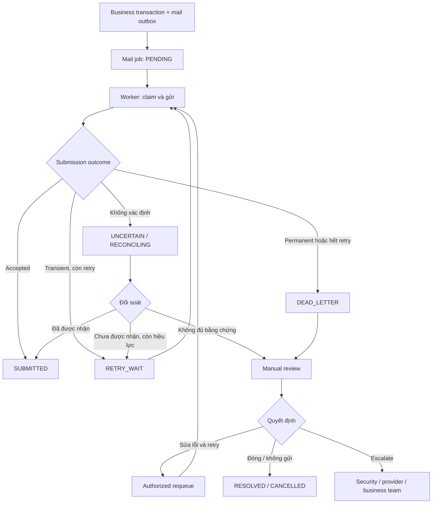
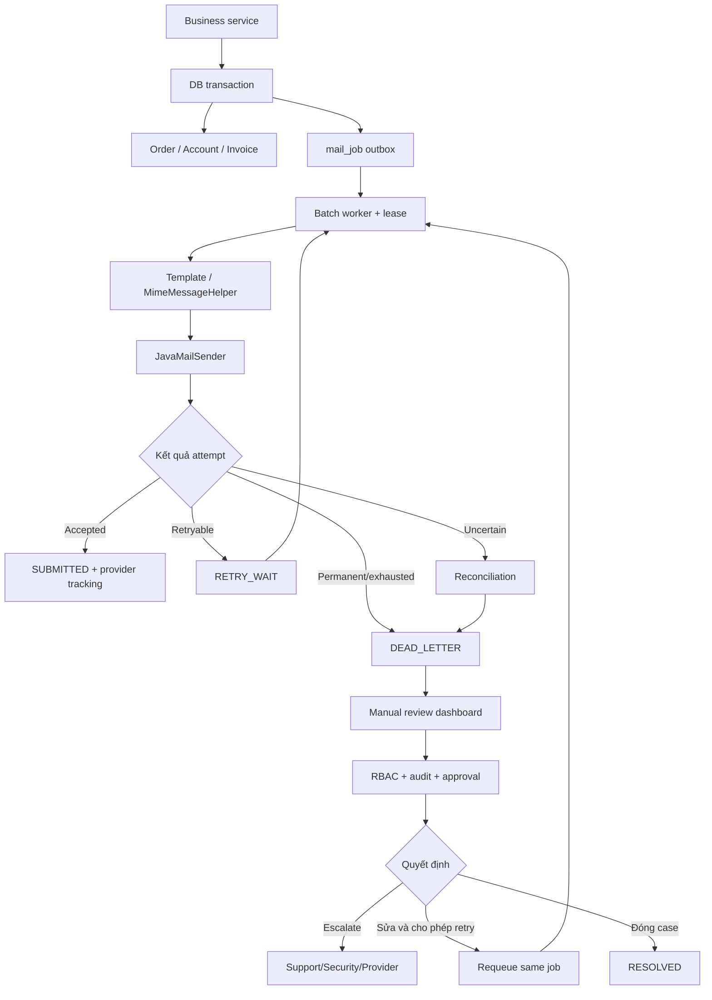

# Dead letter và quy trình xử lý thủ công trong Spring Framework Mail

Trong ứng dụng production, email không phải lúc nào cũng được gửi thành công ngay từ lần đầu. SMTP server có thể timeout, provider hạn chế tốc độ, template bị thiếu dữ liệu, tệp đính kèm không còn tồn tại, địa chỉ người nhận không hợp lệ hoặc một tác vụ bị lỗi lặp đi lặp lại dù đã retry. Nếu ứng dụng chỉ ghi `log.error(...)` rồi bỏ qua, yêu cầu gửi có thể biến mất. Nếu cứ retry không giới hạn, hệ thống dễ tạo **retry storm**, làm đầy queue và gây gửi trùng.

**Dead letter** là cơ chế đưa một công việc không thể tiếp tục xử lý theo tuyến bình thường sang trạng thái hoặc khu vực lưu trữ riêng để **quan sát, điều tra và quyết định bước tiếp theo**. Trong hệ thống gửi email, dead letter có thể là bản ghi `mail_job.status = 'DEAD_LETTER'` trong database, một **dead-letter queue (DLQ)** của broker, hoặc kết hợp cả hai.

Điều quan trọng là **đưa vào dead letter không đồng nghĩa email chưa đến người nhận**. Một SMTP timeout sau khi server đã nhận dữ liệu có thể để lại kết quả *không chắc chắn*; webhook bounce xuất hiện sau khi submission thành công là một giai đoạn khác. Vì vậy, quy trình xử lý thủ công phải phân biệt lỗi chắc chắn, lỗi vĩnh viễn, hết số lần retry và trạng thái không biết đã gửi hay chưa.

Trong Spring Framework Mail:

- `JavaMailSender`/`JavaMailSenderImpl` thực hiện SMTP submission.
- `MimeMessageHelper` hỗ trợ chuẩn bị thư HTML, plain text và tệp đính kèm.
- `MailException` và các exception liên quan cung cấp dữ liệu để phân loại lỗi.
- **Spring Mail không tự cung cấp durable mail job queue, DLQ, retry ledger hoặc màn hình xử lý thủ công.** Các thành phần đó cần được triển khai tại ứng dụng hoặc thông qua broker, job store và hệ thống vận hành.

Bài này xây dựng một mẫu production đầy đủ: phân loại lỗi, state machine, transactional outbox, dead-letter records, retry với giới hạn, Spring Boot/SQL, RabbitMQ/Kafka, dashboard vận hành, phân quyền, audit, retry/requeue an toàn, đối soát và kiểm thử.

## 1. Vì sao cần dead letter?

Giả sử dịch vụ gửi email xác nhận hóa đơn. Lần đầu, provider SMTP trả lỗi tạm thời; worker thử lại vài lần theo backoff nhưng vẫn không gửi được.

Nếu không có dead letter:

```text
InvoiceService
    |
    v
MailWorker -> SMTP timeout
    |
    v
Retry -> SMTP timeout
    |
    v
Retry -> SMTP timeout
    |
    v
Log ERROR rồi task biến mất
```

Hệ quả:

- Không còn cách nào xác định yêu cầu nào bị bỏ sót.
- Bộ phận hỗ trợ không có trạng thái đáng tin để trả lời khách hàng.
- Không có lịch sử các lần thử, thời điểm, lỗi và provider.
- Một đợt lỗi hệ thống có thể âm thầm ảnh hưởng hàng nghìn thư.
- Nhân viên vận hành có thể “gửi lại” bằng cách tạo yêu cầu mới, gây trùng.

Với dead-letter workflow:



Tài liệu và trạng thái phải cho phép người vận hành biết **vì sao một job nằm trong dead letter**, **ai có quyền xử lý**, **đã thực hiện hành động gì**, và **có khả năng gửi trùng hay không**.

## 2. Phân biệt dead letter với retry queue, bounce và quarantine

Những thuật ngữ gần nhau nhưng không đồng nghĩa:

| Khái niệm | Mục đích | Ví dụ |
|---|---|---|
| **Ready queue** | Job sẵn sàng gửi | `PENDING` đến hạn |
| **Retry queue / RETRY_WAIT** | Tạm chờ lỗi có thể phục hồi | SMTP 4xx, provider tạm lỗi |
| **Dead letter / DLQ** | Job không được tự động retry nữa | Hết attempts, dữ liệu không hợp lệ cần điều tra |
| **UNCERTAIN / reconciliation queue** | Không rõ SMTP đã nhận message hay chưa | Mất ACK sau DATA |
| **Bounce / delivery failure** | Provider phản hồi ở giai đoạn delivery | Thư bị từ chối sau submit |
| **Quarantine** | Cách ly nội dung hoặc file đáng ngờ | Attachment nghi malware, HTML rủi ro |
| **Manual review queue** | Tập công việc chờ nhân viên quyết định | Xác minh recipient, khắc phục dữ liệu |

Một email có thể đã `SUBMITTED` ở tầng SMTP, sau đó provider báo `BOUNCED`. Đây là **sự kiện delivery**, không nên tự chuyển job về `PENDING` để gửi lại và cũng không phải lúc nào nên dùng cùng DLQ của lỗi submission.

### 2.1. Dead letter là trạng thái nghiệp vụ hay một hàng đợi vật lý?

**Trạng thái nghiệp vụ:** bản ghi database giữ `mailJobId`, `state`, `failureClass`, lý do, số attempts và thông tin cần xem xét. Đây thường là nguồn sự thật cho đội vận hành.

**Hàng đợi vật lý:** RabbitMQ DLQ, Kafka dead-letter topic hoặc queue chuyên dụng nhận envelope lỗi. Nó hữu ích cho routing/consumer nhưng không tự cung cấp màn hình phân quyền, hành động phê duyệt hoặc audit.

Thiết kế production có thể:

```text
mail_job (source of truth)
    state=DEAD_LETTER
        |
        +-- audit + history
        +-- dashboard/manual review
        +-- optional broker DLQ event
```

Không bắt buộc phải dùng RabbitMQ mới có dead letter. Một mail worker dựa trên PostgreSQL outbox hoàn toàn có thể dùng trạng thái `DEAD_LETTER` và dashboard.

### 2.2. Dead letter không phải nơi lưu dữ liệu bí mật vô thời hạn

Một DLQ thường chứa payload/message envelope. Nếu payload nhúng raw MIME, OTP, token hoặc attachment bytes, lưu DLQ dài ngày có thể trở thành một kho dữ liệu nhạy cảm khó quản lý.

Ưu tiên gửi **opaque mail job ID + mã lỗi + metadata tối thiểu** vào DLQ, trong khi nguồn dữ liệu được bảo vệ nằm ở job store/private storage có retention rõ. Nếu broker bắt buộc giữ original message, cấu hình quyền, mã hóa, retention, giới hạn kích thước và kiểm tra nội dung.

## 3. Phân loại lỗi trước khi quyết định dead letter

Không nên dựa duy nhất vào “`catch (Exception)` rồi attempts++”. Mỗi loại lỗi cần chính sách khác:

| Nhóm lỗi | Ví dụ | Có nên tự retry? | Hướng xử lý |
|---|---|---|---|
| Lỗi cấu hình | SMTP credentials sai, TLS config sai | Thường **không** retry dồn dập | Tạm dừng route, alert, sửa config |
| Tạm thời do provider | Throttle, kết nối gián đoạn, service unavailable | Có, có giới hạn | Backoff/jitter; circuit breaker |
| Lỗi permanent recipient | Địa chỉ sai, recipient bị từ chối vĩnh viễn | Thường không | Dead letter/suppression hoặc business reject |
| Lỗi template | Thiếu variable, lỗi render HTML | Không retry SMTP mù quáng | Sửa template/dữ liệu rồi review |
| Attachment thất bại | File bị xóa, quá lớn, policy cấm | Theo nguyên nhân | Sửa dữ liệu/từ chối hoặc review |
| SMTP response không chắc chắn | Timeout sau khi gửi dữ liệu | **Không retry ngay mặc định** | `UNCERTAIN`, đối soát |
| Hết retry budget | Lỗi tạm thời lặp lại nhiều lần | Không tự retry tiếp | Dead letter + alert |
| Hết deadline | OTP/reset link đã hết hạn | Không | `EXPIRED`; không gửi lại token cũ |
| Người nhận hủy nhận | Unsubscribe/suppression | Không | `CANCELLED`/policy rejection |
| Crash/lease hết hạn | Worker mất quyền sở hữu job | Theo trạng thái attempt | Reclaim có fencing, xác minh ambiguity |

Đây là một **policy mẫu**, không phải quy định mặc định cho mọi nhà cung cấp. SMTP enhanced status code, `MailSendException` hay provider API có thể bổ sung thông tin, nhưng khả năng phân loại phải dựa trên dữ liệu thực sự có được.

### 3.1. Transient và permanent không luôn chỉ dựa vào tiền tố SMTP code

Trong SMTP, response `4xx` thường biểu thị lỗi tạm thời; `5xx` thường biểu thị lỗi vĩnh viễn. Tuy nhiên, cần xét cả **bước giao thức**, nguyên nhân và policy của provider:

- `421`/`451`: có thể retry sau backoff.
- `452`: có thể là giới hạn tài nguyên/dung lượng tạm thời.
- `550`: có thể là recipient không tồn tại, từ chối chính sách hoặc trường hợp khác.
- `552`: nội dung/quota không được chấp nhận.

Không dùng danh sách này để tự động đi qua provider khác nhằm né một từ chối permanent. Lỗi xác thực domain, anti-abuse và suppression cần được tôn trọng.

### 3.2. JavaMailSender không luôn biết provider đã nhận hay chưa

Ví dụ:

```text
Client gửi DATA cho SMTP provider
Provider đã nhận email
Connection mất trước khi client đọc "250 OK"
JavaMailSender ném exception
```

Không thể từ exception tổng quát kết luận chắc chắn email chưa gửi. Nếu job được chuyển ngay sang DLQ rồi nhân viên bấm “Retry” mà không biết bối cảnh, người nhận có thể nhận hai email.

Vì vậy, dùng trạng thái riêng `UNKNOWN_SUBMISSION`/`UNCERTAIN` và một quy trình đối soát trước khi cho phép resend.

## 4. Chính sách retry trước khi vào dead letter

Một job thường được xử lý theo chu trình:

```text
PENDING
  -> attempt #1
  -> failed temporary
  -> RETRY_WAIT
  -> attempt #2
  -> failed temporary
  -> RETRY_WAIT
  -> attempt #3
  -> ...
  -> attempts exhausted
  -> DEAD_LETTER
```

### 4.1. Ba điều kiện dừng

Một retry policy nên kiểm tra đồng thời:

1. **Số lần thử**: `attemptNo < maxAttempts`.
2. **Thời gian**: job chưa vượt `expiresAt`/business deadline.
3. **Loại lỗi**: outcome thuộc tập có thể retry.

Không cố gửi email OTP đã hết hạn chỉ vì nó còn một attempt theo cấu hình. Ngược lại, một hóa đơn cần gửi bắt buộc có thể có quy trình escalation riêng thay vì biến mất sau khi hết một số attempts.

### 4.2. Backoff và jitter

Một ví dụ:

```text
Attempt 1 lỗi -> chờ khoảng 5 giây
Attempt 2 lỗi -> chờ khoảng 10 giây
Attempt 3 lỗi -> chờ khoảng 20 giây
Attempt 4 lỗi -> chờ khoảng 40 giây
Max delay        2 phút
Jitter           ngẫu nhiên có giới hạn
```

Jitter làm các job không đồng loạt retry sau một outage. Không đặt retry delay bằng 0 cho hàng chục nghìn email khi provider đang throttle.

### 4.3. Retry budget theo mail type

| Loại thư | Đặc tính | Chính sách tham khảo |
|---|---|---|
| OTP | Độ trễ thấp; token nhanh hết hạn | Ít attempts, expiry ưu tiên |
| Reset password | Link có thời hạn | Ngừng nếu token/challenge hết hiệu lực |
| Xác nhận đơn hàng | Quan trọng, nhưng có thể không real-time | Retry với backoff; cảnh báo dead letter |
| Hóa đơn | Có thể có nghĩa vụ nghiệp vụ | Retry và escalation/manual workflow |
| Newsletter | Số lượng lớn, có unsubscribe | Retry có quota, suppression và DLQ riêng |
| Báo cáo định kỳ | Có thể phát lại theo kỳ | Chống duplicate và kiểm tra snapshot |

Con số cụ thể phải dựa trên SLA, provider contract và tính chất nghiệp vụ, không phải một thuộc tính cố định của `JavaMailSender`.

## 5. Mô hình trạng thái production

Một state machine hữu ích:

```text
PENDING
  |
  v
PROCESSING
  |   \
  |    +--> SUBMITTED
  |    +--> RETRY_WAIT --> PROCESSING
  |    +--> UNCERTAIN --> RECONCILING
  |    +--> DEAD_LETTER
  |    +--> FAILED_PERMANENT
  |    +--> EXPIRED
  |
  +--> CANCELLED

DEAD_LETTER
  |
  v
UNDER_REVIEW
  |     \
  |      +--> REQUEUE_APPROVED --> RETRY_WAIT
  |      +--> RESOLVED_NO_SEND
  |      +--> ESCALATED
  |      +--> CANCELLED
  |
  +--> DEAD_LETTER (review được trả lại hàng chờ)
```

Tên trạng thái là **enum của ứng dụng**, không phải trạng thái có sẵn trong Spring Mail. Không nhất thiết phải lưu mọi trạng thái vào cùng một cột; một số thiết kế dùng `mail_job.processing_state` và `manual_case.state` riêng để tránh pha trộn job lifecycle và support workflow.

### 5.1. Bất biến cần giữ

- Một `mailJobId` nhận diện **một ý định gửi**, xuyên các attempts/retry/manual requeue.
- Mỗi lần gọi transport có `attemptId` riêng; không ghi đè lịch sử attempt cũ.
- `SUBMITTED` là kết quả submission; provider có thể trả bounce sau đó.
- Job `UNCERTAIN` không được tự xem là “chưa gửi” để bấm retry.
- Một worker có thể xử lý job tại một thời điểm theo ownership claim/lease.
- Một hành động của nhân viên vận hành phải có actor, reason, thời điểm, quyết định và kết quả.
- Requeue không tự bypass expiry, suppression, consent, sender policy hoặc tenant boundary.
- Không có transition mặc định từ `SUBMITTED` về `PENDING`.

### 5.2. Khi nào cần FAILED_PERMANENT thay DEAD_LETTER?

Có hai cách hợp lý:

**Một terminal state chung:** mọi job không còn tự xử lý được vào `DEAD_LETTER` và lưu `failureClass` như `RECIPIENT_REJECTED`, `TEMPLATE_INVALID`, `RETRY_EXHAUSTED`.

**Tách trạng thái:** lỗi vĩnh viễn được đóng `FAILED_PERMANENT`; chỉ trường hợp cần nhân viên xét duyệt vào `DEAD_LETTER`.

Cả hai đều khả thi. Cần thống nhất câu hỏi vận hành: **cái gì xuất hiện trong hàng đợi cần con người thao tác**, cái gì là terminal outcome chỉ cần report, cái gì vẫn đang tự retry. Không đẩy mọi hard bounce vào cùng hàng đợi xử lý thủ công nếu policy đã có hành động tự động phù hợp.

## 6. Kiến trúc đề xuất: outbox + worker + dead-letter store + review UI



**Nguồn sự thật** là `mail_job` và bảng lịch sử attempts/reviews. Một broker DLQ nếu được dùng đóng vai trò routing, không được là nơi duy nhất lưu quyết định nghiệp vụ đã được phê duyệt.

### 6.1. Chuyển vào dead letter phải có tính bền vững

Khi worker quyết định dừng retry, trạng thái `DEAD_LETTER`, reason và `lastAttemptId` phải được ghi trong transaction ngắn. Nếu muốn phát event `MailDeadLettered` cho dashboard/notification, ưu tiên ghi một outbox event **trong cùng transaction** rồi có relay phát ra broker.

Tránh:

```java
deadLetterQueue.send(job);
jobRepository.updateStatus(job.id(), "DEAD_LETTER");
```

nếu hai thao tác dùng hai hệ thống không có cơ chế đồng bộ. Crash sau bước đầu có thể tạo event mà DB chưa đổi; crash sau bước thứ hai (nếu thứ tự đảo) có thể mất event. Outbox giúp việc phát event có thể retry mà không làm mất trạng thái chính.

### 6.2. Đừng giữ database transaction mở trong khi gửi SMTP

Một lượt xử lý lý tưởng:

1. Claim job + tạo attempt trong một transaction ngắn.
2. Commit, giải phóng lock.
3. Render/gửi SMTP bên ngoài database transaction.
4. Trong transaction ngắn, persist outcome và transition job.
5. Nếu đến DLQ, tạo audit/outbox event trong cùng transaction.

SMTP không tham gia DB transaction; gửi xong rồi DB commit lỗi có thể dẫn đến outcome uncertain khi recovery. Vì vậy, thiết kế retry phải chấp nhận khả năng duplicate và có cơ chế đối soát.

## 7. Schema PostgreSQL cho mail job, attempts và dead-letter case

Một mẫu dữ liệu nên giữ được cả **ý định gửi gốc**, **lịch sử từng lần gửi** và **quyết định thủ công**. Các bảng dưới đây là ví dụ để minh họa thiết kế:

```sql
CREATE TABLE mail_job (
    id                 UUID PRIMARY KEY,
    tenant_id          UUID NOT NULL,
    business_key       VARCHAR(180) NOT NULL,
    mail_type          VARCHAR(64) NOT NULL,
    template_id        VARCHAR(100) NOT NULL,
    template_version   VARCHAR(40) NOT NULL,
    payload_ref        VARCHAR(300) NOT NULL,
    state              VARCHAR(40) NOT NULL,
    version            BIGINT NOT NULL DEFAULT 0,
    attempt_count      INTEGER NOT NULL DEFAULT 0,
    max_attempts       INTEGER NOT NULL DEFAULT 5,
    next_attempt_at    TIMESTAMPTZ,
    expires_at         TIMESTAMPTZ,
    claim_token        UUID,
    lease_until        TIMESTAMPTZ,
    last_failure_class VARCHAR(100),
    created_at         TIMESTAMPTZ NOT NULL DEFAULT NOW(),
    updated_at         TIMESTAMPTZ NOT NULL DEFAULT NOW(),
    CONSTRAINT uq_mail_business_key
        UNIQUE (tenant_id, business_key),
    CHECK (attempt_count >= 0),
    CHECK (max_attempts >= 1)
);

CREATE TABLE mail_attempt (
    id                   UUID PRIMARY KEY,
    mail_job_id          UUID NOT NULL REFERENCES mail_job(id),
    attempt_no           INTEGER NOT NULL,
    provider_alias       VARCHAR(80) NOT NULL,
    started_at           TIMESTAMPTZ NOT NULL,
    completed_at         TIMESTAMPTZ,
    outcome              VARCHAR(40),
    failure_class        VARCHAR(100),
    mime_message_id      VARCHAR(320),
    provider_message_id  VARCHAR(320),
    CONSTRAINT uq_mail_attempt_no
        UNIQUE (mail_job_id, attempt_no)
);

CREATE TABLE mail_dead_letter_case (
    id                  UUID PRIMARY KEY,
    mail_job_id         UUID NOT NULL REFERENCES mail_job(id),
    state               VARCHAR(40) NOT NULL,
    reason_class        VARCHAR(100) NOT NULL,
    last_attempt_id     UUID REFERENCES mail_attempt(id),
    opened_at           TIMESTAMPTZ NOT NULL DEFAULT NOW(),
    claimed_by          VARCHAR(160),
    claim_expires_at    TIMESTAMPTZ,
    resolved_at         TIMESTAMPTZ,
    resolution_code     VARCHAR(80),
    version             BIGINT NOT NULL DEFAULT 0
);

CREATE TABLE mail_manual_action (
    id                  UUID PRIMARY KEY,
    case_id             UUID NOT NULL REFERENCES mail_dead_letter_case(id),
    mail_job_id         UUID NOT NULL REFERENCES mail_job(id),
    action              VARCHAR(80) NOT NULL,
    actor_id            VARCHAR(160) NOT NULL,
    reason_code         VARCHAR(80) NOT NULL,
    note_ref            VARCHAR(300),
    request_key         UUID NOT NULL,
    happened_at         TIMESTAMPTZ NOT NULL DEFAULT NOW(),
    outcome             VARCHAR(80) NOT NULL,
    CONSTRAINT uq_mail_manual_request UNIQUE (request_key)
);

CREATE INDEX idx_mail_job_ready
    ON mail_job (next_attempt_at, created_at)
    WHERE state IN ('PENDING', 'RETRY_WAIT');

CREATE INDEX idx_mail_dead_letter_open
    ON mail_dead_letter_case (opened_at)
    WHERE state IN ('OPEN', 'IN_REVIEW', 'ESCALATED');

CREATE INDEX idx_mail_attempt_job
    ON mail_attempt (mail_job_id, attempt_no);
```

### 7.1. Mối quan hệ giữa các bảng

```text
mail_job J100
  |  state=DEAD_LETTER
  |
  +-- mail_attempt A101, provider=P1, TIMEOUT
  +-- mail_attempt A102, provider=P1, THROTTLED
  +-- mail_attempt A103, provider=P2, FAILED
  |
  +-- mail_dead_letter_case C100
         state=IN_REVIEW
         |
         +-- mail_manual_action M1: CLAIM
         +-- mail_manual_action M2: INVESTIGATE
         +-- mail_manual_action M3: REQUEUE_APPROVED
```

Việc sửa dữ liệu khi xử lý thủ công **không nên xóa attempts**; khi job được requeue, attempt kế tiếp có số thứ tự mới, còn lịch sử cũ được giữ để truy vết.

### 7.2. Dead letter case ID khác mail job ID

Một job có thể vào dead letter nhiều lần:

```text
Job J100
   -> dead letter case C1
   -> operator requeue
   -> attempt mới vẫn fail
   -> dead letter case C2
```

Vì vậy, nên dùng ID case riêng. Một ràng buộc ngăn **hai case active cùng lúc cho một job** là phù hợp, nhưng vẫn cho phép case đã đóng tồn tại lịch sử. Ví dụ PostgreSQL:

```sql
CREATE UNIQUE INDEX uq_mail_one_active_dl_case
    ON mail_dead_letter_case (mail_job_id)
    WHERE state IN ('OPEN', 'IN_REVIEW', 'ESCALATED');
```

Nếu sản phẩm cho phép nhiều loại case đồng thời (ví dụ submission failure và compliance review), index/thiết kế phải thay đổi theo contract. Không áp một constraint mẫu mà không xét phạm vi nghiệp vụ.

### 7.3. Version dùng để chống xử lý đồng thời

Cột `version` có thể dùng optimistic concurrency:

```sql
UPDATE mail_dead_letter_case
SET state = 'IN_REVIEW',
    claimed_by = :operator_id,
    claim_expires_at = NOW() + INTERVAL '10 minutes',
    version = version + 1
WHERE id = :case_id
  AND state = 'OPEN'
  AND version = :expected_version;
```

Chỉ khi số row ảnh hưởng bằng 1, operator mới lấy được quyền review. Nếu hai người cùng mở UI, người đến sau phải nhận lỗi conflict và tải lại case. Đừng cho cả hai bấm requeue đồng thời.

### 7.4. Đừng lưu raw body/OTP trong dead-letter table

`payload_ref` nên trỏ tới dữ liệu đã được bảo vệ hoặc snapshot theo chính sách retention. Bảng dead-letter/audit chủ yếu giữ ID, mã nguyên nhân và quyết định, không phải file MIME hoặc nội dung thư.

Khi một OTP hết hạn, **không kéo dài lifetime token chỉ vì một case đang mở**. Nếu khách hàng cần mã mới, yêu cầu nghiệp vụ mới phải tạo challenge/job mới, không replay thư cũ.

## 8. Claim mail job có ownership và lease

Nhiều worker chạy đồng thời phải tránh gửi cùng job. Với PostgreSQL, có thể claim theo batch bằng `FOR UPDATE SKIP LOCKED`:

```sql
WITH ready AS (
    SELECT id
    FROM mail_job
    WHERE state IN ('PENDING', 'RETRY_WAIT')
      AND next_attempt_at <= NOW()
      AND (expires_at IS NULL OR expires_at > NOW())
    ORDER BY next_attempt_at, created_at, id
    FOR UPDATE SKIP LOCKED
    LIMIT :batch_size
)
UPDATE mail_job AS j
SET state = 'PROCESSING',
    claim_token = :claim_token,
    lease_until = NOW() + INTERVAL '90 seconds',
    attempt_count = attempt_count + 1,
    version = version + 1,
    updated_at = NOW()
FROM ready
WHERE j.id = ready.id
RETURNING j.*;
```

Lệnh này chạy trong một **database transaction ngắn**, tạo `claim_token` cho lượt claim và commit trước SMTP call. Với batch lớn, mỗi job vẫn cần attempt ID riêng. `claim_token` chung cho một lần claim có thể dùng với điều kiện `id + token`; không được chỉ lọc theo token để cập nhật toàn bộ jobs vô tình.

### 8.1. Khi lease hết

Một worker có thể đã submit SMTP nhưng crash trước khi cập nhật DB. Nếu lease hết mà worker mới tự lấy job và gửi lại, có nguy cơ duplicate.

Quy trình phục hồi cần:

1. Tìm job `PROCESSING` có `lease_until <= NOW()`.
2. Kiểm tra attempt tương ứng đang `SUBMITTING` hay đã có kết quả.
3. Đánh giá có thể khẳng định chắc chắn chưa gọi SMTP không.
4. Nếu không rõ kết quả, chuyển sang `UNCERTAIN`/reconciliation thay vì requeue mù quáng.
5. Khi giải phóng claim, dùng fencing token/phiên bản để ngăn worker cũ ghi đè.

Fencing bảo vệ tính nhất quán của database, **không thể thu hồi SMTP side effect đã xảy ra**.

### 8.2. Không tiếp tục gửi khi job hết hạn

Kiểm tra `expires_at` cả lúc claim lẫn **ngay trước submission**. Nếu một job đã được claim nhưng bị kẹt sau vài phút, nó có thể hết hạn trong lúc đợi worker.

Với OTP/reset password, kết thúc `EXPIRED` không đồng nghĩa “gửi lại ngay một mã cũ qua manual requeue”. Người dùng nên tạo yêu cầu mới với token mới nếu cần.

## 9. Phân loại kết quả gửi và tạo dead letter

Spring Mail cung cấp:

```java
import org.springframework.mail.MailAuthenticationException;
import org.springframework.mail.MailException;
import org.springframework.mail.MailSendException;
import org.springframework.mail.javamail.JavaMailSender;
```

Nhưng ứng dụng phải tự định nghĩa outcome và failure policy:

```java
public enum SubmissionOutcome {
    SUBMITTED,
    DEFINITELY_NOT_SUBMITTED,
    UNKNOWN_SUBMISSION
}

public enum FailureClass {
    SMTP_AUTHENTICATION,
    SMTP_THROTTLED,
    SMTP_CONNECTION,
    SMTP_TIMEOUT,
    RECIPIENT_REJECTED,
    MIME_PREPARATION,
    TEMPLATE_RENDERING,
    ATTACHMENT_UNAVAILABLE,
    POLICY_REJECTED,
    UNKNOWN
}

public enum RetryDecision {
    RETRY_LATER,
    DEAD_LETTER,
    EXPIRED,
    CANCELLED,
    RECONCILE
}
```

Đây là enum ứng dụng, không phải enum mặc định của Spring Framework. `MailSendException` với nhiều messages có thể có `getFailedMessages()`, nhưng không phải lúc nào exception cũng chứng minh chính xác từng message đã được provider chấp nhận hay chưa.

### 9.1. Classifier mẫu

```java
public final class MailErrorClassifier {

    public FailureClass classify(MailException exception) {
        if (exception instanceof MailAuthenticationException) {
            return FailureClass.SMTP_AUTHENTICATION;
        }
        if (exception instanceof MailSendException) {
            // Phải phân tích thêm loại lỗi/provider response
            // nếu muốn xác định chính xác 4xx/5xx.
            return FailureClass.UNKNOWN;
        }
        return FailureClass.UNKNOWN;
    }
}
```

Ví dụ cố ý thận trọng. Không nên viết `catch (MailException ex) { return RETRY; }` cho mọi lỗi, bởi lỗi sau khi provider nhận message có thể dẫn đến duplicate nếu retry.

### 9.2. Policy dựa vào outcome, error class và deadline

Một hàm policy:

```java
public RetryDecision decide(
        SubmissionOutcome outcome,
        FailureClass failure,
        int attemptsUsed,
        int maxAttempts,
        Instant now,
        Instant expiresAt) {

    if (outcome == SubmissionOutcome.SUBMITTED) {
        throw new IllegalArgumentException(
                "Submitted mail is not a retry candidate");
    }

    if (expiresAt != null && !now.isBefore(expiresAt)) {
        return RetryDecision.EXPIRED;
    }

    if (outcome == SubmissionOutcome.UNKNOWN_SUBMISSION) {
        return RetryDecision.RECONCILE;
    }

    if (failure == FailureClass.POLICY_REJECTED) {
        return RetryDecision.CANCELLED;
    }

    if (failure == FailureClass.MIME_PREPARATION
            || failure == FailureClass.TEMPLATE_RENDERING
            || failure == FailureClass.RECIPIENT_REJECTED
            || failure == FailureClass.ATTACHMENT_UNAVAILABLE) {
        return RetryDecision.DEAD_LETTER;
    }

    if (attemptsUsed >= maxAttempts) {
        return RetryDecision.DEAD_LETTER;
    }

    return switch (failure) {
        case SMTP_CONNECTION, SMTP_TIMEOUT, SMTP_THROTTLED ->
                RetryDecision.RETRY_LATER;
        default -> RetryDecision.DEAD_LETTER;
    };
}
```

`SubmissionOutcome.DEFINITELY_NOT_SUBMITTED` chỉ nên được gán khi adapter biết chắc **chưa có SMTP side effect**. `UNKNOWN_SUBMISSION` được ưu tiên đưa vào reconcile trước khi xem xét retry budget. Trong sản phẩm thật, có thể phân loại thêm provider error codes hoặc chính sách hard bounce; không phải mọi lỗi attachment là permanent, chẳng hạn storage tạm mất kết nối có thể retry có giới hạn.

### 9.3. Terminal transition phải nhất quán

Sau một attempt:

- Persist `mail_attempt.outcome` và `failure_class`.
- Kiểm tra claim token/ownership.
- Update `mail_job.state`.
- Nếu `DEAD_LETTER`, tạo `mail_dead_letter_case`.
- Ghi outbox event thông báo cho vận hành nếu cần.

Các thao tác **ghi database** này nên nằm trong một transaction ngắn để tránh job dead-letter nhưng không có case, hoặc case có mà job vẫn đang ready.

## 10. SQL chuyển job vào dead letter

Ví dụ một transaction xử lý job mà worker còn sở hữu:

```sql
BEGIN;

-- Chỉ owner hợp lệ được thay đổi trạng thái.
UPDATE mail_job
SET state = 'DEAD_LETTER',
    last_failure_class = :failure_class,
    next_attempt_at = NULL,
    claim_token = NULL,
    lease_until = NULL,
    updated_at = NOW(),
    version = version + 1
WHERE id = :mail_job_id
  AND state = 'PROCESSING'
  AND claim_token = :claim_token;

-- Ứng dụng phải kiểm tra UPDATE ảnh hưởng đúng 1 row
-- trước khi INSERT case bên dưới.
INSERT INTO mail_dead_letter_case (
    id, mail_job_id, state, reason_class,
    last_attempt_id
)
VALUES (
    :case_id, :mail_job_id, 'OPEN',
    :failure_class, :attempt_id
);

COMMIT;
```

Đây là **chuỗi thao tác minh họa**, không phải một SQL script an toàn để chạy nguyên văn mà không kiểm tra kết quả. Trong repository/service thực tế, nếu `UPDATE` ảnh hưởng 0 row, phải **rollback** và không insert case; worker có thể đã mất lease hoặc state đã đổi.

Ngoài ra, case insert cần chống tạo trùng do retry transaction bằng unique active-case constraint và idempotency key. Nếu attempt outcome đã được ghi trước đó, không được tăng attempts hoặc phát case mới vô hạn khi cùng completion event bị xử lý lại.

### 10.1. Một lần xử lý lại event không tạo hai dead-letter cases

Ví dụ worker timeout khi commit và không biết transaction đã thành công hay chưa. Sau khi retry, repository phải tra `mail_job.state` và case đang active:

```text
job already DEAD_LETTER
  + active case exists
  -> return existing case ID
  -> do not create a new case
```

Sử dụng unique constraints và thao tác idempotent, không chỉ kiểm tra trong memory.

### 10.2. Vì sao không xóa job sau khi publish DLQ message?

Nếu xóa source job, sau này khó biết:

- Dữ liệu gốc thuộc nghiệp vụ nào.
- Đã thử gửi bao nhiêu lần.
- Có SMTP submission nào không chắc chắn.
- Nhân viên nào quyết định resend/cancel.
- Provider đã gửi bounce hay không.

Một DLQ message có thể có thời hạn lưu ngắn hoặc bị người vận hành xóa. **Lịch sử nghiệp vụ phải nằm ở dữ liệu bền vững có quyền truy cập**, không trông cậy chỉ vào broker.

## 11. Quy trình xử lý thủ công: từ OPEN đến RESOLVED

Dead letter không chỉ là “một thư mục để xóa email lỗi”. Quy trình vận hành phải đưa ra hành động rõ, có phân quyền và có bằng chứng.

### 11.1. Các vai trò

| Vai trò | Quyền phù hợp | Không nên được làm |
|---|---|---|
| Support viewer | Tìm case/đọc metadata đã che | Xem OTP/body/SMTP secret |
| Mail operator | Nhận case, phân loại lỗi, đề xuất retry | Tự sửa tenant/recipient tùy ý |
| Mail approver | Duyệt hành động gửi lại khi cần | Bỏ qua policy/security |
| Platform on-call | Điều tra provider/config/queue | Dùng SMTP admin secret trong UI |
| Security reviewer | Xử lý sự cố dữ liệu/abuse/compliance | Tự phát lại thư bị chặn |
| Auditor | Xem lịch sử quyết định bất biến | Thay đổi case |

Vai trò thực tế tùy tổ chức. Đặc biệt, **quyền xem dead-letter case không tự cấp quyền tải nội dung email hoặc attachments**.

### 11.2. Luồng nhân viên xử lý case

```text
1. Alert hoặc dashboard hiển thị case mới.
2. Operator mở case qua ứng dụng có đăng nhập.
3. Hệ thống xác thực tenant/scope và ghi VIEW audit nếu cần.
4. Operator claim case với lease ngắn.
5. Kiểm tra mail type, deadline, attempts, failure class.
6. Xác định đã/không/chưa chắc SMTP submission.
7. Kiểm tra provider status và event bounce nếu có.
8. Chọn một hành động được phép.
9. Nhập reason code + ghi chú an toàn.
10. (Nếu policy yêu cầu) approver duyệt.
11. Backend ghi action và state trong transaction.
12. Worker nhận job nếu đã được requeue; UI theo dõi outcome mới.
```

Các bước 4–10 không phải lúc nào cũng được thực hiện thủ công; nhiều trường hợp permanent failure có thể được tự đóng nếu policy rõ, nhưng phải có audit. Với email nhạy cảm, thao tác **resend** nên yêu cầu phê duyệt riêng.

### 11.3. Màn hình review nên hiển thị gì?

Một case có thể có:

| Field | Ví dụ | Ý nghĩa |
|---|---|---|
| Case ID | `C-1002` | Định danh case |
| Mail job ID | `J-1025` | Ý định gửi |
| Mail type | `ORDER_CONFIRMATION` | Chính sách nghiệp vụ |
| Template/version | `ORDER_CONFIRMATION/v9` | Khoanh vùng lỗi template |
| Created/last tried | Thời điểm UTC | Độ trễ và tuổi case |
| Attempts | 5/5 | Retry budget đã dùng |
| Failure class | `SMTP_THROTTLED` | Lý do hệ thống |
| Last provider | `primary-relay` | Nơi xảy ra lỗi |
| Submission evidence | `NOT_SUBMITTED` / `UNKNOWN` | Rủi ro gửi trùng |
| Business deadline | `2026-11-13T09:00Z` | Có còn được gửi không |
| Tenant scope | Opaque tenant ID | Phân quyền dữ liệu |
| State | `OPEN` / `IN_REVIEW` | Tình trạng workflow |
| Available actions | `ESCALATE`, `REQUEUE`, `RESOLVE` | Quyền thực tế theo policy |

Không đưa raw MIME, recipient email, message body, token, file name nhạy cảm hoặc thông tin tài khoản SMTP lên dashboard mặc định. Khi hỗ trợ cần tra cứu người nhận, làm qua một màn hình nghiệp vụ riêng có phân quyền và masking.

### 11.4. Claim case không đồng nghĩa claim mail job

**Case claim** nghĩa là nhân viên đang điều tra và có quyền quyết định.

**Mail job claim** nghĩa là worker đang sở hữu việc gửi trong một thời gian ngắn.

Hai loại lease khác nhau. Operator đang giữ case `IN_REVIEW` không được tự tạo một SMTP attempt cho đến khi hành động requeue được phê duyệt và cập nhật bền vững. Không dùng `mail_job.claim_token` như token cho UI operator.

## 12. Ma trận hành động thủ công

Một bộ hành động được kiểm soát tốt:

| Action | Khi nào hợp lệ | Điều cần kiểm tra |
|---|---|---|
| `RETRY_SAME_JOB` | Lỗi tạm thời đã được khắc phục | Outcome trước không unknown; deadline; retry policy |
| `REQUEUE_WITH_BACKUP_PROVIDER` | Primary chắc chắn chưa submit và backup được duyệt | SMTP evidence, provider identity, quota |
| `REQUEST_CORRECTION` | Dữ liệu/template/attachment có thể sửa | Không đổi ý nghĩa intent âm thầm |
| `CANCEL` | Job không còn cần gửi | Actor/reason, liên quan nghiệp vụ |
| `RESOLVE_NO_SEND` | Quyết định hợp lệ không gửi | Có bằng chứng và reason |
| `MARK_ALREADY_HANDLED` | Có bằng chứng xử lý bằng kênh khác | Lưu reference, không giả là SMTP submitted |
| `ESCALATE` | Cần platform/security/business xét | Đội nhận, severity, SLA |
| `RECONCILE` | Outcome SMTP không chắc chắn | Query provider/log/attempt trước resend |
| `CREATE_NEW_INTENT` | Business yêu cầu thư mới, nội dung/token mới | Tạo business event và idempotency key mới |

### 12.1. Không “đổi trạng thái sang SENT” để cho dashboard xanh

Một thao tác `MARK_ALREADY_HANDLED` không được giả mạo sự kiện transport. Ví dụ nhân viên hỗ trợ đã gọi điện xác nhận với khách hàng; có thể đóng case với `resolutionCode=HANDLED_OUT_OF_BAND`, nhưng không nên ghi `mail_attempt.outcome=SUBMITTED` khi chưa gọi SMTP.

Điều này giữ số liệu và audit có ý nghĩa.

### 12.2. Requeue phải giữ nguyên logical mail key

Ví dụ:

```text
mailJobId = J100
idempotencyKey = order-721:confirmation:v1

attempt A1 -> failure
attempt A2 -> failure
case C1 -> operator approved requeue
attempt A3 -> new submission
```

**Không tạo một mail job thứ hai J101** chỉ vì operator bấm retry. Một bản ghi duy nhất và nhiều attempts giúp kiểm soát gửi trùng.

Nếu dữ liệu nghiệp vụ đã thay đổi thành một email khác (ví dụ một yêu cầu reset password mới), hãy tạo **ý định gửi mới hợp lệ**, không sửa `payload_ref`/token của job cũ rồi gọi đó là retry.

### 12.3. Requeue sau khi hết attempts

Nếu worker đã dùng hết 5/5 attempts, việc đổi `state='RETRY_WAIT'` mà không điều chỉnh chính sách có thể dẫn đến worker đưa job trở lại DLQ ngay vì đã quá giới hạn.

Cần **một quyết định có kiểm soát**:

- Giới hạn thêm tối đa N attempts theo action cụ thể.
- Lưu manual retry budget được cấp.
- Không reset/xóa `attempt_count` và lịch sử attempts.
- Kiểm tra expiry/consent/suppression.
- Không requeue vô hạn khi nhà cung cấp vẫn đang lỗi.

Ví dụ policy: mỗi case chỉ được phê duyệt tối đa hai attempts bổ sung; mọi lần cấp thêm phải được audit, có thể yêu cầu phê duyệt hai người đối với loại email nhạy cảm.

## 13. Một service xử lý hành động requeue trong Spring Boot

Ứng dụng có thể có API:

```text
POST /admin/mail/dead-letters/{caseId}/actions
Authorization: authenticated operator with tenant scope
Idempotency-Key: unique request UUID
If-Match: expected case version

body:
{
  "action": "RETRY_SAME_JOB",
  "reasonCode": "PROVIDER_RECOVERED"
}
```

Endpoint chỉ là ví dụ contract; không công khai admin API ra Internet nếu không có authentication, authorization, CSRF/abuse protections phù hợp. Không tin `actorId` hay `tenantId` do client gửi trong JSON; lấy từ identity đã xác thực.

### 13.1. DTO và action enum

```java
public enum ManualMailAction {
    RETRY_SAME_JOB,
    REQUEUE_WITH_BACKUP_PROVIDER,
    RESOLVE_NO_SEND,
    CANCEL,
    ESCALATE,
    REQUEST_CORRECTION
}

public record ManualActionCommand(
        UUID caseId,
        UUID requestKey,
        long expectedVersion,
        ManualMailAction action,
        String reasonCode) {
}
```

`requestKey` dùng để chống double-click hoặc network retry làm cùng quyết định được ghi hai lần. `expectedVersion` dùng optimistic locking. Mã `reasonCode` phải đến từ danh sách cho phép, không phải một đoạn text tùy ý được copy nguyên vào log.

### 13.2. Service transactional

Một implementation khái niệm:

```java
@Service
public class ManualDeadLetterService {

    private final DeadLetterRepository cases;
    private final MailJobRepository jobs;
    private final ManualActionRepository actions;
    private final PermissionService permissions;
    private final ManualRetryPolicy policy;
    private final Clock clock;

    public ManualDeadLetterService(
            DeadLetterRepository cases,
            MailJobRepository jobs,
            ManualActionRepository actions,
            PermissionService permissions,
            ManualRetryPolicy policy,
            Clock clock) {
        this.cases = cases;
        this.jobs = jobs;
        this.actions = actions;
        this.permissions = permissions;
        this.policy = policy;
        this.clock = clock;
    }

    @Transactional
    public UUID retry(
            ManualActionCommand cmd,
            AuthenticatedOperator operator) {

        // Nếu requestKey đã được xử lý, trả kết quả cũ;
        // mọi conflict vẫn phải được bảo vệ bởi unique DB key.
        var previous = actions.findByRequestKey(cmd.requestKey());
        if (previous.isPresent()) {
            permissions.assertCanView(
                    operator, previous.get().tenantId());
            return previous.get().mailJobId();
        }

        DeadLetterCase current = cases.lockById(cmd.caseId())
                .orElseThrow(() ->
                        new IllegalArgumentException("Case not found"));

        permissions.assertCanRetry(
                operator, current.tenantId(), current.mailType());

        if (current.version() != cmd.expectedVersion()) {
            throw new StaleCaseVersionException();
        }
        if (current.state() != ReviewState.IN_REVIEW
                || !current.claimedBy().equals(operator.id())) {
            throw new InvalidReviewStateException();
        }

        MailJob job = jobs.lockById(current.mailJobId())
                .orElseThrow(() ->
                        new IllegalStateException("Job not found"));

        policy.assertCanRetry(
                job, current, cmd.action(), clock.instant());

        // Không thực hiện SMTP trong transaction này.
        jobs.scheduleManualRetry(
                job.id(),
                current.allowedAdditionalAttempts(),
                clock.instant());

        cases.resolveAsRequeued(current.id(), operator.id());

        actions.insert(new ManualActionRecord(
                UUID.randomUUID(),
                cmd.requestKey(),
                current.id(),
                job.id(),
                operator.id(),
                cmd.action(),
                cmd.reasonCode(),
                clock.instant()));

        return job.id();
    }
}
```

Các class `DeadLetterRepository`, `ManualRetryPolicy`, `PermissionService`, `AuthenticatedOperator`, `ReviewState` và exception là API **do ứng dụng định nghĩa**; đây là ví dụ kiến trúc, không phải module có thể copy chạy ngay.

**Yêu cầu quan trọng:** `cases.lockById` và `jobs.lockById` cần thực sự khóa/kiểm soát concurrency trong database; nếu chỉ đọc entity rồi check version trong memory, hai HTTP requests có thể cùng vượt qua check. Unique constraint `request_key` là lớp bảo vệ cuối cùng cho idempotent action.

### 13.3. Request idempotency phải xử lý song song

Hai POST requests cùng `Idempotency-Key` có thể chạy đồng thời:

```text
Request A: SELECT requestKey -> chưa có
Request B: SELECT requestKey -> chưa có
Request A: INSERT action -> success
Request B: INSERT action -> unique conflict
```

Request B cần được xử lý theo transaction semantics: rollback rồi truy vấn kết quả đã có, xác thực cùng actor/tenant/action hoặc trả conflict phù hợp. **Không đơn giản bắt unique exception rồi tiếp tục commit transaction đã bị đánh dấu rollback-only.**

### 13.4. Policy phải được kiểm tra ở backend

Không chỉ ẩn nút "Retry" trên UI. Backend phải xác nhận:

- Actor có role và quyền tenant tương ứng.
- Case còn `IN_REVIEW` và claim hợp lệ.
- Job đang đúng trạng thái dead letter, không có worker active.
- Last outcome không `UNKNOWN_SUBMISSION` chưa đối soát.
- `expiresAt` còn hiệu lực.
- Recipient/consent/suppression chưa bị chặn.
- Template/payload snapshot có thể dùng lại.
- Provider cho phép gửi và có quota.
- Manual retry budget chưa vượt giới hạn.

Chỉ khi tất cả điều kiện đạt thì mới đưa job về `RETRY_WAIT`/`PENDING`. Không để client tự gửi một `mailJobId` bất kỳ rồi yêu cầu SMTP send trực tiếp.

## 14. SQL requeue bảo vệ trạng thái và chống double-click

Một transaction requeue có thể sử dụng locking có điều kiện:

```sql
BEGIN;

-- Khóa case để chỉ một operator/action thắng.
SELECT id, mail_job_id, state, version
FROM mail_dead_letter_case
WHERE id = :case_id
FOR UPDATE;

-- Kiểm tra đúng owner, version, state và quyền ở service.
SELECT id, state, expires_at, attempt_count, version
FROM mail_job
WHERE id = :mail_job_id
FOR UPDATE;

-- Sau khi đã kiểm tra policy trong service:
UPDATE mail_job
SET state = 'RETRY_WAIT',
    next_attempt_at = NOW(),
    version = version + 1,
    last_failure_class = NULL,
    claim_token = NULL,
    lease_until = NULL,
    updated_at = NOW()
WHERE id = :mail_job_id
  AND state = 'DEAD_LETTER'
  AND version = :expected_job_version
  AND (expires_at IS NULL OR expires_at > NOW());

-- Phải yêu cầu UPDATE ảnh hưởng đúng 1 row.
UPDATE mail_dead_letter_case
SET state = 'REQUEUED',
    resolved_at = NOW(),
    resolution_code = 'MANUAL_RETRY_APPROVED',
    version = version + 1
WHERE id = :case_id
  AND state = 'IN_REVIEW'
  AND version = :expected_case_version;

-- Insert audit action cùng transaction, bằng requestKey UNIQUE.
-- Nếu một bước không đạt, ROLLBACK toàn bộ.

COMMIT;
```

Đây là mẫu transactional sequence, **không chạy nguyên văn mà bỏ qua số row cập nhật**. Service/repository phải rollback khi một trong các UPDATE không có đúng một row, và phải cấp/kiểm tra manual retry allowance phù hợp khi đã hết attempt budget.

### 14.1. Không reset attempt_count về 0

Reset counter làm mất dữ liệu retry lịch sử và có thể khiến một job nhận nhiều attempts ngoài ý muốn. Hãy:

- Giữ `attempt_count` tăng đơn điệu.
- Lưu max attempts được cấp thêm hoặc retry budget.
- Ghi manual action/phê duyệt.
- Sinh `attemptId` mới khi worker thực sự gọi SMTP.

### 14.2. Không xóa hoặc chỉnh sửa error evidence

Sau khi requeue, `last_failure_class` ở job có thể được làm sạch để thể hiện trạng thái sắp retry, nhưng **mail_attempt` và `mail_dead_letter_case` vẫn giữ nguyên dữ liệu lỗi lịch sử. Nếu cần biết ai đã thay đổi chính sách, xem audit action.

### 14.3. Không gửi SMTP trong request admin

Khi operator bấm retry, API nên trả `202 Accepted`/job state và để worker xử lý qua tuyến chuẩn. Nếu admin HTTP request vừa gọi SMTP vừa cập nhật DB, có thể bị timeout hoặc double-click khiến gửi trùng.

Một hành động admin hợp lý là **cho phép và lên lịch công việc**, không trực tiếp submit thư từ trình duyệt.

## 15. RabbitMQ dead-letter exchange và DLQ

Nếu mail jobs được nhận từ RabbitMQ, có thể cấu hình dead-letter exchange (DLX) để những message được reject/nack không requeue, hết TTL hoặc vượt giới hạn của một số queue type được chuyển sang tuyến dead letter theo semantics RabbitMQ.

Một cấu trúc:

```text
mail.jobs.exchange
       |
       v
mail.jobs.queue
       |
       +--> worker xử lý / ack khi đã có outcome bền vững
       |
       +--> reject/nack requeue=false
                |
                v
        mail.dead.exchange
                |
                v
        mail.dead.queue
                |
                v
        DLQ consumer -> durable review case
```

### 15.1. Cấu hình Spring AMQP mẫu

Đây là cấu hình RabbitMQ **khi ứng dụng có dùng RabbitMQ**; không phải cấu hình mặc định của Spring Mail:

```java
package com.example.mail.queue;

import org.springframework.amqp.core.Binding;
import org.springframework.amqp.core.BindingBuilder;
import org.springframework.amqp.core.DirectExchange;
import org.springframework.amqp.core.Queue;
import org.springframework.context.annotation.Bean;
import org.springframework.context.annotation.Configuration;

@Configuration
public class MailRabbitTopology {

    public static final String MAIN_EXCHANGE =
            "mail.jobs.exchange";
    public static final String MAIN_QUEUE =
            "mail.jobs.queue";
    public static final String DEAD_EXCHANGE =
            "mail.dead.exchange";
    public static final String DEAD_QUEUE =
            "mail.dead.queue";

    @Bean
    DirectExchange mainMailExchange() {
        return new DirectExchange(MAIN_EXCHANGE, true, false);
    }

    @Bean
    DirectExchange deadMailExchange() {
        return new DirectExchange(DEAD_EXCHANGE, true, false);
    }

    @Bean
    Queue mainMailQueue() {
        return QueueBuilder.durable(MAIN_QUEUE)
                .deadLetterExchange(DEAD_EXCHANGE)
                .deadLetterRoutingKey("mail.dead")
                .build();
    }

    @Bean
    Queue deadMailQueue() {
        return QueueBuilder.durable(DEAD_QUEUE).build();
    }

    @Bean
    Binding mainBinding(Queue mainMailQueue,
                        DirectExchange mainMailExchange) {
        return BindingBuilder.bind(mainMailQueue)
                .to(mainMailExchange)
                .with("mail.jobs");
    }

    @Bean
    Binding deadBinding(Queue deadMailQueue,
                        DirectExchange deadMailExchange) {
        return BindingBuilder.bind(deadMailQueue)
                .to(deadMailExchange)
                .with("mail.dead");
    }
}
```

Cần import `org.springframework.amqp.core.QueueBuilder` để dùng builder. Trong môi trường production, RabbitMQ thường khuyến khích áp policy cho DLX thay vì hard-code x-arguments trong queue để thuận tiện điều chỉnh; tùy tổ chức và deployment, chọn một cơ chế quản trị topology rõ ràng.

### 15.2. Trạng thái nào nên nack vào DLQ?

Không phải mọi SMTP lỗi đều nên `nack(requeue=false)`:

- Lỗi tạm thời có backoff: hẹn retry bền vững thay vì lập tức đưa DLQ.
- Lỗi dữ liệu permanent/poison message: đưa DLQ hoặc hoàn tất job với trạng thái terminal theo policy.
- Submission unknown: cần reconcile, không coi nack là bằng chứng chưa gửi.
- Lỗi xử lý consumer trước SMTP: có thể retry theo delivery count, nhưng cần chống loop.

**Quan trọng:** message bị broker dead-letter không tự cập nhật `mail_job.state=DEAD_LETTER`. Nếu database là source of truth, worker/reconciler phải ghi state/case bền vững, rồi mới ack/drop broker message theo contract phù hợp.

### 15.3. Acknowledgment đúng thời điểm

Giả sử consumer đã xác định một job thất bại vĩnh viễn:

1. Ghi state `DEAD_LETTER` và case/audit hoặc outbox event vào database.
2. Commit thành công.
3. Ack message broker hoặc thực hiện reject/nack theo chiến lược DLQ đã thiết kế.

Nếu **DB commit thất bại**, không ack mất message trước khi recover. Nếu **DB commit thành công nhưng broker ack thất bại**, message có thể redeliver; consumer phải nhìn job đã dead-lettered và xử lý idempotently.

Lưu ý một cách triển khai có thể **không cần publish vào broker DLQ** nữa vì case đã ở database; khi đó ack là hợp lý. Nếu cần DLQ materialized, dùng outbox relay để phát một event DLQ và ack original theo quy trình nhất quán. Đừng vừa nack về DLQ vừa outbox publish DLQ event mà không có chiến lược dedup, dễ tạo hai bản điều phối.

### 15.4. Dead-letter routing không nhất thiết bảo đảm mất mát bằng 0

Độ bền của dead-letter transfer phụ thuộc RabbitMQ queue type, cấu hình, cluster và ack semantics; classic queue dead-lettering không nên được hiểu như một giao dịch nguyên tử bất biến. Với yêu cầu cao, cân nhắc **quorum queues** và cơ chế dead-lettering có guarantee phù hợp theo phiên bản RabbitMQ, đồng thời theo dõi số message pending/transfer failures.

Broker durable queue không thay thế **publisher confirms**, retention, replication, monitoring và idempotent consumers.

### 15.5. TTL retry queue và dead-letter loop

Một sơ đồ retry qua TTL:

```text
mail.main.queue
     |
     +-- temporary error -> mail.retry.queue (TTL)
                                  |
                                  +-- TTL expires -> mail.main.queue
```

Cần đếm attempts trong metadata/job state, đảm bảo giới hạn và deadline. Nếu cấu hình DLX hai chiều mà không có retry budget, một poison message có thể lặp vô hạn giữa queues. Có thể dùng RabbitMQ dead-letter headers cho quan sát nhưng **không thay thế application job attempt ledger** nếu cần state chính xác.

### 15.6. Khi nào không dùng RabbitMQ DLQ làm manual review inbox?

Nếu nhân viên cần lọc theo tenant, xem thời điểm, trạng thái, phê duyệt requeue và audit, một dashboard đọc trực tiếp RabbitMQ management UI thường không đủ. Broker UI chủ yếu phục vụ vận hành queue; nên trình bày **case đã normalize và phân quyền** trong ứng dụng.

Không cấp quyền `purge DLQ` cho support operator chỉ để đóng một case. Xóa queue messages hàng loạt có thể làm mất dữ liệu chưa được đánh giá.

## 16. Kafka dead-letter topic: điểm khác biệt

Kafka không có DLX giống RabbitMQ. Thông thường người ta triển khai:

```text
mail.jobs topic
     |
     +-- consumer success -> commit offset
     |
     +-- retryable -> retry topic / durable schedule
     |
     +-- terminal failure -> mail.jobs.dlt topic
                                |
                                v
                        DLQ case processor
```

Nếu ứng dụng dùng Spring Kafka, các error handler/recoverer như `DeadLetterPublishingRecoverer` có thể giúp publish các records lỗi vào dead-letter topic theo cấu hình. Nhưng **SMTP submission vẫn là external side effect**: Kafka transactions không làm SMTP và database cùng commit nguyên tử.

### 16.1. Đừng commit offset trước khi đảm bảo xử lý lỗi

Nếu một record không thể gửi email:

- Persist dead-letter state hoặc publish thành công vào DLT theo contract.
- Sau đó mới commit/advance offset tương ứng.
- Nếu bước chuyển DLT thất bại, không âm thầm bỏ record.

Nếu producer DLT và consumer offset nằm trong Kafka transaction, có thể có guarantee nội bộ cho Kafka records, nhưng các thao tác DB/SMTP cần thiết kế riêng. Không tuyên bố exactly-once email chỉ vì bật Kafka EOS.

### 16.2. Đừng replay cả DLT không qua business policy

Kafka dead-letter topic có thể chứa nhiều nguyên nhân:

- Invalid payload.
- Lỗi template do deployment cũ.
- Hard bounce/recipient rejection.
- Lỗi SMTP tạm thời hết retry.
- Submission unknown.

Một script đọc tất cả records rồi publish trở lại `mail.jobs` rất nguy hiểm. Nên đưa vào case workflow và chỉ requeue những job đã được xác định **còn hợp lệ và không gây duplicate không kiểm soát**.

### 16.3. Partition ordering có thể ảnh hưởng retry

Nếu một record lỗi đứng đầu partition, lựa chọn block, retry riêng hoặc chuyển DLT sẽ tác động thứ tự các record sau. Cần định nghĩa có bắt buộc giữ ordering theo business key hay không. Với mail transaction đơn lẻ có thể không cần thứ tự tuyệt đối; với chuỗi thông báo trạng thái đơn hàng, gửi email “đã giao” trước “đã xác nhận” có thể gây hiểu lầm.

## 17. Spring Integration Mail và error channel

Nếu hệ thống gửi email qua Spring Integration Mail:

```text
IntegrationFlow
    -> Mail outbound handler
        -> JavaMailSender
            -> SMTP
```

lỗi có thể được propagate trực tiếp ở flow đồng bộ hoặc đi qua error handling/error channel ở flow bất đồng bộ tùy cấu hình.

**Error channel không phải dead-letter storage mặc định.** Một `ErrorMessage` có thể chứa exception và failed Spring message, nhưng nếu chỉ log rồi drop, ứng dụng vẫn mất ý định gửi.

Một error handler hợp lý:

1. Lấy `mailJobId`/`attemptId` từ envelope an toàn.
2. Kiểm tra ownership và state của job.
3. Phân loại failure, retryable/unknown/permanent.
4. Persist attempt outcome và job transition.
5. Nếu cần, phát outbox event tạo dead-letter case.

Không ghi log cả `MimeMessage` hoặc raw `ErrorMessage`: payload có thể chứa email address, HTML, OTP, attachment và credentials trong exception chain.

### 17.1. Cảnh giác với async channel

Một `ExecutorChannel` có thể trả về khi message **được nhận vào executor** chứ chưa thực sự được gửi. Đừng đánh dấu `SUBMITTED` hoặc xóa job chỉ vì `channel.send(...)` trả `true`.

Điểm ghi trạng thái phải là outcome thật của sender/worker. Nếu async flow bị crash trước handler, cần có durable job store hoặc broker để phục hồi.

### 17.2. Không retry vô hạn trong một IntegrationFlow

Spring Retry advice có thể hữu ích cho transient failures, nhưng retry ngay trong cùng call stack nhiều lần có thể:

- Chiếm worker rất lâu.
- Tăng timeout và lượng connection SMTP.
- Vượt provider quota.
- Gửi trùng nếu outcome không chắc chắn.

Với email production, nên định nghĩa attempt budget theo job và dùng durable delayed retry khi cần đợi lâu. Flow advice không phải sự thay thế hoàn chỉnh cho dead-letter/manual workflow.

## 18. Những công việc không nên auto-replay

Trước khi bấm requeue, operator phải xác định lý do job bị dừng:

### 18.1. OTP và reset password

Nếu token đã hết hạn, **không gửi lại email chứa token cũ**. Hướng xử lý đúng có thể là yêu cầu người dùng bắt đầu một flow reset mới. Hành động manual có thể là đóng case với `TOKEN_EXPIRED`, không phải phát lại mail job.

### 18.2. Recipient đã bị suppression hoặc unsubscribe

Nếu provider báo hard bounce hoặc người dùng từ chối nhận marketing, không gửi lại qua provider khác để “thử xem”. Update suppression/consent từ nguồn có thẩm quyền, và không để quyền manual retry bypass chính sách.

### 18.3. Nội dung nhạy cảm hoặc sai người nhận

Nếu một hóa đơn có thể đã gửi tới địa chỉ sai, đó là security/privacy incident. Không sửa recipient bằng cách update trực tiếp `mail_job.payload_ref` rồi gửi lại dưới cùng key mà không xác minh business intent; có thể cần tạo intent mới sau khi xử lý incident.

### 18.4. Provider A đã submit nhưng chưa có delivery receipt

Không tự retry qua provider B vì webhook `delivered` chưa đến trong vài giây. Giai đoạn delivery có thể kéo dài. Việc chuyển tuyến khi không có bằng chứng failure có thể gửi trùng.

### 18.5. Tệp đính kèm không còn tồn tại

Nếu attachment ở object storage đã bị xoá, không copy file bất kỳ có cùng tên vào job. Phải xác minh tài liệu đúng business record/version, quyền truy cập và hash nếu có. Nếu tài liệu đã bị thay thế, quyết định đây là retry của intent cũ hay một intent mới.

### 18.6. Lỗi bulk marketing

Các chiến dịch có consent/unsubscribe và quota riêng. Requeue toàn bộ bulk campaign có thể gây phản ứng tiêu cực hoặc vi phạm policy; nên có rate limit, segment nhỏ, dedup theo recipient và approval theo quy mô.

## 19. Quy trình riêng cho UNKNOWN_SUBMISSION

Đây là điểm cần đặc biệt chú ý khi vận hành hệ thống gửi email. Một job có thể **không có xác nhận từ client**, nhưng provider đã nhận thư. Nếu để trạng thái này chung với dead letter lỗi vĩnh viễn và cho operator bấm retry tùy ý, nguy cơ gửi trùng rất cao.

### 19.1. Tình huống điển hình

```text
10:00:00  Worker tạo attempt A1
10:00:01  Client gửi SMTP DATA
10:00:03  Network disconnect
10:00:03  Worker không nhận được 250 acknowledgment
10:00:04  Attempt được ghi UNKNOWN_SUBMISSION
10:00:05  Reconciliation case được mở
```

Không thể khẳng định email chưa đến server chỉ từ dòng log "SMTP timeout".

### 19.2. Quy trình đối soát

1. Kiểm tra `mailJobId`, `attemptId`, provider alias và thời điểm submit.
2. Xem MIME `Message-ID` và provider ID nếu adapter có ghi nhận.
3. Đối chiếu provider dashboard/API/log có quyền phù hợp, đúng account/region.
4. Kiểm tra provider delivery/bounce events đã nhận.
5. Nếu có bằng chứng **provider accepted**, ghi outcome `SUBMITTED` cho attempt, không resend.
6. Nếu provider xác nhận **chưa nhận** một cách đáng tin cậy, có thể cho phép retry nếu job còn hợp lệ.
7. Nếu không xác định được, giữ trạng thái unknown hoặc quyết định manual theo mức độ rủi ro và SLA.

Không phải SMTP relay nào cũng có API query theo MIME Message-ID; khi thiếu khả năng đối soát, phải công khai giới hạn đó trong case thay vì tự tạo bằng chứng.

### 19.3. Các kết quả reconciliation

| Kết quả | Hành động |
|---|---|
| `CONFIRMED_ACCEPTED` | Mark attempt submitted, theo dõi delivery |
| `CONFIRMED_NOT_ACCEPTED` | Có thể requeue có kiểm tra policy |
| `STILL_UNKNOWN` | Tiếp tục chờ/manual decision, không auto-retry mặc định |
| `JOB_EXPIRED` | Đóng theo expiry policy, không gửi token cũ |
| `BUSINESS_CANCELLED` | Hủy/reject theo quy tắc nghiệp vụ |
| `DUPLICATE_DETECTED` | Incident/audit, không tạo thêm attempt |

**Không được sửa lịch sử một attempt thành “definitely failed” chỉ vì người nhận báo chưa thấy email**. Email có thể vào Spam, bị gateway quarantine hoặc provider vẫn đang xử lý.

### 19.4. Manual override khi chấp nhận rủi ro duplicate

Trong một số nghiệp vụ, doanh nghiệp có thể chấp nhận khả năng người nhận thấy hai thư để đáp ứng deadline. Quyết định phải nêu rõ:

- Ai chấp nhận rủi ro.
- Bằng chứng đã kiểm tra.
- Tại sao resend quan trọng hơn nguy cơ duplicate.
- Có cần phê duyệt cấp cao hay không.
- Có cần dùng tiêu đề/nội dung có tính idempotent về nghiệp vụ.
- Hành động sau đó nếu provider A gửi một bản muộn.

Nếu không có chính sách minh bạch, mặc định an toàn là không biến unknown thành retry một cách tự động.

## 20. Provider bounce, complaint và dead letter

Một ứng dụng cần tách **submission failure** khỏi **delivery feedback**:

```text
JavaMailSender.send() returns normally
    -> submission accepted
    |
    v
Provider processing
    +--> delivered
    +--> deferred
    +--> bounced
    +--> complained
```

`Bounced` không có nghĩa có thể retry SMTP ngay. Một hard bounce thường cần cập nhật suppression; một temporary deferral có thể đã được provider tự retry. Nếu ứng dụng tự gửi thêm một email mới, có thể gây duplicate hoặc phản tác dụng.

### 20.1. Khi nào tạo manual review từ bounce?

Có thể tạo case chuyên biệt khi:

- Hóa đơn bắt buộc bị hard bounce và cần liên hệ khách hàng qua kênh khác.
- Thông báo an ninh không đến được người nhận.
- Provider feedback không map được `providerMessageId` về mail attempt.
- Có conflict giữa delivered và bounced events.
- Một địa chỉ quan trọng bị suppression nhưng dữ liệu nghiệp vụ chưa được cập nhật.

Đừng đưa mọi bounce từ marketing campaign lớn vào cùng DLQ queue của lỗi SMTP transport; sẽ gây nhiễu và khiến support khó ưu tiên.

### 20.2. Mapping về đúng attempt

Nếu hệ thống có nhiều providers:

```text
mailJobId=J100
  attempt A1 / provider P1 / mimeMessageId M1
  attempt A2 / provider P2 / mimeMessageId M2
```

Webhook phải được xác thực, rồi map qua provider namespace/account và `providerMessageId` hoặc metadata hợp lệ. Không tìm bằng provider ID không có namespace, cũng không tự xóa lịch sử A1 sau khi B được chọn.

### 20.3. Webhook retry và deduplication

Provider có thể gửi một webhook nhiều lần. Sử dụng `providerEventId` trong namespace provider, hoặc cơ chế dedup được tài liệu hóa cho provider đó. Tránh tạo nhiều manual cases do cùng một bounce event được redeliver.

Nếu webhook đến muộn từ provider cũ sau khi failover, vẫn phải ghi nhận cho attempt tương ứng. Không bỏ qua mọi event chỉ vì job đã chuyển provider.

## 21. Runbook xử lý dead letter theo từng nguyên nhân

### 21.1. SMTP authentication thất bại hàng loạt

**Tín hiệu:** số lượng `SMTP_AUTHENTICATION` tăng đột ngột; nhiều job chuyển DLQ.

**Thực hiện:**

1. Kiểm tra phạm vi theo provider account và môi trường.
2. Xác minh secrets/certificate/configuration qua công cụ có quyền, không in secret ra log.
3. Dừng tự retry nếu lỗi cấu hình đang lặp hàng loạt.
4. Khắc phục credential/TLS hoặc chuyển route sang provider hợp lệ theo policy.
5. Chọn một tập nhỏ job **chắc chắn chưa submit** để canary retry.
6. Kiểm tra submission outcomes và provider events.
7. Chỉ sau đó mở requeue theo batch với limiter.

**Không làm:** requeue hàng chục nghìn jobs cùng lúc khi chưa chắc cấu hình đã đúng.

### 21.2. SMTP throttling và hết retry budget

**Tín hiệu:** `SMTP_THROTTLED` tăng, queue backlog và dead-letter count cùng tăng.

**Thực hiện:** kiểm tra quota message/recipient/concurrent connections, giảm tốc và batch size nếu cần, chỉnh backoff/jitter, tách bulk khỏi transactional, canary retry sau khi provider ổn định.

**Không làm:** tăng worker vô hạn hoặc chuyển toàn bộ bulk campaign sang backup mà chưa có quota và sender identity được duyệt.

### 21.3. Template render lỗi sau deployment

**Tín hiệu:** lỗi `TEMPLATE_RENDERING` tập trung vào `templateId`/version mới.

**Thực hiện:** tạm dừng loại mail liên quan, sửa template hoặc rollback version, xác nhận dữ liệu variables và snapshot, dựng MIME trong test/sandbox, requeue nhóm case phù hợp.

**Không làm:** auto-retry SMTP với cùng template lỗi hàng nghìn lần. Nếu nội dung/ý định gửi đã thay đổi về mặt nghiệp vụ, xác định cần intent mới hay retry có kiểm soát.

### 21.4. Recipient không hợp lệ

**Tín hiệu:** `RECIPIENT_REJECTED` hoặc hard bounce.

**Thực hiện:** tra cứu thông tin liên hệ bằng hệ thống có phân quyền; yêu cầu cập nhật qua flow nghiệp vụ, kiểm tra consent và trạng thái mail job, đóng case hoặc tạo intent mới khi dữ liệu đã được xác nhận.

**Không làm:** đổi recipient ngay trong DLQ payload rồi gửi để thử; không bỏ qua suppression để xem provider khác có nhận hay không.

### 21.5. Attachment hoặc PDF không tạo được

**Tín hiệu:** `ATTACHMENT_UNAVAILABLE`/`MIME_PREPARATION`.

**Thực hiện:** kiểm tra object reference, quyền truy cập, kích thước, phiên bản tài liệu, timeout storage và hash/metadata khi cần. Chỉ khi tài nguyên đúng nghiệp vụ và được phép, mới requeue.

**Không làm:** copy file cùng tên ngẫu nhiên hoặc ghi raw attachment vào audit record.

### 21.6. SMTP timeout với outcome unknown

**Tín hiệu:** job/attempt `UNCERTAIN`, không có ACK rõ.

**Thực hiện:** xem `attemptId`, provider, MIME ID, provider logs/webhook; xác định bằng chứng `accepted`/`not accepted`; nếu vẫn unknown, giữ manual review và áp chính sách rủi ro.

**Không làm:** sửa status bằng tay thành `FAILED` rồi requeue tự động như mọi timeout khác.

### 21.7. Job đã hết hạn

**Tín hiệu:** OTP, reset link hoặc thông báo thời gian thực chờ quá lâu.

**Thực hiện:** đánh dấu `EXPIRED`, đóng dead-letter case với lý do; hướng người dùng thực hiện flow mới khi cần. Không gửi token/challenge cũ.

## 22. Theo dõi DLQ và SLA vận hành

Một hàng đợi dead letter “còn vài job” không hẳn vô hại nếu đó là email reset password, hóa đơn hoặc thông báo an toàn. Cần đo **tuổi case và ảnh hưởng nghiệp vụ**, không chỉ số lượng.

### 22.1. Metrics gợi ý

| Metric | Loại | Ý nghĩa |
|---|---|---|
| `mail.jobs.dead_lettered` | Counter | Tổng job được đưa vào DLQ theo failure class |
| `mail.dead_letter.open` | Gauge | Số case chưa giải quyết |
| `mail.dead_letter.oldest.age` | Gauge | Case mở lâu nhất |
| `mail.dead_letter.requeue.approved` | Counter | Quyết định cho phép requeue |
| `mail.dead_letter.requeue.rejected` | Counter | Hành động không đủ điều kiện |
| `mail.dead_letter.resolved` | Counter | Case đóng theo resolution code |
| `mail.dead_letter.reopened` | Counter | Job quay lại DLQ sau manual retry |
| `mail.attempts.unknown` | Counter | Submission không xác định |
| `mail.reconciliation.pending` | Gauge | Cases chờ đối soát |
| `mail.smtp.failures` | Counter | Lỗi submission theo provider/class |
| `mail.jobs.expired` | Counter | Job hết hiệu lực |
| `mail.manual.actions` | Counter | Quyết định thủ công theo action/outcome |

Khi xuất sang Prometheus, tên metric có thể được normalize theo convention của exporter. Không gắn `mailJobId`, `caseId`, `attemptId`, recipient email hoặc free-text reason vào metric tags vì cardinality cao và nguy cơ lộ PII.

### 22.2. Tags nên hạn chế

Các tags hữu ích nếu có số lượng hữu hạn:

- `mailType`: OTP/TRANSACTIONAL/BULK/REPORT.
- `failureClass`: SMTP_THROTTLED/TEMPLATE_RENDERING/...
- `providerAlias`: provider-account được định danh ổn định.
- `environment`: production/staging.
- `resolutionCode`: RETRIED/CANCELLED/HANDLED_OUT_OF_BAND/...

Với multi-tenant, chỉ đưa tenant label vào metric nếu có mục đích vận hành rõ, cardinality được kiểm soát và không lộ dữ liệu; thường tốt hơn dùng log/job store để tra từng tenant.

### 22.3. Alert nên dựa vào tuổi và tỷ lệ

Ví dụ:

```text
CRITICAL:
  OTP dead-letter case tồn tại quá ngưỡng SLA

WARNING:
  transaction mail DLQ count tăng kéo dài
  hoặc oldest case age tăng qua nhiều kỳ

CRITICAL:
  UNKNOWN_SUBMISSION tăng đột ngột

WARNING:
  SMTP throttling -> retry queue tăng liên tục

WARNING:
  manual requeue được phê duyệt nhưng job không tiến triển
```

Không phát alert cho mọi case đơn lẻ cùng mức độ; bulk marketing có thể có nhiều hard bounce theo dự kiến. Dùng alert grouping/dedup và routing đến đúng nhóm on-call.

### 22.4. Dashboard nên tách nhóm công việc

Một dashboard hữu ích:

1. **New dead letters** theo ngày/giờ và mail type.
2. **Open cases** theo failure class, priority và owner.
3. **Oldest case age** và SLO breach.
4. **Retry exhaustion** theo provider.
5. **Unknown submissions/reconciliation queue**.
6. **Manual actions**: approved, rejected, closed, escalated.
7. **Requeue outcomes**: submitted, failed again, dead-lettered again.
8. **Provider health**: throttle, timeout, authentication.

Chỉ đếm "đã xử lý 100 cases" chưa nói được bao nhiêu email thực sự được submit, bao nhiêu bị đóng không gửi hoặc bao nhiêu vẫn có nguy cơ duplicate.

## 23. Bảo mật, quyền riêng tư và audit cho manual review

Dead-letter dashboard là hệ thống vận hành có thể liên kết đến dữ liệu email của nhiều khách hàng, vì vậy thường có rủi ro cao hơn một trang xem log thông thường.

### 23.1. Nguyên tắc quyền tối thiểu

- Chỉ operator có role phù hợp mới xem được case.
- Mỗi truy vấn case phải giới hạn theo tenant/account/team scope.
- Quyền requeue khác quyền view; quyền override unknown khác requeue lỗi chắc chắn.
- Những hành động nhạy cảm có thể cần two-person approval.
- Không cấp quyền upload raw MIME, thay recipient hoặc sửa payload tùy ý cho operator chung.
- Không để trang admin gọi SMTP trực tiếp không qua job store.
- Không sử dụng case ID ngẫu nhiên như một authorization token.

### 23.2. Audit log bất biến ở cấp ứng dụng

Một action log tối thiểu có:

```json
{
  "event": "mail_manual_action_applied",
  "caseId": "bb56116d-a4f0-4ced-bacd-0e3ef592ca51",
  "mailJobId": "1e7c40e4-3b2c-4b0f-bdbb-d26cd12c16bc",
  "actorId": "operator-52",
  "action": "RETRY_SAME_JOB",
  "reasonCode": "PROVIDER_RECOVERED",
  "result": "REQUEUED",
  "requestKey": "a5f61e02-317a-4841-a92d-59d76d8eaf26",
  "policyVersion": "v5",
  "occurredAt": "2026-11-12T08:30:00Z"
}
```

Không nên lưu note tự do chứa recipient/OTP/body trong centralized logs. Nếu cần ghi chú phân tích dài, dùng `note_ref` trỏ tới vùng lưu có RBAC/retention riêng, sanitize input chống HTML/log injection, kiểm tra nội dung trước khi hiển thị.

### 23.3. Lý do phải gắn requestKey

Một nhân viên bấm retry nhưng trình duyệt timeout:

```text
POST action -> DB commit success
HTTP response lost
Operator bấm retry lần nữa
```

Nếu không có idempotency key, hai lần bấm có thể tạo hai quyết định và hai dispatch. `requestKey` được cấp bởi UI/API cho một hành động, được unique ở database; retry cùng action dùng lại key và nhận kết quả cũ.

Nếu nhân viên **chủ ý** tạo hành động mới sau khi job thất bại lần nữa, đó là một action mới, requestKey mới, với trạng thái/phiên bản case mới.

### 23.4. MFA, phê duyệt và break-glass

Tùy độ nhạy hệ thống:

- Yêu cầu MFA cho quyền requeue bulk hoặc override unknown.
- Bắt hai người phê duyệt khi nguy cơ gửi trùng/nhầm người nhận cao.
- Có quy trình break-glass được ghi rõ actor/reason/expiry.
- Cảnh báo khi có số lượng manual requeues bất thường.
- Review định kỳ quyền operator và access audit.

Không dùng một “admin password” chung cho cả nhóm; cần actor identity có thể quy trách nhiệm.

### 23.5. Retention

Thời gian lưu nên được định nghĩa riêng:

| Dữ liệu | Yêu cầu xem xét |
|---|---|
| Mail job metadata | Nhu cầu nghiệp vụ và đối soát |
| Attempts/provider IDs | Điều tra duplicate và delivery |
| Dead-letter cases | Workflow/audit resolution |
| Manual actions | Compliance và quyền truy cứu |
| Raw MIME/body/attachments | Rủi ro PII/token, nên hạn chế tối đa |
| Broker DLQ payload | Retention/size/ACL và replay policy |
| Provider logs/webhooks | TTL/provider contract |

Không giữ OTP, reset tokens, payment attachments hoặc raw MIME vô thời hạn chỉ để thuận tiện requeue. Nếu source payload không còn hợp lệ, manual action phải đóng case hoặc tạo intent mới, không kéo dài retention trái chính sách.

### 23.6. Lưu ý audit của “resolution không gửi”

Một case được đóng với `RESOLVED_NO_SEND` có thể hoàn toàn hợp lệ khi:

- Email đã hết hạn hoặc bị thay thế.
- Người dùng đã thay đổi preference.
- Doanh nghiệp đã xử lý qua một kênh khác.
- Nội dung bị chặn vì security incident.

Audit cần cho thấy lý do; không biến `RESOLVED_NO_SEND` thành `SUBMITTED` chỉ để thống kê trông đẹp hơn.

## 24. Hạn chế thao tác hàng loạt và ngăn retry storm

Nút "Requeue All" là một trong những hành động nguy hiểm nhất của DLQ UI.

Giả sử 20.000 jobs bị đưa vào dead letter vì provider A bị timeout. Sau khi provider hồi phục, nếu thao tác đưa 20.000 jobs về ready cùng lúc:

- SMTP có thể lại bị throttle.
- Worker executor/queue quá tải.
- Hàng nghìn job chờ quá deadline.
- Những jobs unknown có thể gửi trùng.
- Các thư quan trọng bị chặn bởi bulk jobs.

### 24.1. Requeue theo batch có ngân sách

Một bulk-requeue workflow có thể:

1. Lọc theo mail type, provider, failure class, trạng thái outcome và deadline.
2. Loại `UNKNOWN_SUBMISSION` chưa đối soát.
3. Xác định có đúng cùng incident root cause không.
4. Phê duyệt danh sách case theo snapshot và version.
5. Chạy canary nhỏ, ví dụ 10–50 jobs tùy tải.
6. Đo SMTP success/failure, provider throttle, duplicate signals.
7. Tăng dần số job requeue trong một cửa sổ thời gian.
8. Tự dừng nếu error rate vượt threshold.
9. Ghi audit cho từng job hoặc batch action + mapping chi tiết.

Không lấy số 10–50 làm mặc định chung; đó là minh họa. Nên cấu hình theo provider capacity và SLA.

### 24.2. Phân biệt batch action với từng job action

Một bulk action có thể có `bulkActionId` đại diện request chung, nhưng **mỗi job** cần ghi nhận:

```text
bulkActionId = B200
    |
    +-- J1 approved/requeued
    +-- J2 skipped/expired
    +-- J3 skipped/unknown
    +-- J4 rejected/suppressed
```

Không ghi “bulk action success” rồi suy ra tất cả jobs được gửi; cần có per-job outcomes và danh sách reason codes.

### 24.3. Rate limiting và workload isolation

Email khẩn cấp và bulk marketing nên có quota/worker pool riêng khi cần. Nếu dùng một SMTP provider account, limiter tổng vẫn phải bảo vệ quota chung.

```text
Manual requeue planner
  -> filtered approved jobs
  -> rate-limited scheduler
     -> transactional mail worker
     -> bulk mail worker
          -> shared/provider-specific limiter
          -> SMTP
```

Không để operator thay đổi trực tiếp số thread hoặc bỏ qua rate limit qua một nút trên dashboard nếu không có quyền platform và kiểm soát an toàn.

### 24.4. Canary khác với gửi thử tới người nhận khác

Một canary có thể dùng những jobs hợp lệ thực sự cần gửi hoặc một bộ thư thử nghiệm **được tạo riêng** cho mailbox sandbox. Không lấy hóa đơn thật của khách hàng rồi thay recipient thành địa chỉ test trong cùng job: sẽ phá vỡ tính đúng đắn của intent và dễ rò dữ liệu.

## 25. Kiểm thử policy và state machine

Các trường hợp phải được kiểm thử không chỉ là “thấy `MailException` thì tạo DLQ”. Cần có tests cho ranh giới retry, expiry, đồng thời và idempotency.

### 25.1. Unit test retry policy bằng JUnit 5

Ví dụ giả sử class `MailRetryPolicy` chứa hàm `decide(...)` của mục 9:

```java
import static org.junit.jupiter.api.Assertions.assertEquals;
import java.time.Instant;
import org.junit.jupiter.api.Test;

class MailRetryPolicyTest {

    private final MailRetryPolicy policy = new MailRetryPolicy();

    @Test
    void transientFailureStillWithinBudgetSchedulesRetry() {
        RetryDecision decision = policy.decide(
                SubmissionOutcome.DEFINITELY_NOT_SUBMITTED,
                FailureClass.SMTP_THROTTLED,
                2,
                5,
                Instant.parse("2026-11-12T10:00:00Z"),
                Instant.parse("2026-11-12T11:00:00Z"));

        assertEquals(RetryDecision.RETRY_LATER, decision);
    }

    @Test
    void exhaustedRetriesMoveToDeadLetter() {
        RetryDecision decision = policy.decide(
                SubmissionOutcome.DEFINITELY_NOT_SUBMITTED,
                FailureClass.SMTP_THROTTLED,
                5,
                5,
                Instant.parse("2026-11-12T10:00:00Z"),
                Instant.parse("2026-11-12T11:00:00Z"));

        assertEquals(RetryDecision.DEAD_LETTER, decision);
    }

    @Test
    void uncertainAttemptMustReconcileBeforeRetry() {
        RetryDecision decision = policy.decide(
                SubmissionOutcome.UNKNOWN_SUBMISSION,
                FailureClass.SMTP_TIMEOUT,
                1,
                5,
                Instant.parse("2026-11-12T10:00:00Z"),
                Instant.parse("2026-11-12T11:00:00Z"));

        assertEquals(RetryDecision.RECONCILE, decision);
    }

    @Test
    void expiredOtpCannotBeRetried() {
        RetryDecision decision = policy.decide(
                SubmissionOutcome.DEFINITELY_NOT_SUBMITTED,
                FailureClass.SMTP_CONNECTION,
                1,
                5,
                Instant.parse("2026-11-12T11:05:00Z"),
                Instant.parse("2026-11-12T11:00:00Z"));

        assertEquals(RetryDecision.EXPIRED, decision);
    }
}
```

Đây là test mẫu cho chính sách đã định nghĩa; `MailRetryPolicy` là implementation của ứng dụng và các enum cần được đặt trong package/import phù hợp. Có thể thêm test cho `RECIPIENT_REJECTED`, `POLICY_REJECTED`, authentication failure và lỗi nội dung.

### 25.2. Test ranh giới "hết attempt"

Kiểm tra:

```text
attemptsUsed=4, maxAttempts=5 -> có thể retry nếu transient
attemptsUsed=5, maxAttempts=5 -> DEAD_LETTER
attemptsUsed=6, maxAttempts=5 -> không tự retry thêm
```

Nếu manual retry đã được phê duyệt cấp thêm ngân sách, test policy theo **allowance đã lưu** mà không làm mất attempt history. Không “fix” bằng cách reset `attempt_count=0`.

### 25.3. Test concurrent manual review

Với PostgreSQL Testcontainers:

1. Tạo case `OPEN`, version 0.
2. Cho hai operators claim cùng case đồng thời.
3. Assert chỉ một transaction thay trạng thái/owner thành công.
4. Người thua nhận conflict, không được requeue.
5. Với hai requests cùng `requestKey`, assert chỉ một audit action.
6. Với request có `expectedVersion` cũ, assert không đổi job.

Không dùng một mocked repository với get/set trong memory để chứng minh race condition đã được giải quyết.

### 25.4. Test ownership khi worker cũ quay lại

```text
Worker W1 claims J100, token=T1
Lease expires, W2 claims new token=T2
W1 tries to mark SUBMITTED WHERE token=T1
  -> rowcount=0
W2 owns current claim
```

Test bảo vệ database state. Nó **không chứng minh** SMTP từ W1 đã được hủy; do đó cần test bổ sung trạng thái unknown/reconciliation để tránh gửi trùng khi W1 thực tế đã submit.

### 25.5. Test không cho requeue sai nghiệp vụ

Tạo các jobs:

- OTP hết hạn.
- Marketing recipient đã unsubscribe.
- Attachment thuộc tenant khác.
- Job `SUBMITTED`.
- Job `UNCERTAIN` chưa được đối soát.
- Case có owner khác.
- Operator không đủ role.

Mỗi test phải xác nhận **không tạo attempt mới, không chuyển job thành ready**, đồng thời trả reason/HTTP status phù hợp và ghi security/audit event nếu cần.

### 25.6. Test crash giữa DB và broker

Giả lập các điểm crash:

```text
A: DB commit state=DEAD_LETTER
B: publish notification event
C: RabbitMQ ack
```

Nếu crash sau A trước B, outbox relay phải phát event sau restart. Nếu crash sau B trước C, consumer có thể nhận lại message; hệ thống phải phát hiện job/case đã tồn tại và không tạo duplicate. Không yêu cầu SMTP production để kiểm tra logic này.

## 26. Kiểm thử SMTP failure không gửi thư thật

Để test transport, dùng các công cụ như Mailpit, GreenMail hoặc một SMTP stub có khả năng kiểm soát response trong môi trường cô lập.

### 26.1. Test lỗi chắc chắn trước DATA

Cấu hình SMTP stub từ chối authentication hoặc recipient ở điểm xác định. Kiểm tra:

- Không ghi `SUBMITTED`.
- Failure class phù hợp.
- Policy quyết định dead letter hay retry.
- Job/case lưu IDs và reason.
- Không in secret/recipient/body ra log.

### 26.2. Test tình huống ACK không chắc chắn

Một SMTP stub có thể nhận dữ liệu xong rồi đóng kết nối trước khi client nhận final ACK. Kiểm tra:

- Attempt được đánh dấu `UNKNOWN_SUBMISSION`.
- Không tự retry ngay qua provider khác.
- Manual review/reconciliation được tạo theo policy.
- Requeue endpoint từ chối khi chưa có bằng chứng an toàn/approval.

Với SMTP sink thông thường, không phải phiên bản nào cũng hỗ trợ điều khiển chính xác điểm drop connection. Nếu không có, mock transport adapter theo contract `UNKNOWN_SUBMISSION` để test policy, và dành protocol fault injection cho môi trường kiểm thử chuyên biệt.

### 26.3. Test partial failure trong một batch

Khi `JavaMailSender.send(MimeMessage...)` nhận nhiều messages, một exception không chứng minh mọi item cùng thất bại hoặc cùng thành công. Với mock `MailSendException` và per-message metadata khi có, test ứng dụng:

- Ghi attempt result riêng từng job.
- Không retry toàn bộ chunk đã có item accepted.
- Giữ những outcome không chắc chắn để reconcile.
- Không tạo dead-letter cases cho item thực sự đã submitted.

Nếu correctness từng item quan trọng hơn connection reuse, có thể gửi từng `MimeMessage` và lưu outcome riêng, vẫn phải chấp nhận ambiguity khi network mất ACK.

### 26.4. Test lại với provider đã phục hồi

Sau khi một lỗi được giải quyết:

1. Cho SMTP stub trả success.
2. Phê duyệt một case eligible.
3. Assert cùng `mailJobId` vẫn được dùng.
4. Worker tạo `attemptId` mới.
5. Assert `mail_attempt` cũ không bị ghi đè.
6. Assert case được đóng `REQUEUED`, outcome mới được lưu.
7. Assert những case bị chặn không được SMTP submit.

Một test SMTP sink chỉ chứng minh server thử nghiệm nhận message, **không chứng minh production delivery hoặc inbox placement**.

## 27. Ba tình huống thực tế minh họa

### 27.1. Case A: provider timeout kéo dài

**Bối cảnh:** 300 email xác nhận đơn hàng chưa gửi được do provider SMTP timeout. Worker đã retry tối đa ba lần với backoff, sau đó tạo dead-letter cases.

```text
Provider A latency tăng
   |
   +-- 300 mail jobs
       +-- RETRY_WAIT -> hết budget
       +-- DEAD_LETTER
       +-- OPEN cases
```

On-call kiểm tra provider dashboard và thấy outage công khai. Vì phần lớn attempts có failure class dạng timeout nên phải kiểm tra **đã nhận hay chưa** trước khi phát lại.

Quy trình hợp lý:

1. Nhóm cases theo khoảng thời gian và provider.
2. Tách nhóm `UNKNOWN_SUBMISSION` cần reconcile.
3. Tách những jobs chắc chắn thất bại trước SMTP acceptance.
4. Chờ provider phục hồi và xác nhận qua test account.
5. Phê duyệt canary cho nhóm eligible.
6. Theo dõi outcomes và quota.
7. Requeue số còn lại có limiter, không gửi đồng loạt.
8. Đóng những cases đã được provider xác nhận submitted mà không tạo retry.

**Kết luận:** dead letter giúp giữ lại công việc chưa hoàn thành; phân loại ambiguity giúp không biến một đợt outage thành đợt gửi trùng hàng loạt.

### 27.2. Case B: template phiên bản mới bị lỗi

**Bối cảnh:** release `INVOICE_READY/v14` thiếu placeholder `invoiceDownloadUrl` cho một nhóm dữ liệu. Các mail jobs bị lỗi khi render MIME.

```text
Job J101, template v14 -> TEMPLATE_RENDERING
Job J102, template v14 -> TEMPLATE_RENDERING
Job J103, template v13 -> SUBMITTED
```

Vì lỗi xảy ra **trước SMTP submission**, không có ambiguity transport cho các attempts đó. Operator:

1. Khoanh vùng theo `templateId`/version và thời gian deploy.
2. Kiểm tra nguồn dữ liệu và rollback/fix template trong môi trường test.
3. Xác định retry có nên dùng snapshot/version cũ hay tạo intent mới.
4. Chạy canary với fixture an toàn.
5. Cho phép requeue những jobs có nội dung vẫn hợp lệ.
6. Ghi manual action và phiên bản template đã được xử lý.

Không nên reset tất cả cases và thay recipient/Subject bằng tay; cần sửa nguyên nhân ở tầng template, giữ audit của ý định gửi.

### 27.3. Case C: OTP đã hết hạn trong DLQ

**Bối cảnh:** hệ thống OTP gửi chậm do provider bị throttle. Khi nhân viên support mở case, token đã hết hạn 15 phút.

Thao tác đúng:

- Xác nhận business challenge cũ đã expired.
- Không requeue mail job chứa token cũ.
- Đóng case `EXPIRED_NO_SEND` hoặc theo resolution tương ứng.
- Hướng người dùng yêu cầu OTP mới qua flow được bảo vệ.
- Kiểm tra queue priority/SLO để ngăn tái diễn.

**Kết luận:** “mọi dead-letter job đều có nút Retry” là thiết kế sai. Hành động hợp lệ phụ thuộc vào **ý nghĩa nghiệp vụ** của thư và deadline.

## 28. Production readiness checklist

### Job và retry

- [ ] Mỗi ý định gửi có `mailJobId` và idempotency key được lưu bền vững.
- [ ] Mỗi SMTP attempt có `attemptId` và lịch sử riêng.
- [ ] Có phân biệt `SUBMITTED`, `DEFINITELY_NOT_SUBMITTED` và `UNKNOWN_SUBMISSION`.
- [ ] Retry policy xét failure class, max attempts và deadline.
- [ ] Retry có backoff/jitter, không loop ngay vô hạn.
- [ ] Không đánh dấu `SUBMITTED` khi chỉ enqueue vào executor/channel.
- [ ] Outbox/queue có cơ chế phục hồi sau process crash.
- [ ] Claim/lease/fencing tránh nhiều workers cùng finalize.
- [ ] Không gửi trong transaction database dài.

### Dead letter

- [ ] Định nghĩa rõ khi nào job được đưa vào `DEAD_LETTER`.
- [ ] Có bảng/state giữ reason, attempts và timestamps bền vững.
- [ ] Không tạo duplicate active case khi completion event bị retry.
- [ ] Có nguồn sự thật độc lập với broker DLQ retention.
- [ ] Nếu dùng RabbitMQ/Kafka, xác định ack/commit/DLT semantics.
- [ ] Có reconcile pipeline cho unknown submissions.
- [ ] Không tự replay thư đã submitted hoặc hard bounced.
- [ ] Có cleanup/retention chính sách riêng cho payload và cases.

### Manual review

- [ ] Dashboard có authentication, RBAC và tenant scoping.
- [ ] Quyền xem khác quyền requeue/override.
- [ ] Có operator claim/version/optimistic locking.
- [ ] Hành động có `requestKey` để chống double-click.
- [ ] Hành động có actor/reason/policy version/audit outcome.
- [ ] Requeue backend kiểm tra expiry/consent/suppression.
- [ ] Có rule xử lý OTP hết hạn và mail có nội dung nhạy cảm.
- [ ] Manual requeue không reset attempt history.
- [ ] Có approval/canary/rate limit cho bulk requeue.
- [ ] Trạng thái `RESOLVED_NO_SEND` không bị giả thành `SUBMITTED`.

### Bảo mật và quan sát

- [ ] Không lưu raw MIME/body/OTP/SMTP password trong DLQ mặc định.
- [ ] Không log raw exception message chứa provider reply/recipient tùy ý.
- [ ] Có audit mọi quyết định quan trọng.
- [ ] Có cảnh báo oldest DLQ age, dead-letter rate và unknown states.
- [ ] Metrics có labels hữu hạn; không tag bằng job/attempt IDs.
- [ ] Có runbook rõ theo SMTP auth, throttle, template, recipient và outage.
- [ ] Có test failure injection, concurrency, idempotency và crash recovery.
- [ ] Không dùng provider production/recipient thật trong automated tests.

## 29. Những sai lầm phổ biến

| Sai lầm | Hậu quả | Cách thay thế |
|---|---|---|
| Retry mọi `MailException` ngay lập tức | Retry storm, gửi trùng | Classifier + backoff + unknown state |
| Không giới hạn retries | Queue vô hạn, tốn quota | Attempt budget + dead letter |
| DLQ chỉ nằm trong log | Không có job/case để phục hồi | Durable state + audit |
| Chỉ lưu broker DLQ payload | Khó tra business history, retention không rõ | Job/attempt store là source of truth |
| Đẩy mọi hard bounce vào manual queue | Support bị ngập cases | Auto suppression, triage theo policy |
| Bấm retry cho mọi job trong DLQ | Gửi trùng, gửi OTP hết hạn | Eligibility check theo loại mail |
| Reset attempt count khi requeue | Vượt retry budget, mất history | Additional allowance + audit |
| Tạo job mới cho mỗi retry | Mất idempotency | Same mailJobId, new attemptId |
| Xóa old attempts sau khi requeue | Không đối soát được | Immutable attempt history |
| Đánh dấu submitted khi channel nhận job | Báo kết quả sai | Mark sau SMTP outcome |
| Bỏ qua `UNKNOWN_SUBMISSION` | Tăng duplicate | Reconciliation/manual decision |
| Dùng `Message-ID` làm exactly-once key | SMTP có thể nhận trùng | Business idempotency + provider contract |
| Dùng IMAP bounce như SMTP retry signal trực tiếp | Nhầm delivery với submission | Tách delivery webhook và retry policy |
| Operator thay trực tiếp recipient | Lộ dữ liệu/sai intent | Business correction/new intent |
| Requeue bulk mà không limiter | Provider throttle lần nữa | Canary, ramp-up, quota |
| Admin API gọi SMTP đồng bộ | Timeout/double-click gây gửi trùng | Schedule job, worker xử lý |
| Không kiểm tra version khi xử lý case | Hai operator cùng requeue | DB lock/optimistic concurrency |
| Không có audit actor | Không truy được trách nhiệm | Immutable action ledger |
| Ghi raw MIME trong DLQ | Tăng bề mặt rò thông tin | Opaque job reference |
| Gắn `mailJobId` vào metrics tag | Cardinality cao | Log/store cho ID, metrics tags hữu hạn |
| Không có retention | DLQ chứa dữ liệu bí mật lâu dài | TTL/cleanup/access control |

## 30. Câu hỏi thường gặp

**Dead letter trong Spring Framework Mail là gì?** Là mô hình đưa những mail jobs không thể tự xử lý tiếp sang nơi bền vững để quan sát, xử lý hoặc đóng theo policy. `JavaMailSender` không tự cung cấp DLQ.

**Bắt buộc phải dùng RabbitMQ mới có DLQ không?** Không. Một PostgreSQL outbox với trạng thái `DEAD_LETTER`, bảng case/audit và worker phù hợp có thể đáp ứng đầy đủ nhiều nhu cầu production.

**DLQ khác retry queue ra sao?** Retry queue chứa job còn được phép tự động thử lại khi đến hạn. DLQ chứa job đã dừng tuyến tự động và thường cần điều tra, sửa lỗi hoặc quyết định.

**Đưa vào dead letter có nghĩa chưa có email nào đến người nhận?** Không. SMTP timeout có thể xảy ra sau khi server đã nhận message. Cần state `UNKNOWN_SUBMISSION`/reconciliation trước resend.

**Có nên đưa mọi lỗi SMTP vào DLQ ngay?** Không. Lỗi transient có thể retry với backoff; lỗi permanent/hết budget mới dừng. Lỗi unknown cần policy riêng.

**Sau bao nhiêu lần retry thì dead-letter?** Không có số mặc định đúng cho mọi loại email. Định nghĩa theo SLA, deadline, mức độ quan trọng, failure class và provider contract.

**SMTP code 4xx có phải luôn retry được không?** Thường là lỗi tạm thời nhưng vẫn cần xem nguyên nhân/giai đoạn/provider policy, deadline và quota. Không retry vô hạn.

**SMTP code 5xx có nên thử provider khác?** Không mặc định. Nếu recipient bị từ chối vĩnh viễn hoặc chính sách anti-abuse chặn, không dùng provider khác để né chính sách.

**Nếu JavaMailSender.send() trả về thành công thì có vào DLQ sau bounce không?** Có thể tạo delivery-failure case riêng, nhưng không coi là lỗi submission ban đầu và không tự retry mù quáng. Bước delivery khác SMTP acceptance.

**Nếu SMTP timeout nhưng provider đã nhận email thì làm sao?** Ghi outcome unknown, kiểm tra provider logs/message IDs/events nếu có; quyết định resend dựa trên bằng chứng và chính sách rủi ro.

**Dead letter có nên lưu toàn bộ MimeMessage không?** Không mặc định. Raw MIME có thể chứa PII, OTP, attachments và nhiều dữ liệu nhạy cảm. Nên lưu metadata/IDs, payload reference có kiểm soát và retention riêng.

**Có thể chỉ dùng exception message để biết lỗi không?** Không an toàn hoặc không đủ chính xác. Nó có thể chứa địa chỉ người nhận/provider replies và không chứng minh server đã nhận hay chưa. Dùng failure class và evidence cụ thể.

**Có nên đưa job permanent failure vào DLQ để operator bấm Retry?** Chỉ khi policy có thao tác sửa hợp lệ. Nhiều hard bounce/recipient suppression nên đóng tự động và phát báo cáo, không tạo một queue để retry bằng tay.

**Quy trình xử lý thủ công cần những quyền nào?** Tối thiểu quyền xem case, nhận case, đề xuất action, phê duyệt requeue, đóng/escalate; phân quyền theo tenant và loại mail.

**Tại sao cần operator claim và version?** Để tránh hai nhân viên cùng quyết định trên trạng thái cũ, dẫn đến duplicate requeue hoặc cập nhật chồng chéo.

**Idempotency-Key trong admin API giải quyết gì?** Chống double-click/network retry làm cùng action được áp dụng hai lần. Unique constraint ở database vẫn cần để bảo vệ các requests đồng thời.

**Requeue có nên tạo mailJobId mới không?** Không nếu vẫn là cùng ý định gửi. Giữ job ID và business idempotency key, tạo attempt ID mới.

**Khi nào tạo ý định gửi mới?** Khi nghiệp vụ thật sự bắt đầu một yêu cầu mới, ví dụ người dùng tạo token reset mới hoặc phát hành hóa đơn phiên bản mới. Không dùng mail job cũ sai nội dung để phát đi một ý định khác.

**OTP hết hạn trong dead letter nên làm gì?** Đóng/expire job cũ, yêu cầu một flow OTP mới. Không requeue token hết hạn.

**Manual requeue nên gọi SMTP ngay trong HTTP request không?** Không nên. Admin API phê duyệt/lên lịch trong database; worker gửi qua pipeline chuẩn có limiter, retry và audit.

**Có thể requeue toàn bộ DLQ một lần không?** Không nên mặc định. Cần lọc eligibility, xử lý unknown outcomes, canary, hạn chế tốc độ và phê duyệt theo quy mô.

**RabbitMQ DLX có phải database transaction cùng job store không?** Không. Cần chiến lược outbox/idempotent consumer/ack để đồng bộ trạng thái. DLX không tự cập nhật business job.

**RabbitMQ nack requeue=false có làm mất email không?** Nó có thể định tuyến dead letter theo topology/policy, nhưng độ bền phụ thuộc broker configuration; không coi đó là một guarantee nghiệp vụ nếu chưa thiết kế và kiểm tra transfer/retention/monitoring.

**Kafka dead-letter topic có hỗ trợ exactly-once SMTP không?** Không. Kafka transactions có thể đảm bảo một số side effects bên trong Kafka, nhưng SMTP nằm ngoài và cần idempotency/reconciliation riêng.

**Spring Integration error channel có phải DLQ không?** Không mặc định. Nó truyền error messages cho handlers; nếu cần durable case/queue, phải tự persist và định nghĩa retry/ack phù hợp.

**Một job đã submitted có nên chuyển lại PENDING để gửi cho chắc?** Không nếu không có quyết định nghiệp vụ được phê duyệt. Submission không phải delivery; chậm webhook không chứng minh thất bại.

**Có cần lưu mọi attempt không?** Nên lưu tối thiểu attempt IDs, thời gian, provider, outcome và failure class khi cần reliability/retry. Nếu ghi đè attempts sẽ mất bằng chứng quan trọng để đối soát duplicate.

**Làm sao báo cáo support về email không gửi?** Qua trạng thái bền vững của job/case và event delivery có quyền truy cập; không chỉ dựa vào console logs hoặc số messages trong broker DLQ.

**Có nên đặt DLQ retention rất dài?** Chỉ khi có nhu cầu và chính sách rõ. Cần xem nội dung payload, PII, token, audit/legal requirements và khả năng dọn dữ liệu.

**Có thể đóng case mà không gửi thư không?** Có, khi có lý do hợp lệ: expired, cancelled, handled out of band hoặc policy rejected. Phải phân biệt `RESOLVED_NO_SEND` với `SUBMITTED`.

**Metric nào quan trọng nhất?** Dead-letter rate, open cases, oldest age, unknown submissions, retry exhaustion, requeue outcomes và provider failure classes. Đừng chỉ đếm queue depth.

**Làm sao kiểm thử không gửi trùng?** Kết hợp unit test state/policy, database concurrency/idempotency tests, SMTP stub mất ACK, broker redelivery và kiểm tra attempts. Không thể dùng một test duy nhất để đảm bảo exactly-once SMTP trong mọi tình huống.

## 31. Tài liệu kỹ thuật liên quan

- **Spring Framework Mail:** `JavaMailSender`, `JavaMailSenderImpl`, `MailException`, `MailSendException`, `MailAuthenticationException` và `MimeMessageHelper`.
- **Jakarta Mail / Eclipse Angus Mail:** `MimeMessage`, SMTP transport, partial sends và error semantics.
- **RFC 5321 (SMTP):** trạng thái trả lời, 4xx/5xx, mail submission/relay.
- **RFC 5322 (Internet Message Format):** `Message-ID` và các header của thư.
- **Spring Transaction Management:** `@Transactional`, transaction boundary và transactional outbox.
- **Spring AMQP / RabbitMQ:** `QueueBuilder`, DLX, `x-dead-letter-exchange`, acknowledgments, quorum queue và dead-letter policies.
- **Spring Kafka:** `DeadLetterPublishingRecoverer`, error handler, retry topics, offset commit và transaction semantics.
- **Spring Integration:** `MessageChannel`, error channels, inbound/outbound adapters, advice chains và `JavaMailSender` integration.
- **PostgreSQL:** `FOR UPDATE SKIP LOCKED`, unique indexes, row locking, optimistic concurrency, `ON CONFLICT`.
- **Spring Security:** authentication, method/endpoint authorization, tenant isolation, CSRF và auditing.
- **Micrometer / Spring Boot Actuator:** Counters, Gauges, Timers, Prometheus export và tag cardinality.
- **JUnit 5 / Mockito / Testcontainers:** unit, integration và concurrency/failure-injection tests.
- **Mailpit / GreenMail / SMTP stub:** kiểm thử SMTP/MIME và những kịch bản failure trong môi trường cô lập.
- **OWASP Logging Cheat Sheet:** secrets, PII, log injection, audit access và retention.
- **Tài liệu SMTP provider thực tế:** rate limits, response codes, provider IDs, idempotency APIs, webhook authenticity, bounce/complaint và delivery semantics.

---

**Ghi nhớ:** Dead letter là **một trạng thái hoặc tuyến xử lý an toàn cho công việc gửi email không thể tiếp tục tự động**, không phải một nơi để gom mọi exception rồi bấm “Retry All”. Trong Spring Framework Mail, hãy lưu mail job và attempts bền vững, phân loại lỗi và kết quả submission, retry với budget/backoff/deadline, đưa lỗi permanent hoặc exhausted vào case rõ ràng, và giữ riêng `UNKNOWN_SUBMISSION` để đối soát. Quy trình thủ công phải có RBAC, claim/version, idempotent action, audit và backend eligibility check; requeue cùng logical job nhưng tạo attempt mới. Với RabbitMQ, Kafka hoặc Spring Integration, DLQ/error channel chỉ là cơ chế điều phối, không thay thế trạng thái nghiệp vụ và không biến SMTP thành exactly-once transaction. Chỉ khi **quản lý được dữ liệu, hành động và rủi ro gửi trùng**, dead-letter workflow mới thực sự giúp vận hành email production đáng tin cậy.
