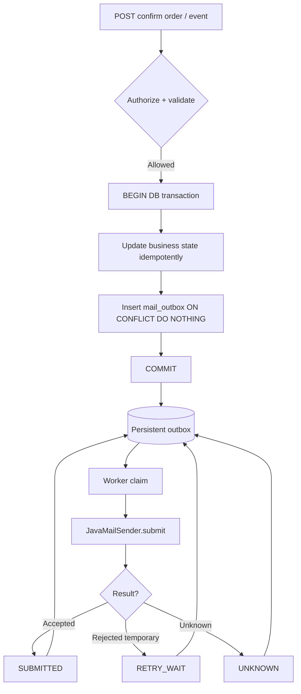
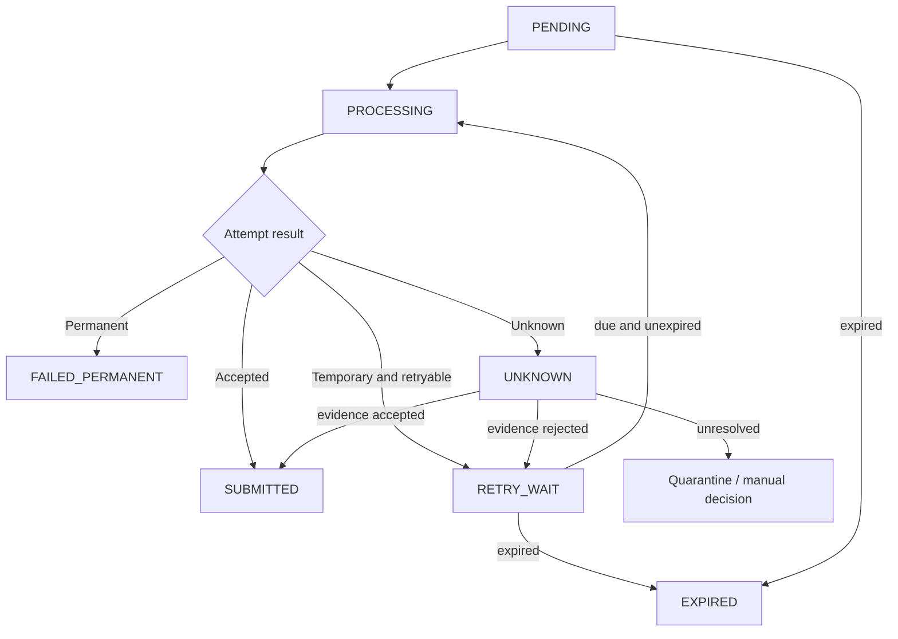

# Idempotency key và chống gửi trùng

Một ứng dụng Spring Boot tiếp nhận sự kiện `OrderPaid`, lưu hóa đơn rồi gửi email xác nhận bằng `JavaMailSender`. Sau khi consumer bị restart, broker phát lại sự kiện. Một HTTP client khác cũng retry request vì không nhận được response, trong khi cron worker chạy đồng thời trên hai pods. Cuối cùng người mua nhận ba email gần giống nhau. Mỗi thành phần có thể đã làm đúng việc riêng: broker bảo đảm *at-least-once delivery*, HTTP client retry vì timeout, scheduler chạy trên từng instance, và SMTP relay chấp nhận từng message. **Hệ thống thiếu một khái niệm thống nhất về “đây có phải cùng một yêu cầu gửi email?”**

Trong production, **idempotency key** là một định danh ổn định cho một thao tác logic. Khi cùng thao tác được yêu cầu lại, hệ thống nhận ra đó là cùng công việc và **không tạo thêm hiệu ứng nghiệp vụ không mong muốn**. Đối với Spring Framework Mail, bài toán này không dừng ở một chuỗi khóa hay một dòng `if (alreadySent) return`: phải xử lý transaction, concurrency, retry, outbox, sự cố giữa SMTP và database, provider API, nhiều người nhận và những lần gửi lại được chủ ý.

Bài học thuộc chương **Mẫu thiết kế production** của **Spring Framework Mail**. Nội dung xây dựng một thiết kế có thể vận hành: từ identity của notification, unique constraint trong PostgreSQL, transactional outbox và per-attempt tracking, đến cách nhận diện kết quả SMTP không chắc chắn, lựa chọn chính sách retry/failover, kiểm thử tranh chấp nhiều instance và điều tra sự cố gửi trùng.

## 1. Idempotency thật sự bảo đảm điều gì?

Một thao tác `f` được coi là idempotent theo hiệu ứng quan sát được nếu thực hiện lại với **cùng identity và cùng ý nghĩa** không tạo thêm thay đổi nghiệp vụ ngoài kết quả của lần đầu:

\[
f(f(x)) \equiv f(x)
\]

Đây là cách diễn giải khái niệm, **không phải** công thức chứng minh SMTP tự idempotent.

Ví dụ:

- Nhận lại sự kiện “order-42 đã thanh toán” không tạo thêm một *notification intent* xác nhận cho đúng recipient và purpose.
- HTTP client gửi lại cùng idempotency key không nhân đôi hàng ghi thông báo.
- Worker retry **cùng intent**, không tạo một intent khác.
- Webhook `delivered` được gửi hai lần không làm bộ đếm delivered tăng hai cho cùng provider event.

Nhưng:

- Một lần gọi `JavaMailSender.send(message)` có thể phát ra một email.
- Lần gọi thứ hai với cùng `Message-ID` vẫn có thể phát ra email thứ hai.
- SMTP relay không tham gia PostgreSQL transaction.
- Không có một cờ `idempotent=true` trong `JavaMailSender`.

**Điều có thể bảo đảm mạnh bằng dữ liệu nội bộ** là *một logical business intent chỉ có một record* và *các lần xử lý cùng record được phối hợp an toàn*. **Không thể tự suy ra exactly-once external SMTP submission/delivery** chỉ từ local database.

### 1.1. Tại sao email là bài toán khó?

Giả sử worker thực hiện:

```text
1. DB: mark PROCESSING
2. SMTP: send message
3. SMTP: 250 OK, relay accepted
4. DB: mark SUBMITTED
```

Nếu process crash giữa bước 3 và 4, database vẫn thấy `PROCESSING`. Khi lease hết hạn, worker khác có thể thử gửi lại. Relay đầu tiên đã chấp nhận thư nhưng DB chưa ghi nhận: duplicate có thể xảy ra.

Chiều ngược lại cũng nguy hiểm: nếu đánh dấu `SUBMITTED` **trước** khi gọi SMTP để tránh retry, process có thể crash trước bước gửi, làm email mất vĩnh viễn.

Đó là **dual-write problem** ở ranh giới database và external side effect. Idempotency key và outbox giúp giảm, kiểm soát, phát hiện trùng lặp; không xóa được hoàn toàn sự bất định của network nếu provider không hỗ trợ cơ chế kết quả/idempotency đáng tin.

## 2. Phân biệt các dạng gửi trùng

| Tầng | Nguồn phát sinh | Dấu hiệu | Hàng rào chính |
|---|---|---|---|
| **HTTP request** | Client retry sau timeout, double-click | Hai requests cùng một thao tác | Request idempotency key, payload fingerprint, unique constraint |
| **Event delivery** | Kafka/RabbitMQ redelivery, replay | Một event ID được xử lý nhiều lần | Inbox/dedup và unique business intent key |
| **Business logic** | Nhiều handlers cùng tạo mail | Hai intents cùng purpose/recipient | Định nghĩa logical notification identity |
| **Scheduler** | `@Scheduled` chạy mỗi pod | Nhiều jobs đọc cùng dữ liệu | Durable occurrence key, atomic work claim |
| **Worker claim** | SELECT pending rồi update riêng | Hai workers cùng gửi một row | Atomic claim, row locks, lease/fencing |
| **Transport retry** | SMTP timeout/4xx, worker crash | Nhiều attempts cho một intent | Failure classification, retry policy, provider idempotency nếu có |
| **Provider delivery** | Relay retry xuống recipient MX | Nhiều events, có thể duplicate at mailbox | Correlation và provider diagnostics; application không tự gửi lại khi relay đang retry |
| **Webhook** | ESP gửi lại callback chưa ACK | Delivered/bounce event lặp | Unique provider event identity + transaction |

Một giải pháp thường chỉ xử lý **một vài tầng**. Ví dụ `UNIQUE(idempotency_key)` không tự ngăn hai workers gửi cùng một outbox row nếu cơ chế claim sai. Một distributed scheduler lock không tự ngăn hai business events có keys khác nhau nhưng cùng ý nghĩa.

### 2.1. Duplicate “hiển thị giống nhau” chưa chắc cùng intent

Hai emails có nội dung giống hệt có thể là:

- Một lần gửi xác nhận hợp lệ và một lần gửi lại được người dùng yêu cầu.
- Hóa đơn gửi cho người mua và bản sao gửi kế toán.
- Email marketing của hai chiến dịch khác nhau.
- Hai notification intents do một event bị nhân đôi ngoài ý muốn.
- Một intent bị SMTP retry thành hai submissions.

Muốn điều tra đúng cần xem **business event, recipient identity, purpose, notification key và attempt history**, không so sánh mỗi subject/body.

## 3. Định nghĩa identity của một logical notification

Câu hỏi quan trọng nhất:

> Hai yêu cầu gửi đến vào lúc khác nhau phải được coi là **cùng một email cần gửi** trong trường hợp nào?

Một logical notification có thể được xác định từ:

- **Tenant/organization**: tránh key của hai tenants xung đột.
- **Nguồn nghiệp vụ**: ví dụ `orderId`/`invoiceId` và event identity.
- **Purpose**: `ORDER_CONFIRMATION`, `INVOICE_PUBLISHED`, `PASSWORD_RESET`.
- **Recipient identity**: người nhận logic hoặc delivery target đã được xác định.
- **Channel**: email khác SMS/push nếu hệ thống chung đa kênh.
- **Semantic version/occurrence**: khi cùng business entity có lần gửi mới hợp lệ.
- **Business policy**: có cho phép correction/reissue/resend không?

Ví dụ bảng ý tưởng:

| Use case | Ví dụ logical key | Khi nào nên đổi key? |
|---|---|---|
| Xác nhận đơn | `tenant:T1:order:O42:confirmation:user:U9` | Có purpose/recipient mới thực sự |
| Hóa đơn | `tenant:T1:invoice:I15:issued:v1:user:U9` | Phát hành bản hóa đơn v2 có chủ đích |
| Reset mật khẩu | `tenant:T1:password-reset:request:R7:user:U9` | Người dùng tạo **request reset mới** |
| Báo cáo ngày | `tenant:T1:daily-summary:2026-11-12:user:U9` | Ngày/occurrence khác hoặc correction version |
| Nhắc cuộc hẹn | `tenant:T1:appointment:A8:reminder:T-24h:user:U9` | Reminder occurrence khác |
| Marketing | `tenant:T1:campaign:C6:recipient:U9:wave:W1` | Wave được phê duyệt mới hoặc resend policy rõ |

Đây là những **ví dụ chuỗi key** nhằm giải thích thành phần; cấu trúc production có thể lưu binary identifier hoặc HMAC/hash để tránh lộ PII.

### 3.1. Retry không được tự tạo identity mới

Sai:

```java
String idempotencyKey = UUID.randomUUID().toString();
outbox.insert(idempotencyKey, email);
```

Nếu consumer redelivery cùng một event, nó tạo UUID khác, nên unique constraint không nhận ra trùng.

Đúng là tạo từ **identity đã tồn tại và ổn định**:

```java
String key = "order-confirmation:v1:"
        + tenantId + ":"
        + orderId + ":"
        + recipientId;
```

Các biến ở đây phải là business identifiers được xác minh; ví dụ rút gọn không tự giải quyết escaping, key length hoặc privacy.

### 3.2. Không phải “một event = một email”

Sự kiện `InvoiceIssued` có thể cần gửi:

- Hóa đơn cho khách hàng.
- Bản sao cho kế toán.
- Thông báo nội bộ khác mục đích.

Nếu unique chỉ theo `eventId`, lần gửi thứ hai hợp lệ có thể bị loại bỏ. Key phải có **purpose + logical recipient** hoặc một notification intent ID được business phát sinh riêng.

### 3.3. Không nên dùng email address raw làm identity khi có user ID bền vững

Địa chỉ có thể đổi sau sự kiện. Có thể dùng `recipientId` cùng **address snapshot** tại thời điểm tạo intent:

```text
recipientIdentity = customer:U9
recipientAddressSnapshot = lan@example.net
```

Nếu nghiệp vụ cần gửi một lần tới **mỗi địa chỉ** kể cả một user đổi email, identity phải phản ánh policy này một cách minh bạch. Không tự chuyển từ user ID sang email address do tiện code.

### 3.4. Email canonicalization rất dễ sai

Không áp dụng mù quáng:

- Xóa dấu chấm trong local part.
- Bỏ phần `+tag`.
- Lowercase mọi local part.
- Thay aliases theo quy tắc của một nhà cung cấp mailbox.
- Coi hai email Unicode có hình thức giống nhau là cùng identity.

Domain thường được so sánh không phân biệt hoa/thường và có thể cần IDNA normalization; local part theo chuẩn mail có những khác biệt và provider-specific behavior. Khi có user ID tin cậy, **ưu tiên identity của user**, còn địa chỉ chỉ là contact snapshot.

Nếu buộc key theo address, hãy định nghĩa rõ normalization và kiểm thử. Đừng dùng một hàm “normalize Gmail” cho mọi domain.

### 3.5. Version trong key là quyết định nghiệp vụ

Không tự thêm `templateVersion` vào mỗi key chỉ vì deploy template mới: cùng một sự kiện bị replay sau deploy có thể tạo email mới chỉ do version khác.

Có thể chọn:

- Key không đổi khi template implementation thay đổi; outbox giữ **content snapshot** hoặc version được chốt lúc tạo.
- Key có `documentRevision` khi nghiệp vụ phát hành bản sửa và **cần gửi email mới**.
- Key có `resendOperationId` khi người dùng bấm “Gửi lại hóa đơn” và business cho phép một email mới.

Phân biệt **thay code/template** với **phát sinh một notification mới có chủ đích**.

## 4. Ai được tạo và tin cậy idempotency key?

Có hai nguồn key phổ biến.

### 4.1. Client-supplied request key

HTTP API có thể cho client gửi `Idempotency-Key` khi bấm xác nhận đơn hoặc yêu cầu tạo thông báo.

Ưu điểm: client biết thao tác nào đang được retry; cùng key được dùng lại khi response thất lạc.

Rủi ro:

- Client có thể tái sử dụng key cho payload khác.
- Hai tenants có thể gửi cùng key.
- Key dài hoặc chứa dữ liệu nhạy cảm.
- Attacker dùng một key cố định để làm thao tác của người khác bị suppress.
- Retention/expiration gây re-execution sau TTL.
- Thực thi check key trước authorization có thể lộ kết quả thao tác của user khác.

**Luôn scope key theo authenticated principal/tenant + API operation.** Authorization vẫn phải được thực hiện cho mỗi request, kể cả replay.

### 4.2. Server-derived business key

Đối với event handling và outbox, server thường có business event ID, recipient và purpose, nên tự tạo key ổn định.

Ưu điểm:

- Không phụ thuộc khách hàng HTTP gửi đúng.
- Dễ liên kết với domain invariants.
- Có thể share giữa nhiều consumers/instances.
- Retry event giữ nguyên key.

Rủi ro: nếu business key thiết kế sai phạm vi hoặc thiếu purpose/recipient/version, có thể **chặn nhầm một thông báo hợp lệ**.

### 4.3. Quy tắc vận hành key

Một key tốt:

1. **Deterministic trong phạm vi một logical intent.**
2. **Khác** với những logical intents thực sự khác.
3. Có namespace/version của **quy ước định danh**, không ngẫu nhiên theo deploy.
4. Được kiểm độ dài/charset.
5. Có scope tenant/account/operation.
6. Có cách phát hiện reuse cùng key với payload khác.
7. Không lộ email address, token hoặc dữ liệu cá nhân không cần thiết.
8. Được lưu bền vững đủ lâu so với vòng đời retry/redelivery.

### 4.4. Có nên hash key?

Nếu source identity chứa PII hoặc rất dài, có thể lưu digest:

```text
logical tuple:
    [tenant-id, purpose, business-id, recipient-id, occurrence]

canonical encoding:
    length-prefixed fields / canonical structured serialization

storage key:
    HMAC-SHA256(secret, canonical tuple)
```

Tại sao cần canonical encoding? Ghép chuỗi đơn giản có thể va chạm ngữ nghĩa:

```text
["ab", "c"]  -> "abc"
["a", "bc"]  -> "abc"
```

Dùng length-prefix hoặc schema serialization có version để tránh ambiguity.

Hash thông thường không phải mã hóa. Nếu input chứa email địa chỉ có thể đoán và không muốn lộ identity, HMAC với secret được quản lý có thể giảm khả năng suy đoán từ digest; nhưng rotation, lookup key version và quản lý secret phải được thiết kế. Không dùng HMAC như một lý do bỏ authorization/PII controls.

## 5. Idempotency key khác những identifier nào?

| Identifier | Nguồn | Vai trò | Có thay idempotency key được không? |
|---|---|---|---|
| `businessEventId` | Domain/event publisher | Nhận biết một event | Chỉ khi scope đúng cho mỗi notification |
| `notificationId` | Outbox/application | Primary key một intent | Không nếu mỗi replay lại tạo UUID mới |
| `idempotencyKey` | Business rule hoặc API client | Nhận biết cùng logical operation | Chính là cơ chế dedup đã thiết kế |
| `attemptId` | Worker | Nhận biết một transport attempt | Không, mỗi retry cần attempt mới |
| Spring `MessageHeaders.ID` | Spring Messaging | Nhận biết message envelope | Không ổn định qua re-build/re-delivery |
| MIME `Message-ID` | Email format/sender | Correlation trong thư | SMTP không bắt buộc dedup |
| `providerMessageId` | ESP/relay | Tra cứu remote submission/event | Có thể null, scope theo provider |
| `traceId` | Observability | Liên kết spans/logs | Không phải business identity |

Không dùng một biến `messageId` mơ hồ cho tất cả identifiers; về sau rất khó phân biệt “cùng intent nhưng 3 attempts” với “3 logical intents”.

## 6. Thiết kế schema PostgreSQL có unique business key

Một schema minh họa cho thông báo một recipient, text/HTML và sender identity:

```sql
CREATE TABLE mail_outbox (
    id UUID PRIMARY KEY,
    tenant_id UUID NOT NULL,
    idempotency_key VARCHAR(240) NOT NULL,
    payload_fingerprint CHAR(64) NOT NULL,

    notification_type VARCHAR(80) NOT NULL,
    recipient_id VARCHAR(120) NOT NULL,
    recipient_address VARCHAR(320) NOT NULL,
    sender_address VARCHAR(320) NOT NULL,
    subject VARCHAR(500) NOT NULL,
    plain_text TEXT NOT NULL,
    html_text TEXT NULL,

    status VARCHAR(40) NOT NULL DEFAULT 'PENDING',
    due_at TIMESTAMPTZ NOT NULL,
    expires_at TIMESTAMPTZ NULL,
    next_attempt_at TIMESTAMPTZ NULL,

    claim_token UUID NULL,
    lease_until TIMESTAMPTZ NULL,
    accepted_at TIMESTAMPTZ NULL,
    provider_reference VARCHAR(240) NULL,

    created_at TIMESTAMPTZ NOT NULL DEFAULT CURRENT_TIMESTAMP,
    updated_at TIMESTAMPTZ NOT NULL DEFAULT CURRENT_TIMESTAMP,

    CONSTRAINT uq_mail_intent UNIQUE (tenant_id, idempotency_key),
    CONSTRAINT ck_mail_status CHECK (
      status IN (
        'PENDING',
        'PROCESSING',
        'RETRY_WAIT',
        'SUBMITTED',
        'UNKNOWN',
        'FAILED_PERMANENT',
        'EXPIRED',
        'CANCELLED'
      )
    )
);

CREATE INDEX ix_mail_outbox_due
ON mail_outbox(status, next_attempt_at, due_at);

CREATE INDEX ix_mail_outbox_lease
ON mail_outbox(status, lease_until);
```

Đây là schema dạy học. Production còn có thể cần template version/snapshot, attachment references, priority, provider account, retry policy version, suppression, encryption-at-rest, audit log và retention. Đừng lưu OTP/plaintext password token không cần thiết trong outbox nếu có thể tham chiếu một token đã được bảo vệ và có expiry; cần cân bằng khả năng retry với bảo vệ dữ liệu.

### 6.1. Unique constraint là hàng rào cuối cùng

`UNIQUE (tenant_id, idempotency_key)` hoạt động ở **database**, bảo vệ cả khi hai app instances cùng chạy, consumer replay hoặc hai requests đến đúng một thời điểm.

Chỉ dùng Java:

```java
if (!repository.existsByKey(key)) {
    repository.save(intent);
}
```

là không đủ:

```text
Pod A: exists(key) = false
Pod B: exists(key) = false
Pod A: insert key
Pod B: insert key
```

Nếu không có unique constraint, hai inserts có thể thành công.

### 6.2. Không trộn business idempotency TTL với retention tùy tiện

Nếu xóa row sau 24 giờ trong khi broker có thể replay sau 7 ngày, cùng key sẽ không còn gì để dedup và email có thể được tạo lại.

Phải xác định:

- Thời gian một event có thể bị redeliver.
- Thời gian client retry cùng request key.
- Thời gian một notification có thể nằm pending/retry/unknown.
- Chính sách GDPR/privacy, data minimization và retention.
- Khả năng giữ một **dedup tombstone** nhỏ hơn full email content.

Không được xóa durable key chỉ vì message đã `SUBMITTED` nếu yêu cầu idempotency còn hiệu lực.

## 7. Payload fingerprint để chống reuse sai key

Một key có thể bị dùng lại với nội dung khác:

```text
Request #1: key=K, to=alice, subject="Invoice I-42"
Request #2: key=K, to=bob,   subject="Invoice I-42"
```

Nếu server chỉ thấy key K tồn tại rồi trả “success”, request thứ hai bị che một lỗi logic hoặc abuse.

Nên lưu **fingerprint của canonical logical request** và so sánh khi key trùng. Fingerprint bao gồm những trường có ý nghĩa đối với “cùng thao tác”:

- Tenant/operation/purpose.
- Business entity và revision.
- Logical recipient identity.
- Destination snapshot nếu policy yêu cầu.
- Content snapshot hoặc template version/parameters đã ổn định.
- Attachment content IDs/hashes khi bắt buộc.
- Scheduling/expiry policy nếu có ý nghĩa.

### 7.1. Không so sánh một JSON serialization ngẫu nhiên

Hai JSON objects có cùng nghĩa nhưng thứ tự fields khác nhau có thể tạo digest khác:

```json
{"to":"alice@example.net","subject":"Hello"}
```

```json
{"subject":"Hello","to":"alice@example.net"}
```

Nếu muốn hash stable, cần canonical schema encoding và versioned normalization. Với binary attachments, lưu content digest thay vì ghép bytes lớn vào chuỗi JSON.

### 7.2. Phân biệt same-key/same-payload với same-key/different-payload

| Tình huống | Phản ứng |
|---|---|
| Key chưa tồn tại | Tạo intent mới |
| Key tồn tại, fingerprint trùng | Trả/tham chiếu intent cũ; không tạo intent mới |
| Key tồn tại, fingerprint khác | Trả conflict/business error rõ, không âm thầm overwrite |
| Key thuộc tenant khác | Không coi là cùng thao tác; phải bảo vệ scope và authorization |
| Key hết retention | Chính sách quy định rõ khả năng re-execution và rủi ro |

Với HTTP API, response có thể là `202 Accepted` cho intent pending hoặc trả trạng thái hiện có theo contract; không nhất thiết trả lại nguyên HTTP response cũ nếu application policy không cần. Nếu API công bố *exact response replay*, phải lưu và quản lý response phù hợp.

## 8. Atomic insert-if-absent với PostgreSQL

Dùng `INSERT ... ON CONFLICT DO NOTHING` để tránh race ở tầng ứng dụng.

```sql
INSERT INTO mail_outbox (
    id, tenant_id, idempotency_key, payload_fingerprint,
    notification_type, recipient_id, recipient_address,
    sender_address, subject, plain_text, html_text,
    status, due_at, expires_at
)
VALUES (
    :id, :tenantId, :idempotencyKey, :payloadFingerprint,
    :notificationType, :recipientId, :recipientAddress,
    :senderAddress, :subject, :plainText, :htmlText,
    'PENDING', :dueAt, :expiresAt
)
ON CONFLICT (tenant_id, idempotency_key)
DO NOTHING
RETURNING id;
```

Kết quả:

- Có một `id` trả về: transaction này tạo intent.
- Không có row trả về: key đã tồn tại tại conflict boundary; đọc record hiện có rồi so sánh fingerprint.

### 8.1. Bước kiểm lại sau conflict

```sql
SELECT id, payload_fingerprint, status
FROM mail_outbox
WHERE tenant_id = :tenantId
  AND idempotency_key = :idempotencyKey;
```

Trong PostgreSQL ở `READ COMMITTED`, một concurrent insert đang commit có thể khiến câu `INSERT ON CONFLICT` chờ; câu `SELECT` **riêng tiếp theo** thường thấy row đã commit. Với isolation mạnh hơn như `REPEATABLE READ`/`SERIALIZABLE`, có thể gặp serialization/conflict behavior cần retry toàn transaction. Không dựa vào `SELECT rồi INSERT` không có constraint.

### 8.2. Khi cần trả kết quả API

Một service có thể trả:

```java
public record EnqueueResult(
        UUID notificationId,
        boolean newlyCreated,
        String status) {
}
```

- `newlyCreated=true`: một logical intent mới được ghi.
- `newlyCreated=false`: replay hợp lệ, trả cùng `notificationId` và trạng thái hiện tại.
- Nếu fingerprint khác: ném domain conflict và để API map thành HTTP status phù hợp (thường `409 Conflict`).

Không gửi SMTP trực tiếp bên trong method xử lý idempotency của HTTP API chỉ vì lần đầu tạo intent thành công.

## 9. Transactional Outbox: ghi business state và intent cùng một commit

Một thiết kế production nên tách:

1. **Business transaction:** cập nhật trạng thái đơn hàng và tạo mail intent bền vững.
2. **Worker transactions:** claim outbox, ghi lịch sử attempts/trạng thái.
3. **External transport:** `JavaMailSender.send(...)` ngoài database transaction khóa row.

Sơ đồ:



### 9.1. Không gửi SMTP trong @Transactional của nghiệp vụ

Sai:

```java
@Transactional
public void confirmOrder(UUID orderId) {
    orders.confirm(orderId);
    mailSender.send(buildEmail(orderId));
}
```

Nếu SMTP relay đã nhận email nhưng database commit thất bại, người nhận có email xác nhận cho giao dịch rollback. Nếu DB transaction giữ lock qua timeout SMTP, throughput và concurrency cũng bị ảnh hưởng.

Đúng hơn:

```java
@Transactional
public EnqueueResult confirmOrder(
        UUID orderId, UUID recipientId) {

    orders.confirmIfEligible(orderId);

    NotificationDraft draft =
            notifications.forConfirmedOrder(orderId, recipientId);

    return outbox.insertOrReturnExisting(draft);
}
```

`orders`, `notifications`, `outbox` và `NotificationDraft` là application ports do dự án định nghĩa. Hợp đồng quan trọng: cùng transaction manager và datasource cho business write + outbox insert. `@Transactional` qua Spring proxy phải thực sự có hiệu lực; không dùng `REQUIRES_NEW` ở outbox writer nếu muốn commit/rollback nguyên tử.

### 9.2. Event replay và business state

Nếu `orders.confirmIfEligible(orderId)` chỉ trả `false` vì order đã confirmed, không tự kết luận không cần mail intent; có thể có case state confirmed nhưng intent chưa được tạo do migration hoặc lỗi cũ.

Policy phải rõ: sự kiện `OrderConfirmed` sẽ đảm bảo presence của intent tương ứng bằng insert-if-absent, độc lập với việc update order có thay trạng thái hay không khi điều đó đúng nghiệp vụ. Khi cả hai cùng transaction, một event xử lý lại bình thường không sinh trùng, còn recovery từ dữ liệu cũ có thể materialize intent thiếu.

### 9.3. Idempotent inbox cho event consumers

Một consumer có thể lưu event ID vào bảng inbox:

```sql
CREATE TABLE processed_event (
    consumer_name VARCHAR(100) NOT NULL,
    event_id VARCHAR(240) NOT NULL,
    processed_at TIMESTAMPTZ NOT NULL DEFAULT CURRENT_TIMESTAMP,
    PRIMARY KEY (consumer_name, event_id)
);
```

Nếu dùng, insert inbox marker, cập nhật business state và insert outbox intent **trong cùng transaction**; nếu commit thành công thì mới ACK broker. Nhưng inbox marker **không thay thế** unique outbox key: nhiều event IDs khác nhau vẫn có thể diễn đạt cùng business operation.

Không insert marker rồi commit riêng **trước** khi xử lý, vì crash sau marker sẽ làm event bị coi là processed dù business/outbox chưa hoàn thành.

## 10. API HTTP: idempotency key không bỏ qua authorization

Một endpoint ví dụ:

```http
POST /api/orders/O42/confirm
Idempotency-Key: 89e0d42a-3eb1-4d11-a2e1-aab5bcee2c64
Content-Type: application/json

{"recipientId":"U9"}
```

Server cần:

1. Xác thực user và tenant.
2. Xác minh user có quyền confirm order O42.
3. Validate key format, size và phạm vi operation.
4. Chuẩn hóa logical request và fingerprint.
5. Ghi business state + outbox trong một DB transaction.
6. Với replay cùng key/same fingerprint, trả cùng notification reference/trạng thái.
7. Với key reuse nhưng request khác, từ chối rõ.
8. Không tạo email ngay trong HTTP request nếu cần durable asynchronous dispatch.

### 10.1. Những tình huống API cần test

| Tình huống | Kết quả mong đợi |
|---|---|
| Client gửi một lần | Tạo một intent |
| Client timeout rồi gửi lại cùng key/payload | Trả intent cũ, không insert trùng |
| Double-click hai requests concurrent | Một insert thành công, request còn lại thấy row cũ |
| Key cũ với recipient mới | Conflict, không sửa recipient lặng lẽ |
| Hai tenants dùng cùng chuỗi key | Hai scopes độc lập, không lộ trạng thái nhau |
| User không còn quyền truy cập | Không trả dữ liệu nhạy cảm chỉ vì biết key |
| Key bị gửi lại sau TTL công bố | Hành vi theo retention contract, có đánh giá duplicate risk |
| Server crash sau DB commit trước HTTP response | Retry lấy lại record committed |

### 10.2. Không đặt API idempotency key của client trực tiếp làm SMTP Message-ID

Client key có thể dài, chứa ký tự không hợp lệ hoặc dữ liệu nhạy cảm. `Message-ID` MIME có cú pháp và ý nghĩa riêng, và cũng không bảo đảm relay deduplicate. Lưu client key trong app database; nếu cần email correlation, dùng một opaque ID hợp lệ được tạo bởi server.

## 11. Thời gian sống của key, dữ liệu và dedup tombstone

Một ý tưởng sai thường thấy: “idempotency key giữ 24 giờ là đủ vì API client thường retry trong ngày”.

Nếu notification đang chờ 48 giờ vì quota, hoặc broker retry sau 7 ngày, xóa key sớm có thể cho phép intent mới trùng khi lại nhận cùng event.

Có ít nhất ba khoảng thời gian riêng:

- **Request replay window:** khoảng API công bố client có thể retry cùng key.
- **Business operation identity lifetime:** khoảng cần chống cùng event/notification xuất hiện trở lại.
- **Provider idempotency TTL:** thời hạn remote provider deduplicate requests, nếu có.

Chúng không buộc bằng nhau.

### 11.1. Dedup tombstone sau khi xóa nội dung nhạy cảm

Khi email body/recipient snapshot phải được xóa theo retention policy, vẫn có thể giữ record tối thiểu (nếu hợp pháp và đúng chính sách):

```text
tenant scope
idempotency digest
notification purpose/version
createdAt
terminal status
payload fingerprint (cân nhắc privacy)
retention expiresAt
```

Tombstone giúp tránh replay tạo mail mới mà không phải giữ nội dung email quá lâu. Cần đánh giá HMAC/key rotation, khả năng suy đoán, xóa dữ liệu theo yêu cầu và khoảng giữ lại hợp lệ.

### 11.2. TTL không phải thời gian OTP có hiệu lực

OTP token hết hạn sau 5 phút có thể khiến notification intent chuyển `EXPIRED`. Nhưng dedup key của **request OTP đó** vẫn cần tồn tại để client retry cùng request không tạo token/email mới. Nếu user chủ động yêu cầu OTP mới, đó là một **requestId mới** theo business policy.

Không dùng `expires_at` của email làm thời điểm tự động xóa idempotency key.

## 12. Lịch sử attempts: một intent, nhiều transport attempts

Nên tách bảng `mail_outbox` (mỗi logical intent) và `mail_submission_attempt` (mỗi lần thử đưa email tới provider).

```sql
CREATE TABLE mail_submission_attempt (
    attempt_id UUID PRIMARY KEY,
    notification_id UUID NOT NULL REFERENCES mail_outbox(id),
    attempt_no INTEGER NOT NULL,
    provider_key VARCHAR(100) NOT NULL,
    provider_account VARCHAR(100) NOT NULL,
    provider_reference VARCHAR(240) NULL,
    state VARCHAR(32) NOT NULL,
    failure_category VARCHAR(80) NULL,
    smtp_reply_code INTEGER NULL,
    transport_stage VARCHAR(60) NULL,
    started_at TIMESTAMPTZ NOT NULL,
    finished_at TIMESTAMPTZ NULL,
    CONSTRAINT uq_mail_attempt_no UNIQUE(notification_id, attempt_no),
    CONSTRAINT ck_mail_attempt_state CHECK (
      state IN ('STARTED', 'ACCEPTED', 'REJECTED',
                'UNKNOWN', 'ABORTED_BEFORE_TRANSPORT')
    )
);

CREATE INDEX ix_mail_attempt_notification
ON mail_submission_attempt(notification_id, started_at);
```

Ví dụ:

```text
mail_outbox
  id=N-101
  idempotency_key=order-confirmation:T1:O42:U9
  status=SUBMITTED

mail_submission_attempt
  A-1: notification=N-101, attempt_no=1, state=REJECTED (451)
  A-2: notification=N-101, attempt_no=2, state=ACCEPTED
```

Đây là **một** notification intent được thử gửi **hai** lần. Không gọi hai attempts là hai logical notifications.

### 12.1. Tách claim và actual SMTP attempt

Worker có thể claim một row rồi local rate limiter từ chối capacity. Khi đó:

- Claim có thể được ghi nhận.
- **SMTP attempt chưa xảy ra**.
- Không nên tăng `mail_submission_attempts_total` như thể đã mở network.
- Không nên tiêu max retry attempts chỉ vì local quota gate trì hoãn.

Một attempt record có thể được tạo ngay trước khi transport bắt đầu hoặc lưu thêm trạng thái `PREPARED`/`SEND_STARTED`. Cần hiểu rằng DB write và network send không thể atomic với nhau; một process crash sát ranh giới vẫn tạo sự bất định.

### 12.2. Không xóa attempts khi retry thành công

Attempt history hữu ích để biết vì sao email trễ, provider nào đã được thử, có kết quả unknown trước accepted hay không, và phát hiện potentially duplicate submissions. Chỉ nên xóa/redact theo data retention được duyệt, không xóa vì dashboard muốn “chỉ hiện successful attempts”.

## 13. Nhiều workers: atomic claim trước khi gửi

Một database unique key chỉ ngăn **tạo hai outbox rows**, nhưng vẫn có thể có hai workers cùng gửi **một** row nếu chọn PENDING bằng query thường rồi update status riêng.

Sai:

```text
A: SELECT status=PENDING for N-101
B: SELECT status=PENDING for N-101
A: send(N-101)
B: send(N-101)
```

Cần **claim có transaction atomic** hoặc broker consumer ownership phù hợp.

### 13.1. PostgreSQL SKIP LOCKED

```sql
WITH due AS (
    SELECT id
    FROM mail_outbox
    WHERE
      status IN ('PENDING', 'RETRY_WAIT')
      AND due_at <= CURRENT_TIMESTAMP
      AND (
        next_attempt_at IS NULL
        OR next_attempt_at <= CURRENT_TIMESTAMP
      )
      AND (
        expires_at IS NULL
        OR expires_at > CURRENT_TIMESTAMP
      )
    ORDER BY
      COALESCE(next_attempt_at, due_at),
      created_at,
      id
    LIMIT :batchSize
    FOR UPDATE SKIP LOCKED
)
UPDATE mail_outbox m
SET
    status = 'PROCESSING',
    claim_token = :claimToken,
    lease_until = CURRENT_TIMESTAMP
                  + (:leaseSeconds * INTERVAL '1 second'),
    updated_at = CURRENT_TIMESTAMP
FROM due
WHERE m.id = due.id
RETURNING
    m.id, m.claim_token,
    m.recipient_address, m.sender_address,
    m.subject, m.plain_text, m.html_text;
```

Với hai workers cùng database:

- Một worker lock một row trong transaction ngắn.
- Worker khác `SKIP LOCKED` không chọn row đó trong cùng thời điểm.
- Sau commit, row đã `PROCESSING` nên poll tiếp không chọn lại.
- Một claim token mới được gắn mỗi lần ownership được cấp.

**Không gọi SMTP trong transaction giữ `FOR UPDATE` row locks.** Commit claim trước; transport call ngoài transaction; update kết quả bằng transaction mới.

### 13.2. Tại sao không reclaim PROCESSING trực tiếp trong query gửi?

Nếu lease của một `PROCESSING` row đã hết, worker cũ có thể:

- Chết trước network call.
- Đang treo trong SMTP call.
- Đã được relay accepted nhưng DB update thất bại.

Reclaim nó rồi gửi ngay có thể gây duplicate. Một thiết kế bảo thủ dành **recovery path riêng**:

1. Tìm `PROCESSING` hết lease.
2. Kiểm attempt stage/evidence trong DB và provider logs khi có.
3. Nếu chứng minh chưa gửi, đưa về `RETRY_WAIT`/`PENDING`.
4. Nếu không chắc, chuyển `UNKNOWN` hoặc queue reconciliation.
5. Chỉ gửi lại theo explicit duplicate-risk policy.

Điều này giảm nguy cơ một race lease tự động biến thành SMTP duplicate. Các hệ at-least-once có thể chọn retry sớm hơn, nhưng phải công bố trade-off.

### 13.3. Batch size và lease

Nếu worker claim 1.000 rows, sau đó gửi tuần tự và mỗi SMTP call chậm 15 giây, lease của rows chưa tới lượt sẽ hết hạn trước khi gửi. Chỉ claim số rows tương ứng slots và thời gian có thể hoàn thành trước lease; gia hạn lease nếu cần.

## 14. Conditional completion và fencing token

Sau khi relay xác nhận accepted:

```sql
UPDATE mail_outbox
SET
    status = 'SUBMITTED',
    accepted_at = CURRENT_TIMESTAMP,
    provider_reference = :providerReference,
    claim_token = NULL,
    lease_until = NULL,
    updated_at = CURRENT_TIMESTAMP
WHERE
    id = :notificationId
    AND status = 'PROCESSING'
    AND claim_token = :claimToken;
```

Kiểm `affectedRows`:

- `1`: worker còn quyền cập nhật row.
- `0`: worker đã mất quyền hoặc state đổi; không overwrite state hiện tại, cần ghi diagnostic/reconciliation.

Khi temporary rejection:

```sql
UPDATE mail_outbox
SET
    status = 'RETRY_WAIT',
    next_attempt_at = :nextAttemptAt,
    claim_token = NULL,
    lease_until = NULL,
    updated_at = CURRENT_TIMESTAMP
WHERE
    id = :notificationId
    AND status = 'PROCESSING'
    AND claim_token = :claimToken;
```

Khi unknown outcome, dùng guarded update sang `UNKNOWN` hoặc policy đã định nghĩa, không tự xếp `RETRY_WAIT` ngay.

### 14.1. Fencing chỉ bảo vệ state của DB nếu external provider không tham gia

Tình huống:

```text
Worker A claims N-101 (token=Ta)
Worker A bắt đầu gửi SMTP, bị treo
Lease A hết hạn
Worker B reclaims N-101 (token=Tb)
Worker B cũng gửi SMTP
A tỉnh lại, SMTP accepted
A UPDATE ... WHERE token=Ta -> 0 rows
B có thể cũng accepted
```

Token ngăn A ghi đè trạng thái của B, nhưng **không thu hồi email A đã gửi**. Muốn ngăn duplicate ở external side effect cần remote idempotency hoặc lựa chọn không gửi lại khi chưa biết kết quả; SMTP chuẩn không cung cấp một fencing mechanism áp dụng chung.

### 14.2. Định nghĩa owner theo claim, không theo pod

`worker_id=pod-4` có thể được tái sử dụng sau restart. Một token mới theo mỗi claim có vai trò rõ hơn cho conditional update. Có thể dùng version tăng đơn điệu; vẫn cần xử lý stale transport.

### 14.3. Heartbeat không phải phép màu

Gia hạn `lease_until` khi worker thực sự đang xử lý có thể giảm premature reclaim. Nhưng nếu network send đã bị kẹt sau giai đoạn không thể hủy, heartbeat không bảo đảm duplicate absence. Cần thiết lập SMTP timeouts, giới hạn concurrency và recovery policy.

## 15. Luồng worker: một notification không sinh intent mới khi retry

Pseudocode:

```text
claim eligible outbox row (atomic transaction)
   |
   v
validate expiry / suppression / provider capacity
   |
   +-- local quota denied -> defer same row, no SMTP attempt
   |
   v
create attempt record, commit
   |
   v
build MimeMessage from immutable content snapshot
   |
   v
call JavaMailSender.send()
   |
   +-- confirmed accepted -> record ACCEPTED / SUBMITTED
   |
   +-- confirmed temporary reject -> RETRY_WAIT same row
   |
   +-- confirmed permanent reject -> FAILED_PERMANENT
   |
   +-- outcome uncertain -> UNKNOWN / reconciliation
```

Worker phải giữ:

- `notificationId` cố định.
- `idempotencyKey` cố định.
- `attemptId` mới mỗi transport attempt.
- `attemptNo` tăng có kiểm soát.
- `providerKey`/`providerReference` gắn với từng attempt.
- `claimToken` riêng theo quyền xử lý.
- Retry deadline/expiry cố định hoặc theo policy version.

### 15.1. Không tạo email mới trong catch

Sai:

```java
try {
    sender.send(message);
} catch (MailException ex) {
    notificationService.createNewNotification(
            UUID.randomUUID(), sameRecipient, sameBody);
}
```

Nó biến một lần transport retry thành một logical intent mới. Lần gửi sau khó trace, unique business key cũng bị vô hiệu.

Đúng: cập nhật `nextAttemptAt` của **cùng outbox row**, giữ lịch sử attempts, áp dụng backoff và phân loại lỗi.

### 15.2. Stable content snapshot

Nếu retry hóa đơn sau 2 ngày, template hoặc địa chỉ khách hàng có thể đã thay. Nếu mỗi retry render lại từ mutable data, cùng idempotency key có thể gửi **hai nội dung khác nhau**.

Nên lưu:

- Recipient address snapshot đã xác minh tại thời điểm tạo.
- Subject/plain/HTML content snapshot hoặc template version + immutable parameters.
- Attachment reference bất biến và content hash.
- Expiry policy và notification purpose.

Nếu nghiệp vụ muốn gửi bản sửa, tạo logical intent mới có correction/version rõ, không âm thầm sửa nội dung của intent cũ đang retry.

## 16. Spring JavaMailSender không tự xử lý idempotency

Spring Mail cung cấp:

```java
JavaMailSender sender;
MimeMessage message = sender.createMimeMessage();
// Build MIME...
sender.send(message);
```

`JavaMailSender` xây/gửi email qua Jakarta Mail transport; nó không biết `idempotencyKey` trong database của bạn, cũng không kiểm business event đã tạo intent chưa.

### 16.1. Một adapter rõ transport boundary

```java
public interface MailTransportPort {
    void submitOnce(MailEnvelope email);
}
```

`MailEnvelope` là type ứng dụng chứa verified From/To/Subject/plain/HTML và attachment snapshots. Một adapter SMTP có thể:

```java
public final class SmtpMailTransport
        implements MailTransportPort {

    private final JavaMailSender sender;

    public SmtpMailTransport(JavaMailSender sender) {
        this.sender = sender;
    }

    @Override
    public void submitOnce(MailEnvelope email) {
        MimeMessage mime = sender.createMimeMessage();

        try {
            MimeMessageHelper helper =
                    new MimeMessageHelper(mime, true, "UTF-8");
            helper.setFrom(email.from());
            helper.setTo(email.to());
            helper.setSubject(email.subject());
            helper.setText(
                    email.plainText(),
                    email.htmlText());
        } catch (MessagingException ex) {
            throw new IllegalArgumentException(
                    "Invalid MIME payload", ex);
        }

        sender.send(mime);
    }
}
```

Imports thuộc `org.springframework.mail.javamail.*` và `jakarta.mail.*`. `MailEnvelope` là record/interface do dự án định nghĩa. Ví dụ này minh họa một attempt với plain+HTML; production cần xử lý HTML absent, attachments, exception classification, recipient policy và SMTP timeouts.

### 16.2. Không trả boolean delivered

`sender.send(...)` không ném exception thường chỉ có nghĩa transport không báo lỗi tại ranh giới submission. Nó **không chứng minh email đã vào Inbox**, không chứng minh downstream MX đã nhận, và không cung cấp global exactly-once guarantee.

Một port production nên trả `SubmissionOutcome` với `ACCEPTED_BY_RELAY`, `TEMPORARY_REJECTION`, `PERMANENT_REJECTION`, `UNKNOWN` khi evidence cho phép, thay vì một boolean `emailDelivered`.

### 16.3. SMTP code/stage quan trọng

Những thông tin có thể giúp phân loại:

- SMTP reply code/enhanced status code.
- Thời điểm kết nối/AUTH/MAIL FROM/RCPT TO/DATA.
- `MessagingException` cause/nextException chain.
- `MailSendException` với failed messages/nested errors.
- Provider logs/reference nếu có.
- Network timeout trước hay sau khi bytes được gửi.

Không regex một message exception rồi coi mọi `MailException` là retryable. Khi không có evidence đủ, phân loại `UNKNOWN` hoặc `UNCLASSIFIED` theo policy bảo thủ.
## 17. Cửa sổ bất định sau SMTP DATA

Đây là giới hạn quan trọng nhất khi bàn về “gửi đúng một lần”.

### 17.1. Thời điểm relay xác nhận chấp nhận

Trong một SMTP transaction đơn giản:

```text
Client                         SMTP relay
  |                                |
  | -------- EHLO/AUTH ----------> |
  | -------- MAIL FROM ----------> |
  | <---------- 250 -------------- |
  | -------- RCPT TO ------------> |
  | <---------- 250 -------------- |
  | -------- DATA ---------------> |
  | <---------- 354 -------------- |
  | ---- MIME bytes + <CRLF>.<CRLF> ->|
  | <---------- 250 -------------- |  Relay accepted
  |                                |
```

Lưu ý: một `250` sau `RCPT TO` chỉ cho biết recipient được chấp nhận ở bước đó; chưa phải xác nhận **toàn bộ message DATA đã được nhận**. Ở bước DATA, phản hồi sau end-of-data là bằng chứng submission chính. Việc provider accepted cũng không đồng nghĩa final delivery tới recipient mailbox.

### 17.2. Mất response sau DATA

```text
Client                         SMTP relay
  | ---- MIME bytes + end ------- > |
  |                                | Accepted internally
  |    [connection reset]          |
  |    [no final reply observed]    |
```

Từ phía client, hai sự thật đều có thể xảy ra:

1. Relay nhận và commit message, nhưng phản hồi bị mất.
2. Relay chưa nhận đầy đủ hoặc từ chối message, client không đọc được kết quả.

Nếu ghi `FAILED` và retry ngay, có thể gửi trùng. Nếu ghi `SUBMITTED`, có thể che một email chưa được nhận. Trạng thái đúng về mặt kiến thức là **`UNKNOWN`**, cùng với evidence và recovery policy.

### 17.3. UNKNOWN khác temporary rejection rõ ràng

| Kết quả client nhìn thấy | Độ chắc chắn | Hành động |
|---|---|---|
| TCP connect failed trước khi gửi SMTP data | Chưa có message submission | Có thể retry sau khi kiểm cấu hình |
| AUTH rejected | Không có accepted message | Sửa credentials/account |
| RCPT TO reject rõ cho recipient | Không accepted recipient theo reply đó | Phân loại temporary/permanent |
| Server trả temporary failure rõ sau DATA | Message không được nhận cho transaction đó theo SMTP semantics, nhưng vẫn xác minh provider diagnostics | Retry có giới hạn |
| Client nhận final `250` sau DATA | Relay accepted | Ghi `SUBMITTED` |
| Client timeout/lost response sau gửi DATA | Không xác định | `UNKNOWN`/reconcile |
| ESP phát delivery event | Evidence downstream theo provider contract | Update delivery state độc lập |

Các framework exceptions không phải lúc nào cho biết chính xác giai đoạn. Đừng tự suy ra “connect exception = chắc chắn không gửi” nếu có proxy, retry tự động hoặc adapter đã thực hiện thao tác trước đó. Cần kiểm implementation và evidence.

### 17.4. Không có transaction nguyên tử giữa SMTP và PostgreSQL

Đặt `@Transactional` quanh toàn bộ workflow không khiến SMTP tham gia DB commit; SMTP không cung cấp XA/2PC giao dịch một cách phổ quát qua `JavaMailSender`.

Lựa chọn thường là:

- **At-least-once notification processing:** retry cho đến khi có bằng chứng thành công hoặc hết policy; chấp nhận nguy cơ duplicate SMTP.
- **Conservative unknown handling:** giữ `UNKNOWN` và đối chiếu trước khi retry; giảm duplicate nhưng tăng nguy cơ chậm/mất thời hạn nếu không thể xác minh.
- **Provider-backed idempotency:** dùng API của provider có key semantics rõ để giảm ambiguous duplicate nếu được hỗ trợ.
- **Business-specific trade-off:** một số notifications chấp nhận duplicate, một số ưu tiên tránh duplicate hơn đảm bảo delivery tức thời.

### 17.5. Bảng quyết định sau UNKNOWN

| Yêu cầu | Phương án gợi ý | Rủi ro còn lại |
|---|---|---|
| Marketing tránh làm phiền | Quarantine, tra provider, retry có kiểm soát | Chậm hoặc bỏ lỡ một email |
| Hóa đơn cần gửi bền vững | Reconcile provider, retry theo policy, cùng snapshot | Có thể gửi trùng nếu provider không xác nhận được |
| OTP có deadline ngắn | Expire nếu quá hạn; UX cho phép tạo request mới | Có thể không nhận OTP cũ |
| Security alert quan trọng | Có thể chấp nhận duplicate hoặc dùng kênh khác | Duplicate được kiểm soát |
| Provider API có idempotency đúng nghĩa | Gửi lại cùng key trong window | TTL/scope/provider semantics vẫn có giới hạn |

Không nên áp một bảng chính sách cho mọi notification. Hãy đặt retry/duplicate tolerance ở **notification purpose policy**.

## 18. Retry: một intent, nhiều attempts, không mất thông tin

Một policy retry nên dựa trên **loại lỗi, giai đoạn, tuổi intent, attempts còn lại và thời hạn nội dung**.

### 18.1. State machine đề xuất



Quarantine có thể được biểu diễn bằng `UNKNOWN` cộng reconciliation status, không nhất thiết cần một enum khác. Điều quan trọng là **không tự động đẩy UNKNOWN vào RETRY_WAIT** như thể đã chắc chắn thất bại.

### 18.2. Exponential backoff với jitter

Một policy ví dụ:

```text
Attempt 1 fails temporary -> chờ ngẫu nhiên 0..30 giây
Attempt 2 fails temporary -> chờ ngẫu nhiên 0..60 giây
Attempt 3 fails temporary -> chờ ngẫu nhiên 0..120 giây
Attempt 4 fails temporary -> chờ ngẫu nhiên 0..240 giây
Tiếp theo -> capped window, giới hạn maxAttempts/maxAge
```

Đây là **full-jitter exponential backoff** minh họa. Không có con số đúng cho mọi provider. Khi provider HTTP API trả `Retry-After` hợp lệ, không retry sớm hơn thời điểm provider yêu cầu. SMTP 4xx không có header `Retry-After` phổ quát.

### 18.3. Hàm tính delay có thể test

```java
import java.time.Duration;
import java.util.concurrent.ThreadLocalRandom;

public final class RetryDelays {

    private RetryDelays() {}

    public static Duration fullJitter(
            int consecutiveFailures,
            Duration base,
            Duration cap) {

        if (consecutiveFailures <= 0
                || base.isNegative() || base.isZero()
                || cap.isNegative() || cap.isZero()) {
            throw new IllegalArgumentException(
                    "Invalid retry delay arguments");
        }

        long baseMillis = base.toMillis();
        long capMillis = cap.toMillis();
        long ceilingMillis = Math.min(
                capMillis,
                saturatingMultiplyByPowerOfTwo(
                        baseMillis, consecutiveFailures - 1));

        if (ceilingMillis <= 0L) {
            return Duration.ofMillis(0);
        }

        long delay = ThreadLocalRandom.current()
                .nextLong(ceilingMillis + 1L);

        return Duration.ofMillis(delay);
    }

    private static long saturatingMultiplyByPowerOfTwo(
            long value, int exponent) {

        if (exponent >= 62) {
            return Long.MAX_VALUE;
        }

        if (value > (Long.MAX_VALUE >> exponent)) {
            return Long.MAX_VALUE;
        }

        return value << exponent;
    }
}
```

Ý tưởng của code: cấp số nhân nhưng **có giới hạn trên**, thêm jitter để nhiều workers không cùng retry đồng loạt. Ví dụ cần giả định `base.toMillis() > 0` và `cap.toMillis() < Long.MAX_VALUE` khi đưa vào production; nếu cho phép các giá trị Duration cực nhỏ hoặc cực lớn, nên bổ sung validation tránh overflow ở `ceilingMillis + 1` và việc làm tròn về 0. Có thể inject jitter source/`Clock` để unit test deterministic.

### 18.4. Không retry trong ba tầng cùng lúc

Nếu:

- `@Retryable` retry 3 lần,
- worker retry 5 lần,
- provider SDK tự retry 4 lần,

thì có thể phát sinh tới 60 transport calls cho một intent, lại khó phân biệt giai đoạn outcome. Cần **một chủ sở hữu retry policy** ở mức dispatch, biết attempt state và idempotency; không để nhiều thư viện retry âm thầm xếp chồng.

### 18.5. @Retryable có thể che metadata

`@Retryable` hữu ích trong nhiều công việc tạm thời, nhưng bọc trực tiếp `JavaMailSender.send` mà không có persistent attempt state có thể:

- Retry sau timeout UNKNOWN.
- Gửi lần thứ hai khi lần đầu đã accepted.
- Không lưu attempt ID/provider ref.
- Không kiểm expiry/consent tại lần retry.
- Retry trên thread đang giữ business transaction.

Nếu dùng Spring Retry, chỉ dùng bên trong một policy đã hiểu **submission outcome và persistence**, không coi annotation là giải pháp exactly-once.

## 19. Provider idempotency: chỉ dùng khi hợp đồng thật sự hỗ trợ

Một số ESP HTTP APIs cho phép gắn request idempotency key. Khi cùng key được gửi lại trong một khoảng được công bố, provider có thể trả kết quả của request trước hoặc ngăn tạo submission mới.

**Điều này là provider-specific, không thuộc Spring Mail SMTP chuẩn.**

### 19.1. Những điều phải đọc trong contract

- Endpoint nào hỗ trợ idempotency?
- Header/field key tên gì?
- Key scope theo account, region, subaccount hay endpoint?
- TTL bao lâu? Khi TTL hết thì sao?
- Same key nhưng payload khác bị từ chối hay silently reused?
- Server xử lý concurrent same-key requests thế nào?
- Khi response timeout, status API có tra được theo key không?
- Một HTTP 202 nghĩa “accepted request”, “queued” hay “mail submitted”?
- Có dedup theo recipient hay batch request?
- Quota usage có tính rejected/duplicate requests không?

Không tự thêm header `Idempotency-Key` vào SMTP MIME rồi hy vọng ESP deduplicate. Nếu provider hỗ trợ X-header riêng, phải kiểm rõ contract; X-header tùy ý **không phải idempotency guarantee**.

### 19.2. Khóa application và khóa provider có thể cùng nguồn

Ví dụ:

```text
Application notification id = N-101
Application idempotency key = K-Order-42-Recipient-9
Provider A API idempotency key = derived(K, provider A scope)
```

Có thể truyền cùng key khi provider cho phép và không lộ thông tin nhạy cảm; hoặc tạo deterministic opaque provider key từ application identity. **Ghi lại key mapping và provider account scope**.

### 19.3. TTL của provider ngắn hơn vòng đời notification

Ví dụ remote idempotency TTL là 24 giờ, nhưng retry có thể xảy ra sau 48 giờ. Một request cùng key ở ngày thứ ba có thể tạo email mới, tùy provider. Không tuyên bố “đã có idempotency key nên không thể duplicate mãi mãi”.

Nếu unknown còn tồn tại sau TTL:

- Reconcile trước khi re-submit.
- Đánh giá ý nghĩa nghiệp vụ.
- Có thể dừng tự động và escalation.
- Nếu vẫn gửi lại, ghi audit rằng duplicate risk đã được chấp nhận.

### 19.4. Chuyển nhà cung cấp không giữ idempotency toàn cục

```text
A accepted request with key K
    |
    +-- Client timeout, application UNKNOWN
    |
    +-- Failover to B with same K
                     |
                     v
             B does not know A's K
             => B can accept duplicate
```

Hai providers không chia sẻ dedup store. Không failover UNKNOWN như thể primary chắc chắn failed.

### 19.5. Khóa provider cho batch

Nếu HTTP API gửi batch 500 recipients trong một request, provider có thể deduplicate **request**, không phải từng recipient. Trường hợp partial failure hoặc batch timeout cần lưu mapping per-recipient và contract rõ; retry lại toàn batch có thể gửi trùng một phần.

## 20. Scheduled mail: idempotency phải gắn với occurrence

Một job tạo báo cáo ngày lúc 08:00 có thể chạy nhiều lần vì:

- Ba instances đều có `@Scheduled`.
- Rolling deployment tạo overlap giữa pods.
- Job bị operator bấm “run now”.
- Restart/catch-up logic tái chạy occurrence.
- Clock/timezone gây nhầm ngày.

Nếu mỗi lần tạo key ngẫu nhiên, gửi trùng là điều dễ xảy ra.

### 20.1. Định nghĩa occurrence ổn định

```text
schedule = DAILY_REVENUE_SUMMARY
tenant = T1
business day = 2026-11-12
recipient = U9

intent key:
DAILY_REVENUE_SUMMARY:T1:2026-11-12:U9
```

Nếu scheduled job chạy ở 08:00:00 trên pod A và 08:00:03 trên pod B, cả hai vẫn dùng **cùng business date/occurrence ID**, không dùng `Instant.now()` tại thời điểm từng pod xử lý.

### 20.2. LocalDateTime và DST

Nếu lịch là “08:00 theo timezone của người nhận”, cần:

- Lưu IANA timezone và local schedule rule.
- Chuyển due time sang `Instant`/UTC.
- Định nghĩa cách xử lý giờ không tồn tại/lặp do DST.
- Dùng stable occurrence ID bất kể application pod ở timezone nào.

Không lấy ngày hệ điều hành của một pod làm identity nếu pods có timezone khác nhau.

### 20.3. Một scheduler lock không thay unique intent

ShedLock hoặc Quartz clustered JobStore có thể giúp tránh nhiều runners materialize cùng occurrence, nhưng nếu lock hết hạn giữa chừng hoặc job recovery chạy lại, vẫn cần unique constraint theo occurrence/recipient.

### 20.4. Coi run marker là complete quá sớm

Một lỗi:

```text
Insert scheduled_job_run(occurrence=2026-11-12), COMMIT
Crash trước khi insert mail_outbox rows
Recovery thấy marker -> skip
=> Mất email
```

Để tránh, commit marker cùng toàn bộ intent rows khi khối lượng vừa phải, hoặc dùng durable occurrence state machine có lease/checkpoint và từng intent unique key. **Marker “đã bắt đầu” không phải “đã hoàn thành”.**

## 21. Đa người nhận và partial recipient failure

Một `MimeMessage` có thể gửi tới To, Cc và Bcc. Khi provider đếm quota theo recipients, một message có ba recipients có thể tiêu ba units.

### 21.1. Message-level và recipient-level success khác nhau

```text
MimeMessage to:
  alice@example.net
  bob@example.net
  carol@example.net

SMTP RCPT TO alice -> 250
SMTP RCPT TO bob   -> 550
SMTP RCPT TO carol -> 250
```

Tùy transport settings và server behavior, email có thể được gửi cho một số recipients hoặc bị từ chối toàn transaction. Không thể dùng một boolean `success=true/false` cho toàn batch để xác định an toàn recipient nào cần retry.

### 21.2. Một intent cho một recipient thường dễ hơn

Với email giao dịch cá nhân:

```text
InvoiceIssued I42
  -> intent K:I42:customer:U9
  -> intent K:I42:accounting:U2
```

Mỗi intent có:

- Recipient snapshot riêng.
- Retry/expiry riêng.
- Provider attempt tracking riêng.
- Suppression/consent policy riêng.
- Idempotency key riêng.

Nếu yêu cầu thực sự cần một group email có To/Cc hợp lệ, phải thiết kế per-recipient status/partial failure và tránh lộ người nhận.

### 21.3. Batch personalization qua HTTP API

Một provider có thể nhận 1 API call chứa 1.000 individualized messages. Khi retry sau partial success, cần per-recipient references và outcome. Nếu không có bằng chứng, đơn vị idempotency của provider batch có thể khác đơn vị logical notification, dẫn tới duplicate.

Không tối ưu request count bằng cách hy sinh đúng đắn của recipient-level dedup.

### 21.4. Bcc và tính riêng tư

Không dùng một message gửi chung To/Cc cho hàng nghìn khách hàng để “đảm bảo một lần gửi”. To/Cc headers có thể tiết lộ danh sách người nhận. Bcc cũng cần được kiểm tra ở MIME/SMTP behavior và không mặc nhiên cung cấp personalization.

## 22. Retry vs resend vs correction: ba hành động khác nhau

Một request “gửi lại” có thể mang ba ý nghĩa:

| Hành động | Dùng lại idempotency key cũ? | Tạo logical intent mới? |
|---|---|---|
| Retry do lỗi tạm thời cùng intent | **Có** | Không |
| Replay cùng event/request do network/broker | **Có** | Không |
| Người dùng chủ động yêu cầu gửi lại lần thứ hai | Theo policy: thường **operation identity mới** | Có nếu business cho phép |
| Gửi bản hóa đơn sửa đổi/reissued | **Không** nếu là semantic revision mới | Có, với revision/version |
| Requeue UNKNOWN sau khi có evidence chưa accepted | Cùng intent | Không |
| Provider webhook redelivery | Dùng provider event identity để dedup | Không tạo outbound intent |

### 22.1. Tránh bấm “Gửi lại” nhưng key không đổi nên không có email mới

Nếu người dùng không nhận được hóa đơn và nhấn “Gửi lại hóa đơn”, ứng dụng cần quyết định:

- Cùng intent chưa accepted? Có thể yêu cầu worker retry **chính intent đó**.
- Intent cũ đã submitted, nhưng business cho phép gửi bản sao mới? Tạo `resendOperationId` mới, purpose `INVOICE_RESEND` và audit.
- Hóa đơn đã được sửa? Tạo revision mới có immutable document snapshot.
- Consent/suppression hoặc expiry ngăn gửi lại? Thực thi policy trước khi tạo intent.

Không gắn `force=true` để bỏ qua tất cả unique constraints mà không có audit.

### 22.2. Correction là một business event khác

Ví dụ:

```text
invoice:I42:issued:v1:recipient:U9
invoice:I42:corrected:v2:recipient:U9
```

Hai email có thể trông giống nhau ở subject, nhưng payload/document có business revision khác. Không coi bản sửa là duplicate cần suppress.

### 22.3. Không thay payload của intent cũ

Nếu retry cùng key mà render lại theo template mới, người nhận có thể nhận nội dung khác giữa các attempts. Giữ snapshot. Những lần gửi chủ động nội dung mới nên có intent/version mới.

## 23. Multi-tenant và an toàn dữ liệu

Dữ liệu của tenant A và B có thể chứa cùng order ID `O42` hoặc cùng client-supplied key `req-123`. Unique key toàn hệ thống không có tenant scope có thể suppress nhầm email.

### 23.1. Scope key trong database

```sql
UNIQUE (tenant_id, idempotency_key)
```

Trong API, key thường cần scope thêm `operation`/endpoint ở cách xây canonical key. Nếu dùng cùng một bảng cho nhiều operations, đặt namespace hoặc lưu operation column trong unique composite key.

### 23.2. Authorization trước khi trả kết quả replay

Nếu user X biết key của user Y, API không được trả `notificationId`, recipient hoặc status của Y chỉ vì key khớp. Authenticate/authorize request theo tenant/entity; khóa không thay quyền truy cập.

### 23.3. Hạn chế PII trong key và log

Không đưa full email address, OTP, invoice number nhạy cảm hoặc raw customer data vào log labels/HTTP URLs. Có thể lưu opaque key digest trong DB và log correlation token theo quyền.

### 23.4. Tấn công ép xung đột

Một client cố tình gửi hàng nghìn requests cùng key nhưng payload khác để làm người dùng khác bị chặn. Rate limit request API, auth scope, validation và conflict logging giúp phát hiện. Không để conflict override nội dung intent đã được tạo hợp lệ.

## 24. Observability: phát hiện duplicate mà không đếm nhầm retry

Một dashboard nên tách rõ:

| Metric | Đơn vị/ý nghĩa |
|---|---|
| `mail_intents_created_total` | Unique intents được commit |
| `mail_intent_idempotent_replays_total` | Requests/events nhận lại cùng key/payload |
| `mail_idempotency_conflicts_total` | Cùng key nhưng fingerprint khác |
| `mail_submission_attempts_total` | Transport attempts thật |
| `mail_submission_accepted_total` | Provider accepted attempts |
| `mail_intents_submitted_total` | Unique intents lần đầu đạt SUBMITTED |
| `mail_submission_unknown_total` | Attempts không rõ outcome |
| `mail_outbox_pending_count` | Intents chưa dispatch |
| `mail_outbox_oldest_pending_age_seconds` | Tuổi backlog |
| `mail_stale_claim_completions_total` | Worker mất claim token cố cập nhật |
| `mail_lease_expiry_total` | Lease expiry/recovery |
| `mail_provider_idempotency_hits_total` | Provider-reported duplicates, nếu có dữ liệu |
| `mail_duplicate_suspicions_total` | Trường hợp có dấu hiệu duplicate cần điều tra |
| `mail_webhook_deduplicated_total` | Delivery webhook bị lặp và đã dedup |

### 24.1. Attempts > 1 chưa chứng minh gửi trùng

Một intent có 3 attempts:

```text
attempt #1: SMTP 451 temporary rejection
attempt #2: TCP connect failed
attempt #3: SMTP 250 accepted
```

không nhất thiết là duplicate accepted submissions. Ngược lại, hai attempts accepted chắc chắn cho cùng intent là tín hiệu mạnh hơn.

### 24.2. Tách accepted và delivered

Provider có thể chấp nhận một message sau đó báo bounce. Không tăng unique delivered chỉ vì `JavaMailSender.send()` trả về. Nếu ESP có webhooks, normalize và dedup trước khi ghi delivery outcomes.

### 24.3. Tags ít cardinality

Dùng:

- `provider`.
- `notification_type`.
- `result_category`.
- `tenant_tier` khi cần.
- `retry_class`.

Không dùng:

- `idempotencyKey`.
- `notificationId`.
- `attemptId`.
- `recipientEmail`.
- `providerMessageId`.
- Raw error response.

Các IDs có thể nằm trong audit database/logs có quyền, không phải Prometheus labels.

### 24.4. Một query audit cho nhiều accepted attempts

```sql
SELECT
    notification_id,
    COUNT(*) AS accepted_attempts
FROM mail_submission_attempt
WHERE state = 'ACCEPTED'
GROUP BY notification_id
HAVING COUNT(*) > 1;
```

Đây là một dấu hiệu có thể kiểm tra; cần so với provider references, recipient granularity và trạng thái per-attempt. `COUNT(*) > 1` ở tất cả attempts là bình thường khi retry temporary failures.

### 24.5. UNKNOWN có thể che accepted duplicate

Nếu một lần accepted ở provider nhưng client ghi `UNKNOWN`, truy vấn chỉ đếm `ACCEPTED` từ nội bộ sẽ không nhìn thấy. Provider logs/events và reconciliation giúp phát hiện các cases này, nhưng không phải mọi SMTP relay có API tra cứu.
## 25. Deduplication của delivery webhooks: đầu vào cũng phải idempotent

Khi provider đã nhận email, ứng dụng có thể tiếp tục nhận các sự kiện:

```text
accepted -> deferred -> delivered
accepted -> bounced
accepted -> complained
```

Provider thường retry callback khi webhook endpoint timeout hoặc trả lỗi. Nếu mỗi callback làm ứng dụng tăng bộ đếm/downgrade state lại từ đầu, analytics và suppression có thể sai.

### 25.1. Inbox/dedup key cho provider events

Ví dụ bảng:

```sql
CREATE TABLE mail_provider_event (
    id UUID PRIMARY KEY,
    provider_key VARCHAR(100) NOT NULL,
    provider_account VARCHAR(100) NOT NULL,
    provider_event_key VARCHAR(240) NOT NULL,
    provider_message_id VARCHAR(240) NULL,
    notification_id UUID NULL REFERENCES mail_outbox(id),
    recipient_key VARCHAR(240) NULL,
    normalized_type VARCHAR(40) NOT NULL,
    occurred_at TIMESTAMPTZ NULL,
    received_at TIMESTAMPTZ NOT NULL DEFAULT CURRENT_TIMESTAMP,
    CONSTRAINT uq_mail_provider_event
      UNIQUE (provider_key, provider_account, provider_event_key)
);
```

Nếu provider cung cấp event ID duy nhất ổn định, sử dụng nó trong đúng account/provider scope. Nếu không, cần định nghĩa composite dedup identity từ dữ liệu có sẵn **theo tài liệu nhà cung cấp**; đừng mặc định `providerMessageId + eventType` luôn unique vì một thư có thể có nhiều deferred events cùng type.

### 25.2. Verify trước, dedup sau, cập nhật state trong transaction

Một webhook flow:

1. Xác minh chữ ký, timestamp/replay window theo hợp đồng provider.
2. Validate payload/schema/version.
3. Ánh xạ provider/account/message/recipient.
4. Insert event record bằng unique constraint.
5. Nếu event đã có: trả ACK mà không tăng business count một lần nữa.
6. Nếu event mới: cập nhật normalized state/suppression phù hợp, trong cùng transaction.
7. Commit thành công rồi trả ACK; nếu commit fail, để provider retry.

Không ACK thành công trước khi event được ghi bền vững nếu còn cần xử lý. Nếu việc xử lý nặng, có thể ghi durable inbox/event rồi xử lý bằng worker riêng, nhưng transaction/dedup vẫn cần rõ.

### 25.3. Out-of-order và state precedence

Provider có thể gửi `delivered` trước rồi mới gửi event `deferred` đã xảy ra trước đó. Không được để state lùi từ delivered về deferred chỉ vì thứ tự **nhận callback**.

Cần:

- Lưu `occurredAt` và `receivedAt` riêng.
- Định nghĩa state transition hợp lệ.
- Xem per-recipient vs per-message events.
- Chấp nhận rằng một số trạng thái provider không có ordering total tuyệt đối.
- Quarantine conflicts/unknown event types để điều tra.

### 25.4. Webhook duplicate không phải outbound SMTP duplicate

Hai callbacks `delivered` cho cùng remote message có thể chỉ là event retry, không chứng minh provider phát hai emails. Ngược lại, hai remote accepted IDs của cùng notification là tín hiệu cần tra cứu. Hai vấn đề có dedup keys khác nhau.

## 26. Ví dụ Spring Boot: service tạo intent với JDBC

Phần này minh họa cách đặt **unique-key handling trong repository** và giữ **transaction boundary trong application service**. Ví dụ dùng PostgreSQL, Spring JDBC và các types tự định nghĩa; nó không phải một starter project hoàn chỉnh.

### 26.1. NotificationDraft đã được chuẩn hóa

```java
import java.time.Instant;
import java.util.UUID;

public record NotificationDraft(
        UUID tenantId,
        String idempotencyKey,
        String fingerprint,
        String type,
        String recipientId,
        String recipientAddress,
        String senderAddress,
        String subject,
        String plainText,
        String htmlText,
        Instant dueAt,
        Instant expiresAt) {
}
```

Trước khi gọi repository, application phải:

- Authorize tenant/order/recipient.
- Tạo stable key theo purpose và recipient.
- Tạo fingerprint từ canonical logical request.
- Snapshot subject/body/recipient.
- Kiểm expiresAt/dueAt và suppression.
- Chọn đúng business event/version.

Repository không nên tự lấy `UUID.randomUUID()` làm **idempotencyKey**. UUID ngẫu nhiên chỉ dùng làm surrogate row `id` mới.

### 26.2. JDBC repository minh họa

```java
import java.util.List;
import java.util.UUID;

import org.springframework.jdbc.core.namedparam.MapSqlParameterSource;
import org.springframework.jdbc.core.namedparam.NamedParameterJdbcTemplate;
import org.springframework.stereotype.Repository;

@Repository
public class JdbcMailIntentRepository {

    private final NamedParameterJdbcTemplate jdbc;

    public JdbcMailIntentRepository(
            NamedParameterJdbcTemplate jdbc) {
        this.jdbc = jdbc;
    }

    public EnqueueResult insertOrGet(NotificationDraft draft) {
        UUID newId = UUID.randomUUID();

        MapSqlParameterSource args = new MapSqlParameterSource()
                .addValue("id", newId)
                .addValue("tenant", draft.tenantId())
                .addValue("key", draft.idempotencyKey())
                .addValue("fingerprint", draft.fingerprint())
                .addValue("type", draft.type())
                .addValue("recipientId", draft.recipientId())
                .addValue("recipientAddress", draft.recipientAddress())
                .addValue("senderAddress", draft.senderAddress())
                .addValue("subject", draft.subject())
                .addValue("plainText", draft.plainText())
                .addValue("htmlText", draft.htmlText())
                .addValue("dueAt", draft.dueAt())
                .addValue("expiresAt", draft.expiresAt());

        List<UUID> inserted = jdbc.query("""
                INSERT INTO mail_outbox (
                    id, tenant_id, idempotency_key,
                    payload_fingerprint, notification_type,
                    recipient_id, recipient_address,
                    sender_address, subject,
                    plain_text, html_text,
                    status, due_at, expires_at
                )
                VALUES (
                    :id, :tenant, :key,
                    :fingerprint, :type,
                    :recipientId, :recipientAddress,
                    :senderAddress, :subject,
                    :plainText, :htmlText,
                    'PENDING', :dueAt, :expiresAt
                )
                ON CONFLICT (tenant_id, idempotency_key)
                DO NOTHING
                RETURNING id
                """, args, (rs, rowNum) ->
                    rs.getObject("id", UUID.class));

        if (!inserted.isEmpty()) {
            return new EnqueueResult(
                    inserted.get(0), true, "PENDING");
        }

        StoredIntent prior = jdbc.queryForObject("""
                SELECT id, payload_fingerprint, status
                FROM mail_outbox
                WHERE tenant_id = :tenant
                  AND idempotency_key = :key
                """, args, (rs, rowNum) ->
                    new StoredIntent(
                            rs.getObject("id", UUID.class),
                            rs.getString("payload_fingerprint"),
                            rs.getString("status")));

        if (prior == null) {
            // Hiếm gặp khi isolation/concurrent delete
            // khác giả định; retry transaction theo policy.
            throw new IllegalStateException(
                    "Idempotency record is not visible");
        }

        if (!prior.fingerprint().equals(draft.fingerprint())) {
            throw new IdempotencyConflictException(
                    "Same key, different logical request");
        }

        return new EnqueueResult(
                prior.id(), false, prior.status());
    }

    public record StoredIntent(
            UUID id,
            String fingerprint,
            String status) {
    }

    public record EnqueueResult(
            UUID notificationId,
            boolean newlyCreated,
            String status) {
    }
}
```

`IdempotencyConflictException` là exception nghiệp vụ do ứng dụng định nghĩa, ví dụ mở rộng `RuntimeException`. `EnqueueResult` trong ví dụ là nested record của repository; caller có thể import tên đầy đủ hoặc tách ra application package.

### 26.3. Những ranh giới để hiểu đúng ví dụ

- Method cần được gọi trong **transaction phù hợp** của application service; repository không tự quyết định business transaction.
- PostgreSQL ở `READ COMMITTED` cho phép statement `SELECT` sau `ON CONFLICT DO NOTHING` nhìn thấy row đã commit trong conflict race điển hình.
- Khi dùng `SERIALIZABLE`/`REPEATABLE READ` hoặc gặp serialization failure, cần retry **toàn transaction** theo chính sách có giới hạn.
- `ON CONFLICT` chỉ bảo vệ keys nằm trong unique constraint tương ứng.
- Tạo draft/fingerprint phải thống nhất giữa requests, không phụ thuộc timezone/JSON field order ngẫu nhiên.
- `prior.status()` là snapshot tại thời điểm đọc, có thể thay đổi ngay sau đó; HTTP API nên thể hiện trạng thái có thể cập nhật thay vì hứa kết quả cuối bất biến.
- Khi trả conflict trong transaction, exception phải khiến transaction rollback nếu có business updates không thể giữ riêng.
- Nếu data retention xóa row, mô hình cần tombstone/retention policy; không tự cho phép duplicate ngoài ý muốn.

### 26.4. Application service phải giữ atomicity

```java
@Service
public class OrderConfirmationApplicationService {

    private final OrderRepository orders;
    private final NotificationDraftFactory drafts;
    private final JdbcMailIntentRepository intents;

    public OrderConfirmationApplicationService(
            OrderRepository orders,
            NotificationDraftFactory drafts,
            JdbcMailIntentRepository intents) {
        this.orders = orders;
        this.drafts = drafts;
        this.intents = intents;
    }

    @Transactional
    public JdbcMailIntentRepository.EnqueueResult confirm(
            UUID tenantId, UUID orderId, UUID recipientId) {

        orders.confirmIfEligible(tenantId, orderId);

        NotificationDraft draft = drafts.forOrderConfirmation(
                tenantId, orderId, recipientId);

        return intents.insertOrGet(draft);
    }
}
```

`OrderRepository`/`NotificationDraftFactory` là application abstractions. Transaction bao cả update business state và insert-or-get intent, với cùng database transaction manager. Việc gọi service phải đi qua Spring bean proxy hoặc transaction mechanism được bật thật.

Điểm mấu chốt: **không gọi `JavaMailSender` trong method `confirm`**.

### 26.5. HTTP response khi replay

Nếu client gọi lại cùng key sau khi notification đã `SUBMITTED`, endpoint có thể trả `notificationId` cũ và state `SUBMITTED`. Không cần tạo email mới. Nếu người dùng muốn resend **có chủ đích**, đó là API operation khác với key/permission/purpose rõ.

## 27. Chuỗi lỗi cần mô phỏng trong production design

| Mốc | Crash/failure | Hệ thống nhìn thấy | Điều cần làm |
|---|---|---|---|
| Trước insert intent | Request bị ngắt | Không có row | Client retry cùng key |
| Insert nhưng trước commit | DB transaction rollback | Không có row committed | Retry tạo một intent |
| Sau commit trước HTTP response | Client timeout | Intent đã tồn tại | Replay nhận lại cùng ID |
| Sau commit trước worker poll | PENDING | Work chưa gửi | Worker sau xử lý |
| Hai workers claim cùng lúc | Contention | Một claim thành công/worker khác chọn row khác | Atomic claim |
| Sau claim commit trước SMTP call | PROCESSING | Lease cần recovery | Kiểm attempt evidence, không mất intent |
| Giữa SMTP DATA/response | PROCESSING/UNKNOWN | Kết quả có thể mơ hồ | Reconciliation/policy |
| SMTP accepted trước result commit | DB vẫn PROCESSING | Có duplicate risk khi retry | Unknown handling, evidence |
| Sau SUBMITTED commit | SUBMITTED | Không requeue tự động | Theo dõi delivery events |
| Sau provider event insert trước ACK | Event đã commit | Provider có thể resend callback | Webhook dedup |
| Sau idempotency retention cleanup | Key mất | Replay có thể tạo mới | Tombstone/TTL contract |

### 27.1. Đối chiếu hai outcome sai đối lập

**Sai vì đánh dấu gửi quá sớm:**

```text
DB SUBMITTED commit
    |
    +-- crash before SMTP
            => mất email, không retry
```

**Sai vì đánh dấu gửi quá muộn nhưng retry vô điều kiện:**

```text
SMTP accepted
    |
    +-- crash before DB SUBMITTED
            => retry -> có thể gửi trùng
```

Phân tách outbox/state machine không xóa cả hai vấn đề cùng lúc. Cần evidence, UNKNOWN và business trade-off.

## 28. Kiểm thử unit: identity, fingerprint và conflict

### 28.1. Deterministic key

```java
@Test
void sameEventAndRecipientProduceSameKey() {
    String a = keys.orderConfirmation(
            tenantId, orderId, recipientId);
    String b = keys.orderConfirmation(
            tenantId, orderId, recipientId);

    assertThat(a).isEqualTo(b);
}
```

Kiểm thêm:

- Tenant khác → key khác.
- Recipient khác → key khác.
- Purpose khác → key khác.
- Lần retry cùng business event → key giữ nguyên.
- Correction revision mới → key khác.
- Local timezone, pod hostname và thời điểm method gọi không ảnh hưởng key.

`keys` là service tự định nghĩa; dùng test data ổn định, không để expected phụ thuộc đồng hồ thực.

### 28.2. Fingerprint payload

Kiểm:

- Cùng logical request nhưng thứ tự JSON fields khác → fingerprint giống nhau nếu canonicalization định nghĩa vậy.
- Same key nhưng recipient khác → conflict.
- Same key nhưng attachment content hash khác → conflict nếu content là một phần của identity contract.
- Unknown optional field không làm fingerprint ngẫu nhiên thay đổi nếu schema cho phép.
- Secret/HMAC version khác phải có migration/lookup policy.

### 28.3. Conflict không thay payload cũ

Test sequence:

1. Insert key K, payload A.
2. Gọi lại K, payload A → same notification ID.
3. Gọi lại K, payload B → `IdempotencyConflictException`.
4. Query DB và xác minh recipient/subject/body vẫn là A.

Đừng giải quyết conflict bằng `UPDATE mail_outbox SET body=:newBody` vì đang có thể một worker xử lý bản cũ.

## 29. Integration test concurrency bằng PostgreSQL Testcontainers

Một unit test mock repository không chứng minh unique constraint hay `SKIP LOCKED` xử lý race đúng. Dùng PostgreSQL thực trong integration tests.

### 29.1. Môi trường

Ví dụ dependencies khi dùng Spring Boot BOM:

```groovy
dependencies {
    implementation 'org.springframework.boot:spring-boot-starter-jdbc'
    implementation 'org.springframework.boot:spring-boot-starter-mail'

    testImplementation 'org.springframework.boot:spring-boot-starter-test'
    testImplementation 'org.springframework.boot:spring-boot-testcontainers'
    testImplementation 'org.testcontainers:junit-jupiter'
    testImplementation 'org.testcontainers:postgresql'
}
```

Không ghim version tùy ý trái Spring Boot dependency management. Kiểm package/version của Testcontainers đang dùng. Khi dự án dùng JDBC khác hoặc Spring Boot version khác, lựa chọn dependencies có thể thay đổi.

### 29.2. Hai threads insert cùng key

Ví dụ logic test:

```java
@Test
void twoConcurrentRequestsCreateOnlyOneIntent()
        throws Exception {

    ExecutorService executor =
            Executors.newFixedThreadPool(2);
    CountDownLatch start = new CountDownLatch(1);

    try {
        Callable<UUID> request = () -> {
            if (!start.await(10, TimeUnit.SECONDS)) {
                throw new IllegalStateException("Barrier timeout");
            }

            return service.confirm(
                    tenantId, orderId, recipientId)
                    .notificationId();
        };

        Future<UUID> first = executor.submit(request);
        Future<UUID> second = executor.submit(request);

        start.countDown();

        UUID firstId = first.get(15, TimeUnit.SECONDS);
        UUID secondId = second.get(15, TimeUnit.SECONDS);

        assertThat(firstId).isEqualTo(secondId);

        Integer storedCount = jdbc.queryForObject("""
                SELECT COUNT(*)
                FROM mail_outbox
                WHERE tenant_id = :tenant
                  AND idempotency_key = :key
                """,
                Map.of("tenant", tenantId, "key", stableKey),
                Integer.class);

        assertThat(storedCount).isEqualTo(1);
    } finally {
        start.countDown();
        executor.shutdownNow();
    }
}
```

Đoạn test mang tính minh họa, với `service`, `jdbc`, `tenantId`, `orderId`, `recipientId`, `stableKey` là fixtures của dự án. Setup cần business order hợp lệ và mỗi thread đi qua service proxy/transaction độc lập.

### 29.3. Tránh @Transactional trên chính test

Nếu test method bao một outer transaction và test data chưa commit, threads khác có thể không thấy dữ liệu hoặc tranh locks khác production. Tạo fixture committed trước, rồi gọi service methods trên các transactions độc lập; verify kết quả bằng một connection/transaction mới.

### 29.4. Latch không chứng minh mọi race

`CountDownLatch` đồng bộ lúc bắt đầu, không bảo đảm hai threads gặp câu `INSERT` đúng cùng nanosecond. Correctness dựa trên **unique database constraint**, transaction semantics và test đủ các interleavings quan trọng. Có thể thêm barriers/fault injection tại repository boundary để ép race cụ thể.

### 29.5. Test cùng key nhưng fingerprint khác

Hai requests concurrent cùng K nhưng payload khác:

- Chỉ một row được tạo.
- Request còn lại có conflict hoặc retry transaction rồi được phát hiện conflict.
- Không có hai email intents.
- Row cuối không bị trộn field của A và B.
- Authorization và tenant scope không bị bỏ qua.

## 30. Integration test worker claim, lease và stale completion

Với hai due rows `N-101` và `N-102` trong PostgreSQL:

1. Thread A và B cùng `claimDue(1)`.
2. Hai claims trả hai IDs khác nhau.
3. Nếu chỉ có một due row, chỉ một worker claim thành công.
4. Sau claim commit, row có `PROCESSING` + token.
5. Token cũ không thể update khi row bị reclaim.

### 30.1. Test conditional result update

```text
A claims N-101, token=Ta.
Lease expires.
Recovery determines safe reclaim policy.
B claims N-101, token=Tb.

UPDATE WHERE id=N-101 AND token=Ta -> 0
UPDATE WHERE id=N-101 AND token=Tb -> 1
```

Nếu A đã gọi SMTP, dù A update 0, vẫn có thể có external duplicate. Test DB fencing và test SMTP side effects phải **được hiểu là hai assertions khác nhau**.

### 30.2. Test quota denied

Worker claim N-101, local quota/rate limiter từ chối **trước transport**. Kỳ vọng:

- Không gọi `JavaMailSender.send`.
- Intent còn bền vững.
- `nextAttemptAt` được đặt hợp lý.
- Không tạo thêm notification row.
- Không tăng SMTP attempt counter như thể đã gửi.
- Claim token được release/updated một cách điều kiện.

### 30.3. Test provider temporary rejection

Fake provider trả temporary rejection rõ ràng:

- Một attempt record `REJECTED` được lưu.
- Outbox chuyển `RETRY_WAIT` với backoff.
- Khi due, worker retry cùng intent ID/key.
- Accepted lần sau chuyển `SUBMITTED`.
- Chỉ có một intent row nhưng có thể có nhiều attempt rows.

### 30.4. Test UNKNOWN sau DATA

Fake transport:

```text
send() receives MIME
provider records Accepted
client receives timeout instead of success
```

Kỳ vọng:

- Không đánh dấu `FAILED_PERMANENT` vô căn cứ.
- Trạng thái `UNKNOWN`/reconciliation được sử dụng.
- Không tự tạo outbox row mới.
- Không tự failover sang provider B nếu policy không cho.
- Nếu operator quyết định retry, log/audit rõ duplicate risk.

Một mock `MailException` đơn giản **không đủ** để kết luận timeout xảy ra sau DATA; fake transport phải cho phép mô phỏng stage/outcome.

## 31. Test crash windows và delivery event dedup

### 31.1. Crash trước business commit

- Update order + insert intent.
- Ném exception trước commit.
- Assert order và intent cùng rollback.

### 31.2. Crash sau commit trước response

- Service commit thành công.
- Test client nhận timeout giả.
- Gửi lại cùng idempotency key.
- Assert nhận cùng notification ID, row count = 1.

### 31.3. Crash sau claim trước SMTP

- Claim commit.
- Worker chết.
- Recovery xử lý lease và attempt evidence.
- Intent không biến mất.

### 31.4. Crash sau SMTP accepted trước result commit

- Fake provider recorded accepted.
- DB update bị fault-injection ném lỗi.
- Sau recovery, xác minh không có tuyên bố exactly-once vô căn cứ.
- Hệ thống giữ UNKNOWN/trace, hoặc duplicate-aware policy nếu phải retry.
- Metrics ghi dấu attempt/reconciliation theo contract.

### 31.5. Webhook redelivery

- Provider gửi một `delivered` event hai lần.
- Event unique constraint giữ một bản.
- Business delivery state/counter không tăng đôi.
- Callback được ACK sau commit.
- Invalid signature/replay không được xử lý như event hợp lệ.

### 31.6. Provider ID không có sẵn

SMTP adapter đôi khi không có provider message reference. Test hệ thống vẫn quản lý notification ID, attempt ID và UNKNOWN, không tự tạo fake remote ID rồi coi có thể reconcile.

## 32. Runbook: người dùng báo nhận hai email

### Bước 1 — Xác minh loại trùng

Thu thập:

```text
Tenant / business operation
Order or invoice revision
Recipient logical identity
Notification purpose
Idempotency key / notification ID
Attempt IDs + states
Provider/account + remote references
MIME Message-ID if available
Timestamps in UTC
Client/API request IDs
Broker event IDs
Worker instance and claim tokens
```

Không đưa thông tin cá nhân vào metrics; xem logs/audit đúng quyền.

### Bước 2 — Xem có hai logical intents không

Nếu có hai outbox rows cùng mục đích/recipient:

- Key có deterministic không?
- Có dùng UUID random mỗi retry?
- Có bao gồm tenant/purpose/recipient đúng?
- Unique constraint có tồn tại và bật trên database production không?
- Hai services có dùng hai DB khác nhau?
- Có event IDs khác nhau nhưng cùng business operation?
- Có manual resend được phê duyệt?

Nếu key khác nhưng cùng business intent, sửa **key derivation** và cleanup/compensation theo policy; không chỉ tăng khóa scheduler.

### Bước 3 — Nếu chỉ một intent, xem attempts

- Có hai workers claim cùng row?
- Có `SELECT` rồi `UPDATE` không atomic?
- Có lease expiry trước khi SMTP call xong?
- Worker cũ có thể gửi dù đã mất claim?
- Có retry bên trong SDK hoặc `@Retryable` ngoài worker retry?
- Có attempt `UNKNOWN` trước accepted?
- Provider có trả hai accepted message references không?

### Bước 4 — Đối chiếu provider

- Provider logs/API có hỗ trợ tra submission không?
- ESP có nhiều remote IDs cho một intent không?
- Event redelivery có làm dashboard đếm sai không?
- Receiving mailbox hiển thị hai bản do forwarding/filter hay do submissions khác nhau?
- Nếu primary/secondary failover, hai providers có cùng gửi không?

Không xóa outbox rows/attempt history trong lúc điều tra vì sẽ mất bằng chứng.

### Bước 5 — Giảm rủi ro trước khi sửa

Có thể:

- Tạm giảm concurrency/batch size.
- Pause chiến dịch không thiết yếu.
- Tắt blind retry của UNKNOWN.
- Điều chỉnh lease/timeout theo số liệu.
- Giữ durable intents và tách quỹ đạo xử lý UNKNOWN.
- Liên hệ provider khi nhiều ambiguous submissions.
- Áp dụng chính sách không resend với loại thư dễ gây phiền nhiễu.

Không giải quyết bằng “đặt mọi email status=SUBMITTED từ đầu” vì sẽ gây mất thư.

### Bước 6 — Hậu kiểm

Ghi lại:

- Dạng duplicate thực tế (intent/claim/transport/provider event).
- Root cause: key, transaction, lease, retry, provider contract.
- Số logical recipients bị ảnh hưởng.
- Dấu hiệu nào trong monitoring có thể phát hiện sớm.
- Những integration/concurrency/crash tests mới cần thêm.
- Cập nhật runbook và retention/audit.

## 33. Runbook: email bị mất vì chống trùng quá mạnh

Đối lập với duplicate là tình huống một notification **không được gửi** vì bị suppress nhầm.

### 33.1. Dấu hiệu

- API trả “already processed” nhưng không có outbox row.
- Unique key trùng với request khác payload.
- Run marker completed dù materialization bị crash.
- Intent `SUBMITTED` nhưng không có accepted evidence.
- Status `UNKNOWN` bị treo vô hạn và không có reconciliation SLA.
- Tombstone/key retention quá rộng chặn một resend hợp lệ.

### 33.2. Hướng điều tra

1. Xác minh business operation và version.
2. Tính lại key theo schema/canonicalization đang áp dụng.
3. Kiểm conflict logs/payload fingerprint.
4. Kiểm business + outbox cùng transaction.
5. Xem trạng thái và lịch sử attempts.
6. Kiểm expiry, consent, suppression và quota.
7. Xác định có evidence SMTP accepted hay không.
8. Nếu cần gửi lại có chủ đích, tạo operation mới được audit thay vì xóa key cũ tùy tiện.

Idempotency đúng không chỉ **ngăn trùng**, mà còn **không ngăn nhầm** các thao tác mới hợp lệ.

## 34. Những lỗi thiết kế phổ biến

### 34.1. Gắn idempotency key bằng UUID random mỗi lần nhận event

Không nhận ra replay. Key cần deterministic theo logical intent.

### 34.2. Dùng email subject/body làm khóa duy nhất

Hai notifications hợp lệ có thể giống nội dung; cùng intent retry có thể khác render. Dùng business identity và purpose.

### 34.3. Chỉ kiểm exists rồi insert

Race trong multi-instance. Unique constraint phải bảo vệ ở DB.

### 34.4. Không scope key theo tenant/operation

Có thể suppress nhầm và gây rò thông tin qua API replay.

### 34.5. Không so fingerprint khi key trùng

Request thay recipient/body nhưng key cũ, server trả success sai hoặc gửi nội dung khác.

### 34.6. Ghép key bằng chuỗi không có escaping/length prefix

Các tổ hợp tuple khác nhau có thể thành cùng chuỗi. Dùng canonical encoding.

### 34.7. Canonicalize email theo rule của một mailbox provider

Xóa dấu chấm, plus tag, lowercase local part có thể hợp nhất nhầm địa chỉ hợp lệ ở domain khác.

### 34.8. Thêm template build version vào mỗi key ngẫu nhiên

Mỗi deploy/replay có thể tạo email mới. Chỉ đổi key khi business intent đổi.

### 34.9. Dùng Message-ID MIME để suy ra SMTP dedup

SMTP server không bắt buộc loại bản trùng theo Message-ID.

### 34.10. Dùng Spring Message ID hoặc broker delivery tag làm business key

Các IDs này có lifecycle khác; redelivery có thể được gán envelope ID mới.

### 34.11. Không ghi intent cùng transaction nghiệp vụ

Business commit có thể thành công nhưng không có email, hoặc email được gửi cho transaction rollback.

### 34.12. Gọi SMTP ngay trong @Transactional

SQL rollback không rút lại email đã accepted. Network call còn giữ locks lâu.

### 34.13. Coi unique outbox key đã đủ chống hai workers cùng gửi

Cần atomic claim/lease/fencing cho từng row.

### 34.14. Không check affectedRows ở conditional update

Stale worker có thể cập nhật trạng thái sau khi mất ownership.

### 34.15. Cho rằng fencing token có hiệu lực lên SMTP relay

Token chỉ bảo vệ resources thực sự xác minh token; relay SMTP thông thường không kiểm token của ứng dụng.

### 34.16. Dùng lease ngắn hơn send duration và claim batch quá lớn

Worker cũ còn gửi khi worker mới reclaim. Tăng rủi ro duplicate.

### 34.17. Không phân biệt claim với transport attempt

Local quota denial có thể làm attempt count sai và kiệt retries dù chưa gửi.

### 34.18. Retry đồng thời ở @Retryable, worker và provider SDK

Nhiều layers nhân tổng attempts, che outcome unknown.

### 34.19. Coi mọi timeout là chắc chắn không gửi

Sau DATA/HTTP request, provider có thể đã accepted. Cần UNKNOWN.

### 34.20. Coi mọi 4xx/5xx là cùng một lỗi retry được

Phải phân loại SMTP stage, enhanced status, provider diagnostics.

### 34.21. Đánh dấu SUBMITTED trước SMTP để tránh retry

Có thể mất email nếu process chết trước transport.

### 34.22. Retry UNKNOWN ngay qua provider khác

Primary có thể đã accepted; remote idempotency không chia sẻ giữa providers.

### 34.23. Tin rằng HTTP Idempotency-Key được SMTP hiểu tự động

SMTP không có chuẩn chung cho header này. Chỉ dùng theo provider API contract.

### 34.24. Không biết provider idempotency TTL

Sau TTL có thể lại accepted, dù same key.

### 34.25. Retry cả batch khi chỉ một recipient lỗi

Có thể gửi trùng recipients đã accepted.

### 34.26. Xóa idempotency record ngay khi email submitted

Broker/API replay sau đó có thể tạo intent mới. Retention cần theo toàn lifecycle.

### 34.27. Xóa toàn bộ lịch sử attempt để “dọn database”

Mất evidence của UNKNOWN, duplicate investigation và provider references.

### 34.28. Ghi delivered ngay khi send() trả về

Submission accepted không đảm bảo downstream delivery.

### 34.29. Tăng delivered counter theo mọi webhook

Callback có thể được redeliver. Cần webhook inbox unique key.

### 34.30. Không phân biệt retry với resend có chủ đích

Dùng cùng key sẽ chặn resend hợp lệ; random key cho retry lại gây duplicate. Định nghĩa operation rõ.

### 34.31. Để recipient/subject thay đổi khi retry cùng intent

Có thể gửi hai nội dung khác nhau dưới cùng key. Lưu immutable snapshot.

### 34.32. Dùng H2 mock để chứng minh PostgreSQL ON CONFLICT/SKIP LOCKED

Khác biệt transaction/locking có thể tạo test xanh giả. Dùng PostgreSQL thật.

### 34.33. Test concurrency trong cùng @Transactional test method

Các threads có thể không thấy fixture chưa commit và điều kiện race không giống production.

### 34.34. Dùng mỗi count(attempts)>1 làm duplicate alert

Temporary failures có thể dẫn đến nhiều attempts hoàn toàn hợp lệ. Xem accepted/unknown outcomes và evidence.

### 34.35. Sử dụng idempotency key thay authorization

Biết key không cho quyền tra trạng thái email của tenant khác.

### 34.36. Tăng số pods khi provider đang throttling

Thêm workers chỉ tăng transport retries, không làm tăng accepted throughput nếu quota đã chạm.

## 35. Bài tập thực hành

### Bài 1 — Identity cho xác nhận đơn hàng

Định nghĩa key cho một email order confirmation tới một recipient trong một tenant. Phân tích các field cần/không nên đưa vào key.

### Bài 2 — Một event, hai recipients

`InvoiceIssued` cần gửi cho khách hàng và kế toán. Vì sao key chỉ có `eventId` có thể chặn nhầm một email hợp lệ?

### Bài 3 — Double-click HTTP

Hai requests concurrent cùng `Idempotency-Key` và payload. Thiết kế transaction và expected response cho cả hai.

### Bài 4 — Same-key/different-payload

Client reuse key K nhưng thay recipient. Viết policy conflict và test row cũ không bị overwrite.

### Bài 5 — Canonical key

Thiết kế encoding không nhập nhằng của tuple `[tenant, purpose, order, recipient]`. Chỉ ra lỗi khi ghép strings không delimit/escape.

### Bài 6 — Email address canonicalization

Giải thích vì sao không nên xóa dấu chấm hoặc phần `+tag` cho mọi địa chỉ email. Đề xuất logical recipient ID.

### Bài 7 — HMAC keys

Thiết kế HMAC-SHA256 từ canonical tuple để không log raw PII. Nêu khó khăn khi rotate secret/key version.

### Bài 8 — Payload fingerprint

Chọn các fields cần hash cho một hóa đơn có PDF attachment. Định nghĩa same-key/same-payload và conflict.

### Bài 9 — ON CONFLICT

Viết PostgreSQL insert-if-absent returning ID với unique composite key. Trả existing ID khi conflict.

### Bài 10 — Transactional Outbox

Trong một transaction, update `orders` và insert mail intent. Test một exception trước commit làm cả hai rollback.

### Bài 11 — Event replay

Một consumer nhận cùng event ID hai lần, và hai event IDs khác nhau cùng mô tả order confirmed. Thiết kế inbox + outbox keys.

### Bài 12 — API authorization

Client từ tenant B đoán được idempotency key của tenant A. Làm gì để không trả notification ID/status của A?

### Bài 13 — Claim race

Hai workers `SELECT PENDING` cùng lúc. Viết atomic `SKIP LOCKED` claim và giải thích khác biệt với SELECT/UPDATE riêng.

### Bài 14 — Lease/fencing

A claim token Ta; B reclaim token Tb; A update SUBMITTED sau đó. Vì sao SQL phải có `WHERE claim_token=?`?

### Bài 15 — Claim != attempt

Worker lấy row nhưng local limiter từ chối. Thiết kế counters/states không tăng SMTP attempt count giả.

### Bài 16 — SMTP crash window

Provider trả final `250` nhưng worker crash trước DB commit. Vì sao retry có thể trùng và tại sao không thể giải quyết chỉ bằng `@Transactional`?

### Bài 17 — Timeout sau DATA

Hãy mô tả hai khả năng của relay khi client mất response sau end-of-data. Thiết kế state UNKNOWN.

### Bài 18 — Backoff

Viết hàm exponential backoff có full jitter, cap và maxAttempts; inject nguồn randomness để test.

### Bài 19 — @Retryable chồng tầng

Ứng dụng có `@Retryable(3)`, worker retry 5 lần và SDK retry 4 lần. Ước lượng số transport attempts tối đa và thiết kế chủ sở hữu retry duy nhất.

### Bài 20 — Provider API idempotency TTL

ESP deduplicate requests trong 24 giờ. Intent UNKNOWN sau 48 giờ. Đề xuất lựa chọn reconciliation/retry.

### Bài 21 — Failover

Provider A timeout sau request, B chưa nhận gì. Vì sao cùng idempotency key không đủ ngăn duplicate giữa providers?

### Bài 22 — Partial recipient acceptance

Một batch có ba recipients, hai được accepted. Thiết kế per-recipient intents/status và retry chỉ phần có evidence thất bại.

### Bài 23 — Manual resend

Người dùng nhấn “Gửi lại hóa đơn” sau khi intent cũ đã SUBMITTED. Thiết kế resend operation mới, audit và key scope.

### Bài 24 — Corrected invoice

Hóa đơn được phát hành bản v2. Giải thích khi nào đổi key/template version và cách tránh replay v1 tạo mail mới.

### Bài 25 — Webhook dedup

Provider gửi cùng `delivered` event hai lần. Thiết kế unique event key, transaction và ACK sau commit.

### Bài 26 — Testcontainers concurrency

Tạo hai threads insert cùng key và hai threads claim hai due rows. Assert một intent ID và distinct claim ownership.

### Bài 27 — Stale claim

Giả lập lease expiry và assert worker cũ update 0 rows, worker mới update 1 row; đánh giá rủi ro external SMTP.

### Bài 28 — Failure injection

Fake SMTP accepted rồi giả lập database outage trước result commit. Kiểm hệ thống không tự tuyên bố exactly-once.

### Bài 29 — Retention

Broker có thể replay sau 7 ngày, client retry 48 giờ, email OTP chỉ hợp lệ 5 phút. Thiết kế dedup retention và tombstone.

### Bài 30 — Dashboard

Thiết kế metrics để phân biệt idempotent replay, conflict, transport retry, accepted duplicate suspicion và webhook redelivery.

### Bài 31 — Incident duplicate

Người nhận báo hai hóa đơn sau rolling deployment. Lập checklist truy business keys, attempt history, lease tokens và provider references.

### Bài 32 — Incident missing mail

Một request API bị báo “already processed” nhưng email chưa được gửi. Điều tra key scope, fingerprint, transaction và status state.

## 36. Checklist triển khai production

Trước khi phát hành một luồng gửi email có retry, hãy xác nhận:

- [ ] Mỗi loại email có **logical notification identity** được business định nghĩa.
- [ ] Key ổn định qua HTTP retries, broker redelivery, worker restart và multi-instance.
- [ ] Key có scope tenant/operation/purpose/recipient đúng.
- [ ] Không dùng random UUID như business idempotency key cho replay.
- [ ] Có canonical encoding/versioning rõ và tránh lộ PII.
- [ ] Same-key/different-payload được detect qua fingerprint.
- [ ] Unique constraint được thực thi ở database, không chỉ ở Java.
- [ ] Business state + outbox insert cùng transaction khi cần atomicity.
- [ ] Cơ chế inbound inbox/event dedup không commit marker riêng trước work.
- [ ] Không gửi SMTP trước business commit.
- [ ] Có bảng intent bền vững và lịch sử attempts theo notification ID.
- [ ] Workers claim công việc atomic; không SELECT-then-send race.
- [ ] Lease, claim token và conditional completion xử lý stale workers.
- [ ] Không giữ row lock khi gọi SMTP.
- [ ] Claim batch phù hợp worker slots, SMTP timeouts và lease.
- [ ] Local quota gate từ chối không được tính thành SMTP attempt.
- [ ] Retry giữ nguyên intent ID/key, thay attempt ID.
- [ ] Không chồng nhiều retry layers không kiểm soát.
- [ ] Lỗi preparation, temporary, permanent và UNKNOWN được phân loại riêng.
- [ ] Timeout sau DATA không bị coi là fail chắc chắn.
- [ ] Có reconciliation/quarantine policy cho UNKNOWN.
- [ ] Provider idempotency chỉ được sử dụng khi contract xác thực scope/TTL.
- [ ] Không coi MIME Message-ID là dedup guarantee.
- [ ] Failover không tự động gửi lại một UNKNOWN accepted ở primary.
- [ ] Recipient/content/attachment snapshot ổn định qua retry.
- [ ] User-requested resend/correction là operation mới được audit.
- [ ] Delivery webhooks có signature verification và dedup.
- [ ] Key retention/tombstone đáp ứng replay window và privacy obligations.
- [ ] Có metrics idempotent hits, conflicts, attempts, UNKNOWN và duplicate suspicions.
- [ ] Có integration tests PostgreSQL concurrency, crash windows, lease fencing và SMTP fake.
- [ ] Không gọi `COMPLETED` hoặc exactly-once delivery chỉ từ tests DB transaction.
- [ ] Có runbook điều tra email trùng và email bị suppress nhầm.

## 37. Tổng kết

**Idempotency key và chống gửi trùng** là một thiết kế nhiều tầng, không phải một annotation:

1. **Định nghĩa logical intent:** một notification có key ổn định theo business operation, recipient và purpose.
2. **Ngăn tạo trùng:** dùng unique constraint trong DB và so fingerprint để không trộn những requests khác ý nghĩa.
3. **Ghi intent bền vững:** transactional outbox cùng domain state trước khi gửi.
4. **Điều phối nhiều workers:** atomic claim, lease và fencing ngăn xử lý cùng row thiếu kiểm soát.
5. **Theo dõi mỗi attempt:** một intent có thể nhiều transport attempts; đừng tạo intent mới khi retry.
6. **Thừa nhận SMTP không transactional:** accepted trước DB commit hoặc timeout sau DATA có thể tạo `UNKNOWN`.
7. **Dùng provider idempotency đúng phạm vi:** có thể giảm duplicate qua HTTP API nhưng không áp dụng chung cho SMTP hay nhiều ESPs.
8. **Phân biệt retry/resend/correction:** chỉ những thao tác nghiệp vụ mới được chủ ý mới có logical identity mới.
9. **Chống trùng inbound events:** webhook redelivery cần dedup riêng, không đồng nghĩa email được gửi hai lần.
10. **Kiểm chứng bằng lỗi thật:** concurrency, restart, network timeout, DB outage và lease expiry phải được mô phỏng.

**Mục tiêu production chính xác** là *không làm mất ý định gửi, không tạo ý định trùng, giảm tối đa việc gửi lại khi không cần, phát hiện những trường hợp mơ hồ và giữ quyền quyết định rõ ràng cho nghiệp vụ*. Một khi ranh giới SMTP không hỗ trợ dedup remote, không nên tuyên bố exactly-once delivery chỉ vì phía ứng dụng có một idempotency key.

## 38. Tài liệu tham khảo

- [Spring Framework Reference — Email](https://docs.spring.io/spring-framework/reference/integration/email.html): `JavaMailSender`, `MimeMessageHelper` và SMTP integration.
- [Spring Boot Reference — Sending Email](https://docs.spring.io/spring-boot/reference/io/email.html): `spring.mail.*`, transport properties và timeouts.
- [Spring Framework Reference — Transaction Management](https://docs.spring.io/spring-framework/reference/data-access/transaction.html): `@Transactional` và transaction boundaries.
- [Spring Framework Reference — Scheduling](https://docs.spring.io/spring-framework/reference/integration/scheduling.html): `@Scheduled` và nhiều application instances.
- [Spring JDBC — NamedParameterJdbcTemplate](https://docs.spring.io/spring-framework/reference/data-access/jdbc/core.html): SQL thực thi và parameter mapping.
- [PostgreSQL — Constraints](https://www.postgresql.org/docs/current/ddl-constraints.html): unique keys/constraint enforcement.
- [PostgreSQL — INSERT / ON CONFLICT](https://www.postgresql.org/docs/current/sql-insert.html): atomic insert-if-absent.
- [PostgreSQL — SELECT / SKIP LOCKED](https://www.postgresql.org/docs/current/sql-select.html): row-level queue claiming.
- [PostgreSQL — Transaction Isolation](https://www.postgresql.org/docs/current/transaction-iso.html): concurrent writes và snapshot behavior.
- [Testcontainers PostgreSQL module](https://java.testcontainers.org/modules/databases/postgres/): integration test với database thật.
- [Spring Retry documentation](https://github.com/spring-projects/spring-retry): retry mechanics; phải dùng cùng outcome-aware policy.
- [Jakarta Mail specifications](https://jakarta.ee/specifications/mail/): MIME, SMTP transport exceptions và message types.
- [RFC 5321 — SMTP](https://www.rfc-editor.org/rfc/rfc5321): DATA, final reply, temporary/permanent failure.
- [RFC 5322 — Internet Message Format](https://www.rfc-editor.org/rfc/rfc5322): `Message-ID` và email headers.
- [RFC 3463 — Enhanced Mail System Status Codes](https://www.rfc-editor.org/rfc/rfc3463): enhanced statuses.
- [RFC 9110 — HTTP Semantics](https://www.rfc-editor.org/rfc/rfc9110): HTTP retry semantics và `Retry-After`.
- **Transactional Outbox pattern:** atomic creation của business state và external notification intent.
- **Idempotent Consumer pattern:** xử lý event redelivery với durable keys.
- **Tài liệu idempotency, message status API và webhook chính thức của ESP đang dùng:** remote key scope, TTL, same-key conflicts, provider references và delivery event semantics.

**Một idempotency key chỉ phát huy giá trị khi toàn bộ pipeline giữ nguyên ý nghĩa của nó.** Tạo đúng logical identity, bảo vệ bằng unique constraint, lưu trạng thái/attempt rõ ràng và xử lý outcome không chắc chắn ở SMTP sẽ giúp hệ thống Spring Mail giảm gửi trùng mà không đánh đổi thành việc âm thầm mất những email quan trọng.


