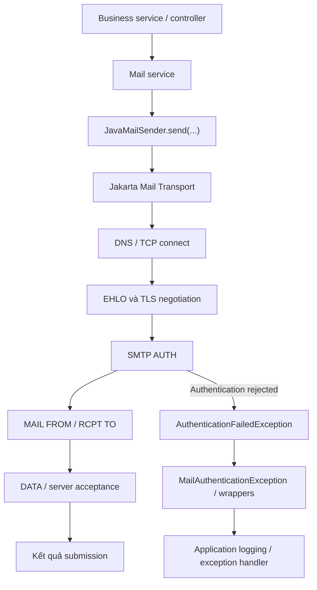
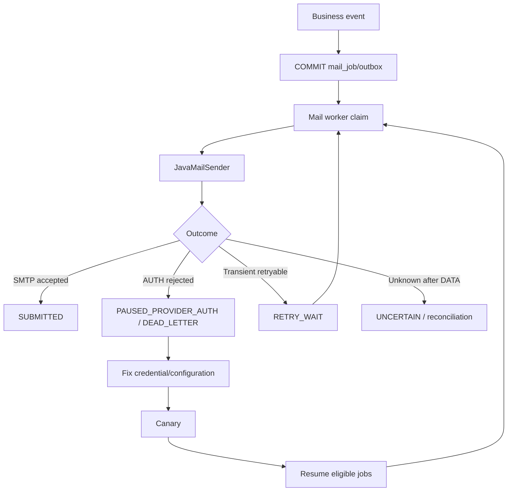
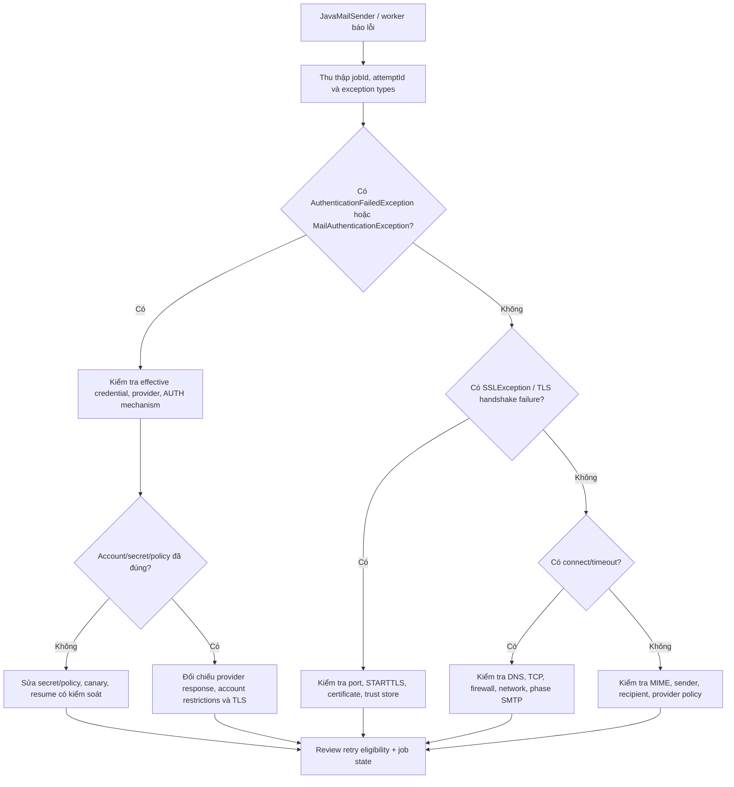

# Dùng password sai nhưng chỉ nhìn exception ngoài cùng trong Spring Framework Mail

Một lỗi SMTP rất phổ biến trong ứng dụng Spring Boot là **mật khẩu tài khoản gửi thư sai hoặc không còn hợp lệ**, nhưng người phát triển chỉ đọc dòng exception ngoài cùng: “Failed to send mail”, “Error occurred in message handler”, hoặc một lỗi chung của tác vụ bất đồng bộ. Họ bắt đầu sửa template HTML, thay port, thêm retry, thậm chí đổi provider mà chưa biết **SMTP server đã từ chối bước xác thực**.

Trong Spring Framework Mail, `JavaMailSender` gọi Jakarta Mail để kết nối và gửi qua SMTP. Khi một thao tác thất bại, exception có thể đi qua nhiều lớp: Spring Mail, Jakarta Mail, Spring Integration, Spring Scheduling/`@Async`, executor, service hoặc HTTP controller. **Dòng log ở trên cùng mô tả nơi lỗi được nhận; nguyên nhân cụ thể có thể nằm trong chuỗi `cause`, `nextException` hoặc chi tiết của một `MailSendException`.**

Ví dụ minh họa, không phải phản hồi của một nhà cung cấp cụ thể:

```text
org.springframework.messaging.MessageHandlingException:
  error occurred in message handler
  Caused by: org.springframework.mail.MailAuthenticationException:
    Authentication failed
    Caused by: jakarta.mail.AuthenticationFailedException:
      535 5.7.8 Authentication credentials invalid
```

Nếu chỉ nhìn `MessageHandlingException`, ta có thể nghĩ flow lỗi. Nếu chỉ nhìn `MailAuthenticationException`, ta biết bước xác thực thất bại nhưng vẫn phải hỏi **vì sao**: password sai, secret chưa được nạp, mật khẩu đã xoay vòng, tài khoản bị khóa, phương thức AUTH không được phép, provider yêu cầu OAuth2/app password hoặc cấu hình TLS sai. Mã `535 5.7.8` giúp khoanh vùng lỗi xác thực, **không phải bằng chứng duy nhất rằng một chuỗi mật khẩu đã gõ sai**.

> **Nguyên tắc:** truy vết tới exception có ý nghĩa nhất, phân loại theo giai đoạn SMTP và cấu hình đang thực sự chạy, sau đó sửa nguyên nhân. Không bật debug in mật khẩu, không retry vô hạn lỗi authentication và không đưa nguyên văn chuỗi exception nhạy cảm về cho người dùng cuối.

Bài học này tập trung vào sai lầm “dùng password sai nhưng chỉ nhìn exception ngoài cùng” trong chương **Lỗi thường gặp** của **Spring Framework Mail**. Nội dung gồm cơ chế bọc exception, cách kiểm tra cause và Jakarta Mail next exception, cấu hình Spring Boot, bảng chẩn đoán SMTP AUTH, cách bảo vệ secret, ví dụ Java, kiểm thử, sự cố production và các tình huống dễ nhầm.

## 1. Vị trí lỗi trong đường gửi SMTP

Một lời gọi gửi email có thể trải qua nhiều giai đoạn:



Một lỗi ở giai đoạn **AUTH** thường xảy ra **trước khi mail content được submit**. Điều này khác với timeout sau `DATA`, khi kết quả có thể không chắc chắn.

| Giai đoạn | Dấu hiệu thường gặp | Có phải password sai? |
|---|---|---|
| DNS | Không resolve được SMTP host | Không |
| TCP connect | Connection refused/timeout | Không trực tiếp |
| TLS/STARTTLS | SSLHandshakeException, certificate error | Không trực tiếp |
| SMTP EHLO | Server capabilities không đúng kỳ vọng | Không chắc |
| SMTP AUTH | 535/5.7.8, AuthenticationFailedException | **Có thể** |
| MAIL FROM | Sender identity/domain bị từ chối | Không nhất thiết |
| RCPT TO | Recipient bị từ chối | Không |
| DATA/acceptance | Content/policy/size, socket timeout | Không nhất thiết |
| Sau submission | Bounce/deferred/delivered events | Không phải lỗi password gửi ban đầu |

Không áp cùng một giải pháp cho mọi lỗi “không gửi được mail”. Nếu TLS handshake chưa hoàn tất, đổi password không giải quyết vấn đề. Nếu server từ chối `RCPT TO`, sửa SMTP password thường vô ích.

## 2. Ba lớp exception thường gặp

### 2.1. Spring Mail exception

Spring Framework có hierarchy của `org.springframework.mail.MailException`. Một số lớp quan trọng:

- `MailAuthenticationException`: lỗi authentication khi gửi mail.
- `MailSendException`: lỗi trong quá trình submit, có thể chứa chi tiết theo message đối với một số kiểu batch.
- `MailParseException`: lỗi khi phân tích/chuẩn bị mail ở tầng Spring.
- `MailPreparationException`: lỗi chuẩn bị message do callback/preparator.

Tùy overload của `JavaMailSender` và vị trí lỗi, exception ngoài cùng có thể khác nhau. Đừng khẳng định mọi password sai luôn trả `MailAuthenticationException` ở root của stack trace bất kể có wrapper nào.

### 2.2. Jakarta Mail exception

Tầng Jakarta Mail thường dùng:

- `jakarta.mail.AuthenticationFailedException`: server từ chối authentication hoặc API phát hiện lỗi liên quan xác thực.
- `jakarta.mail.MessagingException`: nhóm lỗi giao thức/message.
- `jakarta.mail.SendFailedException`: gửi mail thất bại; một số thông tin recipient có thể có ở tầng này.

Một implementation SMTP cụ thể có thể cung cấp exception với response code/enhanced status code, nhưng những lớp implementation đó không phải abstraction chuẩn luôn có ở mọi provider/version.

### 2.3. Wrapper từ các tầng khác

Với ứng dụng production, lỗi có thể được bọc thêm:

```text
Servlet exception / HTTP controller exception
  -> BusinessServiceException
      -> MailAuthenticationException
          -> AuthenticationFailedException
```

Hoặc:

```text
CompletionException / ExecutionException
  -> MailTaskException
      -> MailAuthenticationException
          -> AuthenticationFailedException
```

Hoặc khi dùng Spring Integration:

```text
MessagingException / MessageHandlingException
  -> MailAuthenticationException
      -> AuthenticationFailedException
```

Tầng ngoài cùng cho biết **lỗi đã nổi lên ở đâu**, không nhất thiết cho biết **tại sao SMTP từ chối**.

## 3. Ví dụ sai lầm: chỉ log exception ngoài cùng

Một cách triển khai dễ gây nhầm:

```java
try {
    javaMailSender.send(message);
} catch (Exception ex) {
    log.error("Cannot send email: {}", ex.getMessage());
}
```

Các vấn đề:

1. Chỉ in `getMessage()` của outer exception có thể bỏ mất cause.
2. `catch (Exception)` đánh đồng lỗi template, TLS, xác thực, recipient và network.
3. Nếu method trả về bình thường sau khi log, caller có thể **hiểu nhầm là gửi thành công**.
4. Raw exception message có thể chứa SMTP server response, email address hoặc metadata nhạy cảm.
5. Không có attempt ID/job ID để đối soát và retry có kiểm soát.

Một biến thể:

```java
catch (MailException ex) {
    log.warn("Mail failure: {}", ex.getClass().getSimpleName());
    throw new RuntimeException("Send failed");
}
```

Ở đây exception mới **không giữ nguyên cause**; nguyên nhân gốc có thể mất hẳn. Nếu phải bọc exception, giữ nó làm cause:

```java
catch (MailException ex) {
    throw new MailSubmissionFailure(
            "Mail submission failed; see internal failure class", ex);
}
```

`MailSubmissionFailure` là exception nội bộ do ứng dụng định nghĩa. Giữ cause để điều tra **không có nghĩa được phép log hoặc trả nguyên văn mọi chi tiết ra bên ngoài**.

## 4. Đọc đúng stack trace bằng mắt

Ví dụ log giả lập:

```text
2026-11-12 14:05:11 ERROR MailWorker
MailJob=7a9149d1 failed

java.util.concurrent.CompletionException:
    com.example.mail.MailSubmissionFailure: submission failed
    at ...
Caused by: com.example.mail.MailSubmissionFailure:
    submission failed
    at ...
Caused by: org.springframework.mail.MailAuthenticationException:
    Authentication failed
    at ...
Caused by: jakarta.mail.AuthenticationFailedException:
    535 5.7.8 Authentication credentials invalid
    at ...
```

Nên đọc theo thứ tự:

1. **Outer wrapper:** `CompletionException` — lỗi được quan sát qua future/async.
2. **Application boundary:** `MailSubmissionFailure` — quy tắc ứng dụng bọc lỗi.
3. **Spring mail category:** `MailAuthenticationException` — authentication failed.
4. **SMTP/Jakarta cause:** `AuthenticationFailedException` với mã 535/5.7.8 — server từ chối AUTH.

Đến đây mới kiểm tra **effective SMTP configuration**, account status và chính sách AUTH. Không bắt đầu bằng việc đổi Subject, HTML template hoặc attachment.

### 4.1. “Root cause” không phải lúc nào là mảnh thông tin duy nhất cần xem

Một exception ở sâu nhất có thể chỉ là `SocketException`, trong khi `MailAuthenticationException` ở giữa cho biết AUTH đang diễn ra. Ngược lại, một exception provider-specific có response code hữu ích nằm trong `MessagingException.getNextException()` chứ không nằm trên chuỗi `getCause()`.

Vì vậy, thực tế nên ghi **chuỗi các loại exception quan trọng** (đã lọc/an toàn) thay vì chỉ giữ duy nhất một class name sâu nhất.

## 5. MessagingException có nextException riêng

Jakarta Mail `MessagingException` có phương thức `getNextException()`. Đây là điểm dễ bị bỏ qua nếu chỉ duyệt `Throwable.getCause()`.

```java
MessagingException messagingException = ...;
Exception extra = messagingException.getNextException();
```

Trong các implementation, `nextException` có thể trùng hoặc liên quan đến cause, nhưng không nên giả định mọi nested detail đều được tìm thấy chỉ bằng một vòng:

```java
Throwable current = ex;
while (current.getCause() != null) {
    current = current.getCause();
}
```

Vòng trên chỉ đi **một đường**. Nếu một `MailSendException` giữ nhiều exceptions theo từng message, nó cũng có thể bỏ sót các nhánh còn lại.

Mô hình đầy đủ hơn:

```text
Spring MailException
   |
   +-- getCause()
   |      |
   |      +-- Jakarta MessagingException
   |              |
   |              +-- getCause()
   |              +-- getNextException()
   |
   +-- MailSendException.getFailedMessages()
           |
           +-- exception for message A
           +-- exception for message B
```

**Không đưa nguyên object `MimeMessage`, recipient list hoặc raw SMTP reply vào log** khi duyệt các nhánh này. Mục tiêu là phân loại lỗi, không phải dump dữ liệu.

## 6. Nhận diện sai password so với những vấn đề AUTH khác

Khi thấy `MailAuthenticationException` hoặc `AuthenticationFailedException`, bước tiếp theo không chỉ là “đổi mật khẩu”. Một số khả năng:

| Khả năng | Câu hỏi chẩn đoán | Hướng xử lý |
|---|---|---|
| Password thật sự sai | Secret có khớp tài khoản SMTP đang dùng? | Cập nhật secret đúng nguồn |
| Secret đã xoay vòng | Deployment có nạp version mới chưa? | Đồng bộ rotation/restart khi cần |
| Username sai | Đang gửi bằng mailbox/account nào? | Kiểm tra full username và sender identity |
| App password/OAuth2 bắt buộc | Provider cho phép password AUTH thường không? | Dùng cơ chế auth được hỗ trợ |
| SMTP AUTH bị vô hiệu | Tài khoản/tenant/organization có bật submission không? | Điều chỉnh chính sách hợp lệ |
| Tài khoản bị khóa/tạm hạn chế | Có cảnh báo từ provider hoặc chính sách bảo mật? | Xác minh account health |
| Sai protocol/port/TLS | Đã negotiation đúng trước AUTH chưa? | Sửa port, STARTTLS/SSL |
| AUTH mechanism không phù hợp | Server quảng bá mechanism gì, client chọn gì? | Cấu hình mechanism hỗ trợ |
| Secret biến môi trường rỗng/nhầm | Effective config lấy từ profile/secret path nào? | Kiểm tra nguồn config, không in value |
| Provider/account sai môi trường | Stage đang trỏ SMTP production hoặc ngược lại? | Sửa host/credential mapping |
| Relay yêu cầu OAuth scope | Token có quyền gửi SMTP hợp lệ không? | Điều chỉnh token/scope theo provider |
| Chính sách rate/abuse | Provider đang tạm khóa AUTH vì login failures? | Dừng thử liên tục, xử lý incident |

Một server có thể trả thông báo không rõ để tránh lộ lý do chính xác. **Không suy diễn mạnh từ một mã 535** rằng password typed string chắc chắn là nguyên nhân duy nhất; cần xác minh account và configuration phù hợp.

## 7. Cấu hình SMTP trong Spring Boot: biết mình đang dùng gì

Trước khi tìm lỗi phức tạp, cần xác định **ứng dụng thực sự đang kết nối tới máy chủ nào, bằng account nào và qua cơ chế nào**. File cấu hình trong repository có thể khác với effective configuration do profile, environment variables, secret manager, Kubernetes Secret, ConfigMap hoặc runtime override.

Ví dụ Spring Boot gửi email qua SMTP submission dùng STARTTLS:

```yaml
spring:
  mail:
    host: ${SMTP_HOST}
    port: 587
    username: ${SMTP_USERNAME}
    password: ${SMTP_PASSWORD}
    default-encoding: UTF-8
    properties:
      "[mail.smtp.auth]": true
      "[mail.smtp.starttls.enable]": true
      "[mail.smtp.starttls.required]": true
      "[mail.smtp.connectiontimeout]": 5000
      "[mail.smtp.timeout]": 10000
      "[mail.smtp.writetimeout]": 10000
      "[mail.debug]": false
      "[mail.debug.auth]": false
```

**Các biến môi trường là ví dụ; không copy password thật vào tài liệu hoặc source control.** Port 587/STARTTLS chỉ đúng nếu SMTP server hỗ trợ cấu hình này. Với implicit TLS/port 465, các thuộc tính khác sẽ phù hợp; không dùng hai chế độ một cách tùy tiện.

### 7.1. Các thuộc tính dễ bị hiểu nhầm

| Thuộc tính | Ý nghĩa | Lỗi thường gặp |
|---|---|---|
| `spring.mail.host` | SMTP server hostname | Nhầm môi trường/provider |
| `spring.mail.port` | SMTP submission port | Port không hỗ trợ AUTH/TLS mong đợi |
| `spring.mail.username` | SMTP account principal | Dùng địa chỉ From thay vì login ID |
| `spring.mail.password` | Credential tương ứng | Password cũ, secret rỗng, wrong secret version |
| `mail.smtp.auth` | Bật SMTP AUTH | Quên bật hoặc server không hỗ trợ |
| `mail.smtp.starttls.enable` | Cho phép upgrade STARTTLS | Client không negotiate TLS khi cần |
| `mail.smtp.starttls.required` | Bắt buộc STARTTLS | Cần khớp server capability |
| `mail.smtp.ssl.enable` | Sử dụng SSL/TLS ngay khi kết nối | Không áp bừa lên port STARTTLS |
| `mail.smtp.connectiontimeout` | Timeout tạo kết nối | Không thay thế auth validation |
| `mail.smtp.timeout` | Timeout đọc network | Timeout không chứng minh mật khẩu sai |
| `mail.smtp.writetimeout` | Timeout ghi network | Có thể gây outcome uncertain ở giai đoạn submit |

Một số provider dùng port 465 với implicit TLS. Ví dụ cấu hình tương ứng:

```yaml
spring:
  mail:
    port: 465
    properties:
      "[mail.smtp.auth]": true
      "[mail.smtp.ssl.enable]": true
      "[mail.smtp.starttls.enable]": false
      "[mail.smtp.connectiontimeout]": 5000
      "[mail.smtp.timeout]": 10000
      "[mail.smtp.writetimeout]": 10000
```

Đây là **cấu hình minh họa**, không phải hai phương án có thể hoán đổi cho mọi provider. Đối chiếu tài liệu của SMTP endpoint được phép dùng.

### 7.2. Password SMTP không nhất thiết là password đăng nhập web

Tùy provider/chính sách:

- SMTP password có thể là secret chuyên dụng khác password tài khoản web.
- Một account bật xác thực đa yếu tố có thể yêu cầu app password hoặc OAuth2.
- Organization có thể vô hiệu hóa basic SMTP AUTH.
- Credential có thể là API key được provider hỗ trợ ở SMTP AUTH theo một định dạng cụ thể.
- OAuth2 access token có TTL/scope và chu trình refresh, không phải password cố định.

Không suy diễn “đăng nhập web được thì password SMTP chắc chắn đúng”. Xác thực web và SMTP submission có thể áp chính sách khác nhau.

### 7.3. From khác SMTP username

`MimeMessageHelper.setFrom(...)` thiết lập địa chỉ người gửi trong email; `spring.mail.username` là identity dùng khi SMTP AUTH. Chúng có thể khác nhau theo chính sách provider.

Ví dụ:

```text
SMTP AUTH username: service-account@example.org
From:              notifications@example.org
```

Cấu hình này chỉ hợp lệ khi provider cho phép account đó gửi thay địa chỉ From. Đừng sửa username thành From để thử giải quyết lỗi, vì có thể khiến authentication hoặc sender verification sai.

## 8. Kiểm tra effective config mà không lộ password

Trong một đợt xử lý sự cố, điều cần biết là cấu hình đã được nạp đúng nguồn hay chưa, **không phải in giá trị bí mật ra log**.

Ví dụ class ghi metadata an toàn tại startup:

```java
package com.example.mail.diagnostics;

import org.springframework.boot.autoconfigure.mail.MailProperties;
import org.springframework.stereotype.Component;

@Component
public final class MailConfigurationSnapshot {

    private final MailProperties properties;

    public MailConfigurationSnapshot(MailProperties properties) {
        this.properties = properties;
    }

    public SafeMailConfig view() {
        String username = properties.getUsername();
        String password = properties.getPassword();

        return new SafeMailConfig(
                properties.getHost(),
                properties.getPort(),
                username != null && !username.isBlank(),
                password != null && !password.isBlank());
    }

    public record SafeMailConfig(
            String host,
            Integer port,
            boolean usernameConfigured,
            boolean passwordConfigured) {
    }
}
```

**Chỉ ghi trạng thái có/không**, không ghi `properties.getPassword()`, giá trị hash của password, độ dài password, biến môi trường đầy đủ hoặc raw Spring Environment. Ngay cả username có thể là PII; ở ví dụ chỉ ghi cờ.

`MailProperties` là bean auto-configured trong những cấu hình Spring Boot sử dụng MailAutoConfiguration. Nếu ứng dụng tự khai báo `JavaMailSender` và không dùng cấu hình Spring Boot, lớp snapshot phải đọc từ **nguồn cấu hình thực tế của bean đang gửi**, không áp giả định rằng MailProperties chắc chắn phản ánh sender.

### 8.1. Những lỗi cấu hình phổ biến

**Nhầm active profile:**

```text
application.yml          -> SMTP_HOST primary
application-staging.yml  -> SMTP_HOST sandbox
runtime SPRING_PROFILES_ACTIVE=production
```

Đọc một file YAML trong repository không chứng minh effective host là giá trị đó. Kiểm tra active profiles và cấu hình cuối cùng qua công cụ quản trị có quyền thích hợp.

**Secret không được inject:**

```text
SMTP_PASSWORD env var missing
    -> placeholder resolution failure
hoặc
    -> password=null/empty theo cách cấu hình
    -> authentication cannot succeed
```

Không nói mọi placeholder thiếu đều dẫn đến `AuthenticationFailedException`: Spring có thể fail startup ngay khi binding property không thành công. Điểm cốt lõi là phải biết lỗi xảy ra **trước khi gọi SMTP hay trong AUTH**.

**Secret có ký tự đặc biệt:** dấu `#`, `:`, `!`, khoảng trắng, newline, ký tự Unicode có thể bị ảnh hưởng nếu được viết trực tiếp trong YAML/`.properties`/shell với quoting không đúng. Secret manager/environment injection thường giảm nguy cơ parse sai nhưng vẫn cần bảo đảm giá trị được truyền chính xác mà không in raw bytes.

**Rotation chưa đồng bộ:** Secret đã được xoay ở provider nhưng deployment vẫn dùng giá trị cũ; hoặc chỉ một trong nhiều pod đã refresh.

**Credential của một provider bị dùng với host khác:** rất dễ xảy ra khi có hai `JavaMailSender` beans và cấu hình alias không rõ.

### 8.2. Cẩn trọng khi in metadata cấu hình

Ngay cả `host` và `port` cũng có thể là thông tin hạ tầng nội bộ. Chỉ đưa vào log có quyền theo chính sách; với audit phổ thông có thể ghi một `smtpProviderAlias` do ứng dụng định nghĩa.

Không bật một actuator endpoint phơi bày `/env` hoặc `/configprops` ra Internet để “dễ xem mail password”. Spring Boot có cơ chế masking nhưng không nên xem nó là lý do mở endpoint nhạy cảm công khai.

## 9. Cách đọc nguyên nhân trong nhiều tầng exception

Đối với lỗi từ `JavaMailSender`, cần tách hai nhiệm vụ:

1. **Phân loại máy đọc được**: auth, TLS, network, recipient, template, unknown.
2. **Điều tra kỹ thuật**: xem causal chain/protocol response ở hệ thống log hạn chế quyền, đã loại bỏ dữ liệu nhạy cảm.

Một nguyên tắc thiết kế:

```text
Business workflow:
    catches MailException
    -> structured failure class
    -> persists attempt outcome
    -> decides retry/dead-letter

Restricted diagnostics:
    inspects nested exception types
    -> correlates provider response category
    -> never publishes SMTP credentials
```

Không trả `ex.toString()`, `ex.getMessage()` hoặc stack trace thô trong JSON response cho người dùng.

### 9.1. Log exception đầy đủ có phải cách nhanh nhất?

Trong môi trường local/test cô lập với dữ liệu giả, log toàn bộ stack trace có thể giúp phát hiện hierarchy. Nhưng trong production, stack traces và Jakarta Mail debug có thể chứa:

- SMTP account name hoặc recipient.
- Provider response có email address.
- Header và metadata nội bộ.
- Đường dẫn file/secret reference.
- Thông tin từ authentication/debug output nếu cấu hình không an toàn.

**Không dựa vào giả định “stack trace không bao giờ chứa password”**. Dùng mã lỗi đã chuẩn hóa cho log thông thường; nếu cần dữ liệu chi tiết, dùng hệ thống restricted diagnostics có redaction, retention và audit.

### 9.2. Không catch xong âm thầm trả thành công

Sai:

```java
public void send(MimeMessage mime) {
    try {
        sender.send(mime);
    } catch (MailException ex) {
        log.error("Send failed");
        // Caller sẽ nghĩ method thành công.
    }
}
```

Đúng hơn:

```java
public void submit(MimeMessage mime, UUID mailJobId) {
    try {
        sender.send(mime);
        attempts.recordSubmitted(mailJobId);
    } catch (MailException ex) {
        var details = failureAnalyzer.analyze(ex);
        attempts.recordFailed(mailJobId, details.code());
        throw new MailSubmissionFailure(
                "SMTP submission failed", ex);
    }
}
```

`attempts`, `failureAnalyzer` và `MailSubmissionFailure` là thành phần ứng dụng. Đoạn này cho thấy cách **không mất lỗi**, nhưng trong production việc record attempt và update job phải có ownership/fencing, transaction và xử lý `UNKNOWN_SUBMISSION`. Không mặc định mọi exception có nghĩa “chắc chắn chưa gửi”.

### 9.3. Không trộn diagnostic classification và retry

Việc biết lỗi auth là cần thiết, nhưng quyết định retry là một bước khác. Một `SMTP_AUTH_FAILED` do secret sai thường cần sửa config, không phải dùng vòng lặp retry ngay sau mỗi 100 ms. Tương tự, một lỗi network trước khi kết nối có thể retry theo backoff; một timeout sau `DATA` lại cần xem submission ambiguity.

## 10. Ví dụ Java: duyệt chuỗi lỗi đúng cách

Với một application mail worker, có thể viết utility phân tích **loại exception** mà không in raw message. Mẫu dưới đây đi qua:

- `Throwable.getCause()`.
- `MessagingException.getNextException()` của Jakarta Mail.
- Các exception nằm trong `MailSendException.getFailedMessages()`.
- `Throwable.getSuppressed()` khi cần.
- Dùng identity-based visited set để tránh duyệt trùng hoặc vòng tham chiếu.
- Giới hạn số node để không tốn tài nguyên vô hạn.

### 10.1. Bộ phân tích loại exception

```java
package com.example.mail.diagnostics;

import jakarta.mail.AuthenticationFailedException;
import jakarta.mail.MessagingException;
import java.util.ArrayDeque;
import java.util.ArrayList;
import java.util.Collections;
import java.util.Deque;
import java.util.IdentityHashMap;
import java.util.List;
import java.util.Set;
import javax.net.ssl.SSLException;
import org.springframework.mail.MailAuthenticationException;
import org.springframework.mail.MailException;
import org.springframework.mail.MailSendException;

public final class MailFailureAnalyzer {

    private static final int MAX_NODES = 64;

    public Analysis analyze(Throwable throwable) {
        if (throwable == null) {
            return new Analysis(
                    "MAIL_ERROR_UNKNOWN", List.of());
        }

        Set<Throwable> visited = Collections.newSetFromMap(
                new IdentityHashMap<>());
        Deque<Throwable> pending = new ArrayDeque<>();
        List<String> types = new ArrayList<>();

        pending.push(throwable);
        boolean authentication = false;
        boolean tls = false;

        while (!pending.isEmpty()
                && visited.size() < MAX_NODES) {

            Throwable current = pending.pop();
            if (!visited.add(current)) {
                continue;
            }

            types.add(current.getClass().getSimpleName());

            if (current instanceof MailAuthenticationException
                    || current instanceof AuthenticationFailedException) {
                authentication = true;
            }

            if (current instanceof SSLException) {
                tls = true;
            }

            Throwable cause = current.getCause();
            if (cause != null && !visited.contains(cause)) {
                pending.push(cause);
            }

            if (current instanceof MessagingException messaging) {
                Exception next = messaging.getNextException();
                if (next != null && !visited.contains(next)) {
                    pending.push(next);
                }
            }

            if (current instanceof MailSendException sendFailure) {
                // Chỉ xét exception values.
                // KHÔNG log/serialize map keys (thường là Message).
                for (Exception failure :
                        sendFailure.getFailedMessages().values()) {
                    if (failure != null
                            && !visited.contains(failure)) {
                        pending.push(failure);
                    }
                }
            }

            for (Throwable suppressed :
                    current.getSuppressed()) {
                if (!visited.contains(suppressed)) {
                    pending.push(suppressed);
                }
            }
        }

        String code;
        if (authentication) {
            code = "SMTP_AUTH_FAILURE";
        } else if (tls) {
            code = "SMTP_TLS_FAILURE";
        } else {
            code = "MAIL_ERROR_UNCLASSIFIED";
        }

        return new Analysis(code, List.copyOf(types));
    }

    public record Analysis(
            String code,
            List<String> exceptionTypes) {
    }
}
```

Đây là **bộ phân loại bước đầu**, không phải engine quyết định mọi lỗi provider. Đặc biệt:

- Nó ưu tiên AUTH nếu phát hiện exception xác thực ở bất kỳ nhánh nào.
- Với `MailSendException` nhiều messages, một nhánh có lỗi authentication không chứng minh **mọi message trong batch** đều lỗi authentication. Muốn có outcome per-message, phải phân loại **riêng từng failed-message exception**, không dùng duy nhất tổng hợp ở cấp batch.
- Một `AuthenticationFailedException` có thể liên quan account bị khóa/chính sách, không bắt buộc password sai.
- Nó không đọc raw exception message nên **không xác định** response code 535 hay 454; nếu cần phân biệt sâu hơn, tích hợp classifier dựa trên provider/SMTP response có validation/redaction.
- Nó không sửa/trả lại nguyên exception; hệ thống vẫn cần lưu attempt state/retry policy.

### 10.2. Sử dụng trong mail worker

```java
@Service
public class SmtpSubmissionService {

    private static final Logger log =
            LoggerFactory.getLogger(SmtpSubmissionService.class);

    private final JavaMailSender sender;
    private final MailFailureAnalyzer analyzer;
    private final MailAttemptRepository attempts;

    public SmtpSubmissionService(
            JavaMailSender sender,
            MailFailureAnalyzer analyzer,
            MailAttemptRepository attempts) {
        this.sender = sender;
        this.analyzer = analyzer;
        this.attempts = attempts;
    }

    public void submit(
            UUID mailJobId,
            UUID attemptId,
            MimeMessage mime) {

        try {
            sender.send(mime);
            attempts.recordAccepted(attemptId);

        } catch (MailException failure) {
            var analysis = analyzer.analyze(failure);

            log.warn(
                    "mailAttemptFailed jobId={} attemptId={} "
                    + "failureCode={} exceptionTypes={}",
                    mailJobId,
                    attemptId,
                    analysis.code(),
                    analysis.exceptionTypes());

            attempts.recordFailure(
                    attemptId,
                    analysis.code());

            throw new MailSubmissionFailure(
                    "Mail submission failed", failure);
        }
    }
}
```

`MailAttemptRepository` và `MailSubmissionFailure` do ứng dụng định nghĩa; phần import Spring/SLF4J/Jakarta Mail cần bổ sung theo package thực tế. **Mẫu chỉ thể hiện hướng phân tích exception**, chưa giải quyết atomicity giữa SMTP và DB, chưa cung cấp state `UNKNOWN_SUBMISSION`. Trong production, phải xác định attempt outcome một cách bảo thủ và ghi nó qua transaction có ownership.

**Không thêm `failure` làm đối số cuối của `log.warn` nếu policy production của bạn không cho phép ghi stack trace thô.** Nếu có restricted diagnostic logging đã lọc dữ liệu, vẫn phải kiểm soát access và retention.

### 10.3. Nhánh MessagingException.nextException trong thực tế

Một số exception Jakarta Mail có thể nối các exception khác bằng `setNextException(...)`. Do đó, cả hai phương thức đều đáng xem:

```java
Throwable cause = exception.getCause();

if (exception instanceof MessagingException mailError) {
    Exception next = mailError.getNextException();
    // Phân loại next và cause riêng, không ghi raw object.
}
```

Nếu `cause` và `next` tham chiếu cùng một object, visited set tránh lặp. Không giả định `nextException` luôn khác `cause` hoặc luôn là nút cuối cùng.

### 10.4. Tại sao không parse chuỗi "Invalid password" là nguồn sự thật?

Chuỗi lỗi SMTP do provider/version quyết định, có thể thay đổi ngôn ngữ hoặc wording, đôi khi không tiết lộ nguyên nhân vì bảo mật. Một classifier:

```java
if (ex.getMessage().contains("password")) {
    return "BAD_PASSWORD";
}
```

có thể sai khi message null, thay đổi text hoặc chứa một cụm từ khác. Nên ưu tiên:

1. Exception type ổn định trong tầng library.
2. SMTP response/enhanced status code có validation.
3. Provider API/error code chính thức nếu dùng provider API.
4. Context của giai đoạn gửi.
5. Chỉ khi cần, text pattern dưới dạng *gợi ý điều tra*, không phải căn cứ duy nhất để retry.

## 11. Khi gửi batch: exception ngoài cùng còn dễ gây hiểu nhầm hơn

`JavaMailSender` hỗ trợ gửi nhiều messages:

```java
sender.send(new MimeMessage[] {
        first,
        second,
        third
});
```

Một `MailSendException` có thể chứa các message không gửi được và exception tương ứng qua `getFailedMessages()`. Nếu chỉ nhìn:

```text
MailSendException: Failed messages: 2
```

thì chưa biết lỗi của từng message. Lỗi một recipient không nhất thiết là lỗi toàn account; lỗi AUTH trước lúc bắt đầu có thể ảnh hưởng mọi message trong lần submit.

### 11.1. Đọc value của failed-messages map

```java
catch (MailSendException ex) {
    int failedItems = ex.getFailedMessages().size();

    for (Exception itemFailure :
            ex.getFailedMessages().values()) {
        MailFailureAnalyzer.Analysis result =
                analyzer.analyze(itemFailure);

        metrics.recordFailure(result.code());
    }

    log.warn(
            "mailBatchFailed failedItems={} batchId={}",
            failedItems,
            batchId);
}
```

**Lưu ý:** các map keys có thể là message objects chứa recipient/body. Không gọi `log.error("{}", ex.getFailedMessages())` và không dump toàn bộ exception vào centralized logs. `metrics` chỉ nên nhận low-cardinality failure codes, không nhận message ID/recipient tags.

### 11.2. Không suy luận phần còn lại chắc chắn đã gửi

Mức độ chi tiết về successful/failed outcomes phụ thuộc nơi lỗi xảy ra và implementation. Khi connection mất giữa batch, có thể không đủ bằng chứng xác nhận từng item. Đừng tự đánh dấu mọi message **không có trong failed map** là delivered; chúng có thể chỉ là không có thông tin hoặc đã được SMTP chấp nhận nhưng chưa được giao tới inbox.

Một job store nên lưu mỗi message thành một logical job/attempt:

```text
batch B100
  mailJob J1 / attempt A1 -> SUBMITTED
  mailJob J2 / attempt A2 -> DEFINITELY_NOT_SUBMITTED
  mailJob J3 / attempt A3 -> UNKNOWN_SUBMISSION
```

Chỉ những job có bằng chứng chắc chắn mới được retry trực tiếp. Những trường hợp không rõ cần reconciliation.

## 12. Một tình huống Spring Integration Mail

Nếu outbound email được gửi qua Spring Integration:

```text
HTTP/business event
   -> MessageChannel
   -> IntegrationFlow
   -> Mail outbound handler
   -> JavaMailSender
   -> SMTP provider
```

Khi authentication failed, exception có thể đi qua:

```text
MessageHandlingException
  -> MailAuthenticationException
      -> AuthenticationFailedException
```

Người nhìn dòng `MessageHandlingException` rồi sửa router hoặc filter có thể đi sai hướng. Hãy phân tích `getCause()` hoặc internal error channel payload **trong môi trường log an toàn**, xác định mail handler thất bại ở AUTH rồi kiểm tra credentials.

### 12.1. Error channel không tự biết vì sao password sai

Spring Integration error channel có thể nhận `ErrorMessage` chứa exception, failed message và headers. Nó không tự sửa secret hoặc phân loại chính xác mọi SMTP response.

Một error handler production nên:

- Lấy `mailJobId`/`attemptId` từ metadata nội bộ đã được kiểm soát.
- Duyệt nested exception để xác định `SMTP_AUTH_FAILURE`.
- Cập nhật trạng thái job/attempt và alert đúng provider.
- Không in raw `ErrorMessage`/payload nếu chứa `MimeMessage`.
- Không retry ngay trong flow khi AUTH đang hỏng toàn account.

### 12.2. Channel acceptance không phải SMTP success

Một `ExecutorChannel` có thể nhận message thành công, nhưng outbound handler chạy sau mới gặp `MailAuthenticationException`. Nếu ứng dụng đánh dấu mail job `SUBMITTED` ngay khi `channel.send(...)` trả true, đó là sai về semantics.

```text
channel accepted -> ENQUEUED
SMTP AUTH failed -> FAILED_AUTH / DEAD_LETTER / PAUSED
SMTP submission accepted -> SUBMITTED
provider delivery event -> DELIVERED/BOUNCED/etc.
```

Không trộn các mốc này chỉ vì exception ngoài cùng là message-handling error.

## 13. Lỗi sai password trong @Async và CompletableFuture

Với `@Async` hoặc `CompletableFuture`, caller có thể chỉ thấy:

```text
java.util.concurrent.CompletionException:
    java.lang.IllegalStateException: mail task failed
```

Nhưng nguyên nhân thực:

```text
CompletionException
   -> IllegalStateException
      -> MailAuthenticationException
         -> AuthenticationFailedException
```

### 13.1. Async method trả void

Một phương thức `@Async void` không trả kết quả lỗi cho caller như lời gọi đồng bộ. Nếu SMTP AUTH bị từ chối, exception có thể đi tới `AsyncUncaughtExceptionHandler` tùy cấu hình. Chỉ nhìn HTTP response 200 không có nghĩa tác vụ đã gửi thành công.

Nên dùng **durable mail job**, attempt record và metrics nếu email quan trọng. Khi cần quản lý kết quả qua async API, có thể trả `CompletableFuture<MailSubmissionResult>` với chính sách xử lý failure rõ.

### 13.2. CompletableFuture.join() và get()

- `future.join()` thường bọc lỗi bằng `CompletionException`.
- `future.get()` thường bọc lỗi bằng `ExecutionException`.
- Cả hai đều có cause, và cause đó có thể chứa exception Spring Mail ở sâu hơn.

Đừng coi `CompletionException` là lỗi về thread pool rồi bỏ qua SMTP AUTH. Sử dụng utility duyệt causal chain.

### 13.3. Không biến lỗi thành null

Một anti-pattern:

```java
return CompletableFuture.supplyAsync(() -> {
    try {
        sender.send(mime);
        return "ok";
    } catch (MailException failure) {
        return null;
    }
});
```

Nếu caller không kiểm tra null, lỗi có thể bị mất. Thay bằng typed result có `outcome`/`failureCode` hoặc complete exceptionally, và duy trì durable job state khi cần reliability.

## 14. Chẩn đoán theo thứ tự: không thay password trước khi tìm đúng lớp lỗi

Một runbook tốt giúp giảm thời gian điều tra và tránh làm hỏng hệ thống đang vận hành. Thứ tự tham khảo:

### Bước 1 — Xác nhận yêu cầu gửi nào thất bại

Ghi nhận:

- `mailJobId`, `attemptId` và thời điểm.
- SMTP provider alias hoặc account scope (không cần raw username).
- Môi trường/instance/pod đang chạy.
- Failure class của attempt.
- Có phải một email hay lỗi lan rộng trên nhiều mail types.
- Có record `SUBMITTED` trước đó hay không.

Không cần log body, OTP, recipient, attachment bytes để xác nhận đây là lỗi AUTH.

### Bước 2 — Duyệt exception chain

Tìm các lớp:

```text
MailAuthenticationException
AuthenticationFailedException
MessagingException.nextException()
MailSendException.failedMessages
```

Nếu chỉ có `MailSendException` hoặc `MessagingException` tổng quát, đừng vội kết luận; phân tích lỗi từng attempt/message và protocol stage.

### Bước 3 — Xác định server đã đến giai đoạn AUTH chưa

Lỗi `UnknownHostException`, `ConnectException` hay `SSLHandshakeException` thường xảy ra trước bước xác thực SMTP. Nếu AUTH chưa bắt đầu, sửa password là sai hướng.

Nếu có mã `535` và một auth exception, tập trung vào account/credential/policy. Nếu `454` hoặc mã tạm thời, phải xem provider service status hoặc hệ thống authentication backend; không mặc định password sai.

### Bước 4 — Xác nhận active provider/account và cấu hình effective

Kiểm tra host, port, TLS mode, SMTP AUTH enabled, profile, sender bean được chọn, secret reference và version đang chạy.

**Chỉ so sánh fingerprint hoặc secret version trong secret manager đã có quyền**, không copy password vào ticket hay terminal output. Một người vận hành cần biết “pod X dùng credential version Y”, không cần nhìn giá trị thực.

### Bước 5 — Kiểm tra chính sách tài khoản

Xác minh qua admin console/provider API có quyền phù hợp:

- Account SMTP còn active?
- SMTP submission bị cấm ở tenant/organization?
- App password/OAuth2 bắt buộc?
- Có thay đổi password/secret gần đây?
- Có lockout do quá nhiều lần đăng nhập thất bại?
- Có IP/location/network policy?
- Sender identity đã được xác minh?

Đây là các câu hỏi **khác nhau**. Việc account dùng MFA không tự chứng minh SMTP không thể dùng; tùy provider có thể hỗ trợ OAuth2 hoặc phương thức credential riêng.

### Bước 6 — Test kết nối trong môi trường cô lập

Kiểm tra lần lượt:

1. DNS resolve.
2. TCP reachability.
3. STARTTLS/implicit TLS negotiation.
4. SMTP AUTH với credential hợp lệ qua môi trường/quy trình an toàn.
5. Submission tới sandbox recipient nếu được phép.

Không nhập mật khẩu vào lệnh terminal dùng command-line arguments có thể xuất hiện trong process lists/shell history. Không sử dụng email khách hàng thật làm test recipient.

### Bước 7 — Sửa nguyên nhân và xác nhận nhỏ

Sau khi sửa credential/config:

- Deploy/refresh secret theo chiến lược hỗ trợ.
- Test một account/test inbox đã được cho phép.
- Quan sát `SMTP_AUTH_FAILURE` và connection behavior.
- Không ngay lập tức retry hàng chục nghìn mail jobs.
- Nếu dùng queue, mở dần lưu lượng theo quota.

### Bước 8 — Xử lý các job đã lỗi

Nếu AUTH bị từ chối chắc chắn trước SMTP DATA, có thể cho phép retry các job hợp lệ theo policy. Nhưng nếu trong incident có cả timeout sau DATA, nhóm đó cần xử lý riêng để tránh duplicate.

Đối với OTP/reset password, kiểm tra expiry trước khi retry; không gửi token cũ đã hết hạn chỉ vì credentials nay đã đúng.

## 15. So sánh các triệu chứng thường bị gọi chung là “sai mật khẩu”

### 15.1. Wrong credentials

```text
MailAuthenticationException
  -> AuthenticationFailedException
     -> 535 5.7.8 ... (ví dụ)
```

Ứng dụng đã liên hệ server và server từ chối AUTH. Kiểm tra đúng account, secret version, cơ chế xác thực và policy.

### 15.2. SMTP AUTH không được bật trong client

Nếu `mail.smtp.auth=false` hoặc thiếu cấu hình trong khi relay yêu cầu xác thực, có thể thấy server từ chối thao tác như `MAIL FROM` với thông báo “authentication required”, ví dụ `530`. Lỗi ngoài cùng có thể là `MailSendException` thay vì `MailAuthenticationException`.

**Sửa:** bật SMTP AUTH theo contract server, không chỉ đổi password. Nếu provider yêu cầu TLS trước AUTH, cấu hình TLS tương ứng.

### 15.3. SMTP AUTH bị tắt ở server/account

Ngay cả khi `mail.smtp.auth=true` và password đúng, server có thể không cho account/tenant dùng SMTP AUTH. Thông báo có thể giống “authentication unsuccessful” hoặc “basic authentication disabled”.

**Sửa:** dùng phương thức được provider hỗ trợ (ví dụ OAuth2 nếu áp dụng) hoặc thay cách gửi; không giải quyết bằng cách retry vô hạn.

### 15.4. TLS handshake lỗi trước AUTH

```text
MailSendException / MessagingException
  -> SSLHandshakeException
     -> certificate path validation failed
```

Đây là lỗi xác thực **chứng chỉ TLS**, không phải lỗi password SMTP. Sửa trust store/certificate/hostname/port, không tắt TLS validation hoặc bật trust-all ở production.

### 15.5. Connection refused hoặc timeout

```text
MailSendException
  -> MessagingException
     -> ConnectException: Connection refused
```

Có thể do host sai, firewall, network policy, service outage hoặc port không lắng nghe. Password chưa được gửi tới server. Ưu tiên DNS/TCP/network tracing.

### 15.6. Sender address không được phép

AUTH có thể thành công nhưng provider từ chối sender:

```text
AUTH successful
MAIL FROM:<notifications@example.org>
  -> 5xx sender identity rejected
```

Lỗi liên quan **ủy quyền gửi từ địa chỉ/domain**, không phải chắc chắn password sai. Kiểm tra From/envelope sender và domain verification. Không thay `spring.mail.username` bừa bãi cho khớp From.

### 15.7. Recipient invalid hoặc policy reject

AUTH có thể thành công, nhưng `RCPT TO` bị từ chối. Nếu chỉ nhìn `MailSendException`, bạn có thể nghĩ SMTP account hỏng. Hãy xem giai đoạn và recipient outcome; không dùng provider khác để cố vượt một từ chối permanent.

### 15.8. Authentication hoạt động ở test nhưng production lỗi

Các nguyên nhân thường gặp:

- Test dùng sandbox account, production dùng credential khác.
- Pod chưa được restart/refresh sau rotation.
- Một phần instances dùng secret cũ.
- Config profile/overrides không giống nhau.
- Provider network/IP policy khác giữa môi trường.
- Auth mechanism/token scope khác.

Không chỉ so sánh file `application.yml`; cần so sánh **cấu hình effective theo provider alias và secret version**.

## 16. Một số SMTP reply codes và giới hạn diễn giải

SMTP có ba chữ số response code và có thể có **enhanced status code** như `5.7.8`. Các mã sau là ví dụ tham khảo:

| Mã / nhóm | Ý nghĩa thường gặp | Hành động |
|---|---|---|
| `235` | Authentication thành công | Chuyển sang giai đoạn gửi |
| `535` / `5.7.8` | Credentials/authentication bị từ chối | Kiểm tra account, secret, method, policy |
| `530` / `5.7.x` | Cần AUTH hoặc policy liên quan xác thực | Kiểm tra AUTH/TLS mode |
| `454` / `4.7.0` | Authentication hoặc security backend tạm lỗi | Backoff/điều tra provider |
| `421` | Service tạm unavailable | Kiểm tra health/backoff |
| `550` | Có thể là recipient/policy reject | Xem ngữ cảnh giai đoạn |
| `554` | Transaction bị từ chối theo policy khác nhau | Xem provider reply có kiểm soát |

Không giả định provider nào cũng dùng nguyên wording/cặp mã, và không suy luận toàn bộ nguyên nhân từ một chuỗi ba chữ số. Response code cần được phân tích **trong ngữ cảnh giao thức**, cùng exception type và provider contract.

### 16.1. “Authentication failed” có thể phát sinh từ cấu hình AUTH mechanism

Nếu server chỉ quảng bá một cơ chế AUTH mà client không hỗ trợ/không được cấu hình đúng, lỗi có thể xuất hiện như authentication failure. Khi điều tra, có thể cần:

- Biết cơ chế `AUTH` được quảng bá sau EHLO/STARTTLS.
- Kiểm tra client có đang dùng PLAIN/LOGIN/OAUTH2 đúng contract không.
- Với token OAuth2, xác nhận loại token, scope, expiry và refresh.
- Kiểm tra nếu cơ chế AUTH được quảng bá **chỉ sau STARTTLS**.

Không tự bật `mail.smtp.auth.mechanisms=PLAIN` để “cho nhanh” nếu server/policy bắt buộc cơ chế khác. Không tắt STARTTLS để cơ chế AUTH hiện ra.

### 16.2. Retry liên tục có thể khiến account bị khóa

Một worker tự retry sai password:

```text
Attempt 1 -> 535
Attempt 2 -> 535
Attempt 3 -> 535
...
100 workers -> 535 repeated
```

có thể kích hoạt lockout hoặc anti-abuse policy và tạo thêm áp lực vận hành. Lỗi authentication không thường là lỗi transient “thử ngay thêm lần nữa”; nên tạm dừng route, cảnh báo platform, sửa credential và kiểm tra lại bằng canary.

## 17. Kiểm tra SMTP mà không làm lộ credentials

### 17.1. Test network chỉ xác nhận đường truyền

Trên Windows PowerShell:

```powershell
Test-NetConnection -ComputerName smtp.example.org -Port 587
```

Kết quả TCP thành công chỉ chứng minh client có thể kết nối socket, **không chứng minh SMTP AUTH đúng**. Hơn nữa, firewall/host policy có thể khác giữa máy developer và pod production; test tại đúng môi trường có quyền.

Với OpenSSL và STARTTLS ở hệ thống có công cụ phù hợp:

```bash
openssl s_client \
  -starttls smtp \
  -connect smtp.example.org:587 \
  -servername smtp.example.org
```

Lệnh này hỗ trợ quan sát TLS negotiation/chứng chỉ, không xác minh password. Không thêm credentials vào command line; không tắt verify như một cách sửa production.

### 17.2. Test xác thực bằng JavaMailSenderImpl.testConnection

`JavaMailSenderImpl` có API `testConnection()` để kiểm tra kết nối/transport, có thể bao gồm xác thực theo cấu hình. Nó **không gửi một email nội dung thực**, nhưng vẫn có thể mở SMTP session và thử AUTH.

Ví dụ dùng trong một công cụ quản trị hạn chế quyền:

```java
public ConnectionCheckResult checkConnection(
        JavaMailSenderImpl sender) {

    try {
        sender.testConnection();
        return new ConnectionCheckResult(
                true, "SMTP_CONNECT_OK");
    } catch (MessagingException failure) {
        MailFailureAnalyzer.Analysis analysis =
                analyzer.analyze(failure);

        return new ConnectionCheckResult(
                false, analysis.code());
    }
}

public record ConnectionCheckResult(
        boolean ok,
        String code) {
}
```

`analyzer` là `MailFailureAnalyzer` ở phần trước. Để dùng thật cần inject/tổ chức các class và import. Cần giới hạn tần suất gọi; không cho mọi public HTTP request hoặc liveness probe thử đăng nhập SMTP vì có thể gây lockout/throttle.

**Lưu ý:** `testConnection()` chỉ xác minh connect/auth tại thời điểm đó; nó không chứng minh `From` được phép, `RCPT TO` hợp lệ, message size đạt yêu cầu, inbox placement hoặc delivery.

### 17.3. Cân nhắc spring.mail.test-connection

Spring Boot có tùy chọn startup validation:

```yaml
spring:
  mail:
    test-connection: true
```

Khi bật, ứng dụng có thể kiểm tra mail server lúc khởi tạo tùy cấu hình Boot. Điều này có thể **fail fast** nếu authentication sai, nhưng cũng làm application startup phụ thuộc SMTP availability; với nhiều instance khởi động đồng thời, có thể tạo burst AUTH requests.

Chỉ dùng khi phù hợp reliability/operational model. Không bật cho production hàng loạt chỉ để thay chỗ điều tra exception; cần đánh giá health strategy và khả năng provider outage.

### 17.4. Test email sandbox sau khi fix

Sau khi xác minh AUTH:

1. Dùng recipient `example.invalid` trong unit test/SMTP sink, hoặc mailbox thử nghiệm được cấp phép ở integration environment.
2. Gửi một message đơn giản, không có PII/OTP.
3. Ghi job ID/attempt ID và kết quả submission.
4. Nếu có provider delivery webhook, đối chiếu ID tương ứng.
5. Không tự kết luận user đã nhận thư vào Inbox chỉ từ `JavaMailSender.send()` trả bình thường.

Trong production, một canary gửi thật phải dùng mailbox kiểm thử thuộc sở hữu/được cho phép của tổ chức, không gửi vào địa chỉ `example.invalid` rồi kỳ vọng có delivery.

## 18. Bảo vệ password và dữ liệu nhạy cảm trong logs

Một sai lầm thứ hai thường đi kèm việc bỏ qua exception chain là **bật debug quá mức để tìm password sai**. Nếu vô tình ghi SMTP AUTH payload, access token hoặc password, sự cố xác thực có thể trở thành sự cố lộ credentials.

### 18.1. Những thông tin không nên log

- `spring.mail.password` hoặc toàn bộ `MailProperties`.
- Environment variables, secrets, Kubernetes Secret YAML/JSON.
- Authorization header, OAuth access token hoặc app password.
- Raw SMTP AUTH transcript.
- Toàn bộ `MimeMessage`/HTML body/OTP/reset link/attachment.
- `MailSendException.getFailedMessages()` map keys.
- Chuỗi exception/provider reply chưa qua redaction nếu có recipient/PII.

Ví dụ nguy hiểm:

```java
log.info("Mail config: {}", mailProperties);
log.error("Failed messages: {}", exception.getFailedMessages());
log.debug("SMTP password={}", mailProperties.getPassword());
```

Ngay cả khi chỉ là staging, những logs này có thể được đẩy vào hệ thống tập trung có quyền truy cập rộng hơn dự kiến.

### 18.2. Mẫu structured log an toàn

```json
{
  "event": "smtp_authentication_failed",
  "mailJobId": "46c9c82f-0824-45b7-9c75-c8dfe4501e21",
  "attemptId": "b1fb394d-9e37-4ac4-b30c-2383a5fdba4a",
  "providerAlias": "transactional-primary",
  "failureClass": "SMTP_AUTH_FAILURE",
  "exceptionTypes": [
    "MailAuthenticationException",
    "AuthenticationFailedException"
  ],
  "secretVersion": "configured-version-reference",
  "environment": "production"
}
```

`secretVersion` chỉ nên xuất hiện nếu là metadata an toàn, không suy ra credential thật; không ghi secret ID nhạy cảm khi không cần. `mailJobId` và `attemptId` có thể dùng trong structured logs có quyền, **không dùng làm metric labels** vì cardinality cao.

### 18.3. Có nên bật mail.debug?

Jakarta Mail có khả năng ghi protocol debug. Việc bật debug có thể lộ thông tin kết nối, địa chỉ hoặc authentication details tùy version/implementation/settings.

Đối với production:

- Mặc định **`mail.debug=false`**.
- Không dùng debug thông thường để in AUTH credentials.
- Nếu thật sự cần protocol traces, chỉ bật tạm thời trong môi trường test/sandbox được kiểm soát và với tài khoản giả.
- Redact dữ liệu nhạy cảm; giới hạn người xem và retention.
- Tắt lại sau khi điều tra.

Một số implementation có thuộc tính liên quan debug authentication (ví dụ `mail.debug.auth`); cấu hình và semantics cần được xác minh theo thư viện đang dùng. **Không đặt `mail.debug.auth=true` với production secrets**.

### 18.4. Không đưa raw exception vào REST response

Sai:

```java
@ExceptionHandler(MailException.class)
ResponseEntity<String> handle(MailException ex) {
    return ResponseEntity.status(500)
            .body(ex.toString());
}
```

Nên trả một response trung tính:

```json
{
  "code": "MAIL_SUBMISSION_UNAVAILABLE",
  "message": "Không thể xử lý yêu cầu gửi email.",
  "requestId": "f22c5d53-6e2b-455f-b139-7f558b8bb204"
}
```

Nếu yêu cầu đã được ghi vào outbox, API có thể trả job ID/status phù hợp thay vì đánh đồng lỗi SMTP với lỗi giao dịch nghiệp vụ. Chi tiết SMTP AUTH chỉ nên được xử lý qua kênh vận hành bảo mật.

## 19. Retry policy cho lỗi authentication

Một lỗi sai password **không thường tự hết** sau vài giây. Nếu toàn bộ workers liên tục thử lại, có thể tạo hàng nghìn lần đăng nhập thất bại và khiến provider khóa tài khoản.

Một chính sách tham khảo:

```text
SMTP_AUTH_FAILURE
   |
   v
Pause provider route / open circuit breaker
   |
   v
Emit alert to platform/on-call
   |
   v
Investigate credential + AUTH policy
   |
   v
Update secret / deploy
   |
   v
Restricted connection check / test message
   |
   v
Gradual resume from durable queue
```

### 19.1. Không retry vô hạn cùng credential sai

Tránh:

```java
while (true) {
    try {
        sender.send(mime);
        break;
    } catch (MailAuthenticationException ex) {
        Thread.sleep(1000);
    }
}
```

Đoạn này không có timeout, không có retry budget, không xét expiry hoặc provider lockout, và không lưu job state. Nếu ứng dụng có nhiều instances, hiệu ứng còn nặng hơn.

### 19.2. Job nên nằm trạng thái nào?

Tùy nghiệp vụ:

- `PAUSED_PROVIDER_AUTH` hoặc `BLOCKED_CONFIGURATION`: với provider account đang bị lỗi AUTH hàng loạt, job vẫn còn hạn, không tự tăng attempt vô ích.
- `RETRY_WAIT`: khi xác định lỗi tạm thời và có backoff phù hợp.
- `DEAD_LETTER`: khi policy dừng tự động, cần manual review hoặc escalation.
- `EXPIRED`: token/link đã hết hạn.
- `CANCELLED`: business/policy không còn cho phép gửi.

Không có những state này trong Spring Mail mặc định; chúng do ứng dụng/job store định nghĩa.

### 19.3. Dùng outbox cho các email quan trọng

Một kiến trúc:



Một lỗi AUTH trước SMTP DATA thường có thể phân loại chắc chắn chưa submit, **nếu adapter biết rõ giai đoạn thất bại**. Nhưng với exception tổng quát, không được gán outcome “chắc chắn chưa gửi” khi thiếu bằng chứng.

### 19.4. Khi một số emails đã submitted trước incident

Nếu 10.000 jobs đang chờ và credentials bị xoay giữa lúc hệ thống hoạt động:

- Những job đã `SUBMITTED` không cần gửi lại.
- Những job `PENDING` chưa attempt có thể gửi sau khi fix.
- Những attempt bị AUTH rejection chắc chắn có thể retry nếu còn hợp lệ.
- Những attempt `UNKNOWN_SUBMISSION` cần đối soát.
- Những OTP/reset links hết hạn phải bỏ qua.

Không dùng một nút “Retry all failed mail” không lọc nhóm; nó có thể tạo duplicate hoặc gửi token không hợp lệ.

### 19.5. Không chuyển sang provider B để né AUTH policy

Nếu provider A từ chối vì credentials sai, B có thể là tuyến backup hợp lệ **khi đã được cấu hình và ủy quyền gửi**. Nhưng nếu tài khoản/domain bị vô hiệu do chính sách abuse hoặc consent, không dùng provider khác để né cơ chế đó.

Giữ cùng logical mail job key qua failover, tạo attempt mới và log đúng provider; không tạo một job mới chỉ vì khác SMTP account.

## 20. Giám sát trước khi người dùng báo không nhận thư

Các nhóm số liệu:

| Metric | Loại | Mục đích |
|---|---|---|
| `mail.smtp.auth.failures` | Counter | Lỗi AUTH theo provider |
| `mail.smtp.connection.failures` | Counter | Network/port/connection |
| `mail.smtp.tls.failures` | Counter | TLS handshake/certificate |
| `mail.attempts.started` | Counter | Tổng attempts |
| `mail.attempts.submitted` | Counter | Submission accepted |
| `mail.jobs.pending` | Gauge | Jobs chưa gửi |
| `mail.jobs.oldest.pending.age` | Gauge | Job chờ lâu nhất |
| `mail.jobs.dead.letter` | Gauge | Jobs cần review |
| `mail.provider.route.paused` | Gauge | Tuyến gửi bị tạm ngừng |
| `mail.auth.recovery.duration` | Timer | Thời gian xử lý sự cố AUTH |

Tên metric chỉ là ví dụ convention, có thể khác khi xuất qua Micrometer/Prometheus. Quan trọng là phân biệt **lỗi AUTH có tính hệ thống** với một lần sender chuẩn bị MIME thất bại.

### 20.1. Alert theo tỷ lệ thay vì spam từng attempt

Nếu một credential chung bị vô hiệu, mọi worker đều có thể gửi warning. Không phát một alert riêng cho mỗi `MailAuthenticationException`. Nên dùng alert grouping theo provider account/route, error rate, thời gian và ảnh hưởng queue.

Ví dụ:

```text
WARNING:
  SMTP_AUTH_FAILURE > 0 ở transactional-primary
  trong nhiều lần kiểm tra liên tiếp

CRITICAL:
  SMTP_AUTH_FAILURE tăng và throughput submitted giảm
  trong khi oldest pending age vượt SLO

RECOVERY:
  authentication canary thành công,
  backlog bắt đầu giảm và failure rate trở lại bình thường
```

Không để một xác nhận `testConnection()` thành công tự động xóa alert nếu mail submission vẫn thất bại ở bước sender identity/quota khác.

### 20.2. Tránh metric tag có cardinality cao

Đừng gắn password hash, SMTP username raw, recipient, job ID hoặc attempt ID làm tags. Dùng `providerAlias`, `failureClass`, `mailType`, `environment` có danh mục giá trị hữu hạn.

### 20.3. Log provider secret version an toàn

Nếu secret manager có version ID an toàn, dùng nó để xác định instance nào chưa refresh:

```text
pod-1 -> credential version v17 -> auth OK
pod-2 -> credential version v16 -> auth failed
pod-3 -> credential version v16 -> auth failed
```

Đây là dữ liệu minh họa. Không lưu password thật, token hay deterministic hash của credential trong metrics. Một secret reference có thể nhạy cảm theo chính sách tổ chức, nên giới hạn quyền xem.

## 21. Quy trình rotation để hạn chế lỗi password sai

Một lần đổi SMTP password đột ngột có thể khiến một số pod tiếp tục sử dụng password cũ. Hãy thiết kế vòng đời secret như một thao tác vận hành:

1. Đặt credential mới trong provider/secret manager theo phương thức được hỗ trợ.
2. Xác định giai đoạn overlap giữa credential cũ và mới, nếu provider cho phép.
3. Cập nhật secret reference/volume/environment.
4. Rolling restart/refresh theo semantics framework và platform.
5. Canary connection/auth, sau đó test submission có kiểm soát.
6. Quan sát `SMTP_AUTH_FAILURE` theo provider/instance.
7. Thu hồi credential cũ sau khi các instances đã dùng version mới.
8. Audit thời điểm, actor và kết quả; không ghi giá trị bí mật.

Nếu provider **không hỗ trợ** song song hai credentials, phải có kế hoạch maintenance/switchover khác. Không giả định Kubernetes-mounted secret luôn được JavaMailSenderImpl tự đọc lại ngay: một bean sender được cấu hình khi khởi tạo có thể giữ credential cũ trong memory cho đến khi bean được tái tạo hoặc cấu hình được refresh đúng cách.

### 21.1. Nhiều JavaMailSender beans

Trong ứng dụng nhiều SMTP accounts:

```text
transactionalSender -> credential A
marketingSender     -> credential B
backupSender        -> credential C
```

Hãy xác định `@Qualifier` rõ trong nơi inject. Nếu vô tình dùng một `@Primary JavaMailSender` cho mọi job, việc sửa password của B không thay đổi tuyến thật sự đang gửi qua A.

Không thay host/username/password trên một singleton `JavaMailSenderImpl` dùng chung giữa các threads; có nguy cơ race và trộn account. Tạo adapter/sender riêng có cấu hình cố định cho từng provider.

## 22. Kiểm thử exception chain bằng JUnit 5

Không cần đăng nhập SMTP thật để kiểm thử việc **đọc nested exception**. Unit test có thể tạo chuỗi exception như production rồi xác nhận classifier không dừng ở wrapper.

### 22.1. Một AuthenticationFailedException bị bọc nhiều lớp

```java
package com.example.mail.diagnostics;

import static org.junit.jupiter.api.Assertions.*;

import jakarta.mail.AuthenticationFailedException;
import java.util.concurrent.CompletionException;
import org.junit.jupiter.api.Test;
import org.springframework.mail.MailAuthenticationException;

class MailFailureAnalyzerTest {

    private final MailFailureAnalyzer analyzer =
            new MailFailureAnalyzer();

    @Test
    void findsAuthenticationFailureBehindAsyncWrapper() {
        var inner = new AuthenticationFailedException(
                "535 5.7.8 authentication rejected");

        var springFailure = new MailAuthenticationException(
                inner);

        var wrapped = new CompletionException(
                new IllegalStateException(
                        "Background mail task failed", springFailure));

        var result = analyzer.analyze(wrapped);

        assertEquals("SMTP_AUTH_FAILURE", result.code());
        assertTrue(
                result.exceptionTypes().contains(
                        "AuthenticationFailedException"));
        assertTrue(
                result.exceptionTypes().contains(
                        "MailAuthenticationException"));
    }
}
```

Test minh họa **sai lầm “chỉ xem CompletionException”**. Nếu chỉ đọc class của object ngoài cùng, sẽ có `CompletionException`; classifier duyệt tiếp nên phát hiện authentication failure.

### 22.2. Test MessagingException.nextException

```java
@Test
void discoversJakartaMailNextException() {
    MessagingException wrapper =
            new MessagingException("Mail transport failed");

    wrapper.setNextException(
            new AuthenticationFailedException(
                    "535 auth rejected"));

    var result = analyzer.analyze(wrapper);

    assertEquals("SMTP_AUTH_FAILURE", result.code());
}
```

`MessagingException` được import từ `jakarta.mail.MessagingException`. Test này tập trung vào **next-exception chain**, không chỉ `Throwable.getCause()`.

### 22.3. Test không phân loại TLS thành password sai

```java
@Test
void identifiesTlsFailureWithoutAuthMarker() {
    Throwable failure = new IllegalStateException(
            "SMTP operation failed",
            new javax.net.ssl.SSLHandshakeException(
                    "certificate validation failed"));

    var result = analyzer.analyze(failure);

    assertEquals("SMTP_TLS_FAILURE", result.code());
}
```

Nếu lỗi TLS là nguyên nhân thật, không nên sửa password. Đây là lý do cần **phân biệt exception categories**, không chỉ dùng một nhãn `MAIL_FAILED` cho mọi tình huống.

### 22.4. Test không vô tình log secret

Một test logging có thể sử dụng test appender của framework mà dự án đã cấu hình, gửi một exception chứa sentinel:

```text
TEST_SECRET_SHOULD_NOT_APPEAR_IN_LOGS
```

Sau khi service xử lý, assert logs có `failureCode=SMTP_AUTH_FAILURE`, nhưng **không chứa sentinel, raw password, recipient hoặc MIME body**. Không dùng credential thật trong test.

### 22.5. Test missing password và profile sai

Với Spring Boot integration test, dùng cấu hình test:

```yaml
spring:
  mail:
    host: localhost
    port: 2525
    username: test-user
    password: test-invalid-secret
    properties:
      "[mail.smtp.auth]": true
      "[mail.smtp.connectiontimeout]": 1000
      "[mail.smtp.timeout]": 1000
```

Thử nghiệm cần một SMTP stub chạy trên localhost:2525 có hỗ trợ AUTH và từ chối credentials theo kịch bản được kiểm soát. Nếu stub không hỗ trợ AUTH hoặc không mở port, test sẽ nhận lỗi khác; không nên tự kết luận classifier sai từ một server fixture không phù hợp.

### 22.6. Kiểm thử với GreenMail hoặc SMTP protocol stub

Một SMTP test server có thể được cấu hình account/password giả. Test gồm:

1. Khởi động SMTP server test ở port được cấp động.
2. Tạo một account giả với password đúng.
3. Cấu hình `JavaMailSenderImpl` với cùng username nhưng password sai.
4. Gọi `testConnection()` hoặc gửi tới test mailbox (tùy mục đích).
5. Capture exception và duyệt nested types.
6. Assert failure category là authentication, không phải connect/TLS.
7. Đổi sang đúng test password.
8. Assert connection/auth thành công.
9. Không gửi thư tới người nhận ngoài Internet.

Không phải mọi version của GreenMail, Mailpit hoặc SMTP sink đều cấu hình AUTH giống nhau. Nếu cần fault injection chính xác, dùng SMTP stub có khả năng điều khiển phản hồi AUTH. **Unit test classifier không phải bài test nhà cung cấp thật**.

## 23. Kiểm thử lỗi authentication trong đa provider

Giả sử ứng dụng có hai sender:

```text
transactional-primary -> SMTP account A
transactional-backup  -> SMTP account B
```

Test cases cần phân biệt:

| Kịch bản | Kết quả mong đợi |
|---|---|
| Account A password sai | Auth failure gắn đúng provider A |
| Account B vẫn dùng được | Không ghi lỗi AUTH cho B |
| Router chọn sai bean | Logs cung cấp provider alias để khoanh vùng |
| A failed trước SMTP DATA | Có thể chuyển B sau khi policy cho phép |
| A có outcome unknown sau DATA | Không failover mù quáng |
| Secret A đã xoay nhưng pod cũ chưa refresh | Alert theo instance/credential version |
| Job đã SUBMITTED qua B | Không resend A sau khi A phục hồi |
| Email hết hạn trong lúc fix | Worker không gửi lại token cũ |

Đây là lý do một lỗi “password sai” cần được đặt trong bối cảnh **job state và provider route**, chứ không chỉ là một stack trace đơn lẻ.

### 23.1. Test đúng tên sender bean

Nếu application có:

```java
public MailService(
        @Qualifier("transactionalMailSender")
                JavaMailSender sender) {
    this.sender = sender;
}
```

hãy kiểm tra bean name, provider alias và source config của bean. Một lỗi thường thấy là sửa `spring.mail.password` trong khi service đang dùng **JavaMailSenderImpl tự khai báo** nhận password từ `app.mail.providerA.password`; thay đổi thuộc tính đầu tiên không tác động tới sender thật.

### 23.2. Không dùng chung một error code cho nhiều accounts

Nếu chỉ có `mail.auth.failed=1` nhưng không biết provider alias nào, on-call khó khắc phục. Nên dùng nhóm tag có cardinality thấp như `providerAlias` và `environment`; IDs riêng từng job đặt trong logs có quyền, không trong metric tags.

## 24. Một lỗi production: sai password sau rotation

### 24.1. Bối cảnh

Một ứng dụng Spring Boot có 6 pods cùng gửi qua một SMTP provider. Secret trong hệ quản lý đã được thay đổi. Ba pods khởi động lại với credential mới; ba pods còn lại vẫn giữ giá trị cũ trong bean `JavaMailSenderImpl`.

Triệu chứng:

```text
pod-a: submission accepted
pod-b: MailAuthenticationException
pod-c: submission accepted
pod-d: MailAuthenticationException
pod-e: MailAuthenticationException
pod-f: submission accepted
```

Nếu chỉ nhìn một exception ngoài cùng:

```text
Mail worker failed
```

có thể tưởng lỗi intermittent network. Nhưng khi phân nhóm theo `providerAlias` và pod/secret version:

```text
secret version v2 -> success
secret version v1 -> auth failure
```

nguyên nhân trở nên rõ ràng.

### 24.2. Xử lý

1. Tạm ngừng retry dồn dập từ các pod dùng secret cũ.
2. Xác định actual deployment version và credential reference.
3. Xác nhận provider credential v2 còn hợp lệ.
4. Rolling restart/refresh các pod đúng cách.
5. Chạy test auth có giới hạn qua sandbox/canary.
6. Phân loại mail jobs thất bại theo AUTH trước DATA.
7. Retry các jobs còn hợp lệ và không có submission ambiguity.
8. Quan sát backlog, latency và provider quota khi khôi phục.

Không ghi password v1/v2 vào ticket để chứng minh sự cố; version ID và thời điểm refresh thường đủ.

### 24.3. Bài học rút ra

**Một secret đúng trong secret manager không chứng minh mọi instance đang sử dụng nó.** Cần hiểu lifecycle của biến môi trường, config binding và bean SMTP. Đọc sâu exception và đối chiếu instance-level metadata giúp phân biệt lỗi credential với network.

## 25. Một lỗi production khác: chỉ xem outer MailSendException

### 25.1. Bối cảnh

Hệ thống gửi một batch nhiều MIME messages. Log chỉ có:

```text
MailSendException: Failed messages: 3
```

Developer nghĩ attachment bị hỏng và thử đổi template. Trong failed-messages map, một số cause là authentication failure, một số có thể là recipient rejection ở lượt gửi khác hoặc thiếu thông tin.

### 25.2. Cách điều tra

- Xác định batch size và `attemptId` từng job.
- Xem `MailSendException.getFailedMessages().values()` theo từng item.
- Phân loại ngoại lệ ở từng nhánh, không chỉ outer exception.
- Nếu lỗi AUTH xảy ra trước message submission, kiểm tra credential.
- Nếu partial submit, lưu outcome đúng cho từng job và giữ nhóm unknown.
- Không retry toàn bộ batch chỉ vì một trong các messages lỗi.

**Thông điệp:** một exception ngoài cùng có thể đại diện nhiều outcomes; cách xử lý đúng là per-message, không suy diễn từ tiêu đề exception.

## 26. Khi đã xác định password sai, sửa sao cho an toàn?

Một quy trình xử lý credential:

1. **Xác minh quyền:** chỉ operator/platform có quyền mới xem/chỉnh secret reference.
2. **Kiểm tra account:** xác định đúng SMTP provider alias và account role.
3. **Tạo/rotate credential hợp lệ** theo cách nhà cung cấp hỗ trợ.
4. **Cập nhật secret store**, không hard-code vào `application.yml`/source.
5. **Đảm bảo app nạp credential mới**: refresh hoặc rolling restart theo hệ thống đang dùng.
6. **Canary auth và SMTP submission** bằng mailbox test có quyền.
7. **Mở lại route có điều tiết** và theo dõi error rate.
8. **Xem xét retry** những mail jobs vẫn còn hạn và chưa submit.
9. **Ghi audit** lần rotation, nguyên nhân sự cố và khuyến nghị phòng ngừa.

### 26.1. Không tự động gửi password cho công cụ hỗ trợ

Khi liên hệ provider support hoặc đăng ticket nội bộ, chỉ gửi failure class, time window, provider/account alias, request ID hoặc masked account identifier theo hướng dẫn của provider. Không copy SMTP secret, OAuth refresh token hay raw AUTH transcript.

### 26.2. Không tắt bảo mật để workaround

Những hành động sau là sai hướng:

```text
TLS validation failed -> disable certificate checks
SMTP AUTH failed -> set mail.smtp.auth=false
Provider demands OAuth -> reuse raw account password
Wrong secret version -> hard-code password in Java code
```

Chúng có thể làm tăng rủi ro rò credential, cho phép downgrade hoặc đơn giản chỉ làm lỗi đổi hình thức. Cần sửa **nguyên nhân và cấu hình được hỗ trợ**, không “né” authentication.

## 27. Sơ đồ quyết định nhanh khi mail không gửi



Sơ đồ mô tả một hướng điều tra, không thay thế thông tin giao thức. Có thể có nhiều lỗi đồng thời; thứ tự ở trên giúp tránh đổi password khi nguyên nhân thực là TLS hoặc network.

### 27.1. Tóm tắt theo outer exception và next action

| Outer exception nhìn thấy | Thông tin cần đọc thêm | Hành động đầu tiên |
|---|---|---|
| `MailAuthenticationException` | Cause / SMTP response / provider | Check auth credential và policy |
| `MailSendException` | `getFailedMessages()`, nested exceptions | Phân loại theo từng message |
| `MessagingException` | `getCause()` và `getNextException()` | Xác định SMTP phase |
| `CompletionException` | `getCause()` | Tìm business/Spring Mail exception bên trong |
| `ExecutionException` | `getCause()` | Tìm failure gốc trong async task |
| `MessageHandlingException` | Cause và outbound handler | Phân biệt routing với SMTP auth |
| `MailParseException` | Cause / MIME preparation code | Xem template/MIME, không sửa password ngay |
| `SSLHandshakeException` | Certificate/trust details | Xem TLS, không đổi password |
| `ConnectException` | Host/port/network route | Xem TCP connectivity |

**Đừng dựa hoàn toàn vào tên class:** `MailSendException` có thể chứa nhiều nguyên nhân; `MailAuthenticationException` cho biết AUTH failure nhưng không xác định chi tiết chính sách provider.

## 28. Những sai lầm phổ biến và cách thay thế

| Sai lầm | Hậu quả | Cách thay thế |
|---|---|---|
| Chỉ log `ex.getMessage()` ngoài cùng | Mất lớp nguyên nhân | Duyệt cause/next/per-item safely |
| Tạo exception mới mà không giữ cause | Mất stack relationship | Dùng constructor nhận cause |
| Coi mọi `MailSendException` là wrong password | Bỏ sót recipient/TLS/network | Phân loại theo SMTP phase |
| Chỉ kiểm tra `Throwable.getCause()` | Bỏ qua Jakarta next exception | Duyệt cả `getNextException()` |
| Dump `getFailedMessages()` map | Lộ MimeMessage, recipient, body | Duyệt values và log mã lỗi |
| Thấy `CompletionException` rồi sửa executor | Điều tra sai tầng | Unwrap async cause |
| Thấy `MessageHandlingException` rồi sửa router | Bỏ qua nested auth failure | Truy theo cause tới sender |
| Chỉ sửa `application.yml` trong repo | Không đổi effective runtime secret | Kiểm tra env/profile/provider bean |
| In password vào log để đối chiếu | Lộ credential | Dùng secret version/metadata |
| Hard-code password tạm thời | Leak vào git/CI/log | Secret manager + rotation |
| Gọi `testConnection()` trong mỗi health probe | AUTH flood/lockout | Restricted, rate-limited checks |
| Bật `mail.debug.auth=true` ở production | Có thể lộ auth details | Mặc định tắt, test cô lập |
| Retry AUTH mỗi giây vô hạn | Lockout, retry storm | Pause route, alert, fix + canary |
| Tự chuyển provider để né account policy | Vi phạm quy tắc gửi | Routing được ủy quyền |
| Coi AUTH success là email đã tới Inbox | Báo cáo sai delivery | Theo dõi submission vs delivery |
| Retry mọi message của batch | Duplicate submissions | Per-job outcome/attempt state |
| Resend OTP hết hạn sau khi fix password | Gửi token không hợp lệ | Expiry check, intent mới |
| Sửa `From` bằng cách đổi SMTP username tùy tiện | Lỗi AUTH hoặc sender identity | Xác định hai khái niệm |
| Tắt TLS verification để thử gửi | Mất bảo mật đường truyền | Sửa certificate/trust/hostname |
| Log raw `ErrorMessage` của Integration | Lộ payload email | Log metadata đã lọc |
| Gắn per-job IDs vào metric tags | Cardinality cao | Structured logs + low-cardinality metrics |

## 29. Checklist để xử lý lỗi “password sai”

### Chẩn đoán exception

- [ ] Có biết mail job, attempt và provider alias bị ảnh hưởng?
- [ ] Có đọc nested `cause` thay vì chỉ outer exception?
- [ ] Có kiểm tra `MessagingException.getNextException()` khi áp dụng?
- [ ] Với `MailSendException`, có phân biệt failed messages theo từng item?
- [ ] Có xác định SMTP đã tới AUTH trước khi kết luận password?
- [ ] Có phân biệt auth failure với TLS/connection/recipient error?
- [ ] Có che SMTP reply nhạy cảm khi ghi log?

### Cấu hình SMTP

- [ ] Host/port/protocol/TLS mode đúng theo server?
- [ ] `mail.smtp.auth` đúng trạng thái yêu cầu?
- [ ] Username là login principal được provider cho phép?
- [ ] Password/token đúng loại credential SMTP?
- [ ] Active Spring profile/environment overrides được xác minh?
- [ ] Secret được inject và refresh vào đúng sender bean?
- [ ] Có account/policy/MFA/OAuth2/SMTP AUTH restrictions?
- [ ] Có đa provider hoặc nhiều `JavaMailSender` beans cần qualifier?
- [ ] Không in raw password hoặc token để kiểm tra?

### Reliability

- [ ] Không swallow exception và giả gửi thành công?
- [ ] Có job/attempt outcome bền vững cho thư quan trọng?
- [ ] Retry policy tránh AUTH lockout/retry storm?
- [ ] Có trạng thái riêng cho `UNKNOWN_SUBMISSION` khi cần?
- [ ] Không đánh dấu submitted khi chỉ enqueue?
- [ ] Có expiry check với OTP/reset-password email?
- [ ] Resume có canary và quota limit sau khi fix?
- [ ] Không resend jobs đã submitted?

### Security và test

- [ ] SMTP debug/auth debug tắt ở production?
- [ ] Có unit test nested AUTH exception?
- [ ] Có test TLS exception không bị phân loại thành bad password?
- [ ] Có test async/Integration wrappers?
- [ ] Có SMTP sandbox test với password giả?
- [ ] Có test logs không chứa secret sentinel?
- [ ] Không dùng người nhận/credential production trong automated tests?
- [ ] Có audit secret rotation và provider outage?

## 30. Câu hỏi thường gặp

**Vì sao chỉ nhìn exception ngoài cùng là sai?** Vì Spring Mail, Jakarta Mail, async executor hoặc Spring Integration có thể bọc lỗi. Outer exception nói nơi lỗi được nhận, còn nguyên nhân AUTH có thể nằm trong `cause`, `nextException` hoặc failed-messages map.

**Spring Mail ném exception nào khi password sai?** Một trường hợp điển hình là `MailAuthenticationException`, có thể bọc `jakarta.mail.AuthenticationFailedException`. Tùy cách gọi và các wrapper khác, caller có thể nhìn thấy lớp ngoài khác.

**`MailAuthenticationException` có luôn có nghĩa password sai không?** Không. Nó cho biết authentication thất bại; nguyên nhân có thể là secret không hợp lệ, account disabled, AUTH mechanism không hỗ trợ, OAuth2/app password requirements hoặc provider policy.

**`AuthenticationFailedException` nằm trong package nào?** Trong stack Jakarta Mail hiện đại, nó là `jakarta.mail.AuthenticationFailedException`. Dự án cũ dựa trên JavaMail/`javax.mail` có package khác; không trộn API của hai hệ.

**`MailSendException` có phải lỗi AUTH không?** Không mặc định. Nó là một nhóm lỗi gửi mail, có thể liên quan nhiều messages hoặc nhiều loại lỗi. Cần xem nested exceptions và message-level outcomes.

**`getCause()` có đủ không?** Không luôn luôn. Jakarta Mail `MessagingException` có `getNextException()`. `MailSendException` còn có thể chứa lỗi theo từng message.

**Có thể dùng `getMostSpecificCause()` không?** Một số utility/framework có cách lấy cause sâu nhất, nhưng khi có nhiều nhánh error (next exception/failed messages), chỉ lấy một cause không đại diện đầy đủ toàn bộ batch.

**Có nên log toàn bộ stack trace?** Trong test cô lập với dữ liệu giả có thể hữu ích. Trong production, logs phải theo chính sách bảo mật; tránh raw SMTP response, authentication debug, recipient/body/secret. Dùng failure codes và metadata đã lọc cho logs thông thường.

**Mã 535 có khẳng định password typed sai không?** Nó thường biểu thị authentication bị từ chối, nhưng cần kiểm tra account, secret version, mechanism và provider restrictions. Không phải mọi 535 đều bắt nguồn từ một lỗi nhập ký tự.

**Nếu port 587 đúng thì password chắc chắn đúng?** Không. TCP connection/STARTTLS thành công không xác nhận SMTP AUTH. Mỗi giai đoạn phải được kiểm tra riêng.

**Nếu `Test-NetConnection` thành công thì đã giải quyết lỗi?** Không. Công cụ đó chỉ kiểm tra socket reachability; nó không thử credentials và không gửi email.

**Nếu dùng port 465, có bật STARTTLS như port 587 không?** Không áp dụng tùy tiện. Port 465 thường dùng implicit TLS; port 587 thường dùng STARTTLS. Phải theo cấu hình thực tế của provider.

**`mail.smtp.auth=true` có tự chọn OAuth2 không?** Không thể giả định. Auth mechanism/tokens cần được cấu hình theo Jakarta Mail implementation và provider; credential kiểu password thông thường có thể không còn được provider chấp nhận.

**Password đăng nhập web có giống SMTP password không?** Không nhất thiết. Provider có thể dùng app password, API key theo SMTP contract hoặc OAuth2 token và các chính sách bảo mật riêng.

**Sao localhost/test gửi được nhưng production không?** Có thể khác host, account, profile, secret version, sender bean, firewall, IP restrictions hoặc auth policy. Phải xem effective configuration của môi trường bị lỗi.

**Sửa `spring.mail.password` rồi vẫn lỗi?** Kiểm tra ứng dụng có nạp property đó không, hay đang dùng một `JavaMailSenderImpl` tự khai báo với cấu hình khác. Nếu secret đã đổi, bean hoặc pod có thể chưa refresh.

**`setFrom` có phải SMTP username?** Không. `From` là địa chỉ người gửi trong MIME; username là principal dùng cho AUTH. Provider có thể yêu cầu xác minh quyền gửi của địa chỉ From.

**Nếu tài khoản SMTP bị khóa thì retry được không?** Không nên retry dồn dập. Điều tra provider account status, sửa nguyên nhân rồi canary có kiểm soát. Retry vô hạn có thể làm lockout trầm trọng hơn.

**Có nên bật `spring.mail.test-connection=true` ở mọi production deployment?** Không mặc định. Nó có thể giúp fail fast nhưng làm startup phụ thuộc SMTP và tăng số AUTH requests khi scale. Chọn theo operational policy.

**`JavaMailSenderImpl.testConnection()` có gửi thư không?** Nó kiểm tra kết nối/transport và có thể AUTH theo config, không phải gửi một email nội dung. Nó không chứng minh sender/recipient được phép hoặc mail delivery.

**Tại sao `@Async` làm lỗi khó thấy?** Caller có thể nhận `CompletableFuture` hoặc chỉ thấy `CompletionException`, còn `MailAuthenticationException` nằm sâu trong cause; với `@Async void`, caller có thể không thấy exception trực tiếp.

**Trong Spring Integration thấy `MessageHandlingException` thì sửa router?** Chưa chắc. Outbound mail handler có thể bọc `MailAuthenticationException`. Hãy kiểm tra cause trước khi thay flow.

**Nếu channel.send trả true thì SMTP AUTH đã thành công?** Không nói chung; async channel có thể chưa xử lý SMTP. Channel acceptance và SMTP submission là hai mốc khác nhau.

**Có nên retry ngay một lỗi authentication?** Không theo mặc định. Nếu secret sai, retry liên tục không giúp; có thể làm khóa account. Tốt hơn là pause route, cảnh báo, sửa config và resume có quota.

**Nếu password sai khiến 10.000 mail jobs bị lỗi thì có requeue all sau khi fix?** Nên lọc nhóm eligible, kiểm tra expiry và unknown outcomes, gửi canary rồi tăng dần. Không phát lại các jobs đã submitted hoặc token hết hạn.

**Nếu exception là `SSLHandshakeException` thì sửa gì?** Kiểm tra certificate chain, hostname, trust store, TLS mode và port. Không giải quyết bằng cách tắt certificate validation hoặc đổi password mù quáng.

**Nếu error message có địa chỉ người nhận, có nên đưa vào log?** Không tự động. Email addresses là dữ liệu cá nhân; dùng ID nội bộ, failure class và công cụ support có phân quyền để tra cứu.

**Có nên lưu provider response để điều tra?** Có thể lưu metadata/response code đã chuẩn hóa và cần thiết. Raw replies có thể chứa PII hoặc thông tin nhạy cảm; nếu lưu chi tiết, áp RBAC, redaction và retention.

**Auth failure có nghĩa message chắc chắn chưa submit?** Nếu biết chắc lỗi AUTH xảy ra trước SMTP DATA của attempt đó, thường chưa có submission side effect. Nhưng một exception tổng quát hoặc một batch đã có prior attempts cần đánh giá riêng.

**Có cần dead-letter cho credential sai?** Tùy policy. Có thể pause provider route và giữ jobs pending, hoặc chuyển các jobs hết budget vào DLQ/manual review. Quan trọng là không làm mất ý định gửi hoặc retry vô hạn.

**SMTP test server khác production ra sao?** Server test có thể giả lập AUTH và trả lỗi có thể kiểm soát; nó không mô phỏng toàn bộ provider restrictions/delivery/spam filtering. Không dùng kết quả từ mock để khẳng định production sẽ vào Inbox.

## 31. Bài thực hành tự luyện

### Bài 1 — Đọc một exception chain

Cho log:

```text
CompletionException
  -> BusinessMailException
    -> MailAuthenticationException
      -> AuthenticationFailedException(535)
```

Hãy trả lời:

1. Exception nào là wrapper do async?
2. Exception nào phản ánh lỗi xác thực SMTP?
3. Ba nguyên nhân có thể dẫn tới AUTH rejection ngoài “password gõ sai”?
4. Nên kiểm tra effective config hay HTML template trước?
5. Có được trả nguyên văn SMTP exception cho user qua HTTP API không?

**Gợi ý:** một loại exception có thể trả lời câu hỏi “giai đoạn nào thất bại” nhưng không luôn trả lời chính xác “mục cấu hình nào sai”.

### Bài 2 — So sánh ba kịch bản

| Kịch bản | Lỗi nằm ở đâu? | Hướng kiểm tra |
|---|---|---|
| `SSLHandshakeException` | TLS | Certificate/trust/port |
| `AuthenticationFailedException` | AUTH | Credentials/account policy |
| `SendFailedException` do recipient bị từ chối | RCPT TO | Recipient/provider policy |

Hãy thử viết classifier trả các mã khác nhau thay vì luôn trả `MAIL_FAILED`.

### Bài 3 — Đổi password mà không in password

Thiết kế một deployment có:

- Secret manager lưu version có kiểm soát.
- Hai SMTP provider aliases.
- Một test connection có rate limit.
- Structured logs chỉ chứa provider alias, failure class và secret version reference.
- Canary và controlled resume.

Đảm bảo operator không cần copy credential vào issue tracker để xác nhận rotation thành công.

## 32. Tài liệu kỹ thuật liên quan

- **Spring Framework Mail:** `JavaMailSender`, `JavaMailSenderImpl`, `MailException`, `MailAuthenticationException`, `MailSendException`, `MimeMessageHelper`.
- **Jakarta Mail:** `jakarta.mail.AuthenticationFailedException`, `MessagingException`, `getNextException()` và SMTP transport.
- **Spring Boot Mail auto-configuration:** `spring.mail.*`, `MailProperties`, `spring.mail.test-connection` và externalized configuration.
- **Jakarta Mail SMTP provider properties:** `mail.smtp.auth`, STARTTLS, implicit TLS, network timeouts, authentication mechanisms và debug options.
- **RFC 5321 — SMTP:** SMTP commands/responses, connection phases, mail submission/relay.
- **RFC 4954 — SMTP Service Extension for Authentication:** cơ chế SMTP AUTH và enhanced status codes liên quan.
- **RFC 3207 — Secure SMTP over TLS:** STARTTLS.
- **RFC 8314 — Cleartext Considered Obsolete:** khuyến nghị về TLS khi truy cập mail/submission services.
- **Spring Integration:** `MessageChannel`, `MessageHandlingException`, error channels và mail outbound adapters.
- **Spring Scheduling/Async:** `@Async`, `CompletableFuture`, `CompletionException` và `AsyncUncaughtExceptionHandler`.
- **Spring Retry / transactional outbox patterns:** retry policy, backoff, idempotency, dead letter và trạng thái submission không chắc chắn.
- **Micrometer / Spring Boot Actuator:** failure rate, queue depth, circuit breaker, tracing và cardinality.
- **OWASP Logging / Secrets Management Cheat Sheets:** tránh log secret, token, PII và quản lý rotation.
- **JUnit 5 / Mockito / GreenMail / SMTP stubs:** unit test nested exceptions, test SMTP AUTH và fault injection trong môi trường cô lập.
- **Tài liệu chính thức của SMTP provider:** account restrictions, app passwords, OAuth2, SMTP AUTH availability, error codes, quotas và credential rotation.

---

**Ghi nhớ:** khi dùng Spring Framework Mail và **password SMTP sai**, lỗi thực sự có thể bị che bởi `MailSendException`, `MessageHandlingException`, `CompletionException` hoặc một exception nghiệp vụ bên ngoài. Đừng dừng ở thông báo ngoài cùng: xem **`getCause()`, `MessagingException.getNextException()` và lỗi từng message khi có**, rồi xác định AUTH/TLS/network/giai đoạn gửi. Nếu đúng là authentication failure, kiểm tra account, effective configuration, cơ chế AUTH và secret version **mà không in password**. Sửa nguyên nhân, test có giới hạn, khôi phục job hợp lệ theo retry policy và không nhầm channel acceptance hoặc SMTP submission với delivery. Đọc đúng exception chain giúp tránh sửa sai tầng, tránh retry storm và bảo vệ cả độ tin cậy lẫn bí mật SMTP trong production.
