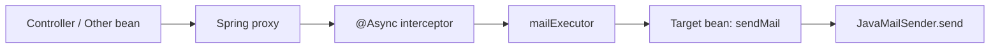
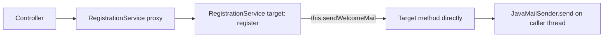
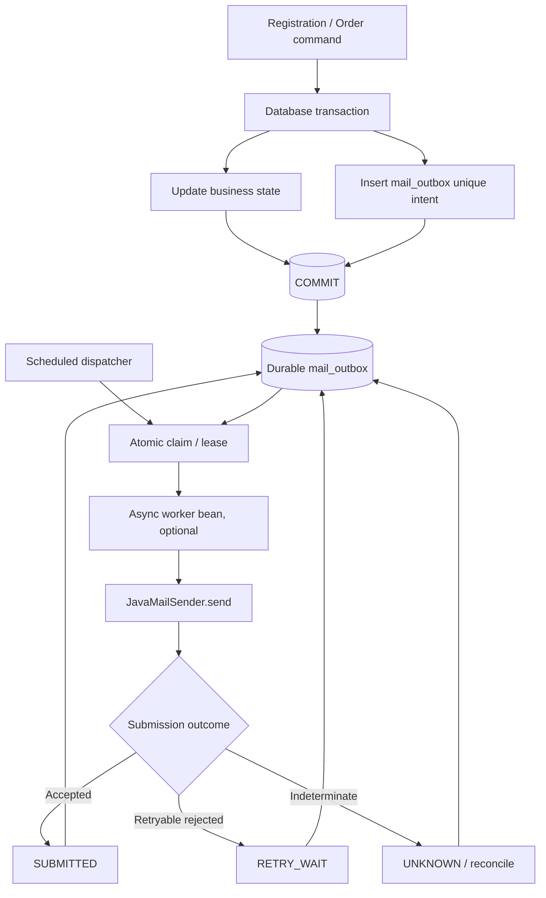

# Dùng @Async nhưng gọi nội bộ cùng bean

Một dịch vụ Spring Boot gửi email xác nhận sau khi người dùng đăng ký. Lập trình viên đánh dấu phương thức gửi mail bằng `@Async` để request không phải chờ SMTP. Tuy nhiên, request vẫn mất vài giây, thread xử lý HTTP vẫn hiện trong log gửi mail, và một SMTP timeout có thể làm API trả lỗi. Đoạn code trông có vẻ đã bất đồng bộ:

```java
@Service
public class RegistrationService {

    private final JavaMailSender mailSender;

    public RegistrationService(JavaMailSender mailSender) {
        this.mailSender = mailSender;
    }

    @Transactional
    public void register(RegisterCommand command) {
        // Lưu tài khoản vào database...
        sendWelcomeMail(command.email()); // GỌI NỘI BỘ.
    }

    @Async("mailExecutor")
    public void sendWelcomeMail(String recipient) {
        SimpleMailMessage message = new SimpleMailMessage();
        message.setFrom("notifications@example.com");
        message.setTo(recipient);
        message.setSubject("Chào mừng");
        message.setText("Tài khoản của bạn đã được tạo.");
        mailSender.send(message);
    }
}
```

**Lỗi nằm ở lời gọi `sendWelcomeMail(...)` từ một phương thức khác của cùng `RegistrationService`.** Với chế độ proxy mặc định của Spring, `@Async` chỉ được áp dụng khi lời gọi đi **qua Spring proxy**. Lệnh gọi nội bộ tương đương `this.sendWelcomeMail(...)` và đi thẳng tới target object, bỏ qua interceptor chạy bất đồng bộ.

Bài học **“Dùng @Async nhưng gọi nội bộ cùng bean”**, thuộc chương **Lỗi thường gặp** của module **Spring Framework Mail**, giải thích cơ chế, cách nhận biết, các phương án sửa, ví dụ gửi email thực tế, các tác động lên transaction, exception, thread pool, context và retry, cùng chiến lược kiểm thử để chắc chắn phương thức thật sự chạy trên thread khác khi đó là thiết kế mong muốn.

## 1. Triệu chứng thường gặp

Các dấu hiệu sau đáng nghi khi dự án có `@Async` nhưng vẫn bị chặn ở request:

- HTTP response chỉ được trả về sau khi SMTP `send()` kết thúc.
- Log `Thread.currentThread().getName()` trong method `@Async` vẫn là `http-nio-*`, `tomcat-handler-*` hoặc thread scheduler/caller ban đầu.
- Đặt `Thread.sleep(...)` trong method `@Async` làm lời gọi bên ngoài bị chậm tương ứng.
- Exception `MailSendException` hoặc `MailAuthenticationException` từ method đó truyền trực tiếp ra controller/service đang gọi, thay vì được xử lý theo async contract.
- `CompletableFuture` trả về đã hoàn tất ngay vì phương thức được thực thi đồng bộ trước khi return.
- Đã cấu hình `@EnableAsync` và executor nhưng metrics của `mailExecutor` không tăng khi code path đó chạy.
- Gọi cùng method từ controller/bean khác thì thấy async, còn gọi từ method cùng class thì không.

Các triệu chứng **không phải bằng chứng duy nhất**: một executor có thể dùng caller-runs rejection policy, thread name có thể cấu hình lạ, hoặc caller tự `join()` để chờ future. Cần xem call path, bean wiring và kiểm thử có kiểm soát.

### 1.1. Tại sao lỗi đặc biệt dễ xảy ra với Spring Mail?

Gửi email thường bị chậm vì:

1. DNS lookup hoặc TCP connect.
2. TLS handshake/STARTTLS.
3. SMTP AUTH.
4. Upload nội dung MIME, attachment.
5. SMTP server chờ/định tuyến rồi trả phản hồi.
6. Provider throttling hoặc network timeout.

Lập trình viên thấy API chậm và thêm `@Async` vào method `sendEmail` nằm ngay trong service gọi nó. Nhưng nếu self-invocation bỏ qua proxy, **SMTP vẫn chạy đồng bộ trên thread của request**, dù annotation đã hiện rõ trong source code.

## 2. @Async hoạt động theo cơ chế nào?

Trong cách dùng phổ biến với `@EnableAsync` và `AdviceMode.PROXY`, Spring tạo một **proxy** quanh bean được quản lý. Khi một bean khác gọi method `@Async` qua tham chiếu proxy, interceptor chuyển công việc tới `Executor`/`TaskExecutor`, và việc thực thi method target diễn ra trong worker thread.

Sơ đồ lời gọi đúng:



Với self-invocation:



### 2.1. Proxy không can thiệp mọi lời gọi method

Một Java method gọi method khác qua `this` được JVM dispatch trên cùng object. Vì vậy, dù `this` được viết tường minh hay ngầm:

```java
sendWelcomeMail(address);
this.sendWelcomeMail(address);
```

cả hai đều là **self-invocation** bên trong target method. Chúng không quay lại proxy.

Điều này cũng có thể ảnh hưởng các Spring AOP annotations khác như `@Transactional`, `@Cacheable` và `@Retryable` khi dựa trên proxy. Không nên suy luận rằng tất cả annotations đều có cùng runtime semantics, nhưng **self-invocation bypass proxy advice** là điểm chung cần ghi nhớ.

### 2.2. @EnableAsync không sửa self-invocation

`@EnableAsync` bật cơ chế xử lý `@Async`. Nó **không** khiến `this.sendWelcomeMail()` tự động trở thành lời gọi qua proxy.

Tương tự, việc chuyển giữa JDK dynamic proxy và class-based proxy (CGLIB/Spring class proxy) **không giải quyết self-invocation** trong chế độ proxy. Dù hình thức proxy khác, code bên trong target vẫn gọi trực tiếp target.

### 2.3. Đúng phạm vi của kết luận

Nội dung trên áp dụng cho **Spring proxy-based @Async**, mô hình thông dụng. Spring cũng có lựa chọn `AdviceMode.ASPECTJ` với weaving và dependency/cấu hình riêng. Trong mô hình AspectJ weaving phù hợp, self-invocation có thể được advice vì việc đan advice diễn ra ở bytecode chứ không chỉ qua proxy.

Tuy nhiên, đổi sang AspectJ weaving để sửa một đường gọi gửi mail thường phức tạp hơn **tách trách nhiệm ra hai Spring beans**. Không coi AspectJ mode là hành vi mặc định của Spring Boot.

## 3. Ví dụ sai: method @Async gọi từ cùng bean

```java
package com.example.mail;

import org.springframework.mail.SimpleMailMessage;
import org.springframework.mail.javamail.JavaMailSender;
import org.springframework.scheduling.annotation.Async;
import org.springframework.stereotype.Service;

@Service
public class UserRegistrationService {

    private final JavaMailSender sender;

    public UserRegistrationService(JavaMailSender sender) {
        this.sender = sender;
    }

    public void register(String email) {
        // Giả định đã tạo user thành công.
        sendWelcomeEmail(email); // Self-invocation: KHÔNG qua proxy.
    }

    @Async("mailExecutor")
    public void sendWelcomeEmail(String email) {
        SimpleMailMessage message = new SimpleMailMessage();
        message.setFrom("notifications@example.com");
        message.setTo(email);
        message.setSubject("Đăng ký thành công");
        message.setText("Chào mừng bạn!");
        sender.send(message);
    }
}
```

Nếu controller gọi `registrationService.register(...)`, Spring có thể cung cấp một proxy cho bean, nhưng lời gọi vào `register` sau đó thực hiện `sendWelcomeEmail(...)` ngay trên target instance. Annotation `@Async` ở method thứ hai không được intercept.

### 3.1. Thời gian thực thi minh họa

Giả sử SMTP giả lập mất 2 giây:

```text
HTTP thread:
  10:00:00.000 register starts
  10:00:00.001 sendWelcomeEmail starts
  10:00:02.001 SMTP send returns
  10:00:02.002 register returns
```

Người dùng vẫn đợi 2 giây.

### 3.2. Sai lầm khi đọc code review

`@Async` **có mặt trong source** không chứng minh invocation cụ thể đi qua interceptor. Cần hỏi:

- Phương thức được gọi qua object nào?
- Object đó có phải Spring-managed proxy?
- Lời gọi xuất phát từ cùng bean không?
- Có bị bypass do tự `new` object, static method, private method, final method hoặc lifecycle hook không?
- Có executor được cấu hình và phương thức thuộc bean đủ điều kiện proxy không?

## 4. Cách sửa ưu tiên: tách thành hai Spring beans

Giữ orchestration trong `RegistrationService` và chức năng gửi mail trong một bean chuyên biệt `AsyncMailSender`. Caller inject bean đó qua constructor.

### 4.1. AsyncMailSender là một bean độc lập

```java
package com.example.mail;

import org.springframework.mail.SimpleMailMessage;
import org.springframework.mail.javamail.JavaMailSender;
import org.springframework.scheduling.annotation.Async;
import org.springframework.stereotype.Service;

@Service
public class AsyncMailSender {

    private final JavaMailSender sender;

    public AsyncMailSender(JavaMailSender sender) {
        this.sender = sender;
    }

    @Async("mailExecutor")
    public void sendWelcomeEmail(String recipient) {
        SimpleMailMessage message = new SimpleMailMessage();
        message.setFrom("notifications@example.com");
        message.setTo(recipient);
        message.setSubject("Đăng ký thành công");
        message.setText("Chào mừng bạn!");
        sender.send(message);
    }
}
```

### 4.2. Service nghiệp vụ gọi qua bean được inject

```java
package com.example.users;

import com.example.mail.AsyncMailSender;
import org.springframework.stereotype.Service;

@Service
public class RegistrationService {

    private final AsyncMailSender asyncMailSender;

    public RegistrationService(
            AsyncMailSender asyncMailSender) {
        this.asyncMailSender = asyncMailSender;
    }

    public void register(String recipient) {
        // Giả định đã đăng ký thành công.
        asyncMailSender.sendWelcomeEmail(recipient);
    }
}
```

Khi Spring inject `AsyncMailSender`, tham chiếu được dùng trong bean khác là **đối tượng do Spring container quản lý, thường là proxy có async advice**. Lời gọi đi qua proxy, interceptor bàn giao công việc cho `mailExecutor`.

### 4.3. Sơ đồ sau khi tách

```text
HTTP controller
     |
     v
RegistrationService.register()
     |
     v
AsyncMailSender bean PROXY
     |
     v
@Async interceptor
     |
     v
mailExecutor.submit(...)
     |
     +-- HTTP caller có thể tiếp tục
     |
     +-- worker thread
              |
              v
         JavaMailSender.send(...)
```

Đây là cách sửa dễ hiểu và dễ test nhất trong đa số ứng dụng. Đồng thời giúp domain/application service không chịu trách nhiệm trực tiếp về MIME/SMTP.

### 4.4. Giới hạn của ví dụ

Code trên chỉ chứng minh **đúng async dispatch**. Nếu `register` nằm trong một database transaction chưa commit, async task có thể bắt đầu **trước commit**. Nếu cần không mất thư khi crash, tách bean và `@Async` **chưa đủ**; các phần sau sẽ trình bày `@TransactionalEventListener(AFTER_COMMIT)` và transactional outbox.

## 5. Cấu hình @EnableAsync và executor có chủ đích

Trong chế độ annotation-based Spring, cần bật async support, ví dụ:

```java
package com.example.config;

import java.util.concurrent.ThreadPoolExecutor;

import org.springframework.context.annotation.Bean;
import org.springframework.context.annotation.Configuration;
import org.springframework.scheduling.annotation.EnableAsync;
import org.springframework.scheduling.concurrent.ThreadPoolTaskExecutor;

@Configuration
@EnableAsync
public class MailAsyncConfiguration {

    @Bean(name = "mailExecutor")
    public ThreadPoolTaskExecutor mailExecutor() {
        ThreadPoolTaskExecutor executor =
                new ThreadPoolTaskExecutor();

        executor.setCorePoolSize(4);
        executor.setMaxPoolSize(8);
        executor.setQueueCapacity(200);
        executor.setThreadNamePrefix("mail-async-");

        executor.setRejectedExecutionHandler(
                new ThreadPoolExecutor.AbortPolicy());

        executor.setWaitForTasksToCompleteOnShutdown(true);
        executor.setAwaitTerminationSeconds(20);
        return executor;
    }
}
```

Giá trị 4/8/200/20 là **ví dụ**, không phải sizing phù hợp mọi provider. Bean `ThreadPoolTaskExecutor` được Spring quản lý lifecycle; nó sẽ được khởi tạo theo cơ chế của container.

### 5.1. Vì sao dùng @Async("mailExecutor")?

```java
@Async("mailExecutor")
public void sendMail(...) { ... }
```

Tên executor rõ ràng giúp:

- Không vô tình dùng executor mặc định cho công việc SMTP chậm.
- Tách capacity gửi mail khỏi xử lý async khác như thumbnail, báo cáo, gọi API.
- Đặt thread prefix dễ truy vết.
- Đo queue depth và active threads.
- Áp dụng saturation/rejection policy theo nhu cầu email.

Nếu tên executor sai hoặc bean không được tìm thấy, async invocation có thể gặp lỗi cấu hình. Đừng chỉ thêm string qualifier mà không khai báo executor tương ứng.

### 5.2. @EnableAsync được bật ở đâu?

Đặt `@EnableAsync` trên configuration được component scan/import trong application context liên quan. Một bean tạo bằng `new AsyncMailSender(...)` thủ công sẽ **không** tự được Spring proxy chỉ nhờ annotation ở class. Trong ứng dụng nhiều contexts, cần bảo đảm async support có hiệu lực trong context quản lý bean.

### 5.3. Không mặc định dùng executor vô hạn

Nếu `mailExecutor` có queue quá lớn hoặc không giới hạn:

- Số message pending trong RAM có thể tăng mất kiểm soát.
- Request trả về nhanh nhưng email bị kẹt rất lâu.
- Shutdown mất task.
- Provider quota bị vượt khi workers mở rộng.
- Email OTP hết hạn trước khi được gửi.

Một queue có giới hạn kết hợp backpressure/rejection rõ tốt hơn “đẩy tất cả vào memory và hy vọng xử lý kịp”.

### 5.4. Rejection có thể xảy ra ngay ở caller

Khi executor đầy, việc submit async task có thể ném `TaskRejectedException` hoặc rejection exception tương ứng **trên thread gọi**. Vì vậy, `@Async` không có nghĩa caller sẽ luôn trả về thành công ngay tức thì. Cần quyết định:

- Trả lỗi tạm thời để caller retry đúng idempotency key.
- Lưu durable outbox rồi defer dispatch.
- Điều tiết traffic trước khi submit.
- Không đánh dấu email `SENT` chỉ vì enqueue vào executor.

Không dùng một rejection policy kiểu `CallerRunsPolicy` một cách vô ý: khi quá tải, task có thể chạy **ngay trên caller thread**, làm mất mục tiêu giảm latency dù proxy vẫn hoạt động đúng.

## 6. @Async có thể đặt ở đâu? Những đường gọi bị bỏ qua

| Tình huống | Nhận định với proxy mode | Cách xử lý |
|---|---|---|
| Bean A inject Bean B và gọi `B.asyncMethod()` | Có thể được intercept bình thường | Ưu tiên |
| Bean A gọi `this.asyncMethod()` | Bypass proxy | Tách Bean B |
| Method trong cùng bean gọi nhau không viết `this` | Vẫn self-invocation | Tách bean |
| Bean được tạo bằng `new` ngoài Spring | Không có Spring proxy | Lấy từ container/DI |
| `private @Async` method | Không thể được proxy interceptor thông thường advice | Đưa API async ra public method của bean |
| `final` method với class-based proxy | Không thể override để intercept | Tránh final ở method cần proxy |
| Static method | Không có instance method dispatch qua proxy phù hợp | Dùng bean instance |
| Constructor gọi method `@Async` | Đối tượng chưa qua lifecycle proxy đầy đủ | Không thực hiện async work trong constructor |
| `@PostConstruct` cùng bean gọi method `@Async` | Có thể bypass cơ chế proxy/lifecycle | Tách bean hoặc dùng event khi context sẵn sàng |
| Controller/service gọi qua proxy nhưng ngay sau đó `join()` | Vẫn async execution nhưng caller **đang chờ** | Chỉ join khi contract thật sự cần |
| `@Async` trên bean method không có `@EnableAsync` | Annotation không kích hoạt async proxy như mong đợi | Bật/configure async support |
| `@Async` và self-invocation sau khi bật `proxyTargetClass=true` | Vẫn bypass | Tách bean, không chỉ đổi proxy type |

### 6.1. Public methods là lựa chọn an toàn nhất

Spring proxy-based async thường được thiết kế cho những **method có thể được proxy intercept**. Chọn `public` ở API boundary của async worker, inject bean qua interface/class tương thích proxy. Không đặt `@Async` vào một helper `private` rồi kỳ vọng annotation có hiệu lực.

### 6.2. JDK dynamic proxy và class-based proxy

- **JDK dynamic proxy** thường expose các interface methods đã proxied. Caller inject type interface nếu bean được JDK-proxy.
- **Class-based proxy** sử dụng subclass/proxy cơ chế thích hợp để intercept các overridable methods.
- `final` methods/classes có hạn chế khi cần subclass-based proxy.
- **Cả hai không giải quyết direct self-invocation**.

Điểm cốt lõi là **đường đi qua proxy**, không phải tên framework tạo proxy.

### 6.3. Self-injection có thể hoạt động nhưng thường không nên dùng

Một số code inject chính proxy của bean vào chính nó:

```java
@Service
public class MailService {
    private final ObjectProvider<MailService> selfProvider;

    public MailService(ObjectProvider<MailService> selfProvider) {
        this.selfProvider = selfProvider;
    }

    public void register(...) {
        selfProvider.getObject().sendAsync(...);
    }

    @Async("mailExecutor")
    public void sendAsync(...) { ... }
}
```

Cách này phụ thuộc thêm vào proxy/container, có nguy cơ circular dependency tùy wiring, khó hiểu và khó unit test. Nếu muốn gửi mail sau một business operation, **tách `AsyncMailSender` sang bean khác** diễn đạt trách nhiệm tốt hơn. Không đề xuất dùng `AopContext.currentProxy()` như giải pháp đầu tiên vì nó buộc code nghiệp vụ biết Spring AOP và cần cấu hình expose proxy.

### 6.4. ApplicationContext.getBean() không phải thuốc chữa kiến trúc

Gọi `applicationContext.getBean(MyService.class).asyncMethod()` có thể làm invocation qua proxy, nhưng biến application service thành service locator. Nó khó mock, khó đọc và dễ che dependency. Dùng constructor injection của bean khác thay vì truy container thủ công.

## 7. Trường hợp tự gọi qua method trung gian

Lỗi đôi khi khó thấy hơn:

```java
@Service
public class MailFacade {

    public void sendWelcome(String to) {
        prepareAndSend(to);
    }

    private void prepareAndSend(String to) {
        enqueue(to);
    }

    @Async("mailExecutor")
    public void enqueue(String to) {
        // SMTP call...
    }
}
```

Dù có hai method trung gian, `enqueue` vẫn được gọi từ cùng target instance. Không có lượt đi qua Spring proxy. Chỉ nhìn nơi annotation được khai báo không đủ; phải lần theo **call graph**.

### 7.1. Sự khác nhau giữa method call và message boundary

Khi A gọi `B.sendAsync(...)` qua Spring-injected bean, đó là invocation có async advice.

Khi A đưa một command vào queue thực sự, đó là một **messaging boundary** khác với các guarantees riêng. Đừng nhầm “gọi method có tên enqueue” với việc đã persist vào durable queue; nếu `enqueue` chỉ gọi SMTP, nó vẫn là synchronous operation khi self-invocation bypass.

## 8. CompletableFuture: khi caller cần quan sát kết quả

Nếu cần lấy kết quả hoặc bắt lỗi, dùng return type được `@Async` hỗ trợ, chẳng hạn `CompletableFuture<T>`.

### 8.1. Async worker trả về outcome

```java
package com.example.mail;

import java.time.Instant;
import java.util.concurrent.CompletableFuture;

import org.springframework.mail.SimpleMailMessage;
import org.springframework.mail.javamail.JavaMailSender;
import org.springframework.scheduling.annotation.Async;
import org.springframework.stereotype.Service;

@Service
public class AsyncMailSubmissionService {

    private final JavaMailSender sender;

    public AsyncMailSubmissionService(JavaMailSender sender) {
        this.sender = sender;
    }

    @Async("mailExecutor")
    public CompletableFuture<SubmissionReceipt> submit(
            MailCommand command) {

        SimpleMailMessage message = new SimpleMailMessage();
        message.setFrom("notifications@example.com");
        message.setTo(command.recipient());
        message.setSubject(command.subject());
        message.setText(command.plainText());

        sender.send(message);

        SubmissionReceipt receipt = new SubmissionReceipt(
                command.notificationId(),
                Instant.now());

        return CompletableFuture.completedFuture(receipt);
    }
}
```

Các records thuộc ứng dụng:

```java
public record MailCommand(
        String notificationId,
        String recipient,
        String subject,
        String plainText) {
}

public record SubmissionReceipt(
        String notificationId,
        Instant acceptedAt) {
}
```

Đặt từng `public` top-level class/record vào file riêng trong project Java thực.

### 8.2. Vì sao method trả completedFuture mà vẫn async?

Đối với Spring proxy, method target chạy trên executor thread. Nó có thể trả một `CompletableFuture.completedFuture(receipt)` tạm để Spring adapter hoàn thành future đưa cho caller. Caller nhận future của tác vụ đã được schedule; nó **không** đợi target method chạy xong chỉ vì target return statement có `completedFuture`.

Nếu **self-invocation** bỏ qua proxy, toàn bộ `sender.send(...)` chạy trước khi method return; caller mới nhận một future đã completed — dấu hiệu rất rõ rằng annotation không được áp dụng cho đường gọi đó.

### 8.3. Caller quan sát kết quả mà không blocking

```java
CompletableFuture<SubmissionReceipt> future =
        asyncMailSubmissionService.submit(command);

future.whenComplete((receipt, failure) -> {
    if (failure != null) {
        log.warn(
            "Mail submission task failed; notificationId={}",
            command.notificationId(),
            failure);
    } else {
        log.info(
            "SMTP submission completed; notificationId={}",
            receipt.notificationId());
    }
});
```

Ví dụ logging cần redaction phù hợp; không log raw recipient address, SMTP credentials hoặc full body. `whenComplete` giúp quan sát outcome trong process nhưng **không phải durable retry state**: process chết trước khi callback chạy thì log và transition có thể không tồn tại.

### 8.4. join() khiến caller chờ

```java
SubmissionReceipt receipt =
        asyncMailSubmissionService.submit(command).join();
```

Phương thức có thể **thực sự chạy trên worker thread**, nhưng caller bị chặn tới khi future hoàn tất. Nếu mục tiêu là giảm HTTP latency, gọi `join()` ngay sau submit làm mất lợi ích cho latency, dù khác về thread execution.

### 8.5. CompletableFuture.supplyAsync không tự tương đương Spring @Async

Một số người sửa self-invocation bằng:

```java
CompletableFuture.runAsync(() -> sender.send(message));
```

Nếu không truyền executor, nó thường dùng `ForkJoinPool.commonPool()`. Điều này có thể gây:

- Tranh tài nguyên với tác vụ khác.
- Thiếu metrics, queue sizing và shutdown policy gửi mail.
- Context (security/trace/MDC/tenant) không được truyền như kỳ vọng.
- Exception không được quan sát.
- Work mất khi process chết.

Nếu không dùng Spring `@Async`, hãy truyền một executor được quản lý và rõ contract; dù vậy, **async in-memory không thay transactional outbox**.

## 9. Trường hợp @Async void: lỗi không truyền về caller như bình thường

Một method:

```java
@Async("mailExecutor")
public void send(MailCommand command) {
    sender.send(buildMail(command));
}
```

không có `Future` để caller đợi/quan sát exception. Nếu SMTP ném exception trên worker thread, nó không thể được truyền ngược như một exception đồng bộ của method `void` đã trả về. Spring cung cấp `AsyncUncaughtExceptionHandler` cho các invocation kiểu `void` khi async advice được áp dụng.

### 9.1. Cấu hình AsyncUncaughtExceptionHandler

```java
import java.lang.reflect.Method;

import org.springframework.aop.interceptor.AsyncUncaughtExceptionHandler;
import org.springframework.context.annotation.Configuration;
import org.springframework.scheduling.annotation.AsyncConfigurer;
import org.springframework.scheduling.annotation.EnableAsync;

@Configuration
@EnableAsync
public class AsyncErrorConfiguration
        implements AsyncConfigurer {

    @Override
    public AsyncUncaughtExceptionHandler
            getAsyncUncaughtExceptionHandler() {

        return (Throwable failure,
                Method method,
                Object... params) -> {

            // Quan sát lỗi có cấu trúc và lọc PII.
            // Không giả định exception này đồng nghĩa chắc chắn
            // relay SMTP chưa nhận message.
        };
    }
}
```

Cấu hình handler có thể được gộp với `MailAsyncConfiguration`. Nếu class cũng override `getAsyncExecutor()`, phải bảo đảm nó dùng đúng executor thực tế hoặc giữ qualifier trên `@Async("mailExecutor")`. Không trùng lặp `@EnableAsync` ở nhiều config chỉ vì copy ví dụ.

### 9.2. AsyncUncaughtExceptionHandler không tự retry bền vững

Handler này chỉ giúp ghi nhận lỗi từ `void @Async`. Nó không:

- Tạo transaction bền vững cho notification.
- Biết provider accepted hay chưa.
- Tự dedup email.
- Bảo đảm retry khi JVM crash.
- Phân loại mọi SMTP exception một cách an toàn.

Nếu notification quan trọng, nên có outbox/attempt records và một supervisor/dispatcher quản lý kết quả thực.

### 9.3. Khi self-invocation bypass proxy, exception có thể bất ngờ trở lại caller

Trong method `@Async void` được gọi **nội bộ**, SMTP exception có thể được ném ngay trên caller thread, không đi qua `AsyncUncaughtExceptionHandler`. Đây vừa là triệu chứng, vừa là lý do cần tránh coi annotation như một hợp đồng mà không test đường gọi.
## 10. @Transactional và @Async: hai ranh giới không thể đánh đồng

Một ứng dụng gửi email thường có nghiệp vụ ghi database trước khi gửi:

```java
@Service
public class OrderApplicationService {

    private final OrderRepository orders;
    private final AsyncMailSender mailSender;

    public OrderApplicationService(
            OrderRepository orders,
            AsyncMailSender mailSender) {

        this.orders = orders;
        this.mailSender = mailSender;
    }

    @Transactional
    public void confirmOrder(UUID orderId) {
        orders.confirm(orderId);

        mailSender.sendWelcomeEmail(
                "buyer@example.net"); // Sai thời điểm.
    }
}
```

Lời gọi trên **có thể thực sự đi qua proxy và chạy bất đồng bộ**. Nhưng có lỗi khác: task gửi email có thể bắt đầu **trước khi transaction xác nhận đơn hàng commit**.

### 10.1. Race giữa email và database commit

```text
HTTP thread                         mail-async-1
-----------                         ------------
BEGIN transaction
UPDATE orders
call proxy @Async
  |
  +-- submits task ----------->     SMTP send starts
                                    SMTP accepted
[validation fails]
ROLLBACK transaction

Buyer receives email "order confirmed"
but database has no confirmed order.
```

Đây là một failure mode khác với self-invocation. Tách bean sửa **lỗi @Async không có hiệu lực**, nhưng không làm network side effect trở thành atomic với database.

### 10.2. Transaction context không tự lan qua thread

Spring quản lý transaction context trong thread thực thi liên quan. Worker `mail-async-*` **không kế thừa transaction JDBC/JPA đang mở trên HTTP thread** một cách tự động.

Do đó:

- Worker có thể không thấy những rows chưa commit.
- Entity lazy-loading có thể thất bại khi worker dùng một detached entity hoặc không có persistence context.
- Một exception trong async worker không tự rollback business transaction đã commit.
- `@Transactional` trên một method async riêng, nếu được áp dụng đúng qua proxy, có thể mở transaction **mới** tại phía worker; nó không phải cùng transaction của caller.

Không thiết kế “gửi mail trong transaction” bằng cách đặt cả `@Async` lẫn `@Transactional` lên mọi method rồi tin chúng bảo đảm exactly-once.

### 10.3. Khi nào cần giao tác vụ sau commit?

Nếu chấp nhận xử lý mail best-effort trong memory, có thể chờ business transaction commit rồi mới lên lịch:

- `@TransactionalEventListener(phase = TransactionPhase.AFTER_COMMIT)`.
- `TransactionSynchronization` được sử dụng đúng.
- Một application service ngoài transaction nhận kết quả commit và gọi mail worker.

Nhưng tất cả các cách này **chưa bảo đảm bền vững** nếu process crash sau commit nhưng trước khi callback/task được thực thi. Nếu yêu cầu không mất email, dùng transactional outbox.

## 11. @TransactionalEventListener(AFTER_COMMIT): sửa thứ tự nhưng chưa đủ độ bền

Một mẫu ngắn khi email không phải giao dịch bắt buộc:

### 11.1. Phát event nghiệp vụ trong transaction

```java
public record WelcomeMailRequested(
        UUID userId,
        String recipientSnapshot) {
}

@Service
public class RegistrationApplicationService {

    private final UserRepository users;
    private final ApplicationEventPublisher events;

    public RegistrationApplicationService(
            UserRepository users,
            ApplicationEventPublisher events) {

        this.users = users;
        this.events = events;
    }

    @Transactional
    public void register(RegisterCommand command) {
        UUID userId = users.createUser(command);
        events.publishEvent(new WelcomeMailRequested(
                userId, command.email()));
    }
}
```

Đây là ví dụ application types `UserRepository` và `RegisterCommand` do dự án định nghĩa. Event object nên chứa các giá trị đã snapshot phù hợp, không đưa JPA managed entity có lazy references sang worker thread.

### 11.2. Listener sau commit gọi một async bean khác

```java
import org.springframework.stereotype.Component;
import org.springframework.transaction.event.TransactionPhase;
import org.springframework.transaction.event.TransactionalEventListener;

@Component
public class WelcomeMailEventListener {

    private final AsyncMailSender asyncMailSender;

    public WelcomeMailEventListener(
            AsyncMailSender asyncMailSender) {

        this.asyncMailSender = asyncMailSender;
    }

    @TransactionalEventListener(
            phase = TransactionPhase.AFTER_COMMIT)
    public void on(WelcomeMailRequested event) {
        asyncMailSender.sendWelcomeEmail(
                event.recipientSnapshot());
    }
}
```

Các điểm cần hiểu:

1. `@TransactionalEventListener` ràng buộc invocation với transaction theo phase đã khai báo.
2. Với `AFTER_COMMIT`, listener chỉ được gọi sau khi transaction tương ứng commit thành công.
3. Listener gọi `AsyncMailSender` **qua bean khác**, vì vậy `@Async` của sender được intercept đúng.
4. Task vẫn chạy trên một executor trong memory.
5. Nếu JVM chết sau commit nhưng trước callback/task dispatch, **không có durable mail intent** từ mẫu này.

### 11.3. Event khi không có transaction thì sao?

`@TransactionalEventListener` mặc định yêu cầu có transaction phù hợp để đăng ký callback; nếu publish event khi không có transaction, listener có thể **không được thực thi** (trừ khi cấu hình `fallbackExecution` theo nhu cầu). Không bật fallback tùy tiện chỉ để “test dễ hơn”: nó thay đổi thời điểm gửi.

### 11.4. Sau commit, không mặc định thao tác database trong callback vẫn commit

Một callback `AFTER_COMMIT` có thể đang thấy transaction resources còn gắn với thread theo lifecycle, nhưng DB transaction gốc đã hoàn tất. Nếu cần ghi record mới bền vững từ callback, thiết kế transaction riêng thích hợp, ví dụ service có `@Transactional(propagation = REQUIRES_NEW)` được gọi qua proxy khi thực sự cần. Đối với notification bắt buộc, thường **gần với nhu cầu hơn là ghi outbox trong transaction ban đầu**.

### 11.5. Vì sao vẫn cần idempotency?

Event listener có thể được kích hoạt cho business operation bị replay qua một con đường khác; email cũng có thể được worker gửi lại sau timeout. Không dùng listener làm bằng chứng “mỗi event chỉ tạo một mail đúng một lần”.

## 12. Transactional outbox: hướng production khi cần không mất yêu cầu gửi

Với password reset, hóa đơn, OTP hoặc thông báo giao dịch quan trọng, chỉ `@Async` chưa đủ:

- Task tồn tại trong heap của một JVM; process crash có thể mất.
- Executor queue không commit nguyên tử cùng database.
- Không có persistent notification identity.
- Không có retry log, audit, provider reference hay kết quả `UNKNOWN`.
- Không có cơ chế chia việc an toàn giữa nhiều replicas.

Thay vào đó, **ghi ý định gửi email** vào outbox cùng transaction nghiệp vụ, rồi để worker dispatch sau commit.

### 12.1. Luồng dữ liệu



### 12.2. Ví dụ schema tối giản

```sql
CREATE TABLE mail_outbox (
    id UUID PRIMARY KEY,
    idempotency_key VARCHAR(240) NOT NULL UNIQUE,
    recipient VARCHAR(320) NOT NULL,
    sender VARCHAR(320) NOT NULL,
    subject VARCHAR(500) NOT NULL,
    plain_text TEXT NOT NULL,
    state VARCHAR(40) NOT NULL,
    due_at TIMESTAMPTZ NOT NULL,
    next_attempt_at TIMESTAMPTZ NULL,
    claim_token UUID NULL,
    lease_until TIMESTAMPTZ NULL,
    last_error VARCHAR(80) NULL,
    created_at TIMESTAMPTZ NOT NULL DEFAULT CURRENT_TIMESTAMP
);
```

Production cần thêm tenant scope, attachment refs, template snapshot, attempts, expiry, provider ID, security/retention fields và constraints phù hợp.

### 12.3. Business service chỉ ghi intent

```java
@Service
public class OrderConfirmationService {

    private final OrderRepository orders;
    private final MailOutboxWriter outbox;

    public OrderConfirmationService(
            OrderRepository orders,
            MailOutboxWriter outbox) {

        this.orders = orders;
        this.outbox = outbox;
    }

    @Transactional
    public void confirm(UUID orderId, UUID recipientId) {
        orders.markConfirmed(orderId);

        outbox.insertIfAbsent(
                "order-confirmation:" + orderId + ":" + recipientId,
                /* immutable content snapshot */);
    }
}
```

`OrderRepository` và `MailOutboxWriter` là abstractions riêng của ứng dụng, không phải Spring APIs có sẵn. Ý chính là **cùng transaction manager/datasource** và một unique idempotency key; không gọi `JavaMailSender` trong transaction này.

### 12.4. Poller và @Async phải tách bean nếu muốn thực thi bất đồng bộ

```java
@Component
public class MailOutboxPoller {

    private final MailClaimRepository claims;
    private final MailAsyncDispatchWorker worker;

    public MailOutboxPoller(
            MailClaimRepository claims,
            MailAsyncDispatchWorker worker) {

        this.claims = claims;
        this.worker = worker;
    }

    @Scheduled(fixedDelayString = "${mail.poll-delay-ms:2000}")
    public void poll() {
        for (ClaimedMail mail : claims.claimAvailable(4)) {
            worker.dispatchAsync(mail);
        }
    }
}
```

```java
@Service
public class MailAsyncDispatchWorker {

    private final MailTransportPort transport;
    private final MailAttemptRepository attempts;

    public MailAsyncDispatchWorker(
            MailTransportPort transport,
            MailAttemptRepository attempts) {

        this.transport = transport;
        this.attempts = attempts;
    }

    @Async("mailExecutor")
    public void dispatchAsync(ClaimedMail mail) {
        try {
            transport.submitOnce(mail);
            attempts.markAcceptedIfOwned(
                    mail.id(), mail.claimToken());
        } catch (SubmissionOutcomeUnknownException ex) {
            attempts.markUnknownIfOwned(
                    mail.id(), mail.claimToken(), ex);
        } catch (MailTransportException ex) {
            attempts.classifyAndRecordIfOwned(
                    mail.id(), mail.claimToken(), ex);
        }
    }
}
```

`MailClaimRepository`, `MailTransportPort`, `ClaimedMail`, `MailAttemptRepository` và exception types là types do ứng dụng định nghĩa cho ví dụ. Để thành production implementation, còn phải xử lý unexpected unchecked exceptions, rejection ngay lúc schedule, transaction failures, shutdown, provider quota và vòng đời lease. Một `void @Async` không thể là nơi duy nhất lưu outcome khi worker process có thể bị kill.

### 12.5. Điều gì xảy ra khi executor từ chối task?

Trong mẫu trên:

```text
Poller claims row PROCESSING
   |
   v
worker.dispatchAsync(mail)
   |
   +-- mailExecutor full -> TaskRejectedException at caller
                              |
                              v
                      Row remains PROCESSING
```

Nếu poller bỏ exception, row có thể kẹt tới khi lease hết hạn. Cần:

- Bắt task rejection tại poller.
- Ghi state/defer theo `claimToken` trước khi return.
- Hoặc claim sau khi reserve worker capacity.
- Có lease recovery cho process crash.
- Giới hạn batch bằng số worker slots thực sự sẵn.
- Không mặc định “method void nên dispatch chắc chắn thành công”.

### 12.6. Outbox không bảo đảm exactly-once SMTP send

Nếu SMTP accepted rồi worker crash trước khi ghi `SUBMITTED`, row có thể được retry. SMTP không tham gia SQL transaction; một notification có thể được gửi hơn một lần trong kịch bản lỗi.

Thiết kế cần kết quả `ACCEPTED/REJECTED/UNKNOWN`, per-attempt history và duplicate-aware policy, không tuyên bố exactly-once delivery chỉ vì đã dùng `@Async` + outbox.

## 13. @Scheduled + @Async gọi nội bộ cùng bean cũng mắc lỗi

Một biến thể rất hay gặp:

```java
@Component
public class MailBatchJob {

    @Scheduled(fixedDelay = 30_000)
    public void pollAndSend() {
        for (MailCommand item : findDue()) {
            sendAsync(item); // self-invocation.
        }
    }

    @Async("mailExecutor")
    public void sendAsync(MailCommand item) {
        // SMTP send...
    }
}
```

`@Scheduled` tạo một endpoint lịch trong application context, còn `sendAsync` được gọi nội bộ từ target. Không nên suy luận rằng vì method poller được framework gọi nên **mọi method trong cùng class tự động đi qua proxy**.

### 13.1. Dấu hiệu

- Poller chỉ xử lý một email tại một thời điểm.
- Một SMTP timeout khiến toàn batch đứng yên.
- Lịch trễ khi batch lớn.
- Log gửi mail ở thread tên scheduler.
- Tăng `mailExecutor` threads không cải thiện throughput của code path đó.

### 13.2. Cách sửa

Tách `MailBatchJob` và `MailAsyncDispatchWorker` thành các beans riêng, rồi inject worker vào job. Hoặc không dùng async ở tầng này nếu một worker tuần tự thực sự phù hợp với provider quota — quan trọng là hành vi phải **có chủ đích**, không dựa vào annotation không hoạt động.

### 13.3. Nhiều instances còn một vấn đề khác

Khi chạy ba pods, mỗi pod có `@Scheduled` của riêng nó. Việc sửa self-invocation để async chạy đúng **không tự ngăn ba pods cùng claim một outbox row**.

Cần atomic claim/lease hoặc distributed scheduling strategy phù hợp. Không dùng `synchronized`, `AtomicBoolean` hay một executor một thread để suy ra đã có distributed lock.

## 14. @Async + @Transactional cùng method: tránh hiểu sai

Có thể thấy:

```java
@Async("mailExecutor")
@Transactional
public void sendEmailAndRecordStatus(...) {
    // Read DB, send SMTP, write DB...
}
```

Một method được gọi qua các proxies/advisors phù hợp có thể chạy trên worker thread và có transaction mới áp dụng tại đó. Nhưng:

- Transaction của caller không được truyền sang worker.
- Network SMTP không thể rollback cùng DB transaction.
- Thứ tự/advice chain, proxy mode và lời gọi thực tế phải được hiểu rõ.
- Self-invocation vẫn có thể bỏ qua cả `@Async` và proxy-based `@Transactional`.
- Transaction kéo dài qua SMTP network call gây contention và không giúp exactly-once.

### 14.1. Thiết kế tách phase

Nên tách:

1. **Transaction A:** claim/lease work một cách ngắn gọn.
2. **SMTP call:** nằm ngoài row-lock DB transaction.
3. **Transaction B:** ghi attempt outcome bằng conditional update theo token.

Nếu cần đọc database từ async worker, có thể gọi một service có transaction riêng phù hợp. Không giữ JPA entity/proxy của request thread để lazy-load bên worker.

### 14.2. Một đoạn code có thể vừa không async vừa không transactional

```java
@Service
public class NotificationService {

    public void process() {
        sendAndPersist(); // this.sendAndPersist()
    }

    @Async("mailExecutor")
    @Transactional
    public void sendAndPersist() {
        // Có thể bypass cả hai proxy advices.
    }
}
```

Đừng sửa bằng cách thêm `@Transactional` vào method `process` một cách máy móc: nó có thể làm SMTP chạy trong transaction dài. Sửa kiến trúc call boundary và transaction boundaries rõ ràng.

## 15. Thread context: security, logging, locale và tenant

Khi `@Async` thực sự chạy trên worker thread, một số `ThreadLocal` values của caller **không tự động đi theo**:

- `SecurityContextHolder`.
- MDC logging context.
- Request context / `RequestContextHolder`.
- Transaction synchronization context.
- `LocaleContextHolder`.
- Tenant context do ứng dụng tự định nghĩa.
- Trace/span context nếu chưa cấu hình propagation.

Kết quả có thể là mail gửi đúng thread nhưng:

- Template dùng locale mặc định thay vì locale người dùng.
- Tenant context bị mất, chọn nhầm sender identity.
- Log không có correlation ID.
- Worker không có authentication principal.
- JPA lazy loading thất bại do không còn persistence context.

### 15.1. Truyền context cần thiết một cách tường minh

Một `MailCommand` tự chứa có thể gồm:

```java
public record MailCommand(
        UUID notificationId,
        UUID tenantId,
        String recipient,
        String verifiedFrom,
        String templateKey,
        Locale locale,
        String correlationId,
        Map<String, String> safeTemplateVariables) {
}
```

Dữ liệu phải được kiểm quyền trước khi tạo command. Worker dùng snapshots/IDs để resolve tài nguyên được phép, thay vì phụ thuộc mọi thứ còn sống trong HTTP request thread.

### 15.2. Không chuyển cả HttpServletRequest hoặc EntityManager

Tránh truyền:

- `HttpServletRequest`.
- `HttpSession`.
- `EntityManager`.
- Live JPA lazy entity.
- `InputStream` đã mở cho attachment.
- Mutable `MimeMessage` hoặc `MimeMessageHelper` dùng chung nhiều threads.

Những objects này có lifecycle, quyền truy cập và thread-safety constraints riêng. Chuyển các values/snapshots an toàn hoặc resource references bất biến thay vì toàn bộ request context.

### 15.3. Context propagation có thể được cấu hình

Nếu cần bảo toàn MDC/trace context, có thể dùng `TaskDecorator` hoặc hệ context propagation tương thích version. Với security, có các executor wrappers như `DelegatingSecurityContextAsyncTaskExecutor` trong Spring Security khi thích hợp.

Nhưng **không tự copy mọi ThreadLocal sang thread pool**. Thread pool tái sử dụng threads; nếu copy mà không restore/clear, dữ liệu user A có thể lộ sang job user B.

### 15.4. TaskDecorator minh họa MDC

```java
import java.util.Map;
import org.slf4j.MDC;
import org.springframework.core.task.TaskDecorator;

public final class MdcTaskDecorator implements TaskDecorator {

    @Override
    public Runnable decorate(Runnable delegate) {
        Map<String, String> callingContext =
                MDC.getCopyOfContextMap();

        return () -> {
            Map<String, String> previous =
                    MDC.getCopyOfContextMap();
            try {
                if (callingContext == null) {
                    MDC.clear();
                } else {
                    MDC.setContextMap(callingContext);
                }
                delegate.run();
            } finally {
                if (previous == null) {
                    MDC.clear();
                } else {
                    MDC.setContextMap(previous);
                }
            }
        };
    }
}
```

Rồi gắn vào `ThreadPoolTaskExecutor`:

```java
executor.setTaskDecorator(new MdcTaskDecorator());
```

Decorator này chỉ minh họa MDC, không truyền database transaction, request, security hoặc toàn bộ tracing contexts. Với các bản Spring/Micrometer hỗ trợ context propagation, cân nhắc lựa chọn chuẩn của dự án thay vì tự xây nhiều wrappers có thể trùng lặp.

## 16. Bảo mật đầu vào khi gửi email bất đồng bộ

Sửa self-invocation làm mail chạy trên worker thread, nhưng không biến dữ liệu đầu vào thành an toàn.

### 16.1. Verified sender identity

Đừng để client truyền tùy ý:

```java
message.setFrom(request.getFrom());
```

SMTP provider có thể chặn hoặc, tệ hơn, hệ thống gửi thư giả mạo. From phải được xác minh theo provider account và tenant.

### 16.2. Recipient validation và consent

Trước khi tạo mail command:

- Xác minh recipient thuộc đúng user/order.
- Validate cú pháp và chống control characters/header injection.
- Kiểm suppression/unsubscribe theo notification purpose.
- Không gửi marketing thiếu consent.
- Kiểm expiry của OTP/reset link.
- Không log recipient address thành metric label.

### 16.3. Nội dung HTML và attachment

Nếu gửi HTML:

- Render bằng template có escaping theo ngữ cảnh.
- Tạo `text/plain` alternative phù hợp.
- Không đưa nội dung tùy ý từ user vào HTML chưa escape.
- Attachment lớn nên dùng storage reference, không giữ bytes vô hạn trong executor queue.
- Không reuse cùng một mutable `MimeMessage`/`MimeMessageHelper` cho nhiều async tasks.

### 16.4. Idempotency riêng của business intent

Nếu HTTP request retry vì response nhanh quá nhưng client không biết job đã được enqueue, mỗi lần có thể gọi `sendAsync(...)` thêm một lần.

**@Async không deduplicate tasks.** Dùng stable business idempotency key + unique outbox intent khi cần chống tạo mail trùng.

## 17. SMTP timeouts, quota và độ trễ: async không giải quyết mọi thứ

### 17.1. Cấu hình SMTP submission có timeouts

Ví dụ Spring Boot:

```yaml
spring:
  mail:
    host: ${SMTP_HOST}
    port: 587
    protocol: smtp
    username: ${SMTP_USERNAME}
    password: ${SMTP_PASSWORD}
    default-encoding: UTF-8
    properties:
      "[mail.smtp.auth]": true
      "[mail.smtp.starttls.enable]": true
      "[mail.smtp.starttls.required]": true
      "[mail.smtp.ssl.checkserveridentity]": true
      "[mail.smtp.connectiontimeout]": 5000
      "[mail.smtp.timeout]": 10000
      "[mail.smtp.writetimeout]": 10000
```

Giá trị tính bằng milliseconds cho các Jakarta Mail SMTP transport properties tương ứng. Đây là cấu hình mẫu cho provider yêu cầu SMTP AUTH + STARTTLS ở port 587. Với implicit TLS port 465 cần `mail.smtp.ssl.enable=true` theo contract provider; không tắt hostname verification để “tăng tương thích”.

### 17.2. Không có timeouts, async tasks có thể giữ threads vô hạn

Nếu nhiều SMTP requests treo vì network:

- Executor active threads đạt max.
- Task queue dần đầy.
- Controller tưởng notification đã được gửi vì call async return.
- Rejection tăng.
- OTP hết hạn trước khi thực sự submitted.

Async chỉ chuyển chỗ chờ, không làm chờ biến mất. Cần timeouts, provider health checks, quota/rate gates, metrics và backpressure.

### 17.3. Giới hạn recipients/giây trên toàn account

Nếu có 5 pods, mỗi pod có `mailExecutor` 8 threads, cả cluster có thể mở 40 concurrent SMTP attempts. Nếu provider chỉ chịu 5 connections hoặc 100 recipients/phút, tăng concurrency sẽ làm rejection/throttling tăng.

Dùng limiter cấp provider account/cluster khi cần; local executor size chỉ giới hạn **mỗi JVM**.

### 17.4. Backpressure và expiry

Khi queue đầy, lựa chọn:

- Trả response “tạm chưa xử lý” có ý nghĩa.
- Lưu durable intent và postpone.
- Ưu tiên transaction mail.
- Đưa expired intents sang `EXPIRED` trước send.
- Không âm thầm gửi OTP 30 phút sau expiry chỉ vì queue cuối cùng được giải phóng.

## 18. Shutdown và restart: @Async không phải queue bền vững

Một `ThreadPoolTaskExecutor` có thể được cấu hình đợi tasks hoàn thành lúc shutdown có kiểm soát. Tuy nhiên:

- Kubernetes pod có termination grace period giới hạn.
- JVM có thể bị kill -9/OOM.
- Máy có thể mất điện.
- Executor queue chỉ ở RAM nếu không có persistence riêng.
- Sau restart, không có sẵn danh sách tasks trước đó.

Vì vậy, `setWaitForTasksToCompleteOnShutdown(true)` và `setAwaitTerminationSeconds(20)` không bảo đảm một email đã enqueue sẽ chắc chắn được gửi.

### 18.1. Phân biệt enqueue vào memory với durable scheduling

```text
Method @Async called
    |
    +-- Executor accepts runnable in memory
            |
            +-- JVM crashes before execution
                    => task lost
```

Trong khi transactional outbox:

```text
DB commit durable intent
    |
    +-- worker crashes
            |
            +-- new worker can claim intent
```

Outbox vẫn cần xử lý dual-write SMTP outcome, nhưng giải quyết được **mất intent do process crash**.

### 18.2. Shutdown đúng vẫn cần idempotency

Nếu worker gửi SMTP accepted nhưng chưa kịp cập nhật status trước khi pod bị kill, recovery có thể retry và duplicate. Shutdown hook hữu ích để giảm sự cố, nhưng không thay attempt state và outcome-aware recovery.

## 19. Chọn công cụ theo mục tiêu thực tế

| Mục tiêu | Phương án phù hợp | Giới hạn |
|---|---|---|
| Làm cho email không chặn request ở ứng dụng nhỏ | `@Async` method trên bean riêng + bounded executor | Task có thể mất khi JVM crash |
| Chạy email sau transaction commit, chấp nhận best-effort | `@TransactionalEventListener(AFTER_COMMIT)` gọi bean async riêng | Crash sau commit có thể mất email |
| Không mất ý định gửi giao dịch | Transactional outbox + worker | Cần DB schema, retry/claim, UNKNOWN |
| Chia tải nhiều instances | Durable outbox + atomic claim | Lease/concurrency/provider rate còn phải thiết kế |
| API có thể lấy kết quả async | `CompletableFuture<SubmissionReceipt>` | Caller không nên `join()` khi muốn nonblocking |
| Quan sát lỗi `void @Async` | `AsyncUncaughtExceptionHandler` | Không tạo audit/durable retry |
| Đảm bảo *delivery tới Inbox* | Provider events/DSN/monitoring | Không thể suy ra chỉ từ `send()` |
| Chống một email gửi trùng | Stable intent key + unique constraint + attempt policy | SMTP exact-once không tự có |

### 19.1. Đừng dùng @Async khi không cần

Một internal service với số lượng mail rất ít có thể gửi đồng bộ nếu latency SLA cho phép và không nằm trong DB transaction. Nhưng nếu mục tiêu là đảm bảo notification không mất và có retry, async memory queue **không nên là giải pháp duy nhất**.

### 19.2. Đừng áp dụng @Async như cách “sửa mọi vấn đề hiệu năng”

Nếu bottleneck là SMTP server throttle, queue backlog hoặc MIME attachment lớn, bật thêm async threads có thể làm lỗi nặng hơn. Đo transport latency, queue wait, accepted throughput và provider limits trước khi tăng concurrency.

## 20. Kết quả gửi email: submitted không phải delivered

Một method tên `sendWelcomeEmail` dễ khiến caller hiểu là khi async future hoàn thành thì người nhận đã nhận thư. Thực tế:

```text
HTTP request accepted
    |
    v
Async task enqueued in JVM
    |
    v
SMTP attempt started
    |
    v
SMTP relay accepted with final response
    |
    v
Provider eventually routes to recipient MX
    |
    v
Delivery / bounce / complaint events if observable
```

Các ranh giới có ý nghĩa khác:

- **Accepted by executor:** runnable được executor nhận, chưa bắt đầu SMTP.
- **SMTP submission started:** transport attempt đã bắt đầu.
- **Accepted by SMTP relay:** phía relay nhận message theo response quan sát được.
- **Delivered (provider report):** provider có evidence recipient MX nhận theo định nghĩa provider.
- **Inbox placement/read:** không thể suy từ `JavaMailSender.send()` hoặc open tracking một cách chắc chắn.

### 20.1. Khi nào gọi future hoàn thành?

Với ví dụ `@Async CompletableFuture<SubmissionReceipt>`, future thành công sau khi target method hoàn thành. Nếu target method chỉ gọi `JavaMailSender.send()`, future thường phản ánh **submission result theo transport**, không phải eventual delivery.

Tên `SubmissionReceipt` chính xác hơn `EmailDelivered`.

### 20.2. Lỗi sau SMTP acceptance

Một bounce phát sinh sau 5 phút không thể được báo qua future đã completed trước đó, trừ khi application có một cơ chế riêng giữ future/live process rất lâu (không phù hợp cho độ bền production). Nên ghi delivery events vào trạng thái bền vững riêng.
## 21. Kiểm thử đúng: phải chạy qua Spring proxy thật

Unit test gọi trực tiếp:

```java
AsyncMailSender worker = new AsyncMailSender(mockSender);
worker.sendWelcomeEmail("lan@example.net");
```

**không kiểm được `@Async`**. Object được tạo bằng `new` không đi qua Spring container/proxy, nên method chạy đồng bộ. Unit test như vậy hữu ích cho logic dựng email, nhưng không chứng minh application async wiring.

Muốn kiểm self-invocation, cần **Spring context với `@EnableAsync` và bean được proxy thực sự**, rồi test thread/call path.

### 21.1. AsyncProxyProbe để quan sát thread

```java
package com.example.test;

import java.util.concurrent.CompletableFuture;

import org.springframework.scheduling.annotation.Async;
import org.springframework.stereotype.Component;

@Component
public class AsyncProxyProbe {

    @Async("mailExecutor")
    public CompletableFuture<String> threadNameAsync() {
        return CompletableFuture.completedFuture(
                Thread.currentThread().getName());
    }

    public String threadNameViaSelfInvocation() {
        // Cùng bean: không có một lượt gọi qua proxy.
        return threadNameAsync().join();
    }
}
```

Điểm tinh tế: `threadNameAsync()` trả một future đã completed **từ method target**. Khi method được gọi qua proxy, target được chạy trong worker; khi gọi nội bộ, target chạy trong caller.

### 21.2. Integration test phân biệt hai đường gọi

```java
package com.example.test;

import java.util.concurrent.TimeUnit;

import org.junit.jupiter.api.Test;
import org.springframework.beans.factory.annotation.Autowired;
import org.springframework.boot.test.context.SpringBootTest;

import static org.assertj.core.api.Assertions.*;

@SpringBootTest
class AsyncProxyBehaviorTest {

    @Autowired
    private AsyncProxyProbe probe;

    @Test
    void invocationViaProxyRunsOnMailExecutor()
            throws Exception {

        String caller = Thread.currentThread().getName();

        String worker =
                probe.threadNameAsync()
                        .get(5, TimeUnit.SECONDS);

        assertThat(worker)
                .startsWith("mail-async-")
                .isNotEqualTo(caller);
    }

    @Test
    void sameBeanInvocationDoesNotUseAsyncInterceptor() {

        String caller = Thread.currentThread().getName();

        String actual =
                probe.threadNameViaSelfInvocation();

        assertThat(actual).isEqualTo(caller);
    }
}
```

Test giả định context có `MailAsyncConfiguration` khai báo `@EnableAsync` và `mailExecutor` với prefix `mail-async-`. Nếu dự án dùng context riêng, import đúng test configuration. Đây là cách so sánh dễ hiểu giữa **invocation qua proxy** và **self-invocation** mà không cần SMTP network.

### 21.3. Vì sao không chỉ assert future.isDone() == false?

Task rất ngắn có thể chạy xong **trước khi caller đọc `isDone()`**, dù đã được schedule đúng. Do đó:

```java
assertThat(future.isDone()).isFalse();
```

có thể là test flaky. Quan sát thread name/identity và dùng latch/barrier cho tác vụ chậm có kiểm soát đáng tin hơn.

### 21.4. Đừng chỉ mock một method @Async rồi kiểm verify

Nếu mock `AsyncMailSender`, Mockito có thể bypass Spring AOP semantics. Test application orchestration bằng mock là hợp lý, nhưng test **@Async boundary** nên dùng bean thật được Spring container quản lý và mock riêng SMTP dependency.

## 22. Kiểm thử chính code path gửi mail

Một test tốt cần kiểm đường đi thực:

```text
RegistrationService.register(...)
   |
   v
injected AsyncMailSender proxy
   |
   v
mailExecutor thread
   |
   v
JavaMailSender.send(SimpleMailMessage)
```

### 22.1. Fake sender ghi thread đã gọi

Có thể tạo fake implementation của `JavaMailSender` hoặc mock với `Answer`; trong test, capture thread name tại lúc `send(...)` được gọi:

```java
AtomicReference<String> transportThread =
        new AtomicReference<>();
CountDownLatch entered = new CountDownLatch(1);

doAnswer(invocation -> {
    transportThread.set(
            Thread.currentThread().getName());
    entered.countDown();
    return null;
}).when(sender).send(
        any(SimpleMailMessage.class));

registrationService.register("lan@example.net");

assertThat(entered.await(5, TimeUnit.SECONDS)).isTrue();
assertThat(transportThread.get())
        .startsWith("mail-async-");
```

Đoạn code giả định `sender` là mock `JavaMailSender` được inject vào **Spring-managed AsyncMailSender**, `registrationService` là bean thật, cấu hình executor hiện diện. Nó kiểm tra **SMTP send diễn ra ở đâu**, chứ không chỉ class có annotation.

### 22.2. Cẩn thận khi test latency

Chỉ đo “API trả về trong 10 ms” không đủ:

- Máy CI có thể chậm.
- Scheduler thread pool có thể đang bận.
- SMTP fake có thể trả quá nhanh.
- Async worker có thể khởi động cùng lúc.
- Với `CallerRunsPolicy`, dưới load task có thể chạy trên caller.

Nên dùng `CountDownLatch` để giữ fake SMTP send ở một điểm xác định, rồi chứng minh caller đã return trước khi thả latch. Tránh `Thread.sleep` là nguồn đồng bộ chính.

### 22.3. Thiết kế test không treo vĩnh viễn

Một fake SMTP chờ latch phải có timeout và `finally` release:

```java
CountDownLatch allowSendToFinish = new CountDownLatch(1);

try {
    // Tạo fake sender chờ allowSendToFinish với timeout.
    // Gọi production code qua Spring bean.
    // Kiểm caller được trả về trước khi fake sender kết thúc.
} finally {
    allowSendToFinish.countDown();
}
```

Nếu test fail do self-invocation, timeout/finally vẫn cho phép cleanup. Không để worker thread chờ vô hạn khiến build pipeline treo.

### 22.4. Test nội dung mail riêng với async behavior

Dùng `ArgumentCaptor<SimpleMailMessage>` hoặc real `MimeMessage` để kiểm:

- To/From/Subject.
- UTF-8.
- Plain/HTML alternatives.
- Attachments.
- Header injection prevention.
- Không gửi khi invalid/suppressed.

Nhưng không lấy test captor này làm bằng chứng proxy hoạt động. Cần cả hai nhóm tests: **mapping correctness** và **execution boundary**.

## 23. Kiểm thử exception của CompletableFuture và void @Async

### 23.1. CompletableFuture thất bại

Giả sử `JavaMailSender` mock ném `MailSendException`. Khi gọi qua proxy:

```java
CompletableFuture<SubmissionReceipt> future =
        asyncMailSubmissionService.submit(command);

assertThatThrownBy(
        () -> future.get(5, TimeUnit.SECONDS))
        .isInstanceOf(ExecutionException.class);
```

Cần kiểm cause chain tương ứng với failure được ném từ target; không giả định top-level exception luôn là `MailSendException`, vì `Future.get` bọc lỗi trong `ExecutionException` và `join` có thể bọc trong `CompletionException`.

### 23.2. void @Async thất bại

Với `void`, test nên xác minh `AsyncUncaughtExceptionHandler`/observable error sink được gọi thay vì mong controller nhận trực tiếp exception. Dùng test handler có latch và kiểm metadata đã redacted.

Nếu self-invocation bypass, lỗi có thể bị ném thẳng từ `register()`. Đây là một negative test có giá trị để chứng minh bug.

### 23.3. Không “fix” bằng cách catch rồi bỏ qua

```java
@Async("mailExecutor")
public void send(String recipient) {
    try {
        sender.send(...);
    } catch (Exception ignored) {
        // Sai: business không biết email thất bại.
    }
}
```

Những email bắt buộc cần có outcome/attempt logs bền vững, retry policy và alerts. Bắt exception để HTTP luôn trả 200 nhưng không lưu trạng thái là **che mất lỗi**, không phải async reliability.

## 24. Kiểm thử transaction timing

Một test nên mô phỏng DB transaction còn mở khi async worker bắt đầu:

1. Thread HTTP bắt đầu `@Transactional`, insert user nhưng chưa commit.
2. Gọi async bean.
3. Async worker query user row.
4. Trong một transaction/connection độc lập, worker có thể chưa thấy row hoặc thấy state cũ.
5. HTTP thread commit/rollback.
6. Đánh giá hành vi theo business contract.

### 24.1. Test after-commit listener

Với `@TransactionalEventListener(AFTER_COMMIT)`:

- Khi transaction commit, listener gọi async bean.
- Khi transaction rollback, listener không gửi.
- Khi event được publish ngoài transaction, kiểm `fallbackExecution` contract.
- Kiểm async sender thực thi trên worker thread.

### 24.2. Test độ bền của outbox riêng

- Business + outbox cùng commit.
- Ném exception trước commit → cả business state và outbox rollback.
- Process crash sau commit trước SMTP → row `PENDING` còn để worker khác gửi.
- Worker crash sau SMTP accepted trước result update → hệ thống giữ/nhận diện outcome uncertain và có duplicate-aware policy.
- Chạy nhiều workers không claim một row đồng thời bằng DB atomicity.

**Async proxy test không thay outbox/DB integration test**, và ngược lại: outbox test không chứng minh lời gọi cụ thể qua `@Async` proxy.

## 25. Dùng AopUtils để chẩn đoán, nhưng không coi là toàn bộ chứng cứ

Trong một test hoặc diagnostic endpoint nội bộ:

```java
import org.springframework.aop.support.AopUtils;

boolean isProxy = AopUtils.isAopProxy(asyncMailSender);
boolean isJdk = AopUtils.isJdkDynamicProxy(asyncMailSender);
boolean isCglib = AopUtils.isCglibProxy(asyncMailSender);
```

Nếu `isProxy=false`, cần xem cấu hình `@EnableAsync`, bean lifecycle, annotation visibility và DI. Nhưng nếu `isProxy=true`, điều đó **không chứng minh mọi lời gọi đều đi qua proxy**: self-invocation từ target vẫn có thể bypass.

### 25.1. Checklist chẩn đoán ngắn

1. Application context có `@EnableAsync` chưa?
2. Method `@Async` nằm trên Spring-managed bean hay object `new`?
3. Caller giữ bean proxy được inject hay giữ reference tới target instance?
4. Có self-invocation không?
5. Method có `public` và interceptable không?
6. Có vấn đề final/private/static hoặc JDK-proxy interface không?
7. Qualifier `mailExecutor` có trỏ đúng bean không?
8. Executor có active tasks và thread name đúng không?
9. Caller có lập tức `join/get` nên vẫn đợi không?
10. Có `CallerRunsPolicy` khi executor saturated không?
11. Có test qua Spring context, không chỉ unit test trực tiếp class không?
12. Có nhầm lỗi “async không hoạt động” với “transaction chưa commit” hoặc “SMTP provider rất chậm” không?

### 25.2. Cách log để phân tích call path

```java
log.debug("Caller thread={}",
        Thread.currentThread().getName());

CompletableFuture<SubmissionReceipt> result =
        asyncMailSubmissionService.submit(command);

log.debug("Async task submitted on thread={}",
        Thread.currentThread().getName());
```

Trong worker:

```java
log.debug("Target thread={}",
        Thread.currentThread().getName());
```

Khi có thread prefix riêng, log giúp thấy ranh giới. Trong production, logging phải tránh recipient PII và email content; thread name chỉ là tín hiệu hỗ trợ.

## 26. Một ví dụ hoàn chỉnh theo hai mức bảo đảm

### 26.1. Mức A: best-effort async, code ngắn

Phù hợp với email không bắt buộc, mất email khi process chết có thể chấp nhận được:

```text
Controller
  -> RegistrationService
       -> commit business data
       -> after-commit listener
            -> injected AsyncMailSender proxy
                 -> bounded mailExecutor
                      -> JavaMailSender.send
```

Phải:

- Có `@EnableAsync`.
- Có executor bounded.
- Tách async method sang bean khác.
- Không dùng self-invocation.
- Xác định failure logging.
- Có SMTP timeouts.
- Nêu rõ best-effort limitations.

### 26.2. Mức B: durable async dispatch, production-critical

Phù hợp với thông báo giao dịch cần retry/audit:

```text
HTTP / Domain event
  -> BEGIN database transaction
        update business state
        INSERT outbox (stable key)
     COMMIT
  -> return 202/ack after commit

Scheduled worker(s)
  -> atomic claim due rows
  -> injected async dispatch bean (optional)
  -> SMTP submission
  -> conditional update result
  -> retry or reconcile UNKNOWN
```

Phải:

- Unique business intent key.
- Immutable recipient/content snapshot.
- Atomic row claim và lease/fencing.
- Per-attempt result với accepted/rejected/unknown.
- Provider quota/rate gate.
- Bounded worker slots.
- Monitoring/backlog/recovery.
- Không trộn `submitted` với `delivered`.
- Có test crash sau SMTP accepted.

### 26.3. Khi nào không cần thêm @Async vào worker?

Nếu outbox worker đã là một process/thread chuyên dụng và đang poll rồi gửi từng email theo quota, việc thêm `@Async` có thể chỉ tạo một in-memory queue thứ hai khó quản lý. Có thể gửi đồng bộ **trong worker** mà không chặn HTTP; điều quan trọng là boundary giữa business transaction và mail dispatch.

Một kiến trúc ít lớp hơn nhưng có outbox đáng tin có thể tốt hơn một đống `@Async` không rõ ownership.

## 27. Cảnh báo về Async execution order và dữ liệu thay đổi

Giả sử cùng user có hai sự kiện:

```text
Event A: send email "Welcome"
Event B: send email "Account verified"
```

Nếu hai lời gọi `@Async` được schedule liên tiếp:

- Worker B có thể bắt đầu trước A.
- B có thể gửi SMTP nhanh hơn A.
- B có thể retry trong khi A accepted.
- Sự kiện được enqueue trước không có nghĩa email đến mailbox trước.

Nếu business yêu cầu ordering:

- Lưu sequence/aggregate version trên outbox.
- Chỉ claim item kế tiếp khi predecessor đạt state hợp lệ.
- Hoặc dùng partitioned queue/serialized dispatcher theo recipient/account với semantics được kiểm.
- Chấp nhận rằng SMTP delivery order cuối cùng vẫn có thể khác submission order.

Không dùng “chỉ có một thread executor” như một đảm bảo email được delivery theo thứ tự, vì downstream relay/MX còn độc lập.

## 28. Race khi gọi async method với mutable input

Sai:

```java
MailCommandMutable command = new MailCommandMutable();
command.setRecipient("lan@example.net");
command.setSubject("Welcome");

asyncMailWorker.send(command);

command.setRecipient("bob@example.net");
```

Nếu worker đọc object sau khi caller thay đổi, email có thể gửi tới người khác. Trong self-invocation, code có thể chạy đồng bộ nên bug này **chưa xuất hiện**; khi sửa đúng proxy, race bắt đầu lộ ra.

### 28.1. Tạo command immutable/snapshot

Dùng record/immutable object:

```java
public record MailCommand(
        UUID notificationId,
        String recipient,
        String verifiedFrom,
        String subject,
        String plainText,
        String htmlText,
        List<AttachmentRef> attachments) {

    public MailCommand {
        attachments = List.copyOf(attachments);
    }
}
```

Nếu có `byte[]` bên trong attachment data, phải defensive copy; `List.copyOf` chỉ copy container, không deep-copy mutable byte arrays. Với attachments lớn, giữ immutable storage references và content hash.

### 28.2. Tránh gửi live JPA entities qua @Async

Một entity có `@OneToMany(fetch = LAZY)` có thể hoạt động khi self-invocation chạy trên request thread trong transaction. Sau khi sửa async, worker ở thread khác có thể ném `LazyInitializationException` hoặc đọc state không nhất quán.

Hãy tạo DTO snapshot hoặc fetch dữ liệu trong một transaction độc lập sau commit, theo business policy. Không “sửa” bằng cách bật Open Session in View khắp ứng dụng để worker truy cập entity của request.

## 29. Tương tác với Spring Integration và message channels

Spring Integration cũng có khái niệm bất đồng bộ qua `ExecutorChannel`, `QueueChannel` và pollers. Đây là một boundary khác với `@Async`.

Ví dụ:

```text
Message<MailIntent>
   -> DirectChannel -> transformer -> JavaMailSender
```

Một `DirectChannel` thường thực thi handler đồng bộ trên caller thread. Nếu transformer gọi method `@Async` **nội bộ cùng bean**, vẫn có self-invocation.

Với:

```text
Message<MailIntent>
   -> ExecutorChannel
   -> mail handler
```

bàn giao sang executor xảy ra ở channel, không cần ép mọi mail handler method mang `@Async`. Cần hiểu failure/error channel, pool sizing và durability riêng. Một `ExecutorChannel` dùng in-memory executor cũng không thay transactional outbox.

Không lắp ba lớp async chồng nhau (`ExecutorChannel` → `@Async` → `CompletableFuture.runAsync`) khi không có mục đích đo được: nó làm ranh giới lỗi, timeout, cancellation và capacity khó theo dõi.

## 30. Những lỗi và hiểu nhầm thường gặp

### 30.1. “Tôi đã viết @Async mà sao vẫn chạy đồng bộ?”

Có thể code gọi method đó từ cùng bean. Kiểm actual call path, không chỉ annotation.

### 30.2. “Đổi proxyTargetClass=true sẽ sửa được self-invocation”

Không. Class-based proxy cũng không intercept lời gọi target gọi chính nó trong proxy mode.

### 30.3. “Đặt @EnableAsync ở class service là đủ”

`@EnableAsync` phải được áp dụng trong Spring configuration/context phù hợp; service còn phải là Spring-managed bean và invocation đi qua proxy.

### 30.4. “Method private @Async hoạt động vì annotation có runtime retention”

Annotation tồn tại không đồng nghĩa private method có thể bị Spring AOP proxy intercept theo cách thông thường.

### 30.5. “Gọi từ constructor/@PostConstruct cũng sẽ @Async”

Trong giai đoạn khởi tạo, bean/proxy/lifecycle chưa phù hợp cho kiểu gọi đó. Sử dụng bean khác hoặc lifecycle event sau context readiness.

### 30.6. “Self-injection là cách sửa đơn giản nhất”

Có thể khiến phụ thuộc vòng/coupling với proxy, khó test; tách bean thường sạch hơn.

### 30.7. “Tôi thấy method chạy thread mail-async, vậy request phải trả nhanh”

Không nếu caller `get()/join()` chờ ngay hoặc executor bị `CallerRunsPolicy` khi saturated.

### 30.8. “@Async là durable queue”

Không. Queue executor nằm trong process trừ khi có persistence/queue khác rõ ràng.

### 30.9. “CompletableFuture.completedFuture nghĩa không async”

Không phải. Trong method target được proxy dispatch, nó trả completed future **tại worker**; caller nhận async future quản lý bởi interceptor.

### 30.10. “void @Async sẽ ném MailException về controller”

Trong invocation async đúng, exception của `void` không truyền ngược như call đồng bộ; cần async uncaught handler/observability.

### 30.11. “Tôi đã thêm @Transactional vào @Async nên caller transaction truyền sang worker”

Transaction context không tự lan qua threads. Cần transaction riêng và phase boundaries đúng.

### 30.12. “Sau commit listener đã bảo đảm không bao giờ mất mail”

Crash window sau commit vẫn tồn tại. Outbox bền vững phù hợp thông báo bắt buộc.

### 30.13. “Tăng thread count làm SMTP nhanh hơn”

Nếu provider đang rate-limit, tăng concurrency có thể làm rejection tăng và queue dồn thêm.

### 30.14. “TaskRejectedException không quan trọng vì @Async void”

Rejection có thể xảy ra ngay lúc caller submit, trước khi task chạy. Phải xử lý/backpressure.

### 30.15. “Bỏ qua lỗi trong async worker là ổn vì không muốn ảnh hưởng API”

Nếu không có trạng thái/audit, mất thông báo âm thầm. Cần rõ hợp đồng delivery.

### 30.16. “Khi async chạy thật, có thể giữ JPA entity/request object qua thread”

Thread-safety, lifecycle và transaction context có thể khác; dùng DTO snapshot.

### 30.17. “Dùng ThreadLocal để giữ tenant trong async worker”

Không tự động propagate; nếu không cleanup có thể lộ context giữa tasks. Truyền tenant ID có kiểm quyền trong command và dùng context propagation đúng.

### 30.18. “Async đảm bảo email gửi theo thứ tự gọi”

Executor scheduling, SMTP relay và downstream delivery có thể đảo thứ tự. Cần ordering policy riêng.

### 30.19. “Khi SMTP send() không throw, mail đã đến Inbox”

Chưa. Submission accepted khác delivery.

### 30.20. “@Async tự chống gửi trùng khi client retry”

Không. Mỗi invocation có thể enqueue một runnable mới. Cần idempotent intent.

### 30.21. “Một scheduler một thread nghĩa cluster không chạy trùng”

Chỉ hạn chế trong instance; nhiều pods vẫn poll. Cần atomic claim/distributed coordination.

### 30.22. “Test new Service() cho thấy @Async không hoạt động nên Spring lỗi”

Unit test tự tạo object không qua proxy; dùng Spring integration test cho async boundary.

### 30.23. “Test future.isDone() ngay sau gọi là đủ”

Tác vụ ngắn có thể hoàn thành trước assertion. Dùng thread identity/latches.

### 30.24. “Bật async không cần kiểm timeouts”

SMTP socket operations có thể treo lâu và chiếm hết pool. Cấu hình timeouts và đo latency.

### 30.25. “Lưu FULL MimeMessage vào queue là tốt nhất”

`MimeMessage` có mutable state và resource lifecycle. Nên lưu immutable mail intent/attachment reference rồi dựng MIME tại worker.

### 30.26. “Đã tách bean thì chắc chắn gửi sau DB commit”

Tách bean chỉ thay execution boundary, không chờ transaction commit. Cần after-commit orchestration hoặc outbox.

### 30.27. “Có @Async nghĩa mọi exception đều sẽ đến AsyncUncaughtExceptionHandler”

Handler dành cho uncaught exceptions của `void` async invocations theo contract; Future variants truyền lỗi qua future, còn failure trước dispatch/rejection có thể xảy ra đồng bộ.

### 30.28. “Chạy đồng bộ trong outbox worker là lỗi”

Không. Nếu worker đã tách khỏi HTTP và capacity phù hợp, synchronous mail send trong dedicated worker có thể đơn giản và đúng.

### 30.29. “Đặt @Async lên method cùng class được @Scheduled gọi là đủ”

Không. Poller gọi method cùng target vẫn bypass proxy.

### 30.30. “Lỗi SMTP ở async làm mất email nên phải retry mọi exception”

Retry mù sau timeout SMTP có thể gửi trùng. Cần phân loại accepted/rejected/unknown.

## 31. Câu hỏi chẩn đoán nhanh

**Hỏi: Nếu gọi `asyncMailService.send()` từ controller có async nhưng gọi từ `asyncMailService.process()` lại sync?**

Đáp: Lời gọi từ controller đi qua proxy. Lời gọi `this.send()` trong target là self-invocation, bỏ qua async advice. Tách worker thành bean khác hoặc đổi call boundary.

**Hỏi: Nếu bật CGLIB thì có intercept `this.send()` không?**

Đáp: Không trong mô hình Spring proxy self-invocation thông thường.

**Hỏi: Phải dùng `@Async` cùng `@Transactional` không?**

Đáp: Không bắt buộc. Nếu cần email sau commit, chọn phase đúng; nếu cần không mất intent, dùng transactional outbox. Async transaction nếu có là transaction riêng trên worker, không đồng nhất với caller.

**Hỏi: Vì sao method trả `CompletableFuture.completedFuture(...)` vẫn chạy background?**

Đáp: Return value đó được tạo ở target method trên worker thread khi lời gọi đi qua async proxy. Caller nhận future do interceptor xử lý.

**Hỏi: Tại sao gọi `future.join()` vẫn mất 2 giây?**

Đáp: Bạn đang đợi kết quả; execution có thể async nhưng caller vẫn blocked.

**Hỏi: Tại sao khi executor full thì request bị chậm như cũ?**

Đáp: Có thể do policy `CallerRunsPolicy` hoặc caller đợi future. Nếu pool từ chối task, exception có thể xảy ra ngay tại lúc submit.

**Hỏi: Tách bean đã chắc chắn email không mất khi restart chưa?**

Đáp: Chưa. In-memory executor tasks không durable. Dùng outbox hoặc durable message broker với xử lý idempotent.

**Hỏi: Vì sao sửa self-invocation xong mới thấy LazyInitializationException?**

Đáp: Worker giờ chạy trên thread khác không mang JPA persistence context của request; phải dùng DTO snapshot hoặc transaction đọc dữ liệu độc lập.

**Hỏi: Nếu transaction rollback sau khi gọi @Async thì email có thể gửi không?**

Đáp: Có, nếu async worker chạy trước rollback. Sau-commit event hoặc outbox giúp định thứ tự đúng, với guarantees khác nhau.

**Hỏi: Làm sao biết Spring đã tạo proxy?**

Đáp: Kiểm Spring context, `AopUtils.isAopProxy(bean)` và integration test thread identity. Proxy tồn tại chưa đủ nếu đường gọi vẫn self-invocation.

## 32. Bài tập thực hành

### Bài 1 — Xác định self-invocation

Cho service có `register()` gọi `sendWelcomeEmail()` cùng class, method thứ hai có `@Async`. Vẽ call path và xác định method chạy trên thread nào.

### Bài 2 — Tách bean

Refactor `RegistrationService` và `AsyncMailSender` thành hai beans, inject bằng constructor, giữ verified From và một `mailExecutor` riêng.

### Bài 3 — @EnableAsync

Viết configuration có `@EnableAsync`, `ThreadPoolTaskExecutor` với thread prefix, queue bounded, max pool size và explicit rejection policy.

### Bài 4 — JDK vs class proxy

Mô tả trường hợp interface proxy và class-based proxy. Giải thích vì sao bật `proxyTargetClass` vẫn không giải quyết direct self-invocation.

### Bài 5 — Private @Async

Đặt `@Async` trên private method và test bằng Spring context. Giải thích vì sao nên expose public method của worker bean.

### Bài 6 — Constructor và lifecycle

Một bean gọi method `@Async` từ `@PostConstruct`. Thiết kế lại initialization workflow qua một bean khác/lifecycle event phù hợp.

### Bài 7 — Future observation

Viết `@Async CompletableFuture<SubmissionReceipt>` và dùng `whenComplete` để quan sát submission result mà không blocking HTTP.

### Bài 8 — join() làm chậm HTTP

Đặt `join()` ngay sau lời gọi async; chứng minh caller đợi kết quả. Đề xuất API contract trả notification ID thay vì giữ request mở.

### Bài 9 — void exception

Giả lập `JavaMailSender.send` ném `MailSendException`. Cấu hình `AsyncUncaughtExceptionHandler` và kiểm handler được gọi cho `void` async.

### Bài 10 — Future exception

Gọi `future.get(...)` khi transport ném lỗi; kiểm `ExecutionException` cause và giải thích khác với exception của self-invocation.

### Bài 11 — Mockito vs proxy test

Viết hai tests: unit test dựng mail bằng `new` và Spring context test xác nhận method target chạy trên `mail-async-*` thread.

### Bài 12 — Same-bean negative test

Tạo `AsyncProxyProbe` với `threadNameAsync` và `threadNameViaSelfInvocation`. Assert direct external call khác caller, self-call bằng caller.

### Bài 13 — Latch test

Dùng fake SMTP chờ `CountDownLatch`. Chứng minh registration method return trước khi fake SMTP kết thúc với đường gọi qua proxy.

### Bài 14 — CallerRunsPolicy

Cấu hình pool/queue rất nhỏ và `CallerRunsPolicy`, rồi tạo tải để kiểm một task được chạy trên caller; đánh giá trade-off latency/backpressure.

### Bài 15 — Executor rejection

Cho pool saturated, assert rejection được xử lý: HTTP không giả báo SENT và durable outbox item không bị mất.

### Bài 16 — Transaction race

Trong `@Transactional` register, gọi async sender trước commit. Dùng barrier để worker chạy trước commit, xem lỗi đọc dữ liệu và nguy cơ email không khớp DB.

### Bài 17 — After-commit event

Dùng `@TransactionalEventListener(AFTER_COMMIT)` gọi bean async riêng. Test commit gửi, rollback không gửi, no-transaction behavior theo contract.

### Bài 18 — Process crash sau commit

Giải thích tại sao after-commit callback không durable khi JVM chết ngay sau DB commit. Thiết kế outbox bền vững.

### Bài 19 — Outbox schema

Tạo bảng `mail_outbox` với stable key, status, dueAt, recipient snapshot, claim token và lease; ghi intent cùng transaction nghiệp vụ.

### Bài 20 — Poller self-invocation

Một `@Scheduled` method cùng class gọi `@Async send`; nhận diện bug và tách thành `MailOutboxPoller` + `MailAsyncDispatchWorker`.

### Bài 21 — Claim và executor capacity

Poller claim 1.000 rows, executor có 4 slots. Giải thích lease expiry và sửa bằng claims theo available slots/bounded queue.

### Bài 22 — Thread context

Một template dùng `LocaleContextHolder` và `SecurityContextHolder` trong worker. Thiết kế command chứa locale/tenant ID được xác thực và context propagation phù hợp.

### Bài 23 — MDC cleanup

Viết `TaskDecorator` lưu/restore MDC đúng để không rò correlation ID giữa jobs.

### Bài 24 — JPA entity qua worker

Truyền lazy entity vào method `@Async` và mô phỏng `LazyInitializationException`. Refactor thành DTO snapshot hoặc transactional data fetch after commit.

### Bài 25 — Mutable input race

Gửi object mutable qua `@Async` rồi caller thay recipient. Tạo test race và chuyển sang immutable command.

### Bài 26 — HTML MIME

Worker tạo `MimeMessageHelper` với plain-text/HTML/attachment. Test MIME structure và UTF-8 bằng real `MimeMessage` thay vì mock toàn bộ.

### Bài 27 — SMTP timeouts

Cấu hình connection, read, write timeouts và đo ảnh hưởng tới active threads, pending queue, p95 latency khi provider outage.

### Bài 28 — SMTP UNKNOWN

Fake SMTP accepted DATA nhưng client timeout. Thiết kế attempt outcome UNKNOWN và duplicate-aware retry; giải thích vì sao `@Async` không thay đổi semantics này.

### Bài 29 — Spring Integration

So sánh `ExecutorChannel` với `@Async` trên method handler và `DirectChannel`; tránh chồng async layers không có chủ đích.

### Bài 30 — Shutdown

Giả lập pod restart giữa task đang chờ trong executor queue. Giải thích vì sao `waitForTasksToCompleteOnShutdown` không bảo đảm task sống qua crash.

### Bài 31 — Metrics

Thiết kế metrics cho executor active/queued/rejected, SMTP attempts/latency, outbox backlog/age, accepted/UNKNOWN và delivery events.

### Bài 32 — Incident chậm

Một API vẫn mất 3 giây sau khi thêm `@Async`. Lập runbook phân biệt self-invocation, `join`, CallerRunsPolicy, proxy missing và SMTP timeout.

### Bài 33 — Incident missing mail

HTTP trả 200 nhưng user không nhận email sau pod restart. Truy logs/executor status/outbox, nêu durable design phù hợp.

### Bài 34 — Incident duplicate

Client retry cùng request sau timeout; mỗi lần enqueue async mail mới. Định nghĩa stable intent idempotency key, unique constraint và retry trên cùng outbox row.

## 33. Runbook: @Async không chạy bất đồng bộ

Khi phát hiện một request vẫn bị chặn trong lúc gửi mail, làm theo thứ tự:

1. **Ghi nhận request thread và transport thread** bằng thread name/trace IDs đã lọc PII.
2. **Truy call path** từ controller/poller tới method `@Async`: có `this.method()` hay chain nội bộ cùng bean không?
3. **Kiểm bean management**: service có annotation `@Service`/`@Component` và được inject qua container không, hay bị `new` thủ công?
4. **Kiểm config**: `@EnableAsync` có hiệu lực trong đúng context? Qualifier `mailExecutor` có bean tương ứng?
5. **Kiểm interceptability**: method public; không private/static/final khiến proxy không intercept.
6. **Kiểm proxy**: `AopUtils.isAopProxy(bean)`; nhớ proxy có mặt không đồng nghĩa self-invocation được intercept.
7. **Kiểm caller waiting**: có `get()/join()` ngay sau invocation, hoặc lock/other blocking logic không?
8. **Kiểm executor saturation**: active count, queue depth, rejection count và CallerRunsPolicy.
9. **Kiểm SMTP timing**: DNS/connect/TLS/AUTH/socket timeouts, provider throttles và transport latency.
10. **Kiểm transaction**: async worker có bị đọc dữ liệu chưa commit, lazy-loading hoặc rollback race không?
11. **Viết Spring context test** chạy actual method qua proxy và assert target thread/behavior.
12. **Chọn giải pháp**: tách async bean, after-commit coordination hoặc outbox theo độ bền thực sự cần.

Đừng sửa trực tiếp production bằng cách tăng pool size trước khi biết lời gọi có qua proxy không: nếu đang self-invocation, tăng threads chẳng thay đổi gì.

## 34. Runbook: sau khi sửa proxy, email lỗi hoặc mất

Sau khi tách bean, ứng dụng không còn chờ SMTP nhưng thông báo vẫn có thể thất bại:

1. Bounded executor có bị reject tasks không?
2. Có lỗi gửi bị bỏ qua do `void @Async` thiếu uncaught handler không?
3. Process có bị restart trước khi task chạy không?
4. Email đã được tạo trước business commit rồi transaction rollback không?
5. Recipient/template có phụ thuộc lazy JPA entity hoặc ThreadLocal request không?
6. Worker có lấy đúng tenant/verified sender identity không?
7. SMTP timeout/temporary/permanent rejection được phân loại hay retry mù?
8. Sau SMTP accepted có bị crash trước status update không?
9. Có multiple pods cùng enqueue/sending một logical intent không?
10. Có durable outbox, idempotency key, claim lease và audit trail không?
11. Delivery event/bounce có tồn tại sau submission accepted không?
12. Metrics phân biệt enqueue/attempt/accepted/delivered không?

Nếu yêu cầu nghiệp vụ là “không mất email giao dịch”, giải pháp dài hạn thường là **durable mail intent + bounded dispatch + outcome-aware retry**, không chỉ bắt thêm exception ở một async thread.

## 35. Checklist triển khai

- [ ] Method `@Async` được gọi qua **Spring-managed proxy** từ bean khác.
- [ ] Không dùng `this.asyncMethod()` hay lời gọi nội bộ tương đương.
- [ ] Có `@EnableAsync` trong context phù hợp.
- [ ] Method public và phù hợp với proxy strategy.
- [ ] `mailExecutor` được khai báo, bounded, có thread prefix và rejection policy rõ.
- [ ] Không gọi `join()/get()` trên HTTP thread khi mục tiêu là nonblocking.
- [ ] Với `void @Async`, có exception observability/`AsyncUncaughtExceptionHandler`.
- [ ] Với `CompletableFuture`, exceptions được quan sát; không coi completed future là delivered.
- [ ] Không trộn business DB transaction với SMTP external send.
- [ ] Gửi sau commit khi nghiệp vụ yêu cầu thứ tự đó.
- [ ] Nếu thông báo bắt buộc, dùng transactional outbox hoặc durable queue contract phù hợp.
- [ ] Nếu nhiều replicas, có idempotent intent + atomic claim/distributed coordination.
- [ ] Caller không đánh dấu email SENT khi executor chỉ mới nhận runnable.
- [ ] Có SMTP timeouts/TLS hostname verification và verified From.
- [ ] Có bounded queue/backpressure và chính sách khi executor rejection.
- [ ] Có giới hạn rate/concurrency theo provider account khi cần.
- [ ] Async command immutable, không chứa live JPA/request/stream objects.
- [ ] Thread contexts được truyền có kiểm soát, không rò MDC/security/tenant giữa jobs.
- [ ] Có tests cho external proxy invocation và negative self-invocation.
- [ ] Có tests cho exception, transaction race, shutdown/crash và queue rejection.
- [ ] Metrics phân biệt pending executor tasks, SMTP submissions và delivery events.
- [ ] Không tuyên bố exactly-once SMTP delivery chỉ vì đã dùng `@Async`.

## 36. Tổng kết

**Lỗi “Dùng `@Async` nhưng gọi nội bộ cùng bean”** xuất phát từ cách hoạt động của Spring AOP proxy:

1. `@Async` trong chế độ proxy hoạt động khi lời gọi đi **qua Spring proxy**.
2. `this.sendEmail()` hoặc lời gọi gián tiếp trong cùng bean đi thẳng vào target, **bỏ qua async interceptor**.
3. `@EnableAsync`, đổi sang CGLIB hoặc tăng thread pool **không sửa** self-invocation.
4. **Tách method gửi mail sang một Spring bean khác**, inject và gọi qua bean đó là phương án rõ ràng nhất.
5. Kiểm thực tế bằng thread identity/proxy tests, không chỉ nhìn thấy annotation trong source.
6. `CompletableFuture` giúp quan sát task, nhưng `join()` vẫn chặn caller; `void @Async` cần cơ chế theo dõi lỗi riêng.
7. Sau khi async thực sự hoạt động, transaction, thread context, mutable data, quota và shutdown trở thành những vấn đề phải xử lý rõ.
8. **@Async không đồng nghĩa email được gửi sau commit**, không có durable queue, không chống trùng và không đảm bảo delivered tới Inbox.
9. Với mail giao dịch quan trọng, dùng **transactional outbox + stable intent key + worker dispatch + attempt outcomes**, có thể có hoặc không có `@Async` bên trong worker.
10. Luôn phân biệt **SMTP submitted/accepted** với **eventual delivery**, và nhận diện outcome `UNKNOWN` khi transport không trả đủ evidence.

Chuyển code sang một bean riêng là **bước sửa đúng lỗi proxy**; còn thiết kế production phải xác định rõ điều kiện thành công và độ bền của notification. Một hệ thống có `@Async` chạy đúng thread nhưng không có idempotency, transaction boundary và retry policy vẫn có thể gửi trùng hoặc âm thầm làm mất email.

## 37. Tài liệu tham khảo

- [Spring Framework Reference — Task Execution and Scheduling](https://docs.spring.io/spring-framework/reference/integration/scheduling.html): `@Async`, `@EnableAsync`, executor và task scheduling.
- [Spring Framework Reference — @Async](https://docs.spring.io/spring-framework/reference/integration/scheduling.html#scheduling-annotation-support-async): annotation-based asynchronous execution và return types.
- [Spring Framework Reference — Proxying Mechanisms](https://docs.spring.io/spring-framework/reference/core/aop/proxying.html): proxy-based AOP và giới hạn self-invocation.
- [Spring Framework Reference — AOP Concepts](https://docs.spring.io/spring-framework/reference/core/aop.html): advice, join points và proxy.
- [Spring Framework API — Async](https://docs.spring.io/spring-framework/docs/current/javadoc-api/org/springframework/scheduling/annotation/Async.html): method annotation semantics.
- [Spring Framework API — EnableAsync](https://docs.spring.io/spring-framework/docs/current/javadoc-api/org/springframework/scheduling/annotation/EnableAsync.html): proxy mode và AspectJ alternative.
- [Spring Framework API — ThreadPoolTaskExecutor](https://docs.spring.io/spring-framework/docs/current/javadoc-api/org/springframework/scheduling/concurrent/ThreadPoolTaskExecutor.html): core/max pool, queue, rejection, lifecycle.
- [Spring Framework Reference — Transaction-bound Events](https://docs.spring.io/spring-framework/reference/data-access/transaction/event.html): `@TransactionalEventListener` và `AFTER_COMMIT`.
- [Spring Framework Reference — Transaction Management](https://docs.spring.io/spring-framework/reference/data-access/transaction.html): transaction boundaries và Spring proxy behavior.
- [Spring Framework Reference — Email](https://docs.spring.io/spring-framework/reference/integration/email.html): `JavaMailSender`, `SimpleMailMessage` và `MimeMessageHelper`.
- [Spring Boot Reference — Sending Email](https://docs.spring.io/spring-boot/reference/io/email.html): SMTP configuration/timeouts.
- [Spring Security — Concurrency Support](https://docs.spring.io/spring-security/reference/features/integrations/concurrency.html): propagating security context across worker threads.
- [Micrometer Context Propagation](https://docs.micrometer.io/context-propagation/reference/): structured context propagation với thread pools.
- [RFC 5321 — SMTP](https://www.rfc-editor.org/rfc/rfc5321): SMTP transport, DATA và reply semantics.
- **Transactional Outbox / Idempotent Consumer patterns:** notification intents bền vững, worker retry và duplicate-aware processing.

**Ghi nhớ:** Trong Spring, `@Async` không phải lời hứa “method này luôn chạy background” bất kể ai gọi. Nó là một contract được áp dụng tại ranh giới proxy. Với Spring Framework Mail, hãy sửa self-invocation bằng một bean worker riêng, xác minh bằng test có Spring context thực, rồi chọn after-commit hoặc outbox theo yêu cầu độ bền của email.


