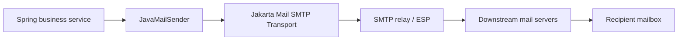
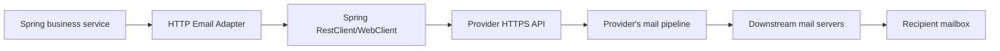
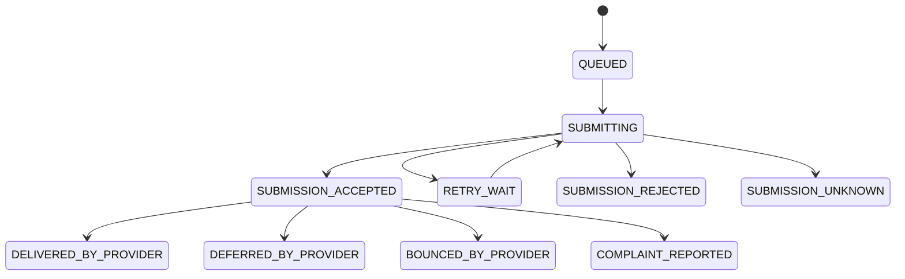
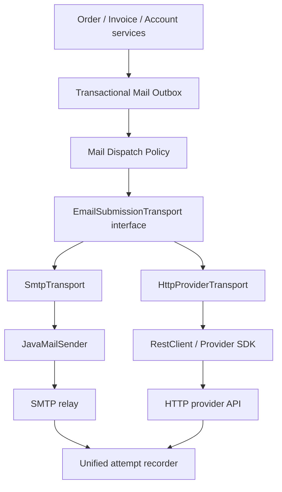
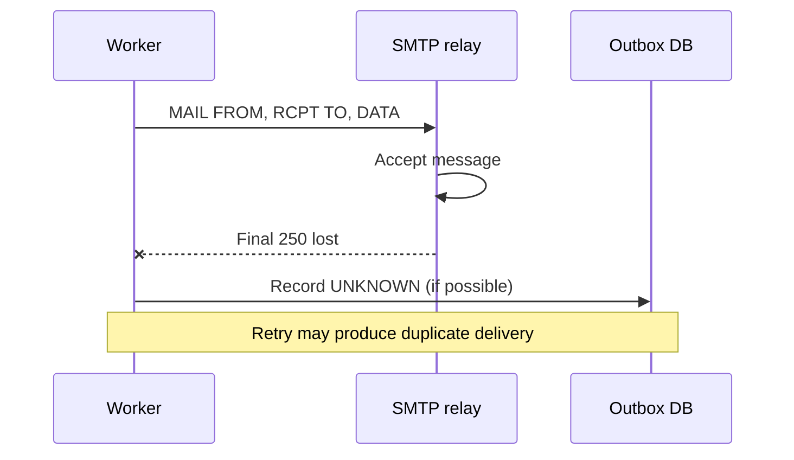
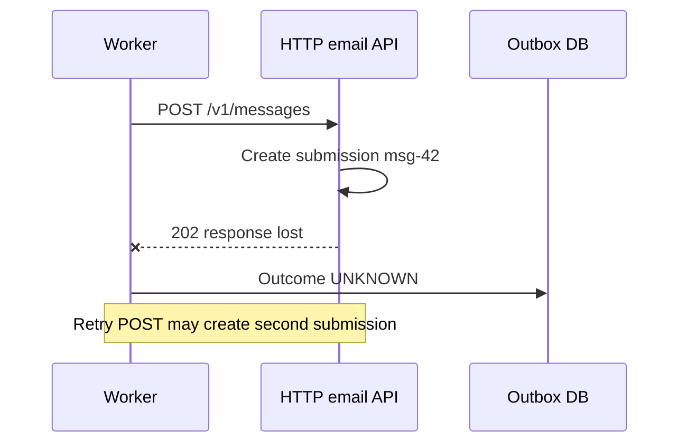
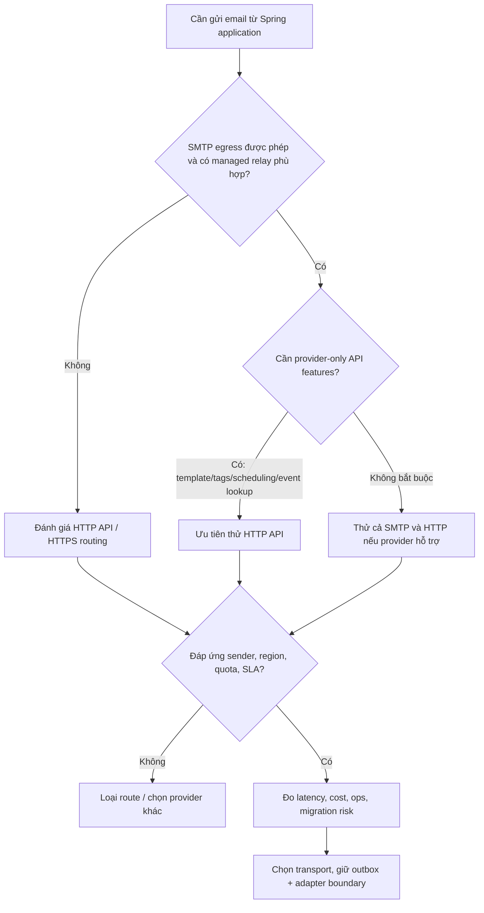

# Chọn SMTP relay hay HTTP email provider

Khi một ứng dụng **Spring Framework Mail** cần gửi email, lựa chọn thường không dừng ở “có `JavaMailSender` hay không”. Nhóm phát triển phải quyết định **kết nối tới SMTP relay** hay **gọi HTTP API của nhà cung cấp email**. Hai con đường đều có thể gửi thư giao dịch, xác minh tài khoản, hóa đơn, thông báo bảo mật hoặc email marketing, nhưng khác nhau về giao thức, cách xác thực, khả năng biểu diễn nội dung, giới hạn, quan sát kết quả, vận hành, tính di động và mức độ phụ thuộc nhà cung cấp.

Một số sai lầm bắt nguồn từ cách đặt câu hỏi quá đơn giản:

- “SMTP là chuẩn, vậy mặc định luôn tốt hơn HTTP API?”
- “HTTP trả 202 nghĩa là email đã vào Inbox?”
- “Dùng API thì không còn duplicate, không cần transactional outbox?”
- “SMTP được Spring Boot hỗ trợ sẵn nên không cần thiết kế retry?”
- “Chỉ cần đổi hostname SMTP thành endpoint API lúc migration?”

Không có câu trả lời chung cho mọi workload. **Quyết định đúng phụ thuộc vào hợp đồng nghiệp vụ, mức độ kiểm soát cần thiết, đặc tính provider và năng lực vận hành của đội ngũ.** Chương *Quyết định kiến trúc* sẽ xây một khung đánh giá thực tế, rồi minh họa cách giữ thiết kế ứng dụng ổn định dù thay đổi transport.

Ví dụ sử dụng Java 21, Spring Framework 6.x/Spring Boot 3.x, Jakarta Mail, `JavaMailSender` và Spring `RestClient`. Địa chỉ `example.test`, endpoint và response HTTP trong bài đều **giả định để minh họa**, không phải API thực của một provider cụ thể. Khi triển khai cần đối chiếu tài liệu, hợp đồng, endpoint, permission, quota và semantics của nhà cung cấp đang sử dụng.

> **Phân biệt trước:** SMTP relay và HTTP email provider đều là **bên tiếp nhận yêu cầu gửi thư**. Kết quả được nhận vào hàng đợi của provider/SMTP relay không tự chứng minh thư đến mailbox cuối, càng không chứng minh vào thư mục Inbox.

## 1. Hai lựa chọn thực chất là gì?

### 1.1. SMTP relay

Ứng dụng sử dụng SMTP client để gửi một MIME message qua SMTP submission/relay endpoint. Trong hệ sinh thái Spring, đường phổ biến:



Ứng dụng cấu hình hostname, port, TLS mode, authentication, sender identity và SMTP timeouts. Một đoạn code:

```java
SimpleMailMessage mail = new SimpleMailMessage();
mail.setFrom("orders@example.test");
mail.setTo("buyer@example.test");
mail.setSubject("Xác nhận đơn hàng");
mail.setText("Đơn ORDER-1042 đã được ghi nhận.");

javaMailSender.send(mail);
```

Với HTML, inline images và attachments, thường dùng `MimeMessage`/`MimeMessageHelper`. SMTP là một giao thức đã được tiêu chuẩn hóa ở nhiều phần; có thể chuyển sang relay khác mà vẫn giữ một phần đáng kể ứng dụng gửi MIME. Tuy nhiên **cấu hình sender, TLS, authentication, quota, phản hồi lỗi, DKIM, webhook và chính sách vận hành vẫn có thể khác theo provider**.

SMTP relay không nhất thiết là server tự vận hành: nhiều email service providers cung cấp một **SMTP endpoint được quản lý**, cùng với HTTP API, dashboard, logs và event webhooks.

### 1.2. HTTP email provider

Ứng dụng gọi một endpoint HTTP(S) do email service provider cung cấp, thường gửi JSON payload:



Một request khái niệm:

```http
POST /v1/messages HTTP/1.1
Host: api.mail-provider.example.test
Authorization: Bearer <REDACTED>
Content-Type: application/json

{
  "from": {"email": "orders@example.test"},
  "to": [{"email": "buyer@example.test"}],
  "subject": "Xác nhận đơn hàng",
  "text": "Đơn ORDER-1042 đã được ghi nhận.",
  "metadata": {"notificationId": "MAIL-8821"}
}
```

Đây là **schema giả định**, không có cam kết provider thực nào chấp nhận các field/URL này. Provider có thể dùng `api-key` header, Bearer token, HMAC, JSON với cấu trúc khác, endpoint gửi theo template ID, hoặc multipart/raw MIME endpoint.

HTTP APIs thường tạo cơ hội khai thác các tính năng riêng của provider: template được lưu trên provider, message tags, per-recipient substitutions, campaign/transactional streams, sandbox, scheduling, analytics, event callbacks, delivery logs và idempotency key **nếu provider có contract tương ứng**.

### 1.3. Cùng đích, khác transport

```text
              Business email intent
                        |
              Mail delivery abstraction
                 /             \
                v               v
        SMTP adapter         HTTP adapter
         |                       |
    JavaMailSender             RestClient
         |                       |
     SMTP relay             Email HTTP API
         \                       /
            Provider delivery pipeline
                        |
                 Mailbox recipient
```

Cả hai đường cuối cùng thường dựa vào hạ tầng email và SMTP giữa các mail servers. Chọn HTTP API **không có nghĩa email cuối cùng được giao tới Gmail/Outlook qua HTTP**. Nó thay đổi cách **ứng dụng nộp yêu cầu gửi** cho nhà cung cấp.

## 2. Bảng so sánh tổng quan

| Tiêu chí | SMTP relay | HTTP email provider |
|---|---|---|
| Giao thức submit | SMTP qua TCP, thường STARTTLS/implicit TLS | HTTPS, thường JSON hoặc MIME API |
| Client Spring | `JavaMailSender` / Jakarta Mail | `RestClient`, `WebClient` hoặc SDK provider |
| Tính tiêu chuẩn hóa | SMTP + MIME có tính phổ biến | API schema/endpoint thường riêng provider |
| Xác thực | SMTP AUTH, app password, OAuth/SASL, đôi khi IP allowlist | API key, Bearer/OAuth, ký request, mTLS tùy provider |
| TLS/ports | 587 STARTTLS; 465 implicit TLS; endpoint theo tài liệu | 443 HTTPS thường gặp |
| HTML, inline, attachment | MIME hỗ trợ tự nhiên | Phụ thuộc schema, size limit, base64/multipart hoặc raw MIME |
| Template lưu phía provider | Không phải tính năng SMTP chuẩn | Thường là tính năng API riêng |
| Metadata/tags tùy chỉnh | Có thể qua header, không portable hoàn toàn | Thường có field rõ, phụ thuộc provider |
| Feedback đồng bộ | SMTP reply code/phase | HTTP status + provider error code/response |
| Delivery events/bounces | Không có webhook trong SMTP protocol; provider có thể bổ sung | Provider thường tích hợp event/webhook nếu có |
| Rate/concurrency limits | SMTP sessions, messages/recipients, quota account | Requests/s, recipients/s, credits/quota account |
| Idempotency submit | SMTP không chuẩn hóa idempotency key end-to-end | Một số provider có; phải kiểm tra contract |
| Tính di động | Tương đối cao ở lớp MIME/SMTP | Thường cần adapter/SDK riêng khi đổi provider |
| Quan sát vận hành | SMTP logs, replies, provider dashboard/event API nếu có | Structured API errors, IDs, events/dashboard nếu có |
| Hạn chế egress | Có nơi chặn port SMTP | HTTPS 443 thường dễ tích hợp hơn, nhưng vẫn có proxy/firewall/policy |
| Chi phí | Phụ thuộc gói và đơn vị tính | Phụ thuộc gói và đơn vị tính; không mặc định rẻ/đắt hơn |
| Retry/outbox | **Ứng dụng vẫn phải thiết kế** | **Ứng dụng vẫn phải thiết kế** |

Hai điều cần tránh:

1. Không gán mọi tính năng tốt cho HTTP và mọi thiếu sót cho SMTP. **Cùng một provider** có thể cấp message ID, analytics, bounce webhooks, reputation dashboard và quota rõ ràng cho cả SMTP và HTTP submissions.
2. Không coi bảng trên là một cam kết API. Tính năng cụ thể phải kiểm tra theo **provider, gói dịch vụ, account, region, sender domain, loại traffic và thời điểm triển khai**.

## 3. Tiêu chí quyết định số một: yêu cầu nghiệp vụ

Trước khi chọn transport, mô tả:

- Email là **transactional** (OTP, password reset, hóa đơn, cảnh báo) hay **bulk/marketing**?
- Thời hạn nhận email có ngắn không; ví dụ OTP hết hạn nhanh?
- Có cần **lưu ý định gửi bền vững** sau khi transaction nghiệp vụ commit?
- Có cần gắn tags/metadata, per-recipient substitutions, campaign tracking, preference management?
- Có cần **webhooks** cho bounce/complaint/delivery và có quản lý suppression?
- Có yêu cầu data residency, thời gian retention, encryption, kiểm toán?
- Có nhiều provider/tenant/account; cần route/failover theo policy?
- Mức độ chấp nhận duplicate và thời gian retry được phép là bao nhiêu?
- Đội ngũ có khả năng vận hành SMTP, DNS, quota, DKIM/DMARC, webhook và telemetry ra sao?

### 3.1. Ví dụ thư OTP

Một OTP có thể yêu cầu:

```text
time-to-submit target  < 10 seconds
token expiry          = 5 minutes
priority              = high
dedupe key            = verificationSessionId + eventType
provider              = whichever route is approved and healthy
```

Các con số giả định. Điều quan trọng không phải HTTP có status 202 hay SMTP có 250, mà là **queue age, rate quota, khả năng gửi trước expiry, kết quả accepted/unknown và chiến lược cấp OTP mới**. Nếu cả hai transport đáp ứng mục tiêu, chọn dựa trên observability, chi phí, bảo mật và mức tích hợp.

### 3.2. Ví dụ hóa đơn có attachment

Một hóa đơn PDF có thể đòi:

- Giữ bản nội dung bất biến theo thời điểm phát hành.
- Unicode/HTML/plain-text alternative đúng định dạng.
- Attachment bytes hợp lệ và không vượt MIME size limit.
- Audit notification ID, attempt ID và provider message ID.
- Khả năng retry sau outage mà không phát hành hóa đơn thứ hai.

SMTP + `MimeMessageHelper` có thể thuận tiện vì MIME là định dạng tự nhiên. HTTP API cũng có thể phù hợp, nhưng cần tính overhead base64 và field size limit; provider có thể hỗ trợ raw MIME upload hoặc attachment endpoint riêng. Không chọn một đường chỉ vì “PDF gửi bằng SMTP thì chắc tốt hơn”.

### 3.3. Ví dụ hệ thống marketing lớn

Nếu cần campaign scheduling, unsubscribe groups, template versioning phía provider, category/tags, per-recipient analytics và preference management, **HTTP API** thường đáng đánh giá kỹ vì nhiều ESP mở các khả năng này qua API rõ ràng. Nhưng không tự coi HTTP là hợp pháp hoặc an toàn cho bulk: cả hai lựa chọn phải tuân consent, suppression, anti-abuse policies và địa phương pháp luật áp dụng.

### 3.4. Email mức best-effort

Với một mail ít quan trọng, có thể chấp nhận mất thông báo nếu process crash, nên thiết kế đơn giản với bounded executor và SMTP relay được cấu hình tốt. Nếu nghiệp vụ thật sự yêu cầu không mất intent, hãy dùng **outbox** với bất kỳ transport nào. Mức độ tin cậy của pipeline không được quyết định bởi chữ “SMTP” hay “HTTP”.

## 4. Tiêu chí số hai: môi trường mạng và bảo mật

### 4.1. SMTP thường có nhiều kiểu kết nối

| Kiểu | Port thường gặp | Semantics |
|---|---:|---|
| SMTP submission với STARTTLS | 587 | Kết nối SMTP rồi nâng cấp TLS |
| SMTP submission với implicit TLS | 465 | TLS handshake ngay từ đầu |
| SMTP server-to-server/relay | 25 | Chính sách và egress khác, không mặc định phù hợp ứng dụng |

Port là **thông lệ**, không phải phương tiện duy nhất xác định security mode. Một endpoint có thể sử dụng port tùy chỉnh, yêu cầu OAuth hoặc IP allowlist. Với STARTTLS bắt buộc, cần kiểm tra TLS thật sự được thiết lập và hostname/certificate hợp lệ; không tắt validation trong production để bỏ qua lỗi cấu hình.

### 4.2. HTTP thường thuận tiện trong mạng chỉ mở HTTPS

Một số cloud/network chặn outbound SMTP ports, đặc biệt port 25, hoặc yêu cầu phê duyệt egress đặc biệt. HTTPS port 443 thường đã đi qua proxy/firewall, nhưng vẫn có:

- Corporate HTTP proxy và certificate trust settings.
- DNS resolution, mTLS, WAF, API endpoint allowlist.
- Provider egress IP allowlist/quy định region.
- TLS certificate/hostname verification.
- API key quản lý như secret.

Nếu môi trường **cấm SMTP egress** mà HTTPS API được phép, HTTP có thể là lựa chọn dễ vận hành hơn. Nhưng cần xác minh thực tế route, không suy “HTTPS chắc chắn luôn hoạt động”.

### 4.3. Credential và phân quyền khác nhau

SMTP có thể dùng username/password SMTP riêng, application password, SASL/OAuth hoặc IP-auth relay. HTTP APIs thường dùng API key/token, đôi khi scope granular theo sender/domain, template hoặc subaccount. Cả hai đều cần:

- Secret manager, rotation, audit access, không hardcode.
- Quyền hạn tối thiểu theo environment/tenant.
- Không đưa secrets vào logs, exception traces hoặc config xuất công khai.
- Thu hồi/rotate khi incident và không dùng chung prod/test credentials tùy tiện.
- Kiểm tra sender identity tách biệt với việc đã xác thực kết nối.

**AUTH thành công không có nghĩa sender domain được phép.** Một SMTP relay có thể nhận AUTH rồi từ chối `MAIL FROM`; HTTP API có thể trả lỗi permission dù token hợp lệ.

### 4.4. TLS không thay thế sender authentication

TLS bảo vệ đường truyền ứng dụng ↔ provider (khi được xác thực đúng). Nó không chứng minh mail do ai phát hành đối với phía nhận. Email sender identity/deliverability còn cần SPF, DKIM, DMARC và các cấu hình nhà cung cấp phù hợp, bất kể ứng dụng nộp thư bằng SMTP hay HTTPS API.

## 5. Cấu hình SMTP relay trong Spring Boot

Spring Boot có thể auto-configure `JavaMailSenderImpl` khi có mail starter/dependencies và các điều kiện bean/config tương ứng. Một cấu hình SMTP submission với STARTTLS minh họa:

```yaml
spring:
  mail:
    host: smtp.example.test
    port: 587
    username: ${SMTP_USERNAME}
    password: ${SMTP_PASSWORD}
    default-encoding: UTF-8
    properties:
      "[mail.smtp.auth]": "true"
      "[mail.smtp.starttls.enable]": "true"
      "[mail.smtp.starttls.required]": "true"
      "[mail.smtp.ssl.checkserveridentity]": "true"
      "[mail.smtp.connectiontimeout]": "5000"
      "[mail.smtp.timeout]": "10000"
      "[mail.smtp.writetimeout]": "10000"
```

Các giá trị timeout tính bằng mili-giây trong cấu hình Jakarta Mail SMTP thông dụng. Chúng không tạo một deadline tổng cho DNS, render template, attachment download, toàn bộ SMTP session, DB updates và retry. Các cổng/TLS mode phải theo tài liệu endpoint; với implicit TLS (thường 465), cấu hình khác, ví dụ `mail.smtp.ssl.enable=true` thay vì giả định chỉ đổi port.

### 5.1. Gửi plain text bằng SimpleMailMessage

```java
package com.example.mail.smtp;

import org.springframework.mail.SimpleMailMessage;
import org.springframework.mail.javamail.JavaMailSender;
import org.springframework.stereotype.Component;

@Component
public class SmtpTextTransport {

    private final JavaMailSender sender;

    public SmtpTextTransport(JavaMailSender sender) {
        this.sender = sender;
    }

    public void submitText(
            String recipient,
            String subject,
            String text) {

        SimpleMailMessage message = new SimpleMailMessage();
        message.setFrom("orders@example.test");
        message.setTo(recipient);
        message.setSubject(subject);
        message.setText(text);

        sender.send(message);
    }
}
```

Đây là code **gọi SMTP đồng bộ**: thread sẽ chờ tới khi transport hoàn tất hoặc lỗi. Nó có thể chạy ở mail worker/executor riêng để không block HTTP request. Không nên nhét `submitText(...)` vào một database transaction đang mở rồi giả định SMTP rollback được.

### 5.2. Gửi MIME với plain text, HTML và attachment

```java
package com.example.mail.smtp;

import jakarta.mail.MessagingException;
import jakarta.mail.internet.MimeMessage;

import org.springframework.core.io.ByteArrayResource;
import org.springframework.mail.javamail.JavaMailSender;
import org.springframework.mail.javamail.MimeMessageHelper;
import org.springframework.stereotype.Component;

@Component
public class SmtpMimeTransport {

    private final JavaMailSender sender;

    public SmtpMimeTransport(JavaMailSender sender) {
        this.sender = sender;
    }

    public void submitInvoice(
            String recipient,
            String subject,
            String plainText,
            String htmlText,
            byte[] pdfBytes) throws MessagingException {

        MimeMessage mime = sender.createMimeMessage();
        MimeMessageHelper helper =
                new MimeMessageHelper(mime, true, "UTF-8");

        helper.setFrom("billing@example.test");
        helper.setTo(recipient);
        helper.setSubject(subject);
        helper.setText(plainText, htmlText);

        helper.addAttachment(
                "invoice.pdf",
                new ByteArrayResource(pdfBytes),
                "application/pdf");

        sender.send(mime);
    }
}
```

Ví dụ dùng `ByteArrayResource` để minh họa file PDF nhỏ; với file lớn hoặc nhiều jobs, không giữ toàn bộ attachment bytes trong heap. Dùng resource có thể mở stream lại, giới hạn size, staging bền vững và có timeout. MIME serialization có thể đọc attachment nhiều lần; không giữ một `InputStream` đã đóng hoặc stream chỉ đọc được một lần mà không đảm bảo lifecycle.

### 5.3. SMTP code không tự cung cấp provider message ID thống nhất

Khi `JavaMailSender.send(...)` trả bình thường, API không nhất thiết trả một provider message ID có thể tra cứu như một HTTP response JSON. Có thể lấy `Message-ID` của MIME trong một số trường hợp, nhưng đó không phải khóa lookup chung của mọi SMTP relay và có thể khác ID nội bộ của nhà cung cấp.

Nếu yêu cầu truy vết sâu:

- Gắn **application notification ID** vào logs/outbox và metadata/headers khi được phép.
- Kiểm tra provider có SMTP submission events, dashboard hoặc API lookup không.
- Dùng webhook/provider message ID nếu service cung cấp cho SMTP submissions.
- Không tuyên bố có thể query mọi SMTP relay bằng `Message-ID` theo một API chuẩn.

### 5.4. SMTP exception cần được đọc theo pha

Spring Mail có thể ném:

- `MailAuthenticationException`: SMTP AUTH thất bại.
- `MailSendException`: một hoặc nhiều email gửi lỗi.
- `MailParseException`: lỗi parse địa chỉ/nội dung.
- `MailPreparationException`: lỗi chuẩn bị MIME.

Nested Jakarta Mail `MessagingException` và subclass provider-specific có thể mang reply code/failed recipients. Với một thư nhiều recipients, `MailSendException` không mặc định cung cấp một trạng thái chuẩn hóa cho từng RCPT TO; cần xem semantics của SMTP implementation và cấu hình partial send.

## 6. Gọi HTTP provider bằng RestClient

Đối với Spring Framework 6.1+ và Spring Boot 3.2+ theo cấu hình tương ứng, `RestClient` là một lựa chọn HTTP client đồng bộ, thuận tiện cho worker gửi mail. `WebClient` phù hợp khi hệ thống đang dùng reactive pipeline hoặc cần async/nonblocking model; **không cần dùng WebClient chỉ vì HTTP provider là “API”**.

### 6.1. Namespace cấu hình ứng dụng

```yaml
app:
  email:
    http:
      base-url: https://api.mail-provider.example.test
      api-key: ${EMAIL_PROVIDER_API_KEY}
      connect-timeout: 5s
      read-timeout: 10s
      sender: orders@example.test
```

`app.email.http` là **custom application configuration**, Spring Boot không tự biến nó thành provider HTTP email sender. Cần viết properties binding, validate HTTPS endpoint/token, cấu hình HTTP request factory và timeouts theo client stack được sử dụng.

### 6.2. DTO của API giả định

```java
package com.example.mail.http;

import java.util.List;
import java.util.Map;

public record ProviderEmailRequest(
        String from,
        List<String> to,
        String subject,
        String text,
        String html,
        Map<String, String> metadata
) {}

public record ProviderSubmitResponse(
        String id,
        String status
) {}
```

Tùy ESP, JSON thực tế có thể yêu cầu:

- `from` là object email/name, không phải String.
- `to` là mảng object chứ không phải mảng String.
- `personalizations` hoặc `recipients` theo semantics khác.
- `content` là mảng MIME types.
- `templateId` cùng dynamic data.
- `attachments` base64 hoặc multipart upload.
- `metadata`, `tags`, `category` có giới hạn/field names riêng.

Đây là lý do nên cô lập DTO provider trong adapter thay vì để application business services phụ thuộc trực tiếp vào schema bên ngoài.

### 6.3. RestClient ví dụ

```java
package com.example.mail.http;

import org.springframework.http.HttpHeaders;
import org.springframework.http.MediaType;
import org.springframework.http.ResponseEntity;
import org.springframework.web.client.RestClient;

public final class HttpEmailClient {

    private final RestClient client;

    public HttpEmailClient(
            RestClient.Builder builder,
            String baseUrl,
            String apiKey) {

        this.client = builder
                .baseUrl(baseUrl)
                .defaultHeader(
                        HttpHeaders.AUTHORIZATION,
                        "Bearer " + apiKey)
                .build();
    }

    public ResponseEntity<ProviderSubmitResponse> submit(
            ProviderEmailRequest request) {

        return client.post()
                .uri("/v1/messages")
                .contentType(MediaType.APPLICATION_JSON)
                .body(request)
                .retrieve()
                .toEntity(ProviderSubmitResponse.class);
    }
}
```

Đây là client minh họa **schema và endpoint giả định**. Ở ứng dụng thực, adapter nên bọc kết quả/exception thành outcome riêng, cấu hình HTTP timeouts/TLS, đặt log redaction và quản lý token rotation. Mặc định với `retrieve()`, những HTTP 4xx/5xx thường được xử lý theo error semantics của `RestClient`, không phải tự động trở thành một `ProviderSubmitResponse` hợp lệ.

### 6.4. Chỉ chấp nhận những HTTP statuses mà provider contract định nghĩa

Không nên viết:

```java
if (status >= 200 && status < 300) {
    return "DELIVERED";
}
```

Vì:

- HTTP `200` có thể trả resource/operation status.
- HTTP `201` có thể tạo một submission object.
- HTTP `202` thường thể hiện **request đã được chấp nhận để xử lý sau** theo semantics HTTP.
- Một provider có thể trả `204` khi thao tác thành công, nhưng không có response ID.

Điều adapter được quyền khẳng định là **những gì tài liệu chính thức của provider nói về endpoint cụ thể**, ví dụ “request accepted/queued by provider”. Không gán `DELIVERED_TO_INBOX` từ HTTP 202, 200 hay 201.

### 6.5. Ví dụ dịch HTTP status thành outcome

Một lớp transport nên tách **trạng thái HTTP** khỏi **trạng thái email**:

```java
package com.example.mail.transport;

public enum SubmissionOutcome {
    ACCEPTED_BY_PROVIDER,
    TEMPORARY_REJECTED,
    PERMANENT_REJECTED,
    UNKNOWN
}

public record EmailSubmitResult(
        SubmissionOutcome outcome,
        String providerId,
        String providerMessageId,
        String safeErrorCode
) {}
```

Giả sử endpoint được ghi trong contract là trả `202` khi đã nhận yêu cầu:

```java
ResponseEntity<ProviderSubmitResponse> response =
        httpClient.submit(request);

if (response.getStatusCode().value() == 202
        && response.getBody() != null) {
    return new EmailSubmitResult(
            SubmissionOutcome.ACCEPTED_BY_PROVIDER,
            "provider-http",
            response.getBody().id(),
            null);
}

return new EmailSubmitResult(
        SubmissionOutcome.UNKNOWN,
        "provider-http",
        null,
        "UNEXPECTED_SUCCESS_RESPONSE");
```

Đây là **minh họa một contract giả định**, không phải quy tắc áp dụng mọi provider. Với response không được nhận diện, tránh tự khẳng định accepted/rejected nếu chưa đủ bằng chứng.

### 6.6. Authentication header không phải chỗ để log

HTTP client logging/interceptors có thể ghi request headers và body. Cần redact:

- `Authorization`, API key, cookies/tokens.
- Recipient addresses khi không cần.
- Subject/body chứa dữ liệu cá nhân.
- HTML/attachment base64 và metadata nhạy cảm.
- URL callback/idempotency data mang secret.

Nếu dùng retries ở HTTP client layer, phải biết nó đang retry **HTTP submission request** hay chỉ retry connection setup. Không bật một generic retry interceptor cho mọi POST mà chưa xét nguy cơ request đã được server nhận nhưng response bị mất.

## 7. HTTP errors: status code không phải toàn bộ câu chuyện

| HTTP status / lỗi | Gợi ý ban đầu | Điều phải kiểm tra |
|---|---|---|
| `400` | Payload validation/syntax | Provider error code, field nào invalid |
| `401` | Thiếu/sai auth | Token/secret/scope; thường không retry liên tục |
| `403` | Quyền/account/policy | Sender verification, suspension, permissions |
| `404` | Endpoint/template không tồn tại | URI/API version/template ID |
| `409` | Conflict | Có phải idempotency conflict hay domain conflict khác? |
| `413` | Request/message quá lớn | MIME/base64/attachment limits |
| `422` | Semantic validation | Recipient/template/content policy theo provider |
| `429` | Rate/quota limit | Retry-After/window/limit scope; không retry storm |
| `5xx` | Provider failure | Retry hoặc UNKNOWN theo contract và thời điểm xử lý |
| Connect failure trước khi gửi bytes | Transport/network | Có bằng chứng chưa submit thì retry an toàn hơn |
| Read timeout sau khi POST gửi đi | Uncertain outcome | Server có thể đã accepted; idempotency/reconciliation |

Không áp dụng bảng máy móc. Provider có thể encode lỗi nghiệp vụ trong response JSON với HTTP 200, trả 400 cho quota hoặc đưa mã riêng không trùng convention. Hãy dùng error catalog/SDK của provider, giữ original code đã lọc và map sang internal category.

### 7.1. ResourceAccessException và timeout

Trong Spring RestClient, network I/O failure thường được biểu diễn qua `ResourceAccessException`. Một timeout **không đủ** để biết request đã tới provider hay chưa:

```text
Client POSTs /v1/messages
Provider creates submission
Provider response lost
Client gets read timeout
```

Nếu HTTP client hoặc worker tự retry POST ngay, có thể tạo hai submissions. Nếu provider có **idempotency key contract** cho endpoint, gửi cùng key có thể hỗ trợ dedupe theo phạm vi/thời hạn của provider; nếu không, cân nhắc provider lookup/reconciliation hoặc duplicate-tolerant retry policy.

### 7.2. HTTP 429 và Retry-After

Một provider có thể trả `429 Too Many Requests` với `Retry-After` hoặc field quota window. Nhưng:

- Cần kiểm tra provider có thực sự phát header và định nghĩa nó không.
- Header có thể là delta-seconds hoặc HTTP date.
- Không tin giá trị vô hạn hoặc không hợp lệ từ mạng mà không giới hạn.
- Quota có thể áp dụng theo account, region, endpoint, recipient/second hoặc daily credits.
- Retry phải được schedule, không giữ worker thread ngủ hàng phút.

Nếu nhiều replicas chia sẻ một account, local limiter ở từng JVM chưa đủ để tránh lặp 429.

### 7.3. 5xx không tự chứng minh chưa xử lý

HTTP 500/502/503 thường gợi ý lỗi server; nhiều trường hợp retryable. Nhưng với POST có side effect, một server có thể đã tạo submission rồi lỗi khi trả kết quả. Vì vậy một policy vững phải dựa trên **provider contract/idempotency semantics**, không tự gán mọi 5xx là “chưa gửi”.

## 8. MIME, attachment và template: transport không phải nội dung

Một email hoàn chỉnh có các thành phần logic:

```text
Envelope/Recipients
From, Reply-To, Subject
Plain-text body
HTML alternative
Inline images
Attachments
Headers/Message-ID
Tracking/correlation metadata
```

SMTP submit thường nhận **MIME bytes**. Với HTTP API, provider có thể nhận các field JSON rồi dựng MIME bên trong, hoặc hỗ trợ raw MIME request. Sự khác biệt này ảnh hưởng khả năng port nội dung giữa hai transports.

### 8.1. SMTP tự chủ MIME

Ưu điểm khi tự tạo `MimeMessage`:

- Quyết định multipart/alternative, multipart/related, attachment filenames và charsets.
- Có thể thêm custom headers phù hợp với policy.
- Kiểm thử MIME serialization bằng SMTP sandbox.
- Có thể lưu bản MIME chuẩn để replay/điều tra theo yêu cầu phù hợp.

Nhược điểm:

- Ứng dụng chịu trách nhiệm dựng multipart và MIME encodings đúng.
- Có thể phát sinh lỗi attachment resource/stream lifecycle.
- Phải tự quản lý template rendering và không để HTML injection.
- Provider có thể áp đặt policy/size limit khác dù MIME hợp lệ.

### 8.2. HTTP API có thể dựng MIME thay ứng dụng

Ví dụ API yêu cầu:

```json
{
  "templateId": "invoice-v3",
  "variables": {
    "customerName": "Người nhận thử nghiệm",
    "invoiceNumber": "INV-42"
  },
  "recipient": "buyer@example.test"
}
```

Đây chỉ là **mô hình minh họa**. Nếu provider giữ template, cần quản lý version, drift giữa staging/production, fallback khi template bị xóa, quyền sửa template, giới hạn personalization và khả năng rollback. Template phía provider tiện cho nhiều nhóm cùng làm nội dung, nhưng tạo **vendor coupling**: một template ID của provider A không dùng được trực tiếp trên provider B.

### 8.3. Attachment qua HTTP có overhead

Nhiều HTTP email APIs yêu cầu attachment bytes được **base64** trong JSON. Base64 tăng kích thước phần encoding khoảng 4/3 trước khi cộng JSON/HTTP framing; MIME cũng có transfer encoding overhead riêng. Vì vậy:

- So sánh **raw file size, encoded request size và final MIME size**; mỗi provider có thể đặt giới hạn khác.
- Không tải PDF 50 MB rồi vô điều kiện chuyển thành một chuỗi base64 rất lớn trong heap.
- Cân nhắc streaming/multipart/raw MIME endpoint nếu provider hỗ trợ và có contract rõ.
- Dùng object-store reference nếu provider/ứng dụng cho phép và có kiểm soát authorization/expiry.
- Không log attachment base64 khi HTTP request lỗi.

Không chọn SMTP chỉ vì “HTTP gửi attachment không được”. Điều đúng là **kiểm tra khả năng và giới hạn của endpoint cụ thể**.

### 8.4. Inline content IDs và HTML

Với SMTP MIME, ứng dụng có thể gắn hình nội tuyến bằng Content-ID và tham chiếu `cid:logo` trong HTML. Với HTTP, một số providers hỗ trợ `content_id` hoặc inline attachment type; một số không. Nếu email yêu cầu HTML phức tạp hoặc inline resources, nên làm một phép thử thực:

1. Render plain/HTML alternative với Unicode.
2. Gắn inline logo và PDF attachment.
3. Gửi qua SMTP và HTTP API tới các test mailboxes được phép.
4. Kiểm tra MIME/source và hiển thị trên các mail clients mục tiêu.
5. Đo encoded size và provider rejection.

Việc mail hiển thị khác nhau có thể do MIME/rendering/provider transformations, không nhất thiết do giao thức submit.

### 8.5. Tracking metadata phải được quản lý riêng

Một provider HTTP có thể trả message ID và cho phép tags/metadata:

```text
notificationId = MAIL-8821
businessEvent  = ORDER_CREATED
tenantGroup    = transactional
templateKey    = ORDER_CONFIRMED
```

Không nên đưa thông tin nhạy cảm như email người nhận, OTP, user token, full order details vào tags nếu chúng được hiển thị trong dashboard/webhook do provider quản lý. Metadata có thể đi xuyên hệ thống thứ ba; chỉ gửi những trường cần thiết và được phép.

Với SMTP, custom headers cũng có thể mang correlation ID, nhưng việc giữ nguyên header/được provider expose/khả năng tra cứu không phải cam kết chung của SMTP.

## 9. Kết quả gửi và sự kiện delivery là hai lớp khác nhau

Đối với cả SMTP lẫn HTTP, nên tách:



Không phải mọi provider phát đủ mọi event. Một service có thể báo accepted/queued nhưng không báo delivered, hoặc cung cấp webhook chậm/không theo thứ tự. Trạng thái DOWNSTREAM phải thể hiện **những gì thật sự quan sát được**.

### 9.1. SMTP 250 và HTTP 202 khác định dạng, tương tự mục tiêu

Với SMTP, phản hồi `250` cuối sau DATA thường là relay chấp nhận message để xử lý tiếp. Với HTTP, một endpoint có thể trả `202 Accepted` với provider message ID để xác nhận job được nhận vào hệ thống gửi. Nhưng semantics thực vẫn theo contract:

```text
SMTP:
  transport submit complete -> relay accepted

HTTP:
  API request accepted -> provider job created/queued

Neither:
  proof of final Inbox placement
```

Không nên hiển thị “Email đã giao thành công tới hộp thư đến” khi ứng dụng chỉ biết submission được accepted.

### 9.2. Delivery feedback khi chỉ có SMTP

SMTP protocol không tự cung cấp một webhook cho thư đã gửi. Nhưng **SMTP relay service** có thể cung cấp webhooks, dashboard, API query hoặc event export độc lập. Nếu cần bounce/complaint, hãy hỏi:

- Provider có event feed cho SMTP submissions không?
- Có cách correlate event với ứng dụng notification ID/provider message ID không?
- Event IDs có uniqueness/deduplication contract không?
- Dữ liệu events được giữ bao lâu?
- Webhook có signature hoặc cơ chế xác thực nào?
- Event semantics “delivered”, “deferred”, “bounce” là gì?

Nếu một relay chỉ nhận SMTP rồi không có event API, hệ thống có thể thiếu thông tin downstream, dù SMTP submission hoạt động tốt. Đây là lý do chức năng vận hành **của nhà cung cấp**, không chỉ transport, phải được đưa vào quyết định.

### 9.3. Webhook HTTP provider không tự đáng tin

Nếu nhà cung cấp HTTP cung cấp webhook, receiver vẫn phải:

1. Xác minh chữ ký/provider authentication theo contract; không tin một HTTP POST tùy ý.
2. Validate schema, event timestamps/clock skew và payload size.
3. Deduplicate event ID (provider có thể gửi lại khi timeout).
4. Xử lý out-of-order events: một event cũ không được đảo state mới vô lý.
5. Map provider message ID về **attempt** đúng, không chỉ tìm theo recipient email.
6. Không ghi raw webhook payload chứa PII/token vào logs mở.
7. Có replay/reconciliation nếu webhook đến trễ hoặc thất bại.

Một lần HTTP API trả 202 và webhook về DELIVERED không có nghĩa có exactly-once end-to-end. Webhooks thường theo hướng at-least-once và phải được xử lý idempotently.

### 9.4. Bounce/complaint không đồng nghĩa lỗi transport

Ví dụ:

```text
T0: SMTP 250 after DATA or HTTP 202
T1: Provider attempts delivery downstream
T2: Destination rejects mailbox -> provider bounce event
```

T0 vẫn là submission accepted. T2 là **delivery failure**. Không sửa lịch sử attempt từ accepted thành “SMTP chưa bao giờ nhận”. Thay vào đó ghi downstream event, phân loại hard/soft bounce đúng theo provider policy và cập nhật suppression nếu phù hợp.

### 9.5. Những event có thể bị thiếu

Không nhận được bounce event không chứng minh delivery thành công; không nhận được delivered event cũng không chứng minh failure. Nếu business SLA yêu cầu bằng chứng, phải hỏi provider có thể tra cứu submission/delivery bằng API/log trong bao lâu và triển khai reconciliation khi events missing.

## 10. Sender reputation và deliverability

Chọn SMTP relay hay HTTP API **không thể thay thế** công việc cấu hình gửi thư hợp lệ. Các yếu tố quan trọng:

- Sender domain và subdomain được verify.
- SPF phù hợp với envelope sender/MAIL FROM và đường gửi thực tế.
- DKIM được ký bằng signing domain/key hợp lệ.
- DMARC yêu cầu SPF hoặc DKIM pass **và aligned** với header From.
- Reverse DNS/IP reputation và IP pool khi tự vận hành relay.
- Bounce/complaint handling, suppression và unsubscribe theo loại mail.
- Nội dung, volume ramp-up, tỷ lệ phản hồi và reputation.
- Chính sách chống lạm dụng của provider và mailboxes đích.

### 10.1. Chuyển transport trong cùng provider cũng cần xác nhận identity

Một provider có thể cho phép SMTP account dùng verified sender A, nhưng HTTP API token chỉ được scope cho sender B hoặc subaccount khác. Đổi từ SMTP sang HTTP mà không verify domain/From/custom MAIL FROM có thể gây 403/550, DKIM alignment mismatch hoặc deliverability giảm.

### 10.2. Chuyển provider cần kiểm tra DNS

Nếu từ relay A sang HTTP provider B:

```text
Before:
  SMTP A signs DKIM d=example.test
  custom envelope domain bounce-a.example.test

After:
  HTTP B may require new DKIM selector
  custom envelope domain bounce-b.example.test
```

Phải xác nhận SPF/DKIM/DMARC alignment trong tuyến B, domain verification, bounce routing và reputation. Không chỉ cập nhật `spring.mail.host` hoặc HTTP base URL rồi coi migration hoàn tất.

### 10.3. Đừng dùng failover để né chính sách

Nếu provider A từ chối vì spam/abuse complaint, thiếu consent hoặc sender chưa được phép, tự động chuyển sang provider B chỉ để vượt bộ lọc là một anti-pattern. Failover phù hợp cho lỗi hạ tầng/quota trong phạm vi gửi được phép, với rủi ro duplicate và compliance đã được đánh giá.

## 11. Thiết kế provider abstraction: không để nghiệp vụ gọi API vendor trực tiếp

Khi cần chọn giữa SMTP và HTTP, một kiến trúc linh hoạt là đặt **transport adapter** dưới một interface riêng của ứng dụng. Business service tạo một **ý định gửi email** và không biết provider dùng SMTP hay HTTPS.



### 11.1. Business intent độc lập với transport

Một model minh họa:

```java
package com.example.mail.domain;

import java.time.Instant;
import java.util.List;
import java.util.Map;
import java.util.UUID;

public record EmailIntent(
        UUID notificationId,
        String tenantId,
        String businessKey,
        String senderIdentityId,
        List<String> recipients,
        String subject,
        String plainText,
        String html,
        List<AttachmentReference> attachments,
        Map<String, String> safeTags,
        Instant expiresAt
) {}

public record AttachmentReference(
        String objectKey,
        String filename,
        String contentType,
        long expectedSize
) {}
```

Đây là model hướng nghiệp vụ. Nó không chứa SMTP server password hoặc HTTP API key; credentials thuộc transport configuration. Với email thực tế cần thêm recipient policy, template version, consent status, locale, reply-to, idempotency/correlation, data residency và điều kiện attachment.

Quan trọng: không để `EmailIntent` giữ live `MimeMessage`, `HttpServletRequest`, `SecurityContext`, JPA entity chưa khởi tạo hoặc `InputStream` tạm. Outbox worker có thể xử lý job ở một process khác nhiều giờ sau request.

### 11.2. Interface gửi một attempt

```java
package com.example.mail.transport;

import com.example.mail.domain.EmailIntent;

public interface EmailSubmissionTransport {
    String transportId();
    EmailSubmitResult submit(EmailIntent intent);
}
```

Một method `submit` ở đây đại diện cho **một attempt**, không đảm bảo retry qua restart hoặc delivery thành công. Tầng orchestration/outbox quản lý retries, còn transport adapter chịu trách nhiệm:

- Serialize intent sang MIME hoặc provider JSON.
- Kết nối/xác thực và submit.
- Chuẩn hóa outcome nhưng giữ provider-specific error metadata đã lọc.
- Đóng/giải phóng network resources đúng cách.
- Không âm thầm retry mọi POST/SMTP call khi outcome có thể UNKNOWN.

### 11.3. SMTP adapter

Một ví dụ rút gọn để thấy ranh giới:

```java
package com.example.mail.transport.smtp;

import com.example.mail.domain.EmailIntent;
import com.example.mail.transport.EmailSubmitResult;
import com.example.mail.transport.EmailSubmissionTransport;
import com.example.mail.transport.SubmissionOutcome;
import org.springframework.mail.MailException;
import org.springframework.mail.javamail.JavaMailSender;
import org.springframework.mail.javamail.MimeMessageHelper;

public final class SmtpEmailSubmissionTransport
        implements EmailSubmissionTransport {

    private final JavaMailSender sender;
    private final SmtpErrorClassifier classifier;

    public SmtpEmailSubmissionTransport(
            JavaMailSender sender,
            SmtpErrorClassifier classifier) {
        this.sender = sender;
        this.classifier = classifier;
    }

    @Override
    public String transportId() {
        return "smtp-primary";
    }

    @Override
    public EmailSubmitResult submit(EmailIntent intent) {
        try {
            var mime = sender.createMimeMessage();
            var helper = new MimeMessageHelper(
                    mime, true, "UTF-8");

            helper.setFrom("orders@example.test");
            helper.setTo(intent.recipients().toArray(String[]::new));
            helper.setSubject(intent.subject());
            helper.setText(intent.plainText(), intent.html());

            // AttachmentReference được resolve bởi một
            // resource loader có kiểm soát ở bản production.
            sender.send(mime);

            return new EmailSubmitResult(
                    SubmissionOutcome.ACCEPTED_BY_PROVIDER,
                    transportId(),
                    null,
                    null);
        } catch (MailException error) {
            return classifier.classify(
                    transportId(), error);
        } catch (jakarta.mail.MessagingException error) {
            return classifier.classifyPreparationFailure(
                    transportId(), error);
        }
    }
}
```

`SmtpErrorClassifier` là abstraction do ứng dụng viết; code trên **không xử lý attachments đầy đủ**, chỉ minh họa adapter. Ở bản production, cần validate sender From/recipient policy và stage-specific errors, không log raw email. Đặc biệt, mặc dù `sender.send(...)` ném `MailException`, classifier không được tự kết luận `NOT_SENT` cho một read timeout sau DATA.

### 11.4. HTTP adapter

```java
package com.example.mail.transport.http;

import com.example.mail.domain.EmailIntent;
import com.example.mail.transport.EmailSubmitResult;
import com.example.mail.transport.EmailSubmissionTransport;

import org.springframework.web.client.ResourceAccessException;
import org.springframework.web.client.RestClientResponseException;

public final class HttpEmailSubmissionTransport
        implements EmailSubmissionTransport {

    private final HttpEmailClient client;
    private final HttpProviderResponseMapper mapper;

    public HttpEmailSubmissionTransport(
            HttpEmailClient client,
            HttpProviderResponseMapper mapper) {
        this.client = client;
        this.mapper = mapper;
    }

    @Override
    public String transportId() {
        return "http-primary";
    }

    @Override
    public EmailSubmitResult submit(EmailIntent intent) {
        ProviderEmailRequest request =
                mapper.buildRequest(intent);

        try {
            var response = client.submit(request);
            return mapper.fromSuccess(response);
        } catch (RestClientResponseException error) {
            return mapper.fromHttpError(error);
        } catch (ResourceAccessException error) {
            return mapper.fromUnknownTransportError(error);
        }
    }
}
```

`HttpProviderResponseMapper` là service adapter do ứng dụng tự triển khai. Phân loại HTTP 429, validation/permission, 5xx và timeout theo **contract của provider**, không rải `if (status == 429)` khắp business services. Với SDK vendor, adapter cũng nên che các exception/response types độc quyền.

### 11.5. Portability có giới hạn thực tế

Nhờ interface, khi đổi transport, phần business service có thể giữ nguyên:

```text
orderCreated -> enqueue EmailIntent
```

Nhưng không phải mọi chức năng chuyển đổi 1:1:

- Provider A có hosted template, provider B không có.
- HTTP API A hỗ trợ idempotency key, SMTP B không.
- Event taxonomy khác (delivered, processed, deferred, bounce).
- Mail merge/personalization semantics khác.
- API key scopes, sender verification, limits khác.
- Unsubscribe groups và marketing compliance khác.

Vì vậy abstraction nên che **những gì thực sự chung**, đồng thời có capability checks và phương án graceful degradation. Đừng tạo một interface giả “mọi provider giống nhau” rồi âm thầm bỏ tracking/unsubscribe/attachments khi chuyển tuyến.

## 12. Capability matrix cho nhiều provider

Thay vì một boolean `usesHttpApi`, lưu thông tin capability được xác thực:

| Capability | Ví dụ câu hỏi |
|---|---|
| `supportsHtmlAlternative` | Có thể gửi plain text + HTML đúng MIME không? |
| `supportsInlineAttachment` | Có content-ID/cid inline không? |
| `supportsRawMime` | HTTP endpoint nhận MIME bytes trực tiếp không? |
| `supportsHostedTemplates` | Template version/variables do provider quản lý? |
| `supportsTags` | Có metadata/tags? Giới hạn và PII policy? |
| `supportsIdempotencyKey` | Áp dụng cho endpoint nào, bao lâu, theo account nào? |
| `supportsDeliveryEvents` | Có webhook/feed/lookup không? |
| `supportsMessageLookup` | Có tra cứu provider message ID không? |
| `supportsScheduledSend` | Có scheduling phía provider, cancel API? |
| `maxEncodedSize` | Dùng MIME, JSON base64 hay raw upload? |
| `regionalAvailability` | Được phép xử lý tenant ở region nào? |

Không suy capability từ tên giao thức. Một SMTP relay service có thể có webhooks tốt hơn một HTTP endpoint đơn giản; một HTTP provider có thể thiếu idempotency dù trả JSON rất rõ.

### 12.1. Xử lý khi capability thiếu

Ví dụ invoice yêu cầu attachment và delivery audit:

```text
Provider A:
  supports attachments = yes
  supports event lookup = yes

Provider B:
  supports attachments = yes
  supports event lookup = no
```

Nếu audit downstream là yêu cầu bắt buộc, provider B có thể không đủ điều kiện dù gửi SMTP/HTTP thành công. Không âm thầm downgrade business requirement khi failover.

### 12.2. Routing theo policy, không theo request parameter tùy ý

Một routing policy có thể xem:

1. Tenant/region có được phép gửi qua provider này?
2. Sender identity đã verified và DKIM/DMARC aligned?
3. Loại email transactional/bulk có được phép?
4. Có đủ size/attachment/template capabilities?
5. Account còn quota/rate/concurrency budget?
6. Provider/circuit breaker có healthy?
7. Notification có prior attempt outcome UNKNOWN không?
8. Chi phí và latency có đạt SLA?

Không để người dùng HTTP tùy ý truyền provider ID để sử dụng credentials của tenant khác. Routing decision cần audit theo notification/attempt.

## 13. Ranh giới transaction: outbox quan trọng hơn transport

Một rủi ro lớn ở cả hai lựa chọn:

```java
@Transactional
public Order placeOrder(CreateOrderCommand command) {
    Order order = orderRepository.save(...);
    emailTransport.submit(buildIntent(order));
    return order;
}
```

Nếu SMTP accepted hoặc HTTP API đã tạo submission, rồi database rollback, email vẫn có thể được gửi. `@Transactional` của Spring chỉ quản lý các tài nguyên DB (hoặc tài nguyên đã thực sự tham gia transaction), **không tự rollback network side effect**.

### 13.1. Transactional outbox

Mẫu bền vững hơn:

```mermaid
sequenceDiagram
    participant HTTP as HTTP request
    participant S as Order service
    participant DB as Business DB
    participant W as Mail worker
    participant P as SMTP or HTTP provider
    HTTP->>S: Create order
    S->>DB: BEGIN
    S->>DB: INSERT order + mail_outbox
    S->>DB: COMMIT
    S-->>HTTP: Order created; mail QUEUED
    W->>DB: Claim due mail intent
    DB-->>W: Notification + lease token
    W->>P: Submit via chosen transport
    P-->>W: Accepted / rejected / unknown
    W->>DB: Record attempt outcome
```

Đây là mẫu **business DB + outbox in same transaction**, rồi worker gửi sau commit. Nó giải quyết cửa sổ mất intent giữa DB commit và gọi SMTP/HTTP:

- Business rollback ⇒ không có outbox job đã commit ⇒ worker không gửi email cho event đó.
- Business commit ⇒ có outbox intent bền vững qua process restart.
- Provider down ⇒ job vẫn có thể được retry mà không rollback order đã tạo.

Nhưng **outbox không tự mang lại exactly-once SMTP/HTTP submission**, vì có thể provider accepted rồi worker chết trước khi lưu status.

### 13.2. Schema PostgreSQL minh họa

```sql
CREATE TABLE mail_outbox (
    id UUID PRIMARY KEY,
    tenant_id VARCHAR(100) NOT NULL,
    business_key VARCHAR(250) NOT NULL,
    template_key VARCHAR(120) NOT NULL,
    template_version VARCHAR(50) NOT NULL,
    recipient_ref VARCHAR(200) NOT NULL,
    payload_ref VARCHAR(300) NOT NULL,
    preferred_transport VARCHAR(80),
    state VARCHAR(32) NOT NULL,
    attempt_count INTEGER NOT NULL DEFAULT 0,
    next_attempt_at TIMESTAMPTZ NOT NULL DEFAULT NOW(),
    expires_at TIMESTAMPTZ,
    lease_owner VARCHAR(100),
    lease_token UUID,
    lease_until TIMESTAMPTZ,
    created_at TIMESTAMPTZ NOT NULL DEFAULT NOW(),
    accepted_at TIMESTAMPTZ,
    UNIQUE (tenant_id, business_key)
);

CREATE INDEX ix_mail_outbox_due
ON mail_outbox (next_attempt_at, created_at)
WHERE state IN ('QUEUED', 'RETRY_WAIT');

CREATE TABLE mail_attempt (
    id UUID PRIMARY KEY,
    outbox_id UUID NOT NULL REFERENCES mail_outbox(id),
    attempt_number INTEGER NOT NULL,
    transport_id VARCHAR(100) NOT NULL,
    provider_account_id VARCHAR(100),
    started_at TIMESTAMPTZ NOT NULL,
    completed_at TIMESTAMPTZ,
    outcome VARCHAR(60),
    http_status INTEGER,
    smtp_reply_code INTEGER,
    safe_provider_error VARCHAR(120),
    provider_message_id VARCHAR(250),
    UNIQUE (outbox_id, attempt_number)
);
```

Schema chỉ minh họa. Production cần constraints cho state transitions, indexes cho lease recovery, retention và quyền truy cập. `http_status` và `smtp_reply_code` là **optional theo transport**; không giả lập HTTP status cho SMTP hoặc ngược lại. Một attempt có thể có mã/phase phong phú hơn (SMTP enhanced code, provider error category, endpoint operation), nên lưu versioned normalized outcome khi cần.

### 13.3. Claim job nguyên tử

Khi có nhiều workers/replicas, không dùng `SELECT where state='QUEUED'` rồi gửi ngay:

```sql
WITH candidate AS (
    SELECT id
    FROM mail_outbox
    WHERE state IN ('QUEUED','RETRY_WAIT')
      AND next_attempt_at <= NOW()
      AND (expires_at IS NULL OR expires_at > NOW())
    ORDER BY next_attempt_at, created_at
    LIMIT 1
    FOR UPDATE SKIP LOCKED
)
UPDATE mail_outbox AS job
SET state = 'SUBMITTING',
    lease_owner = :workerId,
    lease_token = :leaseToken,
    lease_until = NOW() + INTERVAL '2 minutes',
    attempt_count = attempt_count + 1
FROM candidate
WHERE job.id = candidate.id
RETURNING job.*;
```

Đây là ví dụ cho PostgreSQL. Claim transaction cần commit trước transport call; không giữ DB lock suốt lúc chờ network. Tạo attempt record cùng transaction claim hoặc dùng một giao thức bảo đảm attempt ID/persistence nhất quán.

### 13.4. Fencing token và giới hạn của lease

Khi ghi result:

```sql
UPDATE mail_outbox
SET state = :newState,
    lease_owner = NULL,
    lease_token = NULL,
    lease_until = NULL
WHERE id = :outboxId
  AND state = 'SUBMITTING'
  AND lease_token = :leaseToken;
```

Nếu cập nhật 0 rows, worker đã mất lease hoặc state đã thay đổi, không nên ghi đè. Tuy nhiên fencing này **chỉ bảo vệ database state**, không thu hồi SMTP DATA/HTTP POST mà worker cũ có thể đã gửi. Lease expiry không phải bằng chứng provider chưa tiếp nhận request.

### 13.5. Ghi một attempt là cần thiết

Không chỉ lưu `mail_outbox.state=FAILED` rồi ghi đè `lastError` mỗi lần. Hãy giữ:

```text
notificationId = MAIL-8821
businessKey    = order-created:ORDER-1042

attempt 1:
  transport = smtp-primary
  outcome   = TEMPORARY_REJECTED

attempt 2:
  transport = http-backup
  outcome   = ACCEPTED_BY_PROVIDER
  providerMessageId = msg-test-002
```

Attempt history giúp phân tích failover, rate limits, costs và duplicate risk. Không tuyên bố mọi transport đều trả provider message ID; field này có thể null.

## 14. Retry và idempotency: điểm khác có ý nghĩa nhất

Cả SMTP và HTTP đều chạy qua network nên có thể gặp timeout, connection reset, provider outage hoặc response lost. Khác biệt đáng chú ý: **một số HTTP email APIs có idempotency key contract**, trong khi SMTP chuẩn không cung cấp cơ chế tương tự cho mọi relay.

### 14.1. SMTP acceptance và cửa sổ UNKNOWN



Nếu relay đã lưu message nhưng client không thấy reply cuối, nó có thể tiếp tục phát thư. `MailSendException`/socket timeout ở client **không chứng minh chưa gửi**. Cùng MIME `Message-ID` không bảo đảm hai SMTP providers sẽ deduplicate.

### 14.2. HTTP acceptance cũng có cửa sổ UNKNOWN



Đây là cùng một loại distributed systems problem: **remote side effect xảy ra nhưng local acknowledgment mất**. Đổi từ SMTP sang HTTP không tự giải quyết bài toán.

### 14.3. Idempotency key của HTTP provider, nếu có

Một số providers có thể hỗ trợ header hoặc field kiểu:

```http
POST /v1/messages HTTP/1.1
Idempotency-Key: email-order-1042
Content-Type: application/json
Authorization: Bearer <REDACTED>
```

Header/contract ở đây **chỉ là ví dụ**. Không phải mọi provider hỗ trợ `Idempotency-Key`, và một số chỉ hỗ trợ dedupe theo batch, endpoint hoặc account. Khi có:

1. Dùng một key **ổn định cho cùng business submission intent** qua các lần retry tương ứng.
2. Đảm bảo provider quy định cùng key cùng payload có kết quả gì.
3. Kiểm tra TTL của key (ví dụ vài giờ/ngày tùy provider, không tự suy).
4. Hiểu scope account/subaccount/region.
5. Kiểm tra lỗi khi cùng key nhưng payload khác.
6. Xác minh response của retry trả original submission ID hay trạng thái khác.
7. Không giả định key còn hiệu lực sau khi đổi provider.

Nếu API không hỗ trợ idempotency, xử lý UNCERTAIN/UNKNOWN tương tự SMTP: cân nhắc lookup, manual reconciliation hoặc chấp nhận at-least-once với duplicate-tolerant business semantics.

### 14.4. Idempotency nội bộ và provider idempotency là hai lớp

| Lớp | Khóa ví dụ | Ngăn gì? |
|---|---|---|
| HTTP request | `tenantId + clientRequestId` | Client retry tạo nhiều business requests |
| Business event | `tenantId + orderId + ORDER_CREATED` | Enqueue nhiều email intents cho một event |
| Outbox notification | UUID notification ID | Theo dõi một ý định gửi |
| Mail attempt | UUID attempt ID | Phân biệt các lần transport thực tế |
| Provider HTTP (nếu có) | Stable provider idempotency key | Tránh tạo duplicate provider submission trong contract hỗ trợ |

Không dùng **attempt ID mới mỗi lần retry** làm provider idempotency key nếu mục tiêu là provider dedupe *cùng một intent*: key sẽ thay đổi và mất tác dụng. Ngược lại, không tái sử dụng business key cho những lần gửi thực sự khác nhau (ví dụ phát hành phiên bản hóa đơn mới được phép), vì sẽ chặn nhầm notification hợp lệ.

### 14.5. Retry policy tách lỗi trước/sau submission

```text
Connection refused before request begins
  -> retry with backoff when provider policy allows

SMTP 451 during RCPT TO
  -> temporary rejection; retry subject to quota

HTTP 429 with documented retry guidance
  -> defer until suitable quota window

SMTP AUTH 535 / HTTP 401 credential invalid
  -> pause account; operator action

HTTP 422 invalid sender / SMTP 550 5.7.1 relaying denied
  -> fix sender permissions; do not suppress recipients

Read timeout after DATA or after POST accepted
  -> UNKNOWN; reconcile/idempotency-aware retry
```

Không gom mọi `MailSendException` và `RestClientResponseException` thành một boolean `retry=true`. Cần error category, scope (recipient/message/account/provider), retry budget, deadline và khả năng side effect đã được thực hiện.

### 14.6. Failover phải xét duplicate và ràng buộc

Ví dụ provider SMTP A trả 421 có bằng chứng *temporary rejection before accepting DATA*, còn HTTP B khỏe và được phép gửi từ cùng domain. Có thể cân nhắc failover theo routing policy. Nhưng nếu A mất phản hồi cuối sau DATA, B gửi tiếp sẽ có thể tạo hai thư.

Những trường hợp **không tự động failover**:

- Recipient không tồn tại theo phản hồi đáng tin.
- Sender chưa verify hoặc vi phạm quyền/account.
- Content/policy rejection do spam/consent.
- Attachment vượt limit cả các tuyến.
- Dữ liệu tenant không được phép rời region hiện tại.
- Outcome của attempt trước là UNKNOWN và duplicate không được phép.

Không dùng alternate provider để né kiểm soát chống lạm dụng.

## 15. Quota, throughput và latency phải đo ở cùng đơn vị

SMTP và HTTP dùng đơn vị giới hạn có thể khác:

| Đặc tính | SMTP | HTTP |
|---|---|---|
| Concurrency | Active SMTP sessions, connection cap | Active HTTP requests/connections, API concurrency |
| Tốc độ | Messages/s, recipients/s | Requests/s, recipients/s, sends/s |
| Hạn mức dài hạn | Daily/monthly sends hoặc recipients | Quota credits/messages/recipients |
| Kích thước | Final MIME message size | JSON/request bytes, attachment/base64, final MIME limit |
| Batch | Một message nhiều RCPT TO có semantics riêng | Một POST có thể gửi batch/personalizations |
| Throttling | `421`, `451`, provider-specific codes | HTTP `429`, headers/provider-specific codes |

Không kết luận “HTTP nhanh hơn SMTP” chỉ vì handshake SMTP có nhiều lệnh; nếu API thực hiện queue trước khi trả HTTP 202, còn SMTP đợi reply sau DATA, hai endpoints đang cung cấp **hai mốc acknowledgment khác nhau**. Phải đo end-to-end:

```text
T0 business transaction committed
T1 outbox job claimed
T2 provider submit began
T3 provider accepted/rejected
T4 downstream delivered/bounced event
```

Các metric cần tách:

- `T1-T0`: outbox queue delay.
- `T3-T2`: transport submission latency.
- `T3-T0`: time-to-submit accepted.
- `T4-T3`: downstream delivery/defer interval khi có event.
- Tỷ lệ outcomes UNKNOWN và retries.
- Người dùng thấy email đúng thời gian/SLA không.

### 15.1. Little's law chỉ là một điểm khởi đầu

Ở một pha có arrival rate `λ` và thời gian phục vụ trung bình `W`, số in-flight trung bình gần `L=λW` trong điều kiện ổn định. Nếu muốn submit 20/s và mỗi attempt giữ worker trung bình 0,3s, số attempts đồng thời trung bình khoảng 6.

Nhưng concurrency sizing thực còn bị ràng buộc bởi:

- Provider max concurrent SMTP sessions.
- HTTP requests/s, rate limits, daily quotas.
- HTTP connection pool và SMTP socket life cycle.
- MIME rendering/attachment download/CPU.
- Tail latency p95/p99, retries/timeout.
- Số replicas dùng cùng account.
- Fairness giữa transactional và bulk traffic.

Nếu provider quota là 10 sends/s, tăng HTTP client threads từ 10 lên 100 không biến quota thành 100/s.

### 15.2. Global rate limiting

Giả sử ba pods cùng dùng một provider account, mỗi pod có local limiter 10 sends/s. Tổng có thể tới 30 sends/s dù account chỉ được phép 10. Cần:

- Distributed token bucket/counter/coordination.
- Dispatcher tập trung theo provider account.
- Quota allocation tĩnh có kiểm soát theo replica.
- Broker partitions/consumer concurrency theo account.

Trong mọi trường hợp, trần theo provider có thể bao gồm **recipient count**, không chỉ số HTTP requests/SMTP messages. Một HTTP API nhận một request chứa 100 recipients có thể tính quota khác một request chứa một recipient. Hãy dùng đơn vị từ hợp đồng chính thức.

### 15.3. Bounded executor và backpressure

Nếu outbox có một triệu notifications, không claim hết rồi enqueue một triệu `MimeMessage`/JSON payload vào RAM. Worker dispatcher nên:

1. Chỉ claim khi có in-flight capacity và quota.
2. Dùng small batches/lease phù hợp.
3. Có executor/queue bounded với rejection policy rõ.
4. Giữ backlog chờ dài hạn trong storage bền vững.
5. Khi quota hết, đặt `nextAttemptAt` hoặc pause account.
6. Không dùng `Thread.sleep` giữ hàng nghìn workers chờ retry.

Điều này áp dụng cho cả blocking `JavaMailSender` và blocking `RestClient`. Dùng `WebClient` nonblocking có thể giảm số threads trong một số workloads, nhưng không thay thế business-level concurrency/rate limits.

## 16. Chi phí: so tổng sở hữu, không chỉ giá mỗi nghìn email

Một bảng giá công khai có thể nhìn “HTTP API rẻ hơn” hoặc “SMTP relay rẻ hơn”, nhưng cần tính đầy đủ:

\[
\text{TCO}
= \text{provider charges}
+ \text{infrastructure}
+ \text{integration/maintenance}
+ \text{operations/support}
+ \text{risk cost}
\]

Các thành phần cần xem:

- Số messages/recipients mỗi tháng và cách provider tính.
- Free tier, quota tiers, volume discounts, minimum charges.
- Transactional và marketing streams có pricing khác không?
- Dedicated IP, subaccount, region, log retention, event export có tính thêm phí?
- Template hosting, analytics, suppression, API lookups, support SLA có nằm trong gói?
- Webhook processing, object storage và data transfer của hệ thống.
- Retries/failed attempts có tiêu thụ quota/billing không?
- Nhân lực vận hành SMTP servers, DNS, reputation, abuse/complaint management nếu tự host.
- Công sức lock-in/migration và chi phí test hai providers.

### 16.1. Self-hosted SMTP relay không “miễn phí”

Nếu ứng dụng tự dựng Postfix/Exim hoặc hạ tầng tương đương, cần vận hành:

- IP reputation và reverse DNS.
- DKIM signing, SPF, DMARC alignment.
- TLS certificates, AUTH và abuse prevention.
- Queue management, retry policies, bounce processing.
- Monitoring, audit/retention, backup/disaster recovery.
- Capacity planning, egress restrictions và support trực ngoài giờ.

Đó là một quyết định vận hành **khác** với việc dùng SMTP endpoint của một managed ESP. Khi so với HTTP email API có SLA, không nên coi “SMTP” đồng nghĩa “tự host không tốn phí”.

### 16.2. HTTP SDK giúp nhanh hơn nhưng có chi phí khóa nhà cung cấp

Một SDK/provider API có thể giúp gửi và tra cứu events nhanh, nhưng application code có thể dần phụ thuộc:

```text
VendorTemplateId
VendorPersonalizationObject
VendorMessageTags
VendorTrackingSettings
VendorDeliveryEvent
```

Khi migration, cần viết adapter mới, chuyển templates/webhooks và rà business semantics. Giữ boundary từ sớm giúp giảm chi phí, song cũng không nên hy sinh các tính năng cần thiết chỉ để tạo một abstraction quá chung.

### 16.3. Chi phí lỗi nghiệp vụ

Một provider rẻ hơn nhưng có thời gian phục hồi kém, quota không đủ cho OTP hoặc thiếu audit cho hóa đơn có thể làm TCO cao hơn nhiều. Các yêu cầu compliance, data residency, security và SLA là **ràng buộc bắt buộc** trước khi tối ưu giá.

## 17. Khung ra quyết định: điều kiện loại trừ trước, điểm số sau

Một khung quyết định tốt cần tách hai giai đoạn:

1. **Hard constraints:** giải pháp nào không đáp ứng phải loại trước, dù giá rẻ hay code đẹp.
2. **Trade-offs:** với các giải pháp đủ điều kiện, so sánh chi phí, tính di động, độ dễ tích hợp, SLA và vận hành.

### 17.1. Các câu hỏi loại trừ

| Câu hỏi bắt buộc | Hệ quả nếu không đáp ứng |
|---|---|
| Mạng cho phép kết nối endpoint và TLS mode tương ứng? | Không thể dùng transport đó trong deployment |
| Provider chấp nhận sender domain/From và region của tenant? | Không được route |
| Có đủ quota/throughput/size limit cho workload? | Không đạt SLA |
| Có đáp ứng authentication/secret-management policy? | Không được đưa production |
| Có data residency, retention, DPA/compliance phù hợp? | Không được xử lý dữ liệu |
| Có đủ event evidence/audit nếu business bắt buộc? | Không đạt yêu cầu |
| Có hỗ trợ MIME/template/attachment cần thiết? | Không hỗ trợ use case |
| Có chính sách retry/idempotency/UNKNOWN phù hợp? | Không đạt reliability requirement |

Đừng dùng weighted score để “bù” một vi phạm bắt buộc. Ví dụ HTTP API có developer experience tốt nhưng region không được phép thì không thể được chọn chỉ vì tổng điểm cao hơn.

### 17.2. Cây quyết định đơn giản



Đây là **cây tham khảo**, không phải policy tự động được phép bỏ qua security/compliance. Nếu doanh nghiệp đã có SMTP relay với deliverability và monitoring tốt, SMTP vẫn có thể là lựa chọn tối ưu dù HTTP API cũng sẵn.

### 17.3. Weighted scorecard (sau hard constraints)

Có thể chấm từng transport trên các tiêu chí tùy dự án:

| Tiêu chí | Ý nghĩa đánh giá | Ưu tiên thường gặp |
|---|---|---|
| Reliability & recovery | Outbox, provider state, idempotency, lookup | Rất cao cho transactional |
| SLA/latency | Time-to-submit và time-to-event | Cao cho OTP |
| Integration effort | Spring client, tests, SDK, migration | Cao với đội nhỏ |
| Vendor portability | Chuyển provider/region khi cần | Cao với multi-provider |
| Features | Template, metadata, webhooks, analytics | Cao với campaign/transactional insights |
| Operational burden | Secrets, quota, DNS, logs, support | Cao nếu đội thiếu mail ops |
| Security/compliance | Audit, data residency, IAM | Hard constraint trước scoring |
| Cost at expected volume | Giá + vận hành + retries + support | Sau hard constraints |

Có thể cho từng tiêu chí trọng số và điểm trong một bảng quyết định nội bộ. **Điểm số phải dựa trên bằng chứng** từ PoC, hợp đồng hoặc dashboard account, không lấy nhận định “HTTP hiện đại hơn nên 5/5” làm dữ kiện.

### 17.4. Quyết định theo từng workload

**Tình huống 1 — Ứng dụng nhỏ, gửi ít email transactional.**

Nếu Spring Boot đã có `JavaMailSender`, mạng cho phép SMTP submission, managed relay có quota đủ và không cần vendor-only API features, **SMTP relay** thường là lựa chọn triển khai nhanh, dễ port. Vẫn cần timeout, outbox (nếu mail quan trọng), bounce handling và monitoring.

**Tình huống 2 — SaaS nhiều tenant, cần template/tags/event tracking.**

Nếu nhà cung cấp có HTTP API tốt với sender-scoped credentials, webhook/signature, message lookup và template versioning, **HTTP API** có thể giảm công tích hợp các tính năng vendor. Cần adapter và DTO riêng để không khóa toàn bộ business code vào SDK.

**Tình huống 3 — Môi trường chỉ cho egress HTTPS.**

Nếu SMTP ports bị chặn bởi network policy và HTTP endpoint được cho phép sau security review, **HTTP API** là lựa chọn khả thi hơn. Không tắt firewall hoặc gửi qua port không được phê duyệt chỉ để giữ JavaMailSender.

**Tình huống 4 — Đã vận hành SMTP relay nội bộ có SLA rõ.**

Nếu relay nội bộ giải quyết routing, identity, monitoring, bounce và incident response hiệu quả, HTTP vendor có thể không đáng đổi. **Giữ SMTP** có thể giảm lock-in, với điều kiện relay đáp ứng policy và nguồn lực vận hành.

**Tình huống 5 — Có nhu cầu multi-provider/failover.**

Tạo **transport adapter + outbox + routing policy** ngay cả khi hiện tại chỉ dùng một transport. Có thể kết hợp SMTP A và HTTP B, nhưng không tự failover khi prior attempt UNKNOWN hoặc provider B không đủ data residency/capability.

**Tình huống 6 — Hóa đơn với PDF lớn và MIME phức tạp.**

Thử thực tế cả hai đường: MIME serialization, attachment size, encoding overhead, provider limit và recipient render. SMTP có thể tiện vì tự kiểm soát MIME; HTTP có thể tiện nếu provider hỗ trợ raw MIME hoặc attachment API tốt. Quyết định dựa trên test, không đoán từ giao thức.

### 17.5. Không thiết kế “hybrid” khi chưa có nhu cầu

Có khả năng dùng hai transports không có nghĩa mọi email cần chạy hai tuyến. Một hệ thống ít email, không cần vendor features và có relay ổn định có thể giữ **một transport + interface nhỏ**. Bổ sung routing/failover/health scoring quá sớm làm tăng complexity, test matrix và rủi ro gửi trùng.

Nguyên tắc: kiến trúc phải đáp ứng nhu cầu thực và giữ **đường mở rộng có thể kiểm soát**, không viết một platform email tổng quát nếu doanh nghiệp chỉ cần 20 mail/ngày.

## 18. Data residency, privacy và pháp lý

Chọn provider là quyết định về **bên thứ ba nhận dữ liệu**, không chỉ về package Java.

Một HTTP JSON request và một SMTP MIME message đều có thể chứa:

- Địa chỉ email, tên người nhận.
- Nội dung đơn hàng/hóa đơn.
- Token xác minh/reset password.
- Attachment chứa dữ liệu cá nhân.
- Tags/metadata và tracking identifiers.
- IP/identity của hệ thống gửi.

### 18.1. Những câu hỏi cần trả lời

- Provider xử lý và lưu dữ liệu ở region nào? Có quyền chọn region không?
- Có subprocessor/data transfer terms và DPA phù hợp không?
- Log nội dung/metadata được giữ bao lâu?
- Có encryption at rest, retention deletion và audit exports?
- Ai được truy cập email content/attachments trong vendor dashboard?
- Provider có dùng dữ liệu cho mục đích nào ngoài gửi thư theo hợp đồng?
- Webhook destination có thể làm lộ địa chỉ/nguyên nhân bounce không?
- Account/test environment có dùng dữ liệu thật không?

Không suy data residency từ domain hostname. Một endpoint HTTPS ở region nào đó không tự chứng minh toàn bộ xử lý/logging nằm trong region ấy.

### 18.2. Compliance không chỉ ở transport

Ngay cả khi SMTP relay do tổ chức tự vận hành, email vẫn có thể đi qua nhiều mail servers trên Internet. TLS ở đường submit chỉ bảo vệ một hop; email không tự mã hóa end-to-end. Với dữ liệu đặc biệt nhạy cảm, cân nhắc gửi **link tới portal có xác thực** thay vì attachment, theo chính sách bảo mật.

Với marketing, phải có consent, unsubscribe, suppression, complaint response phù hợp quy định và provider policy. Nếu dùng HTTP API có unsubscribe groups, đó là tính năng hỗ trợ, không tự thay tổ chức chịu trách nhiệm tuân thủ.

### 18.3. Secret scopes và blast radius

API key có quyền gửi mọi domain/tenant là một rủi ro lớn khi lộ. SMTP credentials dùng chung cho tất cả luồng cũng vậy. Nếu provider hỗ trợ subaccounts/keys per sender/tenant, cân nhắc:

- Tách production/staging.
- Tách transactional/bulk khi phù hợp.
- Hạn chế permissions theo sender/domain/template.
- Rotate và revoke độc lập.
- Giảm impact khi một worker/token bị lộ.

Không để HTTP client nhận arbitrary API key từ request payload, hay một SMTP sender bean bị mutate username/password liên tục theo request khi có concurrent workers.

## 19. Kế hoạch chuyển từ SMTP sang HTTP hoặc ngược lại

Migration không phải chỉ thay hai dòng cấu hình. Một kế hoạch an toàn gồm:

### Bước 1 — Lập inventory thực tế

Ghi:

- Những luồng đang gửi (OTP, invoice, transactional, campaign).
- Sender domains, envelope From, reply-to, DKIM selectors.
- MIME/HTML/template/attachments và kích thước.
- Số lượng sends, recipients, peak rate, p95 latency.
- Error handling/retry/duplicate policy.
- Webhooks, bounce suppression, analytics, audit.
- Idempotency/business event keys.
- SMTP/network credentials, firewall/proxy.

Đừng bắt đầu bằng việc thay tất cả calls tới `JavaMailSender.send(...)` thành `RestClient.post(...)` từng nơi trong business code. Trước tiên tạo abstraction/outbox để có thể thay route tập trung.

### Bước 2 — Tạo contract chung và provider-specific adapter

Định nghĩa `EmailIntent`/`EmailSubmitResult` với:

- Stable notification/business key.
- Sender/recipient, template version, payload reference.
- Transport ID/provider account.
- Normalized outcome, safe error category.
- Provider message ID nếu có.
- Attempt timestamps và response phase/code.

Lưu các field riêng provider ở adapter/event mapping, không bóp méo semantic của delivery chỉ để phù hợp enum quá đơn giản.

### Bước 3 — Chuẩn bị sender identity, DNS và webhook

Trước khi gửi traffic production:

- Verify domain/sender ở provider mới.
- Cấu hình DKIM/SPF/custom MAIL FROM/DMARC alignment.
- Bật production access (không còn sandbox restriction).
- Kiểm tra quota, message size/attachment, sender permissions.
- Tạo webhook endpoint, xác thực signature, dedupe events.
- Đặt secret ở secret manager, thử rotate.
- Kiểm tra data residency/compliance.

### Bước 4 — So sánh bằng traffic test hợp lệ

Gửi các email test có quyền qua hai transports:

```text
Simple text + Unicode
HTML/plain alternative
Inline image
Small PDF attachment
Invalid recipient test
Rate limit / temporary failure simulation
Network timeout simulation
Webhook delivered/bounce test
```

Đo time-to-submit, provider IDs, MIME rendering, response/errors, encoded payload size và event correlation. Không dùng dữ liệu khách hàng nhạy cảm trong sandbox.

### Bước 5 — Canary routing theo intent

Chọn một subset notifications theo feature flag hoặc tenant group **trước khi tạo attempt**. Ghi route decision vào DB:

```text
notification MAIL-8821:
  preferredTransport = http-primary
  routePolicyVersion = 2026-11
```

Đừng cấu hình để **SMTP và HTTP cùng gửi một notification** chỉ vì đang “so sánh thử”; đó là duplicate email tới người nhận. Với shadow testing, chỉ render/validate/call sandbox hoặc dry-run endpoint có contract rõ, không submit thật hai lần.

### Bước 6 — Monitor và mở rộng

Theo dõi:

- Submission acceptance/error category theo transport.
- Queue delay và retry/UNKNOWN outcomes.
- Bounce/complaint rate theo stream/provider.
- Template/attachment/size rejections.
- Quota/account throttling.
- Chi phí theo volume thật.
- Data/PII incident signals.

Nếu tín hiệu xấu, tạm dừng mở rộng và rà nguyên nhân, không tăng traffic để “làm quen provider” khi chưa hiểu các lỗi.

### Bước 7 — Rollback migration có kiểm soát

Nếu HTTP provider mới outage, có thể quay về SMTP relay cũ cho **các notification chưa submit và đủ điều kiện**, hoặc cho các attempts bị từ chối rõ ràng. Nhưng một job có HTTP POST outcome UNKNOWN cần reconciliation trước khi gửi qua SMTP khác nếu duplicate không được chấp nhận.

Khi rollback, giữ:

- Outbox notification ID/business key.
- Attempt history cả hai transports.
- Sender identity/capability constraints.
- Reason code và người/phần mềm ra quyết định.
- Provider webhook map cho những attempts cũ còn tiếp tục nhận events.

Không tắt webhook cũ ngay khi chuyển tuyến: thư đã submit trước migration có thể tạo bounce/complaint events về sau.

## 20. Kiểm thử so sánh hai transport

Một proof of concept không nên chỉ gửi một email “Hello World” thành công. Cần **kiểm chứng những ranh giới thiết kế** có ảnh hưởng tới quyết định: MIME, authentication, quota, retry, idempotency, events và crash recovery.

### 20.1. Unit test cho transport abstraction

Các business services không nên biết HTTP endpoint/SMTP hostname. Test:

1. Application service tạo `EmailIntent` với business key, sender, recipient và payload.
2. Router chọn transport dựa trên policy của tenant/traffic type.
3. Gọi `EmailSubmissionTransport.submit(...)` với intent phù hợp.
4. Ghi provider ID/outcome bằng một interface độc lập.
5. Không cho phép client chọn route hoặc sender credential khác tenant.

Một test có thể dùng fake transports để kiểm tra routing logic. Nhưng **fake transport không chứng minh SMTP/HTTP protocol hoạt động**, nên vẫn cần integration tests riêng.

### 20.2. SMTP integration test

Dùng một SMTP sandbox như GreenMail hoặc Mailpit, cấu hình `JavaMailSenderImpl` thật trỏ tới localhost:

```text
Input:
  From = orders@example.test
  To = recipient@example.test
  Subject = Unicode "Xác nhận đơn hàng"
  Body = plain + HTML
  Attachment = small fixture PDF

Expected:
  Test SMTP server receives one message
  From/To/Subject are correct
  MIME alternatives/attachment bytes match
  No email leaves controlled test network
```

Ví dụ code khung:

```java
import static org.junit.jupiter.api.Assertions.*;

import com.icegreen.greenmail.util.GreenMail;
import com.icegreen.greenmail.util.ServerSetup;
import org.junit.jupiter.api.Test;
import org.springframework.mail.javamail.JavaMailSenderImpl;

class SmtpRelayIT {

    @Test
    void submitsToControlledRelay() throws Exception {
        GreenMail smtp = new GreenMail(
                new ServerSetup(
                        0,
                        "127.0.0.1",
                        ServerSetup.PROTOCOL_SMTP));

        smtp.start();
        try {
            JavaMailSenderImpl sender = new JavaMailSenderImpl();
            sender.setHost("127.0.0.1");
            sender.setPort(smtp.getSmtp().getPort());

            var message = sender.createMimeMessage();
            var helper =
                    new org.springframework.mail.javamail
                            .MimeMessageHelper(
                                    message, false, "UTF-8");

            helper.setFrom("orders@example.test");
            helper.setTo("recipient@example.test");
            helper.setSubject("Xác nhận đơn hàng");
            helper.setText("Thông báo thử nghiệm.");

            sender.send(message);

            assertTrue(smtp.waitForIncomingEmail(5000, 1));
            assertEquals(1, smtp.getReceivedMessages().length);
        } finally {
            smtp.stop();
        }
    }
}
```

Đây là **khung kiểm thử**, cần dependency GreenMail phiên bản tương thích Jakarta Mail và cấu hình Spring test phù hợp. Bài test chỉ chứng minh server test đã accepted submission. Nó **không** mô phỏng production provider reputation, spam filtering hay guaranteed Inbox delivery.

### 20.3. HTTP integration test với mock server

Với HTTP, dùng MockWebServer, WireMock hoặc `MockRestServiceServer` phù hợp với Spring HTTP client đã cấu hình. Những case cần giả lập:

```text
POST /v1/messages -> 202 + providerMessageId
POST /v1/messages -> 400 invalid payload
POST /v1/messages -> 401 invalid API key
POST /v1/messages -> 403 sender permission denied
POST /v1/messages -> 429 rate limited + Retry-After
POST /v1/messages -> 500 ambiguous server error
POST /v1/messages -> read timeout after request was received
```

Assert cả:

- URL, method, content type, auth header đúng (không in secret trong assertion error logs).
- JSON schema đúng theo contract giả lập.
- Timeout và HTTP status được map sang normalized outcome phù hợp.
- Một 202 không thành `DELIVERED_TO_INBOX`.
- Một 429 được schedule retry, không gọi lại vô hạn ngay trong cùng worker.
- Đọc timeout sau POST không tự thành “chắc chắn không submit”.
- Khi idempotency contract được bật, retry dùng **cùng stable key**.

### 20.4. Test error semantics theo từng provider

Một provider A có thể trả:

```json
{
  "error": {
    "code": "SENDER_NOT_VERIFIED",
    "message": "Sender domain not verified"
  }
}
```

Provider B có thể dùng format/mã khác. Test adapter của từng provider dịch về `SENDER_NOT_AUTHORIZED` mà không suppress recipient và có hành động operator sửa domain. Đừng suy nguyên nhân bằng cách tìm từ “sender” trong error text không ổn định.

### 20.5. Test attachment equivalence

Một bài test hữu ích khi chọn SMTP vs HTTP:

1. Dựng cùng một `EmailIntent` với plain/HTML và attachment nhỏ.
2. Gửi qua SMTP sandbox, kiểm tra received MIME.
3. Gửi qua fake HTTP endpoint, kiểm tra JSON/multipart/raw MIME request đúng contract.
4. So sánh **ngữ nghĩa** của nội dung: recipient, subject, body, attachment bytes, filename, media type.
5. Không so sánh raw MIME bytes với JSON payload theo equality; hai transports có serialization khác nhau.

Kiểm tra kích thước MIME/encoded request để chọn size cap phù hợp trước rollout.

### 20.6. Test webhook authentication và idempotency

Với provider có webhooks:

- Event có signature hợp lệ được chấp nhận.
- Signature sai/unknown key bị từ chối.
- Replay cùng provider event ID không tạo side effect lần hai.
- Event delivered/bounced đến out of order không phá state machine.
- Provider message ID được map về đúng attempt.
- Event của provider A không được chèn vào attempt của provider B.
- Payload quá lớn/JSON sai bị xử lý an toàn.

Một POST giả tới webhook endpoint không chứng minh provider sẽ ký đúng; cần contract test bằng fixture/SDK official verifier hoặc staging webhook được cấp quyền.

### 20.7. Test outbox transaction và concurrency

Sử dụng database production-equivalent (chẳng hạn PostgreSQL/Testcontainers nếu production dùng PostgreSQL):

```text
Business DB transaction rollback
  -> 0 business rows, 0 email intent rows

Business DB transaction commit
  -> 1 business row, 1 email intent row

Two workers claim same due row concurrently
  -> only one valid lease owner

Worker crashes after claim
  -> intent survives; recovery policy applies

Provider accepts; DB result write fails
  -> attempt becomes uncertain/recovery-needed
```

Đừng test idempotency multi-replica chỉ với in-memory fake hoặc `synchronized`. Unique constraint, row locks và transaction isolation phải được kiểm nghiệm trên database có semantics tương đương production.

### 20.8. Fault injection sau khi provider đã nhận

Hai kịch bản quan trọng:

```text
SMTP:
  Relay reads complete DATA
  Relay accepts but final 250 is withheld
  Client times out

HTTP:
  API server creates submission
  API server drops response
  Client times out
```

Ở cả hai trường hợp, **không được assert submission chắc chắn failed**. Hệ thống phải giữ trạng thái UNKNOWN, áp dụng provider-idempotency/reconciliation hoặc duplicate-tolerance policy. Đây là test phát hiện generic retry interceptor nguy hiểm.

## 21. Sự cố thực tế: so sánh cách điều tra

### 21.1. “SMTP chạy local, production connection timeout”

Kiểm tra:

1. Hostname/port và DNS trong production namespace.
2. Network egress policy, security group, firewall, SMTP port restrictions.
3. SMTP STARTTLS hay implicit TLS; certificate validation.
4. Timeout connect/read/write và proxy/corporate network.
5. Provider account/IP allowlist, region restrictions.
6. Có đang mở quá nhiều SMTP sessions không?

Nếu lỗi do mạng chặn SMTP nhưng HTTPS API được phép, đây là lý do mạnh để cân nhắc HTTP. Không tắt TLS/certificate validation để vượt lỗi.

### 21.2. “HTTP trả 202 nhưng người dùng chưa thấy email”

Phân biệt:

```text
Application submitted request
Provider accepted/queued request
Provider attempted downstream delivery
Recipient mailbox accepted/deferred/rejected
End-user inbox placement
```

Tra provider message ID, event feed, webhook/delivery logs, bounce/complaint và suppression policy. Không retry chỉ vì khách chưa thấy Inbox sau vài giây, vì có thể tạo duplicate.

### 21.3. “Đổi từ SMTP sang API, bounce events biến mất”

Kiểm tra:

- API account có bật webhook/event subscription không?
- Webhook secret/signature đã cập nhật theo account mới?
- Event names/schema có khác không?
- Provider message ID có được lưu lúc HTTP 202 không?
- Event handler có map nhầm ID vào SMTP attempt cũ?
- Endpoint webhook có chặn traffic/cert invalid không?
- Events có bị drop khi handler timeout hoặc DB unavailable?

Đừng coi “HTTP API luôn có webhook” là guarantee. Phải cấu hình và verify.

### 21.4. “Provider trả 429 dù worker pool nhỏ”

Worker count khác request rate. Một worker có thể submit nhiều requests/giây nếu API nhanh; nhiều pods cộng lại vượt account limit. Cũng có thể quota tính theo recipients, không phải requests. Kiểm tra unit và scope của quota; dùng global limiter và backoff theo provider guidance.

### 21.5. “SMTP 550 nhiều sau migration”

Không suppress tất cả recipients. Kiểm tra phase:

```text
AUTH -> success
MAIL FROM -> 550 5.7.1 sender not authorized
```

Đây có thể là sender/domain verification, không phải mailbox người nhận. Cần xem From/header identity, envelope MAIL FROM, DKIM alignment và provider account permission. Một số errors 550 tại RCPT TO mới có thể liên quan recipient invalid; phải đọc enhanced code và provider-specific details.

### 21.6. “HTTP timeout rồi failover sang SMTP tạo hai email”

Nếu HTTP provider đã tạo submission nhưng response mất, SMTP backup sẽ submit một bản nữa. Hai providers không chia sẻ một idempotency store chung. Cần ghi prior attempt UNKNOWN, dùng provider lookup nếu có, hoặc một policy rõ ràng về duplicate. Nếu business không chấp nhận double-send, tạm chờ reconciliation/manual review thay vì fallback ngay.

### 21.7. “PDF được gửi qua SMTP nhưng bị từ chối qua HTTP”

Xác minh:

- Raw PDF bytes và base64 JSON size.
- Request body/content length limit ở gateway/provider.
- Final MIME size cap riêng.
- Attachment field encoding, filename charset, content type.
- API account tier/sandbox restrictions.

Không kết luận “HTTP không thể gửi PDF” chỉ từ một lỗi 413 hoặc 422; cần xác định endpoint capabilities.

### 21.8. “Provider mới nhận email nhưng DKIM không aligned”

Kiểm tra signing domain `d=`, header From, SPF envelope domain, DMARC result, DNS propagation và custom MAIL FROM. Transport HTTPS không tự khiến DKIM aligned; provider phải được cấu hình và verify identity phù hợp.

## 22. Runbook điều tra lỗi submission

Một quy trình chung cho cả SMTP và HTTP:

**Bước 1 — Xác định nguồn sự thật.** Có outbox notification ID không? Job QUEUED, SUBMITTING, RETRY_WAIT, ACCEPTED, UNKNOWN hay FAILED? Không chỉ dựa vào HTTP response của client cuối.

**Bước 2 — Lấy attempt.** Xác định transport ID, provider account/region, sender identity, template version, thời gian attempt, trace IDs và message size.

**Bước 3 — Phân biệt phase.** SMTP lỗi tại CONNECT/TLS/AUTH/MAIL FROM/RCPT/DATA; HTTP lỗi trước connect, response 4xx/5xx hay timeout sau POST? Nếu chưa biết, đánh dấu UNKNOWN/UNCLASSIFIED thay vì đoán.

**Bước 4 — Kiểm tra cấu hình identity/quota.** Sender verified, SPF/DKIM/DMARC, credentials/scopes, account quota, retry-after, rate/concurrency và region policy.

**Bước 5 — Quyết định retry.** Temporary rejection rõ ràng → backoff. Permanent validation → sửa payload. Auth/sender permission → pause account. Unknown → idempotency-aware reconciliation.

**Bước 6 — Kiểm tra downstream.** Nếu accepted, tra webhook/provider message ID/delivery event theo contract; không gửi lại chỉ do chưa thấy Inbox.

**Bước 7 — Kiểm tra outbox và dữ liệu.** Nếu request gặp timeout, business transaction đã commit chưa? Có idempotency key? Có duplicate event/attempt? Không rollback hay xóa row accepted chỉ để làm sạch dashboard.

**Bước 8 — Ghi nhận RCA và thay đổi.** Lưu safe reason code, config/secret changes, quota evidence, test results và guardrails. Tránh log raw message content hoặc credentials.

## 23. Những lỗi kiến trúc và ngộ nhận thường gặp

**“Spring hỗ trợ JavaMailSender nên SMTP luôn là lựa chọn tối ưu.”** Spring có client SMTP tiện lợi, nhưng quyết định còn phụ thuộc network, quota, provider features, compliance, reliability và yêu cầu vận hành.

**“HTTP là công nghệ mới nên chắc chắn nhanh và tin cậy hơn SMTP.”** Giao thức submit không tự bảo đảm downstream delivery hay SLA; một endpoint trả 202 rất nhanh có thể chỉ đang enqueue.

**“HTTP email API loại bỏ nhu cầu xây outbox.”** HTTP POST cũng là external side effect không rollback với business database; vẫn có crash window sau commit và before publish.

**“SMTP dùng chuẩn nên thay provider không cần kiểm thử.”** AUTH/TLS, sender verification, enhanced errors, quota, MIME size và webhooks vẫn khác nhau.

**“HTTP API trả 202 là delivered.”** Thường đó là mốc accepted/queued theo endpoint contract, không phải chứng cứ Inbox placement.

**“SMTP 250 nghĩa mail đã vào inbox.”** Mã 250 sau DATA cho biết SMTP relay accepted, không xác minh mailbox cuối đã nhận.

**“HTTP 200/201/202 đều là cùng một semantic.”** Cần đọc contract của endpoint; status code và body có thể biểu thị mốc xử lý khác nhau.

**“Có HTTP JSON response ID thì hoàn toàn không gửi trùng.”** Nếu request đã được xử lý nhưng response mất, app có thể không có ID để tra; chỉ provider idempotency/reconciliation giúp giảm rủi ro theo contract.

**“Cùng Message-ID là đủ dedupe SMTP.”** SMTP không có global idempotency key; hai relays có thể accepted cùng một message.

**“Bất kỳ REST POST lỗi 5xx đều chắc chắn chưa được xử lý.”** Remote side effect có thể đã xảy ra trước khi server lỗi trả response.

**“Nếu API key còn hợp lệ thì sender domain được phép.”** Account/key scope và sender verification là hai vấn đề khác.

**“Chuyển sang HTTP không cần SPF/DKIM/DMARC.”** Sender authentication và domain alignment vẫn ảnh hưởng email deliverability.

**“SMTP port 465 và 587 chỉ khác con số.”** Implicit TLS và STARTTLS có handshake/configuration khác; không tắt TLS validation.

**“Có webhook đồng nghĩa delivery events exactly-once.”** Webhook có thể đến lại, trễ hoặc không theo thứ tự; receiver cần signature verification và idempotency.

**“Mọi provider có cùng khái niệm delivered.”** Một provider có thể coi delivered là mailbox server accepted, không chứng minh thư vào Inbox.

**“HTTP gửi attachment luôn nhỏ hơn SMTP.”** Base64/JSON và MIME đều có overhead; phải đo encoded request và final message size.

**“Một API request nhiều recipients chỉ tính một email quota.”** Một số providers tính theo recipient, credits hoặc batch semantics khác; cần đọc limit/billing units.

**“Tăng worker threads luôn tăng throughput.”** Nếu provider đã throttle, tăng concurrency có thể tăng lỗi và chi phí retries.

**“@Transactional bao gồm cả SMTP hoặc HTTP.”** Spring database transaction không tự rollback external network side effect.

**“Một @Async task đủ bền vững cho hóa đơn/OTP.”** In-memory executor queue có thể mất khi process crash; outbox/queue bền vững có contract riêng.

**“Cấu hình failover là gửi lại với provider khác khi gặp bất kỳ exception.”** Nếu prior attempt UNKNOWN, có thể gửi trùng; lỗi abuse/consent không được né bằng provider khác.

**“Dùng SDK provider trực tiếp ở controller giúp nhanh nhất.”** Tích hợp ban đầu có thể nhanh, nhưng business logic bị khóa vào response/DTO provider và khó test/migration.

**“Có adapter thì mọi tính năng của providers đều tương đương.”** Không; template, tagging, raw MIME, event taxonomy và idempotency là capabilities cần xác thực và route có điều kiện.

**“Mock JavaMailSender hoặc MockRestClient là đủ để kiểm tra delivery.”** Mock chỉ kiểm tra interaction, không mô phỏng network/protocol thực hoặc downstream deliverability.

**“Provider rẻ nhất trên bảng giá luôn là lựa chọn tốt nhất.”** Cần tính TCO, quota, SLA, support, compliance và chi phí sự cố.

## 24. Bài thực hành

### Bài 1 — Chọn transport cho một ứng dụng Spring Boot nhỏ

Giả sử ứng dụng gửi 200 email xác nhận/giờ, đã có managed SMTP relay, không cần provider-hosted templates và SMTP egress được phép. Viết quyết định kiến trúc 1 trang, nêu vì sao SMTP có thể đủ và các điều kiện khiến bạn phải đánh giá HTTP.

### Bài 2 — HTTP API trong mạng hạn chế SMTP

Giả lập môi trường không cho outbound port 587/465 nhưng cho HTTPS 443 theo allowlist. Thiết kế HTTP email adapter, secret/token rotation và fake provider endpoint; không tắt firewall để thử SMTP ngoài policy.

### Bài 3 — Cấu hình SMTP an toàn

Tạo Spring Boot `spring.mail.*` cho STARTTLS-required với connect/read/write timeout và hostname verification. Gửi email test bằng `JavaMailSender` tới SMTP sandbox. Kiểm tra khi server không hỗ trợ TLS, client không âm thầm gửi plaintext.

### Bài 4 — API JSON contract

Viết `ProviderEmailRequest` và `RestClient` cho endpoint test nhận POST, trả 202 và ID. Map thành `ACCEPTED_BY_PROVIDER`, không thành `DELIVERED_TO_INBOX`. Viết unit test cho 400, 401, 403, 429 và 5xx.

### Bài 5 — MIME/attachment parity

Gửi cùng nội dung plain/HTML, Unicode và PDF nhỏ qua SMTP sandbox và fake HTTP API. Kiểm tra semantic fields và encoded size. Nêu các trường hợp có thể mất khả năng inline CID khi provider không hỗ trợ.

### Bài 6 — Provider idempotency

Giả lập HTTP provider hỗ trợ idempotency key có TTL và scope xác định. Worker timeout sau POST, retry cùng stable key và payload. Kiểm tra server fake trả cùng submission ID theo contract test. So sánh với SMTP nơi không có bảo đảm tương đương.

### Bài 7 — UNKNOWN outcome

Tạo hai fake transports: SMTP relay nhận DATA rồi mất phản hồi cuối; HTTP server tạo submission rồi drop response. Xác nhận cả hai có thể dẫn tới UNKNOWN, không tự requeue ngay và không tự failover sang tuyến còn lại.

### Bài 8 — Transactional outbox

Tạo bảng order + mail_outbox, ghi trong một `@Transactional` service. Gây rollback và kiểm tra cả order lẫn intent biến mất. Commit thành công, restart worker và kiểm tra job vẫn được submit.

### Bài 9 — Concurrency ở nhiều replicas

Cho hai workers cùng claim một outbox notification; dùng PostgreSQL transaction/row locking để chỉ một worker có lease hợp lệ. Thử lease expiry và stale-result update với token cũ.

### Bài 10 — Rate limit cấp provider account

Giả định provider giới hạn 10 messages/s và 4 connections, trong khi ứng dụng có 3 pods mỗi pod 5 workers. Thiết kế distributed limiter và connection cap, test không vượt cả hai; không đánh đồng requests/s với recipients/s.

### Bài 11 — DKIM/DMARC migration

Với domain From `example.test`, provider SMTP A và HTTP B yêu cầu DKIM selectors khác. Viết checklist verify DNS, custom MAIL FROM, SPF/DKIM alignment và cách test được phép trước canary.

### Bài 12 — Webhook verifier

Tạo webhook receiver dùng provider signature verifier từ contract giả lập. Gửi hai lần cùng event ID, một event sai signature và các delivered/bounced events lệch thứ tự. Xác nhận idempotency và không làm đảo state sai.

### Bài 13 — Multi-provider routing

Một tenant cần region cụ thể và attachment raw MIME. Provider A hỗ trợ, B không. Router phải loại B dù B đang khỏe và rẻ. Test policy không downgrade hard constraint.

### Bài 14 — So sánh TCO

Với hai bảng giá giả định, lập worksheet gồm provider volume, retries, attachment/egress, event retention, support, vận hành DNS/SMTP và chi phí migration. Chọn transport dựa trên dữ liệu dự kiến của dự án, không dựa vào một đơn giá.

### Bài 15 — Canary migration

Chuyển 5% notifications thử nghiệm từ SMTP A sang HTTP B (tỷ lệ giả định), bảo đảm mỗi notification chỉ chọn **một** route thực. Giữ webhook A cho attempts cũ, đo errors/queue age và quy trình rollback khi B outage.

### Bài 16 — Incident runbook

Giả lập “provider trả accepted nhưng khách chưa nhận email”. Viết câu hỏi cần điều tra ở các mốc application outbox, provider submission, downstream delivery, bounce và Inbox placement. Phân biệt rõ điều biết chắc và điều chưa biết.

## 25. Checklist trước khi chốt quyết định

### Yêu cầu nghiệp vụ

- Có phân biệt transactional, OTP, invoice, security và bulk workloads không?
- Có xác định SLA time-to-submit và expiry/queue age chưa?
- Có biết cần delivery/bounce/complaint events mức nào không?
- Có xác định duplicate tolerance và idempotency semantics không?
- Có yêu cầu template hosting, tags, scheduling, per-recipient substitutions không?
- Có loại mail nào bắt buộc audit/replay hay retention đặc biệt không?

### Khả năng kỹ thuật và bảo mật

- SMTP egress/HTTPS proxy có được phép theo environment không?
- TLS mode, hostname verification và credentials có đúng provider không?
- Sender domain, DKIM/SPF/DMARC alignment đã được kiểm tra chưa?
- API key/SMTP auth có scope tối thiểu, rotation, secret management không?
- Provider/region có đáp ứng data residency, DPA/retention không?
- MIME size, attachment, inline CID, Unicode, HTML/plain alternatives đã được test chưa?
- HTTP response codes và provider error schema có được document không?
- Provider HTTP có thật sự hỗ trợ idempotency key, message lookup/webhooks không?
- Với SMTP, có provider-side event API/lookup nếu nghiệp vụ cần không?

### Độ tin cậy và vận hành

- Có transactional outbox nếu cần không mất email intent sau DB commit?
- Có business/request unique key và attempt IDs xuyên transports không?
- Worker có atomic claim/lease/fencing, không giữ DB lock trong SMTP/HTTP call không?
- Retry có phân loại temporary/permanent/unknown theo bằng chứng không?
- Có tránh retry mù sau POST/DATA khi response lost không?
- Có rate limiter/concurrency cap cấp provider account trên toàn cluster không?
- Executor queue bounded, backlog bền vững và backpressure rõ chưa?
- Có tách ACCEPTED khỏi downstream DELIVERED/BOUNCED và Inbox placement không?
- Webhook có verify signature, dedupe events và handle out-of-order không?
- Có metrics về queue age, attempts, throttling, unknown, bounce và provider latency không?

### Migration và test

- Có abstraction để business code không phụ thuộc SDK/schema provider không?
- Capability matrix đã ghi rõ những tính năng không portable chưa?
- Có tests SMTP sandbox và fake HTTP provider cho error/timeout không?
- Có database concurrency/crash tests cho outbox không?
- Có canary routing mà không double-submit cùng một notification không?
- Có giữ webhook/provider account cũ đủ lâu để nhận late events không?
- Có rollback plan riêng cho prior attempt UNKNOWN không?
- Có quyết định được ghi bằng bằng chứng, TCO và hard constraints không?

## 26. Kết luận

**SMTP relay và HTTP email provider là hai cách nộp yêu cầu gửi email cho hạ tầng cung cấp dịch vụ, không phải hai mức bảo đảm delivery khác nhau một cách mặc định.** SMTP có lợi thế chuẩn giao thức, MIME tự nhiên và tích hợp trực tiếp bằng `JavaMailSender`. HTTP API có thể thuận tiện cho mạng chỉ mở HTTPS, metadata/template features, structured error codes, message lookup và provider webhooks, nhưng đổi lại thường phụ thuộc chặt vào API schema và capability của nhà cung cấp.

Đừng chọn chỉ bằng nhãn “SMTP truyền thống” hay “HTTP hiện đại”. Hãy bắt đầu với **hard constraints** về network, sender identity, security, compliance, quota, MIME và SLA; sau đó đo integration effort, time-to-submit, downstream feedback, vendor lock-in, support và tổng chi phí. Một managed SMTP relay có thể cung cấp analytics/webhooks tốt; một HTTP API không nhất thiết có idempotency key hoặc mọi tính năng mong muốn.

Trong Spring Framework Mail, kiến trúc bền vững là để business service tạo **EmailIntent** và lưu **transactional outbox** khi cần reliability, còn worker gọi một **EmailSubmissionTransport** được chọn theo policy. SMTP adapter sử dụng `JavaMailSender`, HTTP adapter dùng `RestClient`/SDK; cả hai chuẩn hóa accepted/rejected/unknown, giới hạn rate/concurrency, lưu attempt history và theo dõi delivery events độc lập.

Cuối cùng, **không transport nào tự loại bỏ distributed-systems failure windows**: SMTP relay có thể accepted rồi mất reply 250; HTTP provider có thể tạo submission rồi client timeout. Outbox bảo vệ ý định gửi, provider idempotency có thể giúp trong phạm vi được hỗ trợ, và reconciliation/duplicate-risk policy là cần thiết khi outcome UNKNOWN. Khi giữ rõ những ranh giới đó, ứng dụng có thể chọn hoặc chuyển giữa SMTP và HTTP một cách có cơ sở mà không đánh đổi độ tin cậy của nghiệp vụ.


