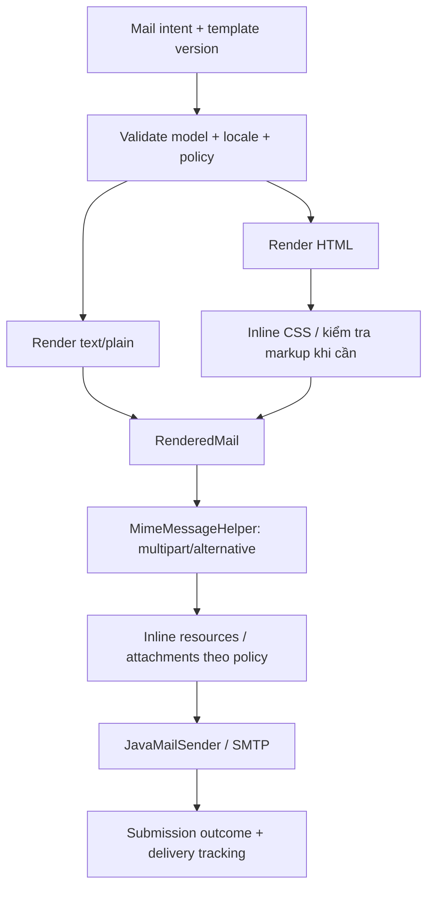

# Chọn template engine theo yêu cầu nội dung trong Spring Framework Mail

Trong một ứng dụng Spring Boot, gửi email bằng `JavaMailSender` tương đối đơn giản. Tuy nhiên, khi số loại thư tăng lên, phần khó không còn là gọi SMTP mà là **quản lý nội dung**: câu chữ thay đổi theo ngôn ngữ, dữ liệu đơn hàng, danh sách sản phẩm, bố cục nhận diện thương hiệu, nút kêu gọi hành động, ảnh inline, nội dung điều kiện hoặc yêu cầu chỉnh sửa của đội nội dung.

Một email xác nhận mã OTP chỉ có vài dòng văn bản không đòi hỏi cùng kiến trúc với bản tin nhiều khối nội dung, bảng chi tiết hóa đơn hay báo cáo được cá nhân hóa theo tenant. Nếu chọn template engine chỉ vì dự án đang dùng nó cho web MVC, chúng ta có thể mang vào email những tính năng không cần thiết. Ngược lại, nếu tự ghép chuỗi HTML cho mọi email, việc bảo trì, dịch thuật, escaping và kiểm thử sẽ ngày càng khó.

**Chọn template engine theo yêu cầu nội dung** là một quyết định kiến trúc: xác định dữ liệu nào đi vào template, ai được phép sửa, HTML phức tạp đến đâu, có cần layout/partial/logic lặp không, phải hỗ trợ những client email nào, cần bản text thuần và đa ngôn ngữ không, template được phiên bản hóa như thế nào, và nội dung sẽ được render ở giai đoạn nào trong workflow gửi.

> **Phân biệt vai trò:** `JavaMailSender` và `MimeMessageHelper` đảm nhiệm việc tạo/gửi email theo MIME/SMTP; **template engine tạo chuỗi nội dung**, thường là HTML và/hoặc plain text. Thay template engine không tự giải quyết TLS, SPF/DKIM, SMTP throttling, bounce, retry hay bảo đảm thư vào Inbox.

Bài học thuộc chương **Quyết định kiến trúc** của **Spring Framework Mail**. Các ví dụ dùng Java 17+, Spring Boot và Jakarta Mail. Mục tiêu là đưa ra phương pháp chọn có thể giải thích được, mẫu triển khai cụ thể, tiêu chí bảo mật/vận hành và checklist ra quyết định thay vì mặc định có một engine tốt nhất cho mọi loại email.

## 1. Bắt đầu bằng yêu cầu nội dung, không bằng tên thư viện

Trước khi chọn Thymeleaf, FreeMarker, Mustache hoặc một hệ thống template từ provider, cần mô tả từng nhóm email như một **sản phẩm nội dung**.

| Nhóm thư | Nội dung | Mức độ động | Gợi ý ban đầu |
|---|---|---|---|
| OTP / mã xác minh | Vài câu, mã và thời hạn | Thấp | Plain text hoặc template rất nhỏ |
| Reset password | Hướng dẫn, link, cảnh báo | Thấp–vừa | Text + HTML đơn giản |
| Xác nhận đơn hàng | Thông tin đơn, danh sách mặt hàng, tổng tiền | Vừa–cao | Engine có vòng lặp, điều kiện, layout |
| Hóa đơn | Thông tin có cấu trúc, bảng, PDF đính kèm | Vừa | HTML template + pipeline tạo PDF riêng |
| Thông báo hệ thống | Tiêu đề, nội dung, CTA, bản dịch | Vừa | Shared layout + locale |
| Báo cáo định kỳ | Nhiều bảng, số liệu, điều kiện hiển thị | Cao | Engine mạnh, model chuẩn hóa, snapshot |
| Email marketing | Block nội dung, branding, responsive, unsubscribe | Cao | Layout/component workflow và quy trình duyệt riêng |
| Email theo tenant | Logo, màu, ngôn ngữ, URL, pháp lý riêng | Cao | Versioned template registry + policy |

Các ví dụ chỉ gợi ý hướng đi. Một sản phẩm có thể dùng **một engine thống nhất** vì chi phí vận hành nhiều engine lớn hơn lợi ích tối ưu từng loại thư; sản phẩm khác dùng text formatter cho OTP và Thymeleaf cho báo cáo là hợp lý.

### 1.1. Mười câu hỏi nên trả lời

1. Nội dung chỉ có `text/plain` hay cần `text/html`?
2. Có cần danh sách lặp, điều kiện, nhánh theo trạng thái nghiệp vụ không?
3. Có layout chung, header/footer, nhiều khối tái sử dụng không?
4. Có bao nhiêu ngôn ngữ và biến thể vùng miền?
5. Ai chỉnh template: lập trình viên, product/content team, đối tác hay tenant?
6. Có yêu cầu xem trước, phê duyệt, lịch sử và rollback nội dung không?
7. Nội dung có dữ liệu nhạy cảm như OTP, link khôi phục, hóa đơn hay PII không?
8. Có cần renderer chạy riêng khỏi mail worker hoặc ngoài JVM không?
9. Lưu lượng dự kiến, SLA render và giới hạn tài nguyên là bao nhiêu?
10. Template thay đổi giữa lúc job chờ retry thì phải gửi **phiên bản nào**?

Nếu chưa trả lời những câu hỏi này, ma trận so sánh syntax của template engines dễ dẫn tới quyết định thiên về sở thích cá nhân.

### 1.2. Tách yêu cầu bắt buộc và yêu cầu mong muốn

Ví dụ cho module email giao dịch:

**Bắt buộc:** tiếng Việt/Anh, HTML + plain text, HTML escaping mặc định, header/footer chung, có thể kiểm thử bằng fixture, không cho người gửi thao tác expression tùy ý.

**Mong muốn:** live preview, component email, kéo-thả, editor không cần lập trình, thử nghiệm A/B.

Đừng triển khai một hệ thống template động có editor và database chỉ vì sau này “có thể sẽ cần marketing”. Chi phí versioning, sandbox, approval và permissions không nhỏ.

## 2. HTML email không giống HTML trang web

Trình duyệt hiện đại và các ứng dụng email không có cùng khả năng render. Một trang React dùng CSS Grid, JavaScript, external stylesheet và custom fonts có thể đẹp trên web nhưng không hiển thị đúng trên một số mail clients.

### 2.1. Các ràng buộc cần tính từ đầu

- Nhiều email clients loại bỏ JavaScript, form và một số phần tử HTML.
- Khả năng hỗ trợ CSS hiện đại khác nhau; một số client dựa vào engine render đặc thù.
- CSS inline thường được ưu tiên cho tương thích, nhưng không có nghĩa mọi CSS inline đều hoạt động.
- Bố cục dạng table vẫn phổ biến khi cần hỗ trợ rộng.
- Dark mode có thể thay màu hoặc đảo màu ngoài dự kiến.
- Ảnh từ URL bên ngoài có thể bị chặn hoặc tải qua proxy.
- Font có thể fallback; không đặt toàn bộ thông tin quan trọng trong ảnh.
- Một số client cắt/truncate thư HTML lớn.
- Link, CTA, unsubscribe, preheader và bản text thuần đều ảnh hưởng trải nghiệm.

**Không nên chọn template engine vì nó có thể render HTML phức tạp** rồi mặc định HTML đó sẽ được mail client hiển thị đúng. Engine chỉ là một lớp trong pipeline.

### 2.2. Pipeline nội dung hoàn chỉnh



Ở đây template engine được sử dụng tại bước render. MIME, attachment, sender verification, submission, queue và delivery là những trách nhiệm khác.

## 3. Ma trận chọn template engine

Các lựa chọn phổ biến trong hệ sinh thái Java/Spring:

| Giải pháp | Đặc điểm nổi bật | Điểm cần cân nhắc | Phù hợp ban đầu |
|---|---|---|---|
| **Chuỗi/format đơn giản** | Không thêm engine lớn; dễ cho vài biến | Dễ ghép HTML sai, thiếu layout/escaping | Text email rất nhỏ |
| **Thymeleaf** | Template HTML đọc gần như HTML gốc; fragment/layout và Spring integration | Phải cấu hình đúng resolver/escaping, không dùng MVC view resolution nhầm mục đích | Email HTML nhiều biến thể, layout, locale |
| **FreeMarker** | Mạnh về template logic, macro, include; thuận tiện text và HTML | Ngôn ngữ template riêng, kiểm soát auto-escape/sandbox | Báo cáo, bảng, nội dung điều kiện phức tạp |
| **Mustache** | Logic-less ở mức tương đối; mô hình đơn giản, sections/partials | Giới hạn diễn đạt, phức tạp khi có nhiều quy tắc nội dung | Template dễ quản trị, logic nằm trong Java |
| **Engine/component email riêng** | Có thể dùng component/layout và compiler email-specific | Thêm bước build/runtime, version và toolchain | Thiết kế HTML email chuyên sâu |
| **Template ở email provider** | Có editor/campaign workflow phía provider | Vendor lock-in, API, quyền truy cập, version drift | Marketing/transactional nếu provider đáp ứng |
| **Renderer service riêng** | Tách render khỏi mail transport, tái sử dụng nhiều hệ thống | Thêm network boundary, SLA, auth/consistency | Hệ thống lớn nhiều nguồn sự kiện |

**Mustache** và các engine khác vẫn cần được cấu hình đúng auto-escaping; “logic-less” không đồng nghĩa nội dung được bảo vệ trước mọi kiểu injection. **FreeMarker** có thể rất phù hợp email plain text, không nhất thiết chỉ dùng HTML. **Thymeleaf** cũng có template mode TEXT; không phải chỉ render HTML.

### 3.1. Các yếu tố có trọng số

Một cách quyết định là đánh giá từng tiêu chí:

| Tiêu chí | Khi trọng số cao | Cần ưu tiên |
|---|---|---|
| Độ an toàn HTML | Nội dung chứa nhiều user-supplied values | Escaping mặc định, review quy tắc render |
| Logic hiển thị | Bảng/mảng/điều kiện nhiều | Engine có loops/conditions rõ |
| Khả năng tái sử dụng | Hàng chục template cùng thương hiệu | Layout/fragment/macro/partial |
| Khả năng của người viết | Team nội dung cần sửa | Syntax dễ học, preview, approval |
| Đa ngôn ngữ | Nhiều locales | Resolver/messages/bundles rõ |
| Testability | Email giao dịch quan trọng | Deterministic render, fixture, version |
| Vận hành | Nhiều workers/tenants | Caching, publish/rollback, quota |
| Bảo mật template | Có editor/tenant customization | Sandboxing/allowlist/approval |
| Tính di động | Nhiều SMTP providers | Renderer độc lập provider |
| Thời gian triển khai | Một vài email đơn giản | Giảm dependency/độ phức tạp |

Không cần chấm điểm máy móc nếu một yêu cầu là **ràng buộc cứng**, ví dụ template từ tenant không được phép thực thi biểu thức tùy ý. Ràng buộc an toàn có thể loại bỏ hẳn một lựa chọn dù nó có nhiều tính năng.

## 4. Ranh giới kiến trúc: MailCommand, renderer và sender

Một thiết kế dễ bảo trì thường **không để service nghiệp vụ vừa viết HTML vừa tự cấu hình SMTP**:

```text
OrderService
    |
    v
MailCommand {
  templateKey, templateVersion, recipient,
  locale, immutable model, idempotencyKey
}
    |
    v
MailRenderer
    |
    v
RenderedMail {
  subject, plainText, html, resources
}
    |
    v
MailTransportGateway
    |
    v
JavaMailSender
```

Các interface giúp thay template engine mà không sửa phần gọi SMTP:

```java
public interface MailRenderer {
    RenderedMail render(MailRenderRequest request);
}

public record MailRenderRequest(
        String templateKey,
        String templateVersion,
        java.util.Locale locale,
        java.util.Map<String, Object> model) {
}

public record RenderedMail(
        String subject,
        String plainText,
        String html) {
}
```

Đây là **contract minh họa**; trong dự án thật, có thể dùng các typed models thay vì `Map<String,Object>` để tránh sai key/kiểu và để hỗ trợ compile-time validation. Với attachment/inline resources, có thể mở rộng `RenderedMail` bằng danh sách descriptor an toàn, không nhúng bytes vô hạn vào event.

### 4.1. Vì sao không trả thẳng MimeMessage từ renderer?

Renderer lý tưởng chỉ biết **nội dung**, không biết SMTP host, user/pass, provider hay các network side effects. Nó có thể trả text + HTML, để MIME builder/sender thêm From/To, Content-ID, attachment và gửi.

Trong trường hợp đặc biệt, renderer có thể trả một `MimeMessage` đã chuẩn bị sẵn nếu kiến trúc chấp nhận coupling; tuy nhiên:

- Khó unit test các phần plain text/HTML mà không khởi tạo Jakarta Mail.
- Có nguy cơ phụ thuộc email transport state.
- Dễ đưa tenant-supplied dữ liệu vào headers thiếu validation.
- Khó tái sử dụng renderer với provider REST API.

Tách ranh giới là một **lựa chọn thiết kế**, không phải một ràng buộc tuyệt đối của Spring.

### 4.2. Không để template quyết định hành vi nghiệp vụ

Template có thể quyết định **hiển thị** khi một trường không tồn tại, nhưng business service phải quyết định:

- Email có được phép gửi không?
- Địa chỉ người nhận có quyền nhận thông báo không?
- Có cần consent/suppression checks không?
- OTP/token đã hết hiệu lực chưa?
- Tenant nào sở hữu dữ liệu?
- Sender identity nào được phê duyệt?

Không biến một conditional trong template thành nơi thực thi authorization hoặc business transaction.

## 5. Khi nào không cần template engine đầy đủ?

Với email ngắn, nội dung cố định và ít thay đổi, một hàm format văn bản có thể đủ. Ví dụ email thông báo tác vụ được xử lý:

```java
public String renderPlainNotification(
        String safeTaskName,
        String stateLabel) {

    return """
            Tác vụ: %s
            Trạng thái: %s

            Đây là email tự động. Vui lòng không trả lời.
            """.formatted(safeTaskName, stateLabel);
}
```

Đoạn này phù hợp khi `safeTaskName` và `stateLabel` đã được chuẩn hóa, độ dài bị giới hạn và nội dung chỉ dùng ở dạng text. Nó không có khả năng sinh HTML an toàn; không nên lấy chính chuỗi trên rồi nối vào `<div>...`.

### 5.1. Các tình huống format dễ sai

Với `String.format`/`formatted`:

- Dấu `%` trong template có ngữ nghĩa format.
- Việc thay thế chuỗi theo tên biến bằng `replace(...)` có thể thay cả trong những đoạn không dự kiến.
- Các kiểu ngày/giờ/số tiền phải được format theo locale, không dùng `toString()` mặc định.
- Khi HTML được ghép thủ công, escaping rất dễ bị bỏ sót.
- Nội dung dài, list/conditional và bản dịch khiến method phát triển khó kiểm soát.

Với `MessageFormat`:

- Cú pháp dấu nháy đơn và dấu ngoặc nhọn có semantics riêng.
- Formatting dựa locale cần được hiểu rõ.
- Nó không phải HTML sanitizer và không tự giải quyết HTML escaping.

**Đừng chọn một engine mới chỉ để thay hai placeholder**, nhưng cũng đừng cố duy trì một “template mini-language” tự viết khi đã cần include/layout và điều kiện phức tạp.

### 5.2. Phương án resource file plain text

Ngay cả khi không dùng template engine, có thể lưu văn bản trong `src/main/resources/mail/text/...` và đưa vào bản dịch/resource bundle:

```text
mail/text/order-confirmed_vi.txt
mail/text/order-confirmed_en.txt
```

Lợi ích là nội dung được review như tài sản độc lập, không nằm trong method Java. Đảm bảo charset UTF-8, version cùng release và có test cho missing placeholders.

### 5.3. Khi nào nâng cấp khỏi plain formatter?

Các dấu hiệu:

- Mỗi email có nhiều nhánh theo sản phẩm/locale.
- Có shared footer, legal notice và brand components.
- Xuất hiện nhiều khối HTML.
- Đội content thường xuyên sửa wording.
- Cần preview và approval.
- Có email theo tenant với nội dung khác nhau.

Khi đó, chi phí của một engine thông dụng thường thấp hơn chi phí tự bảo trì logic nội dung.

## 6. Thymeleaf: lựa chọn mạnh cho HTML email có layout

**Thymeleaf** phù hợp khi template nên được viết theo cú pháp HTML gần tự nhiên, sử dụng attribute để hiển thị dữ liệu, loop, conditional và fragment. Nó thường là lựa chọn thuận tiện cho ứng dụng Spring muốn giữ template trong codebase.

Các khả năng liên quan email:

- `th:text` để đưa text vào HTML với escaping phù hợp.
- `th:each` duyệt danh sách.
- `th:if`/`th:unless` cho conditional presentation.
- `th:href` và `th:src` gắn URL/asset.
- `th:replace`/`th:insert` hỗ trợ fragment/layout.
- `Context` cùng `Locale` để render theo vùng miền.
- Template resolver và cache cho tài nguyên trên classpath.

### 6.1. Dependency trong Spring Boot

Ví dụ Gradle:

```groovy
dependencies {
    implementation 'org.springframework.boot:spring-boot-starter-mail'
    implementation 'org.springframework.boot:spring-boot-starter-thymeleaf'
}
```

Để tránh nhầm với MVC view templates, có thể cấu hình **một email-specific template engine**:

```java
package com.example.mail.template;

import org.springframework.context.annotation.Bean;
import org.springframework.context.annotation.Configuration;
import org.thymeleaf.TemplateEngine;
import org.thymeleaf.templatemode.TemplateMode;
import org.thymeleaf.templateresolver.ClassLoaderTemplateResolver;

@Configuration
public class MailTemplateConfiguration {

    @Bean("mailHtmlTemplateEngine")
    public TemplateEngine mailHtmlTemplateEngine() {
        ClassLoaderTemplateResolver resolver =
                new ClassLoaderTemplateResolver();

        resolver.setPrefix("mail/html/");
        resolver.setSuffix(".html");
        resolver.setTemplateMode(TemplateMode.HTML);
        resolver.setCharacterEncoding("UTF-8");
        resolver.setCacheable(true);
        resolver.setCheckExistence(true);

        TemplateEngine engine = new TemplateEngine();
        engine.setTemplateResolver(resolver);
        return engine;
    }
}
```

Đây là cấu hình **Thymeleaf core** cho email templates. Nếu dự án cần tích hợp đầy đủ Spring message expressions, Spring beans hoặc Spring-specific dialect, cân nhắc `SpringTemplateEngine` và resolver tương ứng, nhưng không tự cho template tùy ý truy cập beans/secrets. Tên bean riêng và `@Qualifier` giúp tránh vô tình inject engine khác dùng cho HTTP MVC.

### 6.2. Template HTML theo dữ liệu có cấu trúc

Đặt file `src/main/resources/mail/html/order-confirmation.html`:

```html
<!doctype html>
<html lang="vi" xmlns:th="http://www.thymeleaf.org">
<head>
    <meta charset="UTF-8">
    <title>Xác nhận đơn hàng</title>
</head>
<body>
    <table role="presentation" width="100%" cellspacing="0"
           cellpadding="0" style="border-collapse:collapse">
        <tr>
            <td style="padding:24px">
                <h1>Đơn hàng đã được xác nhận</h1>
                <p>
                    Chào <strong th:text="${customerName}">Khách hàng</strong>,
                </p>
                <p>
                    Mã đơn:
                    <strong th:text="${orderCode}">ORD-000</strong>
                </p>
                <table role="presentation" width="100%">
                    <tr th:each="item : ${items}">
                        <td th:text="${item.name}">Sản phẩm</td>
                        <td th:text="${item.displayPrice}">0 đ</td>
                    </tr>
                </table>
                <p th:if="${hasTracking}">
                    <a th:href="${trackingUrl}">Theo dõi đơn hàng</a>
                </p>
            </td>
        </tr>
    </table>
</body>
</html>
```

Template minh họa các phần điều kiện và lặp. Bản thực tế cần kiểm tra HTML/CSS trên các mail clients mục tiêu, accessibility, layout cho thiết bị nhỏ, preheader, alt text, footer và bản text thuần.

### 6.3. Render template bằng Context

```java
package com.example.mail.template;

import java.util.Locale;
import java.util.Map;
import org.springframework.beans.factory.annotation.Qualifier;
import org.springframework.stereotype.Component;
import org.thymeleaf.TemplateEngine;
import org.thymeleaf.context.Context;

@Component
public class ThymeleafHtmlMailRenderer {

    private final TemplateEngine engine;

    public ThymeleafHtmlMailRenderer(
            @Qualifier("mailHtmlTemplateEngine")
            TemplateEngine engine) {
        this.engine = engine;
    }

    public String renderOrder(
            Locale locale,
            Map<String, Object> model) {

        Context context = new Context(locale);
        context.setVariables(model);

        return engine.process("order-confirmation", context);
    }
}
```

`model` phải được xây từ dữ liệu ứng dụng đã kiểm tra và giá trị cho phép. Không chuyển toàn bộ entity JPA, servlet request, user principal hoặc Spring ApplicationContext vào template context.

### 6.4. Escaping và lỗi th:utext

Với giá trị `customerName = "<script>alert(1)</script>"`, `th:text` có nhiệm vụ đưa nó vào text context theo escaping của engine; `th:utext` chèn HTML **không escape** và dễ trở thành XSS/HTML injection.

Không dùng:

```html
<div th:utext="${customerProvidedHtml}"></div>
```

cho dữ liệu do khách hàng nhập. Nếu thật sự có *trusted HTML fragment* từ hệ thống nội dung, cần xác định rõ trust boundary, sanitizer/allowlist, approval, và test trong mail client. **Email clients có các cơ chế chặn script riêng nhưng ứng dụng web preview/admin có thể vẫn bị XSS nếu render raw HTML.**

### 6.5. Dùng fragment để giảm trùng lặp

Một dự án có nhiều templates có thể chia:

```text
mail/html/
  fragments/
    header.html
    footer.html
    button.html
  order-confirmation.html
  password-reset.html
  invoice-ready.html
```

Ví dụ khái niệm:

```html
<div th:replace="~{fragments/footer :: footer}"></div>
```

Trong fragment/layout, giữ các thông số brand và legal notices qua policy; đừng để một template tự bỏ footer bắt buộc chỉ vì khác loại email.

### 6.6. Lưu ý về xử lý URL

`th:href` giúp tạo attribute nhưng không tự đảm bảo URL thuộc domain được phép. Một `trackingUrl` lấy từ email hoặc request không đáng tin có thể dẫn tới phishing, link scheme không an toàn hoặc lộ token.

Tốt hơn là application:

1. Lấy base URL từ cấu hình trust-checked theo môi trường/tenant.
2. Build URL qua URI builder đúng encoding.
3. Giới hạn scheme `https` và host/path được phép.
4. Truyền URL đã được validate vào template.
5. Không ghi toàn bộ reset token/link vào log.

Template chỉ thực hiện presentation, không tự xác định URL có quyền truy cập dữ liệu nào.

## 7. FreeMarker: linh hoạt với bảng, macro và nội dung điều kiện

**FreeMarker** hữu ích khi email có nhiều cấu trúc động dạng danh sách, bảng, điều kiện hoặc muốn định nghĩa macro/include có thể tái sử dụng. Nó thường được chọn trong các hệ thống đã dùng FTL và có nhiều bản tin hoặc báo cáo.

Các cấu trúc tiêu biểu:

- `${...}`: chèn biểu thức theo output format.
- `<#list ...>`: vòng lặp.
- `<#if ...>`: điều kiện.
- `<#include ...>`: bao gồm template khác.
- `<#macro ...>`: định nghĩa khối tái sử dụng.
- `Configuration` để thiết lập template loading, encoding, exception policy và caching.

### 7.1. Dependency và cấu hình

Ví dụ Gradle:

```groovy
dependencies {
    implementation 'org.springframework.boot:spring-boot-starter-mail'
    implementation 'org.springframework.boot:spring-boot-starter-freemarker'
}
```

Có thể tạo cấu hình riêng cho email:

```java
package com.example.mail.template;

import freemarker.template.Configuration;
import freemarker.template.TemplateExceptionHandler;
import org.springframework.context.annotation.Bean;

@org.springframework.context.annotation.Configuration
public class FreeMarkerMailConfiguration {

    @Bean("mailFreemarkerConfiguration")
    public Configuration mailFreemarkerConfiguration() {
        Configuration config =
                new Configuration(Configuration.VERSION_2_3_32);

        config.setClassLoaderForTemplateLoading(
                getClass().getClassLoader(), "/mail/freemarker");
        config.setDefaultEncoding("UTF-8");
        config.setTemplateExceptionHandler(
                TemplateExceptionHandler.RETHROW_HANDLER);
        config.setLogTemplateExceptions(false);
        config.setWrapUncheckedExceptions(true);
        config.setFallbackOnNullLoopVariable(false);
        return config;
    }
}
```

`Configuration.VERSION_2_3_32` là lựa chọn compatibility API trong ví dụ, **không phải version bắt buộc**. Khi áp dụng, dùng dependency phù hợp với Spring Boot và xác minh phiên bản FreeMarker thực sự có mặt. Với HTML email, phải bật escaping qua **HTML output format**, không gửi một template text mode rồi mặc định nó tự escape HTML.

### 7.2. Template HTML có escaping rõ

File `src/main/resources/mail/freemarker/invoice-ready.ftlh`:

```html
<#ftl output_format="HTML" auto_esc=true>
<!doctype html>
<html lang="vi">
<body>
    <h1>Hóa đơn đã sẵn sàng</h1>
    <p>Chào ${customerName},</p>
    <p>Mã hóa đơn: ${invoiceNumber}</p>
    <#if lines?has_content>
      <table role="presentation" width="100%">
        <#list lines as line>
          <tr>
            <td>${line.label}</td>
            <td>${line.amountText}</td>
          </tr>
        </#list>
      </table>
    </#if>
    <p><a href="${invoiceUrl}">Xem hóa đơn</a></p>
</body>
</html>
```

Auto-escaping làm giảm nguy cơ HTML injection ở vị trí chèn text/attribute. Nó **không xác minh** URL có host/scheme an toàn hoặc văn bản không chứa thông tin bị cấm. Không dùng `?no_esc` với nội dung người dùng hay đối tác cung cấp.

### 7.3. Render theo locale

```java
package com.example.mail.template;

import freemarker.template.Configuration;
import freemarker.template.Template;
import freemarker.template.TemplateException;
import java.io.IOException;
import java.io.StringWriter;
import java.util.Locale;
import java.util.Map;
import org.springframework.beans.factory.annotation.Qualifier;
import org.springframework.stereotype.Component;

@Component
public class FreeMarkerMailRenderer {

    private final Configuration configuration;

    public FreeMarkerMailRenderer(
            @Qualifier("mailFreemarkerConfiguration")
            Configuration configuration) {
        this.configuration = configuration;
    }

    public String renderInvoice(
            Map<String, Object> model,
            Locale locale) throws IOException, TemplateException {

        Template template = configuration.getTemplate(
                "invoice-ready.ftlh", locale, "UTF-8");
        StringWriter output = new StringWriter();
        template.process(model, output);
        return output.toString();
    }
}
```

Không tạo `Configuration` mới cho từng job. Configuration nên được hoàn thiện trước khi chia sẻ qua nhiều workers; thay đổi loader/template source/cache khi đang chạy phải có publish strategy rõ.

### 7.4. Macro và include nên đặt ở đâu?

```text
mail/freemarker/
  macros/
    buttons.ftlh
    invoice-table.ftlh
  fragments/
    legal-footer.ftlh
  invoice-ready.ftlh
  payment-failed.ftlh
```

Macro có thể tạo CTA/button hay một hàng bảng chuẩn. Tuy nhiên, không nên chuyển logic tính thuế, kiểm tra quyền truy cập hóa đơn hoặc xử lý trạng thái thanh toán vào FTL expressions. Những nghiệp vụ đó phải hoàn tất trước khi renderer nhận model.

### 7.5. Điểm cần cân nhắc về dữ liệu

Một template FreeMarker mạnh có thể gọi vào getters/methods của object model tùy object wrapper/config. Tránh truyền entity/service objects có method nhạy cảm; ưu tiên immutable DTO hoặc Map chứa giá trị đã tính. Với template từ nguồn không tin cậy, **không cho thực thi như trusted template** chỉ vì đã bật auto-escaping; cần sandbox/approval hoặc một format template hạn chế hơn.

## 8. Mustache: đơn giản hóa logic trong template

**Mustache** thích hợp khi muốn template tương đối đơn giản, dùng placeholders, sections và partials; việc quyết định dữ liệu, điều kiện nghiệp vụ và định dạng được thực hiện ở Java.

Ví dụ:

```html
<!doctype html>
<html lang="vi">
<body>
  <h1>Đơn hàng đã được xác nhận</h1>
  <p>Chào {{customerName}},</p>
  <p>Mã đơn: {{orderCode}}</p>
  {{#items}}
    <p>{{name}}: {{displayPrice}}</p>
  {{/items}}
  {{^items}}
    <p>Không có sản phẩm hiển thị.</p>
  {{/items}}
</body>
</html>
```

Sections giúp hiển thị hoặc lặp một collection, inverted section xử lý trường hợp trống. Mustache có partials ở nhiều implementations để tái sử dụng header/footer.

### 8.1. Ưu điểm

- Template khó chứa logic tính toán phức tạp hơn những engine biểu thức mạnh.
- Dễ chuyển template cho người thiên về nội dung nếu có guideline.
- Dữ liệu được quyết định rõ ở model do Java xây dựng.
- Phù hợp nhiều email thông báo có layout vừa phải.

### 8.2. Giới hạn cần chấp nhận

- Format số tiền/ngày/giờ và branching phức tạp nên xử lý trước.
- Điều kiện hiển thị nhiều mức có thể làm model xuất hiện nhiều Boolean flags.
- Nếu business logic tăng, model-builder có thể cồng kềnh.
- Partial inheritance/layout tùy implementation cần được kiểm tra, không mặc định giống FreeMarker/Thymeleaf.
- Escaping phải được xác minh theo implementation/mode, đặc biệt với raw HTML.

### 8.3. Mẫu render với Mustache.java

Một ví dụ với implementation `com.samskivert.mustache`:

```java
import com.samskivert.mustache.Mustache;
import com.samskivert.mustache.Template;
import java.io.StringReader;
import java.util.Map;

public String renderMustache(
        String trustedTemplate,
        Map<String, Object> safeModel) {

    Template compiled = Mustache.compiler()
            .escapeHTML(true)
            .compile(new StringReader(trustedTemplate));

    return compiled.execute(safeModel);
}
```

Đây là code theo một implementation cụ thể, không phải API thống nhất của mọi thư viện Mustache. Trong production, compile/cache trusted templates theo `templateKey/version` thay vì compile từ source trong mỗi lần gửi. Không cho external caller gửi một chuỗi Mustache bất kỳ để chạy dưới quyền service.

### 8.4. Chú ý cú pháp raw HTML

Một số triển khai Mustache hỗ trợ chèn nội dung không escape bằng cú pháp ba dấu ngoặc:

```html
<div>{{{trustedHtmlFragment}}}</div>
```

Không sử dụng cú pháp này với user input. Nếu sản phẩm cần các khối HTML giàu nội dung, phải xác định chúng có phải fragments được tạo từ trusted component library không, có sanitizer/approval không, và có thể gây XSS trong preview nội bộ không.

### 8.5. Chọn Mustache hay FreeMarker?

Một câu hỏi quan trọng: *team muốn đặt bao nhiêu presentation logic trong file template?*

- Nếu chỉ cần placeholders và show/hide sections, Mustache thường đủ.
- Nếu cần nhiều macros, loops có cấu trúc, format và xử lý bảng phức tạp, FreeMarker có thể thuận tiện hơn.
- Nếu người thiết kế muốn thao tác trên HTML attributes và fragments, Thymeleaf có thể trực quan hơn.

Không có kết luận tuyệt đối; khả năng review, test và duy trì lâu dài của đội dự án mới là yếu tố quan trọng.

## 9. Template được quản lý tại email provider

Một số SMTP/email API providers có công cụ quản lý dynamic templates hoặc marketing campaigns. Ứng dụng có thể gửi `templateId` và model, provider thực hiện render.

```text
Application
  -> MailSendRequest {
       providerTemplateId,
       model,
       recipient
     }
  -> Provider API
  -> Provider renders content
  -> Delivery pipeline
```

Điểm mạnh có thể gồm:

- Editor/preview cho đội nội dung.
- Workflow phê duyệt hoặc lịch sử version nếu provider hỗ trợ.
- Thử nghiệm template/campaign theo tính năng provider.
- Giảm trách nhiệm render HTML trong ứng dụng.

Nhưng có các đánh đổi lớn:

- **Vendor lock-in:** template syntax và ID gắn provider.
- **Version drift:** nội dung live template có thể thay đổi trước lúc job retry.
- **Dữ liệu:** model gồm tên khách hàng, order info và link có thể đi sang provider.
- **Security:** quyền sửa template phía provider, API key và tenant boundary.
- **Observability:** khó biết chính xác HTML mà provider đã render nếu không có snapshot/audit.
- **Testing:** local unit tests khó tái hiện renderer của provider.
- **Failover:** khi dùng provider B, template ID ở A có thể không tồn tại.

### 9.1. Provider template không giống JavaMailSender template

`JavaMailSender` gửi một `MimeMessage` đã được ứng dụng chuẩn bị. Nếu muốn provider render theo `templateId`, thường cần sử dụng provider API tương ứng thay vì chỉ gọi `JavaMailSender.send(...)`, trừ khi provider có một SMTP extension/API được tài liệu hóa rõ.

Không truyền `templateId` vào Subject hoặc custom header rồi mặc định SMTP relay sẽ render nó.

### 9.2. Khi nào nên chọn provider-managed?

- Team content có nhu cầu chỉnh nhiều và provider có editor/approval phù hợp.
- Dự án chấp nhận ràng buộc vendor và biết cách export/migrate.
- Template versions được pin hoặc snapshot theo contract.
- Dữ liệu cá nhân được phép chuyển tới provider.
- Có pipeline test/preview và fallback được định nghĩa.

Với email pháp lý hoặc bảo mật có yêu cầu audit chặt, cần đánh giá kỹ khả năng tái tạo **nội dung đã gửi thực tế**, quyền xuất/khôi phục template và quy trình freeze/version.

## 10. Component-based email rendering và MJML

Khi yêu cầu HTML email nhiều thành phần, dùng Thymeleaf/FreeMarker vẫn có thể tạo ra markup cuối cùng, nhưng việc **thiết kế responsive HTML tương thích email client** có thể cần một lớp riêng:

```text
Design tokens + components
    |
    v
Email markup source (ví dụ MJML/component)
    |
    v
Build/compile -> email-compatible HTML
    |
    v
Template variables + content render
    |
    v
MIME alternative + SMTP
```

**MJML** là ngôn ngữ/biên dịch hướng tới HTML email, không phải một thư viện Spring Mail hoặc một SMTP sender. Nó có thể bổ sung workflow thiết kế nhưng không thay thế renderer dữ liệu động hay authorization.

### 10.1. Compile ở build time hay runtime?

**Build time:** compiler chạy trong CI/CD, artifact HTML được commit/publish theo version.

- Ưu điểm: không cần Node/renderer process trong mail worker, performance ổn định.
- Cần bảo đảm artifact đã compile giữ đúng placeholders/cú pháp của engine Java.
- Mỗi thay đổi layout cần quy trình publish/rollback.

**Runtime:** renderer compile layout khi gửi.

- Linh hoạt với template chỉnh động.
- Tốn CPU và thêm dependency/runtime, tăng bề mặt lỗi.
- Phải sandbox template untrusted và kiểm soát cache.

Với email giao dịch có volume lớn và layout ít thay đổi, compile-time hoặc publish-time thường dễ vận hành hơn runtime compilation không giới hạn.

### 10.2. React Email hoặc UI component libraries

Một đội front-end có thể thích viết email bằng React-based components hoặc công cụ khác, xuất HTML rồi giao cho Spring worker gửi. Khi đó cần một **hợp đồng rõ giữa renderer và mail transport**:

- HTML output và text fallback.
- Escaping/URL policy.
- Template/component version.
- Localization.
- Image/assets.
- Content size limits.
- Trace ID và failure handling.

Không gửi nguyên JSX/React code vào `JavaMailSender` và kỳ vọng mail client chạy JavaScript. HTML phải được render thành nội dung tương thích trước khi MIME được tạo.

## 11. Một email tốt thường có cả text/plain và text/html

Việc chọn template engine không nên chỉ dựa vào HTML. Một email transactional chất lượng thường có **hai phiên bản của cùng nội dung**:

```text
MimeMessage
└── multipart/alternative
    ├── text/plain; charset=UTF-8
    └── text/html;  charset=UTF-8
```

Client có thể chọn bản phù hợp. Bản plain text cũng hữu ích cho accessibility, môi trường hạn chế HTML và debugging. **Không mặc định strip HTML tags là tạo được bản plain text tốt**: link anchor, bảng, thứ tự nội dung và hidden preheader có thể bị biến dạng.

### 11.1. Hai template từ cùng một model

Ví dụ:

```text
Template key: ORDER_CONFIRMATION
Template version: v6
Locale: vi-VN
Model:
  customerName
  orderNumber
  itemSummaries[]
  totalAmountText
  orderDetailsUrl

Render output:
  subject: "Xác nhận đơn hàng ORD-2026-001"
  text:    "Chào An,..."
  html:    "<!doctype html>..."
```

Hai bản được render từ **cùng business snapshot** để tránh HTML nói tổng tiền A còn text nói tổng tiền B. Với email chứa token, plain và HTML nên dùng cùng challenge/link có deadline.

### 11.2. JavaMailSender + MimeMessageHelper

Một gateway mẫu:

```java
package com.example.mail.transport;

import jakarta.mail.MessagingException;
import jakarta.mail.internet.MimeMessage;
import org.springframework.mail.javamail.JavaMailSender;
import org.springframework.mail.javamail.MimeMessageHelper;

public final class SmtpMailGateway {

    private final JavaMailSender sender;

    public SmtpMailGateway(JavaMailSender sender) {
        this.sender = sender;
    }

    public void submit(
            String from,
            String recipient,
            RenderedMail rendered) throws MessagingException {

        MimeMessage mime = sender.createMimeMessage();
        MimeMessageHelper helper = new MimeMessageHelper(
                mime, true, "UTF-8");

        helper.setFrom(from);
        helper.setTo(recipient);
        helper.setSubject(rendered.subject());

        helper.setText(
                rendered.plainText(),
                rendered.html());

        sender.send(mime);
    }

    public record RenderedMail(
            String subject,
            String plainText,
            String html) {
    }
}
```

Đoạn này giả định model đã validate và renderer trả cả text và HTML không null. `MimeMessageHelper.setText(plainText, htmlText)` tạo các body alternatives thích hợp. Chữ ký helper có `multipart=true` vì ứng dụng có thể thêm attachment/inline, nhưng không bắt buộc dùng multipart hỗn hợp nếu chỉ gửi một văn bản.

**Quan trọng:** `sender.send(...)` có thể ném `MailException`; signature trên chỉ khai báo `MessagingException` cho quá trình chuẩn bị MIME, không có nghĩa mọi lỗi gửi là checked exception. Tầng worker nên phân loại và persist submission outcomes.

### 11.3. Không lưu RenderedMail vào logs

`RenderedMail` có thể chứa tên khách hàng, thông tin đơn, reset token hoặc nội dung hợp đồng. Tránh:

```java
log.info("Rendered mail={}", rendered);
```

Một Java record có `toString()` tự in các field, rất dễ rò body. Log `mailJobId`, `templateKey`, `templateVersion`, `locale`, thời lượng render và outcome mã hóa, không dump HTML/text.

### 11.4. Chọn engine cho Subject

Subject thường là một chuỗi ngắn nhưng vẫn cần:

- Localization.
- Đúng thứ tự thông tin.
- Không chèn dữ liệu bí mật không cần thiết.
- Giới hạn độ dài hợp lý.
- Loại control characters/CRLF từ user input để tránh header injection.
- Encoding UTF-8 qua Jakarta Mail/MimeMessageHelper.

Có thể render subject bằng một text template riêng hoặc format có kiểm soát trong Java. **Không nhất thiết dùng HTML engine để render Subject** rồi đưa cả markup vào header.

## 12. CSS, layout, preheader và accessibility là tiêu chí chọn công cụ

Một template engine có thể tạo markup hợp lệ nhưng email vẫn trông sai trên một số clients. Vì vậy khi chọn engine, cần biết ai chịu trách nhiệm **email layout** và kiểm thử tương thích.

### 12.1. Layout kiểu email

Một layout đơn giản:

```html
<!doctype html>
<html lang="vi">
<head>
  <meta charset="UTF-8">
  <meta name="viewport" content="width=device-width, initial-scale=1">
</head>
<body style="margin:0;padding:0;background:#f5f5f5">
  <table role="presentation" width="100%"
         cellspacing="0" cellpadding="0" border="0">
    <tr>
      <td align="center" style="padding:24px">
        <table role="presentation" width="600"
               cellspacing="0" cellpadding="0" border="0"
               style="max-width:600px;width:100%;background:white">
          <tr>
            <td style="padding:32px;font-family:Arial,sans-serif">
              <h1 style="margin:0 0 16px">Thông báo</h1>
              <p>Nội dung email...</p>
            </td>
          </tr>
        </table>
      </td>
    </tr>
  </table>
</body>
</html>
```

Đây là minh họa cấu trúc table-based email, không phải template hoàn chỉnh hay guarantee hiển thị giống nhau trên mọi email client. Dùng responsive techniques được hỗ trợ bởi tập client thực tế.

### 12.2. CSS inlining

Nếu team viết CSS trong `<style>` hoặc stylesheet, pipeline có thể có bước **inline CSS** sau render. Cần cẩn trọng:

- CSS inliner có thể thay đổi markup/attributes.
- Nếu render giá trị động vào CSS không đúng ngữ cảnh, có thể tạo style injection.
- Không lấy một chuỗi CSS nguyên khối từ tenant không đáng tin rồi đưa vào layout.
- Cần render/test cả trước và sau inlining.
- CSS inlining không thay thế escaping/HTML sanitization.

Với theme đơn giản, dùng token màu/spacing và class/inline style được allowlist có thể dễ kiểm soát hơn đưa toàn bộ CSS tùy ý vào template.

### 12.3. Preheader

Preheader là đoạn text preview mà một số client dùng trong inbox list. Nó có thể là một field của `RenderedMail` hoặc phần HTML ẩn theo kỹ thuật được kiểm chứng:

```text
subject:    "Đơn hàng ORD-2026-001 đã được xác nhận"
preheader:  "Xem chi tiết đơn hàng và thời gian dự kiến."
```

Không lặp mã OTP, thông tin y tế hoặc nội dung nhạy cảm trong preheader vì nó có thể xuất hiện trên màn hình khóa/inbox preview.

### 12.4. Accessibility

- Dùng headings có thứ bậc hợp lý.
- Có text rõ ràng cho CTA/link.
- Ảnh quan trọng có `alt`.
- Không dùng ảnh thay cho toàn bộ nội dung.
- Đảm bảo tương phản và font fallback.
- Không chỉ dùng màu sắc để diễn đạt trạng thái.
- Giữ bản text thuần đầy đủ thông tin quan trọng.

Chọn một engine có syntax tiện viết bảng/fragment chỉ giúp năng suất. **Accessibility phải được xác thực trên HTML kết quả.**

### 12.5. Dark mode và mobile

Dark mode có thể thay đổi màu nền/text của email. Đừng đảm bảo “render Thymeleaf thành công là dark mode đúng”. Tạo các test snapshots/preview cho desktop/mobile và một tập client mục tiêu; nếu dùng theme theo tenant, cần test màu/chữ/logo đủ tương phản.

## 13. Đa ngôn ngữ, locale và thời gian

Một template chỉ hỗ trợ tiếng Việt có thể chưa cần locale-aware resolver. Nhưng khi có tiếng Anh, Nhật, địa chỉ theo khu vực hoặc định dạng tiền tệ, đây thường là **ràng buộc kiến trúc**.

### 13.1. Những gì phải localize

| Thành phần | Ví dụ |
|---|---|
| Subject | “Xác nhận đơn hàng” vs “Order confirmed” |
| CTA | “Xem hóa đơn” vs “View invoice” |
| Plain text | Thứ tự câu và hướng dẫn |
| HTML text | Headings, labels, footer |
| Ngày/giờ | `dd/MM/yyyy` vs định dạng khác |
| Tiền tệ | VND, USD, JPY theo locale/nghiệp vụ |
| Tên sản phẩm | Có thể là nhãn được dịch |
| Hướng dẫn pháp lý | Có thể tùy nước/tenant |
| Unsubscribe/privacy text | Theo loại thư và chính sách |

Không phải trường nào cũng chỉ cần thay từ tiếng Việt sang tiếng Anh. Một số ngôn ngữ thay đổi cấu trúc câu và số nhiều; cần template/bundle đủ linh hoạt.

### 13.2. Chọn locale ở đâu?

Locale nên đến từ nguồn có thẩm quyền:

1. Preference đã lưu của recipient.
2. Ngôn ngữ của workflow nghiệp vụ nếu có.
3. Default locale của tenant.
4. Fallback được định nghĩa cho sản phẩm.

Không mặc định dùng `Locale.getDefault()` trên máy worker; các container có thể chạy với locale khác nhau và kết quả có thể thay đổi sau deployment.

### 13.3. Format dữ liệu trước khi render

Ví dụ:

```java
import java.math.BigDecimal;
import java.text.NumberFormat;
import java.time.Instant;
import java.time.ZoneId;
import java.time.format.DateTimeFormatter;
import java.util.Currency;
import java.util.Locale;

public record OrderDisplayModel(
        String totalAmountText,
        String createdAtText) {
}

public OrderDisplayModel formatOrder(
        BigDecimal total,
        Currency currency,
        Instant createdAt,
        ZoneId recipientZone,
        Locale locale) {

    NumberFormat money = NumberFormat.getCurrencyInstance(locale);
    money.setCurrency(currency);

    String amountText = money.format(total);
    String dateText = DateTimeFormatter
            .ofPattern("dd MMM uuuu HH:mm", locale)
            .withZone(recipientZone)
            .format(createdAt);

    return new OrderDisplayModel(amountText, dateText);
}
```

`NumberFormat` là mutable, nên tạo cho mỗi rendering scope/thread hoặc quản lý đồng bộ đúng cách. `DateTimeFormatter` là immutable và có thể tái sử dụng phù hợp. Với tiền tệ, hãy xác định rounding/scale theo business rules trước render, không dựa hoàn toàn vào UI formatter.

### 13.4. Timezone và deadline

Ví dụ reset password:

```text
“Liên kết có hiệu lực đến 16:30 ngày 12/11.”
```

Nếu recipient ở múi giờ khác, câu này có thể sai. Hệ thống nên lưu deadline theo `Instant` và render theo timezone được chọn/được công bố rõ; không dùng giờ server local như một phần của identity.

Khi retry sau 30 phút, kiểm tra token vẫn hợp lệ. Không vì template có câu “link còn hiệu lực 30 phút” mà mặc định gia hạn token.

### 13.5. Locale-specific templates hay message bundles?

**Template riêng từng locale:**

```text
order-confirmation_vi.html
order-confirmation_en.html
```

Thích hợp khi bố cục/thứ tự câu khác đáng kể. Đánh đổi là phải cập nhật layout nhiều nơi.

**Một template + message bundles:**

```text
messages_vi.properties
messages_en.properties
```

Thích hợp khi layout chung, phần lớn chỉ khác labels. Đảm bảo engine được cấu hình để resolve messages tương ứng và có fallback khi key thiếu.

**Kết hợp:** shared layout + locale-specific content partial là lựa chọn thực tế khi có nhiều ngôn ngữ.

### 13.6. Kiểm thử missing translation

Khi template có placeholder `order.total` nhưng một locale thiếu key:

- Không gửi literal `??order.total??` hoặc placeholder nội bộ vào email production.
- Định nghĩa fallback có kiểm soát, hoặc fail rendering trước SMTP.
- Có test để detect missing keys ở CI/review.
- Khi fallback, ghi metadata mã lỗi/locale, không log dữ liệu cá nhân.

Đừng âm thầm render tiếng Anh khi recipient được yêu cầu một ngôn ngữ có ràng buộc pháp lý nếu policy không cho phép fallback.

## 14. Bảo mật template: escaping, injection và dữ liệu không tin cậy

Template engine giúp chèn dữ liệu nhưng không biến dữ liệu đó thành an toàn một cách toàn diện. Email có thể chứa tên khách hàng, tiêu đề ticket, địa chỉ, mô tả sản phẩm hoặc ghi chú do bên thứ ba cung cấp. Những giá trị này là **untrusted input** dù nằm trong database nội bộ.

### 14.1. Phân biệt các ngữ cảnh chèn

| Ngữ cảnh | Ví dụ | Kiểm soát |
|---|---|---|
| HTML text node | Tên khách hàng trong `<p>` | HTML escaping |
| HTML attribute | `href`, `alt` | Attribute escaping + validation |
| URL | Link xác nhận | Scheme/host/path allowlist, encoding |
| CSS value | Màu tenant, image URL | Whitelist design tokens, không raw CSS |
| Plain text | Mô tả đơn hàng | Chuẩn hóa control chars/độ dài |
| MIME Subject | Subject có input động | Header validation, encoding |
| Template source | Template do editor gửi lên | Approval/sandbox, không thực thi tùy ý |

HTML escaping **không thay thế URL validation**. Một URL `javascript:...` được escape dấu ngoặc kép vẫn không phải liên kết an toàn. Và việc lọc `<script>` không đủ để chống các dạng HTML injection/XSS khác trong preview web.

### 14.2. Chỉ template từ nguồn tin cậy mới được thực thi

Các engine có biểu thức mạnh có thể truy cập thuộc tính hoặc method trên model objects. Nếu một tenant được quyền sửa template trực tiếp với bất kỳ syntax nào, họ có thể cố truy cập thuộc tính không được dự kiến, tạo vòng lặp tốn tài nguyên hoặc khai thác khả năng của engine.

Một nguyên tắc:

```text
Trusted template source (code/approved registry)
    + validated allowlisted model
    + safe template engine configuration
    -> rendered content

Untrusted template source
    -> NOT automatically executable with full engine privileges
```

Với template từ đối tác/người dùng, cân nhắc:

- Chỉ cung cấp editor block-based có schema hạn chế.
- Chỉ cho phép thay text, hình ảnh URL đã kiểm tra và màu từ palette.
- Giới hạn kích thước template, số block, số lần lặp.
- Phê duyệt/publish trước khi sử dụng.
- Cô lập renderer nếu phải xử lý syntax mạnh.
- Không truyền Spring beans, secrets, file handles, classloaders vào context.
- Giới hạn CPU/time/memory và quyền truy cập mạng của renderer.

Không xem `Mustache` hay một engine “logic-less” là sandbox an toàn tuyệt đối; mức độ an toàn còn phụ thuộc implementation, custom lambdas/helpers, partial resolvers và dữ liệu model.

### 14.3. Server-side Template Injection (SSTI)

Một lỗi nguy hiểm là lấy chuỗi template do người dùng gửi rồi compile/execute dưới quyền ứng dụng:

```java
// Không dùng cho template source từ người dùng không đáng tin.
String templateSource = httpRequest.getParameter("template");
String result = templateEngine.process(
        templateSource, context);
```

Ngoài ra, `TemplateEngine.process(String, Context)` trong Thymeleaf mặc định nhận **template name**, không mặc nhiên một literal template body; ví dụ trên nhấn mạnh *anti-pattern nhận tên/source tùy ý* hơn là một cách chạy template trong mọi configuration. Dù là tên hay nội dung, caller không được tùy ý chọn resource ngoài danh sách cho phép hoặc đọc template nội bộ không thuộc quyền.

Template name nên là một enum/registry key do server resolve, ví dụ `ORDER_CONFIRMATION@v7`, không phải arbitrary path như `../../secrets`.

### 14.4. Trusted HTML fragment phải có chính sách

Khi business cần một đoạn HTML có nội dung giàu định dạng, không nên đưa raw HTML từ CMS chưa kiểm duyệt vào `th:utext` hoặc `?no_esc`.

Phương án:

1. Tạo fragment từ các component được phép.
2. Sanitize bằng HTML sanitizer có allowlist rõ nếu nguồn là rich-text.
3. Không cho script, form, iframe, event handlers và scheme không an toàn.
4. Giới hạn độ dài/độ sâu HTML.
5. Kiểm tra cả HTML output sau render.
6. Render preview bằng sandbox/escaping thích hợp.

Một email client có thể chặn một số active content, nhưng một admin dashboard hiển thị preview trực tiếp bằng `innerHTML` hoặc template unescaped vẫn có thể bị ảnh hưởng. Không dựa vào cơ chế phòng thủ của mail clients để bảo vệ hệ thống quản trị.

### 14.5. Validation của model

Model nên có schema rõ:

```java
public record OrderConfirmationView(
        String customerDisplayName,
        String orderCode,
        java.util.List<OrderLineView> lines,
        String totalAmountText,
        java.net.URI orderDetailsUrl) {
}

public record OrderLineView(
        String name,
        String quantityText,
        String lineAmountText) {
}
```

Khi tạo model, kiểm tra số lượng items tối đa, độ dài các trường và URL allowlist. Không đưa cả `OrderEntity` chứa quan hệ lazy-loaded hoặc object chứa payment token vào template.

### 14.6. Data leakage qua render exception

Một lỗi “variable not found” có thể chứa tên field, template path hoặc nội dung liên quan. Đừng log toàn bộ model khi renderer ném exception:

```java
catch (TemplateInputException ex) {
    log.warn(
            "mailRenderFailed jobId={} template={} failureClass={}",
            jobId, templateKey, "INVALID_RENDER_MODEL");
}
```

Muốn debug sâu hơn, dùng hệ thống restricted diagnostics với redaction/retention phù hợp; không dump OTP, password-reset link hoặc địa chỉ khách hàng.

## 15. Multi-tenant branding và quyền chỉnh sửa nội dung

Khi mỗi tenant có logo, màu, tên thương hiệu và footer, việc chọn engine cần tính đến **tenant isolation** và publish policy.

### 15.1. Tách brand data khỏi template logic

Một design contract:

```text
Template: INVOICE_READY@v5
Locale: vi-VN
Tenant brand:
  displayName = "Cửa hàng ABC"
  logoAssetId = "logo-approved-23"
  primaryColorToken = "brand-blue"
  supportUrl = approved HTTPS URL

Business model:
  invoiceNumber
  amountText
  deadlineText
```

Không để tenant cung cấp tùy ý:

```text
customHtml = "<script>...</script>"
customCss  = "url(http://internal-host/...)"
templateExpression = ...
```

Thay vào đó, expose các fields đã validate hoặc một block schema hữu hạn.

### 15.2. Hai mô hình hỗ trợ tenant

**Một template chung, model khác nhau:** dễ bảo trì và kiểm thử, thích hợp khi chỉ khác logo/màu/địa chỉ hỗ trợ.

**Template override theo tenant:** linh hoạt hơn, nhưng cần quản lý:

- Template ownership và version.
- Quyền edit/approve/publish.
- Validation trước publish.
- Default fallback không lộ nội dung tenant khác.
- Cache partition theo tenant.
- Retention của versions cũ.
- Rollback/incident response.

Nếu template registry lookup quên `tenantId` trong cache key, một tenant có thể nhận nội dung/brand của tenant khác. Đây là lỗi nghiêm trọng hơn việc sai màu logo.

### 15.3. Phân quyền

| Vai trò | Quyền gợi ý |
|---|---|
| Template viewer | Xem preview/metadata trong tenant |
| Content editor | Soạn draft cho tenant được cấp quyền |
| Approver | Phê duyệt phiên bản đã kiểm thử |
| Publisher | Kích hoạt version mới |
| Security reviewer | Kiểm tra template/asset có rủi ro |
| Mail operator | Theo dõi render/send outcomes, không tự sửa template |

Không cho phép quyền “edit template” ngầm cấp quyền truy cập PII từ dữ liệu production. Preview nên dùng dữ liệu giả hoặc fixture đã loại thông tin nhạy cảm.

## 16. Versioning, caching và reproducibility

Một template thay đổi **trong khi email job đang chờ** là rủi ro rất thực tế. Giả sử:

```text
10:00 business tạo email job ORDER_CONFIRMATION
10:01 job chờ SMTP provider khôi phục
10:10 content team publish template v8
10:15 worker retry job tạo lúc 10:00
```

Job nên dùng v7 hay v8?

Không có câu trả lời đúng cho mọi nghiệp vụ. Nhưng phải có **quyết định rõ**, không phụ thuộc vào cache nào đang nóng ở worker.

### 16.1. Ba chiến lược version

| Chiến lược | Ý nghĩa | Phù hợp |
|---|---|---|
| Render tại enqueue, lưu snapshot | Nội dung đã cố định khi tạo job | Audit/giao dịch nhạy cảm |
| Pin template version, render tại send | Model + template version cố định | Cân bằng storage và khả năng tái dựng |
| Luôn render latest version | Job retry có thể đổi nội dung | Chỉ khi business chấp nhận rõ |

Với password reset/OTP, ngoài version còn phải kiểm tra expiry của token; snapshot cũ không làm link sống lại.

### 16.2. Snapshot có ưu và nhược

**Ưu điểm:**

- Retry có thể dùng đúng nội dung từng được duyệt.
- Dễ audit/đối chiếu.
- Không chịu ảnh hưởng bởi template publish sau đó.

**Nhược điểm:**

- Lưu HTML/text có thể chứa PII/token.
- Có thể tăng storage và yêu cầu mã hóa/retention.
- Link/token có thể hết hạn.
- Có trường hợp cần sửa nội dung sai và không muốn resend bản cũ.

Nếu snapshot chứa bí mật, không dùng outbox event/broker payload chứa toàn bộ HTML một cách rộng rãi. Lưu private reference, giới hạn quyền và TTL.

### 16.3. Pin immutable template version

Một job:

```json
{
  "mailJobId": "82a54eae-e814-4eb6-b23f-779e51c59541",
  "templateKey": "ORDER_CONFIRMATION",
  "templateVersion": "v7",
  "locale": "vi-VN",
  "modelSnapshotRef": "private-ref-102",
  "senderIdentity": "transactional"
}
```

Worker render đúng `(templateKey, version, locale, tenant)`. Nếu template v7 đã bị xóa mà job vẫn tham chiếu, đó là lỗi lifecycle; cần retention của versions cho tới khi các jobs tương ứng hoàn tất hoặc hết hạn.

### 16.4. Cache key phải đủ phạm vi

Ví dụ:

```text
cacheKey = tenantId
         + templateKey
         + version
         + locale
         + outputKind
```

`outputKind` phân biệt subject, text và HTML. Không cache **RenderedMail chứa thông tin từng khách hàng** theo template key; chỉ cache **compiled template hoặc source đã xác minh**. Dùng dữ liệu render cá nhân làm shared cache không đúng key có thể gửi nhầm nội dung cho người khác.

### 16.5. Hot reload và publish

Với classpath templates, thay đổi thường thông qua deployment. Với DB/CMS templates, cần:

1. Tạo draft version mới.
2. Validate syntax, dependencies và model schema.
3. Render preview bằng fixture an toàn.
4. Kiểm tra nội dung/HTML/links/legal footer.
5. Approve và publish immutable version.
6. Gửi event invalidation/cache refresh theo version.
7. Quan sát lỗi render của version mới.
8. Rollback pointer active version nếu cần.

Không sửa **nội dung của version đã publish** để “sửa lỗi nhanh” nếu job cũ phụ thuộc vào version đó; tạo version mới và thực hiện migration policy có audit.

## 17. Render khi nào trong workflow gửi email?

Ba vị trí thường gặp:

### 17.1. Render đồng bộ trong business request

```text
HTTP request
  -> business update
  -> render HTML/text
  -> JavaMailSender.send
```

Đơn giản nhưng có nhược điểm:

- Request latency phụ thuộc rendering và SMTP.
- Nếu gọi SMTP trong transaction DB, rollback không thu hồi mail.
- Timeout khiến caller dễ retry toàn request gây duplicate.

Phù hợp với email không quan trọng hoặc hệ thống nhỏ có contract đồng bộ rõ; với giao dịch quan trọng, thường cần tách job.

### 17.2. Render sau commit trong mail worker

```text
Business transaction:
    save order + mail_job/outbox
        |
        v
Worker:
    claim -> validate -> render -> MIME -> submit
```

Lợi ích:

- Không giữ HTTP request trong lúc render/gửi.
- Có retry, backpressure và state bền vững.
- Có thể pin template version/model snapshot.

Điểm cần lưu ý: **render có thể fail** vì missing variable hoặc template không còn tồn tại; phải phân loại khác với SMTP transport failure. Tránh retry HTTP/SMTP không cần thiết cho lỗi template vĩnh viễn.

### 17.3. Renderer service riêng

```text
Mail worker
  -> Render API (templateKey/version/modelRef)
  -> RenderedMail
  -> MIME builder
  -> SMTP
```

Khi nhiều backend sử dụng cùng bộ template, renderer service có lợi về chuẩn hóa branding/layout. Nhưng thêm network boundary, timeout, auth, rate limiting, idempotency, latency và quản lý dữ liệu nhạy cảm.

Một Render API không được cho caller yêu cầu template của tenant khác hoặc trả raw HTML chứa PII không thuộc quyền của họ. Template và model cũng cần versioning/checksum để tránh inconsistent output.

### 17.4. Không render nhiều lần trong một attempt nếu không cần

Khi MIME đã được tạo và SMTP timeout, nếu retry cùng logical job, việc render lại bằng dữ liệu “latest” có thể thay nội dung mà vẫn giữ cùng idempotency key. Tùy chính sách, lưu snapshot hoặc pinned version và immutable model; khi nội dung buộc phải thay, xác định nó là revision hay một mail intent mới.

## 18. Attachment, hình ảnh inline và link trong template

Template engine thường render **text/HTML**, trong khi MIME attachment và inline resources do `MimeMessageHelper` quản lý.

### 18.1. Một HTML fragment có ảnh CID

Template:

```html

```

Java:

```java
MimeMessage mime = sender.createMimeMessage();
MimeMessageHelper helper =
        new MimeMessageHelper(mime, true, "UTF-8");

helper.setFrom("no-reply@example.org");
helper.setTo("customer@example.invalid");
helper.setSubject("Thông báo");
helper.setText(plainText, renderedHtml);

helper.addInline(
        "brand-logo",
        new org.springframework.core.io.ClassPathResource(
                "mail/assets/logo.png"),
        "image/png");

sender.send(mime);
```

**Đặt `setText(...)` trước `addInline(...)`** theo cách dùng `MimeMessageHelper` để inline resource được thêm vào MIME đúng bố cục trong những trường hợp thông dụng.

### 18.2. Inline khác attachment

- `addInline(...)` tạo resource được HTML tham chiếu bằng CID.
- `addAttachment(...)` tạo file đính kèm độc lập.
- `` là remote resource, phụ thuộc mail client, privacy và mạng.

Chọn template engine không làm file đính kèm tự xuất hiện. Renderer cần trả resource references/metadata hoặc gateway phải có danh sách đính kèm từ business intent đã kiểm tra.

### 18.3. Không để template tự truy cập đường dẫn tệp

Không cho tenant/content editor đưa đường dẫn như `C:\secrets\...` hoặc `/etc/...` vào template để Java loader đọc tự động. Asset references nên được map qua **approved asset registry**:

```text
brandLogoAssetId = "asset-logo-2026"
  -> server resolves owned asset
  -> validates MIME/type/size
  -> attaches via controlled resource
```

Nếu file đã xóa hoặc không thuộc tenant, fail rendering/preparation với failure code phù hợp; không tự lấy một file khác có cùng tên.

### 18.4. Remote image và link tracking

Một email marketing có thể có tracking pixel, link redirect hoặc remote images. Cân nhắc:

- Consent/privacy requirements.
- Link domain và HTTPS.
- Phạm vi dữ liệu URL được phép chứa.
- Có thể bị mail client chặn ảnh.
- Provider có thể rewrite link/track opens theo khả năng riêng.
- Không coi pixel load là bằng chứng chắc chắn người nhận đã đọc email.

Với thư bảo mật như OTP, tránh chèn quá nhiều tracker hoặc URL không cần thiết.

## 19. Hiệu năng, cache và quy mô mail rendering

Khi email có nhiều dữ liệu động hoặc volume lớn, chi phí render phụ thuộc:

- Compile template từ source hay dùng cache compiled template.
- Độ lớn model, vòng lặp và số fragments.
- CSS inlining, xử lý asset, tạo PDF hoặc tài liệu liên quan.
- Template loader truy vấn classpath/database/CMS.
- Số lượng concurrent workers và giới hạn CPU/memory.

Nên đo **từng giai đoạn** thay vì chỉ benchmark thời gian `JavaMailSender.send(...)`. SMTP/network latency có thể lớn hơn nhiều so với thời gian template rendering.

### 19.1. Đo cold-cache và warm-cache riêng

Các thước đo:

| Bước | Điều cần đo |
|---|---|
| Template resolve | Thời gian tìm version/locale/tenant |
| Compile/cold load | Độ trễ khi chưa cache |
| Warm render | Latency với template đã compile |
| Model formatting | Định dạng số tiền, ngày/giờ, URL |
| CSS inlining | Chi phí biến đổi HTML |
| MIME preparation | Tạo alternative parts và resources |
| SMTP submission | Giai đoạn transport, không phải render |

Đừng tăng số worker chỉ vì thấy queue chậm nếu bottleneck là provider quota hoặc object storage lấy attachment.

### 19.2. Cache đúng đối tượng

Đối tượng phù hợp để cache:

```text
Compiled template:
  (tenantId, templateKey, version, locale, outputKind)
```

Đối tượng nguy hiểm nếu cache bằng key quá rộng:

```text
Rendered HTML:
  "Chào khách hàng A, số dư của bạn..."
```

Nếu cache rendered body của A theo `templateKey` và tái sử dụng cho B, hệ thống có thể gửi nhầm PII. Chỉ cache rendered content khi có identity/scope/retention và business justification thật rõ.

### 19.3. Giới hạn tài nguyên

Một policy cần giới hạn:

- Số dòng trong bảng và chiều dài các chuỗi.
- Kích thước HTML và text output.
- Số fragment/include và độ sâu lồng.
- Số image/attachment references.
- Thời gian render và lượng request đồng thời.
- Độ trễ khi load remote template/asset.
- Dữ liệu được phép nằm trong template context.

Các con số cần dựa vào nghiệp vụ và nhà cung cấp, không có mặc định chung. Nếu một báo cáo có hàng trăm nghìn dòng, cân nhắc tạo file theo pipeline được bảo vệ và gửi link có phân quyền thay vì nhét toàn bộ vào HTML.

### 19.4. Thread safety

Không chia sẻ mutable `Context`, `StringWriter`, `NumberFormat` hoặc Map đang bị thay đổi giữa các mail worker threads. Một template engine/configuration được cấu hình xong và dùng chung theo contract của thư viện thường phù hợp, nhưng **đừng mutate cấu hình/loader trong lúc workers đang render** mà không có publish/version mechanism.

## 20. Phân biệt lỗi render với lỗi gửi SMTP

Một template thiếu biến `invoiceUrl` là lỗi chuẩn bị nội dung, không phải lỗi transport. Nếu worker gán mọi exception thành `SMTP_FAILED`, on-call có thể sửa nhầm credentials hoặc tăng retry vô ích.

Enum ứng dụng tham khảo:

```java
public enum MailFailureClass {
    TEMPLATE_NOT_FOUND,
    TEMPLATE_VERSION_MISSING,
    TEMPLATE_SYNTAX_ERROR,
    MISSING_RENDER_VARIABLE,
    INVALID_RENDER_MODEL,
    UNSAFE_CONTENT_OR_URL,
    ASSET_NOT_AVAILABLE,
    HTML_TOO_LARGE,
    SMTP_AUTHENTICATION,
    SMTP_THROTTLED,
    SMTP_SUBMISSION_UNKNOWN
}
```

### 20.1. Retry phù hợp từng nguyên nhân

| Lỗi | Hướng xử lý |
|---|---|
| Template key/version thiếu | Sửa registry/deployment; không retry SMTP mù quáng |
| Model thiếu biến bắt buộc | Validate/fix snapshot; không gửi nội dung thiếu |
| Syntax template lỗi | Rollback/publish version sửa |
| Locale-specific translation thiếu | Fallback được duyệt hoặc fail rendering |
| CMS tạm unavailable | Có thể retry load sau backoff |
| Asset storage timeout | Có thể retry nếu tài nguyên còn hợp lệ |
| URL không thuộc allowlist | Security/policy reject |
| HTML vượt size limit | Sửa/rút gọn nội dung |
| SMTP throttle | Backoff, rate limiter |
| SMTP outcome không chắc chắn | Reconciliation trước resend |

### 20.2. Đừng gửi mail rỗng khi template lỗi

Sai:

```java
String html;
try {
    html = renderer.render(request);
} catch (Exception ex) {
    html = "";
}
sender.send(buildMime(html));
```

Hệ thống có thể phát email trống hoặc mất thông tin quan trọng. Khi render lỗi, ghi job `RENDER_FAILED`/`DEAD_LETTER` theo policy và xử lý riêng. Một fallback sang plain text **chỉ hợp lệ khi đã được thiết kế và chấp thuận trước**, không tự động rơi về empty string.

### 20.3. Bảo vệ dữ liệu khi ghi lỗi

Không log toàn bộ `MailRenderRequest` hay model vì có thể chứa token/PII. Ghi `mailJobId`, template key/version, locale, failure class và duration. Nếu có debug chi tiết, dùng restricted diagnostic logging với redaction/retention.

### 20.4. Render lại khi retry

Nếu render thành công nhưng SMTP fail, lần retry có thể:

1. Dùng đúng rendered snapshot còn hợp lệ.
2. Render lại từ **pinned template version + immutable model snapshot**.
3. Tạo **intent mới** nếu nội dung nghiệp vụ thay đổi.

Không tự đổi sang latest template khi retry và vẫn dùng cùng idempotency key nếu việc thay nội dung có thể gây hiểu lầm, đặc biệt với hóa đơn và thư bảo mật.

## 21. Kiểm thử template: nội dung phải đúng, không chỉ render được

Một engine được chọn tốt phải cho phép unit test nội dung **không kết nối SMTP**. Đối với email giao dịch, regression về số tiền, URL, tên khách hàng hoặc deadline có thể gây hậu quả thực tế.

### 21.1. Unit test với fixture

Ví dụ kiểm tra output từ `ThymeleafHtmlMailRenderer`:

```java
import static org.junit.jupiter.api.Assertions.*;
import java.util.List;
import java.util.Locale;
import java.util.Map;
import org.junit.jupiter.api.Test;

class MailTemplateRenderingTest {

    // Trong test thật, inject hoặc khởi tạo renderer
    // với mailHtmlTemplateEngine được cấu hình.
    private ThymeleafHtmlMailRenderer renderer;

    @Test
    void rendersOrderWithExpectedSections() {
        String html = renderer.renderOrder(
                Locale.forLanguageTag("vi-VN"),
                Map.of(
                        "customerName", "An",
                        "orderCode", "ORD-2026-001",
                        "items", List.of(Map.of(
                                "name", "Sách Java",
                                "displayPrice", "120.000 ₫")),
                        "hasTracking", false,
                        "trackingUrl", "https://example.org/orders"));

        assertTrue(html.contains("ORD-2026-001"));
        assertTrue(html.contains("Sách Java"));
        assertFalse(html.contains("th:each"));
    }
}
```

Đây là **test skeleton**, cần initialize renderer và template resource trước khi chạy. Mục tiêu là minh họa test trên HTML **đã render**. Trong dự án thật, nên dùng DTO/fixture đồng nhất với mail model contract và thêm test kiểm tra cấu trúc HTML.

### 21.2. Test HTML escaping và URL policy

Đầu vào:

```text
customerName = <script>alert("hello")</script>
```

Output mong đợi: người dùng thấy chuỗi chữ đó như **text**, không xuất hiện phần tử script thực sự trong HTML. Có thể dùng HTML parser trong test để kiểm tra DOM, thay vì chỉ so khớp cách mã hóa entities vì một số renderer có thể dùng encoding khác nhau nhưng vẫn đúng.

Các trường hợp khác:

- Ampersand, dấu nháy, ký tự nhỏ/lớn.
- Tiếng Việt, emoji và Unicode phức tạp.
- Subject chứa CRLF hoặc ký tự điều khiển.
- URL có scheme không được phép.
- Host không thuộc allowlist.
- Chuỗi quá dài hoặc danh sách quá nhiều phần tử.
- Trường dữ liệu null/không có.

Đảm bảo policy validation chặn URL nguy hiểm **trước khi** template chèn giá trị, không xem HTML escaping là đủ.

### 21.3. Test thiếu biến

```text
Given:
  INVOICE_READY@v4 cần invoiceNumber
When:
  model thiếu invoiceNumber
Then:
  INVALID_RENDER_MODEL
  no SMTP call
```

Đừng để một email hóa đơn mang literal `null` hoặc để trống số hóa đơn được xem là thành công. Có thể validate DTO bằng Bean Validation hoặc service-specific rules trước render.

### 21.4. Test locale và fallback

```text
locale=vi-VN -> subject và body tiếng Việt
locale=en-US -> subject và body tiếng Anh
locale=fr-FR -> fallback hoặc error theo policy
missing legal-footer key -> không silent success
```

Nếu có ràng buộc pháp lý theo ngôn ngữ, không tự fallback sang bản khác khi policy không cho phép.

### 21.5. Snapshot testing

Snapshot lưu HTML/text output kỳ vọng cho fixture. Nó phát hiện thay đổi ngoài dự kiến trong layout hoặc wording, nhưng:

- Không chứng minh tương thích với Gmail/Outlook/mobile clients.
- Cần cố định locale, timezone, template version, date và random IDs.
- Snapshot quá lớn dễ khiến reviewer approve mà không xem.
- Chỉ lưu dữ liệu giả, không đưa PII production vào repository.

Nên kết hợp snapshot với assertions trên nội dung/DOM và visual previews cho các thư quan trọng.

### 21.6. Test bản plain text

Kiểm tra bản text:

- Không chứa HTML tags hoặc placeholders chưa render.
- Có link/URL mà HTML chỉ thể hiện qua CTA.
- Có số tiền/mã đơn/deadline đúng.
- Có thứ tự nội dung đọc được bằng screen reader/text client.
- Không bỏ mất thông báo pháp lý bắt buộc.

Khi chỉ test HTML, rất dễ để bản plain text trở thành một bản cũ hoặc thiếu thông tin.

## 22. Kiểm thử MIME và SMTP submission bằng sandbox

Sau khi renderer trả `RenderedMail`, `MimeMessageHelper` vẫn có thể được sử dụng sai thứ tự hoặc thiếu charset. Cần kiểm tra end-to-end ở môi trường cô lập.

```text
Render service
    -> RenderedMail(subject, text, html)
    -> MimeMessageHelper
    -> JavaMailSenderImpl
    -> local SMTP sink
```

### 22.1. Kịch bản integration test

Sử dụng Mailpit, GreenMail hoặc SMTP test server phù hợp:

1. Khởi động SMTP server test bằng cấu hình riêng.
2. Tạo fixture model giả.
3. Render đúng pinned template version/locale.
4. Gửi qua `JavaMailSender` tới server thử nghiệm.
5. Capture MIME và assert Subject/From/To.
6. Assert `multipart/alternative` có cả text và HTML.
7. Assert Content-Type và encoding UTF-8.
8. Nếu có CID, assert HTML `cid:...` trùng Content-ID của inline part.
9. Nếu có attachment, assert đúng filename đã sanitize, type và bytes.
10. Đảm bảo không có placeholder chưa render.

Không cần gửi email thực ra Internet để xác minh MIME construction; SMTP sink đủ cho nhiều loại integration tests. Test delivery/inbox placement là một mục tiêu khác.

### 22.2. Test bảo vệ lỗi trước transport

Nếu template lỗi cú pháp:

```text
template syntax invalid
  -> RENDER_FAILED
  -> no JavaMailSender.send invocation
```

Nếu model chứa URL không được phép:

```text
URL validation rejected
  -> UNSAFE_CONTENT_OR_URL
  -> no MIME submission
```

Nếu SMTP AUTH lỗi:

```text
render successful
  -> MIME built
  -> SMTP_AUTHENTICATION failure
  -> template stays unchanged
```

Ba trường hợp này giúp tránh nhầm nguyên nhân và retry không đúng chỗ.

### 22.3. Visual preview khác production delivery

Một trang preview bằng Chrome không đại diện đầy đủ cho email clients. Nếu thương hiệu/layout quan trọng, kiểm thử trên tập email clients mục tiêu và các điều kiện: mobile, dark mode, blocked images, long text, text-only và logo không tải.

Không sử dụng mailbox khách hàng thật, token thật hoặc file nội bộ làm fixture cho visual tests. Nếu cần preview dữ liệu production trong admin, phải có authorization và masking riêng.

## 23. Observability cho mail rendering

Các mốc nên được phân biệt rõ:

```text
mail_job_created
mail_template_resolved
mail_render_started
mail_render_completed
mail_render_failed
mail_mime_prepared
mail_submission_started
mail_submitted
mail_delivery_event
```

**`mail_render_completed` không phải `mail_submitted`.** Render thành công chỉ chứng minh nội dung được tạo, không chứng minh SMTP đã được gọi hoặc provider đã nhận.

### 23.1. Structured log an toàn

```json
{
  "event": "mail_render_completed",
  "mailJobId": "933fbceb-fb56-46ba-b824-834b481378b0",
  "templateKey": "ORDER_CONFIRMATION",
  "templateVersion": "v7",
  "locale": "vi-VN",
  "engine": "thymeleaf",
  "durationMs": 13,
  "htmlBytes": 8420,
  "textBytes": 720
}
```

Số liệu chỉ minh họa. Log `jobId` có thể có ích cho tracing theo quyền truy cập, nhưng không log raw HTML, OTP, recipient hay toàn bộ model.

### 23.2. Metrics đề xuất

| Metric | Ý nghĩa |
|---|---|
| `mail.render.duration` | Thời gian render theo template family/engine |
| `mail.render.failures` | Lỗi theo failure class |
| `mail.render.output.bytes` | Kích thước HTML/text |
| `mail.template.resolve.failures` | Thiếu key/version/locale |
| `mail.template.cache.hit` | Cache hit |
| `mail.template.cache.miss` | Cache miss/cold load |
| `mail.template.publish.failures` | Publish version không hợp lệ |
| `mail.jobs.render.pending` | Backlog trước render |
| `mail.mime.prepare.failures` | Lỗi MIME construction |
| `mail.submission.failures` | Lỗi SMTP tách riêng |

Các tag nên có số giá trị hữu hạn: `engine`, `mailType`, `templateFamily`, `failureClass`, `environment`. Không đưa `mailJobId`, email người nhận, model hash, raw URL/token vào metric tags vì cardinality cao và nguy cơ lộ PII.

### 23.3. Distributed tracing

```text
mail.job.process [jobId=J100]
  -> mail.model.validate
  -> mail.template.resolve [version=v7]
  -> mail.render.text
  -> mail.render.html
  -> mail.mime.build
  -> mail.smtp.submit
```

Nếu job đi qua queue và nhiều instances, dùng correlation ID bền vững hoặc span links khi phù hợp. Không giữ một span mở nhiều giờ trong lúc retry. Span attributes cũng cần tránh dữ liệu riêng tư.

## 24. Đề xuất lựa chọn theo bốn trường hợp thực tế

### 24.1. Dự án A — Chỉ có OTP và reset password

**Yêu cầu:**

- Vài dòng text và một link.
- Nội dung tiếng Việt/Anh.
- Mỗi email có deadline ngắn.
- Không cần blocks hay danh sách động.
- Security và deliverability quan trọng hơn thiết kế cầu kỳ.

**Phương án hợp lý:** text/plain hoặc một template engine đơn giản cho cả text/HTML, có model chuẩn và URL validation. Nếu ứng dụng đã có Thymeleaf thì dùng một template nhỏ cũng hợp lý; không cần dựng editor/template registry động hoặc một renderer service riêng chỉ vì hai loại thư.

**Điểm cốt lõi:** token generation, expiry, rate limit, idempotency và URL security nằm ngoài template. Template phải hiển thị đúng deadline, nhưng không được quyết định token còn hiệu lực hay không.

### 24.2. Dự án B — Thương mại điện tử nhiều emails giao dịch

**Yêu cầu:**

- Xác nhận đơn, thanh toán, giao hàng, hóa đơn.
- Danh sách items, conditional CTA, thông tin từng đơn.
- Layout/chữ ký thương hiệu chung.
- Locale, đa tiền tệ.
- Template release/rollback theo sprint.

**Phương án hợp lý:** Thymeleaf hoặc FreeMarker dùng code-managed templates, immutable version theo release và typed view models. Có fragment/macro shared, text alternative, mail worker/outbox và integration tests với SMTP sink.

**Lý do:** đủ khả năng loop/conditional/layout mà không cần full CMS để chỉnh mọi đoạn nội dung. Việc dùng Thymeleaf hay FreeMarker nên dựa trên kinh nghiệm team, cách review syntax và nhu cầu biểu diễn cụ thể.

### 24.3. Dự án C — Marketing đa chiến dịch

**Yêu cầu:**

- Content team sửa thường xuyên.
- Nhiều CTA, hình ảnh, khối nội dung và branding.
- Preview mobile/dark mode, phê duyệt và unsubscribe.
- A/B testing/campaign analytics.

**Phương án hợp lý:** cân nhắc provider-managed template/editor hoặc công cụ component-based email authoring kết hợp quy trình publish/version. Nếu render nội bộ, một engine Java có thể dùng biến dữ liệu, còn layout được compile/test qua pipeline email-specific.

**Lý do:** bottleneck không nằm ở tốc độ string interpolation, mà ở khả năng content team quản lý, kiểm tra chất lượng layout và compliance.

**Điểm bắt buộc:** consent/suppression và unsubscribe không thể chỉ là một conditional trong template; chúng thuộc policy gửi.

### 24.4. Dự án D — SaaS đa tenant cần white-label

**Yêu cầu:**

- Mỗi tenant có logo, màu, footer, domain riêng.
- Template family chung; một số tenant được phép override.
- Phải chống lẫn dữ liệu/brand giữa tenants.
- Có version/approval và audit.

**Phương án hợp lý:** template registry phân tenant, pinned versions, approved branding tokens, scoped caching và engine server-side có escaping. Chỉ cung cấp template editing theo mức độ tin cậy:

- Tenant thông thường: thay fields/logo/colors nằm trong allowlist.
- Enterprise tenant có hợp đồng đặc thù: custom draft/approval được sandbox.
- Admin nội bộ: publish với audit.

**Lý do:** isolation/permissions là tiêu chí bắt buộc, còn syntax engine là chi tiết thứ hai.

### 24.5. Không cần dùng một engine cho mọi trường hợp

Một kiến trúc có thể định nghĩa:

```text
MailRenderer interface
    |
    +-- TextMailRenderer       -> OTP
    +-- ThymeleafMailRenderer  -> Transactional HTML
    +-- ProviderTemplateClient -> Campaign
```

Tuy nhiên, việc hỗ trợ nhiều engine làm tăng:

- Số dependency cần cập nhật.
- Nhu cầu bảo mật và review syntax của từng engine.
- Số chuẩn build/test/preview.
- Độ phức tạp caching/versioning.
- Kiến thức vận hành đội ngũ.

Chỉ sử dụng nhiều engines khi lợi ích nội dung hoặc quy trình thực sự lớn hơn chi phí quản trị.

## 25. Architecture Decision Record (ADR) cho template engine

Một quyết định tốt không chỉ ghi “chọn Thymeleaf”, mà còn ghi **lý do và hậu quả**.

### 25.1. Mẫu ADR

```markdown
# ADR-EMAIL-001: Template engine cho transactional mail

## Trạng thái
Accepted

## Bối cảnh
- Có 15 template transactional, tiếng Việt và tiếng Anh.
- Cần HTML + text, danh sách item, CTA, shared footer.
- Template do developers review trong source control.
- Mail worker chạy Java 17 + Spring Boot.
- Nội dung cần tái tạo theo version khi retry.

## Lựa chọn được xem xét
1. Java String/MessageFormat
2. Thymeleaf
3. FreeMarker
4. Provider-managed templates

## Quyết định
- Dùng Thymeleaf cho HTML.
- Plain text có template/resource riêng.
- Tạo typed view model + pinned template version.
- Render ở worker sau outbox commit.
- CSS và MIME được kiểm tra độc lập.

## Lý do
- Dễ review HTML/fragment.
- Team có kinh nghiệm với Thymeleaf.
- Tránh phụ thuộc template API của provider.
- Đáp ứng locale và các conditional hiện có.

## Rủi ro và biện pháp
- CSS email khác web -> visual regression trên mail clients.
- Raw HTML injection -> th:text và URL allowlist.
- Version drift -> immutable publish và pin version.
- Data leakage -> no raw model/body logs.

## Tín hiệu cần đánh giá lại
- Số tenant overrides tăng mạnh.
- Content team cần editor không cần developer.
- Thời gian release template trở thành bottleneck.
```

Đây là ADR mẫu, không phải yêu cầu bắt buộc dùng Thymeleaf. Một đội đã chuẩn hóa FreeMarker hoặc phải dùng provider-managed marketing template có thể chọn khác với cùng mức độ hợp lý.

### 25.2. Tiêu chí chấp nhận quyết định

Trước khi ADR chuyển sang Accepted, có thể yêu cầu một proof of concept thể hiện:

- Render đúng một email phức tạp nhất theo scope.
- HTML/text từ cùng view model.
- Dynamic loop và conditional.
- Shared header/footer.
- Escaping đúng với input độc hại.
- Locale và number/date formatting.
- CSS preview trên client email mục tiêu.
- Version pin/retry behavior.
- Test SMTP sink.
- Quan sát render failures và latency.

Không cần benchmark hàng chục engines cho một hệ thống chỉ có hai email text; đánh giá nên tương xứng với phạm vi kiến trúc.

## 26. Lộ trình chuyển từ HTML ghép chuỗi sang template engine

Giả sử hệ thống hiện có:

```java
String html = "<h1>Chào " + customerName + "</h1>"
        + "<p>Đơn " + orderCode + " đã xác nhận.</p>";
```

Các vấn đề thường gặp: thiếu escaping, localization khó, HTML lặp, không có preview và test version.

Một lộ trình ít rủi ro:

### Bước 1 — Ghi lại behavior hiện có

- Danh sách email types.
- Input fields và nguồn dữ liệu.
- Subject, text/html body.
- Locale và link/domain.
- Ảnh/attachments.
- Những phần pháp lý/suppression bắt buộc.

Tránh sửa tất cả content cùng lúc với thay template engine; khó phân biệt regression do HTML mới hay do migration.

### Bước 2 — Tạo MailRenderer interface

Giữ phần SMTP độc lập:

```text
Business -> MailCommand -> MailRenderer -> RenderedMail
                                      -> MimeBuilder -> JavaMailSender
```

Ban đầu, implementation `LegacyStringMailRenderer` vẫn có thể dùng cách cũ. Khi có template engine mới, thay implementation mà không sửa business call sites.

### Bước 3 — Di chuyển một loại thư

Ưu tiên loại:

- Có fixture/test data đầy đủ.
- Ít biến thể.
- Không chứa token nhạy cảm hoặc quy tắc đặc biệt nếu team mới làm quen.
- Có thể so sánh HTML/text output.

Chuyển sang template version đầu tiên; kiểm tra MIME/locale và visual differences.

### Bước 4 — Chuẩn hóa view model

Không dùng ORM entity trực tiếp. Xây typed model và giới hạn:

```text
Order
  -> OrderConfirmationView
      customerDisplayName
      orderCode
      displayLineItems
      totalAmountText
      orderDetailsUrl
```

Giữ business calculations ở domain layer, validation ở input builder, presentation ở renderer.

### Bước 5 — Tạo test và preview

Thiết lập:

- Unit tests HTML/text.
- Escaping/URL tests.
- Locale tests.
- SMTP sink.
- Snapshot hoặc visual diff đối với bố cục quan trọng.

Chỉ sau khi test các boundaries này, mới chuyển thêm các templates còn lại.

### Bước 6 — Tách version và rollout

Nếu mail jobs còn pending khi deploy renderer mới, định nghĩa cách giữ bản cũ:

- Pin version trong job.
- Lưu compiled/source versions cũ trong thời gian cần thiết.
- Dùng canary rollout.
- Có rollback pointer cho template registry.

Đừng để worker mới render mọi job pending bằng template latest nếu business yêu cầu nội dung của thời điểm enqueue.

### Bước 7 — Dừng legacy path có kiểm soát

Sau khi tất cả mail types được chuyển:

- Xác nhận không còn job cũ cần renderer legacy.
- Giữ đủ dữ liệu audit theo retention.
- Loại code ghép HTML không còn dùng.
- Đơn giản hóa dependency/cấu hình.
- Cập nhật tài liệu cho content team và operator.

Không xóa các resource/templates phiên bản cũ khi vẫn còn một job chờ retry cần chúng.

## 27. Runbook và những lỗi thường gặp khi chọn template engine

### 27.1. HTML render đúng nhưng email client hiển thị sai

**Triệu chứng:** preview web đẹp nhưng email trong một số client bị vỡ layout hoặc mất button.

**Nguyên nhân thường gặp:** CSS/HTML không được hỗ trợ nhất quán, ảnh bị chặn, dark mode tự đổi màu hoặc provider/client sửa markup.

**Hướng xử lý:**

1. Xác nhận HTML cuối cùng đã gửi (không chỉ template source).
2. Kiểm tra MIME Content-Type, charset và alternative structure.
3. So sánh mail client/version cụ thể.
4. Chạy CSS inliner/layout compiler nếu pipeline yêu cầu.
5. Kiểm tra image blocking/dark mode.
6. Kiểm tra trên tập client email đã được chọn hỗ trợ.

**Không làm:** thay Thymeleaf bằng FreeMarker chỉ vì HTML có CSS không tương thích. Engine có thể tạo cùng HTML lỗi.

### 27.2. Giá trị khách hàng hiện ra dưới dạng HTML tag hoặc script

**Triệu chứng:** tên sản phẩm chứa `<b>...` bị render thành markup.

**Nguyên nhân:** dùng unescaped output, trusted fragment không đáng tin hoặc tự nối raw HTML.

**Hướng xử lý:** dùng escaped expressions, validate model, giới hạn HTML từ CMS, sanitize khi thật sự có rich text, và test ở cả email output lẫn admin preview.

### 27.3. Template được render nhưng placeholder còn nguyên

**Triệu chứng:**

```text
Xin chào ${customerName}
```

hoặc:

```text
Chào {{customerName}}
```

**Nguyên nhân:** dùng sai engine/mode, file chưa đi qua renderer, template syntax thuộc engine khác hoặc missing data.

**Hướng xử lý:** xác định đúng template key/version, output format, resolver và model; có test “không còn placeholders” cho những field bắt buộc.

**Không làm:** cứ gửi raw template source ra SMTP vì `JavaMailSender` không hiểu các placeholders.

### 27.4. Nội dung tiếng Việt bị lỗi dấu

**Nguyên nhân có thể:** template resource encoding, reader encoding, `MimeMessageHelper` charset, SMTP/MIME serialization hoặc một bước chuyển đổi bytes–String sai.

**Hướng xử lý:** UTF-8 xuyên suốt từ resource, renderer, model, MIME helper và kiểm thử bằng SMTP sink. Không chuyển UTF-8 bytes thành String bằng charset mặc định.

### 27.5. Email gửi nhầm branding của tenant

**Nguyên nhân:** thiếu tenant trong template/cache key, dùng mutable global theme object hoặc asset resolver không kiểm tra ownership.

**Hướng xử lý:** kiểm tra cache scope, tenant authorization, asset registry và integration tests cho hai tenants chạy đồng thời. Đây là lỗi isolation có thể dẫn tới lộ dữ liệu, không chỉ lỗi giao diện.

### 27.6. Retry gửi nội dung khác lần đầu

**Nguyên nhân:** dùng active/latest template sau khi content team publish version mới, model lấy lại dữ liệu business đã thay đổi, hoặc không snapshot.

**Hướng xử lý:** xác định chiến lược snapshot/pin; persist template version và model reference; replay đúng phiên bản hoặc tạo mail intent mới được phê duyệt.

### 27.7. Cùng một email có HTML và text không nhất quán

**Nguyên nhân:** render từ hai nguồn dữ liệu khác nhau, locale khác, business model thay đổi giữa hai lần render.

**Hướng xử lý:** xây immutable model snapshot và locale một lần, render cả hai output từ cùng snapshot, test các fields quan trọng.

### 27.8. Thiếu template khi deploy

**Triệu chứng:** `TemplateInputException`, FreeMarker template not found hoặc renderer trả file trống.

**Nguyên nhân:** sai classpath prefix/suffix, resource không được đóng gói, template key/version mismatch hoặc loader cache cũ.

**Hướng xử lý:** kiểm tra artifact được deploy, key/locale/tenant/version, resource packaging và cache policy. Không lấy một template khác cùng tên theo kiểu fallback không kiểm soát.

### 27.9. Render quá chậm

**Nguyên nhân:** compile mỗi lần, nested loops lớn, DB calls trong getter, remote asset request trong template hoặc CSS compiler runtime tốn CPU.

**Hướng xử lý:** đo riêng resolve/compile/render/inlining/MIME; dùng typed precomputed model, compiled cache, giới hạn size, bounded workers và timeout. Không tối ưu SMTP khi bottleneck ở template.

### 27.10. Provider template đổi nội dung mà ứng dụng không biết

**Nguyên nhân:** provider-managed template ID trỏ tới bản live, không pin version/audit.

**Hướng xử lý:** dùng versioned provider template nếu hỗ trợ, record publish history, kiểm tra quyền editor và có cơ chế xuất/snapshot nội dung gửi khi yêu cầu audit.

### 27.11. Template trong database chạy expression nguy hiểm

**Nguyên nhân:** cho external editor lưu raw template source rồi render dưới engine có quyền rộng.

**Hướng xử lý:** thu hẹp data model, không expose service beans, dùng block schema/allowlist, approval, sandbox nếu cần, giới hạn tài nguyên và audit publisher.

### 27.12. Mail HTML quá lớn hoặc bị client cắt

**Nguyên nhân:** nhét toàn bộ báo cáo/bảng dữ liệu lớn vào body, thêm quá nhiều styles/inline assets.

**Hướng xử lý:** đặt output size budget, rút gọn summary, đính kèm file đã chuẩn bị an toàn hoặc gửi link có quyền truy cập; không tăng giới hạn vô hạn.

## 28. Checklist quyết định và triển khai

### Yêu cầu và lựa chọn

- [ ] Đã phân loại các email types theo text/HTML và độ phức tạp.
- [ ] Đã xác định audience và email clients cần hỗ trợ.
- [ ] Đã trả lời ai sửa template, ai approve và publish.
- [ ] Đã xác định cần layout/partial/macro/loop/conditional đến đâu.
- [ ] Đã xác định locale/timezone/tiền tệ và quy tắc fallback.
- [ ] Đã đánh giá plain formatter, Thymeleaf, FreeMarker, Mustache và provider template theo nhu cầu.
- [ ] Có ADR ghi lý do, đánh đổi và điều kiện xem xét lại.
- [ ] Không thêm nhiều engines nếu không có lợi ích thực.

### Tách kiến trúc

- [ ] Business logic không nằm trong template.
- [ ] Renderer tách biệt transport/SMTP credentials.
- [ ] Có typed view model hoặc schema allowlisted.
- [ ] Có bản text/plain và text/html theo policy.
- [ ] Subject/preheader được kiểm tra riêng.
- [ ] MIME, attachments, inline resources do thành phần thích hợp quản lý.
- [ ] Không gọi SMTP trong database transaction dài.
- [ ] Với mail quan trọng, có outbox/job state và idempotency.

### Bảo mật

- [ ] HTML escaping được bật và kiểm thử.
- [ ] Không dùng raw HTML/unescaped expression cho user data.
- [ ] Link được validate scheme/host/path và encode đúng.
- [ ] Không tự fetch URL/asset từ nguồn không tin cậy trong privileged renderer.
- [ ] Template source có trust boundary, RBAC và approval.
- [ ] Không truyền service beans, ORM entities hoặc secrets vào model.
- [ ] Template name/key không do caller tùy ý trỏ tới filesystem/resource.
- [ ] Tenant scope có trong template/asset/cache lookup.
- [ ] Không log raw model, HTML, OTP, reset link hoặc attachment bytes.

### Version và vận hành

- [ ] Có templateKey/version/locale/tenant trong mail job.
- [ ] Đã quyết định render-at-enqueue, pinned version hay latest.
- [ ] Có chiến lược cache/invalidation/rollback.
- [ ] Không xóa template version cũ khi còn jobs cần retry.
- [ ] Retention và mã hóa snapshot nội dung phù hợp PII/token.
- [ ] Có quota cho model size, output bytes và render time.
- [ ] Có metrics cho render failures/latency và SMTP riêng.
- [ ] Có xử lý thiếu template/variable không gửi mail rỗng.

### Kiểm thử

- [ ] Có fixture từng email type và locale.
- [ ] Có test text/HTML cùng business snapshot.
- [ ] Có test escaping, URL validation và injection.
- [ ] Có test missing variables và version không tồn tại.
- [ ] Có snapshot/visual preview phù hợp email clients.
- [ ] Có test UTF-8 và ký tự tiếng Việt.
- [ ] Có SMTP sink test MIME alternative, CID và attachment.
- [ ] Có test multi-tenant branding isolation và concurrency.
- [ ] Có test retry render giữ version và deadline đúng.
- [ ] Không sử dụng recipient/secret/dữ liệu production trong automated tests.

## 29. Câu hỏi thường gặp

**Spring Framework Mail có template engine mặc định không?** Không. `JavaMailSender` và `MimeMessageHelper` hỗ trợ gửi/tạo MIME, còn rendering nội dung dùng Thymeleaf, FreeMarker, Mustache hoặc cách riêng được ứng dụng lựa chọn.

**Chỉ cần một email OTP thì nên dùng engine nào?** Nếu nội dung rất ngắn, plain text/resource formatter có thể đủ. Nếu dự án đã dùng một engine chung, tái sử dụng cũng hợp lý. Quan trọng là validation, deadline, URL/token security và khả năng kiểm thử.

**Khi nào Thymeleaf phù hợp?** Khi muốn HTML gần với markup gốc, dùng `th:text`/`th:each`/`th:if`, fragment/layout, locale và tích hợp dễ với Spring.

**Khi nào FreeMarker phù hợp?** Khi template có danh sách/bảng, macro/include, nhiều điều kiện trình bày và team quen cú pháp FTL.

**Mustache có luôn an toàn hơn vì logic-less không?** Không. Mức độ an toàn còn tùy implementation, escaping, raw HTML, partial resolvers, model và trust boundary của template source.

**Có phải engine có nhiều tính năng là tốt nhất?** Không. Tính năng thừa tạo chi phí học, security review và vận hành. Chọn khả năng vừa đủ cho loại nội dung và team.

**Có thể dùng hai template engines trong cùng dự án?** Có, nhưng nên có interface renderer chung và lý do rõ cho từng engine. Cân nhắc chi phí dependency, testing và maintenance.

**Có dùng Java String.format để làm HTML không?** Kỹ thuật có thể, nhưng dễ thiếu escaping và layout reuse. Chỉ nên dùng cho nội dung text nhỏ hoặc trường hợp đã kiểm soát chặt.

**Thymeleaf có render plain text được không?** Có template mode phù hợp cho text. Không bắt buộc dùng Thymeleaf HTML engine cho Subject/text; có thể dùng resource formatter riêng.

**FreeMarker có chỉ dùng cho HTML không?** Không. Nó cũng có thể render text và các loại output khác; cần đặt output format/escaping đúng theo ngữ cảnh.

**Template engine có tự tạo multipart/alternative không?** Không. Nó thường tạo chuỗi text/HTML; `MimeMessageHelper.setText(plainText, htmlText)` giúp đóng gói hai phần nội dung.

**Có cần bản plain text nếu đã có HTML?** Nên có khi phù hợp yêu cầu sản phẩm. Nó hỗ trợ nhiều mail clients và accessibility, đồng thời giúp tránh email chỉ hoạt động khi HTML được bật.

**Có nên tạo plain text bằng cách bỏ mọi HTML tag?** Không phải luôn. Bảng, CTA, link và thứ tự nội dung có thể mất nghĩa. Tốt hơn là render bản text có chủ đích từ cùng view model.

**Vì sao HTML email hiển thị khác web?** Email clients có mức hỗ trợ HTML/CSS khác nhau, có thể chặn ảnh và thay đổi màu trong dark mode. Đây là vấn đề layout/rendering compatibility, không chỉ do engine.

**Thymeleaf có tự inline CSS không?** Không nên giả định email HTML tự tương thích chỉ vì được render bằng Thymeleaf. Nếu cần CSS inlining/layout compilation, cấu hình một bước riêng và test output.

**Có thể dùng MJML cùng Thymeleaf/FreeMarker không?** Có thể. MJML/layout compiler tạo HTML hướng tới email, còn Java engine đưa dữ liệu động vào. Cần bảo đảm compiler không làm hỏng placeholders và versioning.

**Có thể dùng React Email rồi gửi bằng JavaMailSender không?** Có nếu đã xuất nội dung thành HTML/text cuối cùng qua build/render pipeline được kiểm soát. SMTP không thực thi React hoặc JavaScript.

**Khi nào nên để provider render template?** Khi cần editor/campaign workflow phía provider và chấp nhận ràng buộc API, versioning, dữ liệu/permission và khả năng migration.

**Provider template ID có truyền trực tiếp qua JavaMailSender không?** Không mặc định. `JavaMailSender` gửi MIME; provider rendering thường yêu cầu API/contract riêng. Không tự giả định custom header sẽ được provider diễn giải.

**Provider quản lý template có khiến mail vào Inbox tốt hơn?** Không có guarantee như vậy. Deliverability liên quan authentication, reputation, consent, content và nhiều yếu tố khác; chọn renderer không giải quyết chúng.

**Có nên đặt logic tính tổng tiền trong template không?** Không. Tính toán, rounding và business validation phải được thực hiện ở domain/model layer; template chỉ hiển thị giá trị đã xác nhận.

**Có thể truyền JPA entity trực tiếp vào template không?** Không nên. Entity có lazy relationships, methods ngoài ý muốn, PII và phụ thuộc transaction. Dùng typed view model đã chuẩn hóa.

**HTML escaping có tự chặn mọi URL nguy hiểm không?** Không. Escaping text/attribute không xác thực scheme/host. Cần validate URL được phép trước render.

**Có nên dùng `th:utext` hoặc `?no_esc`?** Chỉ khi fragment HTML đã được xác định là tin cậy và có policy review/sanitization rõ. Không dùng cho dữ liệu người dùng không đáng tin.

**Template do tenant cung cấp có thể render trực tiếp không?** Không mặc định. Cần scope, approval, sandbox/allowlist và giới hạn tài nguyên; không cho expression truy cập service beans hoặc dữ liệu tenant khác.

**Có nên dùng màu CSS do tenant tự nhập bất kỳ?** Tốt hơn là dùng design tokens/palette đã được allowlist. Raw CSS có thể gây vấn đề layout/security hoặc tải tài nguyên ngoài không mong muốn.

**Locale nên lấy từ máy chủ không?** Không. Nên lấy từ preference/workflow/tenant đã định, rồi fallback theo policy. Máy worker có thể có default locale khác nhau.

**Ngày/giờ trong email nên format thế nào?** Lưu thời điểm theo Instant, chọn timezone/locale đúng đối tượng nhận, định dạng trước render và đảm bảo deadline còn hiệu lực khi gửi.

**Nên dùng latest template khi retry không?** Chỉ khi business đã chấp nhận. Với nội dung giao dịch quan trọng, nên pin immutable version hoặc snapshot để không đổi ý nghĩa thông báo giữa attempts.

**Nếu template mới phát hiện lỗi, rollback làm sao?** Publish một version sửa hoặc rollback active pointer có kiểm soát. Job đã pin version cần policy riêng; không sửa nội dung của version immutable một cách âm thầm.

**Có nên cache HTML đã render để tăng tốc không?** Cẩn trọng: nội dung cá nhân dễ bị dùng sai giữa người nhận. Thường nên cache compiled template/source và render riêng theo từng model.

**Có cần cache key chứa tenant không?** Có khi nguồn template/branding khác nhau theo tenant; thiếu tenant scope có thể dẫn tới lẫn nội dung hoặc dữ liệu.

**Subject có cần engine riêng không?** Không bắt buộc. Subject có thể được render bằng text template hoặc formatter nhỏ, có validation CRLF, charset và length policy.

**Template có thể tự tạo attachment không?** Template có thể chỉ định asset reference/đường dẫn logic, nhưng MIME attachment và quyền truy cập file thuộc pipeline được bảo vệ. Không cho template tự truy cập arbitrary filesystem path.

**Render thành công có nghĩa email đã gửi chưa?** Không. Render, MIME preparation, SMTP submission và provider delivery là các giai đoạn khác nhau.

**Nếu template lỗi, có nên retry SMTP?** Không. Khi chưa render được nội dung hợp lệ thì không có gì đúng để gửi. Sửa template/model hoặc dùng fallback đã được thiết kế.

**Nếu template trong CMS tạm thời không truy cập được thì sao?** Có thể retry load với backoff nếu lỗi tạm thời, hoặc dùng cached immutable version đã được phê duyệt. Không tự chọn template khác không cùng nội dung.

**Có cần test từng email client không?** Tùy mức độ quan trọng và tập người dùng. Với email HTML nhiều layout/branding, nên có visual tests trên tập clients mục tiêu thay vì chỉ xem trong browser.

**SMTP sink test chứng minh được gì?** Nó chứng minh MIME được xây và SMTP server thử nghiệm tiếp nhận, không chứng minh delivery tới mailbox thực hay inbox placement.

**Làm sao đo engine nào nhanh hơn?** Đo riêng cold compile, warm render, model preparation, inlining và output size trên fixture đại diện. Đừng trộn SMTP network latency vào benchmark rendering.

**Có nên viết ADR cho lựa chọn nhỏ không?** Một ghi chú ngắn có context, options, decision và review trigger thường đủ. Với SaaS nhiều tenant/campaign workflow, ADR chi tiết giúp tránh thay engine theo xu hướng.

## 30. Tài liệu kỹ thuật liên quan

- **Spring Framework Mail:** `JavaMailSender`, `JavaMailSenderImpl`, `MimeMessageHelper`, `SimpleMailMessage` và `MailException`.
- **Jakarta Mail:** `MimeMessage`, `Multipart`, `Content-Type`, `Content-Disposition`, inline Content-ID và charset.
- **Spring Boot:** Mail auto-configuration, dependency management, `spring.mail.*`, externalized secrets và configuration profiles.
- **Thymeleaf:** `TemplateEngine`, `SpringTemplateEngine`, `ClassLoaderTemplateResolver`, `Context`, expression attributes, fragments và template modes.
- **Apache FreeMarker:** `Configuration`, `Template`, FTL syntax, macros/includes, HTML output format và auto-escaping.
- **Mustache.java:** placeholders, sections, partials và HTML escaping theo implementation.
- **MJML và email component tooling:** compiler/layout dành cho HTML email; cần kiểm tra build-time artifacts và client compatibility.
- **Email provider documentation:** dynamic templates, publish/version APIs, test send, rate limits và permissions.
- **RFC 5322, RFC 2045–2049:** Internet Message Format và MIME multipart/alternative.
- **Spring Transaction Management:** `@Transactional`, transactional outbox, event phases và độ bền mail jobs.
- **OWASP XSS Prevention / Input Validation / Server Side Template Injection guidance:** context-sensitive encoding, validation, template trust boundaries.
- **JUnit 5, SMTP sinks, HTML parsers và visual test services:** nội dung, MIME và email-client compatibility tests.
- **Micrometer / OpenTelemetry:** render latency/error metrics, tracing và cardinality.

---

**Ghi nhớ:** chọn template engine cho Spring Framework Mail phải bắt đầu từ **yêu cầu nội dung và quy trình thay đổi nội dung**, không bắt đầu bằng tên thư viện. Email text đơn giản có thể không cần engine mạnh; Thymeleaf thuận tiện cho HTML gần tự nhiên và fragments; FreeMarker mạnh với macro/bảng/logic trình bày; Mustache hướng tới templates đơn giản; provider-managed templates hoặc component-based tooling phù hợp khi cần editor/campaign workflow. Bất kể chọn gì, hãy tách **domain model → renderer → RenderedMail → MimeMessageHelper → JavaMailSender**, tạo HTML và text từ cùng snapshot, escape/validate đúng ngữ cảnh, pin template version khi retry, cô lập tenant và kiểm thử kết quả trên các mail clients cần hỗ trợ. Template engine chỉ là một phần của hệ thống email production — không thay cho MIME correctness, SMTP reliability, idempotency, authorization hay kiểm soát nội dung nhạy cảm.
