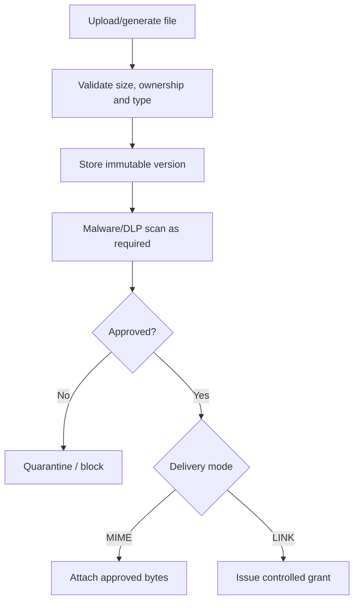
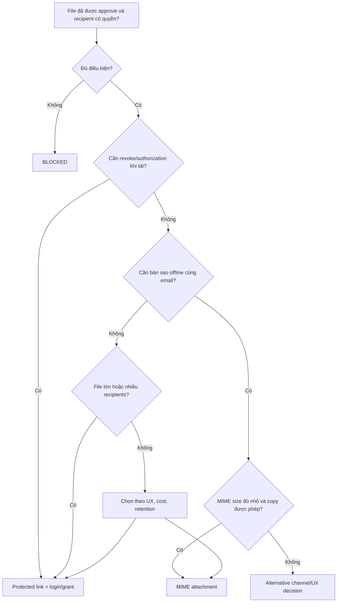

# Chọn attachment inline hay object storage link

Trong **Spring Framework Mail**, khi gửi hóa đơn, hợp đồng, báo cáo, ảnh, tài liệu xuất dữ liệu hoặc file hướng dẫn, ứng dụng cần quyết định **đưa dữ liệu trực tiếp vào email MIME** hay **chỉ gửi một liên kết HTTPS tới tài liệu trong object storage**. Cả hai đều có thể triển khai với `JavaMailSender`, nhưng chúng khác nhau về tải SMTP, khả năng truy cập offline, quyền tải, mức độ thu hồi, rủi ro chuyển tiếp, retention, chi phí và độ tin cậy.

Một tệp PDF nhỏ được đính kèm có thể tiện cho người dùng vì nó nằm ngay trong email. Nhưng một file 30 MB có thể bị từ chối vì giới hạn kích thước SMTP; nếu tài liệu nhạy cảm bị forward, người gửi không thể thu hồi bản sao đã chuyển tới hộp thư khác. Ngược lại, gửi object storage link giảm kích thước email và có thể xác thực người tải, nhưng link có thể hết hạn, bị scanner tự mở hoặc không hoạt động khi ứng dụng/download service gặp sự cố.

**Quyết định đúng không chỉ là chọn overload `MimeMessageHelper.addAttachment(...)` hay render một thẻ `<a href="...">`.** Cần chọn một hợp đồng phân phối tài liệu: dữ liệu có được sao chép ra ngoài không, người nhận cần đăng nhập không, file cần mở offline không, link có thể bị forward không, bao lâu còn truy cập được, trạng thái nào được xem là thành công.

Bài này trình bày đầy đủ hai mô hình, phân biệt attachment với tài nguyên CID inline, so sánh MIME size, UX, hiệu năng, bảo mật và compliance; sau đó xây cách triển khai bằng Spring Mail, private object storage, authorization endpoint, outbox, worker và test. Các ví dụ về policy, URL và tên dịch vụ là minh họa, cần điều chỉnh cho hệ thống thực tế.

## 1. Phân biệt MIME attachment, CID inline và object storage link

Có ba dạng dữ liệu thường bị gọi chung là “inline”:

| Cơ chế | Nội dung file nằm ở đâu? | Mục đích |
|---|---|---|
| **MIME attachment** | Bytes của file nằm trong MIME message, thường `Content-Disposition: attachment` | Đính kèm PDF, CSV, tài liệu |
| **Inline MIME resource** | Bytes nằm trong MIME message và được tham chiếu bằng `Content-ID` | Logo, hình ảnh hiển thị trong HTML qua `cid:...` |
| **Object storage link** | Bytes ở private storage; email chỉ chứa URL hoặc deep link | Tải tài liệu theo quyền qua HTTPS |

Với bài này, **“attachment inline” được hiểu chủ yếu là file được đính kèm trực tiếp trong email**, đối lập với URL tới object storage. API `MimeMessageHelper.addInline(...)` là một trường hợp MIME nội tuyến cụ thể, không thay thế chung cho PDF attachment.

Ví dụ:

```html
<p>Hóa đơn đã sẵn sàng.</p>

<a href="https://app.example.org/downloads/opaque-grant">Tải hóa đơn</a>
```

Ở đây logo có thể là CID inline image, còn hóa đơn được phân phối qua link. Nếu gửi hóa đơn dạng MIME attachment, PDF nằm trong một MIME part riêng, không cần URL.

## 2. Sơ đồ hai kiến trúc

### A. Đính kèm trực tiếp vào thư

```text
Domain action
     |
     v
Notification / outbox
     |
     v
Mail worker
     |
     v
Read approved file bytes
     |
     v
MimeMessageHelper.addAttachment(...)
     |
     v
JavaMailSender.send(...)
     |
     v
SMTP -> recipient mailbox
             |
             v
     Open attachment locally
```

Bytes của file được mã hóa và chuyển trong email. Khi bản sao đến hệ thống nhận, quyền thu hồi của hệ thống gửi rất hạn chế.

### B. Gửi protected link

```text
Domain action
     |
     v
Store immutable file version
     |
     v
Scan + approve + create download grant
     |
     v
Notification / outbox
     |
     v
Mail worker renders stable HTTPS link
     |
     v
SMTP -> recipient mailbox
             |
             v
         Click link
             |
             v
     App validates auth/grant
             |
             v
     Private object store/CDN
             |
             v
         Download bytes
```

Đường đi thứ hai có **hai pipeline độc lập**: một pipeline gửi email và một pipeline truy cập tài liệu. SMTP thành công không chứng minh người nhận tải được file.

## 3. Bảng so sánh kiến trúc

| Tiêu chí | MIME attachment | Object storage link |
|---|---|---|
| Kích thước email | Tăng theo bytes file + MIME encoding | Nhẹ, chủ yếu HTML/text/URL |
| Giới hạn SMTP | Dễ bị ảnh hưởng bởi file lớn | Ít phụ thuộc file size khi submit |
| Tải file khi offline | Có thể, nếu email/file đã được tải | Cần tải từ HTTPS trước |
| Trải nghiệm mail client | File đính kèm quen thuộc | Mở trình duyệt/portal |
| Quyền sau khi email bị forward | Bản file thường đi theo thư | Phụ thuộc authentication và grant |
| Thu hồi | Không thu hồi được bản sao đã phát | Có thể chặn truy cập tương lai |
| Số bản sao | Có thể tăng theo recipients/forward | File gốc lưu tập trung, download tạo bản sao |
| Thời điểm tiêu thụ băng thông | Chủ yếu lúc gửi SMTP | Chủ yếu lúc người nhận tải |
| Retention | Ngoài tầm kiểm soát sau khi phát thư | Có thể quản lý ở storage và grant |
| Tài liệu nhiều người nhận | Mỗi bản email mang tệp | Có thể reuse object, cấp quyền riêng |
| File nhạy cảm | Rủi ro bản sao tồn tại lâu | Dễ kiểm soát nếu login/authorization đúng |
| File lớn | Thường không phù hợp | Thường phù hợp |
| Trạng thái cần theo dõi | MIME + SMTP + delivery | SMTP + grant + HTTP download |
| Sự phụ thuộc sau khi thư đã đến | Ít nếu attachment đã tải | App, auth, storage/CDN phải hoạt động |
| Tracking truy cập | Không có bằng chứng download chuẩn từ mail | Có HTTP events, nhưng scanner làm nhiễu |
| Chi phí | SMTP upload, mailboxes, retries | Object storage, HTTP/CDN egress, auth service |

Không có lựa chọn đúng tuyệt đối. Hãy xác định yêu cầu riêng của **tài liệu, người nhận và vòng đời truy cập** trước khi chọn.

## 4. Bắt đầu bằng các câu hỏi nghiệp vụ

1. Người nhận phải giữ bản sao file độc lập hay chỉ có quyền xem khi được cấp phép?
2. File có dung lượng bao nhiêu, cực đại bao nhiêu và có nhiều tệp không?
3. Gửi cho một người, nhiều người hay hàng chục nghìn người?
4. File có thể chứa thông tin cá nhân hoặc bí mật không?
5. Người nhận có cần xem offline không?
6. Có cần xác minh danh tính người tải mỗi lần không?
7. Có cần thu hồi quyền khi user hủy dịch vụ, nhân viên nghỉ việc hoặc tenant bị khóa không?
8. File cần giữ bao lâu và có yêu cầu chứng từ/audit không?
9. Người nhận có account trên portal hay phải truy cập mà không đăng nhập?
10. Email có thể được mở sau vài tuần/tháng không?
11. Có chấp nhận link đi qua mail-security scanners không?
12. Hệ thống download, storage và identity provider có SLO phù hợp không?
13. Có yêu cầu không thay đổi nội dung tài liệu sau thời điểm gửi không?
14. Có quy định data residency hoặc kênh phân phối cụ thể không?

Câu trả lời về **quyền truy cập và retention** thường quan trọng hơn độ tiện của một API.

## 5. MIME attachment lớn hơn tệp gốc

Dữ liệu nhị phân trong attachment thường được chuyển dưới dạng base64. Với n byte dữ liệu gốc, phần base64 thuần dài khoảng `4 × ceil(n / 3)` byte: gần 33% lớn hơn, chưa tính MIME boundaries, header, line folding và body.

Ví dụ:

```text
Original binary file:     about 12 MiB
Base64 content:          about 16 MiB
Actual MIME size:        greater than 16 MiB
```

Vì vậy không thể suy rằng “SMTP provider giới hạn 20 MB” nghĩa là có thể đính kèm file nhị phân 20 MB. Nhiều hệ thống giới hạn **toàn message size**, và người nhận có thể có giới hạn khác relay gửi.

Cần:

- Dùng ngưỡng file thấp hơn message limit.
- Tính cả HTML/text, headers và các inline images.
- Có headroom cho encoding/overhead.
- Kiểm tra limit theo provider/route/account.
- Thử với SMTP test server và môi trường provider được phép.
- Không retry vô hạn một thư bị từ chối vì vượt kích thước.

### Ước lượng lập kế hoạch

\[
\text{MIME size} \approx \text{body bytes} + 1.33 \times \sum \text{attachment bytes} + \text{overhead}
\]

Đây là một **ước lượng**; kiểm tra kích thước message sau MIME serialization nếu ứng dụng cần enforce ngưỡng sát thực tế.

## 6. Số recipients thay đổi tổng tải

Giả sử gửi một file 12 MiB cho 1.000 recipients, mỗi người nhận một message riêng. Chỉ phần nội dung base64 đã xấp xỉ 16 MiB mỗi thư, tương đương khoảng 16 GiB dữ liệu submission, chưa kể MIME overhead.

Nếu lưu một file trong object storage rồi gửi protected links, SMTP phải chuyển ít dữ liệu hơn. HTTP egress chỉ phát sinh khi link được mở, nhưng cũng có thể gồm các lần tải lặp, scanner fetch, cache miss và các lượt forward.

Phân biệt:

| Đường | Khi nào truyền dữ liệu tệp? |
|---|---|
| MIME | Trong SMTP message/forwarding, có thể nhân theo recipients |
| Link | Khi tải từ storage/CDN, có thể nhân theo số lần download |

Đừng khẳng định object storage luôn rẻ hơn: tổng chi phí còn phụ thuộc provider rate, lưu trữ, CDN/egress, số người tải, vận hành authorization và retention.

## 7. Khi attachment trực tiếp thường phù hợp

Một số tình huống:

- Tệp nhỏ, ví dụ một PDF chứng từ đã hoàn tất.
- Người nhận cần gửi/nhận file bằng workflow email truyền thống.
- Người nhận không có tài khoản portal.
- Tệp cần xem offline sau khi tải thư.
- Chính sách chấp thuận phát **bản sao độc lập** ra hộp thư người nhận.
- Nội dung cần là một snapshot cố định đi cùng email.
- Attachment size thấp hơn giới hạn gửi/nhận có headroom.
- Hệ thống muốn tránh phụ thuộc download service nhiều tháng về sau.

Ví dụ phòng kế toán nhận hóa đơn PDF và đưa vào hệ thống xử lý tự động có thể cần **file đính kèm thực**, không phải link tải thủ công.

Nhưng ngay cả file nhỏ cũng không nên gửi trực tiếp nếu quá nhạy cảm và quyền xem cần được thu hồi hoặc kiểm tra theo phiên.

## 8. Khi protected link thường phù hợp

- File lớn hoặc có nhiều attachments.
- Một file chia sẻ cho nhiều recipients.
- Dữ liệu nhạy cảm cần xác thực và thu hồi quyền xem.
- File cần nằm trong kho tài liệu trung tâm.
- Người nhận có portal/login flow hợp lý.
- Tài liệu có phiên bản, retention và legal hold.
- Số lượng email lớn khiến MIME bandwidth trở thành bottleneck.
- Muốn tách tốc độ SMTP và tải file.
- Cần kiểm soát download quota hoặc loại file.
- Có khả năng vận hành download service, storage và CDN.

Không chọn link chỉ vì code gửi email ngắn hơn. Một link cần **authorization, expiry, retention, download UX và error handling** riêng.

## 9. Đừng dùng public bucket URL cho tài liệu nhạy cảm

Ví dụ không nên áp dụng với tài liệu cá nhân:

```text
https://bucket.example.org/invoices/customer-123.pdf
```

Nếu object public, người có URL có thể tải. Đặt tên file bằng UUID khó đoán **không thay thế authorization**. Cũng không nên cho client tự cung cấp object key rồi backend phát signed link mà không xác minh owner/tenant.

Mô hình chặt hơn:

```text
Email -> https://app.example.org/downloads/<grantId>
      -> identify requester
      -> check grant, document, tenant and recipient
      -> private object storage
```

Bucket private, credentials giới hạn, request được xét policy, nội dung được scan và object version đã được xác định.

## 10. Ba mô hình link tải phổ biến

### Link yêu cầu login

Email trỏ tới ứng dụng; người nhận đăng nhập rồi app kiểm tra quyền. Đây là lựa chọn tốt khi người nhận đã có tài khoản và tài liệu nhạy cảm.

Ưu điểm:

- Có thể kiểm tra quyền ở **mỗi lần download**.
- Revoke quyền khi user bị khóa hoặc thuộc tenant khác.
- Có thể audit truy cập theo policy.
- Không dùng việc sở hữu email link làm danh tính.

Nhược điểm: thêm bước đăng nhập; SSO có thể không hoạt động khi mở link từ mail client khác hoặc thiết bị khác.

### Link dùng bearer grant

Một opaque token có thể cho phép tải mà không cần account, theo TTL và phạm vi cụ thể. Nhưng **ai giữ token có thể sử dụng quyền đó** nếu không có xác thực bổ sung.

Cần:

- Token đủ ngẫu nhiên/khó đoán.
- Token hash/verifier trong storage phù hợp.
- TTL và revocation.
- Rate limiting.
- Không lộ token trong log/analytics.
- Chống scanner prefetch.
- Cấm open redirect.
- Ràng buộc đúng file/version và scope.

Không gọi bearer grant là “xác thực người nhận” khi chưa có yếu tố xác thực danh tính.

### Presigned URL trực tiếp

Storage có thể cấp URL ký số với quyền GET và thời hạn ngắn.

Ưu điểm: dữ liệu đi trực tiếp từ storage/CDN, giảm tải application server.

Rủi ro:

- URL hoạt động như bearer capability.
- Bị forward/copy/log.
- Hết hạn trước khi người dùng mở email.
- Có thể khó revoke tức thì nếu URL vẫn trong TTL.
- Browser sẽ thấy URL ký số và có thể lưu trong history.

Khi dùng, nên xem URL ký số là **credential tạm thời**, không phải link công khai an toàn vĩnh viễn.

## 11. Phân biệt stable email link với short-lived storage URL

Mô hình thường phù hợp:

```text
Email:
  https://app.example.org/downloads/grant-A

When recipient clicks:
  validate account/session/grant and current policy
  -> generate short-lived signed GET for object version
  -> redirect or stream
```

Lợi ích:

1. Link được gửi qua SMTP không chết chỉ vì queue chờ lâu.
2. Link có thể mở sau nhiều ngày trong thời hạn được phép.
3. Có thể revoke grant ở database.
4. Có thể đổi object storage provider mà email cũ vẫn dẫn tới ứng dụng.
5. Có thể xác minh tenant/role tại thời điểm tải.
6. URL ký số không cần nằm trực tiếp trong body email.

**Đừng tạo URL ký số 10 phút rồi nhét vào email mà người nhận có thể đọc sau hai ngày.** Nếu dùng URL ngắn hạn, tạo tại thời điểm người nhận đã vượt qua bước authorization và bắt đầu tải.

## 12. TTL và retention phải khớp nhu cầu

Một link có thể được mở sau vài phút, vài giờ, vài tuần hoặc nhiều tháng. Cần định nghĩa:

- Link còn hợp lệ tới khi nào?
- Sau expiry có thể yêu cầu cấp lại không?
- File có còn trong object storage không?
- Nếu user đổi role/tenant, grant còn hợp lệ không?
- Nếu file bị sửa, link dẫn tới phiên bản nào?

Ví dụ lỗi:

```text
File retention: 24 hours
Download grant validity: 14 days

Recipient clicks on day 5:
  grant valid, object missing -> 404
```

Một lỗi khác:

```text
Outbox retry window: 48 hours
Temporary source file removed after HTTP request

Worker at hour 6:
  cannot read attachment
```

Nên phối hợp tối thiểu theo các nhu cầu còn tồn tại:

```text
Source retention >= necessary send/retry lifetime
Source retention >= active download-grant lifetime
Plus approved evidence/record retention where required
```

Không có một TTL mặc định đúng với mọi loại tài liệu.

## 13. Revoke không đồng nghĩa thu hồi mọi bản sao

Với MIME attachment:

- Sau khi file tới mailbox, người gửi không kiểm soát bản sao ở phía recipient.
- Người nhận có thể download, forward, lưu trên cloud cá nhân hoặc backup.
- Xóa file khỏi storage của người gửi không xóa các bản sao đã phát.

Với protected link:

- Có thể revoke grant để từ chối tải **trong tương lai**.
- Có thể kiểm tra quyền mỗi lần click.
- Có thể giới hạn thời hạn và phiên bản.

Nhưng:

- File đã tải trước revoke vẫn tồn tại.
- Signed URL đã cấp có thể còn hiệu lực đến expiry tùy provider.
- CDN/cache có thể giữ dữ liệu nếu không cấu hình đúng.

**Link tăng khả năng kiểm soát truy cập tương lai, không bảo đảm thu hồi tài liệu đã phân phối.**

## 14. Forward email là một phần của threat model

Một email chứa MIME attachment có thể được forward kèm toàn bộ file. Nếu dữ liệu nhạy cảm, người nhận mới có thể giữ bản sao.

Một email chứa link khi được forward có hai trường hợp:

- **Public/bearer link:** người nhận mới có thể mở được.
- **Link yêu cầu user/tenant authorization:** người nhận mới có thể bị chặn dù nhìn thấy URL.

Nếu sản phẩm muốn cho phép forward quyền truy cập, hãy xây cơ chế share/grant có audit thay vì âm thầm cho mọi người có URL tải file.

Nếu không muốn người nhận mới mở được file, phải dùng identity-based authorization hoặc cơ chế xác thực bổ sung. Chỉ randomize URL không đủ.

## 15. Scanner của hệ thống email có thể tự mở URL

Mail-security gateways và các bộ lọc phishing có thể fetch URL ngay sau khi email được nhận. Một số hệ thống có thể follow redirects, tải resource hoặc prefetch preview.

Hậu quả:

- Một HTTP GET không chứng minh người nhận thật đã bấm.
- Một link one-time tiêu thụ ở GET có thể bị scanner dùng trước.
- HTTP requests có thể xuất hiện trước khi người dùng đọc email.
- Link scanner tạo download traffic và làm nhiễu analytics.

**Không đặt hành động quan trọng vào GET.** Ví dụ `GET /confirm-transfer` không nên tự xác nhận chuyển tiền hoặc ký hợp đồng. Dùng authentication + giao diện xác nhận + một hành động POST có kiểm soát khi nghiệp vụ cần.

Với one-time download grant, cân nhắc bước xác thực/confirmation phù hợp để scanner không “đốt” lượt tải. Không cố nhận diện scanner chỉ bằng user-agent như một giải pháp bảo mật hoàn chỉnh.

## 16. URL là dữ liệu dễ bị lưu ở nhiều nơi

Link có token trong query/path có thể bị ghi vào:

- Browser history.
- Reverse proxy/load balancer access logs.
- Security inspection products.
- Email tracking và analytics.
- Screenshot, clipboard và messages khi forward.
- Referer nếu trang tải mở nội dung third-party không kiểm soát.

Một URL như:

```text
https://app.example.org/download?email=customer@example.net&token=secret
```

không phù hợp để giữ thông tin nhạy cảm.

Nếu dùng bearer grant:

- Dùng opaque random token.
- Không nhúng email, OTP hay user ID dễ đoán.
- Redact token trong access logs.
- Không tải third-party scripts trên trang chứa token.
- Đặt `Referrer-Policy` và cache policy phù hợp.
- Có rate limit và revoke.
- Không ghi full signed URL trong audit/metric.

Nếu không cần bearer link, login-based app link thường giảm rủi ro URL bị dùng bởi người không đúng quyền.

## 17. Hai cách phục vụ bytes sau authorization

### Stream qua application server

```text
Recipient -> app auth -> application streams object -> recipient
```

Ưu điểm:

- Authorization mỗi lần tải.
- Có thể kiểm soát rate/bytes theo user.
- Không trao raw storage URL.
- Có thể kiểm soát Content-Disposition/HTTP response trực tiếp.

Nhược điểm:

- Tăng băng thông CPU/network của application.
- File lớn phải được stream, không `readAllBytes`.
- Download resume/range/timeout cần thiết kế.
- Cần autoscaling/capacity nếu traffic cao.

### Redirect tới signed storage URL

```text
Recipient -> app auth -> 302 -> storage/CDN signed GET
```

Ưu điểm: giảm tải app, tận dụng storage/CDN.

Nhược điểm: signed URL lộ cho browser trong TTL; có thể khó revoke ngay; HTTP file response cuối do storage/CDN quyết định.

**Đừng chỉ đặt `Content-Disposition` và `no-store` trên response 302 rồi cho rằng file response từ storage cũng có các header này.** Cần cấu hình ở nơi thực sự phục vụ bytes.

## 18. Tạo MIME attachment bằng JavaMailSender

Ví dụ file nhỏ đã được kiểm tra quyền, kích thước và loại nội dung:

```java
import jakarta.mail.internet.MimeMessage;
import org.springframework.core.io.ByteArrayResource;
import org.springframework.mail.javamail.JavaMailSender;
import org.springframework.mail.javamail.MimeMessageHelper;

public final class InvoiceAttachmentMailer {

    private final JavaMailSender sender;

    public InvoiceAttachmentMailer(JavaMailSender sender) {
        this.sender = sender;
    }

    public void send(
            String approvedRecipient,
            byte[] validatedPdfBytes
    ) throws Exception {

        MimeMessage message = sender.createMimeMessage();

        MimeMessageHelper helper =
                new MimeMessageHelper(
                        message,
                        true,
                        "UTF-8"
                );

        helper.setFrom("billing@example.org");
        helper.setTo(approvedRecipient);
        helper.setSubject("Hóa đơn của bạn");
        helper.setText(
                "Hóa đơn được đính kèm.",
                "<p>Hóa đơn được đính kèm.</p>"
        );

        helper.addAttachment(
                "hoa-don.pdf",
                new ByteArrayResource(validatedPdfBytes),
                "application/pdf"
        );

        sender.send(message);
    }
}
```

`ByteArrayResource` phù hợp khi toàn bộ file đã nằm trong memory và kích thước được giới hạn. Nó có thể cung cấp stream mới cho Jakarta Mail khi cần serialize/đọc lại.

**Không sử dụng file bytes chưa được kiểm tra, không lấy recipient tùy ý chưa xác minh và không log toàn bộ MIME.**

## 19. Lỗi InputStreamResource single-use

Ví dụ có rủi ro:

```java
try (InputStream input = Files.newInputStream(path)) {
    helper.addAttachment(
            "report.pdf",
            new InputStreamResource(input),
            "application/pdf"
    );
}

// input đã đóng; Jakarta Mail có thể mới đọc lúc send.
sender.send(message);
```

`InputStreamResource` bọc một stream đã mở, thường có tính single-use. MIME attachment/inline có thể bị đọc muộn hoặc nhiều lần.

Nguồn phù hợp:

- `ByteArrayResource` cho bytes nhỏ đã bounded.
- `FileSystemResource` cho file ổn định, còn tồn tại.
- Custom `InputStreamSource` trả một stream mới mỗi lần.
- Custom `DataSource` có lifecycle/readability đúng.

Đưa `send` vào trong `try` chưa giải quyết toàn bộ yêu cầu *repeatable source*. Không truyền open stream qua `@Async` hoặc outbox.

## 20. Stream file lớn với InputStreamSource

Với file từ object storage, có thể tạo nguồn mở mới mỗi lần:

```java
import java.io.IOException;
import java.io.InputStream;
import org.springframework.core.io.InputStreamSource;

public final class ObjectAttachmentSource
        implements InputStreamSource {

    private final AttachmentStore storage;
    private final String key;
    private final String version;

    public ObjectAttachmentSource(
            AttachmentStore storage,
            String key,
            String version
    ) {
        this.storage = storage;
        this.key = key;
        this.version = version;
    }

    @Override
    public InputStream getInputStream() throws IOException {
        return storage.openReadStream(key, version);
    }
}

public interface AttachmentStore {
    InputStream openReadStream(
            String key,
            String version
    ) throws IOException;
}
```

Dùng:

```java
InputStreamSource source =
        new ObjectAttachmentSource(
                storage,
                approved.objectKey(),
                approved.version()
        );

helper.addAttachment(
        approved.safeFilename(),
        source,
        approved.mediaType()
);
sender.send(message);
```

`approved` và `storage` là các abstraction của ứng dụng.

Mỗi lần `getInputStream()` phải trả một stream mới bắt đầu từ byte đầu của **cùng immutable object version**. Stream phải còn truy cập được tới khi sender đọc xong và trong retry window.

Streaming giúp giảm heap nhưng **không vượt được SMTP message-size limit**. Với file thực sự lớn, link là một lựa chọn kiến trúc khác, không phải chỉ thay cách đọc bytes.

## 21. Inline CID cho ảnh trong HTML

Khi cần hiển thị logo trong body:

```java
MimeMessage message = sender.createMimeMessage();

MimeMessageHelper helper =
        new MimeMessageHelper(
                message,
                MimeMessageHelper.MULTIPART_MODE_MIXED_RELATED,
                "UTF-8"
        );

helper.setFrom("notifications@example.org");
helper.setTo("customer@example.net");
helper.setSubject("Thông báo");

helper.setText(
        "Xin chào!",
        "<p>Xin chào!</p>"
      + ""
);

helper.addInline(
        "brand-logo",
        new org.springframework.core.io.ClassPathResource(
                "mail/logo.png"
        ),
        "image/png"
);

sender.send(message);
```

`setText` nên được gọi trước `addInline` khi xây các phần MIME liên quan theo cách `MimeMessageHelper` mong đợi.

CID image tăng kích thước email và có vấn đề tương thích mail client riêng. Nó không biến tài liệu lớn thành file tải qua HTTP. Nếu dùng ảnh từ HTTPS URL thay CID, nhiều mail client có thể chặn remote images, và mọi lượt fetch có ảnh hưởng privacy/tracking.

## 22. Gửi protected download link bằng HTML và plain text

Email chứa link nên có cả text và HTML:

```java
import jakarta.mail.internet.MimeMessage;
import org.springframework.mail.javamail.JavaMailSender;
import org.springframework.mail.javamail.MimeMessageHelper;
import org.springframework.web.util.HtmlUtils;

public final class DownloadLinkMailer {

    private final JavaMailSender sender;

    public DownloadLinkMailer(JavaMailSender sender) {
        this.sender = sender;
    }

    public void send(
            String approvedRecipient,
            String trustedDownloadUrl
    ) throws Exception {

        MimeMessage message = sender.createMimeMessage();

        MimeMessageHelper helper =
                new MimeMessageHelper(message, false, "UTF-8");

        helper.setFrom("documents@example.org");
        helper.setTo(approvedRecipient);
        helper.setSubject("Tài liệu đã sẵn sàng");

        String safeAttribute =
                HtmlUtils.htmlEscape(trustedDownloadUrl);

        helper.setText(
                "Tải tài liệu: " + trustedDownloadUrl,
                "<p>Tài liệu đã sẵn sàng.</p>"
              + "<p><a href=\"" + safeAttribute + "\">"
              + "Tải tài liệu</a></p>"
        );

        sender.send(message);
    }
}
```

`trustedDownloadUrl` **phải** được tạo từ HTTPS base URL được cấu hình và grant ID do server cấp. HTML escaping là cần thiết nhưng **không thay thế URL validation**. Đừng lấy URL từ request tùy ý rồi đưa vào email: service có thể bị lợi dụng gửi link phishing.

Trong ứng dụng thật, nên dùng template engine (ví dụ Thymeleaf/FreeMarker) và context đã validate thay vì nối chuỗi HTML.

Ví dụ template Thymeleaf:

```html
<p>Tài liệu của bạn đã sẵn sàng.</p>
<p><a th:href="${downloadUrl}">Tải tài liệu</a></p>
<p>Nếu bạn không yêu cầu tài liệu này, hãy bỏ qua email.</p>
```

Trong template thực tế, `${downloadUrl}` được thay bằng cú pháp biểu thức biến chuẩn của Thymeleaf sau khi ghi Markdown.

## 23. Download endpoint phải xác minh quyền trước khi cấp URL

Một skeleton Spring MVC:

```java
import java.net.URI;
import java.time.Clock;
import org.springframework.http.HttpHeaders;
import org.springframework.http.HttpStatus;
import org.springframework.http.ResponseEntity;
import org.springframework.security.core.Authentication;
import org.springframework.web.bind.annotation.GetMapping;
import org.springframework.web.bind.annotation.PathVariable;
import org.springframework.web.bind.annotation.RestController;

@RestController
public final class DocumentDownloadController {

    private final DownloadGrantService grants;
    private final PrivateObjectStore storage;
    private final Clock clock;

    public DocumentDownloadController(
            DownloadGrantService grants,
            PrivateObjectStore storage,
            Clock clock
    ) {
        this.grants = grants;
        this.storage = storage;
        this.clock = clock;
    }

    @GetMapping("/downloads/{grantId}")
    public ResponseEntity<Void> download(
            @PathVariable String grantId,
            Authentication authentication
    ) {
        if (authentication == null
                || !authentication.isAuthenticated()) {
            return ResponseEntity
                    .status(HttpStatus.UNAUTHORIZED)
                    .build();
        }

        ApprovedDownload approved =
                grants.requireAuthorized(
                        grantId,
                        authentication.getName(),
                        clock.instant()
                );

        URI temporaryGet =
                storage.createTemporaryReadUrl(
                        approved.objectKey(),
                        approved.version()
                );

        return ResponseEntity.status(HttpStatus.FOUND)
                .header(
                        HttpHeaders.LOCATION,
                        temporaryGet.toString()
                )
                .header(
                        HttpHeaders.CACHE_CONTROL,
                        "no-store"
                )
                .build();
    }
}
```

`DownloadGrantService`, `PrivateObjectStore` và `ApprovedDownload` là thành phần tự định nghĩa, không phải API Spring Mail. Ví dụ giả định người dùng đăng nhập bằng cơ chế Spring Security phù hợp.

Trong triển khai thật:

1. Bảo vệ route ở security configuration.
2. Kiểm tra grant expiry, revoked state, tenant, recipient và document authorization.
3. Kiểm tra file scan APPROVED.
4. Chỉ ký GET của đúng object/version với TTL ngắn.
5. Không log `Location` chứa signed URL.
6. Cân nhắc dùng 404 cho một số trường hợp unauthorized để hạn chế lộ sự tồn tại của tài liệu, tùy policy.
7. Đặt Content-Disposition/Content-Type/nosniff ở **storage file response cuối**, không chỉ response redirect.
8. Nếu cần revoke gần như tức thì, cân nhắc stream file qua ứng dụng thay vì cấp presigned URL còn hiệu lực.

Authentication bằng một cái tên user mà không có tenant/document access check là chưa đủ.

## 24. Nếu recipient không có account thì sao?

Có thể dùng một record bearer grant:

```text
download_grant:
  grantId
  tokenVerifierHash
  attachmentId
  objectVersion
  recipientRef
  purpose
  issuedAt
  expiresAt
  revokedAt
  accessPolicy
```

Các nguyên tắc:

- Token đủ entropy, tạo bằng CSPRNG.
- Không lưu raw token nếu không cần.
- Hạn mức tải/TTL/expiry có quy định.
- Không cấp quyền vượt file/tenant đã được duyệt.
- Thực thi audit ở mức cần thiết và redaction.
- Scanner có thể mở link trước người nhận.
- Tránh để GET kích hoạt thao tác “đã ký/đã xác nhận”.
- Có quy trình cấp lại grant khi người nhận làm mất link.
- Không coi việc email được gửi đến một địa chỉ là xác minh ai đang sử dụng link.

Nếu tài liệu cực nhạy cảm, có thể cần bước xác minh bổ sung hoặc portal login dù làm UX dài hơn.

## 25. Phiên bản tài liệu: snapshot hay latest?

Khi một email được gửi vào ngày 1 và file được cập nhật vào ngày 3, người nhận mở ngày 10 sẽ thấy gì?

| Semantics | Ý nghĩa | Trường hợp |
|---|---|---|
| **Immutable snapshot** | Link/attachment gắn với phiên bản đúng thời điểm gửi | Hóa đơn, hợp đồng, báo cáo chốt |
| **Latest view** | Link luôn trả phiên bản hiện hành theo quyền | Dashboard, hướng dẫn cập nhật |

Không dùng một object key có thể bị overwrite nếu cần chứng minh nội dung đã phát hành. Hãy pin object version hoặc dùng immutable keys.

Metadata:

```text
attachmentId
objectKey
objectVersion
contentLength
mediaType
safeFilename
classification
scanStatus
retentionUntil
```

Nếu một object bị sửa sau khi scan nhưng trước khi download/MIME serialization, nội dung được phát có thể khác nội dung đã được phê duyệt. Dùng immutable version và scan status gắn với version để tránh sai lệch này.

## 26. Quyền requester, recipient và downloader có thể khác nhau

Một hệ thống gửi tài liệu có ba quyết định:

1. **Ai được yêu cầu gửi tài liệu này?**
2. **Ai được nhận thông báo hoặc file?**
3. **Ai được tải tài liệu vào thời điểm click?**

Ví dụ nhân viên A được phép gửi hóa đơn cho khách B, nhưng sau khi hợp đồng chấm dứt, khách B có thể không còn quyền tải bản mới. Người C nhận email forward từ B cũng không tự được quyền.

Với MIME attachment, kiểm tra quyền **trước khi gửi** là ranh giới chính, vì bản sao ra ngoài gần như không thu hồi được. Với link, kiểm tra quyền **trước khi gửi** và **mỗi lần tải** đều có ích.

Không lấy `From`/`To`, URL hoặc object key từ client làm bằng chứng quyền.

## 27. Một file cho nhiều recipients: dùng grant theo người

Nếu gửi cùng file cho nhiều người, object có thể dùng chung nhưng quyền truy cập nên được tách:

```text
documentVersion = report-v3
recipient A -> grant-A
recipient B -> grant-B
recipient C -> grant-C
```

Nhờ vậy có thể revoke riêng, áp dụng TTL riêng hoặc gắn với tenant. Nhưng bearer grant có thể bị forward, nên grant ID không tự chứng minh người click.

Nếu email có personalization/link riêng, một **logical notification per recipient** thường dễ quản lý hơn. Một MIME message chung với nhiều To/Cc/Bcc recipients không thể chứa các link cá nhân khác nhau trong cùng body mà không có logic gửi riêng.

Đừng tạo một URL của người A rồi reuse cho người B trong một chiến dịch.

## 28. Outbox và ranh giới bất đồng bộ

Một pipeline gửi mail đáng tin cậy:

```text
HTTP/API action
     |
     v
Validate + store immutable approved file
     |
     v
Create notification, attachmentRef/grantRef
     |
     v
Commit durable outbox
     |
     v
Worker builds message and submits SMTP
```

Đừng truyền qua queue:

- `InputStream` hoặc `InputStreamResource`.
- `MultipartFile`/servlet `Part` thuộc request.
- Temp file path chỉ tồn tại trên Pod A.
- Presigned URL ngắn hạn được tạo trước khi job chờ.
- File chưa được quét/commit.
- Raw object credentials.

Một job nên giữ:

```json
{
  "notificationId": "notif-401",
  "recipientRef": "recipient-31",
  "deliveryMode": "PROTECTED_LINK",
  "attachmentRef": "attachment-918",
  "objectVersion": "v3",
  "grantRef": "grant-712",
  "templateKey": "document-ready"
}
```

Worker truy cập storage bằng identity/service credential phù hợp và tạo message từ references bền vững.

## 29. Retry SMTP không đồng nghĩa retry download

Dù chọn mode nào, SMTP submission có thể:

- `SMTP_ACCEPTED`: server next-hop đã chấp nhận.
- `KNOWN_REJECTED`: có bằng chứng từ chối.
- `UNKNOWN`: không biết chắc message đã được server nhận chưa.

Một timeout sau `DATA` có thể dẫn đến duplicate khi retry. Nếu email chứa link:

- Hai bản email có thể cùng grant.
- Nếu grant được sinh lại ở mỗi attempt, người nhận có thể có nhiều link khác nhau.
- Nếu grant cũ bị revoke bất ngờ, email đã accepted có thể mở không được.

Nên giữ `notificationId`, `attachmentVersion` và `grantRef` ổn định theo **logical notification** theo policy. Mỗi attempt có `attemptId` riêng.

**SMTP accepted không có nghĩa file được tải.** Download lifecycle cần trạng thái/metric riêng.

## 30. Link có state machine riêng

```text
Mail submission:
  QUEUED -> SUBMITTING -> SMTP_ACCEPTED
                       -> KNOWN_REJECTED
                       -> UNKNOWN

Download:
  GRANT_ISSUED -> AUTHORIZED -> STARTED -> COMPLETED
               -> EXPIRED
               -> REVOKED
               -> DENIED
               -> STORAGE_FAILURE
```

Không suy ra `DOWNLOAD_COMPLETED` chỉ vì server trả HTTP redirect; người nhận có thể không theo redirect hoặc kết nối bị cắt giữa chừng.

Tương tự, download HTTP 200 không chứng minh recipient đã đọc/hiểu tài liệu; scanner hoặc proxy có thể là bên tải.

Nếu cần audit kết quả tải chính xác, định nghĩa mức chứng cứ phù hợp ở nơi thực sự truyền bytes và giới hạn dữ liệu cá nhân được thu thập.

## 31. Scan malware và DLP trước khi phát file

Cả hai phương án đều cần kiểm soát file:



- Không mở tệp tin không tin cậy trong mail worker.
- Không dùng filename client làm object key/path.
- Không cho phép download trước scan approval.
- Không tự giải nén archive không giới hạn.
- Giới hạn số file, dung lượng và nesting.
- Scanner không đảm bảo tuyệt đối an toàn; còn cần policy về loại file, nguồn và mục đích.
- Scan status gắn với **object version**.

**Link không tự làm file an toàn hơn**. Nó chỉ chuyển đường phân phối từ SMTP sang HTTP.

## 32. Path traversal, SSRF và truy cập chéo tenant

Những ví dụ không nên làm:

```java
Path path = Path.of(userSuppliedFilename);

helper.addAttachment(
        userSuppliedFilename,
        new FileSystemResource(path)
);
```

Hoặc:

```java
URL remote = new URL(userSuppliedUrl);
// Fetch arbitrary remote URL to attach to email.
```

Rủi ro:

- Path traversal/symlink/TOCTOU đọc file ngoài phạm vi.
- SSRF khi fetch internal/metadata endpoints.
- Lấy object của tenant khác.
- MIME header/filename injection.
- File bị overwrite sau phê duyệt.

Cho client gửi `attachmentId` logic. Backend ánh xạ từ ID tới object key/version **sau khi kiểm tra quyền**, nguồn dữ liệu đã approve và chính sách file.

Đối với link, đừng phát signed URL chỉ vì caller biết key.

## 33. Tên file và HTTP security headers

Với MIME attachment, tên file thường nằm trong `Content-Disposition` của MIME part. Với object link, tên download từ HTTP `Content-Disposition`.

Các nguyên tắc:

- Sanitize filename, bỏ CR/LF và path separators.
- Dùng server-generated storage key, không dùng filename làm path.
- Áp dụng `Content-Type` đã được kiểm tra.
- Với file có khả năng render active content, cân nhắc `Content-Disposition: attachment`.
- Dùng `X-Content-Type-Options: nosniff` ở response tải file.
- Cân nhắc origin/domain riêng cho untrusted active content.
- Hỗ trợ Unicode filename theo chuẩn phù hợp.
- Không phụ thuộc browser suy đoán MIME type từ extension không tin cậy.

Nếu redirect tới object store, **header của file response cuối phải do object store/CDN phát**. Header ở 302 của app không tự bảo vệ response file.

## 34. Data residency, retention và bản sao của người nhận

Object storage cho phép kiểm soát:

- Bucket/region.
- Object replication.
- Encryption/KMS.
- Tenant permissions.
- Lifecycle/retention/legal hold.
- Download audit và deletion.

Nhưng nếu file được tải, bản sao ở thiết bị của người nhận vẫn nằm ngoài hệ thống. MIME attachment cũng đi qua SMTP relays và recipient mailboxes mà người gửi có thể không kiểm soát nơi lưu.

Cần xác định chính sách theo loại tài liệu, ngành nghề và địa bàn. Không tự tuyên bố một TTL hoặc thời hạn lưu trữ là bắt buộc cho mọi ứng dụng; nên dùng policy được phê duyệt và thiết kế xóa dữ liệu bao phủ backups, logs, cache, exports và storage.

## 35. Deliverability: link không tự bảo đảm vào inbox

Mail gateway có thể đánh giá:

- Message size và MIME structure.
- Loại file attachment hoặc archive.
- Tệp có malware/macro.
- Domain reputation và TLS.
- URL redirect chain.
- Phishing-like links, shorteners, tracking.
- Alignment giữa sender identity và link domain.

Chuyển file lớn thành link có thể tránh lỗi size nhưng có thể làm xuất hiện rủi ro link phishing nếu domain lạ hoặc redirect phức tạp.

Nên:

- Dùng domain HTTPS do tổ chức quản lý.
- Tránh arbitrary shortener.
- Thể hiện rõ vì sao recipient nhận được email.
- Có plain-text và HTML version.
- Dùng sender authentication (SPF/DKIM/DMARC) theo hạ tầng phù hợp.
- Không gửi link tới file chưa approved.
- Kiểm thử qua những mail gateways/clients liên quan nếu sản phẩm yêu cầu.

## 36. Trải nghiệm khi hệ thống download đang outage

Attachment đã được người nhận tải cùng email có thể mở offline, ngay cả khi ứng dụng gửi hoặc object storage ngừng hoạt động.

Link có thể phụ thuộc:

- DNS/TLS/app endpoint.
- Portal login/SSO.
- Grant database.
- Object storage/CDN.
- Quyền và retention hiện hành.

Nếu tài liệu là chứng từ cần mở sau nhiều năm, cân nhắc bản sao attachment hoặc một portal có cam kết SLO và retention phù hợp.

Không hứa “đường dẫn dùng mãi” khi file retention chỉ vài ngày. Email nên thông báo rõ thời hạn hoặc cách xin cấp lại link.

## 37. Quyết định policy theo classification, size và UX

Một mô hình:

```java
public enum FileDeliveryMode {
    MIME_ATTACHMENT,
    PROTECTED_LINK,
    BLOCKED
}

public record FileDeliveryContext(
        long contentLength,
        String classification,
        boolean requiresOfflineCopy,
        boolean requiresRevocation,
        boolean recipientHasPortalAccess,
        int recipientCount,
        String notificationType
) {
}

public interface FileDeliveryPolicy {
    FileDeliveryMode choose(FileDeliveryContext context);
}
```

Đây là abstractions ứng dụng. Cần trả `BLOCKED` nếu không có phương án phân phối nào đáp ứng chính sách. **Không âm thầm xóa attachment rồi gửi email thiếu nội dung**, cũng không tự động dùng public link để vượt qua giới hạn SMTP.

Một cây quyết định minh họa:



Không hard-code một ngưỡng dung lượng duy nhất cho mọi notification nếu classification, provider limits và người nhận khác nhau.

## 38. Config policy theo môi trường

Ví dụ cấu hình **riêng của ứng dụng**, không phải property built-in của Spring Boot:

```yaml
mail:
  file-delivery:
    small-attachment-max-bytes: 3145728
    require-approved-scan: true
    default-link-ttl-days: 14
    allow-presigned-url-directly-in-email: false
    require-portal-auth-for-sensitive: true
```

Giá trị 3 MiB và 14 ngày chỉ minh họa. Chúng phải phù hợp giới hạn SMTP thực tế, mục đích nghiệp vụ và retention.

Nên version hóa policy và lưu `deliveryPolicyVersion` khi cần điều tra vì sao cùng loại tài liệu hôm trước attach, hôm nay lại gửi link.

## 39. Metadata và database model

Có thể tách ba nhóm record:

```text
stored_attachment:
  attachmentId
  tenantRef
  objectKey
  objectVersion
  contentLength
  mediaType
  safeFilename
  classification
  scanStatus
  retentionUntil

download_grant:
  grantId
  attachmentId
  recipientRef
  issuedAt
  expiresAt
  revokedAt
  accessPolicy

mail_notification:
  notificationId
  recipientRef
  templateKey
  deliveryMode
  attachmentId
  grantId
  dueAt
  status
```

Một object có thể được dùng chung cho nhiều grants nhưng việc revoke một recipient không được làm hỏng grants hợp lệ của những người khác.

Nếu object versioning không được storage hỗ trợ, dùng immutable key hoặc cơ chế snapshot rõ ràng. Nếu object thay đổi sau scan và trước khi gửi, có thể phát nội dung chưa được phê duyệt.

## 40. Error matrix theo từng phương án

| Tình huống | MIME attachment | Protected link |
|---|---|---|
| File bị xóa trước khi gửi | Source/MIME read failure | Email có thể gửi, download sau đó 404 |
| File vượt message limit | SMTP rejection | Không ảnh hưởng size SMTP, HTTP có limits khác |
| SMTP timeout sau DATA | Có thể duplicate message | Có thể duplicate email chứa link |
| Recipient forward email | File có thể được forward | Link được forward; auth quyết định truy cập |
| Grant expired | Không có | 403/expired UX |
| Portal/SSO outage | File đã tải có thể mở | Có thể không download được |
| Storage outage lúc gửi | Worker không lấy được bytes | Mail có thể gửi link, download không sẵn |
| Storage outage sau SMTP | Bản file đã đến recipient vẫn dùng được | Download thất bại |
| File đổi version | Có thể attach phiên bản sai | Có thể download phiên bản sai |
| Policy revoke | Không thu hồi attachment đã phát | Có thể ngăn future access |
| Scanner tự mở URL | Không có download link | Có traffic không đại diện người đọc |
| File quá nhạy cảm để phát bản sao | Thường không phù hợp | Login-based controlled link có lợi |

Không gộp lỗi download vào trạng thái SMTP. Hai hệ thống có thể thành công/thất bại độc lập.

## 41. Một case study: hóa đơn PDF nhỏ

Giả sử hóa đơn cuối kỳ là một PDF 300 KB, cần được kế toán của khách lưu làm chứng từ:

- Đã kiểm tra người nhận và chính sách phát hành.
- File đã được tạo/scan và version pin.
- Kích thước MIME an toàn dưới giới hạn.
- Người nhận chấp nhận nhận bản sao không thể revoke.
- Hệ thống nhận xử lý được PDF attachment.

**MIME attachment** có thể hợp lý. Lưu `attachmentId` và `objectVersion` trong outbox; worker dựng message với repeatable source và gửi. Nếu hệ thống cần audit, ghi template/version, notification/attempt ID và SMTP outcome, không cần lưu full PDF trong audit.

Một link vẫn có thể được cung cấp bổ sung để người nhận tra lại trên portal, nhưng không nên thay thế attachment nếu hợp đồng tích hợp yêu cầu file thực.

## 42. Một case study: báo cáo 80 MB cho nhiều nhân viên

Một báo cáo 80 MB được chia cho 500 nhân viên:

- MIME size sau encoding có thể quá lớn cho nhiều mail systems.
- Mỗi bản attachment sẽ tạo tải SMTP cao.
- Nhân viên đã có SSO.
- Báo cáo có thể bị revoke nếu quyền nhân viên thay đổi.

**Protected link** là hướng phù hợp hơn:

1. Lưu một immutable object version.
2. Quét file và đánh dấu approved.
3. Tạo per-user grant hoặc xác thực theo entitlement.
4. Gửi email nhỏ tới từng người/nhóm được phép.
5. Khi click, xác thực SSO và kiểm tra quyền.
6. Redirect tới signed GET ngắn hạn hoặc stream file.
7. Theo dõi HTTP failures/bytes và SLO riêng.

Vẫn cần cân nhắc bandwidth nếu 500 người cùng tải và chính sách không để scanner tải file lớn vô hạn.

## 43. Một case study: hồ sơ cực kỳ nhạy cảm

Giả sử tài liệu có dữ liệu cá nhân mức nhạy cảm cao, yêu cầu hạn chế truy cập và khả năng revoke:

- Không tự động attach file vào email.
- Email chỉ thông báo có tài liệu.
- Link dẫn tới portal quản lý.
- User phải đăng nhập với mức xác thực phù hợp.
- Server kiểm tra tenant/ownership và trạng thái tài liệu tại mỗi lần tải.
- Download được audit có kiểm soát, không log raw file/signed URL.
- Retention và storage encryption được thực thi.
- Cần phương án khi portal/identity provider outage.

Giải pháp này có UX phức tạp hơn; nhưng việc gửi bản sao độc lập qua email có thể không phù hợp yêu cầu bảo mật của sản phẩm.

## 44. Kiểm thử MIME attachment

Các test hữu ích:

1. Dựng `MimeMessage` chứa file với `ByteArrayResource`.
2. Gọi `message.writeTo(...)` để buộc MIME serialization.
3. Parse lại MIME và kiểm tra decoded attachment bytes.
4. Kiểm tra `Content-Disposition`, filename, content type.
5. Kiểm tra subject/body Unicode.
6. Kiểm tra nhiều attachments và CID inline.
7. Kiểm tra source mở stream nhiều lần.
8. Kiểm tra file bị xóa/permission denied trước send.
9. Kiểm tra kích thước MIME tại ngưỡng policy.
10. Tích hợp SMTP test server, không dùng SMTP production.

Chỉ dùng Mockito `verify(mailSender).send(...)` không đủ: mock không đọc attachment bytes.

## 45. Kiểm thử protected link

- HTTPS domain và host thuộc allowlist.
- Link không chứa PII/secrets/presigned credential lâu hạn.
- Người nhận hợp lệ mở được theo policy.
- Tenant khác/user khác bị từ chối.
- Expired/revoked grant không cấp quyền mới.
- File chưa scan approved bị chặn.
- Object version được pin đúng.
- Signed GET chỉ có scope cần thiết và TTL ngắn.
- Redirect không trở thành open redirect.
- Download response cuối có MIME type/Content-Disposition đúng.
- Không tiêu thụ one-time grant chỉ vì scanner GET.
- Không có raw token trong logs, tracing hoặc analytics.
- Storage không còn object → lỗi rõ và runbook.
- Người nhận mở sau nhiều ngày vẫn có UX dự đoán được.
- Concurrent downloads/rate limits không làm cạn service.
- Client cần resume/range thì có cơ chế phù hợp.

Các tests cần mô phỏng download flow, không chỉ SMTP accepted.

## 46. Kiểm thử bảo mật bổ sung

| Tình huống | Kết quả cần có |
|---|---|
| Caller nhập attachment ID của tenant khác | Từ chối trước MIME/link generation |
| Filename chứa path traversal hoặc CR/LF | Sanitize/từ chối |
| Object chưa scan | Không gửi content/không cấp grant |
| MIME source thay đổi bytes giữa hai lần đọc | Chặn bằng immutable version |
| Presigned URL bị forward | Rủi ro được giới hạn bằng TTL/scope hoặc auth |
| Link scanner fetch | Không xác nhận business action |
| User đổi role sau khi nhận email | Download auth kiểm tra entitlement hiện tại |
| Grant bị revoke | Không tạo signed URL mới |
| Signed URL bị log | Redaction/giới hạn tiếp cận |
| File dạng active content | Header/origin isolation phù hợp |
| Email retry sau 24h | Không dùng URL storage đã hết hạn từ lúc enqueue |
| Download grant sống lâu hơn file | Contract/retention test phải bắt lỗi |
| Provider SMTP giới hạn message | Delivery policy fallback/reject có chủ đích |

## 47. Observability cho hai pipelines

### Mail submission metrics

```text
mail_notification_created_total
mail_send_attempt_total
mail_send_accepted_total
mail_send_rejected_total
mail_send_unknown_total
mail_outbox_oldest_age_seconds
mail_message_size_bytes
```

### File/download metrics

```text
mail_file_delivery_mode_total
document_download_authorized_total
document_download_denied_total
document_download_expired_total
document_download_failure_total
document_download_bytes_total
document_storage_read_failure_total
```

Đây là tên đề xuất, không phải toàn bộ metric có sẵn của Spring Mail.

Tags nên là danh mục hữu hạn như `deliveryMode`, `stage`, `errorCategory`, `documentClass`, `route`. Không dùng recipient email, grant token, object key, signed URL hoặc notification ID làm metric tags.

Audit có thể giữ delivery mode, policy version, object/attempt references và access decision tối thiểu. Không cần lưu attachment bytes hoặc URL có chữ ký trong audit.

## 48. Runbook: người nhận báo không tải được file

**Bước 1:** Xác định mode thực tế: có MIME attachment hay protected link?

**Bước 2:** Với MIME, kiểm tra serialization, stream source, kích thước toàn MIME, file type, provider rejection, mail gateway và client compatibility.

**Bước 3:** Với link, kiểm tra domain, grant ID, expiry/revoke, đăng nhập, tenant và recipient authorization.

**Bước 4:** Kiểm tra object/version còn tồn tại, scan APPROVED, storage permission, KMS, CDN và network.

**Bước 5:** Kiểm tra redirect, signed URL TTL, scope GET, Content-Disposition ở file response cuối.

**Bước 6:** Kiểm tra mail-security scanners có prefetch hoặc consume one-time access hay không.

**Bước 7:** Nếu cần, cấp lại grant theo policy; không mở bucket public chỉ để sửa lỗi nhanh.

**Bước 8:** Không resend email hàng loạt nếu SMTP outcome có thể đã accepted. Tách sự cố download khỏi sự cố submission để không gây duplicate.

## 49. Runbook: email attachment bị chặn vì kích thước

1. Đo kích thước MIME thực, không chỉ binary file.
2. Xác định limit của SMTP provider và mail gateway người nhận.
3. Xác định file type/scan/quarantine.
4. Kiểm tra nhiều CID images hoặc attachments cộng dồn.
5. Nếu quá ngưỡng cố định, không retry nóng.
6. Xác minh recipient có thể nhận protected link hay không.
7. Nếu chuyển mode, đưa file vào private storage/scan/grant đúng.
8. Truyền thông rõ ràng “tải tài liệu” thay vì “tệp đính kèm”.
9. Ghi audit lý do đổi mode và notification mới nếu cần.
10. Kiểm thử link mở muộn, revoke và quyền người nhận.

Đừng tự động chuyển sang public link để vượt qua một giới hạn kích thước SMTP.

## 50. Các sai lầm thường gặp

| Sai lầm | Vì sao nguy hiểm | Cách làm phù hợp |
|---|---|---|
| File quá lớn vẫn attach vì có streaming | SMTP size limit không đổi | Chọn link theo policy |
| Public bucket link cho tài liệu riêng | Bất kỳ ai có URL đều xem | Private bucket + auth/grant |
| Presigned URL 15 phút trong email | Email mở muộn bị 403 | App link, ký lúc click |
| Một bearer link cho mọi recipients | Không revoke theo người | Per-recipient grant |
| Dùng `InputStreamResource` đã đóng | MIME serialization lỗi | ByteArrayResource/repeatable source |
| Queue lưu temp file path | Worker khác node không mở được | Durable object key/version |
| Link tới file chưa scan | Phân phối dữ liệu không an toàn | Quarantine/approval |
| Dùng `latest` cho hóa đơn chốt kỳ | Người nhận thấy nội dung khác | Immutable snapshot |
| Link GET tự xác nhận giao dịch | Scanner có thể click | Auth + POST confirmation |
| Signed URL trong log | Lộ bearer credential | Redaction và TTL nhỏ |
| Chỉ kiểm tra gửi SMTP, không test download | Lỗi link xuất hiện muộn | E2E lifecycle tests |
| Không ghi retention | Link 404 trong khi grant còn hạn | Đồng bộ file/grant lifetime |
| Chỉ set security headers ở redirect | Response cuối vẫn không bảo vệ | Cấu hình storage/CDN |
| Thay attachment bằng link không báo user | UX/tích hợp nghiệp vụ bị phá | Policy/contract rõ |
| Coi download HTTP 200 là người đã đọc | Scanner/proxy có thể tải | State semantics rõ |
| Không giới hạn downloads/rate | Abuse hoặc quá tải HTTP | Admission/rate limit |
| Xóa object khi revoke một grant | Các grants khác bị hỏng | Shared object reference policy |

## 51. Checklist quyết định production

1. Phân biệt MIME attachment, CID inline và object storage link.
2. Có data classification và authorization cho requester/recipient.
3. File đã scan và approved theo policy.
4. Đã tính kích thước MIME sau encoding.
5. Provider/recipient message size limit có headroom.
6. Xác định người nhận có cần offline copy không.
7. Xác định forward có được phép cấp quyền tải cho người mới không.
8. Nếu link, bucket private và HTTPS domain được quản lý.
9. Nếu link, có authentication/grant/expiry/revoke phù hợp.
10. Không đặt presigned storage URL ngắn hạn vào email sẽ mở muộn.
11. Scanner GET không gây tác động business ngoài ý muốn.
12. Có per-recipient grant khi cần.
13. Object version bất biến với snapshot đã gửi.
14. Attachment và grant retention đồng bộ với outbox/retry.
15. Có kế hoạch khi app/SSO/storage/CDN outage.
16. Với MIME, stream source repeatable và file tồn tại đủ lâu.
17. Không truyền `MultipartFile`/live `InputStream` qua queue.
18. Có content type, safe filename và Content-Disposition đúng.
19. Chống path traversal, SSRF và cross-tenant access.
20. Email link có plain text/HTML và UX expiry rõ.
21. SMTP status và HTTP download status được theo dõi riêng.
22. Có audit tối thiểu, metric, alert và runbook cho cả hai pipeline.
23. Có tests cho MIME bytes, auth, expiry/revoke và download sau nhiều ngày.
24. Có policy version và owner của quyết định delivery mode.
25. Không âm thầm hạ cấp bảo mật để xử lý lỗi SMTP.

## 52. Ghi nhớ

- **MIME attachment** gửi bản sao file trong email; **object storage link** yêu cầu một luồng HTTP download riêng.
- `MimeMessageHelper.addInline` phục vụ tài nguyên CID trong HTML, không đồng nghĩa PDF attachment.
- Base64 làm attachment lớn hơn khoảng 33% trước MIME overhead.
- File nhỏ cần bản sao offline, ít nhạy cảm và được phép phát có thể phù hợp attachment.
- File lớn, nhiều recipients hoặc cần revoke/authorization có thể phù hợp protected link.
- Presigned URL là bearer capability tạm thời, không phải danh tính người tải.
- Link tới app có kiểm tra quyền tại click thường tốt hơn signed URL ngắn hạn đặt trực tiếp trong email.
- Scanner có thể mở link trước user; GET không chứng minh người dùng đã đọc.
- Revoke link chỉ chặn truy cập tương lai; không thu hồi bản sao đã tải.
- File/version phải immutable và scan-approved cho cả hai modes.
- Với MIME, source phải còn tồn tại và có thể mở stream mới khi Jakarta Mail cần.
- Streaming giảm heap nhưng không vượt message-size limit.
- SMTP accepted và download completed là hai sự kiện khác nhau.
- Quyết định phải dựa vào size, security, UX, entitlement, lifetime, recipient count và khả năng vận hành.

**Kết luận:** Chọn **MIME attachment** khi cần gửi một bản sao nhỏ, tự chứa và có thể sử dụng offline, với chấp thuận phân phối dữ liệu rõ. Chọn **protected object storage link** khi tệp lớn, nhiều người nhận, cần quản lý tập trung hoặc kiểm tra/thu hồi quyền truy cập. Đối với cả hai, hãy giữ dữ liệu đúng phiên bản, kiểm soát authorization và retention, ghi nhận kết quả SMTP riêng với kết quả tải file, và kiểm thử hành vi thực tế sau khi email đã được gửi.
