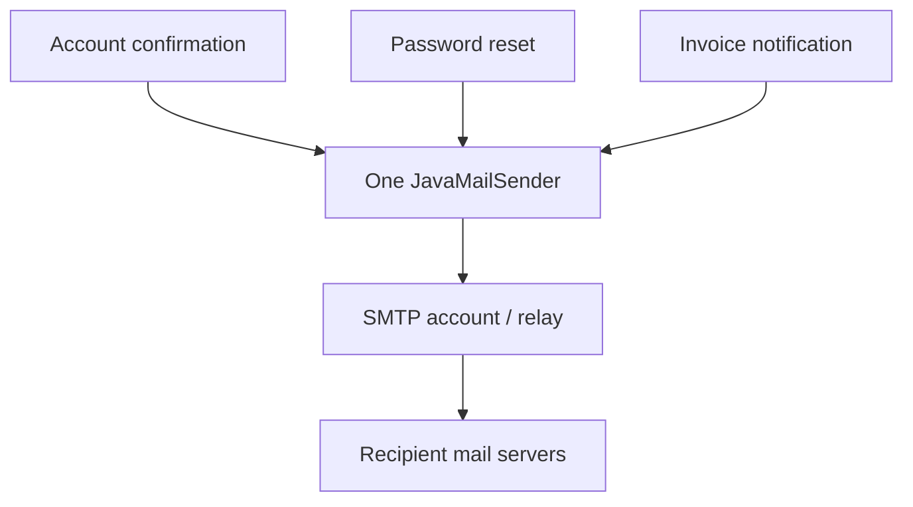
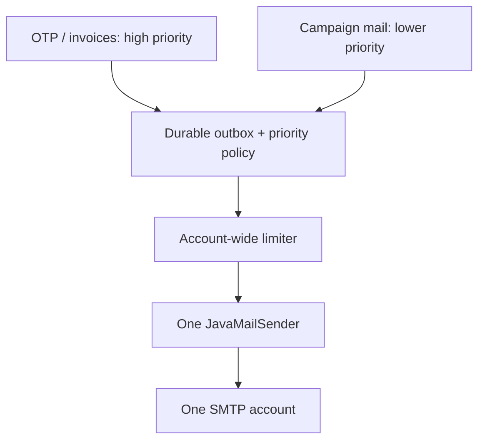
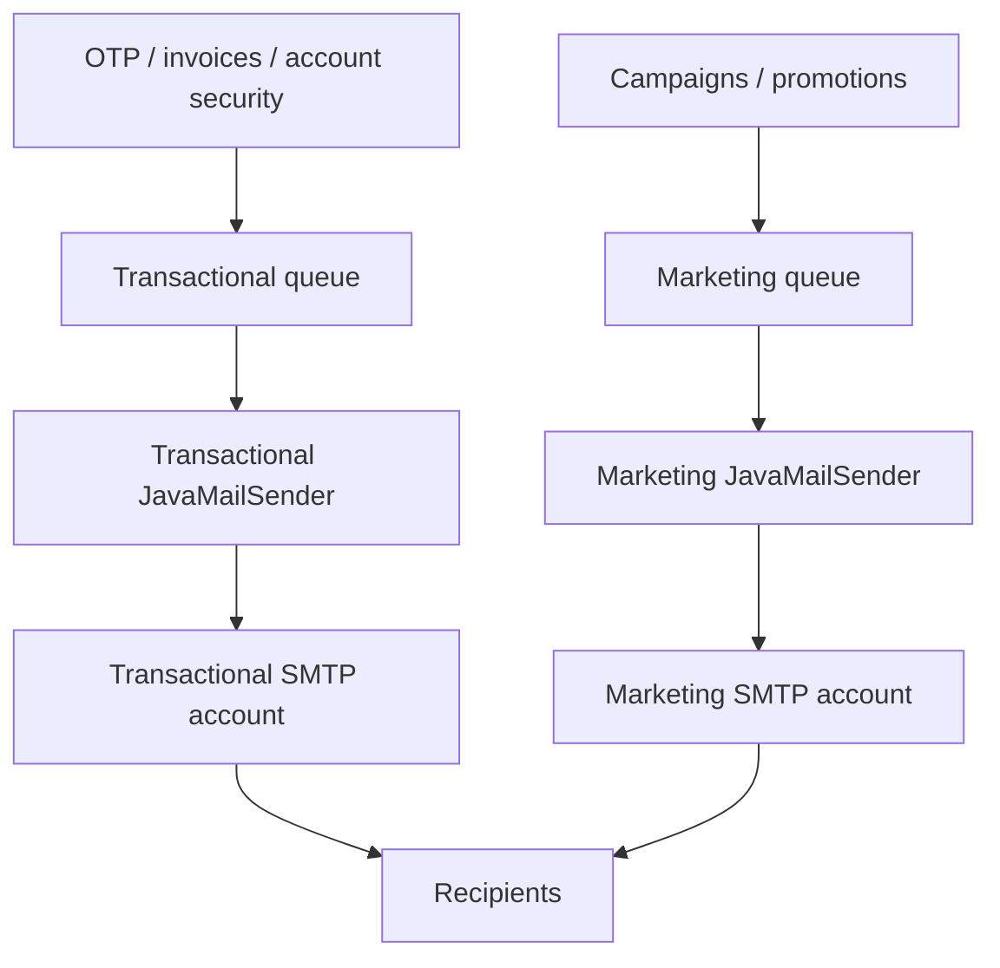
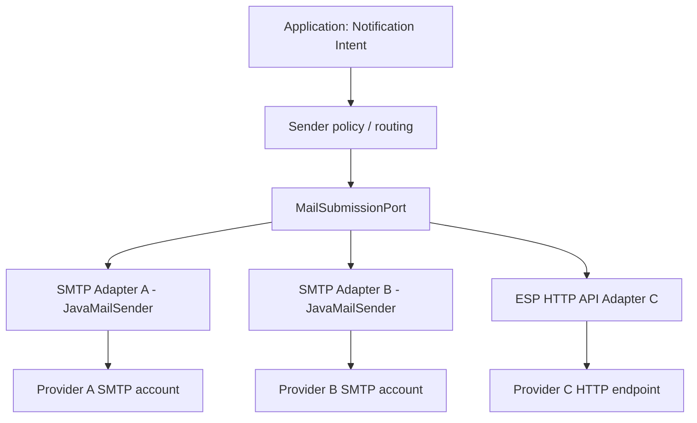
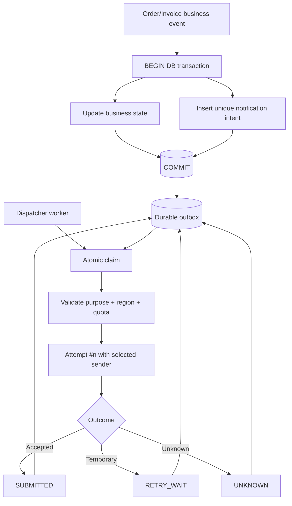

# Chọn một sender hay nhiều sender

Một ứng dụng Spring Boot ban đầu chỉ gửi email xác nhận tài khoản qua một SMTP relay. Khi sản phẩm phát triển, cùng hệ thống bắt đầu gửi OTP, hóa đơn PDF, thư marketing, cảnh báo bảo mật và thông báo cho nhiều tổ chức khách hàng. Đội phát triển đứng trước một quyết định kiến trúc: **tiếp tục dùng một `JavaMailSender` hay cấu hình nhiều sender?** Nếu chọn nhiều sender, nên chia theo luồng nghiệp vụ, SMTP account, tenant, nhà cung cấp, vùng dữ liệu hay loại nội dung? Nếu chỉ dùng một sender, có thể xảy ra tình trạng email quan trọng bị kẹt sau một đợt marketing lớn không?

Đây là quyết định thuộc chương **Quyết định kiến trúc** của module **Spring Framework Mail**, chứ không chỉ là câu hỏi “khai báo một hay hai `@Bean`”. Một bean `JavaMailSender` diễn tả **cách kết nối và submit email** tới một transport SMTP. Nó không mặc nhiên đại diện cho một business channel, một domain gửi hợp lệ, một queue bền vững, một quyền hạn tenant, hay một chính sách dự phòng. Nhiều sender có thể tạo ra những mức cách ly hữu ích, nhưng cũng làm tăng cấu hình, secrets, quota, DNS, webhook, monitoring và rủi ro gửi trùng nếu failover không đúng.

Bài học giải thích các lựa chọn từ đơn giản đến nâng cao, cung cấp ví dụ cấu hình Spring Mail, chiến lược chọn sender, ma trận quyết định, cách vận hành nhiều SMTP accounts hoặc nhiều ESP, cùng thiết kế kiểm thử, migration và ADR để không tối ưu quá sớm hoặc tạo lock-in không cần thiết.

## 1. Xác định “sender” đang nói tới thứ gì

Trong code Java/Spring, có nhiều thực thể thường cùng được gọi là sender:

| Khái niệm | Ví dụ | Vai trò |
|---|---|---|
| **Spring sender bean** | `JavaMailSender`/`JavaMailSenderImpl` | API dựng/gửi email qua SMTP transport |
| **SMTP account** | Username/password hoặc OAuth2 identity trên relay | Quyền gửi, quota, sender identities |
| **SMTP relay / transport endpoint** | `smtp.provider.example:587` | Máy chủ nhận submission |
| **Provider/ESP** | Dịch vụ thư bên thứ ba hoặc relay nội bộ | Hạ tầng gửi, rate limits, reputation, events |
| **Email From identity** | `notifications@example.com` | Header người gửi hiển thị |
| **Envelope sender / Return-Path** | Địa chỉ dùng ở SMTP `MAIL FROM` | Bounce routing, SPF alignment |
| **Business stream** | Transactional, marketing, alerts | Loại yêu cầu, SLA, consent, ưu tiên |
| **Logical notification intent** | “Gửi hóa đơn I42 cho khách hàng U9” | Đơn vị idempotency/retry/audit |
| **Worker / dispatcher** | Outbox poller, consumer | Khi nào và bao nhiêu email được submit |

**Một `JavaMailSender` bean không bắt buộc chỉ dùng một header From** nếu SMTP account/provider cho phép nhiều verified identities, nhưng cũng **không có nghĩa muốn đặt From gì cũng được**. Account có thể bị giới hạn domain, mailbox, Return-Path, region và rate quota. Tương tự, hai `JavaMailSender` beans có thể cùng trỏ tới **một SMTP account**; điều đó không tự tạo hai quotas hoặc hai failure domains.

### 1.1. Chọn số lượng bean khác chọn số lượng provider

Có ít nhất bốn cấu hình rất khác nhau:

1. **Một bean, một SMTP account, một provider:** mô hình cơ bản.
2. **Hai beans, hai SMTP accounts cùng provider:** có thể chia transaction và marketing.
3. **Hai beans, hai SMTP providers:** có thể phục vụ vùng dữ liệu hoặc dự phòng, nhưng cần quản lý deliverability và failover.
4. **Một application mail port, nhiều adapter:** một adapter dùng `JavaMailSender`, adapter khác gọi HTTP API của ESP; khi đó không thể đếm số `JavaMailSender` beans để suy ra số “senders” nghiệp vụ.

Trước khi thiết kế, cần viết rõ đang muốn tách **điểm gì**: tài khoản, secrets, queue, quota, danh tiếng IP/domain, SLA, compliance hay code dependency.

## 2. Kiến trúc một sender: mặc định hợp lý cho nhu cầu đơn giản

Một ứng dụng nhỏ có thể dùng duy nhất một `JavaMailSender` do Spring Boot cấu hình từ `spring.mail.*`.



### 2.1. Cấu hình Spring Boot phổ biến

```yaml
spring:
  mail:
    host: ${SMTP_HOST}
    port: 587
    protocol: smtp
    username: ${SMTP_USERNAME}
    password: ${SMTP_PASSWORD}
    default-encoding: UTF-8
    properties:
      "[mail.smtp.auth]": true
      "[mail.smtp.starttls.enable]": true
      "[mail.smtp.starttls.required]": true
      "[mail.smtp.ssl.checkserveridentity]": true
      "[mail.smtp.connectiontimeout]": 5000
      "[mail.smtp.timeout]": 10000
      "[mail.smtp.writetimeout]": 10000
```

Đây là cấu hình minh họa SMTP submission qua port 587 với STARTTLS bắt buộc và SMTP AUTH. Với provider yêu cầu **implicit TLS** ở port 465, cần thay transport settings phù hợp như `mail.smtp.ssl.enable=true`, không copy mù quáng cấu hình port 587. Dùng secrets manager/environment variables, không commit credentials.

### 2.2. Service gửi một email đơn giản

```java
package com.example.mail;

import org.springframework.mail.SimpleMailMessage;
import org.springframework.mail.javamail.JavaMailSender;
import org.springframework.stereotype.Service;

@Service
public class SimpleNotificationSender {

    private final JavaMailSender sender;

    public SimpleNotificationSender(JavaMailSender sender) {
        this.sender = sender;
    }

    public void submitText(
            String recipient,
            String subject,
            String content) {

        SimpleMailMessage email = new SimpleMailMessage();
        email.setFrom("notifications@example.com");
        email.setTo(recipient);
        email.setSubject(subject);
        email.setText(content);

        sender.send(email);
    }
}
```

Code này mô tả **submission**, chưa phải toàn bộ giải pháp production: cần validate recipient, verified From, consent, idempotency, outbox và quản lý lỗi. Khi bean `JavaMailSender` duy nhất trong context, constructor injection theo kiểu thường rõ ràng.

### 2.3. Lợi ích của một sender

- Cấu hình ít, secrets ít.
- Chỉ một endpoint TLS/SMTP AUTH cần theo dõi.
- Bean injection đơn giản, ít nhầm `@Qualifier`.
- Sender policies, DKIM/SPF/DMARC và webhook dễ tập trung.
- Triển khai/rotation credential ít bước hơn.
- Tốt cho môi trường dev, test và hệ thống có khối lượng phù hợp.

### 2.4. Điểm yếu của một sender

- Cùng account có thể chia sẻ quota/rate/concurrency.
- Marketing burst có thể gây queue age cao cho email OTP nếu dispatcher không ưu tiên.
- Một account bị suspended ảnh hưởng mọi loại mail đi qua account đó.
- Có thể khó cách ly reputation giữa transactional và promotional traffic.
- Tenant cao cấp có yêu cầu sender domain/region riêng.
- Provider có thể không hỗ trợ đủ API/template/events cho tất cả use cases.

Nhưng các vấn đề này **không tự động buộc phải tạo nhiều `JavaMailSender` beans**: trước tiên có thể giải quyết bằng **priority queues, shared rate limiter, admission control và outbox workers**, vẫn trên cùng provider account.

## 3. Không nhầm tăng throughput với tăng số sender beans

Giả sử một account được provider giới hạn 100 recipient units/phút. Bạn tạo ba beans:

```text
Sender A -> smtp.provider.example / account X
Sender B -> smtp.provider.example / account X
Sender C -> smtp.provider.example / account X
```

Nếu cả ba dùng **cùng account X**, quota vẫn có thể là 100 recipient units/phút. Ba bean objects không tạo thêm quota; thậm chí nếu cùng lúc submit, bạn dễ gặp throttling hơn.

### 3.1. Những chỗ cần đo trước khi tách

- Intent arrival rate (emails/recipients theo phút).
- Accepted submission rate theo account/provider.
- Thời gian chờ trong outbox.
- p95/p99 SMTP attempt latency.
- Provider throttling/rejection frequency.
- Concurrency/connection limits của account.
- Distribution transactional vs marketing.
- Volume attachment và message size.
- Reputation, bounce/complaint theo traffic class.
- SLA của OTP, hóa đơn, báo cáo ngày.

**Một sender có thể phục vụ khối lượng cao** nếu hạ tầng, quota, worker pool và chính sách phù hợp. **Nhiều sender vẫn có thể xử lý chậm** nếu account quotas, remote bottleneck hoặc message size không thay đổi.

### 3.2. Đừng tăng connections trước khi hiểu account limit

Tăng số instances, task executor threads hoặc `JavaMailSenderImpl` beans đều có thể mở nhiều SMTP submissions song song. Nếu provider giới hạn concurrent connections, hãy dùng limiter theo **account scope**. Local semaphore mỗi pod chỉ giới hạn một JVM, không phải toàn cluster.

## 4. Khi nào một sender đủ?

Một sender thường phù hợp nếu đa số điều kiện sau đúng:

1. Chỉ có một provider/account được phép theo policy.
2. Tất cả email dùng được verified sender identities trên account đó.
3. Không có yêu cầu tách reputation/campaign.
4. Region/retention/compliance nhất quán.
5. Các luồng có SLA tương thích hoặc có priority scheduling đủ.
6. Provider hỗ trợ nội dung cần thiết: plain/HTML, attachments và limits.
7. Quota còn headroom theo peak traffic.
8. Monitoring và retry đủ cho nghiệp vụ.
9. Không có contractual requirement sử dụng SMTP relay riêng cho tenant.
10. Chi phí vận hành nhiều accounts/adapters lớn hơn lợi ích.

### 4.1. Ví dụ một hệ thương mại nhỏ

- 20.000 email giao dịch mỗi tháng.
- Không có chiến dịch marketing.
- Một domain đã verified.
- Hóa đơn PDF dưới giới hạn của account.
- Không có yêu cầu vùng dữ liệu khác biệt.
- Có transactional outbox và provider event integration.

Một sender bean cùng account được cấu hình tốt có thể là lựa chọn dễ bảo trì hơn việc tạo ba senders vì “có ba loại email”.

Con số trên **chỉ minh họa workload**, không phải ngưỡng chung cần tách sender. Ngưỡng thực tế phụ thuộc quota, SLA, provider, message size, thời gian đỉnh và danh tiếng gửi.

### 4.2. Một sender nhưng nhiều luồng ưu tiên



Nếu bottleneck là **queue scheduling**, chia priority lanes có thể bảo vệ transactional SLO mà chưa cần thêm account. Nếu bottleneck là **account reputation/quota**, đó có thể là lý do thực sự để tách.

## 5. Những dấu hiệu hợp lý để cân nhắc nhiều sender

| Tín hiệu | Câu hỏi kiểm chứng | Kiến trúc có thể phù hợp |
|---|---|---|
| Marketing làm chậm OTP | Có thiếu priority/rate reservation trước? | Priority queues; có thể tách transactional account |
| Một loại mail ảnh hưởng reputation loại khác | Có evidence bounce/complaint và domain/IP pooling? | Tách sending stream/account và reputation management |
| Tenant cần gửi bằng domain riêng | Domain/account có được provider verify không? | Per-tenant identity mapping hoặc account riêng |
| Vùng dữ liệu bắt buộc | Provider/region hiện tại có đáp ứng không? | Regional sender/adapter với strict routing |
| Một provider outage ảnh hưởng toàn hệ | Có provider thứ hai thật sự ready không? | Multi-provider routing + duplicate-aware failover |
| ESP API cần tính năng mà SMTP không có | Đó là required hay optional? | HTTP API adapter cho workload cụ thể |
| Quota peak vượt capacity một account | Có thể tăng quota/capacity chính thức không? | Account/provider scaling theo policy |
| Cần credentials tách biệt | Có yêu cầu audit/least privilege? | Sender beans/accounts riêng |
| Tenant có hợp đồng BYO SMTP | Ai sở hữu secrets, abuse prevention và support? | Dynamic sender registry với control plane riêng |
| Marketing cần unsubscribe/template/campaign analytics | Có thể tách stream ngoài core app không? | Dedicated marketing platform/adapter |

**Nhiều sender là quyết định về isolation và capability trước khi là quyết định về Java configuration.**

## 6. Chọn đơn vị cách ly: bean, account, provider hay queue?

Một kiến trúc tốt thường tách nhiều trục thay vì đồng nhất tất cả.

| Trục | Điều được cách ly | Điều *không* tự được cách ly |
|---|---|---|
| **Sender bean** | Cấu hình JavaMailSenderImpl trong JVM | Quota/reputation nếu cùng account |
| **SMTP credentials/account** | Permission, quota theo provider contract, logs | Infrastructure provider-wide outage |
| **Sending domain/subdomain** | Identity, DKIM/DMARC, một phần reputation | Có thể vẫn chung IP pool/tenant/account quotas |
| **Dedicated IP pool** | Một phần sending reputation và warm-up | Code failure, template bugs, region policy |
| **Provider** | Hạ tầng, outage, API contract | Recipient MX, ISP-level filtering, application bugs |
| **Region** | Residency/routing theo contract | Compliance không chỉ dựa vào endpoint URL |
| **Queue/worker pool** | Backlog, concurrency, priority | SMTP account quotas nếu chung account |
| **Tenant partition** | SLA, consent, audit, dữ liệu | Provider rate nếu mọi tenant cùng account |

### 6.1. Isolation chỉ đúng nếu provider thực sự cung cấp

Một ESP có thể áp quota ở cấp **organization**, dù có nhiều subaccounts. Một domain riêng có thể vẫn dùng IP pool chung. Một endpoint vùng EU có thể còn yêu cầu data processing/retention clauses riêng. Không tuyên bố “đã tách accounts nên không ảnh hưởng nhau” nếu giới hạn thực tế nằm ở cấp cao hơn.

### 6.2. Tách queue trước hay tách SMTP account trước?

Nếu dùng một account nhưng mail marketing chiếm hết worker threads, tách worker pools và quota reservations có thể giải quyết.

Nếu một campaign gây spam complaints khiến provider giảm deliverability của toàn sending identity, chỉ tách queue **không** tạo reputation isolation. Khi ấy cần xem account/domain/IP/config theo tài liệu provider.

## 7. Mô hình hai sender thường gặp: transactional và marketing

Một lựa chọn phổ biến khi traffic đã tăng:



Lợi ích có thể đạt được khi **tách account đúng nghĩa**:

- Quota/rate allocations riêng nếu provider hỗ trợ.
- Credentials, sending domains và identity policies riêng.
- Logging, abuse/suppression và delivery events tách theo stream.
- Khả năng pause marketing mà không ảnh hưởng OTP.
- Reputation protection trong phạm vi được provider bảo đảm.

Nhưng nhiều sender còn đặt ra các câu hỏi:

- Người dùng unsubscribe marketing có bị gửi transactional sai không?
- Transactional sender có bị dùng để né marketing quota không?
- Account marketing có SPF/DKIM/DMARC và bounce processing đúng không?
- Mỗi account có giới hạn recipient và connection riêng như công bố không?
- Cả hai có cùng data region và security requirements không?

### 7.1. Tránh “sender-switch” tự chữa lỗi

Nếu marketing account gặp `429`/SMTP throttling, **không** mặc định gửi marketing qua transactional account để vượt quota. Điều đó có thể phá isolation, reputation và policy đã quyết định. Router phải coi purpose và account permissions là **constraints**, không chỉ là preferences.

## 8. Spring Boot auto-configuration và nhiều JavaMailSender beans

Trong ứng dụng đơn giản, Spring Boot có thể auto-configure `JavaMailSender` dựa trên `spring.mail.*` khi các điều kiện auto-config phù hợp. Khi bạn tạo sender beans thủ công, **đừng mặc định auto-config vẫn tạo thêm một “default sender”**: cấu hình tự động thường có điều kiện tránh tạo bean nếu đã có sender phù hợp.

Hệ quả:

- Việc inject chỉ theo `JavaMailSender` có thể trở nên ambiguous khi có nhiều beans.
- Dự án cần định nghĩa rõ bean names, qualifiers và ownership.
- Mỗi sender cần một cấu hình account/transport hoàn chỉnh.
- Boot starter vẫn hữu ích cho dependencies, nhưng application phải chủ động cấu hình các senders mong muốn.
- `spring.mail.*` không tự có schema dạng danh sách accounts chỉ bằng cách thêm `spring.mail.accounts[0]` nếu không có custom configuration properties và wiring tương ứng.

### 8.1. Mẫu cấu hình nhiều sender có tên rõ ràng

Dùng `@Bean` và `@Qualifier` cho hai accounts. Ví dụ dưới đây giả định **cả hai accounts sử dụng port 587 với SMTP AUTH và STARTTLS**.

```java
package com.example.mail.config;

import java.util.Properties;

import org.springframework.beans.factory.annotation.Value;
import org.springframework.context.annotation.Bean;
import org.springframework.context.annotation.Configuration;
import org.springframework.mail.javamail.JavaMailSender;
import org.springframework.mail.javamail.JavaMailSenderImpl;

@Configuration
public class MultiSmtpConfiguration {

    @Bean("transactionalMailSender")
    public JavaMailSender transactionalSender(
            @Value("${app.mail.transactional.host}") String host,
            @Value("${app.mail.transactional.port}") int port,
            @Value("${app.mail.transactional.username}") String user,
            @Value("${app.mail.transactional.password}") String password) {

        return createStartTlsSender(host, port, user, password);
    }

    @Bean("marketingMailSender")
    public JavaMailSender marketingSender(
            @Value("${app.mail.marketing.host}") String host,
            @Value("${app.mail.marketing.port}") int port,
            @Value("${app.mail.marketing.username}") String user,
            @Value("${app.mail.marketing.password}") String password) {

        return createStartTlsSender(host, port, user, password);
    }

    private static JavaMailSenderImpl createStartTlsSender(
            String host,
            int port,
            String username,
            String password) {

        JavaMailSenderImpl sender = new JavaMailSenderImpl();
        sender.setHost(host);
        sender.setPort(port);
        sender.setProtocol("smtp");
        sender.setUsername(username);
        sender.setPassword(password);
        sender.setDefaultEncoding("UTF-8");

        Properties props = sender.getJavaMailProperties();
        props.setProperty("mail.smtp.auth", "true");
        props.setProperty("mail.smtp.starttls.enable", "true");
        props.setProperty("mail.smtp.starttls.required", "true");
        props.setProperty(
                "mail.smtp.ssl.checkserveridentity", "true");
        props.setProperty(
                "mail.smtp.connectiontimeout", "5000");
        props.setProperty("mail.smtp.timeout", "10000");
        props.setProperty(
                "mail.smtp.writetimeout", "10000");

        return sender;
    }
}
```

Các biến `app.mail.transactional.*` và `app.mail.marketing.*` là **cấu hình riêng ứng dụng**, không phải property namespace mặc định Spring Boot tự bind vào hai senders.

### 8.2. application.yml minh họa

```yaml
app:
  mail:
    transactional:
      host: ${TX_SMTP_HOST}
      port: 587
      username: ${TX_SMTP_USERNAME}
      password: ${TX_SMTP_PASSWORD}
    marketing:
      host: ${MKT_SMTP_HOST}
      port: 587
      username: ${MKT_SMTP_USERNAME}
      password: ${MKT_SMTP_PASSWORD}
```

Ví dụ không hardcode secrets. Trong production, dùng secrets manager/Vault/Kubernetes Secret, cấu hình rotation, audit access, phân vùng môi trường test/prod và TLS verification. Địa chỉ `From` nên là **verified identity** được cấu hình riêng cho mỗi sending account, không nhận tùy ý từ HTTP payload.

### 8.3. Injection qua @Qualifier

```java
package com.example.mail.service;

import org.springframework.beans.factory.annotation.Qualifier;
import org.springframework.mail.javamail.JavaMailSender;
import org.springframework.stereotype.Service;

@Service
public class TransactionalEmailService {

    private final JavaMailSender sender;

    public TransactionalEmailService(
            @Qualifier("transactionalMailSender")
            JavaMailSender sender) {
        this.sender = sender;
    }

    public void submitText(String to, String subject, String text) {
        // Build message with verified transactional From...
        // sender.send(...)
    }
}
```

Với service marketing:

```java
@Service
public class MarketingEmailService {

    private final JavaMailSender sender;

    public MarketingEmailService(
            @Qualifier("marketingMailSender")
            JavaMailSender sender) {
        this.sender = sender;
    }

    // Thực thi consent, unsubscribe, campaign policy...
}
```

Tên bean/qualifier phải rõ, không dựa vào tên biến parameter được compiler giữ hay vào Spring tự đoán “sender nào phù hợp”.

### 8.4. Khi nào dùng @Primary?

`@Primary` có thể giải quyết một injection không có qualifier khi nhiều candidates. Nhưng nó có rủi ro:

- Service vô tình inject sender mặc định sai mục đích.
- Tenant/provider mới không được route đúng.
- Test context chỉ có default sender nên không phát hiện lỗi production.
- Marketing email bị gửi qua transactional account chỉ vì thiếu qualifier.

Với hai luồng nghiệp vụ có chính sách khác nhau, **explicit qualifiers hoặc một application routing abstraction** thường minh bạch hơn việc chọn default âm thầm.

### 8.5. Đừng mutate singleton JavaMailSenderImpl trước mỗi lần gửi

Sai:

```java
public void sendForTenant(Tenant tenant, MimeMessage mime) {
    sharedSender.setUsername(tenant.smtpUsername());
    sharedSender.setPassword(tenant.smtpPassword());
    sharedSender.send(mime);
}
```

Nếu hai requests chạy đồng thời, properties của shared sender có thể bị thay giữa lúc SMTP submission, gửi với nhầm account hoặc làm rò tenant boundaries. `JavaMailSenderImpl` có cấu hình mutable, nhưng một instance dùng chung nên được cấu hình như **immutable runtime configuration**; không cập nhật host/username/password per request trên singleton đang hoạt động.

Khi có nhiều tenants, dùng registry/factory/sender instances theo account với lifecycle và secret rotation riêng thay vì thay fields của một singleton giữa requests.

## 9. SMTP account và header From là hai điều khác

Giả sử bean `transactionalMailSender` xác thực bằng `smtp-user-1`. Một email có thể có:

```text
SMTP AUTH identity: smtp-user-1
Header From: billing@example.com
Header Reply-To: support@example.com
Envelope MAIL FROM: bounces.account1.example.net
```

Các identity này không bắt buộc giống text, nhưng phải được provider **cho phép**, đồng thời đáp ứng email authentication/alignment và bounce policy.

### 9.1. Verified From theo account

Nếu account A chỉ được phép gửi `notifications@example.com`, đừng cho router đặt `From: marketing@other-domain.example` rồi kỳ vọng relay sẽ ký DKIM hợp lệ.

Một cấu hình account có thể gồm:

```java
public record SenderAccountConfig(
        String key,
        String verifiedFrom,
        String allowedDomain,
        String providerKey,
        String region,
        boolean enabled) {
}
```

Đây là application metadata, không phải một class Spring Mail có sẵn. Config phải được validate lúc startup hoặc trước dispatch; không cho sender account tự tạo arbitrary verified domains.

### 9.2. Envelope sender / Return-Path

`mail.smtp.from` trong Jakarta Mail có thể ảnh hưởng SMTP envelope sender theo transport. Đây không phải header `From` và có thể chịu quyền hạn/policy provider khác. Khi nhiều accounts dùng chung config, đừng đặt một envelope sender toàn cục không hợp lệ cho mọi account.

Bounces thường được provider quản lý qua Return-Path/bounce domain, DSN hoặc webhooks. Chọn nhiều senders đòi mapping sự kiện trả về đúng **provider/account/attempt**, không chỉ dựa vào header From.

### 9.3. SPF, DKIM, DMARC khi tách sender

Đổi account/provider có thể đòi:

- Verify domain/sender identity.
- SPF authorization phù hợp envelope sender.
- DKIM selectors/keys cho từng ESP và kiểm tra chữ ký thực.
- DMARC alignment theo domain From.
- Bounce domain/Return-Path routing.
- Quản lý IP reputation, warm-up nếu dùng dedicated IP.
- Theo dõi yêu cầu sender hiện hành của recipient providers.

**Bean thứ hai compile thành công không chứng minh email gửi từ account thứ hai có khả năng vào Inbox.**

## 10. Chọn sender theo policy, không theo random

Một router đơn giản có thể chia theo mail purpose. Khi requirements phức tạp, selector cần xét nhiều điều kiện:

- `purpose`: OTP, invoice, marketing, security alert.
- `tenant` và sending identity đã được xác minh.
- `dataRegion`/residency constraints.
- Required capabilities: attachments, native templates, delivery events, scheduling.
- Account/provider enabled và credential health.
- Quota, rate capacity và connection count.
- Compliance/contract restrictions.
- Workload isolation, priority và cost model.
- Retry policy và kết quả attempt trước đó.

### 10.1. Required khác preferred

**Required constraint** là điều không được vi phạm chỉ để gửi thành công, ví dụ:

- Bắt buộc có PDF hóa đơn.
- Bắt buộc gửi trong region đã phê duyệt.
- Chỉ dùng sender domain đã được verify cho tenant.
- Marketing phải tuân thủ consent/suppression.
- Có yêu cầu encryption/data-handling theo hợp đồng.

**Preferred property** có thể thay đổi theo availability/cost khi vẫn bảo toàn constraints, ví dụ account A được ưu tiên vì latency tốt hơn.

Router không nên âm thầm bỏ attachment hoặc dùng provider ngoài region chỉ vì sender A bị lỗi.

### 10.2. Một mô hình metadata cho lựa chọn

```java
public enum MailPurpose {
    OTP,
    INVOICE,
    SECURITY_ALERT,
    MARKETING
}

public record DeliveryRequirements(
        MailPurpose purpose,
        String tenantId,
        String requiredRegion,
        boolean attachmentRequired,
        boolean deliveryEventsRequired) {
}

public record SelectedSender(
        String senderKey,
        String providerKey,
        String accountKey,
        String verifiedFrom) {
}
```

Đây là application types. `SelectedSender` chưa mang credential: secrets chỉ thuộc infrastructure sender registry. Cách này giúp audit quyết định mà không lộ password trong domain objects.

### 10.3. Tách selection khỏi submission

```java
public interface SenderSelector {
    SelectedSender select(
            DeliveryRequirements requirements);
}

public interface MailSubmissionPort {
    SubmissionOutcome submit(
            OutgoingEmail email,
            SelectedSender selectedSender);
}
```

`OutgoingEmail` và `SubmissionOutcome` là contracts do ứng dụng định nghĩa. Có thể biến `SenderSelector` thành một service nhỏ khi ít rules; không cần dựng rule engine lớn chỉ vì có hai senders.

Tách hai bước giúp:

1. Validate requirements.
2. Chọn sender có **quyền** xử lý.
3. Reserve quota/capacity của sender đó.
4. Persist attempt + selected sender.
5. Gọi adapter SMTP/API tương ứng.
6. Ghi result với đúng provider/account scope.

### 10.4. Sender selection cần có tính giải thích được

Một decision record có thể lưu:

```text
notificationId=N-101
purpose=INVOICE
tenant=T1
requiredRegion=EU
selectedSender=eu-transactional-a
provider=provider-a
account=acct-eu-1
policyVersion=2026-11
reason=REGION_AND_ATTACHMENT_SUPPORTED
```

Không log recipient email hay full message để giải thích routing. Khi retry hoặc failover, phải biết attempt cũ đã dùng sender nào, kết quả nào và lý do sender mới được chọn.

## 11. Mô hình một application port nhưng nhiều infrastructure adapters

Khi provider B chỉ hỗ trợ HTTP API hoặc có tính năng native templates, ép tất cả vào `JavaMailSender` có thể không tự nhiên.



Lợi ích:

- Domain/application không import vendor SDK.
- Contract nghiệp vụ nói “submit notification” thay vì biết SMTP/HTTP.
- Unit test dùng fake port.
- Một adapter có thể hỗ trợ native HTTP idempotency hoặc delivery events khi thật sự có.
- Không buộc các nghiệp vụ ít tính năng dùng API riêng của provider.

### 11.1. Đừng over-abstract

Nếu toàn bộ hệ thống hiện chỉ cần một SMTP account, `JavaMailSender` injected trực tiếp vào infrastructure service có thể đủ. Thêm 6 tầng interface, weighted routers, simulated providers và global feature negotiation trước khi có requirements thật làm tăng surface bugs.

Cách hợp lý là **giữ boundary sạch**, nhưng chỉ triển khai số adapters/policies mà sản phẩm có nhu cầu.

### 11.2. Một port không xóa khác biệt nhà cung cấp

ESP A và B có thể khác:

- Quota unit: recipients hay messages.
- Bounce/complaint event granularity.
- API idempotency TTL.
- Native template schema.
- Attachment size/content type.
- Domain verification and DMARC.
- Scheduling support.
- Residency/retention.
- HTTP status/SMTP error handling.

`MailSubmissionPort` nên chuẩn hóa outcome ở mức ứng dụng mà **không giả vờ** mọi providers hỗ trợ cùng một feature hay trả cùng remote message reference.

## 12. Một ví dụ router với hai SMTP beans

Với một ứng dụng chỉ có hai accounts cố định, không cần dynamic registry:

```java
package com.example.mail.service;

import jakarta.mail.MessagingException;
import jakarta.mail.internet.MimeMessage;
import org.springframework.beans.factory.annotation.Qualifier;
import org.springframework.mail.javamail.JavaMailSender;
import org.springframework.mail.javamail.MimeMessageHelper;
import org.springframework.stereotype.Service;

@Service
public class RoutedSmtpMailService {

    private final JavaMailSender transactional;
    private final JavaMailSender marketing;

    public RoutedSmtpMailService(
            @Qualifier("transactionalMailSender")
            JavaMailSender transactional,
            @Qualifier("marketingMailSender")
            JavaMailSender marketing) {

        this.transactional = transactional;
        this.marketing = marketing;
    }

    public void submit(EmailCommand command) {
        boolean promotional =
                command.purpose() == MailPurpose.MARKETING;

        JavaMailSender selected = promotional
                ? marketing
                : transactional;

        String from = promotional
                ? "campaigns@example.com"
                : "notifications@example.com";

        MimeMessage mime = selected.createMimeMessage();

        try {
            MimeMessageHelper helper =
                    new MimeMessageHelper(mime, true, "UTF-8");
            helper.setFrom(from);
            helper.setTo(command.recipient());
            helper.setSubject(command.subject());

            if (command.htmlText() == null) {
                helper.setText(command.plainText(), false);
            } else {
                helper.setText(
                        command.plainText(),
                        command.htmlText());
            }
        } catch (MessagingException ex) {
            throw new IllegalArgumentException(
                    "Failed to prepare MIME email", ex);
        }

        selected.send(mime);
    }
}
```

Một record cho ví dụ:

```java
public record EmailCommand(
        String recipient,
        MailPurpose purpose,
        String subject,
        String plainText,
        String htmlText) {
}
```

Các public top-level types đặt file riêng trong dự án Java thật. Cách chọn từ `purpose` chỉ là **một policy minh họa**: production còn cần validation, consent/suppression, tenant, region, sender verification và request identity. Chạy hai beans không tự định nghĩa các chính sách đó.

### 12.1. Vì sao createMimeMessage() phải dùng sender đã chọn?

Cấu hình `JavaMailSenderImpl` có thể ảnh hưởng default encoding/Session và các properties của MIME creation. Nên dùng:

```java
MimeMessage mime = selected.createMimeMessage();
selected.send(mime);
```

thay vì tạo MIME từ sender A nhưng gửi bằng sender B rồi kỳ vọng mọi properties/security/encoding vẫn đúng. Jakarta Mail có thể cho phép transport một MIME qua các senders trong một số điều kiện, nhưng **không nên trộn ngẫu nhiên sessions/accounts**.

### 12.2. Không share một mutable MimeMessage giữa threads/accounts

Một `MimeMessage` có thể bị thay headers, recipients, Date/Message-ID hoặc content. Không tạo một object rồi cho hai asynchronous senders cùng cập nhật/gửi để “race provider nào nhanh hơn”. Dựng một message snapshot **mỗi transport attempt**, từ dữ liệu immutable và sender được chọn.

### 12.3. Một sender dành cho nhiều purposes vẫn khả thi

Khi yêu cầu còn đơn giản, logic routing ở ví dụ có thể được thu nhỏ thành một sender duy nhất. Không tạo thêm `marketingMailSender` chỉ vì code có enum `MARKETING`; tách khi account separation thật sự tạo lợi ích.

## 13. Cấu hình linh hoạt hơn bằng @ConfigurationProperties

Khi số account settings tăng, nhiều `@Value` parameters trở nên khó quản lý. Spring Boot hỗ trợ bind cấu hình vào typed properties do ứng dụng tự định nghĩa.

Ví dụ mô hình:

```yaml
app:
  mail:
    accounts:
      transactional:
        host: ${TX_SMTP_HOST}
        port: 587
        username: ${TX_SMTP_USER}
        password: ${TX_SMTP_PASSWORD}
        tls-mode: STARTTLS_REQUIRED
        from: notifications@example.com
        provider: smtp-a
        region: approved-region
      marketing:
        host: ${MKT_SMTP_HOST}
        port: 465
        username: ${MKT_SMTP_USER}
        password: ${MKT_SMTP_PASSWORD}
        tls-mode: IMPLICIT_TLS
        from: campaigns@example.com
        provider: smtp-a
        region: approved-region
```

Ứng dụng có thể khai báo `@ConfigurationProperties(prefix = "app.mail")` cùng nested `Map<String, SmtpAccountProperties>`, validate account keys, host, port, TLS mode và verified From; tạo explicit beans cho số account ít, hoặc registry cho số account nhiều. Kiểu dữ liệu bên dưới do ứng dụng thiết kế, **không phải properties được Spring Boot Mail autoconfiguration xử lý sẵn**.

### 13.1. TLS mode phải có nghĩa cụ thể

Một enum riêng như:

```java
public enum SmtpTlsMode {
    STARTTLS_REQUIRED,
    IMPLICIT_TLS
}
```

giúp kiểm tra rằng:

- `STARTTLS_REQUIRED`: SMTP connection thường bắt đầu rồi upgrade TLS; đặt `mail.smtp.starttls.enable=true` và `required=true`.
- `IMPLICIT_TLS`: kết nối SSL/TLS ngay từ đầu; thường `mail.smtp.ssl.enable=true`.
- Hostname verification bật trong cả hai.
- Certificate trust chain hợp lệ.
- Không bật trust-all/`mail.smtp.ssl.trust=*` để chữa lỗi certificate.
- Port theo provider contract, không ép port 587 hay 465 thành quy tắc toàn cầu.

Một boolean `tlsEnabled` quá chung có thể không phân biệt được hai transport modes trên.

### 13.2. Validate configuration lúc khởi động

Nếu account marketing có port 0, thiếu password, From chưa được thiết lập hoặc TLS mode không hợp lệ, nên fail fast hoặc đánh dấu account unavailable, thay vì để lỗi xuất hiện khi gửi email đầu tiên.

Dù validate config locally, **domain verification và relay permissions thực** vẫn phải được kiểm bằng controlled integration/operational checks; bean khởi tạo thành công không chứng minh SMTP AUTH và sending identity được chấp thuận.

## 14. Khi số tenants lớn: đừng tạo một bean thủ công cho mỗi khách hàng

Nếu hệ thống chỉ có hai accounts tĩnh, `@Bean` + `@Qualifier` dễ đọc. Nhưng một SaaS platform có vài nghìn tenants, mỗi tenant tùy chọn SMTP server riêng, không nên thêm một `@Bean` method và redeploy mỗi lần onboard tenant.

Một **sender registry / factory** có thể giữ mapping account → immutable configuration/sender instance.

```text
Mail intent (tenantId, purpose)
       |
       v
Tenant policy / verified identity
       |
       v
Sender registry lookup(accountKey)
       |
       v
Immutable sender config snapshot
       |
       v
JavaMailSenderImpl instance or provider adapter
       |
       v
SMTP/API submission
```

### 14.1. Các yêu cầu với registry

- Không dùng user-supplied arbitrary SMTP host nếu chưa có validation/quyền phê duyệt; hạn chế SSRF và network abuse.
- Secrets chỉ được đọc bởi infrastructure privileged service.
- Không log credentials.
- Sender instances/configurations không bị mutate khi đang dùng.
- Cache có size/TTL và eviction policy, tránh một tenant tạo vô hạn endpoints.
- Rotating credentials cần versioning/safe switchover, không làm hỏng in-flight attempts.
- Tenant-specific From/Return-Path phải được verify.
- Rate quotas và concurrency áp dụng theo account/tenant/cluster.
- TLS trust/hostname verification không bị hạ chuẩn.
- Chỉ cho phép region/endpoint đã được phê duyệt.
- Audit mỗi lựa chọn sender theo account key và config version.
- Có policy rõ nếu account bị disabled hoặc bị suspend.

### 14.2. Sender registry không được trở thành nơi che business policy

Registry trả transport theo một **account key đã được authorization/policy chọn**. Nó không nên âm thầm quyết định “tenant A sẽ dùng mail server B vì config cũ lỗi” nếu điều đó vi phạm tenant contract hoặc data residency.

### 14.3. Không sử dụng chung SMTP Session mutable giữa tenants

`JavaMailSenderImpl` có JavaMail properties và JavaMail `Session`; không cập nhật password/host/properties trên singleton đang dùng để phục vụ nhiều accounts. Tạo immutable sender/session per account configuration hoặc adapter boundary phù hợp. Với HTTP provider clients, dùng credential scope và connection pools tương ứng.


## 15. Tách sender để bảo vệ SLA: queue và quota phải đi cùng nhau

Hai sender beans không giúp OTP nhanh hơn nếu cả hai vẫn lấy việc từ một hàng đợi FIFO đang chứa hàng triệu email marketing. Khi quyết định tách, cần xem cả **dispatcher, queue scheduling và account capacity**.

### 15.1. Một queue cho mọi email

```text
mail_outbox FIFO:
  MKT-1, MKT-2, ... MKT-1000000, OTP-1

Worker(s) -> one SMTP account
```

Ngay cả khi OTP chỉ mất 100 ms để submit, nó có thể chờ lâu sau marketing batch. Nếu đây là vấn đề duy nhất, tăng priority của OTP, reserve worker capacity hoặc tách queue theo class có thể giải quyết.

### 15.2. Hai sender accounts, hai queue classes

```text
Transactional queue -> transactional workers -> TX sender/account
Marketing queue     -> campaign workers       -> MKT sender/account

Each stream:
  rate limiter / queue age / retry policy / credentials / monitoring
```

Nếu provider thực sự cấp quota khác nhau, thiết kế này có thể tách throughput và blast radius.

### 15.3. Shared provider-wide limits vẫn có thể tồn tại

Hai accounts cùng provider có thể bị giới hạn cấp organization. Cần xem tài liệu provider, không giả định hai accounts luôn có quota độc lập. Trong routing metadata, nên biết giới hạn được scope theo:

- SMTP account.
- API key/subaccount.
- Provider organization.
- IP pool.
- Recipient domain.
- Sending region.
- Contractual service plan.

Một local semaphore cho mỗi sender bean chỉ giải quyết concurrent requests **trong JVM đó**. Với nhiều pods, quota/rate gate phải có coordination toàn cluster khi provider giới hạn account/organization.

### 15.4. Tách chi phí và ưu tiên

Nếu marketing không khẩn cấp, có thể đặt:

- Transactional: deadline theo notification, expiry cho OTP, retry ngắn có kiểm soát.
- Marketing: pacing theo campaign, quiet hours và consent, delayed retry.
- Security alerts: priority cao hoặc dedicated route khi chính sách yêu cầu.

Không đưa mọi email qua route transactional chỉ để nhận độ ưu tiên cao. Priority là business policy, không phải nơi lách quota/suppression.

## 16. Health, availability và capability: ba lớp thông tin khác nhau

Một sender configured có thể thỏa tính năng nhưng **không gửi được ngay**.

### 16.1. Static capability

Ví dụ:

```text
sender A:
  SMTP submission: yes
  HTML: yes
  PDF attachment under provider limit: yes
  Delivery webhook: yes
  Region: EU

sender B:
  HTTP submission: yes
  Native template: yes
  API request idempotency: yes (scope/TTL documented)
  Region: US
```

Những attributes này tương đối ổn định hoặc được kiểm soát theo config/account entitlements.

### 16.2. Current health

Một sender đang unhealthy vì:

- DNS/network outage.
- TLS certificate/hostname mismatch.
- SMTP AUTH token hết hạn.
- Provider account bị suspend.
- Quota depleted.
- Provider rate throttling.
- Outbound network policy chặn port.
- API key không còn quyền.
- Provider webhooks unavailable.
- Provider degraded trong một region.

### 16.3. Eligibility theo notification

Một sender có thể healthy và hỗ trợ PDF nhưng **không được phép** xử lý hóa đơn tenant EU vì chỉ có endpoint US. Một account khác có thể healthy nhưng chưa verify domain của tenant.

Router phải xử lý các thuộc tính theo thứ tự rõ:

1. **Bắt buộc tuân thủ**: region, contract, verified From, purpose, consent, attachment/feature requirements.
2. **Khả năng vận hành**: enabled, credential health, availability, quota.
3. **Ưu tiên tối ưu**: latency, cost, distribution/reputation policy.

Không lấy “healthy” làm giấy phép bỏ qua compliance.

## 17. Multi-sender failover không phải try/catch rồi gửi qua B

Một anti-pattern:

```java
try {
    senderA.send(message);
} catch (Exception ex) {
    senderB.send(message);
}
```

Rủi ro:

- Không phải mọi exception đều chứng minh A **chưa nhận email**.
- Nếu timeout sau SMTP `DATA`, A có thể đã accepted.
- A và B có quota, region, From domain, suppression và trust policies khác nhau.
- Nếu cùng `MimeMessage` mutable được gửi lại qua B, có thể có coupling không mong muốn với Session/headers.
- Provider B không tự biết request idempotency key đã được A xử lý.
- Retry có thể tạo duplicate email.

### 17.1. Bốn nhóm outcome chính

| Outcome của A | Bằng chứng | Có thể chọn B? |
|---|---|---|
| **Không có transport attempt** | Local quota gate/route selection fail trước network | Có thể, nếu B đáp ứng mọi required constraints |
| **Chắc chắn chưa được A nhận** | Ví dụ connect refused trước khi SMTP transaction bắt đầu | Có thể theo retry/failover policy |
| **Rõ ràng bị từ chối** | SMTP reply/API rejection được phân loại theo giai đoạn | Tùy loại lỗi: permanent recipient/data failure không tự chữa bằng B |
| **Không xác định** | Timeout/mất response khi A có thể đã accepted | **Không tự failover mù**; reconcile hoặc duplicate-aware policy |
| **Đã accepted bởi A** | Final SMTP response/provider evidence | Không gửi B chỉ vì delivery event chưa đến |

### 17.2. Timeout sau DATA và kết quả UNKNOWN

Trong SMTP, client gửi message data rồi chờ final response:

```text
Client                        SMTP relay A
  | ---- MAIL FROM/RCPT TO --> |
  | ---- DATA + MIME --------> |
  | ---- end-of-data --------> |
  |                            | accepts message
  | [connection reset]         |
  | no final reply received    |
```

Nếu A đã nhận nhưng client mất response, ứng dụng không thể suy ra A chưa gửi. Nếu chuyển qua B, người dùng có thể nhận hai thư. Trạng thái trung thực là `UNKNOWN`, kèm attempt evidence và policy đối chiếu.

### 17.3. Provider API idempotency không chia sẻ giữa providers

Giả sử ESP A và B đều hỗ trợ `Idempotency-Key: K` qua HTTP APIs. A và B có **kho dedup độc lập**. A accepted nhưng client timeout; B có thể chấp nhận chính K vì B chưa từng thấy nó.

Với SMTP chuẩn, header `Message-ID` cũng **không** bảo đảm relay/recipient deduplicate.

### 17.4. Một policy failover an toàn hơn

```text
Select A
   |
   v
Check A: eligibility + quota
   |
   v
Start attempt with A
   |
   +-- Definitively not sent -> may select B (if eligible)
   |
   +-- Explicit temporary rejection -> backoff / policy
   |
   +-- Permanent rejection -> fail/remediate
   |
   +-- Accepted -> SUBMITTED, do not resend blindly
   |
   +-- UNKNOWN -> quarantine/reconcile/decision
```

Không có policy chung cho mọi mail:

- OTP quá hạn có thể được bỏ và yêu cầu người dùng tạo OTP mới.
- Hóa đơn phải giữ immutable file snapshot và có thể cần reconciliation.
- Marketing thường không nên gửi trùng khi outcome uncertain.
- Security alerts đôi khi chấp nhận duplicate có kiểm soát hoặc dùng kênh thông báo khác.

Mọi failover nên tạo **attempt mới của cùng logical notification**, không tạo một notification intent mới bằng random key.

## 18. Mẫu Outbox giúp nhiều sender có trạng thái nhất quán

Khi hệ thống có retry/failover, **đừng để trực tiếp business service quyết định gửi rồi trả kết quả duy nhất bằng boolean**. Tách một logical intent khỏi các transport attempts.

### 18.1. Dữ liệu tối thiểu

```text
mail_outbox
  notification_id
  idempotency_key (UNIQUE under tenant/purpose scope)
  tenant_id
  purpose
  recipient_snapshot
  content_snapshot or immutable template + parameters
  required_region
  required_capabilities
  due_at / expires_at
  status
  selected_policy_version

mail_submission_attempt
  attempt_id
  notification_id
  attempt_no
  sender_key
  provider_key
  account_key
  started_at / finished_at
  state = STARTED | ACCEPTED | REJECTED | UNKNOWN
  transport_stage / error_category
  provider_reference
```

### 18.2. Transactional outbox trước transport



Khi nghiệp vụ và outbox dùng cùng database transaction manager, business update và intent insert commit/rollback cùng nhau. SMTP send ở **ngoài** transaction đang giữ row lock.

### 18.3. Bảo vệ khỏi hai workers gửi cùng một intent

Nếu nhiều pods cùng poll, việc đọc `PENDING` rồi update trong hai câu riêng có thể tạo race. Cần atomic claim hoặc queue consumer ownership tương đương:

```sql
WITH due AS (
    SELECT id
    FROM mail_outbox
    WHERE status IN ('PENDING', 'RETRY_WAIT')
      AND due_at <= CURRENT_TIMESTAMP
      AND (
        next_attempt_at IS NULL
        OR next_attempt_at <= CURRENT_TIMESTAMP
      )
    ORDER BY due_at, id
    LIMIT :batchSize
    FOR UPDATE SKIP LOCKED
)
UPDATE mail_outbox m
SET status = 'PROCESSING',
    claim_token = :claimToken,
    lease_until = CURRENT_TIMESTAMP
                  + (:leaseSeconds * INTERVAL '1 second')
FROM due
WHERE m.id = due.id
RETURNING m.*;
```

Đây là mẫu PostgreSQL; schema phải có các cột dùng trong query, cùng indexes, transaction boundaries và expiry logic đúng. Claim xong phải **commit trước khi gọi SMTP**; không giữ `FOR UPDATE` lock xuyên network I/O.

### 18.4. Fencing token khi cập nhật result

```sql
UPDATE mail_outbox
SET status = 'SUBMITTED',
    claim_token = NULL,
    lease_until = NULL
WHERE id = :id
  AND status = 'PROCESSING'
  AND claim_token = :claimToken;
```

Nếu affected rows bằng 0, worker có thể đã mất ownership. Token giúp chặn **stale database writes**, không ngăn một SMTP request cũ đã phát đi.

### 18.5. Nhiều senders không giải quyết crash sau acceptance

Một worker gửi thành công tới A, rồi DB unavailable trước lúc lưu result. Khi lease hết hạn, worker khác có thể reclaim và gửi lại. Trạng thái `UNKNOWN`/reconciliation và provider-specific idempotency khi có vẫn cần thiết, dù chỉ một sender hay nhiều senders.

### 18.6. Retry routing có thể thay đổi theo thời gian

Nếu policy chuyển từ A sang B sau deployment:

- Ghi sender của **mỗi attempt**.
- Ghi policy/config version khi cần audit.
- Không đổi content/recipient snapshot chỉ vì chọn B.
- Không làm mờ các yêu cầu region/consent.
- Không áp một idempotency key của provider A cho B và giả định dedup.
- Không tự gửi lại tất cả notifications đang `SUBMITTED`.

## 19. Multiple senders và idempotency là hai bài toán độc lập

Một business intent như:

```text
invoice-issued:T1:I42:v1:recipient:U9
```

phải có **một** outbox row ngay cả khi:

- Event Kafka/RabbitMQ được phát lại.
- HTTP client retry.
- Hai Spring Boot instances xử lý đồng thời.
- Sender A tạm unavailable.
- Policy chọn B cho attempt tiếp theo.

### 19.1. Unique key bảo vệ ở database

```sql
ALTER TABLE mail_outbox
ADD CONSTRAINT uq_mail_intent
UNIQUE (tenant_id, idempotency_key);
```

Chỉ check `existsByKey` ở Java là không đủ trong concurrency.

### 19.2. Sender không phải một phần mặc định của logical key

Nếu cùng invoice intent được retry qua B, không nên đổi từ key `invoice:I42:U9:A` sang `invoice:I42:U9:B`: điều đó biến **đổi transport** thành một logical notification mới, làm vô hiệu hóa dedup.

Sender key thuộc **attempt**, không thuộc business identity, trừ khi product requirement thực sự định nghĩa hai notifications riêng có mục đích.

### 19.3. Manual resend khác retry

Nếu người dùng bấm “Gửi lại hóa đơn” sau khi email trước đã submitted, đó có thể là một **operation mới được cấp phép và audit**. Tạo resend key mới theo business policy, không xóa unique key cũ để ép gửi lại.

## 20. Multiple senders không có nghĩa multiple “deliveries”

Một email gửi qua `JavaMailSender` được accepted bởi SMTP relay chưa chắc:

- Đến recipient MX.
- Vào Inbox thay vì Spam.
- Được đọc.
- Không bị bounce trong tương lai.
- Không bị provider hold/suppress.

Hãy dùng thuật ngữ:

| Trạng thái | Bằng chứng |
|---|---|
| `INTENT_CREATED` | Outbox đã commit |
| `ATTEMPT_STARTED` | Transport attempt bắt đầu |
| `ACCEPTED_BY_RELAY` | SMTP/HTTP provider accepted theo response/contract |
| `SUBMISSION_UNKNOWN` | Outcome không đủ evidence |
| `DELIVERED` | Provider/DSN báo downstream delivery theo semantics được công bố |
| `BOUNCED` | Provider có bounce evidence |
| `COMPLAINED` | Provider nhận abuse/spam complaint event |

Không coi `sender.send(...)` không ném exception là email đã delivered; không dùng số “sender success” để so sánh với provider delivery success nếu hai providers đo khác ranh giới.

## 21. Bảo mật khi có nhiều SMTP credentials

Một sender thường có một set credentials. Nhiều senders tăng số secrets, endpoints và quyền truy cập cần quản trị.

### 21.1. Secrets riêng và least privilege

- Dùng credentials riêng khi có yêu cầu isolation.
- Chỉ cấp quyền gửi với verified identities cần thiết.
- Lưu secrets trong hệ thống quản lý được duyệt.
- Không đưa password vào `toString()` của config objects.
- Không log `Session` properties/raw SMTP transcript có AUTH data.
- Có kế hoạch secret rotation mà không phá in-flight requests.
- Tách test/staging/prod secrets và provider accounts.

### 21.2. Không tắt TLS verification để mọi provider “đều chạy được”

Không dùng:

```properties
mail.smtp.ssl.trust=*
mail.smtp.ssl.checkserveridentity=false
```

như giải pháp tăng portability. Nếu relay nội bộ dùng private CA, thêm trust anchor đúng và kiểm SAN/hostname thay vì trust-all.

### 21.3. Network egress policy

Nếu hỗ trợ per-tenant SMTP endpoints, phải cân nhắc SSRF và data exfiltration:

- Chỉ kết nối tới hosts/ports được phê duyệt.
- Chặn truy cập internal metadata/IP ranges khi tenant input chưa tin cậy.
- Cân nhắc DNS rebinding và redirects/proxies (đối với HTTP ESP adapter).
- Ràng buộc transport region.
- Rate-limit và abuse monitoring.
- Không cho tenant A sửa config của tenant B.

SMTP connections không phải HTTP requests, nhưng cùng có nguy cơ **server-side connection to attacker-controlled/internal destinations** nếu host tùy ý được phép.

### 21.4. Không gửi cùng MIME qua hai accounts để “kiểm tra chất lượng”

Một số công cụ debug định gửi cùng email tới A và B rồi so sánh performance. Nếu cả hai adapters gửi **thư thật** cho cùng recipient, đó là gửi trùng, có thể làm hại reputation và gây phiền.

Dùng non-delivering shadow validation, test recipients được kiểm soát hoặc canary partition **mỗi intent chỉ route một primary** khi so sánh.

## 22. Tách domain reputation và suppression

Sender count có liên hệ tới email deliverability, nhưng mức độ isolation phải được provider xác nhận.

### 22.1. Reputation không chỉ ở bean/account

Reputation có thể liên quan:

- Sending domain và subdomain.
- DKIM domain.
- IP pool/dedicated IP.
- Provider account/subaccount.
- Bounce/complaint rates.
- Recipient engagement.
- Volume patterns và IP warm-up.
- Spam-trap/domain-specific policies.

Tạo `marketingMailSender` bean nhưng vẫn gửi cùng domain/IP pool/account **không tự tạo reputation isolation**.

### 22.2. Transactional vs marketing identity

Nếu có yêu cầu cách ly, có thể dùng:

```text
notifications.example.com -> transactional mail
campaigns.example.com     -> marketing mail
```

Nhưng DNS records, DKIM, DMARC, Return-Path, IP pooling và deliverability cần được xác minh trên account cụ thể. Không xem subdomain change là một bảo đảm mailbox placement.

### 22.3. Consent và suppression phải nhất quán

Nếu provider A biết một recipient đã unsubscribe hoặc hard bounce, provider B **không tự biết** trừ khi đồng bộ.

Một kiến trúc nhiều sender cần:

- Business consent/preference source of truth phù hợp.
- Notification purpose (transactional vs marketing).
- Local suppression decisions trước sender selection.
- Provider webhook normalization.
- Recipient-level hard bounce/complaint updates.
- Phân biệt unsubscribe marketing và các thư giao dịch được phép theo policy.
- Retention/privacy rules khi lưu địa chỉ/event.
- Nếu provider B có suppression riêng, đồng bộ/cross-check theo hợp đồng.

**Không được đổi sang B để né suppression của A.**

### 22.4. API tracking không phải yêu cầu chung

Một ESP marketing có click/open tracking, một SMTP relay transactional không có. Không nên biến tracking thành required core API của mọi sender; open tracking còn chịu ảnh hưởng mạnh bởi privacy settings của mail client. Giữ optional features trong adapter/capability metadata và không coi “opened” là bằng chứng người dùng thật sự đọc.

## 23. Webhooks/DSN khi nhiều providers

Một SMTP `JavaMailSender` thường không trả thông tin delivery downstream đủ chi tiết. ESP có thể có webhook cho accepted, deferred, delivered, bounced, complained, unsubscribed.

Nếu có nhiều senders/providers:

1. Ghi provider/account đã chọn cho từng attempt.
2. Lưu provider reference khi có.
3. Có endpoint/handler verify signature theo provider.
4. Normalize provider-specific event type thành model chung.
5. Dedup webhook redelivery bằng provider event identity và scope.
6. Xử lý out-of-order events không làm state machine lùi sai.
7. Correlate về notification và recipient đúng.
8. Cập nhật suppression/consent policy từ evidence đáng tin.
9. Lưu raw diagnostic có giới hạn truy cập/retention.
10. Không ghi delivered khi chỉ có accepted event.

### 23.1. Event có thể đến từ sender cũ sau migration

Nếu email gửi qua A hôm qua, hôm nay chuyển traffic mới sang B, webhook của A vẫn có thể tới trong nhiều ngày.

Không xóa mapping `provider=A/account=X/messageReference=...` ngay khi tắt route A cho **new submissions**. Giữ event handler và audit lifecycle đến khi outstanding mail đã có thể kết thúc theo policy.

### 23.2. Provider B có thể không cung cấp cùng dữ liệu

Không tự tạo fake `DELIVERED` event cho SMTP B chỉ để dashboard nhìn đồng nhất. Nếu không có reliable downstream data, báo `delivery_confirmation_unavailable` hoặc bỏ metric tương ứng; so sánh acceptance rate và delivery rate ở đúng tầng.

## 24. Multi-region và tenant routing

Nếu doanh nghiệp có khách hàng ở EU, APAC và US, có thể cần sender accounts/ESP endpoints theo region. Nhưng mục tiêu không phải mỗi region bắt buộc một bean tĩnh; quan trọng là **eligibility của mỗi intent**.

### 24.1. Required residency constraint

```text
MailIntent:
  tenant = EU-tenant
  requiredRegion = EU
  attachment = regulated-document.pdf

Sender A:
  region = EU
  approved = true

Sender B:
  region = US
  approved = false
```

Nếu A outage, router **không được** failover sang B chỉ vì B đang healthy. Có thể giữ outbox, alert và escalate theo SLA; không phá compliance.

### 24.2. Delivery path vẫn có yếu tố bên ngoài

Một ESP endpoint ở EU không tự chứng minh mọi hop SMTP, recipient mailbox hoặc log retention nằm trong EU. Cần hợp đồng/data-processing controls thực và đánh giá kiến trúc dữ liệu phù hợp; residency không giải quyết bằng một trường `region` trong Java record.

### 24.3. Tenant bring-your-own SMTP

Một tenant có thể muốn dùng SMTP server riêng. Cần quyết định:

- Ai verify domain và cấu hình SPF/DKIM/DMARC?
- Ai chịu phí/quota và support incident?
- Ai giữ/rotate credentials?
- Có giới hạn endpoints/networks để chống SSRF?
- Hệ thống xử lý bounce/complaint ra sao?
- Được failover sang shared provider hay không?
- SMTP reply/timeout có khác?
- Account bị khóa thì giữ intent bao lâu?
- Liệu một tenant gửi spam làm liên lụy app/network reputation?

**Nhiều sender mỗi tenant** là một sản phẩm vận hành riêng, không chỉ là “thêm Map<String, JavaMailSender>”.

## 25. Observability: đúng dimension, không rò PII

Một hệ nhiều senders cần biết **mail intent, route, account, provider và attempt** khác nhau.

### 25.1. Metrics gợi ý

| Metric | Đơn vị |
|---|---|
| `mail_intents_created_total` | Logical notification intents đã commit |
| `mail_sender_selection_total{sender,reason}` | Số lần router chọn sender |
| `mail_sender_ineligible_total{sender,reason}` | Số lần một sender không thỏa required constraints |
| `mail_account_quota_denied_total{account}` | Local quota gate từ chối |
| `mail_submission_attempts_total{sender,result}` | Transport attempts |
| `mail_submission_duration_seconds{sender}` | Submission latency |
| `mail_submission_unknown_total{sender}` | Outcome không chắc chắn |
| `mail_outbox_pending_count{purpose}` | Pending backlog |
| `mail_outbox_oldest_due_age_seconds{purpose}` | Tuổi intent quá hạn lâu nhất |
| `mail_time_to_submission_seconds{purpose}` | Từ intent commit tới accepted |
| `mail_provider_throttles_total{provider,account_class}` | Remote rate rejects |
| `mail_provider_events_total{provider,event}` | Delivery/bounce/complaint events |
| `mail_failover_total{from,to,reason}` | Controlled provider switch |
| `mail_sender_config_errors_total{sender}` | Sender configuration/health errors |

### 25.2. Sender labels phải có cardinality kiểm soát

Nếu SaaS có 100.000 tenant SMTP accounts, **không** nên để mỗi account key thành Prometheus label mặc định trên toàn hệ: time series cardinality sẽ bùng nổ. Dùng provider, region, account tier/class và purpose có tập giá trị hạn chế; chi tiết account/tenant ID nằm trong structured logs/audit database và tracing theo quyền.

Không dùng recipient email, notification ID, raw subject hay provider reference làm metric labels.

### 25.3. So sánh sender phải cùng workload

Sender A xử lý OTP text ngắn; sender B xử lý hóa đơn PDF và marketing batch. Nếu A có p95 latency thấp hơn, chưa chắc A là “provider tốt hơn” vì payload mix và quota khác.

Khi đánh giá:

- Cùng notification purpose.
- Cùng recipient domain mix.
- Cùng message size/capability.
- Cùng thời gian/region/traffic pattern.
- Cùng thước đo acceptance vs delivered.
- Có thông tin quota và account maturity.

Không so `accepted_rate` của A với `delivered_rate` của B.

### 25.4. Health checks không được gửi email thật tùy tiện

Một liveness probe mỗi 10 giây gọi `sender.testConnection()` hoặc gửi mail có thể làm quá tải/quota, gây SMTP AUTH throttling và tiết lộ secret trong logs nếu cấu hình debug sai. Dùng readiness/health assessment với cadence, timeout và scope phù hợp; phân biệt “port kết nối được” với “relay sẽ chấp nhận đúng From/message”.

## 26. Chi phí của nhiều senders không chỉ là SMTP fee

Một quyết định thực tế phải tính các khoản:

| Chi phí | Một sender | Nhiều senders/accounts/providers |
|---|---|---|
| Beans/config | Ít | Tăng, có thể registry |
| Credentials/rotation | Một set | Nhiều sets + access controls |
| DNS/SPF/DKIM/DMARC | Một sending identity setup | Nhiều setups, monitoring |
| IP warm-up/reputation | Một luồng | Nhiều luồng cần quản trị |
| Quota/rate | Một policy | Scope/phối hợp khác nhau |
| Bounce/complaint | Một event pipeline | Nhiều webhook formats/keys |
| Incident response | Một provider path | Routing/failover và audit phức tạp |
| Testing | Một SMTP integration suite | Contract tests mỗi adapter/account |
| Compliance | Một tập hợp contracts | Nhiều vùng, DPA và data flows |
| Deployment | Ít config | Thêm rollout/rollback policy |
| Reliability | Provider/account là một failure domain | Có thể cải thiện nếu thực sự độc lập, nhưng tăng lỗi orchestration |

Vì vậy, **nhiều sender có thể tăng khả năng phục hồi hoặc giảm blast radius**, nhưng chỉ khi separation thực và hệ thống đã có capacity, operations và correctness controls tương xứng.

## 27. Ma trận quyết định: nên chọn mô hình nào?

Trước khi viết configuration, chọn một trong các mức sau:

| Mức | Kiến trúc | Phù hợp nhất | Điều kiện chuyển sang mức khác |
|---|---|---|---|
| **A** | Một `JavaMailSender`, một account | MVP, transaction mail đơn giản | Isolation, region, feature hoặc quota thực sự thiếu |
| **B** | Một sender, outbox + priority worker lanes | Cần SLA khác nhau nhưng cùng account đủ năng lực | Account quota/reputation là bottleneck |
| **C** | Hai `JavaMailSender` beans, hai accounts tĩnh | Transactional vs marketing, hai verified identities, least privilege | Số accounts động tăng hoặc providers khác giao thức |
| **D** | Nhiều SMTP accounts qua sender registry | Multi-tenant/BYO SMTP, regional accounts | Cần ESP APIs/features khác SMTP |
| **E** | MailSubmissionPort + nhiều SMTP/HTTP adapters | Multi-provider, native ESP features, regional policy/failover | Vận hành phức tạp phải được justify bằng SLA/compliance |
| **F** | External dedicated messaging/email platform | Scale lớn, governance, campaigns và deliverability chuyên biệt | Cân nhắc build-vs-buy dựa trên ownership/chi phí |

### 27.1. Quy tắc chọn đầu tiên

Nếu chưa có yêu cầu cách ly account, feature, region hay SLA khác biệt: **chọn một sender** và giữ contract đơn giản.

Nếu chỉ có **hai accounts tĩnh**: **hai beans có `@Qualifier` rõ ràng** thường đủ.

Nếu có **nhiều tenants/accounts động**: cân nhắc registry/factory và control plane.

Nếu có **hai providers khác giao thức hoặc cần failover**: tạo application port với adapters riêng, quản lý outcome/UNKNOWN và route eligibility thay vì chỉ tạo thêm `JavaMailSender`.

### 27.2. Đừng đặt ngưỡng số email tùy ý

Một triệu emails/tháng có thể trải đều 24/7 trên provider có headroom; 10.000 OTP trong một phút có thể vượt quota bất ngờ. Quan trọng là:

- Peak recipient units.
- p95/p99 end-to-end time-to-submission.
- SLA và expiry.
- Account/provider limits.
- Required capabilities.
- Failure-domain isolation.
- Deliverability/reputation.
- Operational ownership.

Không có ngưỡng “100.000 email thì bắt buộc 2 senders” áp dụng phổ quát.

## 28. Bảng câu hỏi để ra quyết định

Dưới đây là bộ câu hỏi để thảo luận với team kiến trúc, vận hành, bảo mật và product.

### 28.1. Khối lượng và SLA

1. Mỗi loại email được tạo bao nhiêu recipients/giây lúc cao điểm?
2. SLA của OTP, invoice và marketing khác nhau thế nào?
3. Có email hết hiệu lực sau 5 phút hoặc theo thời hạn khác không?
4. Quota được provider tính theo messages, recipients, connections hay bytes?
5. Có cần reserve capacity cho transaction mail không?
6. Nếu campaign lớn, các mail quan trọng có bị chờ quá mức không?

### 28.2. Identity và deliverability

7. Mỗi tenant có verified From domain riêng không?
8. Có cần dedicated IP pool hoặc warm-up?
9. Có historical reputation/suppression ảnh hưởng transaction mail?
10. SPF/DKIM/DMARC và bounce domain đã chuẩn bị cho account mới chưa?
11. Có bắt buộc tách marketing unsubscribe khỏi transaction mail không?

### 28.3. Bảo mật và compliance

12. Có data residency/retention constraints không?
13. Provider account có quyền truy cập dữ liệu theo tenant không?
14. Có yêu cầu credential separation hoặc BYO SMTP?
15. Có egress allowlist và certificate verification cho provider mới không?
16. Ai kiểm tra abusive use của SMTP tenant-supplied?

### 28.4. Reliability

17. Nếu provider A outage, có B thỏa mọi required constraints không?
18. Có durable outbox và per-attempt history không?
19. Có xử lý `UNKNOWN` sau SMTP DATA timeout không?
20. Remote provider có idempotency với TTL/scope rõ không?
21. Có thể reconcile submission theo provider reference không?
22. Delivery webhooks/DSNs được normalize và deduplicate không?

### 28.5. Vận hành và ownership

23. Ai quản lý account/quota/secrets/DNS?
24. Ai tiếp nhận bounce/complaint incidents?
25. Monitoring có phân biệt accepted, delivered, queue age không?
26. Có integration tests cho từng sender/account không?
27. Mục tiêu rollback khi canary gặp lỗi là gì?
28. Provider B có thể được warm-up/verified trước khi bật traffic không?
29. Có ai sở hữu migration costs của native templates/tags/events?
30. Nhiều sender có thực sự giúp đạt SLA hơn một sender được tối ưu không?

**Nếu chưa trả lời được các câu hỏi cốt lõi, chưa nên mặc định tăng số senders.** Có thể thử priority queues và đo account capacity trước, rồi tách với bằng chứng.

## 29. Kiểm thử một sender đúng cách

Trước khi nói đến nhiều accounts, cần kiểm những điều cơ bản:

- From phải là verified sender.
- Recipient được xác minh và policy consent/suppression phù hợp.
- Subject/body UTF-8 được giữ nguyên.
- Plain/HTML alternative và attachments đúng MIME.
- SMTP AUTH/STARTTLS hoặc implicit TLS đúng provider.
- Hostname verification bật, certificate chain hợp lệ.
- Connection/read/write timeouts.
- Lỗi temporary/permanent/unknown được phân loại.
- Không log credentials/full body.
- Outbox pending và acceptance metrics đáng tin.

### 29.1. Test dựng MIME bằng real MimeMessage

Dùng mock `JavaMailSender` và trả real `MimeMessage` trong bộ nhớ:

```java
import jakarta.mail.Session;
import jakarta.mail.internet.MimeMessage;
import java.util.Properties;

when(sender.createMimeMessage()).thenAnswer(
        invocation -> new MimeMessage(
                Session.getInstance(new Properties())));
```

Capture MIME, kiểm To/From/Subject, `text/plain`/`text/html` và attachment bytes. Không chỉ verify `sender.send(any())` vì test sẽ bỏ qua lỗi recipient hoặc From.

### 29.2. SMTP catcher integration

Dùng SMTP test server có kiểm soát (ví dụ GreenMail/Mailpit hoặc tương đương) để test transport/wiring; không gửi email thật đến người dùng. Nếu production dùng TLS/AUTH, có một test tương ứng TLS/AUTH; profile SMTP catcher không TLS ở localhost chỉ dành cho test, không chứng minh cấu hình production an toàn.

## 30. Unit test khi có hai sender beans

Với `RoutedSmtpMailService` từ phần 12, test nên xác minh **route đúng** và **sender còn lại không được gọi**.

### 30.1. Test invoice chọn transactional sender

```java
import jakarta.mail.Session;
import jakarta.mail.internet.MimeMessage;
import java.util.Properties;

import org.junit.jupiter.api.Test;
import org.springframework.mail.javamail.JavaMailSender;

import static org.mockito.Mockito.*;

class RoutedSmtpMailServiceTest {

    @Test
    void invoiceUsesTransactionalSender() {
        JavaMailSender transactional =
                mock(JavaMailSender.class);
        JavaMailSender marketing =
                mock(JavaMailSender.class);

        when(transactional.createMimeMessage())
                .thenAnswer(invocation -> new MimeMessage(
                        Session.getInstance(
                                new Properties())));

        RoutedSmtpMailService service =
                new RoutedSmtpMailService(
                        transactional, marketing);

        EmailCommand command = new EmailCommand(
                "buyer@example.net",
                MailPurpose.INVOICE,
                "Hóa đơn I-42",
                "Hóa đơn đã phát hành.",
                "<p>Hóa đơn đã phát hành.</p>");

        service.submit(command);

        verify(transactional, times(1))
                .send(any(MimeMessage.class));
        verifyNoInteractions(marketing);
    }
}
```

Đây là unit test **routing logic**, không chứng minh credentials/SMTP endpoint thật. Method có thể chạy khi `MimeMessageHelper` dựng MIME trên Jakarta Mail `Session` test.

### 30.2. Test marketing chọn marketing sender

Tương tự:

- Mock hai senders.
- Stub `marketing.createMimeMessage()`.
- Dùng `MailPurpose.MARKETING`.
- Verify `marketing.send(MimeMessage)` một lần.
- Verify transactional không được gọi.

### 30.3. Test From theo sender

Dùng `ArgumentCaptor<MimeMessage>` để kiểm:

- Invoice route có `From: notifications@example.com`.
- Marketing route có `From: campaigns@example.com`.
- Không dùng một From thuộc account khác.
- MIME text/plain và text/html được dựng đúng.

Trong test thực, kiểm decoded addresses và subject, không so raw MIME boundaries.

### 30.4. Không chỉ assert selected bean name

Một test `SenderSelector.select()` trả `transactional` là chưa đủ nếu transport adapter sau đó inject nhầm `marketingMailSender`. Cần test **route-to-bean wiring** ở Spring context hoặc test integration với hai SMTP endpoints riêng.

## 31. Spring context test với @Qualifier thật

Unit test tạo `new RoutedSmtpMailService(tx, mkt)` kiểm logic nhưng không chứng minh Spring DI wiring. Một integration test có Spring context tối thiểu nên xác minh:

1. Có đúng hai `JavaMailSender` beans dự kiến.
2. `@Qualifier("transactionalMailSender")` lấy đúng bean.
3. `@Qualifier("marketingMailSender")` lấy đúng bean.
4. Khi gọi service qua Spring bean, route không dùng sai default sender.
5. Không có bean không mong muốn do auto-config hoặc `@Primary` tạo ambiguity.
6. Secrets/configuration không bị trộn giữa accounts.

Ví dụ kiểu test:

```java
@Autowired
@Qualifier("transactionalMailSender")
JavaMailSender transactionalSender;

@Autowired
@Qualifier("marketingMailSender")
JavaMailSender marketingSender;

@Test
void sendersAreDifferentConfiguredBeans() {
    assertThat(transactionalSender)
            .isNotSameAs(marketingSender);
}
```

Test này một mình chưa kiểm config đúng; có thể inspect `JavaMailSenderImpl` properties trong test context với secrets giả và assert expected host/port/protocol/TLS flags. Không in password ra logs/assertion error detail.

### 31.1. Test hai SMTP catchers

Chạy hai test SMTP endpoints nội bộ với ports khác nhau:

```text
transactional sender -> catcher port A
marketing sender     -> catcher port B
```

Gửi hai notifications:

- Invoice phải xuất hiện ở catcher A, không xuất hiện ở B.
- Campaign phải xuất hiện ở catcher B, không xuất hiện ở A.

Điều này kiểm wiring/config thật tốt hơn một mock router unit test. Vẫn cần TLS/auth test riêng nếu production providers có security requirements khác.

### 31.2. Đừng gửi production test mail qua thật cả hai accounts

Integration tests phải override endpoints/credentials rõ để không vô tình gọi SMTP production. Có egress restrictions/test profiles và test recipients giả trong các bài test phù hợp.

## 32. Test router eligibility và policy

Các test quan trọng hơn “nếu purpose MARKETING thì chọn B”:

| Tình huống | Kết quả mong đợi |
|---|---|
| Transactional invoice, A verified From/attachment OK | Chọn A |
| Marketing request, account B có suppression/campaign policy | Chỉ gửi nếu consent cho phép |
| Tenant EU, sender B chỉ US | **Không** route B |
| PDF bắt buộc, B không hỗ trợ endpoint tương ứng | Không gửi thiếu attachment |
| Provider A disabled, B eligible | Có thể chọn B **trước attempt** |
| A bị local quota gate từ chối trước transport | Có thể chuyển B nếu policy cho phép |
| A timeout sau DATA | `UNKNOWN`; không blind failover |
| A explicit permanent recipient reject | Không vòng sang B vô hạn |
| B chưa verify domain của tenant | B không eligible |
| B credentials expired | Báo account health failure, không bỏ qua TLS/auth |
| Cả A/B unavailable | Giữ durable outbox, alert/backoff |
| Marketing được route qua transactional do code default | Test phải fail |
| Provider quota chia theo recipients | Cost model đếm recipient units đúng |
| Rule mới triển khai | Có policy version/audit để giải thích attempts |

### 32.1. Test failover không gửi trùng

Fake SMTP adapter A có thể mô phỏng:

- **Pre-connect failure chắc chắn:** policy có thể chuyển B.
- **Explicit rejection:** phân loại rồi decide.
- **Accepted:** không gửi B.
- **Unknown after DATA:** không gửi B tự động.

Khi test `UNKNOWN`, cần fake adapter có khả năng mô phỏng stage/outcome; chỉ ném một `RuntimeException` trống không thể chứng minh ý nghĩa network.

### 32.2. Test crash windows

- Sau insert outbox nhưng trước commit → rollback.
- Sau commit nhưng trước claim → worker khác tiếp tục.
- Sau claim nhưng trước SMTP → lease recovery.
- Sau SMTP accepted nhưng trước result commit → duplicate risk, UNKNOWN policy.
- Sau chuyển sender policy trước retry → giữ cùng intent key/content.
- Webhook A đến sau khi route B đã được bật cho traffic mới → correlate đúng provider.

## 33. Migration playbook: từ một sender sang hai senders

### Giai đoạn 1 — Đo hiện trạng và xác định lý do

Trước khi sửa code:

- Thu thập intent volume/peak theo purpose.
- Đo accepted throughput, quota, throttling.
- Đo p95/p99 time-to-submission và queue age.
- Xác minh complaint/reputation impact nếu cần tách.
- Ghi nhận sự cố provider outage đã xảy ra.
- Chốt lý do nghiệp vụ rõ (SLA/isolation/compliance).

Nếu không có problem statement, đừng tự tăng số accounts vì “chuẩn production luôn cần hai senders”.

### Giai đoạn 2 — Phân loại traffic và ranh giới

Chọn taxonomy:

```text
TRANSACTIONAL
    OTP
    SECURITY_ALERT
    INVOICE
MARKETING
    CAMPAIGN
    PROMOTION
```

Các purpose còn cần consent/suppression/priority policies riêng. Chọn một nguồn truth cho classification, tránh hai services phân loại một notification khác nhau.

### Giai đoạn 3 — Chuẩn bị account mới

Trước khi nhận traffic:

1. Tạo account/provider configuration.
2. Verify allowed From domains.
3. Cấu hình SPF/DKIM/DMARC.
4. Cấu hình bounce/Return-Path domain.
5. Xác minh TLS/certificate/hostname.
6. Provision secrets với least privilege.
7. Kiểm quota/connection limits và IP warm-up nếu cần.
8. Thiết lập webhook signatures/handlers.
9. Đồng bộ suppression/consent theo policy.
10. Đối chiếu region/retention/contract.

### Giai đoạn 4 — Tách routing ở code

- Khai báo beans/accounts tĩnh hoặc registry.
- Dùng explicit `@Qualifier` hoặc `SenderSelector`.
- Tạo application contract `OutgoingEmail` nếu chưa có.
- Không để domain model import vendor SDK.
- Ghi sender/account theo từng attempt.
- Bảo đảm business idempotency key không phụ thuộc sender.
- Có unit/integration tests route-to-transport.

### Giai đoạn 5 — Canary có kiểm soát

Chọn một phần **new notifications** hợp lệ để route sender mới, theo policy đã audit.

Tránh gửi **cùng email thật** qua hai accounts để so sánh. Nếu cần shadow mode, chỉ render/validate payload mà không send.

Theo dõi:

- Accepted rate.
- Queue age và p95 submission latency.
- Bounce/complaint.
- DKIM/DMARC pass và reputation indicators.
- Quota/rate throttling.
- Webhook lag, event completeness.
- Cost/recipient units.
- Unexpected UNKNOWN/failover count.

### Giai đoạn 6 — Mở rộng traffic và rollback policy

Tăng traffic từng phần nếu account mới đáp ứng SLA. Khi phải rollback:

- Chỉ route **new intents/chưa bắt đầu transport** về account cũ theo eligibility.
- Không tự gửi lại intents đã accepted.
- Giữ account/provider attempt references.
- UNKNOWN cần reconciliation và business decision.
- Không xóa suppression/consent vì đổi provider.

### Giai đoạn 7 — Decommission route cũ khi phù hợp

Sau migration:

- Pending/processing attempts được xử lý.
- Scheduled messages bên provider cũ được kiểm kê.
- Event webhooks cũ vẫn xử lý trong retention window cần thiết.
- Provider references/audit không bị xóa sớm.
- Secrets cũ được revoke/rotate.
- DNS records cũ chỉ gỡ sau khi xác minh không dùng.
- Dashboards/runbooks phản ánh sơ đồ mới.

## 34. Migration ngược: từ nhiều senders về một sender

Không phải lúc nào càng nhiều càng tốt. Có thể hợp nhất lại khi:

- Traffic giảm đáng kể.
- Một provider đáp ứng mọi account features/region.
- Các accounts tách ra không thực sự giúp reputation hoặc quota.
- Chi phí secrets/DNS/webhooks/migration quá lớn.
- Hệ đã có priority outbox đủ bảo đảm SLA.
- BYO SMTP không còn thuộc product contract.

Trước khi hợp nhất:

1. Kiểm tra một account có đủ quota ở peak combined load.
2. Xác minh verified From identities.
3. Kiểm tra marketing isolation/consent và suppression.
4. Đồng bộ pending attempts/events.
5. Xác định cách preserve audit references.
6. Tránh gửi lại accepted intents từ accounts cũ.
7. Canary traffic mới và giám sát reputation.
8. Có rollback có kiểm soát.

Một consolidation được đo và có audit có thể làm hệ thống **đáng tin hơn** vì giảm số failure paths, ngay cả khi mất một số lựa chọn dự phòng.

## 35. Architecture Decision Record (ADR) mẫu

Một quyết định về sender nên được lưu lại lý do và trigger cần xem xét. Ví dụ:

```text
ADR-012: Separate transactional and marketing SMTP accounts

Status:
  Accepted

Context:
  - Transactional OTP submission SLO is at risk
    during campaign bursts.
  - Shared account quota and reputation concerns.
  - Current provider supports separated subaccounts
    and verified sending identities.

Decision:
  - Keep one application MailSubmissionPort.
  - Route transactional intents to account TX.
  - Route marketing intents to account MKT.
  - Use explicit sender configuration and verified From.
  - Persist logical intent before dispatch (outbox).
  - Keep recipient/purpose/consent policy independent
    from transport routing.
  - Failover only when eligibility and outcome allow.

Alternatives considered:
  1. One sender + priority queues only.
  2. Two beans using the same SMTP account.
  3. Split providers immediately.
  4. External marketing platform.

Expected benefits:
  - Capacity and abuse blast-radius separation.
  - Independent credentials, reporting and controls.
  - Better protection of transactional queue age.

Consequences:
  - Extra account, DNS, DKIM/DMARC and monitoring.
  - Account-specific quota/rate policies.
  - Two transport integration test suites.
  - Additional webhook/suppression coordination.

Invariants:
  - One logical notification key, sender-independent.
  - No blind failover after UNKNOWN.
  - Verified sender identity and consent always required.
  - Accepted is not Delivered.

Owner:
  Messaging Platform team

Success metrics:
  - Transactional p95 time-to-submission.
  - Quota rejects / provider account.
  - Bounce and complaint rates.
  - Outbox oldest due age.
  - Operational incidents and cost.

Review triggers:
  - Provider contract/quota changes.
  - New region/tenant requirements.
  - Native ESP features becoming required.
  - New provider onboarding.
  - 90-day evidence of no isolation benefit.
```

### 35.1. ADR không nên chỉ ghi “dùng hai sender vì best practice”

ADR có giá trị khi chỉ ra:

- Vấn đề cần giải.
- Assumptions chưa chứng minh.
- Alternatives có thể rẻ hơn.
- Tác động bảo mật/deliverability.
- Cost và vận hành.
- Metrics kiểm chứng quyết định.
- Khi nào cần xem xét lại.

## 36. Runbook khi sender bị lỗi

### Bước 1 — Xác định sender/account/provider

- Notification ID, purpose, tenant và region.
- Selected sender key, account, provider.
- Attempt ID và thời điểm.
- JavaMailSender configuration version.
- Accepted/rejected/unknown state.

Không log full recipient/content/secret để debug.

### Bước 2 — Phân loại nguyên nhân

- DNS/TCP/egress?
- TLS certificate/hostname?
- SMTP AUTH credentials?
- From identity chưa verified?
- Provider quota/rate?
- SMTP 4xx temporary vs 5xx permanent?
- Payload/attachment quá lớn?
- Downstream bounce sau accepted?
- Provider webhook lag?

### Bước 3 — Kiểm lựa chọn thay thế

- Sender B có đáp ứng purpose/region/consent/verified From?
- B có remaining quota?
- B có đủ attachment/API capability?
- B có reputational readiness?
- A đã accepted chưa hoặc outcome unknown?
- Chính sách có cho failover không?

### Bước 4 — Chọn xử lý đúng

- **Config/TLS/auth failure:** sửa cấu hình; không tắt security check.
- **Local quota denial:** hoãn hoặc chọn sender eligible trước transport.
- **Explicit temporary rejection:** backoff/rate tuning có giới hạn.
- **Permanent recipient rejection:** sửa dữ liệu/suppression; không gửi qua B chỉ vì A từ chối.
- **Accepted:** ghi/submitted, không resend khi webhook chậm.
- **UNKNOWN:** reconcile, quarantine hoặc duplicate-aware policy.
- **Compliance restriction:** giữ outbox và escalation, không route trái region.

### Bước 5 — Bảo vệ SLA và dữ liệu

- Ưu tiên transactional intents theo expiry/SLA.
- Không flush toàn bộ backlog một lúc.
- Kiểm tra consent/unsubscribe.
- Theo dõi queue age, quota và sender health.
- Giữ provider/account references.
- Chỉ chuyển traffic mới khi route mới ready.

### Bước 6 — Hậu kiểm

- Một hay nhiều sender có làm sự cố lan rộng?
- Có blindly failed over UNKNOWN không?
- Có sender identity/suppression leak?
- Policy selection có audit được không?
- Có cần sửa rate/quota gating hoặc worker priorities?
- Có cần bổ sung contract test/ADR/tracing?

## 37. Những sai lầm thường gặp

### 37.1. Tạo nhiều JavaMailSender beans để tăng quota

Cùng account có thể giữ nguyên quota; beans không phải resource limits.

### 37.2. Mặc định một sender nghĩa chỉ được một From

Provider có thể cho phép nhiều verified identities, nhưng phải tuân account permissions.

### 37.3. Tạo hai beans dùng cùng credentials rồi tuyên bố đã cách ly reputation

Cần kiểm account, domain, IP pool và provider contract.

### 37.4. Dùng @Primary để giấu lựa chọn sender

Unqualified injection có thể đi nhầm purpose/account. Ưu tiên explicit selection.

### 37.5. Tưởng Spring Boot tự bind spring.mail.accounts[0]

Cần custom configuration properties và bean factory nếu muốn nhiều accounts.

### 37.6. Đổi username/password trên singleton trước mỗi request

Race giữa tenants và gửi nhầm account. Sender config phải được quản lý an toàn.

### 37.7. Lưu provider SDK class trong domain model

Gắn logic nghiệp vụ vào transport; khó test và migration.

### 37.8. Xây routing engine phức tạp từ ngày đầu

Tăng code và failure paths không có requirement thật. Bắt đầu từ một sender/contract nhỏ.

### 37.9. Dùng SMTP account marketing để gửi OTP chỉ vì đang rảnh

Có thể phá SLA/isolation/consent/reputation. Policy purpose là constraint.

### 37.10. Dùng transaction account để bypass marketing throttling

Thường vi phạm chủ đích tách traffic và có thể gây abuse/provider block.

### 37.11. Đặt From theo HTTP user input

Sender identity phải được verify/authorize.

### 37.12. Cho rằng Return-Path bằng header From

Envelope sender, bounce domain và header From có vai trò khác; cần DKIM/SPF/DMARC.

### 37.13. Bỏ SPF/DKIM/DMARC khi thêm provider

Bean hoạt động không đồng nghĩa email authenticated/deliverable.

### 37.14. Bật mail.smtp.ssl.trust=* khi gặp certificate lỗi

Làm giảm bảo mật. Sửa truststore/certificate/hostname.

### 37.15. Cho tenants cung cấp arbitrary SMTP endpoint mà không egress controls

Có nguy cơ kết nối tới internal service/metadata endpoints và abuse.

### 37.16. Chỉ chia queue mà tưởng đã cách ly provider account quota

Shared account vẫn có quota/health/reputation constraints.

### 37.17. Chỉ chia account mà không chia priority/backpressure

Transactional mail vẫn có thể kẹt trong outbox FIFO lớn.

### 37.18. Tăng nhiều worker threads khi provider đang throttling

Tăng attempts/rejections, không tăng remote accepted throughput.

### 37.19. Thiếu limits cấp cluster

Mỗi pod có local limiter nhưng tổng nhiều pods vượt account limit.

### 37.20. Coi mọi 4xx/5xx là có thể failover

Cần giai đoạn, recipient rejection, account/config lỗi và provider-specific contract.

### 37.21. Failover khi timeout sau SMTP DATA

A có thể accepted; B có thể gửi trùng.

### 37.22. Nghĩ Message-ID/Idempotency-Key dedup xuyên ESPs

Các providers không chia sẻ remote key store; SMTP không bắt buộc dedup theo MIME header.

### 37.23. Sử dụng sender name làm business idempotency key

Đổi sender làm thay key và tạo notification mới. Sender thuộc attempt metadata.

### 37.24. Dùng MailSender.send success làm Delivered

SMTP accepted không chứng minh Inbox. Delivery events thuộc bước sau.

### 37.25. Không giữ provider references khi migration

Webhook của provider cũ có thể tới trễ; mất correlation.

### 37.26. Bỏ suppression khi đổi provider

Có nguy cơ gửi marketing cho người đã unsubscribe/hard bounce.

### 37.27. Bật double-send A/B để “shadow test”

Gửi hai thư thật cho cùng recipient. Shadow nên non-delivering.

### 37.28. Không test bean wiring thật

Unit test selector không chứng minh `@Qualifier` của production đúng.

### 37.29. Mock toàn bộ MimeMessage nên không kiểm MIME/charset

Dùng real MimeMessage trong test, kiểm decoded content.

### 37.30. Không kiểm context/auto-configuration sau thêm bean

Có thể xuất hiện injection ambiguity hoặc mất default sender bean.

### 37.31. Không đo queue age

SMTP attempt nhanh nhưng một OTP chờ 10 phút vẫn là failure of system SLO.

### 37.32. Cho mọi account ID vào Prometheus labels

SaaS lớn tạo high cardinality/PII leakage. Dùng bounded dimensions.

### 37.33. Không phân biệt required features với preferences

Có thể bỏ attachment/region/consent để “gửi thành công”.

### 37.34. Coi một region field là compliance guarantee

Cần hạ tầng, hợp đồng và data flows được đánh giá thực.

### 37.35. Không có incident ownership cho account thứ hai

Credential rotation, quota, bounce và webhook có thể bị bỏ quên.

### 37.36. Chọn nhiều sender mà không có rollback/canary plan

Chuyển traffic lớn trước khi verify domain và warm-up có thể làm deliverability xấu đi.

### 37.37. Tắt sender cũ ngay sau khi chuyển route mới

Outstanding attempts, scheduled sends và webhook events vẫn cần xử lý.

### 37.38. Giả định nhiều senders luôn đáng tin hơn một sender

Nhiều code paths và configuration cũng tạo lỗi mới. Đánh giá theo bằng chứng và operational maturity.

## 38. Bài tập thực hành

### Bài 1 — Một sender cơ bản

Cấu hình `spring.mail.*` cho một SMTP relay yêu cầu STARTTLS và AUTH. Dùng `JavaMailSender` gửi text email với From verified.

### Bài 2 — Nhận diện “sender” đang nói tới

So sánh Spring bean, SMTP account, provider, From identity, envelope sender và outbox worker. Nêu ví dụ hai beans nhưng một account.

### Bài 3 — Kiểm tra quota

Ba JavaMailSender beans cùng dùng account X bị giới hạn 100 recipients/phút. Giải thích vì sao việc tạo ba beans không làm thành 300 recipients/phút.

### Bài 4 — Tách priority trước khi tách account

OTP bị kẹt sau marketing backlog trong một queue FIFO. Thiết kế priority queues/worker reservation trên một SMTP account.

### Bài 5 — Cấu hình hai beans

Tạo `transactionalMailSender` và `marketingMailSender` bằng `JavaMailSenderImpl` với credentials riêng, timeouts và hostname verification.

### Bài 6 — @Qualifier

Viết service transactional và marketing inject đúng bean. Cho ví dụ lỗi khi bỏ `@Qualifier` và lý do không nên chỉ dùng `@Primary`.

### Bài 7 — SMTP TLS modes

Một account dùng port 587 STARTTLS, account khác port 465 implicit TLS. Viết hai sets properties và giải thích khác nhau.

### Bài 8 — Verified From

Dữ liệu HTTP gửi From không thuộc verified domain. Thiết kế validation và chọn account/From từ trusted configuration.

### Bài 9 — Envelope sender

Phân biệt `MAIL FROM`, header From, Reply-To và Return-Path. Giải thích liên quan SPF/DMARC.

### Bài 10 — Subject/HTML/MIME

Viết `MimeMessageHelper` gửi plain+HTML bằng sender đã chọn, kiểm MIME UTF-8.

### Bài 11 — Router theo purpose

Từ `MailPurpose.INVOICE` chọn transactional account; `MARKETING` chọn marketing account. Viết unit test kiểm sender còn lại không được gọi.

### Bài 12 — Routing nhiều constraints

Một invoice có PDF bắt buộc cho EU tenant. Sender B chỉ US và không hỗ trợ PDF. Router phải phản ứng thế nào khi A outage?

### Bài 13 — Dynamic registry

Thiết kế registry cho 1.000 tenants, mỗi tenant có account riêng. Xử lý caching, secret rotation, sender configuration immutability và egress protection.

### Bài 14 — Rate limiter cấp account

Hai pods, mỗi pod có 8 SMTP workers, cùng account tối đa 5 concurrent connections. Thiết kế distributed concurrency gate.

### Bài 15 — Reputation isolation

Marketing làm tăng complaint rate. Phân tích khi nào nên tách subdomain/account/IP pool và tại sao bean thứ hai có thể chưa đủ.

### Bài 16 — Consent/suppression

Recipient unsubscribe marketing trên A. B được thêm vào để dự phòng. Làm sao bảo đảm B không gửi marketing trái ý người nhận?

### Bài 17 — Provider HTTP API

ESP C có native template/idempotency API. Thiết kế `MailSubmissionPort` với SMTP adapter và HTTP API adapter, không đưa SDK vào domain.

### Bài 18 — Failover pre-connect

Sender A connection refused trước khi gửi DATA. Xác định điều kiện để có thể route sang B.

### Bài 19 — Failover UNKNOWN

A timeout sau SMTP DATA. Giải thích hai khả năng provider đã/ chưa nhận và vì sao không được tự gửi B mù quáng.

### Bài 20 — Provider key TTL

ESP A hỗ trợ idempotency trong 24 giờ, B không có. Một notification retry sau 48 giờ; đánh giá duplicate risks.

### Bài 21 — Outbox intent

Tạo unique notification idempotency key không chứa sender name, lưu payload snapshot và sender selection ở attempt.

### Bài 22 — Two-worker claim

Với PostgreSQL `FOR UPDATE SKIP LOCKED`, hai workers claim hai due rows khác nhau. Chứng minh không cùng gửi một row trong claim window.

### Bài 23 — Fencing token

Worker A mất lease, B reclaim. Viết SQL result update có `WHERE claim_token` và giải thích vì sao không chặn SMTP side effect từ A.

### Bài 24 — Multi-sender metrics

Thiết kế accepted rate, queue age, provider throttles, attempt UNKNOWN, sender selection và failover metrics, tránh account ID high-cardinality.

### Bài 25 — SMTP catcher A/B

Hai test SMTP endpoints ở ports khác nhau. Gửi invoice/campaign rồi assert chúng xuất hiện đúng endpoints, không gửi production mail.

### Bài 26 — Spring context wiring

Viết Spring Boot integration test xác minh beans khác nhau và `@Qualifier` inject chính xác service tương ứng.

### Bài 27 — DNS/deliverability readiness

Trước migration sang provider B, lập checklist SPF/DKIM/DMARC, Return-Path, From verification, IP warm-up và bounce handling.

### Bài 28 — Canary rollout

Thiết kế migration 5% new notifications sang account B, không double-send một intent. Chọn metrics và rollback policy.

### Bài 29 — Multi-region

Một regulated tenant yêu cầu EU routing, B chỉ US. Khi EU provider outage, xử lý SLA ra sao mà không phá data residency?

### Bài 30 — ADR

Viết ADR “tách transactional/marketing” gồm context, lựa chọn, alternatives, benefits, costs, invariants, success metrics và review triggers.

### Bài 31 — Consolidation

Ứng dụng có ba sender accounts nhưng traffic đã giảm. Thiết kế quy trình quay lại một account mà không làm mất suppression, domain authentication hay pending events.

### Bài 32 — Incident

Sau khi bật account thứ hai, OTP bị gửi từ marketing From domain và một số emails bounce. Lập runbook truy bean wiring, verified identity, sender policy và DNS.

### Bài 33 — Security review

Tenant có thể nhập tùy ý SMTP hostname/port và password. Đề xuất egress controls, secret storage, authz, region restrictions và account validation.

### Bài 34 — Cost model

Provider A tính theo recipients, B theo HTTP request. Một MIME message có 5 recipients. Thiết kế cost/quota model so sánh đúng đơn vị.

### Bài 35 — Sender selection race

Hai workers cùng thấy outbox row PENDING và chọn hai senders khác nhau. Thiết kế atomic claim và attempt recording để ngăn uncontrolled concurrent submissions.

### Bài 36 — Operational review

Sau 90 ngày có hai senders, isolation benefit rất nhỏ nhưng chi phí DNS/webhook/alerts cao. Đề xuất metrics và quyết định giữ/gộp.

## 39. Checklist production

Trước khi triển khai quyết định một hay nhiều sender:

- [ ] Xác định sender đang nói tới là bean, account, provider, region hay business stream.
- [ ] Có problem statement và metrics cần cải thiện, không tăng beans theo thói quen.
- [ ] Đã đo peak recipients, queue age, acceptance, throttling và latency theo purpose.
- [ ] Đã xem priority queues/worker sizing trên một sender có đủ chưa.
- [ ] Quota/connection limits được xác minh ở đúng account/organization scope.
- [ ] Mỗi account có host/port/TLS mode/timeout/secrets được validate.
- [ ] Không tắt certificate/hostname verification để “dễ đa provider”.
- [ ] Có verified From domain và envelope/bounce policy cho từng account.
- [ ] SPF/DKIM/DMARC và IP reputation/warm-up được chuẩn bị.
- [ ] Không sửa mutable singleton sender config theo từng request.
- [ ] Bean names/`@Qualifier` rõ ràng; không dựa vào `@Primary` để giấu routing.
- [ ] Các requirements về purpose, consent, attachment và region được enforce trước transport.
- [ ] Routing policy có lý do/policy version để audit khi cần.
- [ ] Sender config/credential rotation có lifecycle và ownership rõ.
- [ ] Outbox intent có business idempotency key không phụ thuộc sender account.
- [ ] Có atomic claim và conditional result updates cho multi-instance workers.
- [ ] Sender/provider/account được lưu theo từng transport attempt.
- [ ] Temporary/permanent/UNKNOWN outcomes được phân biệt.
- [ ] Không blind failover sau SMTP DATA timeout.
- [ ] Không coi SMTP accepted = Delivered.
- [ ] Có suppression/consent consistency khi dùng nhiều providers.
- [ ] Webhook signature verification/dedup/ordering/correlation có xử lý.
- [ ] Provider quotas/rate gates và priorities hoạt động ở cấp cluster khi cần.
- [ ] Có test route-to-bean, MIME, SMTP transport và negative failure paths.
- [ ] Có canary/non-delivering shadow plan và rollback không gửi trùng.
- [ ] Có runbook provider outage, credential rotation và DKIM/DMARC problems.
- [ ] Monitoring có sender/account/region/purpose bounded labels và queue SLA.
- [ ] Có ADR ghi rõ lợi ích, chi phí, alternatives và review trigger.

## 40. Tổng kết

Quyết định **“Chọn một sender hay nhiều sender”** nên được hiểu là chọn **mức độ phân tách hệ thống gửi email**, không phải chỉ số lượng Spring beans:

1. **Một `JavaMailSender`** là mặc định hợp lý khi một account/provider đáp ứng nhu cầu, quota, identity và SLA.
2. Nếu vấn đề chủ yếu là backlog/prioritization, **tách queue/worker priorities trước** khi thêm account có thể đủ.
3. **Hai senders/accounts** phù hợp khi cần thật sự cách ly transactional và marketing, verified identities, credentials, quota hoặc reputation theo provider contract.
4. **Nhiều accounts động** cần sender registry/factory, immutable configuration, secret rotation, tenant authorization và egress controls, không đổi fields trên một singleton sender.
5. **Nhiều providers khác giao thức** nên có application mail port và adapters riêng thay vì ép HTTP ESP API vào `JavaMailSender`.
6. **`@Qualifier` rõ ràng** và cấu hình transport riêng giúp tránh nhầm account; `@Primary` không phải business routing policy.
7. Sender selection phải xét **purpose, verified From, consent, required capability, region, quota và availability**, không chỉ chọn nơi nào healthy.
8. **Failover sau outcome `UNKNOWN` có nguy cơ gửi trùng**; provider idempotency không tự chia sẻ giữa accounts/providers.
9. **Outbox + stable business key + per-attempt state** giúp đổi sender mà không đổi logical notification identity.
10. **Accepted submission không phải delivered tới Inbox**; đo và lưu provider events riêng khi có.
11. Nhiều senders làm tăng chi phí DNS, SPF/DKIM/DMARC, secrets, quota, webhooks, monitoring, migration và incident ownership.
12. Khi thiếu bằng chứng lợi ích, giữ một sender hoặc hợp nhất lại có thể đơn giản và đáng tin hơn.

**Quy tắc thực hành:** bắt đầu từ kiến trúc nhỏ nhất đáp ứng yêu cầu thật; tách sender khi có bằng chứng về isolation, capability, compliance, quota hoặc reliability. Giữ nghiệp vụ độc lập với transport, kiểm đúng ranh giới accepted/unknown/delivered, và chỉ dùng failover nếu chính sách tránh trùng lặp cùng các constraints khác đều được bảo đảm.

## 41. Tài liệu tham khảo

- [Spring Framework Reference — Email](https://docs.spring.io/spring-framework/reference/integration/email.html): `MailSender`, `JavaMailSender`, `MimeMessageHelper` và email MIME.
- [Spring Framework API — JavaMailSender](https://docs.spring.io/spring-framework/docs/current/javadoc-api/org/springframework/mail/javamail/JavaMailSender.html): contract gửi `MimeMessage`.
- [Spring Framework API — JavaMailSenderImpl](https://docs.spring.io/spring-framework/docs/current/javadoc-api/org/springframework/mail/javamail/JavaMailSenderImpl.html): host/port/credentials/protocol, `Session` và JavaMail properties.
- [Spring Framework Reference — Dependency Injection](https://docs.spring.io/spring-framework/reference/core/beans/annotation-config/autowired-qualifiers.html): `@Qualifier`, bean selection và injection.
- [Spring Boot Reference — Sending Email](https://docs.spring.io/spring-boot/reference/io/email.html): `spring.mail.*` và mail sender auto-configuration.
- [Spring Boot Reference — Configuration Properties](https://docs.spring.io/spring-boot/reference/features/external-config.html): external config, typed properties và profile management.
- [Jakarta Mail API and Specifications](https://jakarta.ee/specifications/mail/): `MimeMessage`, transport, `Session` và MIME.
- [Eclipse Angus Mail SMTP Provider Properties](https://eclipse-ee4j.github.io/angus-mail/): SMTP AUTH/SSL/STARTTLS và timeout provider configuration.
- [RFC 5321 — SMTP](https://www.rfc-editor.org/rfc/rfc5321): submission phases và reply semantics.
- [RFC 5322 — Internet Message Format](https://www.rfc-editor.org/rfc/rfc5322): `From`, `Reply-To`, `Message-ID`.
- [RFC 2045 — MIME](https://www.rfc-editor.org/rfc/rfc2045): content types và multipart encoding.
- [RFC 3207 — SMTP STARTTLS](https://www.rfc-editor.org/rfc/rfc3207): TLS upgrade.
- [RFC 8314 — TLS for Email Submission](https://www.rfc-editor.org/rfc/rfc8314): bảo vệ email submission.
- [RFC 7208 — SPF](https://www.rfc-editor.org/rfc/rfc7208): sender authorization qua SPF.
- [RFC 6376 — DKIM](https://www.rfc-editor.org/rfc/rfc6376): chữ ký email và domain identity.
- [RFC 7489 — DMARC](https://www.rfc-editor.org/rfc/rfc7489): domain alignment/reporting policy.
- [PostgreSQL — SELECT FOR UPDATE / SKIP LOCKED](https://www.postgresql.org/docs/current/sql-select.html): atomic claim trong DB queue.
- [PostgreSQL — INSERT ON CONFLICT](https://www.postgresql.org/docs/current/sql-insert.html): chống tạo intent trùng.
- [Testcontainers — PostgreSQL](https://java.testcontainers.org/modules/databases/postgres/): concurrency/integration tests với DB thật.
- **Transactional Outbox / Idempotent Consumer patterns:** durable notification intent và retry có kiểm soát.
- **Ports and Adapters / Hexagonal Architecture:** boundary giữa application contract và SMTP/ESP implementations.
- **Tài liệu chính thức của provider đang sử dụng:** sender verification, quota scope, IP pools, domain authentication, bounce/complaint, webhook signature, data residency, idempotency TTL và failover restrictions.

**Kết luận:** Một sender được cấu hình, giám sát và vận hành đúng có thể tốt hơn nhiều senders thiếu isolation thật. Khi nhu cầu bắt buộc phải tách, hãy tách có mục đích: account và sender policy rõ, ranh giới transport sạch, dữ liệu notification bền vững, sender lựa chọn có audit và failover không gửi trùng mù quáng.


