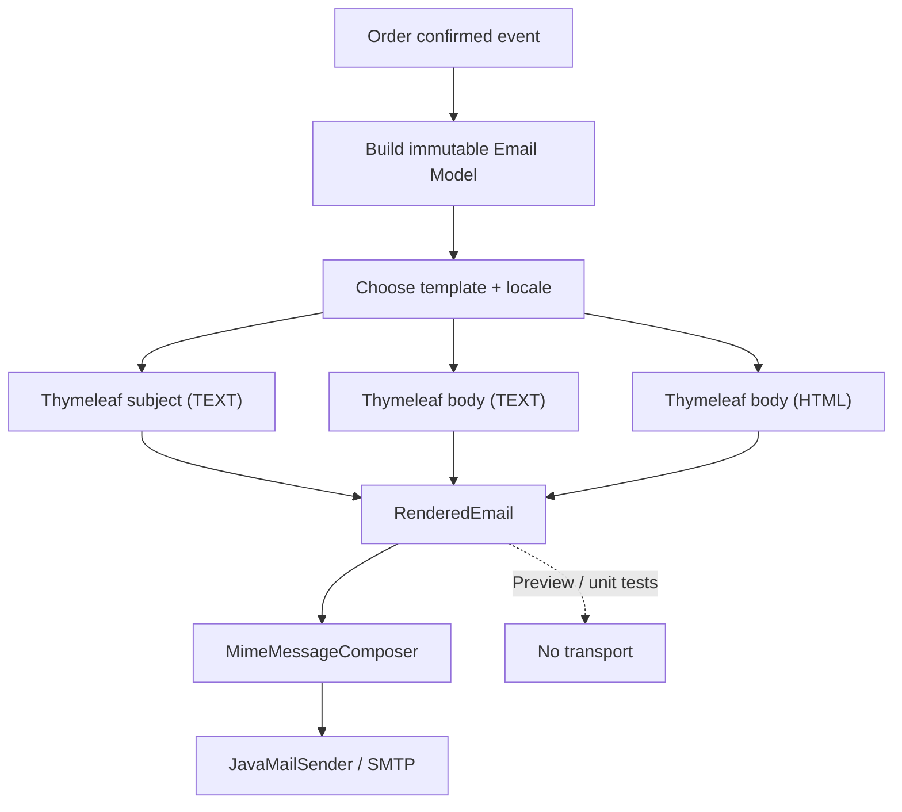

# Render email bằng template engine

Trong một ứng dụng **Spring Framework Mail**, gửi một email chỉ gồm một câu văn bản cố định tương đối dễ: tạo `SimpleMailMessage` và gọi `JavaMailSender.send(...)`. Nhưng một email sản phẩm thực tế thường cần tên người nhận, mã đơn hàng, tổng tiền, nút mở chi tiết, ngôn ngữ hiển thị, nội dung HTML, bản plain text dành cho client không hỗ trợ HTML và đôi khi cả ảnh hoặc tài liệu đính kèm. Nếu ghép các phần này bằng nối chuỗi Java, nội dung nhanh chóng trở nên khó bảo trì và dễ mắc lỗi bảo mật.

Bài thực hành **“Render email bằng template engine”** xây dựng một module email có thể sử dụng lại trong ứng dụng Spring Boot:

- Dùng **Thymeleaf** làm template engine; giữ giao diện ở file template, không nhét HTML dài vào Java.
- Render **subject**, **plain-text body** và **HTML body** từ cùng một dữ liệu nghiệp vụ.
- Dùng `MimeMessageHelper` tạo MIME message có `multipart/alternative` và UTF-8.
- Xử lý dữ liệu động an toàn, tránh HTML injection, header injection và link giả.
- Cung cấp chế độ preview/test **không gửi email thật**.
- Ghép với `JavaMailSender` ở lớp delivery/worker, không lẫn rendering với network I/O.
- Kiểm thử renderer, MIME message, template thiếu biến, locale, attachment/inline resource và những tình huống lỗi.

Bài tập thuộc chương **Dự án thực hành** của *Spring Framework Mail*. Ví dụ dùng Java 21, Spring Framework 6.x, Spring Boot 3.x, Thymeleaf 3.x và Jakarta Mail. Tên lớp, model nghiệp vụ và domain `example.test` đều là minh họa có thể thay đổi theo dự án. Hãy kiểm tra phiên bản dependencies của dự án khi lắp ghép; không dùng cấu hình SMTP production để chạy test.

> **Phân biệt:** *Render* chỉ tạo ra subject/plain text/HTML (hoặc MIME) trong bộ nhớ. *Submit* mới là thao tác gửi qua SMTP/HTTP provider. Render thành công không có nghĩa email đã được gửi; SMTP accepted cũng chưa chứng minh thư đến Inbox.

## 1. Mục tiêu và đầu ra của dự án

Ta xây dựng email **xác nhận đơn hàng**. Input là dữ liệu đã được ghi nhận trong nghiệp vụ:

```text
orderId       = ORDER-1042
customerName  = Nguyễn An
total         = 149000.00
currency      = VND
locale        = vi-VN
orderUrl      = https://app.example.test/orders/ORDER-1042
recipient     = customer@example.test
```

Đầu ra mong đợi:

| Thành phần | Ví dụ |
|---|---|
| Subject | Đơn hàng ORDER-1042 đã được ghi nhận |
| Plain text | Lời chào, mã đơn hàng, tổng tiền và đường dẫn dạng văn bản |
| HTML | Layout có logo, bảng thông tin, nút xem đơn hàng và footer |
| Content encoding | UTF-8 giữ đúng chữ tiếng Việt |
| MIME | Plain-text và HTML là hai alternative của cùng email |
| Transport | Worker sử dụng `JavaMailSender` để submit sau khi render |

**Không sử dụng HTML làm bản plain text** bằng cách gọi `html.replaceAll("<[^>]*>", "")`. HTML stripping không xử lý tốt entities, alt text, links, thứ tự nội dung hoặc các trường hợp nested markup. Cần một template text có cấu trúc riêng.

### 1.1. Định nghĩa hoàn thành

Một bài thực hành đạt yêu cầu khi:

1. Template không cần thay đổi mã Java nếu sửa wording, bố cục hoặc màu sắc cơ bản.
2. Một model dữ liệu có thể render ba output khác nhau.
3. Tên chứa các ký tự `<`, `>`, `&` không biến thành HTML thực thi.
4. URL mở đơn hàng được tạo từ **base URL đáng tin cậy**, không lấy host tự do từ email người dùng.
5. Có thể preview mà không gửi ra SMTP.
6. Unit test kiểm tra giá trị đã render, integration test kiểm tra MIME alternative.
7. Delivery service không gọi SMTP từ database transaction đang mở.

### 1.2. Luồng dữ liệu



Tách rendering và transport giúp kiểm thử nhanh: renderer có thể chạy mà không cần SMTP server; composer có thể tạo MIME message nhưng chưa gửi; transport adapter chịu trách nhiệm mở network connection.

## 2. Chuẩn bị dự án Spring Boot

Nếu dự án đã có Spring Boot, thêm các dependencies cần thiết (đây là **phần `dependencies` của một `build.gradle` đang có plugin/version quản lý đúng**, không phải file build hoàn chỉnh):

```groovy
dependencies {
    implementation 'org.springframework.boot:spring-boot-starter-mail'
    implementation 'org.springframework.boot:spring-boot-starter-thymeleaf'
    implementation 'org.springframework.boot:spring-boot-starter-validation'
    implementation 'org.springframework.boot:spring-boot-starter-web'

    testImplementation 'org.springframework.boot:spring-boot-starter-test'
}
```

Nếu dùng Maven, các starter tương đương là `spring-boot-starter-mail`, `spring-boot-starter-thymeleaf`, `spring-boot-starter-validation`, `spring-boot-starter-web` và `spring-boot-starter-test`, với dependency versions được quản lý bởi Spring Boot BOM. Không tự trộn phiên bản Jakarta Mail/Thymeleaf/Spring Framework không tương thích.

`spring-boot-starter-web` chỉ cần nếu xây HTTP preview/demo endpoint. Với mail worker không có HTTP API, có thể bỏ starter web.

### 2.1. Thư mục đề xuất

```text
src/
  main/
    java/com/example/mail/
      MailApplication.java
      config/
        MailTemplateConfiguration.java
        MailDeliveryProperties.java
      model/
        OrderConfirmationModel.java
        RenderedEmail.java
      render/
        OrderConfirmationRenderer.java
      compose/
        OrderConfirmationComposer.java
      delivery/
        OrderConfirmationDelivery.java
      preview/
        MailPreviewController.java
    resources/
      application.yml
      templates/
        mail/
          html/
            order-confirmed.html
          text/
            order-confirmed.txt
            order-confirmed-subject.txt
      mail/
        assets/
          brand-logo.png
  test/
    java/com/example/mail/
      OrderConfirmationRendererTest.java
      OrderConfirmationComposerTest.java
```

Ở đây, ba template nằm trong `src/main/resources/templates/mail` và logo thuộc `src/main/resources/mail/assets`. Chúng được đóng gói vào classpath khi build. Vì là nội dung template server-side, không nên cho người dùng bên ngoài sửa tùy ý các file này thông qua đường dẫn truyền vào API.

### 2.2. Vì sao tạo ba template?

Một email có ba phần mang mục đích khác nhau:

- **Subject** cần ngắn gọn, không chứa CR/LF, không có HTML tags.
- **Plain text** đọc tốt trong client text-only, accessibility, preview và trường hợp HTML bị chặn.
- **HTML** tạo layout, nút, bảng, styling và logo.

Ta có thể tái sử dụng model và một số wording nhưng không buộc plain text phải giống cách bố trí HTML. Việc tách template còn giúp người chỉnh sửa nội dung không vô tình làm hỏng email headers.

## 3. Cấu hình SMTP dành cho môi trường thực hành

Trước tiên, cấu hình gửi vào một **SMTP sandbox** hoặc hệ thống nhận thư kiểm thử đã được cấp phép:

```yaml
spring:
  mail:
    host: ${MAIL_HOST:127.0.0.1}
    port: ${MAIL_PORT:1025}
    default-encoding: UTF-8
    properties:
      "[mail.smtp.connectiontimeout]": "5000"
      "[mail.smtp.timeout]": "10000"
      "[mail.smtp.writetimeout]": "10000"

app:
  mail:
    from: no-reply@example.test
    public-base-url: https://app.example.test
    preview-enabled: false
```

Host/port trên là ví dụ cho local SMTP catcher (nhiều test servers dùng port 1025 không bật AUTH/TLS). **Đừng dùng cấu hình đó cho SMTP production**. Trong production phải dùng endpoint và security mode thực tế, SMTP AUTH/secret manager, STARTTLS required hoặc implicit TLS, certificate/hostname verification, sender verification, timeout và quota. Không gửi thư thật vào domain `example.test`.

Một mẫu cấu hình production STARTTLS (minh họa, chọn host/port đúng tài liệu relay):

```yaml
spring:
  mail:
    host: ${SMTP_HOST}
    port: 587
    username: ${SMTP_USER}
    password: ${SMTP_PASSWORD}
    properties:
      "[mail.smtp.auth]": "true"
      "[mail.smtp.starttls.enable]": "true"
      "[mail.smtp.starttls.required]": "true"
      "[mail.smtp.ssl.checkserveridentity]": "true"
      "[mail.smtp.connectiontimeout]": "5000"
      "[mail.smtp.timeout]": "10000"
      "[mail.smtp.writetimeout]": "10000"
```

Các biến `MAIL_HOST`, `SMTP_PASSWORD`... được lấy từ environment/secret manager. Không commit SMTP passwords, production email contents hoặc OTP tokens vào Git.

### 3.1. Preview không nên cần SMTP

Mode preview của bài chỉ gọi renderer rồi hiển thị HTML hoặc trả plain text. Không khởi tạo transport call, không đặt SMTP secret trong preview service và không dùng email người nhận thật. Khi kiểm thử MIME/SMTP, dùng một SMTP sandbox có kiểm soát và mailbox giả.

### 3.2. Những thành phần Java nên chịu trách nhiệm gì?

| Component | Trách nhiệm | Không nên làm |
|---|---|---|
| `OrderConfirmationModel` | Dữ liệu để render | Truy vấn DB hoặc giữ HTTP request |
| `OrderConfirmationRenderer` | Chọn templates, render subject/text/HTML | Mở SMTP socket |
| `RenderedEmail` | Chứa output immutable | Giữ credentials |
| `OrderConfirmationComposer` | Chuyển output thành `MimeMessage` | Gửi network nếu chỉ compose |
| `OrderConfirmationDelivery` | Submit qua `JavaMailSender`, gắn tracking/exception boundary | Mở DB transaction nghiệp vụ |
| Outbox/worker (mở rộng) | Retry, status, attempt tracking | Giữ task quan trọng chỉ trong RAM |

Đây là các ranh giới giúp bài thực hành phát triển lên production mà không phải viết lại toàn bộ.

## 4. Cấu hình Thymeleaf cho HTML và TEXT

Thymeleaf có nhiều template modes, trong đó quan trọng với email là:

- `TemplateMode.HTML`: hiểu cấu trúc HTML, xử lý các thuộc tính `th:*`, escape nội dung được chèn bằng `th:text`.
- `TemplateMode.TEXT`: phù hợp subject/plain text, hỗ trợ các expression inlining như `[[...]]` hoặc `[(...)]` theo syntax Thymeleaf.

Nếu dùng resolver cho HTML nhưng lại render file `.txt` qua chế độ HTML, các biểu thức text hoặc ký tự đặc biệt có thể cho output không như mong đợi. Ta khai báo **hai resolvers** có phạm vi template riêng.

### 4.1. Bean mailTemplateEngine

```java
package com.example.mail.config;

import java.util.Set;

import org.springframework.context.annotation.Bean;
import org.springframework.context.annotation.Configuration;
import org.thymeleaf.spring6.SpringTemplateEngine;
import org.thymeleaf.templatemode.TemplateMode;
import org.thymeleaf.templateresolver.ClassLoaderTemplateResolver;

@Configuration(proxyBeanMethods = false)
public class MailTemplateConfiguration {

    @Bean("mailTemplateEngine")
    public SpringTemplateEngine mailTemplateEngine() {
        ClassLoaderTemplateResolver html =
                new ClassLoaderTemplateResolver();
        html.setPrefix("templates/mail/");
        html.setSuffix(".html");
        html.setTemplateMode(TemplateMode.HTML);
        html.setCharacterEncoding("UTF-8");
        html.setResolvablePatterns(Set.of("html/*"));
        html.setCheckExistence(true);
        html.setOrder(1);
        html.setCacheable(true);

        ClassLoaderTemplateResolver text =
                new ClassLoaderTemplateResolver();
        text.setPrefix("templates/mail/");
        text.setSuffix(".txt");
        text.setTemplateMode(TemplateMode.TEXT);
        text.setCharacterEncoding("UTF-8");
        text.setResolvablePatterns(Set.of("text/*"));
        text.setCheckExistence(true);
        text.setOrder(2);
        text.setCacheable(true);

        SpringTemplateEngine engine = new SpringTemplateEngine();
        engine.addTemplateResolver(html);
        engine.addTemplateResolver(text);

        return engine;
    }
}
```

Bean này dùng template names:

```text
html/order-confirmed
  -> classpath:templates/mail/html/order-confirmed.html

text/order-confirmed
  -> classpath:templates/mail/text/order-confirmed.txt

text/order-confirmed-subject
  -> classpath:templates/mail/text/order-confirmed-subject.txt
```

**Lưu ý Spring Boot auto-configuration:** khi tự tạo `SpringTemplateEngine` bean, Spring Boot có thể dùng bean đó cho cả MVC view rendering nếu điều kiện auto-configuration tương ứng bị thay đổi. Trong ứng dụng vừa render email vừa render Thymeleaf views cho website, nên tách cấu hình email và web rõ ràng: cấu hình resolver/template engine phù hợp, tên bean/qualifier và MVC view resolver nhất quán. Không tự thêm một engine riêng rồi mặc định nó sẽ không ảnh hưởng MVC auto-configuration.

Nếu ứng dụng chỉ dùng Thymeleaf cho email (còn web API trả JSON), cấu hình trên đơn giản hơn. Nếu muốn tránh cạnh tranh engine, có thể tận dụng global Spring Boot-managed `SpringTemplateEngine` với các resolvers/namespace mail được khai báo cẩn thận. Thực tế cần chọn **một chiến lược có kiểm soát** theo cấu trúc dự án.

### 4.2. Lý do dùng resolver patterns

Nếu cả HTML và TEXT resolvers đều nhận mọi tên template, một resolver có thể thử load sai suffix trước, ví dụ `text/order-confirmed.html` thay vì `text/order-confirmed.txt`. Với `setResolvablePatterns(Set.of("html/*"))` và `Set.of("text/*")`, mỗi resolver chỉ xử lý namespace tương ứng.

`setCheckExistence(true)` cho phép resolver kiểm tra template tồn tại trước khi claim tên template. Khi thiếu template, render nên **fail rõ ràng**, không tự tạo email rỗng rồi gửi.

### 4.3. Cache trong production và phát triển

`setCacheable(true)` giúp giảm chi phí đọc và parse file khi nhiều email dùng cùng mẫu. Khi phát triển nội dung, có thể tắt cache trong profile local để quan sát thay đổi, nhưng chỉ khi hiểu ảnh hưởng của cấu hình engine riêng. Không dùng một cache key bỏ qua template version khi outbox có nhiều phiên bản mẫu.

Nếu worker chạy trong nhiều replicas, cache nằm trong mỗi JVM. Thay template và rolling deploy có thể dẫn tới hai phiên bản render khác nhau trong cùng thời gian; với email cần audit, lưu **template version/snapshot** trong notification intent.

### 4.4. Không lấy tên template trực tiếp từ người dùng

Anti-pattern:

```java
String template = request.getParameter("template");
String html = templateEngine.process(template, context);
```

Nếu application cho phép tên template tùy ý, có thể gây lỗi tài nguyên, template injection theo thiết kế sai hoặc truy cập template không được phép. Dùng **enum/registry whitelist**:

```java
public enum MailTemplateKey {
    ORDER_CONFIRMED(
            "text/order-confirmed-subject",
            "text/order-confirmed",
            "html/order-confirmed");

    private final String subject;
    private final String plain;
    private final String html;

    MailTemplateKey(
            String subject, String plain, String html) {
        this.subject = subject;
        this.plain = plain;
        this.html = html;
    }

    public String subjectTemplate() { return subject; }
    public String plainTemplate() { return plain; }
    public String htmlTemplate() { return html; }
}
```

Một template key được chọn bởi business event type đã xác thực, không bởi một đường dẫn arbitrary từ query parameter.

## 5. Tạo template subject

File `src/main/resources/templates/mail/text/order-confirmed-subject.txt`:

```text
Đơn hàng [(${order.orderId})] đã được ghi nhận
```

Đây là template **TEXT mode**, không phải Java string format hay Spring Expression Language đứng một mình. Thymeleaf xử lý `[(${order.orderId})]` khi được gọi bằng `templateEngine.process(...)` với biến `order` trong `Context`.

### 5.1. Vì sao subject cần template riêng?

- Dễ thay đổi wording và locale mà không sửa Java.
- Có thể tạo subject theo business event hoặc template version.
- Có thể preview/test độc lập.
- Ngăn developer dùng nguyên HTML làm subject.

### 5.2. Subject là header, không phải body

Subject không được chứa CR/LF do input không tin cậy, vì một số stack/client/header builders có thể bị tấn công header injection. Nên:

1. Chỉ dùng các biến business đã được validate (ví dụ order ID có format cố định).
2. Kiểm tra output render không chứa `\r` hoặc `\n` sau khi loại newline cuối template một cách chủ động.
3. Giới hạn độ dài/charset theo policy.
4. Để `MimeMessageHelper` thực hiện encoding header theo Jakarta Mail.

Không nhận `subjectTemplate` từ HTTP request rồi cho người dùng chèn expression tùy ý.

## 6. Tạo template plain text

File `src/main/resources/templates/mail/text/order-confirmed.txt`:

```text
Xin chào [(${order.customerName})],

Cảm ơn bạn đã đặt hàng.

Mã đơn hàng: [(${order.orderId})]
Tổng tiền: [(${totalFormatted})]

Xem chi tiết đơn hàng:
[(${order.orderUrl})]

Nếu bạn không thực hiện đơn hàng này, vui lòng liên hệ bộ phận hỗ trợ
qua kênh chính thức của ứng dụng.

Trân trọng,
Đội ngũ hỗ trợ
```

Đây là nội dung có ý nghĩa ngay cả khi email client tắt HTML hoặc khi người dùng dùng text-only reader. Link dạng văn bản hiển thị nguyên URL, không phụ thuộc vào thuộc tính `href` của HTML.

### 6.1. Plain text không phải HTML và không tự có đầy đủ bảo vệ

TEXT mode không phải công cụ sanitize mọi input. Nếu `customerName` chứa newline và chuỗi mạo danh “Hỗ trợ ngân hàng”, output plain text có thể gây hiểu nhầm. Với các trường chỉ cần hiển thị một dòng, áp dụng giới hạn độ dài, Unicode normalization/validation và từ chối control characters theo policy.

Subject phải bị kiểm soát nghiêm hơn vì thuộc email header. Các dữ liệu không tin cậy như `orderUrl` cần được tạo từ host đáng tin, không xây bằng việc ghép một URL từ email bên nhận.

### 6.2. Không dùng một file text đã render làm HTML

Nếu lấy plain text rồi bọc vào `<p>` không escape, dấu `<` và `&` trong tên có thể trở thành markup. HTML cần template riêng với escaping đúng ngữ cảnh. Nếu chỉ gửi text, dùng `SimpleMailMessage` có thể đủ; nhưng bài này cần cả plain/HTML alternative.

## 7. Tạo template HTML

File `src/main/resources/templates/mail/html/order-confirmed.html`:

```html
<!DOCTYPE html>
<html lang="vi" xmlns:th="http://www.thymeleaf.org">
<head>
  <meta charset="UTF-8"/>
  <meta name="viewport"
        content="width=device-width, initial-scale=1"/>
  <title>Xác nhận đơn hàng</title>
</head>
<body style="margin:0;padding:24px;background:#f5f7fb;
             font-family:Arial,sans-serif;color:#263238;">
  <table role="presentation" cellpadding="0" cellspacing="0"
         width="100%" style="max-width:620px;margin:auto;
         background:#ffffff;border-collapse:collapse;">
    <tr>
      <td style="padding:28px;">
        
        <h1 style="font-size:23px;line-height:1.3;margin:0 0 16px;">
          Xác nhận đơn hàng
        </h1>

        <p>
          Xin chào
          <strong th:text="${order.customerName}">Tên khách hàng</strong>,
        </p>
        <p>
          Cảm ơn bạn đã đặt hàng. Chúng tôi đã ghi nhận đơn
          <strong th:text="${order.orderId}">ORDER-DEMO</strong>.
        </p>

        <table role="presentation" cellpadding="8" cellspacing="0"
               width="100%" style="border-collapse:collapse;
               margin:20px 0;background:#f7f9fc;">
          <tr>
            <td>Mã đơn hàng</td>
            <td style="text-align:right;font-weight:bold;"
                th:text="${order.orderId}">ORDER-DEMO</td>
          </tr>
          <tr>
            <td>Tổng tiền</td>
            <td style="text-align:right;font-weight:bold;"
                th:text="${totalFormatted}">0 VND</td>
          </tr>
        </table>

        <p style="margin:24px 0;">
          <a th:href="${order.orderUrl}"
             href="https://app.example.test/orders/ORDER-DEMO"
             style="display:inline-block;background:#175cd3;
             color:#ffffff;text-decoration:none;border-radius:6px;
             padding:12px 18px;font-weight:bold;">
            Xem đơn hàng
          </a>
        </p>

        <p style="font-size:13px;color:#667085;">
          Nếu bạn không thực hiện đơn hàng này, hãy liên hệ
          bộ phận hỗ trợ qua kênh chính thức.
        </p>
      </td>
    </tr>
  </table>
</body>
</html>
```

Một số đặc điểm:

- Nội dung động đi qua `th:text`, giúp Thymeleaf **escape HTML entities** khi chèn text.
- `th:href` đặt link từ biến `orderUrl`, nhưng **escape attribute không tự xác minh URL an toàn**. Phải xây/validate URL ở application layer.
- Logo sử dụng `cid:brand-logo`; composer phải thêm inline resource với đúng Content-ID.
- CSS quan trọng được viết inline vì nhiều email clients hạn chế external stylesheets, scripts, forms và CSS hiện đại.
- Có plain-text alternative độc lập, tránh lệ thuộc rendering HTML.

### 7.1. HTML email khác web page

Không đưa nguyên trang React/Vue hoặc Thymeleaf web page phức tạp vào email. Nhiều mail clients:

- Chặn JavaScript và forms.
- Chặn external images mặc định hoặc proxy image URLs.
- Hạn chế CSS selectors, media queries, fonts.
- Xử lý layout table ổn định hơn nhiều layout web hiện đại.
- Có dark mode tự động thay màu.
- Có link rewriting và tracking policy.

Vì vậy HTML email nên đơn giản, có layout dự phòng và text alternative. Không dùng `<script>`, event handlers hoặc external JavaScript trong template.

### 7.2. Dynamic data phải được escape đúng

Giả sử tên khách hàng là:

```text
Nguyễn  & Co.
```

Nếu dùng `th:text="${order.customerName}"`, đoạn markup nguy hiểm được biểu diễn như **text đã escape**, không phải một phần tử `img` mới được chèn. Ngược lại:

```html
<!-- Không dùng với dữ liệu không tin cậy: -->
<span th:utext="${order.customerName}"></span>
```

`th:utext` chèn nội dung không escape. Chỉ dùng khi nguồn là HTML đã kiểm soát/sanitize theo allowlist và thật sự cần rich content. Thông thường email nghiệp vụ không cần cho user nhập raw HTML.

### 7.3. Attributes và URL cần kiểm soát riêng

`th:text` phù hợp cho text nodes. Với thuộc tính, dùng `th:href`, `th:src` và validate đúng loại giá trị. Không xây CSS, JavaScript, HTML fragment hoặc URL từ chuỗi do user kiểm soát rồi chèn bằng `th:utext`.

Với order URL, nên giới hạn HTTPS và hostname do ứng dụng sở hữu; URL escaping đơn thuần không ngăn link trỏ tới domain lừa đảo. Nếu có token nhạy cảm trong link, cần expiration, authorization/replay protection và tránh log token.

## 8. Thiết kế model email không phụ thuộc template engine

Dùng một Java record bất biến cho dữ liệu sẽ render:

```java
package com.example.mail.model;

import java.math.BigDecimal;
import java.util.Objects;

public record OrderConfirmationModel(
        String orderId,
        String customerName,
        BigDecimal total,
        String currencyCode,
        String orderUrl
) {
    public OrderConfirmationModel {
        Objects.requireNonNull(orderId, "orderId");
        Objects.requireNonNull(customerName, "customerName");
        Objects.requireNonNull(total, "total");
        Objects.requireNonNull(currencyCode, "currencyCode");
        Objects.requireNonNull(orderUrl, "orderUrl");

        if (orderId.isBlank() || customerName.isBlank()) {
            throw new IllegalArgumentException(
                    "Order identity and customer name are required");
        }
        if (total.signum() < 0) {
            throw new IllegalArgumentException(
                    "Total cannot be negative");
        }
    }
}
```

Đây là **validation tối thiểu để minh họa**, chưa phải toàn bộ validation production. Cần kiểm tra format/length/order ID, control characters, currency hợp lệ và URL HTTPS đáng tin trước khi render. Những model loại tiền hoàn tiền có thể có tổng âm, khi đó contract phải khác; đừng áp đặt validation không phù hợp nghiệp vụ.

### 8.1. Vì sao không đưa JPA entity trực tiếp vào template?

Không nên:

```java
Context context = new Context();
context.setVariable("order", orderJpaEntity);
```

Thymeleaf có thể truy cập getter/lazy relationships, kích hoạt truy vấn ngoài ý muốn, gặp `LazyInitializationException` hoặc làm lộ thuộc tính nội bộ. Worker xử lý outbox cũng có thể chạy sau khi transaction chứa entity đã kết thúc.

Thay vào đó:

- Ứng dụng tạo **DTO đã chọn lọc** từ dữ liệu business.
- Các field được xác thực theo tenant và mục đích email.
- Với dữ liệu không được phép gửi, đừng để field xuất hiện trong DTO.
- Với email cần audit lâu dài, lưu snapshot/payload version ở outbox.

### 8.2. Dữ liệu render khác dữ liệu vận chuyển

Một notification còn cần recipient email, sender identity, template key, locale, notification ID và TTL. Không nhất thiết nhồi tất cả vào `OrderConfirmationModel` nếu chúng không dùng để render.

Một wrapper có thể là:

```java
public record MailNotification(
        String notificationId,
        String recipientEmail,
        String senderIdentity,
        String templateKey,
        String localeTag,
        OrderConfirmationModel model
) {}
```

Tách ranh giới giúp renderer không có SMTP credentials, và composer không phải truy vấn cơ sở dữ liệu để lấy tổng tiền.

## 9. Xây URL đáng tin cậy từ server configuration

Một liên kết “Xem đơn hàng” không nên dùng giá trị `host` lấy trực tiếp từ người dùng:

```java
// Không an toàn nếu host do caller quyết định:
String url = "https://" + userProvidedHost + "/orders/" + orderId;
```

Với domain server đã cấu hình và được kiểm soát:

```java
package com.example.mail.render;

import org.springframework.web.util.UriComponentsBuilder;

public final class OrderUrlFactory {

    private final String trustedBaseUrl;

    public OrderUrlFactory(String trustedBaseUrl) {
        if (!trustedBaseUrl.startsWith("https://")) {
            throw new IllegalArgumentException(
                    "Order email URL must use HTTPS");
        }
        this.trustedBaseUrl = trustedBaseUrl;
    }

    public String forOrder(String orderId) {
        if (!orderId.matches("[A-Z0-9-]{1,80}")) {
            throw new IllegalArgumentException(
                    "Invalid order ID");
        }

        return UriComponentsBuilder
                .fromUriString(trustedBaseUrl)
                .path("/orders/{orderId}")
                .buildAndExpand(orderId)
                .encode()
                .toUriString();
    }
}
```

Đây là ví dụ giúp tránh ghép path bằng dữ liệu arbitrary. **Trong production, chỉ kiểm tra `startsWith("https://")` chưa đủ**: cấu hình base URL còn phải parse URI, kiểm tra scheme/host/port theo allowlist và không cho user đổi nó. Không dùng `Host` header từ HTTP request chưa được trusted-proxy validation làm cơ sở tạo link trong email.

Nếu URL chứa token xác minh, phải có TTL/one-time semantics theo nghiệp vụ, không lưu token thô trong access logs. Link cần phù hợp domain/brand để giảm nguy cơ phishing.

## 10. Kết quả render là dữ liệu bất biến

```java
package com.example.mail.model;

public record RenderedEmail(
        String subject,
        String plainText,
        String html
) {
    public RenderedEmail {
        if (subject == null || subject.isBlank()) {
            throw new IllegalArgumentException(
                    "Email subject must not be blank");
        }
        if (plainText == null || plainText.isBlank()) {
            throw new IllegalArgumentException(
                    "Plain text content must not be blank");
        }
        if (html == null || html.isBlank()) {
            throw new IllegalArgumentException(
                    "HTML content must not be blank");
        }
        if (subject.contains("\r") || subject.contains("\n")) {
            throw new IllegalArgumentException(
                    "Email subject must be a single line");
        }
    }
}
```

Record này chưa gửi email; nó chỉ đại diện cho ba output đã render. Composer sau đó chuyển thành MIME message. Việc có một kết quả riêng giúp:

- Unit test không cần SMTP.
- Preview HTML/text không phải gửi thư.
- Đặt limit kích thước trước khi chuyển sang transport.
- Lưu render artifact hoặc hash/snapshot khi business audit yêu cầu.
- Phân loại lỗi render khác lỗi SMTP.

## 11. Renderer sử dụng Context riêng cho mỗi email

```java
package com.example.mail.render;

import com.example.mail.model.OrderConfirmationModel;
import com.example.mail.model.RenderedEmail;

import java.text.NumberFormat;
import java.util.Currency;
import java.util.Locale;

import org.springframework.beans.factory.annotation.Qualifier;
import org.springframework.stereotype.Service;
import org.thymeleaf.context.Context;
import org.thymeleaf.spring6.SpringTemplateEngine;

@Service
public final class OrderConfirmationRenderer {

    private final SpringTemplateEngine templates;

    public OrderConfirmationRenderer(
            @Qualifier("mailTemplateEngine")
            SpringTemplateEngine templates) {
        this.templates = templates;
    }

    public RenderedEmail render(
            OrderConfirmationModel order,
            Locale locale) {

        NumberFormat money =
                NumberFormat.getCurrencyInstance(locale);
        money.setCurrency(
                Currency.getInstance(order.currencyCode()));

        Context context = new Context(locale);
        context.setVariable("order", order);
        context.setVariable(
                "totalFormatted", money.format(order.total()));

        String subject = templates.process(
                "text/order-confirmed-subject", context).strip();

        String plain = templates.process(
                "text/order-confirmed", context);

        String html = templates.process(
                "html/order-confirmed", context);

        return new RenderedEmail(subject, plain, html);
    }
}
```

Renderer trên dùng một `Context` **mới trên mỗi invocation**, không lưu một Context mutable trong singleton service. `SpringTemplateEngine` được thiết kế để tái sử dụng sau khi cấu hình xong; không mutate resolvers hoặc dialects trong lúc các threads đang render.

`NumberFormat` là mutable và không nên chia sẻ cùng một instance giữa nhiều worker threads; tạo mới theo locale như trên là cách đơn giản. Với currency `VND`, kết quả format phụ thuộc locale/Java localization data; test theo target locale hoặc assert ngữ nghĩa thay vì sao chép string spacing từ máy khác.

### 11.1. Chọn locale

Ví dụ:

```java
Locale vi = Locale.forLanguageTag("vi-VN");
Locale en = Locale.forLanguageTag("en-US");

RenderedEmail result = renderer.render(order, vi);
```

Với template đang chứa wording tiếng Việt cố định, đổi `locale` chỉ ảnh hưởng locale-dependent formatting trong code chứ **không tự dịch toàn bộ nội dung sang tiếng Anh**. Để hỗ trợ nhiều ngôn ngữ, cần message bundles hoặc templates riêng theo locale. Phần nâng cao sẽ trình bày cách làm.

### 11.2. Lỗi template không nên bị nuốt

Nếu file template không tồn tại hoặc expression lỗi, Thymeleaf có thể ném exception như `TemplateInputException` hoặc `TemplateProcessingException`. Không catch rồi trả `RenderedEmail("", "", "")`, cũng không tự gửi email body trống.

Hãy ghi error category an toàn (ví dụ `TEMPLATE_NOT_FOUND`, `TEMPLATE_RENDER_FAILED`), notification/template version, và **không gọi SMTP** khi render thất bại. Với outbox, worker quyết định retry/pause/dead-letter theo nguyên nhân: template bị xóa thường cần sửa deployment hơn là retry 100 lần mỗi giây.

## 12. Từ RenderedEmail đến MimeMessage

Spring Framework Mail dùng `JavaMailSender` để tạo và gửi `MimeMessage`. Để cùng một email có cả text và HTML, `MimeMessageHelper.setText(plainText, htmlText)` là API thuận tiện.

```java
package com.example.mail.compose;

import com.example.mail.model.RenderedEmail;

import jakarta.mail.MessagingException;
import jakarta.mail.internet.MimeMessage;

import org.springframework.core.io.ClassPathResource;
import org.springframework.mail.javamail.JavaMailSender;
import org.springframework.mail.javamail.MimeMessageHelper;
import org.springframework.stereotype.Component;

@Component
public final class OrderConfirmationComposer {

    private final JavaMailSender sender;

    public OrderConfirmationComposer(JavaMailSender sender) {
        this.sender = sender;
    }

    public MimeMessage compose(
            String recipient,
            RenderedEmail rendered) throws MessagingException {

        MimeMessage mime = sender.createMimeMessage();

        MimeMessageHelper helper =
                new MimeMessageHelper(
                        mime,
                        true,
                        "UTF-8");

        helper.setFrom("no-reply@example.test");
        helper.setTo(recipient);
        helper.setSubject(rendered.subject());

        // Tạo multipart/alternative với hai bản nội dung:
        helper.setText(
                rendered.plainText(),
                rendered.html());

        // Content-ID khớp src="cid:brand-logo" trong HTML.
        helper.addInline(
                "brand-logo",
                new ClassPathResource(
                        "mail/assets/brand-logo.png"),
                "image/png");

        return mime;
    }
}
```

Ở ví dụ này, `no-reply@example.test` là sender giả; production lấy sender identity đã xác thực từ config/policy, không để request chọn From tùy ý. File logo cần thực sự nằm trên classpath. Composer **không gửi SMTP**: dù có inject `JavaMailSender` để gọi `createMimeMessage()`, method chỉ dựng một object `MimeMessage`.

### 12.1. Vì sao dùng setText(plain, html)?

Hai phiên bản khác nhau của cùng nội dung nên được biểu diễn dưới dạng MIME alternative; mail client lựa chọn phiên bản phù hợp. API:

```java
helper.setText(plainText, htmlText);
```

giúp xử lý phần bố trí MIME. Không làm:

```java
helper.setText(plainText);
helper.setText(htmlText, true); // Ghi đè nội dung trước đó.
```

Một số mail clients/chống spam đánh giá tích cực việc có cả plain/HTML hợp lệ, nhưng không thể bảo đảm Inbox placement chỉ vì có text alternative.

### 12.2. Thứ tự setText rồi addInline

Với `MimeMessageHelper`, nên gọi `setText(...)` **trước** khi thêm inline resources để đảm bảo MIME multipart structure/CID được dựng theo semantics của helper. Sau đó thêm logo và attachment. Với template có nhiều inline resources, mỗi Content-ID phải duy nhất và khớp HTML:

```text
HTML: 
Java: helper.addInline("brand-logo", resource, "image/png");
```

Không dùng `cid:https://...` hoặc gọi `addInline` với Content-ID ngẫu nhiên không khớp tên trong HTML.

### 12.3. Resource phải còn đọc được khi MIME được serialize

Một lỗi thực tế:

```java
InputStream stream = upload.getInputStream();
// Request ends, stream closes ...
// Worker later tries to send MIME using old stream.
```

Jakarta Mail có thể cần đọc attachment/inline content khi serialize, không chỉ tại lúc gọi `addInline`. Dùng `ClassPathResource` cho logo hoặc blob/file resource có lifetime phù hợp; với dữ liệu từ request, lưu staged file/object theo policy trước khi enqueue mail worker. `ByteArrayResource` phù hợp file nhỏ nhưng giữ toàn bộ bytes trong heap. Tránh `InputStreamResource` đơn-lượt khi transport có thể đọc stream nhiều lần.

### 12.4. Đính kèm PDF tùy chọn

Nếu muốn gửi hóa đơn, thêm tài liệu đã kiểm soát:

```java
import org.springframework.core.io.Resource;

public void addInvoice(
        MimeMessageHelper helper,
        Resource invoicePdf) throws MessagingException {
    helper.addAttachment(
            "invoice.pdf",
            invoicePdf,
            "application/pdf");
}
```

Chọn filename, content type và resource từ business data hợp lệ; không dùng upload filename tùy ý rồi tin MIME client sẽ xử lý an toàn. Đặt giới hạn bytes, antivirus/quarantine khi cần và retention policy. Attachment phải thực sự tồn tại trong lần retry.

### 12.5. Logo không xuất hiện trong HTML preview trình duyệt?

Trình duyệt không hiểu `cid:brand-logo` như một HTTP resource bình thường. Vì vậy browser preview có thể hiện alt text hoặc biểu tượng ảnh lỗi, dù email MIME thực có inline part. Đừng đánh giá tính đúng đắn của inline CID chỉ qua HTML preview; cần kiểm thử MIME và xem bằng mail client/sandbox.

## 13. Delivery service chỉ submit, không render lại tùy ý

Ghép renderer + composer + transport trong một service rõ ràng:

```java
package com.example.mail.delivery;

import com.example.mail.compose.OrderConfirmationComposer;
import com.example.mail.model.OrderConfirmationModel;
import com.example.mail.model.RenderedEmail;
import com.example.mail.render.OrderConfirmationRenderer;

import java.util.Locale;

import jakarta.mail.MessagingException;
import jakarta.mail.internet.MimeMessage;

import org.springframework.mail.javamail.JavaMailSender;
import org.springframework.stereotype.Service;

@Service
public final class OrderConfirmationDelivery {

    private final OrderConfirmationRenderer renderer;
    private final OrderConfirmationComposer composer;
    private final JavaMailSender sender;

    public OrderConfirmationDelivery(
            OrderConfirmationRenderer renderer,
            OrderConfirmationComposer composer,
            JavaMailSender sender) {
        this.renderer = renderer;
        this.composer = composer;
        this.sender = sender;
    }

    public void submit(
            OrderConfirmationModel model,
            Locale locale,
            String recipientEmail) throws MessagingException {

        RenderedEmail rendered =
                renderer.render(model, locale);

        MimeMessage mime =
                composer.compose(recipientEmail, rendered);

        sender.send(mime);
    }
}
```

Ở đây `submit(...)` là thao tác blocking SMTP. Trong một ứng dụng thực tế, service này được gọi bởi **mail worker** sau khi business transaction/outbox intent đã commit. Đừng gọi nó ngay giữa `@Transactional` lưu đơn hàng và kỳ vọng rollback của database thu hồi thư đã gửi.

### 13.1. Lỗi render, compose và send khác nhau

| Stage | Ví dụ lỗi | Ý nghĩa |
|---|---|---|
| Render | Template không tồn tại, expression lỗi | Chưa mở SMTP |
| Validate | Locale/currency/link/recipient không hợp lệ | Cần sửa input/policy |
| Compose | MIME helper, inline resource missing, attachment read | Chưa chắc đã submit SMTP |
| Send | SMTP AUTH, TLS, transient/permanent reject | Cần phân loại provider/recipient |
| Send uncertain | Timeout sau DATA, response cuối bị mất | Provider có thể đã accepted |
| Post-send tracking | DB không lưu được ACCEPTED | Recovery có duplicate risk |

Một `MailSendException` không nên bị gộp với lỗi Thymeleaf thành “template sai”. Ngược lại, lỗi `TemplateInputException` không nên retry kết nối SMTP hàng trăm lần vì SMTP chưa được gọi.

### 13.2. Không tạo lại nội dung khác ở mỗi lần retry

Nếu dùng outbox, dữ liệu email phải có semantic ổn định. Ví dụ đơn hàng được sửa sau khi intent được tạo; worker retry sau 24 giờ không nên vô tình gửi tổng tiền mới với subject của lần phát hành cũ.

Có thể lưu:

- Template key và version.
- Render model đã chọn lọc hoặc immutable snapshot reference.
- Locale, sender identity, recipient reference.
- Business event key và notification ID.
- Chính sách expiry/revalidate trước send (đặc biệt với OTP).

Một số loại email, ví dụ subscription marketing, phải kiểm tra consent/suppression hiện hành tại lúc gửi. Vì vậy phải phân biệt **dữ liệu cần snapshot** và **policy cần kiểm tra lại**.

## 14. Chế độ preview chỉ render, không send

Preview hữu ích khi nhân viên nội bộ hoặc developer cần xem HTML trước khi phát hành. Nó cũng giúp tự động tạo screenshot trong hệ thống test nếu có hạ tầng, nhưng **preview không thay thế kiểm tra MIME trên mail clients**.

Một controller chỉ bật ở profile `local`:

```java
package com.example.mail.preview;

import com.example.mail.model.OrderConfirmationModel;
import com.example.mail.render.OrderConfirmationRenderer;

import java.math.BigDecimal;
import java.util.Locale;

import org.springframework.context.annotation.Profile;
import org.springframework.http.MediaType;
import org.springframework.web.bind.annotation.GetMapping;
import org.springframework.web.bind.annotation.RequestMapping;
import org.springframework.web.bind.annotation.RestController;

@Profile("local")
@RestController
@RequestMapping("/internal/mail-preview")
public final class MailPreviewController {

    private final OrderConfirmationRenderer renderer;

    public MailPreviewController(
            OrderConfirmationRenderer renderer) {
        this.renderer = renderer;
    }

    @GetMapping(
            value = "/order-confirmed",
            produces = MediaType.TEXT_HTML_VALUE)
    public String previewHtml() {
        return renderer.render(demoModel(), demoLocale()).html();
    }

    @GetMapping(
            value = "/order-confirmed.txt",
            produces = MediaType.TEXT_PLAIN_VALUE)
    public String previewText() {
        return renderer.render(demoModel(), demoLocale()).plainText();
    }

    private static Locale demoLocale() {
        return Locale.forLanguageTag("vi-VN");
    }

    private static OrderConfirmationModel demoModel() {
        return new OrderConfirmationModel(
                "ORDER-1042",
                "Nguyễn An",
                new BigDecimal("149000.00"),
                "VND",
                "https://app.example.test/orders/ORDER-1042");
    }
}
```

Khi chạy local profile, có thể truy cập:

```text
GET http://localhost:8080/internal/mail-preview/order-confirmed
GET http://localhost:8080/internal/mail-preview/order-confirmed.txt
```

**Không triển khai controller preview công khai trên production.** Nếu yêu cầu preview trong công cụ admin thực, cần authentication/authorization, rate limit, tenant-scoped dữ liệu, chống XSS từ HTML tùy biến, log redaction và tránh lộ dữ liệu email thật. `@Profile("local")` giảm rủi ro bật nhầm trong ví dụ nhưng chỉ an toàn khi profile được quản lý đúng.

### 14.1. Chỉ dùng dữ liệu giả trong preview

Preview không cần email khách hàng thật. Dùng model giả cho phép UI/design thay đổi mà không đụng dữ liệu nhạy cảm. Nếu muốn preview nhiều trường hợp, tạo một bộ fixture:

```text
normal-name
long-customer-name
html-special-characters
very-large-currency
missing-optional-field
en-US / vi-VN
```

Không cho người dùng nhập raw Thymeleaf template source rồi gửi nó vào engine trong một public endpoint. Template source là nội dung đáng tin do developer/content admin đã được phân quyền quản lý.

### 14.2. Preview “HTML nhìn đẹp” chưa đủ

Cần mở bằng actual email clients/sandbox để kiểm tra:

- Multipart alternative có đúng không?
- Inline image CID có liên kết tới MIME part không?
- Dark mode và mobile rendering.
- Link rewriting và alt text.
- Long subject/filename encoding.
- Footer và link hỗ trợ.
- HTML được email client sanitize/giới hạn thế nào.

Browser preview là bước nhanh cho layout, không phải bằng chứng deliverability.

## 15. Unit test renderer không cần kết nối SMTP

Một điểm mạnh của cách tách lớp là kiểm thử rendering chỉ cần Thymeleaf và template files trong classpath. Chưa cần dựng SMTP sandbox, chưa cần Spring web server và chưa cần database.

### 15.1. JUnit test với engine thật

```java
package com.example.mail;

import static org.junit.jupiter.api.Assertions.*;

import com.example.mail.config.MailTemplateConfiguration;
import com.example.mail.model.OrderConfirmationModel;
import com.example.mail.model.RenderedEmail;
import com.example.mail.render.OrderConfirmationRenderer;

import java.math.BigDecimal;
import java.util.Locale;

import org.junit.jupiter.api.Test;

class OrderConfirmationRendererTest {

    private final OrderConfirmationRenderer renderer =
            new OrderConfirmationRenderer(
                    new MailTemplateConfiguration()
                            .mailTemplateEngine());

    @Test
    void rendersSubjectTextAndHtmlFromSameModel() {
        var order = demoOrder("Nguyễn An");
        var locale = Locale.forLanguageTag("vi-VN");

        RenderedEmail email = renderer.render(order, locale);

        assertEquals(
                "Đơn hàng ORDER-1042 đã được ghi nhận",
                email.subject());
        assertTrue(email.plainText().contains("ORDER-1042"));
        assertTrue(email.plainText().contains("Nguyễn An"));
        assertTrue(email.html().contains("ORDER-1042"));
        assertTrue(email.html().contains("Nguyễn An"));
        assertTrue(email.html().contains(
                "https://app.example.test/orders/ORDER-1042"));
    }

    @Test
    void escapesUntrustedTextInHtml() {
        var order = demoOrder(
                "Nguyễn  & Co.");

        RenderedEmail email = renderer.render(
                order, Locale.forLanguageTag("vi-VN"));

        assertFalse(email.html().contains(
                ""));
        assertTrue(email.html().contains("&lt;img"));

        // Plain text không phải HTML, nên phải kiểm soát
        // control characters riêng nếu nguồn không tin cậy.
        assertTrue(email.plainText().contains(
                "Nguyễn "));
    }

    @Test
    void rejectsHeaderNewlineFromSubjectVariable() {
        var order = new OrderConfirmationModel(
                "ORDER-1042\r\nBcc: attacker@example.test",
                "Nguyễn An",
                new BigDecimal("149000.00"),
                "VND",
                "https://app.example.test/orders/ORDER-1042");

        assertThrows(
                IllegalArgumentException.class,
                () -> renderer.render(
                        order, Locale.forLanguageTag("vi-VN")));
    }

    private static OrderConfirmationModel demoOrder(
            String customerName) {
        return new OrderConfirmationModel(
                "ORDER-1042",
                customerName,
                new BigDecimal("149000.00"),
                "VND",
                "https://app.example.test/orders/ORDER-1042");
    }
}
```

Test dùng **engine và templates thật**, nhưng không gửi SMTP. Nếu refactor model/renderer, cần điều chỉnh fixture. Một số email clients có thể encode lại MIME body, song unit test renderer chỉ kiểm tra chuỗi HTML trước serialization.

### 15.2. Một bộ test hợp lý cho nhiều dữ liệu

| Trường hợp | Điều cần xác nhận |
|---|---|
| Tên bình thường có dấu | UTF-8 không mất ký tự |
| Tên chứa `<script>` hoặc `&` | HTML escape đúng, không có markup mới |
| Mã đơn hàng có CR/LF | Subject validation từ chối |
| Order ID dài bất thường | Model validation theo business policy |
| Currency invalid | Render fail có reason rõ, không submit SMTP |
| Amount lớn/định dạng thập phân | Formatting theo locale và currency |
| Missing template | Fail trước khi gửi |
| Missing variable | Không âm thầm để trống field bắt buộc |
| URL không hợp lệ | Bị chặn ở model factory/validation |
| Locale khác | Nội dung/template hoặc message bundle đúng theo policy |

Đặc biệt, Thymeleaf có thể render giá trị null thành chuỗi rỗng trong một số expression, nên chỉ trông chờ template engine tự phát hiện thiếu field là chưa đủ. **Các field bắt buộc cần validation ở domain/model layer** trước khi render.

### 15.3. Kiểm tra template missing

Ví dụ:

```java
import org.thymeleaf.context.Context;
import org.thymeleaf.exceptions.TemplateInputException;

@Test
void unknownTemplateFailsExplicitly() {
    var engine = new MailTemplateConfiguration()
            .mailTemplateEngine();

    assertThrows(
            TemplateInputException.class,
            () -> engine.process(
                    "html/not-existing", new Context()));
}
```

Không sửa bằng cách fallback sang template trống để “gửi cho kịp”; với email hóa đơn/OTP, nội dung thiếu có thể nguy hiểm hơn việc ghi lỗi rõ và đưa job vào trạng thái cần xử lý.

## 16. Kiểm tra MIME alternative và inline resource

Sau khi render, cần chứng minh `MimeMessageHelper` đã đưa **plain text**, **HTML** và **inline image** vào một MIME tree hợp lệ, không chỉ ghép ba chuỗi trong bộ nhớ.

### 16.1. Test composer không mở SMTP

```java
package com.example.mail;

import static org.junit.jupiter.api.Assertions.*;

import com.example.mail.compose.OrderConfirmationComposer;
import com.example.mail.model.RenderedEmail;

import jakarta.mail.Message;
import jakarta.mail.Multipart;
import jakarta.mail.Part;
import jakarta.mail.internet.InternetAddress;
import jakarta.mail.internet.MimeMessage;

import java.util.ArrayList;
import java.util.List;

import org.junit.jupiter.api.Test;
import org.springframework.mail.javamail.JavaMailSenderImpl;

class OrderConfirmationComposerTest {

    @Test
    void createsMimeWithBothAlternatives() throws Exception {
        JavaMailSenderImpl sender = new JavaMailSenderImpl();
        OrderConfirmationComposer composer =
                new OrderConfirmationComposer(sender);

        var rendered = new RenderedEmail(
                "Xác nhận ORDER-1042",
                "Đơn hàng ORDER-1042",
                "<html><body><p>ORDER-1042</p>"
                        + ""
                        + "</body></html>");

        MimeMessage mime = composer.compose(
                "recipient@example.test", rendered);
        mime.saveChanges();

        assertEquals(
                "Xác nhận ORDER-1042", mime.getSubject());

        var recipient = (InternetAddress)
                mime.getRecipients(Message.RecipientType.TO)[0];
        assertEquals(
                "recipient@example.test",
                recipient.getAddress());

        List<String> types = new ArrayList<>();
        collectMimeTypes(mime, types);

        assertTrue(types.contains("text/plain"));
        assertTrue(types.contains("text/html"));
    }

    private static void collectMimeTypes(
            Part part, List<String> types) throws Exception {

        if (part.isMimeType("text/plain")) {
            types.add("text/plain");
        } else if (part.isMimeType("text/html")) {
            types.add("text/html");
        } else if (part.isMimeType("multipart/*")) {
            Multipart multipart =
                    (Multipart) part.getContent();

            for (int i = 0; i < multipart.getCount(); i++) {
                collectMimeTypes(
                        multipart.getBodyPart(i), types);
            }
        }
    }
}
```

Test có thể dùng `JavaMailSenderImpl` để dựng message mà không cấu hình host, vì `createMimeMessage()`/`saveChanges()` không phải `send()`. Cần có `mail/assets/brand-logo.png` trên test classpath khi kiểm tra inline resource đầy đủ. Với MIME nested multipart, đừng assert tất cả parts nằm trực tiếp ở level đầu của message; `MimeMessageHelper` có thể tạo cấu trúc `multipart/mixed`, `multipart/related`, `multipart/alternative` lồng nhau.

### 16.2. Kiểm tra CID và attachment

Ở test nâng cao, duyệt toàn bộ MIME parts và kiểm tra:

- Có inline part có `Content-ID: <brand-logo>` (chuẩn hóa bỏ ngoặc khi so sánh).
- Content-Type là hình ảnh phù hợp, bytes thực match fixture.
- HTML body có `cid:brand-logo`.
- Plain-text part không chứa HTML tags ngoài dữ liệu được hiển thị chủ đích.
- Attachment part có disposition ATTACHMENT, filename và bytes đúng.
- Charset UTF-8 đúng ở subject/body khi serialized.

Không chỉ kiểm tra tên file `brand-logo.png` trong code rồi tuyên bố email render đủ; MIME resource có thể không được đọc thành công cho tới lúc serialize.

### 16.3. Một số client hỗ trợ inline khác nhau

Một mail client có thể hiển thị inline CID, client khác chặn ảnh hoặc có dark-mode transformations. Đây là khác biệt client rendering. Vì thế song song với MIME unit test, cần **gửi tới mailbox sandbox** và kiểm tra trên các clients đại diện khi triển khai production.

## 17. Integration test với SMTP sandbox

Unit test rendering và MIME không kiểm tra:

- TCP connection tới relay.
- SMTP EHLO/AUTH/TLS/reply handling.
- MIME bytes thực được server chấp nhận.
- Timeout, quota và một số lỗi transport.

Với integration test, dùng SMTP test server đã được kiểm soát như GreenMail hoặc Mailpit. Không gửi thư đến người nhận thật.

### 17.1. Quy trình thực hành

1. Khởi động SMTP sandbox local theo cách của công cụ test.
2. Cấu hình `JavaMailSenderImpl` host `127.0.0.1`, port của SMTP sandbox.
3. Render `OrderConfirmationModel` fixture.
4. Compose `MimeMessage` với plain/HTML/inline logo.
5. Gọi `sender.send(mime)`.
6. Đợi server nhận thư trong timeout hữu hạn.
7. Đọc MIME gốc từ test server, xác nhận subject, recipient và alternative parts.
8. Đảm bảo không có email nào rời hệ thống test.

### 17.2. Ví dụ GreenMail JUnit 5

```java
import static org.junit.jupiter.api.Assertions.*;

import com.icegreen.greenmail.util.GreenMail;
import com.icegreen.greenmail.util.ServerSetup;

import org.junit.jupiter.api.Test;
import org.springframework.mail.javamail.JavaMailSenderImpl;

class SmtpTemplateDeliveryIT {

    @Test
    void sendsRenderedMessageToTestRelay() throws Exception {
        GreenMail relay = new GreenMail(
                new ServerSetup(
                        0, "127.0.0.1",
                        ServerSetup.PROTOCOL_SMTP));

        relay.start();
        try {
            JavaMailSenderImpl sender =
                    new JavaMailSenderImpl();
            sender.setHost("127.0.0.1");
            sender.setPort(relay.getSmtp().getPort());
            sender.setDefaultEncoding("UTF-8");

            var composer =
                    new OrderConfirmationComposer(sender);
            var rendered = new RenderedEmail(
                    "Xác nhận đơn ORDER-1042",
                    "Đơn hàng ORDER-1042 đã được ghi nhận",
                    "<p>Đơn hàng ORDER-1042 đã được ghi nhận</p>"
                        + "");

            sender.send(composer.compose(
                    "recipient@example.test", rendered));

            assertTrue(
                    relay.waitForIncomingEmail(5000, 1));
            assertEquals(
                    1, relay.getReceivedMessages().length);
            assertEquals(
                    "Xác nhận đơn ORDER-1042",
                    relay.getReceivedMessages()[0].getSubject());
        } finally {
            relay.stop();
        }
    }
}
```

Các import model/composer của dự án cần bổ sung theo package thực tế. GreenMail là test dependency riêng; chọn phiên bản tương thích Jakarta Mail của Spring Boot 3, không trộn với javax.mail đời cũ. Test minh họa một SMTP sandbox session; nếu test server yêu cầu mailbox/user setup, cấu hình theo API của phiên bản đã khóa.

**Điểm quan trọng:** SMTP sandbox accepted message không phải bằng chứng deliverability qua các ISP hay Inbox placement. Kiểm thử thật với provider cần xem SPF/DKIM/DMARC, reputation, rate/size, bounces và các mail clients — không chạy những phép thử đó với dữ liệu khách hàng hoặc không có quyền.

## 18. Mở rộng i18n: locale không tự dịch template

Trong ví dụ chính, mọi câu tiếng Việt được viết cố định trong file template. Khi gọi `renderer.render(model, Locale.US)`, `NumberFormat` có thể đổi cách hiển thị tiền, nhưng các câu “Xin chào”, “Tổng tiền” và “Xem đơn hàng” vẫn là tiếng Việt.

Nếu muốn tiếng Anh/tiếng Việt thật, cần **quyết định chiến lược dịch**:

1. Một template mỗi ngôn ngữ.
2. Một template dùng message bundles cho các câu/ngữ đoạn.
3. Template chung kết hợp dữ liệu bản địa hóa từ content service đã kiểm soát.

### 18.1. Một template mỗi ngôn ngữ

Ví dụ:

```text
templates/mail/html/
  order-confirmed-vi.html
  order-confirmed-en.html

templates/mail/text/
  order-confirmed-vi.txt
  order-confirmed-en.txt
  order-confirmed-subject-vi.txt
  order-confirmed-subject-en.txt
```

Lựa chọn theo whitelist:

```java
private String supportedLanguage(Locale locale) {
    return switch (locale.getLanguage()) {
        case "vi" -> "vi";
        case "en" -> "en";
        default -> "vi"; // Fallback policy đã thống nhất.
    };
}

String suffix = "-" + supportedLanguage(locale);
String htmlTemplate = "html/order-confirmed" + suffix;
```

Đây là thay thế tùy chọn cho tên template trong renderer hiện tại, cần tạo đầy đủ các file tương ứng trước khi bật. Không để locale tag tùy ý trở thành path template không whitelist. Nếu một bản dịch thiếu, cần fallback rõ và có metric/alert phù hợp; đừng vô tình gửi email trộn hai ngôn ngữ.

Ưu điểm: người phụ trách nội dung có thể thay toàn bộ bố cục theo văn hóa/ngôn ngữ. Nhược điểm: nhiều files cần đồng bộ, nhất là khi cùng một email có nhiều business fields.

### 18.2. Dùng message bundles cho wording

Một hướng khác là:

```text
src/main/resources/messages_vi.properties
src/main/resources/messages_en.properties
```

Ví dụ:

```properties
mail.order.title=Xác nhận đơn hàng
mail.order.greeting=Xin chào
mail.order.total=Tổng tiền
mail.order.view=Xem đơn hàng
```

Trong HTML template có thể dùng expression `#{mail.order.title}` nếu `SpringTemplateEngine` đã được tích hợp đúng với message resolver/message source của Spring:

```html
<h1 th:text="#{mail.order.title}">Xác nhận đơn hàng</h1>
```

Một template cũng có thể nhận các chuỗi đã được service lấy từ Spring `MessageSource`. Không giả định một engine tự tạo thủ công luôn có mọi localization integration mà không kiểm tra bean/message resolver; cần test với locale thật ở project Spring context.

**Quan trọng:** Properties files mặc định có escaping/encoding rules theo framework/configuration. Chọn UTF-8 rõ ràng trong Spring Boot message source setup và kiểm thử nội dung có dấu, thay vì coi source file encoding là điều luôn tự đúng.

### 18.3. Locale, currency và timezone

Nếu model có ngày giờ, không tự format bằng server timezone:

```java
import java.time.Instant;
import java.time.ZoneId;
import java.time.format.DateTimeFormatter;
import java.time.format.FormatStyle;

String formattedTime =
        DateTimeFormatter
                .ofLocalizedDateTime(FormatStyle.MEDIUM)
                .withLocale(Locale.forLanguageTag("vi-VN"))
                .withZone(ZoneId.of("Asia/Ho_Chi_Minh"))
                .format(Instant.parse("2026-11-12T09:00:00Z"));
```

Timezone có thể theo account/customer preferences, nhưng cần whitelist/validate `ZoneId`; không dùng server default nếu email phải ghi giờ chính xác cho người nhận ở nhiều nước.

Với tiền tệ, một vấn đề là số chữ số phần thập phân theo currency (VND thường không có phần thập phân, USD có thể có 2). Nếu sử dụng `NumberFormat`, có thể đặt fraction digits theo `Currency.getDefaultFractionDigits()` khi hợp đồng định dạng yêu cầu; không chỉ dựa vào locale nếu currency là loại khác locale.

### 18.4. Fallback là một quyết định sản phẩm

Giả sử khách hàng đặt locale `fr-FR` nhưng chưa có email tiếng Pháp. Những lựa chọn:

- Fallback sang tiếng Anh.
- Fallback sang ngôn ngữ mặc định của tenant.
- Từ chối một loại email marketing chưa có bản dịch để tránh sai nội dung.
- Với thông báo bắt buộc, dùng ngôn ngữ pháp lý được quy định.

Chọn policy tường minh, ghi template/version đã dùng vào outbox để audit. Không tự kết luận locale “không hỗ trợ” thì lỗi hệ thống nghiêm trọng với mọi loại email.

## 19. Render ở thời điểm enqueue hay ở mail worker?

Có hai kiến trúc cơ bản:

<text>**Cách A — Render ngay khi nghiệp vụ tạo notification.**</text>

```text
HTTP/business service
  -> build model
  -> render subject/plain/HTML
  -> persist rendered snapshot in outbox
  -> DB commit
  -> worker submits exact content
```

Ưu điểm: nội dung được cố định sớm, dễ audit những gì đã định gửi. Nhược điểm: rendering có thể tăng latency CPU/transaction, lưu HTML/PII lớn trong database và khó đổi template khi đã queue.

<text>**Cách B — Lưu intent/model, render khi worker lấy job.**</text>

```text
HTTP/business service
  -> build immutable versioned model
  -> persist model snapshot + template version in outbox
  -> DB commit
  -> worker renders, composes, submits
```

Ưu điểm: request nhanh, giảm coupling với template engine, worker xử lý concurrency và attachment. Nhược điểm: cần giữ template version, payload schema và tài nguyên cũ đủ lâu; khi deploy template mới phải bảo đảm không đổi ý nghĩa email đang chờ.

### 19.1. Đề xuất cho bài thực hành

Với email order confirmation có thể retry và cần đúng nội dung tại thời điểm chốt đơn, chọn **B với immutable snapshot + template version** là một mô hình thực tế. Worker render từ data đã persist, không đọc lại các field bất kỳ của JPA Order rồi gửi tổng tiền thay đổi.

Tuy nhiên, nếu cần lưu **bản email được chấp thuận chính xác** trước khi commit (chẳng hạn văn bản pháp lý/biên nhận theo quy định), có thể lưu rendered snapshot hoặc artifact bất biến theo yêu cầu. Quyết định thuộc business/legal contract, không phải sở thích template engine.

### 19.2. Outbox record tối thiểu

```text
notificationId    = MAIL-8821
businessKey       = tenant-5:ORDER-1042:CONFIRMED
templateKey       = ORDER_CONFIRMED
templateVersion   = v1
locale            = vi-VN
senderIdentity    = orders-default
recipientRef      = CUSTOMER-51
payloadSchema     = order-confirmation-v1
payloadRef        = immutable-order-snapshot-1042
state             = QUEUED
nextAttemptAt     = ...
```

Worker cần kiểm tra tenant scope, TTL và recipient consent (nếu loại email yêu cầu), render bằng đúng version và giữ attempt history. Không lưu credential SMTP trong outbox, không đặt JWT web session vào payload để worker dùng sau.

### 19.3. Mẫu transaction nghiệp vụ

```java
@Service
public final class OrderApplicationService {

    private final OrderRepository orders;
    private final MailOutboxRepository outbox;

    public OrderApplicationService(
            OrderRepository orders,
            MailOutboxRepository outbox) {
        this.orders = orders;
        this.outbox = outbox;
    }

    @Transactional
    public CreatedOrder confirm(CreateOrderCommand command) {
        Order order = orders.insertIdempotently(command);

        String eventKey =
                "order-confirmed:" + order.getId();

        String mailId = outbox.insertIfAbsent(
                order.getTenantId(),
                eventKey,
                "ORDER_CONFIRMED",
                "v1",
                order.getImmutableEmailPayloadRef());

        return new CreatedOrder(
                order.getId(),
                mailId,
                "QUEUED");
    }
}
```

Đây là **pseudocode Java với interfaces/DTO theo ứng dụng**, không phải classes Spring Boot tự cung cấp. Unique constraint trên `(tenant_id, business_event_key)` trong outbox ngăn duplicate intent khi HTTP request retry. Business insert và outbox insert phải ở cùng database transaction manager/resource để bảo đảm atomicity.

### 19.4. Worker render và submit ngoài DB transaction

Một worker logic:

```java
public void process(ClaimedMailJob job) throws Exception {
    // Job đã được claim + commit lease trong transaction ngắn.
    OrderConfirmationModel model =
            payloadStore.loadValidatedModel(job.payloadRef());

    RenderedEmail rendered = renderer.render(
            model, Locale.forLanguageTag(job.localeTag()));

    MimeMessage mime = composer.compose(
            job.recipientEmail(), rendered);

    // Gọi SMTP ngoài database transaction.
    sender.send(mime);

    // Transaction ngắn mới ghi accepted/attempt,
    // có điều kiện lease token và trạng thái phù hợp.
    outcomeRecorder.recordAccepted(job.id(), job.leaseToken());
}
```

Các tên `ClaimedMailJob`, `payloadStore`, `outcomeRecorder` là abstraction minh họa. Trong production phải có `try/finally` để giải phóng permits, error classification, expiry/retry/dead-letter, conditional state updates, observation và handling khi SMTP result UNKNOWN. Không wrap toàn method trong một DB transaction rồi giữ lock trong lúc gửi SMTP.

### 19.5. Vì sao outbox không bảo đảm exactly-once email?

```text
Worker renders and sends
SMTP relay accepts
Worker crashes before recordAccepted()
Another worker recovers job and retries
Recipient might receive two copies
```

Outbox bảo đảm *intent được lưu bền vững*, không tạo một atomic transaction giữa database và SMTP. Có thể dùng business idempotency key và policy khi outcome UNKNOWN; SMTP không cung cấp một global idempotency key cho mọi providers. Template rendering có thể quyết định nội dung retry giống nhau nhưng **không tự deduplicate hai submissions đã được relay nhận**.

## 20. Bảo mật khi template chứa dữ liệu không tin cậy

Một email có thể được gửi đến người dùng ngoài tổ chức. Dữ liệu đưa vào template cần được xem là **untrusted**, kể cả khi nó đến từ database (database có thể chứa dữ liệu nhập từ khách).

### 20.1. HTML injection và template injection là hai vấn đề khác nhau

**HTML injection:** ứng dụng đặt tên khách hàng/thông tin do user nhập vào HTML mà không escape. Cách phòng tránh: `th:text` cho text nodes, validation và HTML sanitization phù hợp nếu thật sự nhận rich text.

**Template injection:** ứng dụng nhận template source hoặc expression do người dùng kiểm soát, rồi đưa vào engine để evaluate. Thymeleaf expressions có khả năng truy cập object graph/logic trong ứng dụng; không cho arbitrary template/expression input được thực thi. Giữ templates trên classpath hoặc trong content store có cơ chế quyền hạn/phê duyệt riêng.

Tránh:

```java
// Ví dụ thiết kế nguy hiểm:
String rawTemplateFromUser = request.getTemplateSource();
// Đừng cấu hình một engine để đánh giá tùy ý template source này
// trong cùng trust boundary với dữ liệu và secrets của ứng dụng.
```

### 20.2. Escaping đúng context

| Vị trí | Cách xử lý |
|---|---|
 HTML text node | `th:text`, không dùng `th:utext` cho input không tin cậy |
 HTML attribute | Dùng processor như `th:href`, nhưng validate URL/type độc lập |
 Subject header | Không có CR/LF, giới hạn độ dài, validate variables |
 Plain text | Kiểm soát control chars, xuống dòng/độ dài có thể gây mạo danh |
 Link | HTTPS + host allowlist + URL encoding + token TTL |
 CSS | Không ghép chuỗi CSS từ input arbitrary |
 Attachment name | Validate filename, ký tự điều khiển và độ dài |
 Metadata/tags | Chỉ thêm fields được phép, không chứa PII/secret |

### 20.3. Không log raw rendered email

Email có thể chứa đơn hàng, số tiền, địa chỉ, reset link, OTP, hóa đơn PDF, dữ liệu sức khỏe hoặc thông tin riêng tư. Log:

```text
event=mail_render_completed
notificationId=MAIL-8821
templateKey=ORDER_CONFIRMED
templateVersion=v1
locale=vi-VN
renderDurationMs=14
htmlBytes=3840
textBytes=512
```

Không log:

- Subject/body đầy đủ trong môi trường nhiều người truy cập logs.
- Recipient full email nếu không có nhu cầu bảo mật/điều tra rõ.
- Reset tokens, mã OTP, signed URLs.
- Attachment bytes, image URLs chứa secrets.
- Template data object bằng `toString()` nếu có PII.

Nếu cần audit nội dung thực, lưu artifact/snapshot theo policy encryption at rest, TTL và access control thay vì rải bản sao vào structured logs.

### 20.4. URL trong email phải chống phishing

Không trộn:

```text
Visible button text: "Mở hóa đơn tại app.example.test"
Actual href: https://attacker.example.test/collect?token=...
```

Ngay cả khi Thymeleaf escape `href`, URL độc hại vẫn hợp lệ về cú pháp. Xây URL từ server-configured trusted domain, dùng HTTPS, kiểm tra redirect/open-redirect ở landing endpoint và không dựa vào untrusted `Host`/`X-Forwarded-Host` headers.

### 20.5. Content policy và external images

Email clients có thể tải external images qua proxy, tạo tracking signals và lộ metadata. Khi sử dụng tracking pixels hoặc external resources, phải tuân policy riêng tư và consent. Với logo, inline CID giúp tự chứa MIME nhưng tăng size; chọn cách phù hợp. Không dùng remote SVG/scripts chưa được review trong transactional email.

## 21. Hiệu năng và vận hành khi render số lượng lớn

Một renderer chạy tốt với một email không có nghĩa sẽ hoạt động hiệu quả khi backlog có hàng trăm nghìn notifications. Chi phí render đến từ parse/compile templates, expression evaluation, formatting currency/date, đọc payload/attachment, tạo chuỗi HTML lớn, MIME encoding và garbage collection.

### 21.1. Reuse engine, tạo Context riêng

```text
SpringTemplateEngine:
  singleton bean, initialized once

Context:
  new object per render call

NumberFormat:
  new object per render call
```

Không tạo `SpringTemplateEngine` mới mỗi email; có thể tốn chi phí template parsing/cache. Ngược lại, không chia sẻ `Context` mutable giữa concurrent workers vì biến có thể lẫn khách hàng/tenant. `NumberFormat` là mutable; không dùng một shared instance ở nhiều threads mà không bảo vệ.

### 21.2. Render theo capacity của worker

Không làm:

```java
List<RenderedEmail> rendered =
        oneMillionJobs.stream()
                .map(job -> renderer.render(
                        job.model(), job.locale()))
                .toList();
```

Toàn bộ HTML/text sẽ nằm trong heap dù provider chỉ cho phép gửi số lượng nhỏ mỗi giây. Nên claim một batch nhỏ theo concurrency/quota, render gần lúc submission, gửi/ghi kết quả và giải phóng object references.

```text
Durable outbox
    -> limited claim
    -> render (bounded CPU)
    -> MIME compose
    -> submit (bounded SMTP connections/rate)
    -> attempt update
```

Không để render queue tăng vô hạn và không claim job quá sớm khiến lease hết hạn trước khi SMTP bắt đầu.

### 21.3. Template version trong rolling deployment

Nếu outbox lưu `ORDER_CONFIRMED:v1` nhưng bản ứng dụng mới chỉ còn template v2, jobs queued từ bản cũ có thể render lỗi. Lựa chọn:

- Giữ templates v1/v2 cùng thời gian retention.
- Lưu rendered snapshot có kiểm soát cho email cần tái hiện đúng nội dung.
- Migrate jobs sang version mới sau khi kiểm chứng nghiệp vụ.
- Phân luồng worker theo payload/template version khi cần.

Không xóa template cũ chỉ vì code mới không trực tiếp dùng nữa. Email gửi sau deploy có thể thuộc event trước đó.

### 21.4. Render artifact cache phải có key đúng

Với nội dung lớn, có thể cache rendered artifact theo `notificationId + templateVersion` hoặc lưu immutable snapshot. Nhưng phải cân đối privacy, retention và invalidation. Không dùng một global cache key chỉ là `templateName` nếu giá trị cache chứa dữ liệu cá nhân của người nhận.

### 21.5. Metric nên theo dõi

| Metric | Ý nghĩa |
|---|---|
| `mail.render.duration` p50/p95/p99 | Template processing có chậm? |
| `mail.render.errors` theo template/version | Template mới có lỗi hàng loạt? |
| HTML/text bytes p95 | Payload size có tăng bất thường? |
| MIME encoded size | Có vượt provider limit? |
| Mail worker active/queue capacity | Có backpressure? |
| Outbox oldest due age | Render/SMTP có làm trễ SLA? |
| SMTP submit latency và outcomes | Lỗi nằm ở transport hay template? |
| GC/heap use của mail worker | Có giữ bytes/template data quá lâu? |

Không dùng recipient email/order ID/notification ID làm metric labels độ phân giải cao. Dùng IDs trong logs/traces có kiểm soát, còn metrics dùng template key/version/error category khi phù hợp.

## 22. Troubleshooting khi template không render như mong đợi

### 22.1. Biến hiển thị nguyên expression

Ví dụ email chứa:

```text
Xin chào [(${order.customerName})]
```

Nguyên nhân có thể: file được đọc raw thay vì qua `TemplateEngine.process(...)`; resolver dùng sai template mode; expression syntax sai; hoặc một resolver khác tải file cùng tên. Hướng kiểm tra: test renderer trực tiếp với `Context` và đúng template name, không gửi SMTP để debug.

### 22.2. TemplateNotFound hoặc TemplateInputException

Kiểm tra file có ở `src/main/resources/templates/mail/...`, suffix `.html`/`.txt` khớp resolver, pattern `html/*`/`text/*` khớp template name, path case-sensitive trên Linux, classpath JAR chứa file, và template version còn tồn tại khi rolling deployment.

Không sửa bằng cách cho user truyền arbitrary filesystem path trong production.

### 22.3. HTML hiển thị nhưng không có plain text

Kiểm tra composer gọi:

```java
helper.setText(rendered.plainText(), rendered.html());
```

thay vì gọi hai lần `setText(...)` làm ghi đè. Duyệt MIME tree thực, không kết luận chỉ từ HTML preview.

### 22.4. Tên tiếng Việt bị lỗi charset

Kiểm tra source template UTF-8, resolver `setCharacterEncoding("UTF-8")`, `MimeMessageHelper(..., "UTF-8")`, encoding subject qua Jakarta Mail, SMTP sandbox/mail client đọc đúng MIME charset và input database không bị hỏng trước rendering.

Không chữa bằng cách chuyển Unicode sang ASCII hoặc tắt encoding.

### 22.5. Nút bấm dẫn tới domain sai

Kiểm tra `app.mail.public-base-url`, cấu hình trusted proxy nếu có, `OrderUrlFactory` và `th:href`. Không dùng untrusted `Host` header từ request để tạo link. Preview dùng `example.test` không chứng minh link production đúng.

### 22.6. Logo CID không hiển thị

Kiểm tra resource tồn tại trong classpath, `helper.addInline("brand-logo", ...)` gọi sau `setText`, HTML có `src="cid:brand-logo"`, MIME part Content-ID và content type đúng, client có chặn inline image không. Browser preview không tự tải `cid:` như URL HTTP.

### 22.7. HTML hiển thị khác nhau trên Outlook/Gmail

Đây có thể là vấn đề hỗ trợ CSS/email client chứ không phải Thymeleaf. Kiểm tra serialized HTML, CSS inline, table layout, dark mode, image policies, alt text và plain text. Không dùng web-only JS/CSS rồi kỳ vọng email clients xử lý như Chrome.

### 22.8. Attachment lỗi sau khi worker nhận job

Nếu resource là file upload tạm của HTTP request, tới lúc worker chạy file có thể đã bị xóa. Cần durable staging, tenant-scoped access control, TTL hợp lý và stream có thể reopen. Không giữ live `InputStream` từ request trong outbox.

### 22.9. MailSendException sau khi render thành công

Đây không phải bằng chứng template sai. Kiểm tra SMTP AUTH/TLS/From policy/quota/recipient/size/network; ghi rõ stage SEND. Timeout sau DATA có thể xảy ra khi relay đã accepted; không retry mù chỉ vì renderer đã thành công.

### 22.10. Template mới làm hàng nghìn jobs fail

Kiểm tra template version, expression errors, missing variables và rollout. Tạm pause route/template lỗi theo policy, không để worker retry vô hạn. Canary templates và replay job có kiểm soát sau khi sửa.

## 23. Bảng kịch bản lỗi cần xử lý

| Kịch bản | Kết quả mong đợi |
|---|---|
| Thiếu file `order-confirmed.html` | Render fail rõ, không gọi SMTP |
| Sai template name từ enum/registry | Không fallback tùy ý sang email rỗng |
| Thiếu `orderId` | Model validation/renderer fail có lý do |
| Tên chứa `<script>` hoặc `&` | `th:text` escape, không tạo HTML nguy hiểm |
| Subject có CR/LF | Không tạo email header từ chuỗi ấy |
| URL có host ngoài allowlist | Bị chặn ở model/link factory |
| Locale chưa hỗ trợ | Fallback theo policy, không trộn tùy tiện ngôn ngữ |
| File logo không có trong JAR | Compose/serialization fail, không báo sent giả |
| Attachment lớn hơn giới hạn | Bị từ chối/stage theo policy, không OOM |
| Template v1 bị xóa khi jobs v1 còn queue | Cần giữ/migrate version, không retry vô hạn |
| SMTP AUTH thất bại | Ghi transport error, pause provider account khi cần |
| SMTP tạm từ chối | Retry có backoff, không giữ worker ngủ |
| SMTP accepted rồi DB result update fail | Recovery có outcome không chắc, không coi NOT_SENT |
| Outbox worker restart | Intent, payload, template version vẫn tồn tại |
| Hai workers cùng claim job | Atomic claim/lease/fencing bảo vệ state |
| Preview bị bật công khai | Chặn bằng profile/auth/authorization |

### 23.1. Ba ranh giới cần test riêng

**Renderer boundary:** model + template + locale → subject/plain/HTML.

**Composer boundary:** strings/resources → MIME headers + alternatives + inline/attachment parts.

**Transport boundary:** MIME bytes → SMTP accepted/rejected/uncertain result.

Không gộp tất cả assertions vào một end-to-end test có SMTP thật rồi khó biết lỗi do template, MIME hay provider; cũng không chỉ dùng mocked unit tests rồi tuyên bố SMTP end-to-end hoạt động.

### 23.2. Fault injection tại các mốc quan trọng

Một chuỗi test production-oriented:

```text
Business transaction:
  order insert + mail intent insert
  -> rollback: neither exists
  -> commit: both exist

Mail worker:
  claim job
  -> render error: no SMTP call, safe failure state
  -> compose error: no accepted result
  -> SMTP temporary error: RETRY_WAIT
  -> SMTP accepted: record submit outcome
  -> crash before accepted record: UNKNOWN/recovery policy
```

Nếu test rollback email, nhớ SMTP không tham gia cùng database transaction: không gọi send bên trong `@Transactional` và mong rollback được email; đó chính là anti-pattern cần tránh.

## 24. Các lỗi thiết kế thường gặp

**“Template engine là thứ gửi email.”** Không. Thymeleaf chỉ render text/HTML; `JavaMailSender` mới submit qua SMTP.

**“HTML template đẹp trên browser nghĩa là email sẽ đẹp ở mọi client.”** Không. Mail clients có CSS/image/dark mode restrictions khác trình duyệt.

**“Chỉ cần template HTML là đủ.”** Email nên có plain-text alternative có ý nghĩa, không strip HTML bằng regex rồi coi là text.

**“Gọi setText(text) rồi setText(html,true) sẽ có hai versions.”** Lần sau có thể ghi đè; dùng `setText(plain, html)`.

**“Gắn inline resource trước lúc tạo body thì luôn hoạt động.”** Nên gọi `setText` trước `addInline` và kiểm tra CID trong MIME thực.

**“Plain text luôn an toàn vì không có HTML.”** Control characters, giả mạo nội dung bằng xuống dòng, link lừa đảo hoặc subject injection vẫn cần validation.

**“Thymeleaf tự sanitize mọi URL.”** Escaping HTML attribute không chứng minh link HTTPS trỏ về domain đáng tin.

**“th:utext là cách sửa khi text bị escape quá nhiều.”** Nó bỏ escaping HTML, nguy hiểm với user-controlled data; ưu tiên `th:text`.

**“Đưa raw template source từ request cho Thymeleaf đánh giá là một tính năng nhỏ.”** Đây là trust-boundary nguy hiểm; dùng template registry có phân quyền.

**“Dùng JPA entity trực tiếp trong Context tiện và không sao.”** Có thể lazy-load, rò rỉ field nội bộ và lệ thuộc transaction lifecycle.

**“Locale.forLanguageTag tự dịch toàn bộ email.”** Nó chỉ cung cấp locale; phải có localized templates hoặc message source cho wording.

**“Tạo NumberFormat singleton sẽ tiết kiệm CPU mà an toàn.”** `NumberFormat` mutable, không dùng shared instance nhiều threads không bảo vệ.

**“Subject chèn được bất cứ input nào vì Jakarta Mail sẽ lo.”** Cần kiểm soát CR/LF/độ dài và business field validation trước khi tạo header.

**“MimeMessage được dựng xong thì attachment InputStream có thể đóng ngay.”** Serialization có thể cần đọc resource khi submit, cần resource hợp lệ và có thể reopen.

**“Render trong request transaction rồi send ngay để giảm độ trễ.”** SMTP network I/O không thuộc transaction database; lỗi/timeout có thể làm rollback nghiệp vụ và giữ DB locks.

**“@Async là đủ cho email quan trọng.”** Queue RAM có thể mất khi process crash; outbox/worker durable cần có contract riêng.

**“Template cache theo templateName có thể giữ nội dung đã render cá nhân.”** Cache chung có nguy cơ trả dữ liệu người nhận này cho người khác nếu key không đúng.

**“Thay template v1 bằng v2 không ảnh hưởng queued jobs.”** Jobs có thể render về sau; cần version/snapshot/migration policy.

**“SMTP relay accepted nghĩa là mail vào Inbox.”** SMTP submission và downstream delivery là các giai đoạn khác nhau.

**“Một test Mockito verify(send) chứng minh MIME đúng.”** Mock không kiểm tra MIME serialization, Content-ID hoặc SMTP protocol.

**“Cứ log rendered HTML để debug.”** Email có thể chứa thông tin cá nhân, OTP/token và attachments; log metadata an toàn thay vì raw content.

## 25. Bài thực hành theo từng bước

### Bài 1 — Khởi tạo module

Tạo project Spring Boot Java 21 với Spring Mail, Thymeleaf, validation, test dependencies. Dựng cấu trúc thư mục như phần 2 và chạy ứng dụng với profile local. Không kết nối SMTP production.

### Bài 2 — Hai resolvers

Tạo `MailTemplateConfiguration` với HTML resolver và TEXT resolver, namespace `html/*`, `text/*`. Thử render tên `text/order-confirmed` và `html/order-confirmed`; giải thích vì sao không dùng chung `TemplateMode.HTML` cho file TXT.

### Bài 3 — Render subject

Tạo `order-confirmed-subject.txt`, chèn order ID. Assert subject đúng, không có CR/LF bên trong, Unicode giữ nguyên.

### Bài 4 — Render plain text

Tạo `order-confirmed.txt` chứa lời chào, mã đơn, tổng tiền, URL. Assert có link hiển thị nguyên văn và không cần HTML.

### Bài 5 — Render HTML

Tạo `order-confirmed.html` dùng layout table/inline CSS, `th:text` cho name/order/amount, `th:href` cho link. Dùng fixture có tên `<b>Test</b> & Co` để chứng minh không có markup mới từ tên.

### Bài 6 — Link đáng tin cậy

Viết `OrderUrlFactory` lấy base URL từ cấu hình server; kiểm tra HTTPS/hostname allowlist và encode order ID. Thử input có ký tự path traversal/host giả và assert bị chặn.

### Bài 7 — Định dạng tiền và locale

Render VND với `vi-VN`, USD với `en-US` theo policy. Thêm một field ngày/giờ và format theo customer timezone đã validate. So sánh output thực mà không tự giả định server timezone.

### Bài 8 — Composer MIME

Dùng `MimeMessageHelper.setText(plain, html)`, thêm logo inline bằng `cid:brand-logo`. Duyệt MIME parts và assert có plain/HTML alternatives, Content-ID và attachment tùy chọn.

### Bài 9 — Preview không gửi

Tạo local-only `MailPreviewController` có routes HTML/text, dữ liệu giả. Xác nhận khi gọi preview, không có SMTP `send(...)`; logo CID không nhất thiết hiện trong browser.

### Bài 10 — SMTP sandbox

Kết nối `JavaMailSenderImpl` tới GreenMail hoặc Mailpit trên localhost. Gửi mail subject tiếng Việt, plain/HTML và logo. Đọc MIME từ sandbox. Không gửi tới người dùng thật.

### Bài 11 — Lỗi template

Đổi một template name thành file không tồn tại. Xác nhận renderer fail rõ, không gọi SMTP và có safe error category. Thử biến null/không hợp lệ trong model.

### Bài 12 — Bảo vệ subject và HTML

Đưa tên chứa HTML markup và order ID có CR/LF vào fixture. Assert HTML text được escape và subject có control characters bị reject. Giải thích vì sao `th:utext` không phù hợp.

### Bài 13 — Multi-language

Thêm templates tiếng Anh hoặc message bundles, locale whitelist và fallback. Test `vi-VN`, `en-US` và một locale chưa hỗ trợ; đảm bảo wording đúng chứ không chỉ đổi currency format.

### Bài 14 — Outbox thay gửi trực tiếp

Tạo outbox intent lưu template key/version, model snapshot và locale trong cùng transaction với order. Worker render sau commit rồi gửi SMTP. Cố ý rollback order transaction và assert không có mail intent.

### Bài 15 — Retry và template version

Giữ một job template v1 trong outbox, deploy v2, rồi xử lý job cũ. Đảm bảo v1 vẫn có hoặc có migration policy. Gây template failure và phân loại khác SMTP temporary error.

### Bài 16 — Incident simulation

Giả lập SMTP accepted nhưng worker không cập nhật DB result được. Phân tích tại sao retry có thể gửi trùng và tại sao template engine không giải quyết network outcome uncertainty.

### Bài 17 — Monitoring

Ghi metric render duration, render error count theo template version, MIME size, queue delay và SMTP accepted/rejected/unknown. Không đưa raw HTML/email address/OTP vào logs.

### Bài 18 — Đánh giá email client

Mở email sandbox trên các clients mục tiêu. Kiểm tra HTML table layout, plain text, logo inline, dark mode, mobile, keyboard accessibility, link label và signed/authorized domains.

## 26. Checklist bàn giao dự án

### Templates và dữ liệu

- Có đủ subject, plain-text và HTML templates không?
- Text và HTML resolvers có namespace/template mode/UTF-8 đúng không?
- Không cho user chọn template path/expression tùy ý?
- Model có validation và không dùng JPA entity/lazy data trực tiếp?
- Template version/payload schema được giữ cho queued emails?
- Wording/locale/currency/timezone có fallback rõ ràng?
- Template không giữ secret hoặc dữ liệu nhạy cảm không cần thiết?

### HTML, links, MIME

- Text nodes dùng `th:text` thay vì `th:utext` cho untrusted data?
- Subject từ chối CR/LF và field không hợp lệ?
- URL được tạo từ trusted HTTPS host/allowlist?
- Plain text có đủ nội dung mà không dựa vào HTML strip?
- `setText(plain, html)` được dùng đúng?
- Inline Content-ID khớp HTML và resource tồn tại?
- Attachment resource có lifetime/size/content type phù hợp?
- UTF-8 được giữ từ source template đến MIME?
- CSS email tương thích clients cần hỗ trợ, có alt text/fallback?

### Kiến trúc và bảo mật

- Renderer chỉ render, composer chỉ tạo MIME, delivery mới gửi?
- Preview không gửi network và bị giới hạn local/admin?
- Không gọi SMTP trong database transaction nghiệp vụ?
- Với email quan trọng, có durable outbox/worker/retry policy?
- Worker có tenant-scoped access, không giữ HTTP request context cũ?
- Có backpressure, rate/connection limit và timeout?
- Không log raw email/PII/OTP/token/attachment?
- Accepted SMTP không bị diễn giải là delivered-to-Inbox?

### Kiểm thử và vận hành

- Renderer unit tests bao phủ Unicode, escaping, missing fields/template và subject validation?
- Composer tests kiểm tra alternatives/CID/attachments trong MIME?
- SMTP sandbox integration test sử dụng server test, không gửi thư thật?
- Có test template v1/v2 khi rolling deployment?
- Có test rollback outbox và recovery khi worker crash?
- Có phân biệt lỗi RENDER, COMPOSE, SEND và outcome UNKNOWN?
- Có metrics theo template version, size, render latency và SMTP attempts?
- Có runbook sửa template lỗi hàng loạt/quá hạn payload/missing resource?

## 27. Tổng kết

**Render email bằng template engine** giúp tách giao diện/nội dung khỏi Java code và SMTP transport. Trong Spring Framework Mail, một mô hình thực hành hiệu quả là dùng **Thymeleaf** để render **subject (TEXT), plain text (TEXT), HTML (HTML)** từ một model bất biến; sau đó dùng `MimeMessageHelper.setText(plain, html)` dựng MIME alternative và thêm inline/attachment resources phù hợp.

Điểm quyết định chất lượng không chỉ là template đẹp. Cần xác định đúng **template resolver, encoding UTF-8, escaping với `th:text`, subject/header validation, trusted links, locale và resource lifetime**. Browser preview giúp sửa layout nhanh; unit tests xác minh text/HTML output; MIME tests và SMTP sandbox kiểm tra cấu trúc thật của email. Không loại kiểm thử nào tự chứng minh thư đã vào Inbox.

Để đưa vào production, giữ renderer không phụ thuộc network, composer không thực hiện nghiệp vụ và delivery/worker chịu trách nhiệm gửi SMTP sau business commit. Với mail quan trọng, lưu **template key/version và immutable payload trong transactional outbox**, có retry, attempt state, backpressure và reconciliation cho những kết quả SMTP không chắc chắn. Nhờ đó cùng một bộ template có thể phát triển từ demo đến hệ thống gửi email vận hành đáng tin cậy mà không trộn HTML, logic nghiệp vụ và transport vào một phương thức khổng lồ.


