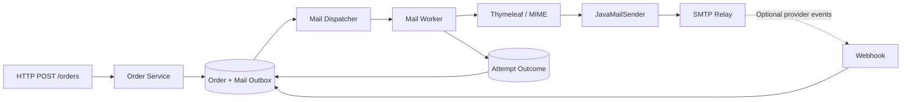

# Thêm metric, correlation ID và log an toàn

Khi ứng dụng **Spring Framework Mail** mới chỉ gửi vài email thử nghiệm, một lời gọi `JavaMailSender.send(...)` thành công có vẻ đã đủ. Nhưng ở môi trường production, email có thể bị chậm hàng phút do outbox backlog, SMTP relay có thể trả lỗi tạm thời, một attempt có thể được gửi lại sau restart, hoặc khách hàng báo không nhận thư mặc dù hệ thống đã ghi trạng thái “sent”. Khi đó, chỉ có dòng log `"send failed"` là không đủ để tìm nguyên nhân.

Bài thực hành **“Thêm metric, correlation ID và log an toàn”** bổ sung khả năng quan sát cho luồng gửi email trong một ứng dụng Spring Boot:

- **Metric:** đo tốc độ gửi, latency, tỷ lệ lỗi, retry, backlog và thời gian một notification chờ trước khi được nhà cung cấp chấp nhận.
- **Correlation ID:** nối cùng một yêu cầu nghiệp vụ qua HTTP request, database transaction, outbox, worker, SMTP attempt và các sự kiện provider đến sau.
- **Log an toàn:** ghi metadata phục vụ điều tra nhưng không phơi bày địa chỉ email đầy đủ, body HTML, attachment, OTP, reset token hoặc SMTP credentials.
- **Tracing:** phân biệt correlation ID do ứng dụng quản lý với trace/span IDs của hệ thống distributed tracing.
- **Kiểm thử:** xác nhận metric có label hữu hạn, MDC không rò rỉ giữa các threads, correlation không mất qua outbox/restart và logs không chứa thông tin nhạy cảm.

Đây là một bài thuộc chương **Dự án thực hành** của *Spring Framework Mail*, với ví dụ Java 21, Spring Boot 3.x, Micrometer, Spring Boot Actuator, SLF4J, Jakarta Mail và một kiến trúc có **transactional outbox + mail worker**. Các class `MailOutboxRepository`, `MailAttemptService` hoặc DTO trong ví dụ là những phần ứng dụng phải triển khai; chúng không phải API có sẵn của Spring Boot. Metric names, status taxonomy và ngưỡng alert là **đề xuất minh họa**, cần phù hợp SLO/provider cụ thể.

> **Giới hạn quan trọng:** việc đo `JavaMailSender.send(...)` trả bình thường chỉ cho biết mốc **SMTP submission accepted theo quan sát của client/relay**. Nó không xác nhận email đã vào Inbox. Metrics và logs phải giữ sự khác biệt giữa `accepted`, `delivered`, `bounced` và `unknown`.

## 1. Mục tiêu của bài thực hành

Giả sử ứng dụng tạo đơn hàng, lưu ý định gửi mail rồi worker gửi SMTP:



Các câu hỏi vận hành muốn trả lời được:

1. Từ lúc order commit tới lúc SMTP accepted mất bao lâu?
2. Mail chậm do render template, chờ outbox hay SMTP?
3. Bao nhiêu attempts nhận SMTP 4xx, 5xx, lỗi AUTH, timeouts hoặc kết quả `UNKNOWN`?
4. Worker có ngừng claim job hay executor bị đầy không?
5. Một lần request retry có tạo hai business events/mail intents không?
6. Mail nào cần điều tra khi khách phản ánh? Có thể tra theo notification ID mà không log toàn bộ nội dung không?
7. Nếu process restart, có nối được log request trước đó với worker mới không?
8. Nếu provider gửi bounce webhook sau một ngày, có tìm đúng submission attempt không?
9. Nếu log bị truy cập ngoài dự kiến, liệu OTP, reset links, email addresses hoặc tài liệu đính kèm có bị tiết lộ không?

### 1.1. Định nghĩa hoàn thành

Sau bài thực hành, ta muốn có:

| Thành phần | Kết quả mong đợi |
|---|---|
| HTTP boundary | Sinh hoặc chuẩn hóa `correlationId`, đưa vào response header và MDC |
| Business service | Lưu `notificationId` + `correlationId` cùng durable email intent |
| Worker | Đọc correlation từ outbox, tạo scope MDC riêng mỗi attempt |
| Timer/counter | Đo một SMTP attempt, outcome và duration bằng Micrometer |
| Gauge | Thể hiện số jobs pending, oldest due age và active workers bằng dữ liệu hữu hạn |
| Logs | Sự kiện cấu trúc có ID và safe reason code, không log body/PII/secrets |
| Endpoint | Actuator health/metrics/Prometheus được cấu hình với quyền truy cập phù hợp |
| Tests | Assert correlation, metric tags, log redaction và cleanup ở success/failure paths |

**Không coi “có nhiều logs” đồng nghĩa có observability.** Một hệ thống có thể ghi hàng triệu dòng `DEBUG` mà vẫn không biết job nào tồn tại trong outbox, và đồng thời làm lộ nhiều dữ liệu.

## 2. Ba khái niệm khác nhau

### 2.1. Metric

Metric là phép đo tổng hợp theo thời gian: `counter`, `timer`, `gauge`, histogram. Ví dụ:

```text
mail.submit.attempts{transport=smtp, outcome=accepted}
mail.submit.duration{transport=smtp, outcome=accepted}
mail.outbox.pending{priority=transactional}
mail.outbox.oldest.due.age{priority=transactional}
```

Metrics trả lời “bao nhiêu”, “nhanh/chậm đến mức nào”, “có vượt SLO không”. Chúng **không** cần biết email của từng khách và thường không nên dùng notification ID làm tag.

### 2.2. Log

Log là bản ghi sự kiện cụ thể:

```text
event=mail_submission_attempt_finished
correlationId=2dd5a6aa-4131-4c02-9d2e-b8265b2e19f1
notificationId=MAIL-8821
attemptId=ATT-2
transport=smtp
outcome=temporary_rejected
reasonCode=SMTP_RATE_LIMIT
durationMs=873
```

Log trả lời “chuyện gì xảy ra với attempt này”, nhưng phải loại bỏ thông tin nhạy cảm và có retention/access control.

### 2.3. Correlation ID, trace ID và span ID

**Correlation ID** là khóa liên kết do ứng dụng chọn; có thể tồn tại xuyên request, outbox và những job chạy hàng giờ sau. Nó không cần tương ứng với một trace đang hoạt động.

**Trace ID** trong distributed tracing đại diện cho một luồng spans/observations; **span ID** đại diện một đơn vị thao tác cụ thể. Các thư viện Micrometer Tracing/OpenTelemetry có thể tự tạo/propagate chúng nếu được cấu hình.

Không nhầm:

```text
correlationId : ID ổn định nối business workflow
notificationId: ID của một email intent
attemptId     : ID của một lần thử gửi
traceId       : ID của một distributed trace
spanId        : ID của một span trong trace
providerId    : ID do SMTP/ESP tạo nếu có
```

Một notification có thể có nhiều `attemptId`, nhiều trace IDs qua các worker restarts, nhưng vẫn thuộc cùng `notificationId` và business event. Các IDs không thay thế nhau.

### 2.4. Vì sao cần metric *và* log *và* tracing?

| Câu hỏi | Tín hiệu hữu ích |
|---|---|
| Tỷ lệ SMTP temporary rejects tăng? | Counter theo outcome |
| Latency p95 của SMTP tăng? | Timer/histogram |
| Mail cũ nhất đang chờ bao lâu? | Gauge từ outbox summary |
| Một thư cụ thể lỗi lần thứ mấy? | Log/attempt history theo notification ID |
| Request có liên quan tới job được tạo sau commit? | Correlation ID lưu trong outbox |
| Bottleneck nằm ở render, SMTP hay DB? | Spans + timers |
| Vì sao bounce sau 3 ngày? | Provider event lookup + attempt ID |

Metrics giúp phát hiện triệu chứng; logs/traces giúp điều tra. **Database outbox/attempt history** mới là nguồn bền vững cho business state; không dùng counter trong RAM làm bằng chứng email đã gửi chính xác bao nhiêu lần.

## 3. Phụ thuộc Spring Boot và cấu trúc project

Trong một project Gradle đã có Spring Boot plugin và dependency management phù hợp, thêm:

```groovy
dependencies {
    implementation 'org.springframework.boot:spring-boot-starter-mail'
    implementation 'org.springframework.boot:spring-boot-starter-actuator'
    implementation 'org.springframework.boot:spring-boot-starter-web'

    runtimeOnly 'io.micrometer:micrometer-registry-prometheus'

    testImplementation 'org.springframework.boot:spring-boot-starter-test'
}
```

Đây là **phần dependencies**, không phải một `build.gradle` hoàn chỉnh. Boot Actuator cung cấp auto-configuration cho Micrometer. Registry Prometheus được thêm nếu có hệ thống thu thập Prometheus; nếu sử dụng OTLP/StatsD hoặc registry khác, chọn dependency/backend tương ứng. Đừng trộn phiên bản Micrometer độc lập với Spring Boot BOM không tương thích.

Để có distributed tracing thực sự, cần thêm thư viện bridging/exporter tương ứng (ví dụ Micrometer Tracing bridge cho OpenTelemetry và OTLP exporter), cấu hình sampling/export và collector theo kiến trúc. **Có Actuator không đồng nghĩa tracing/export traces đã bật đầy đủ.**

### 3.1. Cấu trúc thư mục

```text
src/main/java/com/example/mail/
  web/
    CorrelationIdFilter.java
  observability/
    MailMetrics.java
    SafeMailLogger.java
    MailLogContext.java
    OutboxMetricsSnapshot.java
  outbox/
    MailOutboxRepository.java
    MailDispatcher.java
    ClaimedMailJob.java
  worker/
    MailSubmissionWorker.java
    SmtpOutcomeClassifier.java
  provider/
    ProviderWebhookController.java
src/main/resources/
  application.yml
  logback-spring.xml              (optional)
src/test/java/com/example/mail/
  CorrelationIdFilterTest.java
  MailMetricsTest.java
  MailLogSafetyTest.java
  MailWorkerTelemetryTest.java
```

Các class outbox/worker chỉ được tạo nếu dự án chưa có; trong project đang vận hành, nên tích hợp observability vào flow sẵn có thay vì tạo một hệ thống gửi thứ hai.

### 3.2. Cấu hình Actuator mức tối thiểu

```yaml
management:
  endpoints:
    web:
      exposure:
        include: health,info,prometheus
  metrics:
    tags:
      application: order-mail-service
    distribution:
      percentiles-histogram:
        mail.submit.duration: true

spring:
  mail:
    host: ${MAIL_HOST:127.0.0.1}
    port: ${MAIL_PORT:1025}
    properties:
      "[mail.smtp.connectiontimeout]": "5000"
      "[mail.smtp.timeout]": "10000"
      "[mail.smtp.writetimeout]": "10000"
```

Thông số SMTP ở đây hướng tới sandbox local. Production phải dùng cấu hình AUTH/TLS/credentials đúng provider. Exposure Prometheus endpoint chỉ phù hợp khi được **bảo vệ ở mạng/ingress/auth**; không mở công khai toàn bộ Actuator vào Internet. Những Actuator endpoints khác có thể lộ cấu hình/metrics nhạy cảm tùy thiết lập, vì vậy chỉ expose các endpoint thực sự cần thiết.

**Lưu ý:** tính sẵn có và tên endpoint có thể khác theo dependencies và phiên bản Spring Boot. Không đặt `include: "*"` như cấu hình production mặc định.

### 3.3. Quy tắc tên metric

Micrometer dùng tên dạng dot notation như `mail.submit.attempts` và `mail.submit.duration`, còn Prometheus registry chuyển sang convention của Prometheus (thường dùng dấu gạch dưới và hậu tố theo loại/đơn vị metric).

Ví dụ:

```text
Micrometer Counter: mail.submit.attempts
Prometheus series : mail_submit_attempts_total

Micrometer Timer: mail.submit.duration
Prometheus series: mail_submit_duration_seconds_count
                   mail_submit_duration_seconds_sum
```

Không tự thêm `_total` vào tên Micrometer counter rồi khiến exporter sinh tên không mong muốn. Chọn naming convention ổn định từ đầu; nếu đổi metric names, dashboards/alerts sẽ cần migration.

## 4. Tạo correlation ID ở ranh giới HTTP

Đầu vào của một request có thể có header `X-Correlation-ID` do gateway/client truyền xuống. Một thiết kế an toàn cần **validate và chuẩn hóa**, hoặc tạo ID mới nếu header vắng mặt/không hợp lệ. Đừng ghi trực tiếp giá trị header arbitrary vào log: người dùng có thể gửi một chuỗi quá dài, control characters hoặc giá trị mô phỏng một dòng log khác.

Ở ví dụ này, correlation ID chuẩn là **UUID canonical**:

```text
X-Correlation-ID: 7e1ab7c2-d153-4df5-9b5a-63fe29c41b09
```

Một hệ thống đã dùng ULID hoặc tracing IDs theo tiêu chuẩn nội bộ có thể giữ định dạng khác, nhưng phải có policy rõ: maximum length, character set, spoofing/authorization, cách phát hành và propagation. Correlation ID **không phải authentication token**.

### 4.1. Filter kiểm soát header và MDC

```java
package com.example.mail.web;

import java.io.IOException;
import java.util.UUID;
import java.util.regex.Pattern;

import jakarta.servlet.FilterChain;
import jakarta.servlet.ServletException;
import jakarta.servlet.http.HttpServletRequest;
import jakarta.servlet.http.HttpServletResponse;

import org.slf4j.Logger;
import org.slf4j.LoggerFactory;
import org.slf4j.MDC;
import org.springframework.stereotype.Component;
import org.springframework.web.filter.OncePerRequestFilter;

@Component
public final class CorrelationIdFilter extends OncePerRequestFilter {

    private static final Logger log =
            LoggerFactory.getLogger(CorrelationIdFilter.class);

    private static final String HEADER = "X-Correlation-ID";

    private static final Pattern CANONICAL_UUID = Pattern.compile(
            "^[0-9a-fA-F]{8}-[0-9a-fA-F]{4}-[1-8][0-9a-fA-F]{3}-"
                    + "[89aAbB][0-9a-fA-F]{3}-[0-9a-fA-F]{12}$");

    @Override
    protected void doFilterInternal(
            HttpServletRequest request,
            HttpServletResponse response,
            FilterChain chain)
            throws ServletException, IOException {

        String correlationId =
                normalizeOrNew(request.getHeader(HEADER));
        response.setHeader(HEADER, correlationId);

        long started = System.nanoTime();
        boolean completedNormally = false;

        try (MDC.MDCCloseable ignored =
                     MDC.putCloseable("correlationId", correlationId)) {
            try {
                chain.doFilter(request, response);
                completedNormally = true;
            } finally {
                long elapsedMs =
                        (System.nanoTime() - started) / 1_000_000;

                // Không log query string, form body hoặc raw URI.
                log.info(
                        "event=http_request_finished method={} "
                        + "httpStatus={} chainCompleted={} "
                        + "durationMs={}",
                        request.getMethod(),
                        response.getStatus(),
                        completedNormally,
                        elapsedMs);
            }
        }
    }

    static String normalizeOrNew(String input) {
        if (input != null
                && input.length() == 36
                && CANONICAL_UUID.matcher(input).matches()) {
            return UUID.fromString(input).toString();
        }
        return UUID.randomUUID().toString();
    }
}
```

Các quyết định ở filter:

1. Header hợp lệ thì giữ ID dạng chuẩn; không hợp lệ thì tạo UUID mới.
2. Đưa ID an toàn vào response header để đội vận hành có thể liên hệ với báo cáo của client.
3. Đặt ID vào **SLF4J MDC** trong scope request đồng bộ.
4. Dùng `try-with-resources` để scope MDC được đóng ngay cả khi downstream ném exception.
5. Log method/status/outcome/duration, không log query string hay body.

**Giới hạn của ví dụ:** với async servlet dispatch/error dispatch, lifecycle có thể tiếp tục sau lần `chain.doFilter(...)` này. `response.getStatus()` lúc filter finally chạy có thể chưa phản ánh error response cuối cùng do container xử lý; cờ `chainCompleted` giúp phân biệt. Nếu ứng dụng dùng `Callable`, `DeferredResult`, WebFlux hoặc custom thread dispatch, cần thiết kế propagation/logging riêng theo framework thay vì mặc định filter này bao trùm toàn bộ async lifecycle.

### 4.2. Header do client đưa vào không phải bằng chứng quyền

Một attacker có thể đoán hoặc tự tạo correlation ID hợp lệ. Vì vậy:

- Không dùng correlation ID làm khóa truy cập notification/status endpoint.
- Không dùng nó thay JWT/session/tenant-scoped authorization.
- Không cho ID điều khiển phân quyền hoặc chọn account SMTP.
- Không coi cùng ID đồng nghĩa hai requests thuộc cùng người dùng.
- Rate-limit truy vấn logs/status theo cơ chế auth, không chỉ dựa vào ID.

Nếu gateway cần một ID đáng tin do gateway sinh, có thể tạo header nội bộ riêng hoặc overwrite header không tin cậy ở biên. Các hops cần thống nhất **ai có quyền phát hành ID gốc**; format validation chỉ chống dữ liệu bẩn, không xác thực nguồn.

### 4.3. Vì sao không log URL nguyên văn?

Một URL có thể chứa:

```text
/password-reset?token=...
/orders/123?recipient=user@example.test
/callback?api_key=...
```

Ngay cả path segment cũng có thể chứa token hoặc email. Nếu cần metric HTTP route, nên dùng **route template** có cardinality thấp (ví dụ `/orders/{id}`), không dùng raw URI/path parameters. Spring Boot Actuator HTTP server observations thường dùng low-cardinality route tags khi framework có metadata; kiểm tra instrumentation thực tế để tránh thêm metric trùng.

## 5. Correlation ID phải sống lâu hơn request thread

MDC là một map gắn với thread xử lý log, **không** phải durable business storage. Giả sử request ghi order/outbox rồi return:

```mermaid
sequenceDiagram
    participant C as Client
    participant W as Web thread
    participant DB as Database
    participant M as Mail worker
    participant S as SMTP
    C->>W: POST /orders (correlationId=C1)
    W->>DB: BEGIN; order + outbox(C1)
    DB-->>W: COMMIT
    W-->>C: 201, notificationId=N1, C1
    Note over W: MDC cleared when request ends
    M->>DB: claim outbox N1
    DB-->>M: job includes correlationId=C1
    Note over M: establish worker MDC C1, N1, A1
    M->>S: submit mail
    S-->>M: 250 accepted
    M->>DB: attempt result(A1)
    Note over M: worker MDC cleared/restored
```

Nếu chỉ đặt `MDC.put("correlationId", ...)` ở controller, worker chạy sau đó sẽ không nhận được ID. Với worker ở process khác hoặc sau restart, không có ThreadLocal nào được chuyển sang.

### 5.1. Ghi correlation vào outbox intent

Một schema minh họa:

```sql
CREATE TABLE mail_outbox (
    id UUID PRIMARY KEY,
    tenant_id VARCHAR(100) NOT NULL,
    business_event_key VARCHAR(240) NOT NULL,
    correlation_id UUID NOT NULL,
    template_key VARCHAR(120) NOT NULL,
    template_version VARCHAR(50) NOT NULL,
    payload_ref VARCHAR(300) NOT NULL,
    state VARCHAR(32) NOT NULL,
    attempt_count INTEGER NOT NULL DEFAULT 0,
    next_attempt_at TIMESTAMPTZ NOT NULL DEFAULT NOW(),
    lease_owner VARCHAR(120),
    lease_token UUID,
    lease_until TIMESTAMPTZ,
    accepted_at TIMESTAMPTZ,
    created_at TIMESTAMPTZ NOT NULL DEFAULT NOW(),
    UNIQUE (tenant_id, business_event_key)
);

CREATE INDEX ix_mail_outbox_due
    ON mail_outbox (next_attempt_at, created_at)
    WHERE state IN ('QUEUED', 'RETRY_WAIT');
```

Cột `correlation_id` có thể dùng kiểu `UUID` vì policy ví dụ là UUID canonical. Nếu hệ thống sử dụng ULID/correlation opaque khác, chọn kiểu/constraint phù hợp. Ngoài ra bảng attempt nên có `attempt_id`, `notification_id`, `started_at`, `outcome`, `safe_error_code` và provider message ID (nếu có) để điều tra từng lần thử.

**Không đồng nhất business event key với correlation ID**: một HTTP request có thể tạo nhiều notifications; một business event có thể được replay hoặc phát từ scheduler không có HTTP request. Các IDs phục vụ mục đích khác nhau.

### 5.2. Truyền ID tường minh vào application service

```java
public record CorrelationId(UUID value) {
    public CorrelationId {
        java.util.Objects.requireNonNull(value);
    }
}

@Service
public final class OrderApplicationService {

    private final OrderRepository orders;
    private final MailOutboxRepository outbox;

    public OrderApplicationService(
            OrderRepository orders,
            MailOutboxRepository outbox) {
        this.orders = orders;
        this.outbox = outbox;
    }

    @Transactional
    public CreatedOrder create(
            CreateOrderCommand command,
            CorrelationId correlationId) {

        Order order = orders.insertIdempotently(command);

        UUID notificationId = outbox.insertIfAbsent(
                order.getTenantId(),
                "order-created:" + order.getId(),
                correlationId.value(),
                "ORDER_CONFIRMED",
                "v1",
                order.getImmutableMailPayloadRef());

        return new CreatedOrder(
                order.getId(),
                notificationId,
                "QUEUED");
    }
}
```

`OrderRepository`, `MailOutboxRepository`, `CreateOrderCommand` và các DTO là abstraction minh họa. Application service nhận `CorrelationId` được chuẩn hóa ở HTTP boundary; code nghiệp vụ không phải phụ thuộc vào SLF4J MDC để lấy dữ liệu quan trọng.

Khi request retry cùng business idempotency key, `insertIfAbsent` cần trả ID của intent cũ nếu event đã tồn tại, và chính sách phải xác định **giữ correlation gốc hay ghi thêm request correlation mới vào audit**. Thông thường notification lưu correlation của lần tạo intent gốc, còn retry request có correlation riêng trong request log. Không update tùy tiện correlation của job mỗi khi client retry.

### 5.3. Job không bắt nguồn từ HTTP thì sao?

Scheduler, batch job, webhook hoặc CLI có thể tạo email không có request correlation ID. Chúng cũng cần một ID:

```java
CorrelationId correlation =
        new CorrelationId(UUID.randomUUID());
```

Nên ghi nguồn phát `triggerType` như `scheduled`, `webhook`, `api` trong business audit nếu hữu ích. Tránh gán chung một correlation ID cố định cho mọi job cron mỗi ngày, vì log sẽ khó phân biệt từng đợt chạy.

## 6. Dùng MDC an toàn trong mail worker

Mail worker thường dùng thread pool. Một thread có thể gửi email của tenant A rồi ngay sau đó gửi email của tenant B. Nếu MDC không được xóa/khôi phục, log của tenant B có thể mang `notificationId` của tenant A — vừa sai điều tra vừa tạo nguy cơ lộ ngữ cảnh.

### 6.1. Helper mở scope MDC với try/finally

```java
package com.example.mail.observability;

import java.util.Map;
import java.util.Objects;
import java.util.UUID;

import org.slf4j.MDC;

public final class MailLogContext implements AutoCloseable {

    private final Map<String, String> previous;

    private MailLogContext(Map<String, String> previous) {
        this.previous = previous;
    }

    public static MailLogContext open(
            UUID correlationId,
            UUID notificationId,
            UUID attemptId) {

        Objects.requireNonNull(correlationId);
        Objects.requireNonNull(notificationId);
        Objects.requireNonNull(attemptId);

        Map<String, String> previous =
                MDC.getCopyOfContextMap();

        MDC.clear();
        MDC.put("correlationId", correlationId.toString());
        MDC.put("notificationId", notificationId.toString());
        MDC.put("attemptId", attemptId.toString());

        return new MailLogContext(previous);
    }

    @Override
    public void close() {
        MDC.clear();
        if (previous != null) {
            MDC.setContextMap(previous);
        }
    }
}
```

Trong worker:

```java
try (MailLogContext ignored = MailLogContext.open(
        job.correlationId(),
        job.notificationId(),
        job.attemptId())) {

    log.info(
            "event=mail_attempt_started templateGroup={} transport={}",
            job.templateGroup(), "smtp");

    submitOneAttempt(job);
}
```

Sau scope, MDC được restore về context trước đó thay vì chỉ `clear()` bừa khi code có nested scopes. Nếu worker dùng một context mới hoàn toàn, previous thường là null. Dữ liệu trong MDC **chỉ là metadata log**, không phải nguồn để quyết định quyền truy cập tenant/attachment.

### 6.2. Có nên log tenantId?

Tenant ID có thể cần để điều tra incidents, nhưng tenant identifier có thể là thông tin khách hàng nhạy cảm và tạo metric cardinality cao. Chỉ log một **tenant group hoặc internal tenant ID** khi được policy cho phép và log store có quyền truy cập phù hợp. Đừng tự thêm full email recipient hoặc domain cá nhân vào MDC.

Nếu cần tìm một khách, dùng hệ thống audit nội bộ có authorization để map `notificationId` tới recipient, thay vì xuất email address vào mọi log event.

### 6.3. Structured logging mẫu

```text
timestamp=2026-11-12T13:45:12Z
level=INFO
event=mail_attempt_started
correlationId=2dd5a6aa-4131-4c02-9d2e-b8265b2e19f1
notificationId=610e0bb3-3a03-4f10-b2dd-8a889c655be8
attemptId=4dba9c70-a1f5-4d5d-9d5d-a370f026aa89
templateGroup=transactional
transport=smtp
```

Không bắt buộc phải có một log formatter JSON ngay trong bài đầu tiên; một pattern nhất quán có thể đủ cho local. Với production, nếu nền tảng log hỗ trợ JSON/structured logging, nên dùng output cấu trúc để field `correlationId`, `notificationId` được index/truy vấn chính xác, thay vì phải parse một câu văn tự do.

## 7. Truyền MDC qua @Async và Executor

SLF4J MDC thông dụng sử dụng context gắn với thread. Khi code submit một task vào `ThreadPoolTaskExecutor`, **không nên kỳ vọng MDC tự được copy** sang thread mới. Nếu code dùng `@Async` hoặc `ExecutorChannel`, có thể dùng `TaskDecorator` để snapshot/restore logging context cho các task **trong cùng JVM**.

### 7.1. TaskDecorator minh họa

```java
package com.example.mail.observability;

import java.util.Map;

import org.slf4j.MDC;
import org.springframework.core.task.TaskDecorator;

public final class MdcTaskDecorator implements TaskDecorator {

    @Override
    public Runnable decorate(Runnable task) {
        Map<String, String> captured =
                MDC.getCopyOfContextMap();

        return () -> {
            Map<String, String> previous =
                    MDC.getCopyOfContextMap();

            try {
                if (captured == null) {
                    MDC.clear();
                } else {
                    MDC.setContextMap(captured);
                }

                task.run();
            } finally {
                if (previous == null) {
                    MDC.clear();
                } else {
                    MDC.setContextMap(previous);
                }
            }
        };
    }
}
```

Gắn với một executor chuyên biệt:

```java
@Configuration(proxyBeanMethods = false)
@EnableAsync
public class AsyncConfiguration {

    @Bean("mailTaskExecutor")
    ThreadPoolTaskExecutor mailTaskExecutor() {
        ThreadPoolTaskExecutor executor =
                new ThreadPoolTaskExecutor();

        executor.setThreadNamePrefix("mail-");
        executor.setCorePoolSize(4);
        executor.setMaxPoolSize(4);
        executor.setQueueCapacity(16);
        executor.setTaskDecorator(
                new MdcTaskDecorator());
        executor.initialize();
        return executor;
    }
}
```

Các imports cần dùng trong cấu hình:

```java
import org.springframework.context.annotation.Bean;
import org.springframework.context.annotation.Configuration;
import org.springframework.scheduling.annotation.EnableAsync;
import org.springframework.scheduling.concurrent.ThreadPoolTaskExecutor;
```

Khi nhiệm vụ async được submit lúc request MDC còn tồn tại, decorator capture ID. Sau `task.run()`, nó restore MDC cũ để tránh rò rỉ thông tin sang task kế tiếp.

### 7.2. Những điều TaskDecorator không giải quyết

- Không tồn tại qua process crash, restart hoặc network boundary.
- Không thay thế việc **persist correlationId trong outbox**.
- Không tự sao chép Spring Security `SecurityContext`, transaction context hoặc mọi tracing baggage.
- Không được dùng captured authentication principal để quyết định gửi email sau nhiều giờ.
- Không bảo đảm propagation qua mọi cơ chế callback `CompletableFuture` nếu callback chạy ở executor khác chưa được instrument.
- Không làm task trong RAM thành durable job.

Với mail worker đọc job từ DB, **ưu tiên tái thiết lập context từ job đã persist** (mục 6), không phụ thuộc MDC capture từ HTTP request. TaskDecorator chủ yếu hữu ích cho công việc asynchronous ngắn trong một process.

### 7.3. Tracing context không đồng nghĩa MDC context

Copy ba MDC keys không tự nối OpenTelemetry spans vào cùng distributed trace. Muốn truyền trace/span context, dùng Micrometer Context Propagation, Micrometer Tracing/OpenTelemetry instrumentation hoặc cơ chế propagation phù hợp với executor/broker đang dùng.

Không tạo trace ID thủ công bằng `MDC.put("traceId", correlationId)`; như vậy logs có vẻ được trace nhưng spans không thực sự cùng trace. Với outbox jobs chạy rất lâu sau HTTP request, có thể tạo một trace mới cho attempt và gắn **link/correlation attributes** theo tracing strategy, thay vì giữ một span HTTP đang mở qua nhiều giờ.

## 8. Định nghĩa metric theo đơn vị công việc

Trước khi gọi MeterRegistry, cần xác định điều mình đo. Một notification là **ý định gửi**; một attempt là **một lần thực hiện transport**; provider delivery event có thể tới sau.

Ví dụ:

```text
Notification MAIL-8821
  attempt 1 -> SMTP 451 temporary rejection
  attempt 2 -> SMTP 250 accepted
  provider event -> delivered
```

Đo đúng:

```text
mail.submit.attempts{outcome=temporary_rejected} += 1
mail.submit.attempts{outcome=accepted} += 1
mail.delivery.events{type=delivered} += 1
```

Số attempt = 2 nhưng số notification intent = 1. Không gọi `send` hai lần rồi coi đó là “hai đơn hàng đã gửi”. Metrics về notification completion nên có định nghĩa riêng, tránh double count sau retry.

### 8.1. Bộ metric tối thiểu

| Tên Micrometer | Loại | Định nghĩa |
|---|---|---|
| `mail.submit.attempts` | Counter | Một transport attempt đã kết thúc theo một outcome |
| `mail.submit.duration` | Timer | Thời gian một transport attempt |
| `mail.render.duration` | Timer | Thời gian Thymeleaf/render payload |
| `mail.compose.duration` | Timer | Thời gian tạo MIME trước submission |
| `mail.outbox.pending` | Gauge | Số jobs QUEUED/RETRY_WAIT theo nhóm đã chuẩn hóa |
| `mail.outbox.oldest.due.age` | Gauge (seconds) | Tuổi job đến hạn lâu nhất còn pending |
| `mail.worker.active` | Gauge | Số attempts đang chạy trong worker pool |
| `mail.worker.rejections` | Counter | Số lần executor từ chối task |
| `mail.outbox.claims` | Counter | Số claim thành công/thất bại theo outcome |
| `mail.recovery.expired.leases` | Counter | Số lease hết hạn đã phát hiện/xử lý |
| `mail.delivery.events` | Counter | Provider events đã xử lý theo loại |

Không cần triển khai mọi metric trong một ngày. Bắt đầu với **attempts, duration, pending, oldest age, active, failures**, rồi bổ sung khi có vận hành thực. Tránh duplicate metric names của những instrumentations đã được Spring Boot/JavaMail provider tạo nếu có.

### 8.2. Outcome taxonomy cố định

```java
package com.example.mail.observability;

public enum MailTransport {
    SMTP("smtp"),
    HTTP_API("http_api");

    private final String tag;

    MailTransport(String tag) { this.tag = tag; }
    public String tag() { return tag; }
}

public enum MailAttemptOutcome {
    ACCEPTED("accepted"),
    TEMPORARY_REJECTED("temporary_rejected"),
    PERMANENT_REJECTED("permanent_rejected"),
    AUTH_FAILURE("auth_failure"),
    UNKNOWN("unknown");

    private final String tag;

    MailAttemptOutcome(String tag) { this.tag = tag; }
    public String tag() { return tag; }
}
```

Đặt outcome từ enum, không dùng `exception.getMessage()` làm metric tag. Exception message có thể chứa địa chỉ email, hostname, token, attachment path, timestamp hoặc mã phản hồi thay đổi, tạo **high-cardinality labels** và lộ thông tin.

Một hệ thống có thể cần thêm `RENDER_FAILURE`, `COMPOSE_FAILURE` hoặc `PROVIDER_PAUSED`, nhưng chúng là lỗi ở stage khác hoặc cùng một stage với category khác. Giữ taxonomy và stage nhất quán.

### 8.3. Những tags an toàn và hữu hạn

Ví dụ tags:

```text
transport = smtp | http_api
outcome = accepted | temporary_rejected | permanent_rejected
          | auth_failure | unknown
template_group = transactional | security | bulk
provider_route = primary | backup
error_category = auth | quota | network | validation | provider
```

Chỉ dùng danh sách giá trị đã được giới hạn và review. Không trực tiếp dùng tên account, tenant ID, provider response text hoặc template name nếu số lượng biến thiên không kiểm soát.

**Không dùng các giá trị sau làm metric labels:**

```text
recipientEmail
subject
notificationId
attemptId
correlationId
rawRequestUri
exceptionMessage
providerMessageId
resetToken
fullTenantId (khi số tenant không giới hạn)
```

Các IDs có ích trong logs/traces truy vấn theo event, nhưng nếu có một time-series mới cho mỗi ID thì metric backend có thể quá tải về cardinality, memory và chi phí lưu trữ. Đồng thời labels có thể bị đọc bởi nhiều hệ thống vận hành nên không phù hợp làm nơi chứa PII.

## 9. Cài đặt MailMetrics bằng Micrometer

Một service tập trung giúp các components không tự tạo tên/tag khác nhau cho cùng loại event.

```java
package com.example.mail.observability;

import java.time.Duration;

import io.micrometer.core.instrument.MeterRegistry;
import io.micrometer.core.instrument.Tags;

import org.springframework.stereotype.Component;

@Component
public final class MailMetrics {

    private final MeterRegistry registry;

    public MailMetrics(MeterRegistry registry) {
        this.registry = registry;
    }

    public void recordSubmission(
            MailTransport transport,
            MailAttemptOutcome outcome,
            Duration elapsed) {

        Tags tags = Tags.of(
                "transport", transport.tag(),
                "outcome", outcome.tag());

        registry.counter(
                "mail.submit.attempts", tags).increment();

        registry.timer(
                "mail.submit.duration", tags)
                .record(elapsed);
    }

    public void recordRenderDuration(
            String templateGroup,
            Duration elapsed) {

        // Đây là category từ whitelist; không lấy trực tiếp
        // tên template arbitrary của người dùng.
        String safeGroup = switch (templateGroup) {
            case "security" -> "security";
            case "transactional" -> "transactional";
            case "bulk" -> "bulk";
            default -> "other";
        };

        registry.timer(
                "mail.render.duration",
                Tags.of("template_group", safeGroup))
                .record(elapsed);
    }
}
```

`recordSubmission` được gọi **một lần khi một attempt hoàn tất hoặc kết luận được outcome**, không gọi cả ở `catch` và `finally` rồi đếm đôi. Nếu worker chết trước khi record, metric in-process có thể không bao giờ được tăng — đó là giới hạn bình thường của metrics; attempt history/database recovery nên giúp xác định trạng thái bền vững.

### 9.1. Timer dùng thời gian monotonic

Một mẫu dùng `System.nanoTime()`:

```java
long started = System.nanoTime();
try {
    transport.submit(job);
} finally {
    long nanos = System.nanoTime() - started;
    Duration duration = Duration.ofNanos(nanos);
    // Caller xác định outcome dựa trên kết quả/exception
    // rồi ghi metric đúng một lần.
}
```

`System.nanoTime()` phù hợp đo duration trong cùng JVM; không dùng `Instant.now()` trừ nhau cho một microbenchmark khi clock hệ thống có thể điều chỉnh. Với các timestamps bền vững trong database, dùng clock UTC để tính queue age và audit.

### 9.2. Không trộn render duration vào submit duration

Nếu `mail.submit.duration` có nhiệm vụ đo **SMTP network call** thì bắt đầu timer ngay trước `JavaMailSender.send(...)` và dừng sau call. Render Thymeleaf/PDF/attachment download nằm ở metric riêng.

Nếu cần end-to-end worker time, tạo `mail.worker.process.duration` với định nghĩa gồm render+compose+submit+state update. Không gọi hai tên khác nhau cùng một khoảng đo rồi dashboard cộng chúng thành tổng thời gian.

### 9.3. Sự khác nhau giữa counter và timer count

Timer đã có count và sum/max distribution tương ứng; một counter riêng cho attempts có thể hơi trùng với Timer count. Tuy nhiên counter giúp điều tra outcome không có duration đo đầy đủ và định nghĩa “attempt finished” rõ. Nếu triển khai cả hai, giữ **cùng ranh giới** và tránh dashboard cộng `mail.submit.attempts` với timer count.

Nếu chỉ cần attempts theo outcome và duration, có thể chọn một Timer gắn outcome tags thay vì thêm counter; lựa chọn tùy nhu cầu/backend, không có bắt buộc phải dùng cả hai.

## 10. Gắn metric và log vào mail worker

Một ví dụ worker orchestrator đơn giản, giả định job đã được claim bằng DB transaction ngắn:

```java
package com.example.mail.worker;

import java.time.Duration;

import com.example.mail.observability.MailLogContext;
import com.example.mail.observability.MailMetrics;
import com.example.mail.observability.MailTransport;
import com.example.mail.observability.MailAttemptOutcome;

import org.slf4j.Logger;
import org.slf4j.LoggerFactory;
import org.springframework.stereotype.Component;

@Component
public final class MailSubmissionWorker {

    private static final Logger log =
            LoggerFactory.getLogger(MailSubmissionWorker.class);

    private final SmtpSubmissionTransport transport;
    private final SmtpOutcomeClassifier classifier;
    private final MailAttemptOutcomeRecorder recorder;
    private final MailMetrics metrics;

    public MailSubmissionWorker(
            SmtpSubmissionTransport transport,
            SmtpOutcomeClassifier classifier,
            MailAttemptOutcomeRecorder recorder,
            MailMetrics metrics) {
        this.transport = transport;
        this.classifier = classifier;
        this.recorder = recorder;
        this.metrics = metrics;
    }

    public void process(ClaimedMailJob job) {
        try (MailLogContext ignored = MailLogContext.open(
                job.correlationId(),
                job.notificationId(),
                job.attemptId())) {

            long started = System.nanoTime();
            MailAttemptOutcome outcome =
                    MailAttemptOutcome.UNKNOWN;
            String safeCode = "UNCLASSIFIED";

            log.info(
                    "event=mail_attempt_started transport=smtp "
                    + "templateGroup={}",
                    job.templateGroup());

            try {
                transport.submitOne(job);
                outcome = MailAttemptOutcome.ACCEPTED;
                safeCode = "SMTP_ACCEPTED";
            } catch (Exception failure) {
                ClassifiedMailError classified =
                        classifier.classify(failure);

                outcome = classified.outcome();
                safeCode = classified.safeCode();

                // Không log failure.getMessage() hoặc raw cause
                // vào log nhiều người đọc.
                log.warn(
                        "event=mail_attempt_transport_failed "
                        + "reasonCode={} outcome={}",
                        safeCode, outcome.tag());
            } finally {
                Duration elapsed = Duration.ofNanos(
                        System.nanoTime() - started);

                metrics.recordSubmission(
                        MailTransport.SMTP, outcome, elapsed);
            }

            // Transaction khác ghi attempt + outbox transition
            // với điều kiện lease token/attempt còn hợp lệ.
            recorder.recordOutcome(
                    job, outcome, safeCode);

            log.info(
                    "event=mail_attempt_finished "
                    + "outcome={} reasonCode={}",
                    outcome.tag(), safeCode);
        }
    }
}
```

`SmtpSubmissionTransport`, `SmtpOutcomeClassifier`, `ClassifiedMailError`, `ClaimedMailJob` và `MailAttemptOutcomeRecorder` là **interfaces/classes do dự án định nghĩa**. Code mô tả ranh giới telemetry rõ ràng, không tự xử lý các vấn đề lease/retry/database transaction. Trong production nên:

- Có mapping lỗi render/compose ở stage riêng, không bắt tất cả thành SMTP error.
- Đảm bảo `classifier.classify(...)` không ném exception làm mất outcome; có fallback UNKNOWN.
- Ghi attempts, TTL, backoff, status bằng transaction ngắn, có lease token/fencing.
- Nếu `recorder.recordOutcome(...)` thất bại, nêu rõ **database acknowledgment failure**; SMTP có thể đã accepted. Đừng cho request retry mù như một kết quả NOT_SENT.
- Thực hiện error/alert handling khi chính metrics backend hoặc log appender bị lỗi.

### 10.1. Vì sao metric outcome và persisted outcome có thể khác?

Trong ví dụ, counter tăng sau transport call, trước khi DB recorder commit. Nếu recorder không ghi được:

```text
SMTP returns 250 accepted
mail.submit.attempts{outcome=accepted} += 1
DB UPDATE to SUBMISSION_ACCEPTED fails
worker crashes
```

Metric có thể nói một attempt được client quan sát accepted, còn outbox DB vẫn SENDING/UNKNOWN. Đây không nhất thiết là metric “sai”; chúng phản ánh **hai mốc khác nhau**. Nhưng alert/dashboard phải đặt tên đúng, không coi counter accepted là số business notifications đã commit state accepted.

Nếu business cần báo cáo chính xác số trạng thái, dùng query/aggregation từ durable attempt records có reconciliation, không dùng ephemeral in-memory counters thay database.

## 11. Gauge cho outbox backlog và độ trễ

Đếm số email được submit không đủ để biết hệ thống đang có sự cố. Nếu request tạo 100 notifications/giây nhưng SMTP chỉ xử lý 20/giây, HTTP có thể vẫn rất nhanh trong khi **outbox queue age tăng liên tục**.

Hai gauge thường có giá trị vận hành cao:

1. `mail.outbox.pending`: số jobs QUEUED + RETRY_WAIT (theo định nghĩa rõ ràng).
2. `mail.outbox.oldest.due.age`: số giây từ thời điểm job đến hạn cũ nhất tới hiện tại; 0 nếu không có job đến hạn.

Nên phân biệt **job chưa đến hạn retry** với **job đã quá hạn mà không được xử lý**. Một notification đang đợi `nextAttemptAt` trong tương lai không nhất thiết là lỗi backlog. Có thể đo thêm `totalQueued` và `overdueCount` riêng nếu business SLO yêu cầu.

### 11.1. Tránh query DB từ mỗi lần scrape

Anti-pattern:

```java
// Không nên thực hiện DB query đắt đỏ theo mỗi scrape:
Gauge.builder("mail.outbox.pending", repository,
        repo -> repo.countPending())
        .register(registry);
```

Nếu monitoring scraper chạy liên tục hoặc nhiều registries được export, gauge evaluation có thể kích hoạt nhiều queries, làm tăng tải DB ngay khi hệ thống gặp sự cố. Hơn nữa, một DB outage có thể làm metrics scrape chậm hoặc ném exception, gây khó quan sát thêm.

Mẫu tốt hơn cho bài thực hành: **scheduled snapshot** cập nhật các Atomic values, gauge chỉ đọc bộ nhớ. Phải biết snapshot có thể trễ vài giây và có freshness indicator.

### 11.2. Snapshot service

```java
package com.example.mail.observability;

import java.time.Instant;
import java.util.concurrent.atomic.AtomicInteger;
import java.util.concurrent.atomic.AtomicLong;

import io.micrometer.core.instrument.Gauge;
import io.micrometer.core.instrument.MeterRegistry;

import org.slf4j.Logger;
import org.slf4j.LoggerFactory;
import org.springframework.scheduling.annotation.Scheduled;
import org.springframework.stereotype.Component;

@Component
public final class OutboxMetricsSnapshot {

    private static final Logger log =
            LoggerFactory.getLogger(OutboxMetricsSnapshot.class);

    private final MailOutboxSummaryRepository repository;
    private final MeterRegistry registry;

    private final AtomicInteger pending = new AtomicInteger();
    private final AtomicInteger sending = new AtomicInteger();
    private final AtomicLong oldestDueAgeSeconds = new AtomicLong();
    private final AtomicLong lastSuccessEpochSeconds = new AtomicLong();

    public OutboxMetricsSnapshot(
            MailOutboxSummaryRepository repository,
            MeterRegistry registry) {
        this.repository = repository;
        this.registry = registry;

        Gauge.builder("mail.outbox.pending",
                pending, AtomicInteger::get)
                .register(registry);

        Gauge.builder("mail.outbox.sending",
                sending, AtomicInteger::get)
                .register(registry);

        Gauge.builder("mail.outbox.oldest.due.age",
                oldestDueAgeSeconds, AtomicLong::get)
                .baseUnit("seconds")
                .register(registry);

        Gauge.builder("mail.outbox.snapshot.age",
                lastSuccessEpochSeconds,
                last -> last.get() == 0L
                        ? Double.NaN
                        : Math.max(0L, Instant.now()
                                .getEpochSecond() - last.get()))
                .baseUnit("seconds")
                .register(registry);
    }

    @Scheduled(
            fixedDelayString = "${app.mail.metrics-refresh-ms:15000}")
    public void refresh() {
        try {
            MailOutboxSummary summary = repository.loadSummary();

            pending.set(summary.pending());
            sending.set(summary.sending());
            oldestDueAgeSeconds.set(
                    summary.oldestDueAgeSeconds());
            lastSuccessEpochSeconds.set(
                    Instant.now().getEpochSecond());
        } catch (RuntimeException failure) {
            registry.counter(
                    "mail.outbox.snapshot.errors").increment();

            // Không log SQL parameters, secrets hoặc dữ liệu email.
            log.warn(
                    "event=mail_metrics_snapshot_failed "
                    + "reasonCode=OUTBOX_SUMMARY_UNAVAILABLE");
        }
    }
}
```

Các contracts:

```java
public record MailOutboxSummary(
        int pending,
        int sending,
        long oldestDueAgeSeconds
) {}

public interface MailOutboxSummaryRepository {
    MailOutboxSummary loadSummary();
}
```

Code trên dùng `@Scheduled`, nên cần bật scheduling ở configuration (ví dụ `@EnableScheduling`). Repository cần query aggregation có index/SQL phù hợp; nên lấy tuổi job từ cùng clock/source khi có thể, giới hạn giá trị không âm và trả 0 nếu không có overdue job.

### 11.3. Định nghĩa oldest due age

Một cách tính:

```text
eligible jobs:
  state in QUEUED/RETRY_WAIT
  nextAttemptAt <= now

oldestDueAge =
  now - MIN(nextAttemptAt of eligible jobs)

if no eligible jobs:
  oldestDueAge = 0
```

Nếu hệ thống còn các jobs `SENDING` bị treo quá lease, chúng cần một metric/alert riêng như `expiredLeases`. Không trộn `SENDING` vào pending age mà không thay đổi định nghĩa, vì dashboard sẽ khó hiểu.

### 11.4. Snapshot freshness và stale values

Nếu DB outage, Atomic values sẽ giữ **kết quả cũ**; dashboard có thể hiển thị backlog rất thấp dù thực tế đang tăng. Vì vậy có `mail.outbox.snapshot.age` và `mail.outbox.snapshot.errors` để biết dữ liệu đã cũ. Khi không có snapshot thành công, code trả `NaN` cho age thay vì hiển thị sai “fresh=0”.

Một lựa chọn khác là đọc aggregation trực tiếp trong exporter theo một cơ chế cache/database health rõ ràng. Điều quan trọng là định nghĩa được freshness và không để metrics scrape làm nghẽn hệ thống.

### 11.5. Multi-replica và tính tổng

Nếu mỗi worker replica đều query **cùng một outbox database** và export gauge toàn bộ số pending, Prometheus `sum(mail_outbox_pending)` qua mọi replicas sẽ **nhân backlog lên N lần**. Với shared DB summary, có thể:

- Chỉ một exporter chịu trách nhiệm global gauge.
- Dùng `max(...)`/chọn một replica trong dashboard với đảm bảo đồng bộ thích hợp.
- Phân chia gauge theo shard/partition sở hữu thực và chỉ sum các shards không overlap.

Ngược lại, `mail.worker.active` là số local active threads per instance; **sum theo replicas** thường có nghĩa. Trước khi viết PromQL, xác định metric là global snapshot hay local gauge. Không suy mọi metric đều cộng được.

### 11.6. Worker active/concurrency

Nếu mail worker executor có active thread count, có thể expose như gauge. Không dùng gauge này để dự đoán provider rate: 4 active workers mỗi thread có thể gửi nhiều messages mỗi giây, còn HTTP API có thể nhận batch nhiều recipients trong một request. Concurrency, rate và backlog cần metric riêng.

## 12. Log an toàn theo kiểu sự kiện, không theo dump object

Log mục tiêu là giúp tìm đúng stage, state và nguyên nhân; không cần in mọi byte email. Một tập sự kiện tiêu chuẩn:

| Event | Thời điểm | Fields đề xuất |
|---|---|---|
| `mail_intent_created` | Outbox commit | correlation ID, notification ID, template group |
| `mail_claimed` | Worker claim | notification ID, attempt ID, worker ID nội bộ |
| `mail_render_completed` | Render thành công | template key/version, duration, byte sizes |
| `mail_compose_failed` | MIME/resource lỗi | safe reason code, stage |
| `mail_attempt_started` | Trước transport call | transport, attempt ID, provider route |
| `mail_attempt_finished` | Sau attempt | normalized outcome, safe code, duration |
| `mail_retry_scheduled` | Retry policy | attempt count, next attempt timestamp, category |
| `mail_outcome_unknown` | Không chắc provider đã nhận | attempt ID, phase nếu an toàn |
| `mail_dead_lettered` | Hết retry/TTL | reason code, notification ID |
| `mail_delivery_event_received` | Webhook đã xác minh | provider event ID, normalized event type |

### 12.1. Log có cấu trúc với SLF4J placeholders

```java
log.info(
    "event=mail_attempt_finished transport={} outcome={} "
    + "reasonCode={} durationMs={}",
    "smtp",
    outcome.tag(),
    safeCode,
    duration.toMillis());
```

Các IDs trong MDC được log appender/encoder đính kèm nếu cấu hình hỗ trợ; không cần lặp chúng vào mọi message template. Trong local console nếu pattern không include MDC, log có thể thiếu correlation metadata; cấu hình pattern/structured log format nhất quán, và kiểm thử có field thật khi export.

### 12.2. Không ghi exception message vô điều kiện

Đặc biệt nguy hiểm:

```java
// Tránh ở log dễ truy cập:
log.error("Cannot send email to {}: {}",
        recipientEmail, exception.getMessage(), exception);
```

Exception từ provider/client có thể chứa:

- Recipient email addresses và MAIL FROM/RCPT TO.
- SMTP command details.
- HTTP request URLs/headers hoặc response body.
- File/attachment paths.
- Một phần nội dung email hoặc token trong template vars.
- Provider/account identifiers thuộc phạm vi nhạy cảm.

Mẫu tốt hơn:

```java
SafeMailError error = classifier.classify(exception);

log.warn(
        "event=mail_attempt_failed stage={} "
        + "reasonCode={} outcome={}",
        error.stage(),
        error.safeCode(),
        error.outcome());
```

Nếu cần stack trace để sửa lỗi kỹ thuật, gửi tới **restricted diagnostics** với access control/retention và redaction đã được review; không mặc định bật full stack trace chứa thông tin email ở mọi INFO/WARN log stream.

### 12.3. Định nghĩa SafeMailError

```java
public enum MailStage {
    VALIDATION, RENDER, COMPOSE, CONNECT,
    AUTH, SMTP_ENVELOPE, SMTP_DATA,
    PROVIDER_RESPONSE, OUTCOME_PERSIST
}

public record SafeMailError(
        MailStage stage,
        String safeCode,
        String outcome
) {
    public SafeMailError {
        if (safeCode == null
                || !safeCode.matches("[A-Z0-9_]{1,80}")) {
            throw new IllegalArgumentException(
                    "Unsafe diagnostic code");
        }
    }
}
```

`safeCode` như `SMTP_AUTH_FAILED`, `SMTP_TEMPORARY_REJECTION`, `TEMPLATE_NOT_FOUND` hoặc `DATABASE_OUTCOME_UPDATE_FAILED` được tạo bởi classifier đã kiểm soát. **Không** lấy raw `exception.getMessage()` rồi dùng làm safeCode chỉ vì đổi chữ thường thành chữ hoa.

### 12.4. Không dùng log-level DEBUG để dump email

Một lỗi phổ biến là bật SMTP protocol debug rồi quên tắt:

```properties
mail.debug=true
```

SMTP debugging có thể ghi protocol transcript, recipient, server response và trong một số cấu hình chứa thông tin nhạy cảm. Không bật mặc định ở production. Nếu cần điều tra ngắn hạn, đặt phạm vi/timeout, kiểm soát credentials và retention, đảm bảo log channel bị hạn chế. Với HTTP provider, tương tự không bật wire logging chứa Authorization header, JSON body, attachment base64.

### 12.5. Masking không thay thế việc không log

Regex masking ở log appender chỉ là **phòng tuyến cuối**, vì secret có vô số format và có thể bị split/encoded. Phòng tuyến đầu là **không đưa PII/secrets vào tham số log**. Với email address, tốt nhất dùng `notificationId` rồi tra DB theo quyền. Nếu thực sự cần pseudonymous recipient key để phân tích, cân nhắc HMAC có khóa được quản lý (không plain SHA-256 dễ bị dictionary attack), retention/rotation và review mục đích xử lý dữ liệu.

## 13. Tránh high-cardinality và lộ dữ liệu qua metrics

Giả sử một ngày hệ thống gửi 1 triệu email. Nếu mỗi notification ID thành một metric label:

```text
mail_submit_attempts_total{
  notificationId="MAIL-000001",
  outcome="accepted"
}
...
mail_submit_attempts_total{
  notificationId="MAIL-1000000",
  outcome="accepted"
}
```

Số time-series có thể tăng gần tuyến tính theo số emails, tiêu tốn RAM/backend storage và tăng chi phí. Nếu còn tags `recipientEmail`, `tenantId` và `providerMessageId`, cardinality có thể bùng nổ theo tích số lượng giá trị các chiều.

### 13.1. Cardinality budget

Giả sử:

```text
transport      = 2 values
outcome        = 5 values
template_group = 3 values
provider_route = 2 values
```

Số tổ hợp tối đa về mặt lý thuyết:

\[
2 \times 5 \times 3 \times 2 = 60
\]

60 series cho một metric có thể được kiểm soát tương đối dễ (chưa tính instance/region/other tags), còn thêm hàng triệu notification IDs sẽ phá budget. Đây chỉ là ví dụ cấu trúc; hệ thống thực phải tính mọi common labels và retention/cost.

### 13.2. Giữ dimension quan trọng, bỏ dimension không phù hợp

Nên:

- `outcome` theo enum cố định.
- `transport` theo danh sách giới hạn.
- `template_group` thay vì template ID tùy biến nếu số lượng template lớn.
- `error_category` theo taxonomy ổn định.
- `region` theo allowed regions nếu thực sự cần.

Tránh:

- `exception_class` arbitrary cho hàng trăm vendor exception subclasses nếu không normalize.
- Toàn bộ `smtp_reply_text` hoặc HTTP provider response body.
- Timestamp, raw query strings, free-form HTTP headers.
- Email recipient/tenant ID đầy đủ khi số lượng không giới hạn.

### 13.3. MeterFilter như lớp kiểm soát bổ sung

Micrometer `MeterFilter` có thể được dùng để giới hạn/deny tags theo policy ở cấp registry. Tuy nhiên, nó không thay thế API instrumentation được thiết kế đúng. Một nhãn PII đã được đưa vào metric có thể xuất hiện trước khi filter/registry export theo một số luồng xử lý, nên **không thu thập ngay từ đầu** vẫn là cách an toàn hơn.

Không dùng metric label như hệ thống tìm kiếm từng email; logs/audit DB với quyền truy cập phù hợp mới là nơi cho per-notification investigation.

## 14. Quan sát distributed tracing với Micrometer Observation

Micrometer cung cấp **Observation API** để đặt tên và gắn low-cardinality key-value cho một thao tác. Tùy observation handlers được cấu hình, observation có thể sinh metrics, tracing spans hoặc cả hai.

Để có traces trên collector, dự án cần Micrometer Tracing bridge/exporter phù hợp, cấu hình sampling và đúng network/permissions. Không thể mặc định mọi Spring Boot application đã xuất traces chỉ vì có `MeterRegistry`.

### 14.1. Tạo observation cho một worker attempt

```java
import io.micrometer.observation.Observation;
import io.micrometer.observation.ObservationRegistry;

public final class ObservedMailWorker {

    private final ObservationRegistry observations;
    private final SmtpSubmissionTransport transport;

    public ObservedMailWorker(
            ObservationRegistry observations,
            SmtpSubmissionTransport transport) {
        this.observations = observations;
        this.transport = transport;
    }

    public void submitObserved(ClaimedMailJob job) {
        Observation observation = Observation
                .createNotStarted(
                        "mail.worker.attempt", observations)
                .lowCardinalityKeyValue(
                        "transport", "smtp")
                .lowCardinalityKeyValue(
                        "template_group", "transactional");

        observation.observe(() -> transport.submitOne(job));
    }
}
```

Trong ví dụ, `SmtpSubmissionTransport.submitOne` được giả định có thể gọi bằng `Runnable` (không khai báo checked exception); một API thực trả kết quả hoặc ném checked exception có thể dùng biến thể observation phù hợp hoặc wrapper đã phân loại lỗi.

Nếu Observation handler có metrics, thao tác `mail.worker.attempt` có thể tạo timer riêng. **Đừng đo cùng đoạn code bằng hai timers cùng tên rồi đếm hai lần**. Có thể giữ:

- `mail.submit.duration`: network SMTP call.
- `mail.worker.attempt`: toàn bộ attempt gồm render/compose/send/state update.

hoặc chỉ dùng một observation cho mỗi stage với naming rõ.

### 14.2. Cẩn thận với high-cardinality trace attributes

Trace spans có khả năng chứa attributes chi tiết hơn metrics, nhưng không có nghĩa có thể đưa PII tùy ý vào đó. Tracing vendor/collector có thể là hệ thống thứ ba và retention/access policy khác logs.

Nên dùng:

```text
transport=smtp
operation=mail.submit
template_group=transactional
outcome=unknown
```

Còn `recipientEmail`, SMTP password, token, raw MIME, attachment filename nhạy cảm và HTTP Authorization không được đưa vào trace. `notificationId`/`attemptId` chỉ nên gắn dưới controlled high-cardinality attribute khi truy cập tracing backend và data handling policy cho phép; mặc định truy theo chúng ở restricted logs/audit thay vì metric labels.

### 14.3. Nối request trace sang worker sau nhiều giờ

Một mail intent có thể được tạo lúc 10:00, worker gửi lúc 12:00 rồi webhook tới hôm sau. Không nên giữ một span HTTP “mở” trong 26 giờ để bao trùm chuỗi này. Một cách trình bày:

```text
HTTP trace A
  span: POST /orders
  span: DB order + outbox commit
  persists correlationId=C1, notificationId=N1

Mail worker trace B
  span: claim N1
  span: render N1
  span: SMTP attempt A1
  log metadata references C1, N1

Provider webhook trace C
  span: receive event
  map providerMessageId to attempt A1
  log metadata references C1, N1
```

Có thể sử dụng trace links/baggage theo chuẩn của tracing infrastructure nếu thực sự cần, nhưng đừng tự đặt `traceId=correlationId` trong MDC để tạo liên kết ảo. Correlation ID trong outbox là khóa bền vững để tra nhiều traces/log streams theo cùng business workflow.

### 14.4. Sampling và visibility

Sampling 10% giúp giảm chi phí traces, nhưng không có nghĩa 90% emails phải thiếu audit. Cần tách:

- Durable outbox + attempt records: lưu business result theo policy.
- Metrics: aggregation cho mọi attempts được instrument, tùy restart semantics.
- Logs: safe events theo policy/rate limit.
- Traces: sampled spans phục vụ phân tích latency/dependencies.

Khi sampling, một notification không có trace export vẫn có thể có correlation ID và audit record; không nên để ứng dụng suy trạng thái gửi mail từ sự tồn tại của trace.

## 15. Nhận provider events và nối về attempt

Sau khi SMTP relay accepted message, downstream provider có thể phát sự kiện `delivered`, `bounced`, `deferred`, `complained` hoặc loại khác. Với một số SMTP relays không có webhook, cần event API/log export hoặc không thể quan sát đầy đủ downstream.

Khi webhook tồn tại, incoming payload không tự đáng tin. Cần:

1. Xác minh signature/auth theo tài liệu provider; từ chối event không hợp lệ.
2. Giới hạn kích thước, validate schema và timestamp/replay window nếu provider hỗ trợ.
3. Deduplicate theo `provider + account + eventId` hoặc khóa theo contract.
4. Map `providerMessageId` về **mail attempt ID** (không chỉ recipient email).
5. Khôi phục correlationId, notificationId từ bảng attempt/outbox đã lưu.
6. Tạo log scope mới cho webhook handler; không tái sử dụng bừa MDC của request.
7. Ghi downstream event idempotently, xử lý out-of-order transitions.
8. Count normalized event type bằng counter có tags giới hạn.

### 15.1. Tại sao cần attempt ID khi có failover?

```text
notification MAIL-8821
  attempt A1 -> SMTP relay primary -> timeout UNKNOWN
  attempt A2 -> HTTP provider backup -> ACCEPTED
  delayed bounce event for A1 arrives
```

Nếu webhook handler chỉ tìm theo recipient email, nó có thể gán bounce của A1 sang submission A2. Hãy map bằng provider account/route/message ID/event semantics, lưu cả attempt relationship.

### 15.2. Metric delivery events không thay thế submission status

```java
public enum DeliveryEventType {
    DELIVERED("delivered"),
    BOUNCED("bounced"),
    DEFERRED("deferred"),
    COMPLAINT("complaint"),
    OTHER("other");

    private final String tag;

    DeliveryEventType(String tag) { this.tag = tag; }
    public String tag() { return tag; }
}

public void recordDeliveryEvent(
        MeterRegistry registry,
        DeliveryEventType event) {

    registry.counter(
            "mail.delivery.events",
            "event_type", event.tag())
            .increment();
}
```

Đây là method minh họa đặt trong một observability class, không phải method tự do hợp lệ đứng ngoài class Java. Trong implementation thực, xác định **counter đếm raw received events hay unique processed events**. Nếu webhook duplicate cùng event ID được gửi lại, nên đếm riêng `webhook.received` và `mail.delivery.unique.events` nếu cần, để không hiểu double delivery chỉ vì provider retry webhook.

### 15.3. Không log toàn bộ webhook payload

Provider webhook có thể chứa địa chỉ người nhận, reason text có PII, link và metadata. Sau khi verify, map thành safe categories và IDs. Nếu cần raw payload để tranh chấp/điều tra, lưu trong restricted encrypted audit store theo retention, không log toàn bộ ở INFO.

## 16. Dùng Prometheus để quan sát

Khi đã thêm Actuator + Prometheus registry và expose endpoint trong mạng giám sát an toàn, thường có thể scrape:

```text
GET /actuator/prometheus
```

Một số series minh họa:

```text
mail_submit_attempts_total{
  transport="smtp",outcome="accepted"
} 1280

mail_submit_attempts_total{
  transport="smtp",outcome="temporary_rejected"
} 41

mail_submit_duration_seconds_count{
  transport="smtp",outcome="accepted"
} 1280

mail_submit_duration_seconds_sum{
  transport="smtp",outcome="accepted"
} 364.8
```

Format/labels thực tế do Prometheus registry, common tags, instrumentation và runtime quyết định; ví dụ này chỉ để minh họa tên series và ngữ nghĩa. Không đặt email address làm label hay expose endpoint qua public ingress.

### 16.1. Xem accepted attempts mỗi giây

PromQL:

```promql
sum(rate(mail_submit_attempts_total{
  outcome="accepted"
}[5m]))
```

Chỉ đếm **attempt outcomes được instrument**, không nhất thiết là số notifications unique hoặc delivered. Nếu app restart làm metric counter reset, `rate` xử lý counter reset theo semantics Prometheus nhưng không thể tái tạo events chưa được emit; audit DB vẫn cần.

### 16.2. Tỷ lệ rejected/unknown attempts

```promql
sum(rate(mail_submit_attempts_total{
  outcome!="accepted"
}[5m]))
/
clamp_min(
  sum(rate(mail_submit_attempts_total[5m])),
  0.000000001
)
```

Đây là **tỷ lệ attempts không accepted**, không phải tỷ lệ business emails thất bại vĩnh viễn. Một notification tạm lỗi rồi thành công được tính một rejected attempt và một accepted attempt. Cần giải thích rõ để không báo sai “khách nào cũng bị lỗi”.

### 16.3. SMTP p95 latency

Với histogram được bật cho `mail.submit.duration`:

```promql
histogram_quantile(
  0.95,
  sum by (le) (
    rate(mail_submit_duration_seconds_bucket[5m])
  )
)
```

Truy vấn cần tồn tại series `_bucket`; nếu không bật histogram hoặc metric chưa có samples, kết quả trống. Với tags theo provider route hoặc outcome, có thể `sum by (le, transport)` để so sánh SMTP/HTTP nếu cùng instrumentation.

### 16.4. Backlog đang chờ

Nếu metric `mail.outbox.pending` là **global DB snapshot lặp ở mọi replicas**, không được `sum` tất cả instance series; điều đó nhân số jobs. Có thể dùng `max(mail_outbox_pending)` cho một shared DB có replicas đọc cùng summary, đồng thời theo dõi snapshot age để tránh sử dụng bản ghi cũ. Nếu mỗi metric là per-shard, lúc đó cần sum theo shards không trùng nhau.

### 16.5. Oldest due age và SLO

Một ví dụ policy giả định:

```text
Transactional email:
  99% of new notifications accepted by provider within 60 seconds

Operational alert:
  oldest due age > 120 seconds sustained for 5 minutes
  and pending > 0
```

Không dùng con số này như SLA cho mọi hệ thống; OTP có thời hạn rất ngắn, bulk/marketing có thể có lịch gửi riêng, còn provider health/quota khác nhau. **SLO time-to-provider-acceptance** khác **time-to-downstream-delivery**, và cả hai khác Inbox placement.

## 17. Dashboard và alert theo mục đích vận hành

Không phải mọi metric đều cần một alert. Một dashboard nên giúp trả lời câu hỏi “luồng mail hiện đang phục vụ tốt hay bị trễ?”, rồi alert khi cần hành động.

### 17.1. Dashboard đề xuất

| Panel | Nguồn | Cách đọc |
|---|---|---|
| Emails requested | Business/outbox inserts | Nhu cầu đầu vào theo thời gian |
| Provider accepted attempts/s | `mail.submit.attempts` | Throughput submit thực quan sát |
| Temporary reject / AUTH / UNKNOWN | Attempt outcome counters | Lỗi nào tăng? |
| Submit duration p50/p95/p99 | `mail.submit.duration` | SMTP relay chậm không? |
| Render duration | `mail.render.duration` | Thymeleaf/PDF có làm chậm? |
| Outbox pending + oldest due age | Gauges | Có backlog quá SLO? |
| Worker active/rejected | Worker metrics | Executor có bão hòa? |
| Expired leases | Recovery counters | Workers crash/reclaim nhiều không? |
| Dead letters/expired jobs | Durable status aggregation | Số notification không thể xử lý? |
| Delivery/bounce/complaint | Provider events | Downstream có vấn đề? |
| Snapshot age | `mail.outbox.snapshot.age` | Dữ liệu dashboard còn tươi không? |

Với email bảo mật, OTP và bulk, nên có lane hoặc `template_group` rõ ràng để không trộn các SLO khác nhau trong một biểu đồ. Tuy vậy, tags phải giữ cardinality thấp và không làm lộ tenant/email.

### 17.2. Ví dụ alert

**Pending quá lâu:** nếu `oldest due age` tăng và pending > 0 liên tục, có thể worker đã stop, provider đã throttle hoặc database claim lỗi.

**AUTH errors diện rộng:** nếu nhiều attempts có `auth_failure` trong một account/route, nên pause route và kiểm tra credentials/permission, không retry từng notification liên tục.

**UNKNOWN tăng:** nhiều timeout sau DATA hoặc DB result failures có thể tăng nguy cơ duplicate. Alert phải đưa runbook reconciliation, không khuyên operator “gửi lại tất cả”.

**Worker starvation:** pending tăng nhưng claims/s gần 0 và không có lỗi SMTP mới; cần kiểm tra scheduler, DB locks, lease/query errors, thread pool/rejection.

**Template rollout lỗi:** `mail.render.errors` tăng sau deploy với một templateVersion mới; dừng route/version lỗi trước khi tạo hàng nghìn attempts không cần thiết.

**Snapshot stale:** backlog dashboard còn số liệu cũ do DB metrics refresh fail; alert snapshot age, không dựa vào gauge cũ.

### 17.3. Không alert “cứ có một MailSendException”

Một recipient invalid đơn lẻ hoặc một SMTP 451 tạm thời có thể là sự kiện dự kiến. Alert nên dựa vào rate, duration, age, business impact và repeat window; điều này giúp giảm noise và tránh bỏ qua cảnh báo thật.

### 17.4. Định nghĩa metric trong tài liệu vận hành

Mỗi metric cần có:

- Tên, đơn vị (seconds, count, bytes).
- Đơn vị công việc (attempt, notification, event, job).
- Stage và bắt đầu/kết thúc timer.
- Danh sách tags, allowed values và cardinality budget.
- Scope local worker, global DB hay per-shard.
- Source of truth và freshness.
- Ví dụ PromQL/dashboards/alerts.
- Người hoặc nhóm sở hữu metric khi thay đổi.

Nếu không, một đội có thể hiểu `mail.submit.attempts{accepted}` là số đơn hàng đã nhận, đội khác lại hiểu là số emails vào Inbox — cả hai đều sai.

## 18. Bảo mật và quyền truy cập dữ liệu telemetry

Email thường chứa thông tin cá nhân và dữ liệu cần bảo vệ. Một số loại cực kỳ nhạy cảm: OTP, reset link, thông báo thay đổi mật khẩu, hóa đơn, file đính kèm có thông tin tài chính. Thiết kế observability phải theo nguyên tắc **data minimization**.

### 18.1. Những thứ không được ghi vào log/trace/metric rộng

| Dữ liệu | Vì sao rủi ro | Thay thế |
|---|---|---|
| SMTP username/password/OAuth token | Mất quyền gửi mail hoặc account compromise | Safe code `AUTH_FAILED` |
| HTTP provider API key | Có thể gửi/thao tác thay tài khoản | Provider route ID nội bộ |
| Full recipient email | PII, có thể bị truy cập trái phép | Notification ID tra qua audit được phân quyền |
| Full subject/body | Có thể chứa bí mật/PII | Template key, content category, byte size |
| Reset link/OTP | Cho phép chiếm phiên hoặc tài khoản | Event type, TTL, safe status |
| Raw MIME/attachment | Nội dung lớn, nhạy cảm | Content hash/size đã kiểm soát nếu thực sự cần |
| Raw HTTP/SMPP/SMTP transcript | Có credentials/recipients/protocol data | Sanitized error stage/code |
| Provider webhook full JSON | Có recipient, bounce details | Verified event ID + normalized type |
| Untrusted request headers | Log injection và dữ liệu tự do | Validated correlation ID |

Đừng coi `SHA256(email)` là luôn vô danh: địa chỉ email có thể đoán bằng từ điển. Nếu cần pseudonymous key có thể đối chiếu, dùng cơ chế được đánh giá về mục đích, HMAC/secret rotation và access control.

### 18.2. Phân tầng quyền

Một hệ thống có thể có:

- **General operational metrics:** counters/timers có labels giới hạn, quyền đọc tương đối rộng trong nhóm kỹ thuật.
- **Structured application logs:** notification/attempt IDs và safe codes, quyền đọc hạn chế, retention rõ.
- **Restricted audit store:** recipient mapping, provider IDs và thông tin có thể dùng điều tra, yêu cầu RBAC/tenant scoping.
- **Mail content store:** HTML/PDF/OTP hoặc snapshot chỉ khi cần, mã hóa và TTL/retention riêng.

Không dùng một log index chung làm kho lưu tất cả email contents chỉ để có thể search nhanh. Khi có yêu cầu xóa dữ liệu hay retention, cần biết nội dung xuất hiện trong những hệ thống nào.

### 18.3. Correlation ID không phải access token

Nếu API có:

```text
GET /notifications/{notificationId}
```

thì phải authorize theo principal/tenant, không chỉ kiểm tra caller có `X-Correlation-ID` tương ứng. Header có thể do client tự tạo; notification ID cũng không nên được coi như secret chỉ vì là UUID.

### 18.4. Bảo vệ endpoint Actuator

- Chỉ expose endpoints cần thiết, thường qua management port hoặc private ingress.
- Dùng network policy, authentication/authorization hoặc Prometheus service identity theo hạ tầng.
- Không expose `/actuator/env`, `/configprops`, `/heapdump` hoặc endpoints nhạy cảm công khai.
- Kiểm tra `health` có lộ provider hostname/account names không.
- Mã hóa traffic đến collector, quản lý scraping credentials nếu cần.
- Metric labels không chứa PII kể cả khi endpoint private, vì dữ liệu có thể được forward cho backend khác.

### 18.5. Không để log appender làm hỏng luồng gửi

Một logging sink chậm/không phản hồi có thể làm worker bị block nếu appender đồng bộ qua network. Với production có thể dùng asynchronous buffered logging với bounded queue, backpressure/drop policy đã xác định và alert khi logs bị drop.

Nhưng không sử dụng asynchronous appender làm bằng chứng audit không mất dữ liệu: queue RAM cũng có thể mất khi process crash. Nếu một event cần audit bắt buộc, ghi vào **durable audit/outbox database** trong transaction phù hợp; operational log là tín hiệu hỗ trợ.

## 19. Kiểm thử correlation ID và MDC

### 19.1. Unit test normalization

```java
package com.example.mail.web;

import static org.junit.jupiter.api.Assertions.*;

import java.util.UUID;
import org.junit.jupiter.api.Test;

class CorrelationIdFilterTest {

    @Test
    void acceptsValidCanonicalUuid() {
        String input =
                "7e1ab7c2-d153-4df5-9b5a-63fe29c41b09";
        assertEquals(
                input,
                CorrelationIdFilter.normalizeOrNew(input));
    }

    @Test
    void replacesUntrustedOrTooLongHeader() {
        String generated =
                CorrelationIdFilter.normalizeOrNew(
                        "header-value\r\nX-Injected: yes");

        assertDoesNotThrow(() -> UUID.fromString(generated));
        assertEquals(36, generated.length());
        assertFalse(generated.contains("Injected"));
    }

    @Test
    void createsIdWhenHeaderAbsent() {
        String id =
                CorrelationIdFilter.normalizeOrNew(null);

        assertNotNull(UUID.fromString(id));
    }
}
```

Test normalization không cần HTTP server. Với integration test, dùng `MockMvc` hoặc mock servlet request/response để khẳng định response header có correlation ID hợp lệ, log context có trong downstream filter chain và được cleanup sau request.

### 19.2. Unit test MDC restore

```java
package com.example.mail.observability;

import static org.junit.jupiter.api.Assertions.*;

import java.util.UUID;

import org.junit.jupiter.api.Test;
import org.slf4j.MDC;

class MailLogContextTest {

    @Test
    void restoresPreviousContextOnSuccess() {
        MDC.put("correlationId", "outer-request");
        MDC.remove("notificationId");

        UUID correlationId = UUID.randomUUID();
        UUID notificationId = UUID.randomUUID();
        UUID attemptId = UUID.randomUUID();

        try {
            try (MailLogContext ignored = MailLogContext.open(
                    correlationId, notificationId, attemptId)) {
                assertEquals(
                        correlationId.toString(),
                        MDC.get("correlationId"));
                assertEquals(
                        attemptId.toString(),
                        MDC.get("attemptId"));
            }

            assertEquals(
                    "outer-request", MDC.get("correlationId"));
            assertNull(MDC.get("attemptId"));
        } finally {
            MDC.clear();
        }
    }

    @Test
    void restoresContextWhenWorkerFails() {
        MDC.clear();
        try {
            assertThrows(
                    IllegalStateException.class,
                    () -> {
                        try (MailLogContext ignored =
                                MailLogContext.open(
                                        UUID.randomUUID(),
                                        UUID.randomUUID(),
                                        UUID.randomUUID())) {
                            throw new IllegalStateException("test");
                        }
                    });
            assertNull(MDC.get("notificationId"));
        } finally {
            MDC.clear();
        }
    }
}
```

Test tương tự nên chạy trên **single-thread executor**: task A có notificationId A và kết thúc; task B chạy cùng thread mà không có context A. Đây là cách phát hiện rò rỉ context trên thread pool mà test đồng bộ đơn lẻ khó thấy.

### 19.3. Test MDC với @Async

Với `MdcTaskDecorator`:

1. Parent thread đặt correlation ID C1.
2. Submit một task đọc MDC tới executor đã cấu hình decorator.
3. Test nhận C1 bên trong task.
4. Sau task, submit một task từ parent khác có C2 hoặc không có context.
5. Xác nhận executor thread không giữ C1 khi task mới chạy.
6. Trong test exception, xác nhận decorator vẫn restore context.

Không dùng `Thread.sleep(100)` để “đợi worker”; dùng `Future.get(timeout)` hoặc latch với timeout hữu hạn.

### 19.4. Test qua outbox/restart

TaskDecorator không chứng minh correlation ID tồn tại qua restart. Integration test cần:

```text
Request creates business record + outbox with correlationId=C1
DB transaction commits
Worker process A exits/restarts
New worker claims job
Worker logs and attempt record reference C1
```

Đây là phép thử quan trọng nhất cho email async/durable. Nếu hệ thống chỉ truyền MDC trong RAM, test sẽ thất bại ngay khi web request và worker ở hai processes khác nhau.

## 20. Kiểm thử metric và log an toàn

### 20.1. Unit test SimpleMeterRegistry

Micrometer cung cấp `SimpleMeterRegistry`, đủ để test counters/timers mà không cần chạy Prometheus server.

```java
package com.example.mail.observability;

import static org.junit.jupiter.api.Assertions.*;

import java.time.Duration;

import io.micrometer.core.instrument.Counter;
import io.micrometer.core.instrument.Timer;
import io.micrometer.core.instrument.simple.SimpleMeterRegistry;

import org.junit.jupiter.api.Test;

class MailMetricsTest {

    @Test
    void countsAttemptsByFixedOutcome() {
        try (SimpleMeterRegistry registry =
                     new SimpleMeterRegistry()) {

            MailMetrics metrics = new MailMetrics(registry);

            metrics.recordSubmission(
                    MailTransport.SMTP,
                    MailAttemptOutcome.ACCEPTED,
                    Duration.ofMillis(120));

            metrics.recordSubmission(
                    MailTransport.SMTP,
                    MailAttemptOutcome.TEMPORARY_REJECTED,
                    Duration.ofMillis(900));

            Counter accepted = registry
                    .find("mail.submit.attempts")
                    .tags(
                            "transport", "smtp",
                            "outcome", "accepted")
                    .counter();

            Timer temporary = registry
                    .find("mail.submit.duration")
                    .tags(
                            "transport", "smtp",
                            "outcome", "temporary_rejected")
                    .timer();

            assertNotNull(accepted);
            assertNotNull(temporary);
            assertEquals(1.0, accepted.count());
            assertEquals(1L, temporary.count());
            assertEquals(
                    900L,
                    (long) temporary.totalTime(
                            java.util.concurrent.TimeUnit.MILLISECONDS));
        }
    }
}
```

Test này chứng minh tags và số event được ghi vào registry, **không** chứng minh SMTP đã gửi thật. Với một fake transport trả 451 hay timeout, worker test có thể verify `MailMetrics.recordSubmission(...)` được gọi với đúng outcome và một lần/attempt.

### 20.2. Assert không có label nhạy cảm

Sau khi chạy workflow test, duyệt các meter IDs:

```java
boolean hasForbiddenTag = registry.getMeters().stream()
        .flatMap(meter ->
                meter.getId().getTags().stream())
        .anyMatch(tag -> switch (tag.getKey()) {
            case "recipientEmail", "notificationId",
                 "attemptId", "correlationId",
                 "providerMessageId", "subject" -> true;
            default -> false;
        });

assertFalse(hasForbiddenTag);
```

Đây là một contract test hỗ trợ, không phải biện pháp bảo mật duy nhất. Nếu app dùng thư viện bên thứ ba tạo metrics, phải audit thêm names/tags và các giá trị không nằm trong blacklist; tốt nhất dùng **whitelist các tag keys** tại lớp mail instrumentation.

### 20.3. Log redaction test

Giả lập lỗi SMTP có message chứa một email thật hoặc token kiểm thử:

```text
Simulated transport exception:
  "Failed for user@example.test token=very-secret-value"

Expected application log:
  event=mail_attempt_transport_failed
  outcome=unknown
  reasonCode=SMTP_REPLY_UNAVAILABLE

Forbidden in log:
  "user@example.test"
  "very-secret-value"
  MIME body / attachment content
```

Với Spring Boot logging dùng Logback, test có thể gắn `ListAppender<ILoggingEvent>` vào logger của worker rồi kiểm tra:

- `getFormattedMessage()` không chứa address/token.
- MDC có correlation/notification/attempt IDs đúng.
- Error logs không attach raw Throwable nếu policy không cho phép.
- Với lỗi ngay trong classifier/recorder, log fallback vẫn là safe code.
- Appender được detach/stop sau test để không làm ảnh hưởng các tests khác.

Lưu ý `ILoggingEvent.getFormattedMessage()` không phải toàn bộ dữ liệu event nếu appender còn serialize MDC, marker, stack trace hoặc custom attributes. Test phải kiểm tra **định dạng output thực** ở môi trường production/staging nếu muốn chứng minh không rò rỉ.

### 20.4. Test publisher/outcome recorder failure

Giả lập:

```text
SMTP relay accepted request
MailMetrics records accepted attempt
Database update status fails
Worker process ends
```

Expected:

- Một log event có safe code `DATABASE_OUTCOME_UPDATE_FAILED` hoặc phù hợp.
- Outbox job vẫn cần recovery; không sửa thành “definitely not sent”.
- Có alert/reconciliation pathway cho kết quả chưa được persist.
- Correlation ID và attempt ID vẫn có thể tìm trong audit/worker logs.
- Không tự gửi lại ngay chỉ vì không thấy `SUBMISSION_ACCEPTED` trong DB.

Đây là kịch bản thực tế rất quan trọng vì counter “accepted” và DB status có thể không nhất quán trong một khoảng thời gian. Observability phải **phơi bày sự không chắc chắn**, không che bằng một Boolean `sent=true/false`.

### 20.5. Test high-cardinality dưới tải

Dùng nhiều notification IDs giả (ví dụ 10.000 IDs) và cho worker ghi metric cùng 2-3 outcome tags. Kiểm tra số meter/time series của `mail.submit.attempts` **không tăng theo số notification IDs**, mà chỉ theo số allowed tag combinations. Không cần chạy SMTP thật cho test này.

Nếu số meters tăng tương ứng số jobs, có thể lớp instrumentation đã vô tình gắn `notificationId` hoặc một tag arbitrary. Đây là một lỗi kiến trúc telemetry, không phải lỗi Prometheus.

### 20.6. Test dashboard/global gauges

Với 3 worker replicas đọc cùng global outbox summary, kiểm chứng cách dashboard query không nhân pending count lên 3 lần. Với một replica không refresh được 2 phút, snapshot age phải báo dữ liệu stale thay vì âm thầm hiển thị zero.

### 20.7. Kiểm tra tracing instrumentation

Khi tracing bridge/exporter đã được cấu hình trong test/staging:

- HTTP span có trace ID hợp lệ.
- Worker attempt có span riêng.
- Log có trace/span IDs do instrumentation cung cấp, nếu cấu hình log correlation.
- Durable correlation ID vẫn nối được hai traces khi xử lý bất đồng bộ lâu.
- Không có email address/body/token trong attributes/events.
- Nếu sampling bỏ qua một trace, business audit/outbox vẫn đủ điều tra.

Không cần bắt buộc xuất mỗi test lên một cloud tracing backend; có thể dùng in-memory span exporter/test observation handler phù hợp với dependencies.

## 21. Runbook khi email gặp sự cố

### 21.1. “Khách báo không nhận email”

Quy trình điều tra:

1. Lấy order/business ID hoặc notification ID từ hệ thống support đã được phân quyền.
2. Tìm durable outbox record: `QUEUED`, `RETRY_WAIT`, `SENDING`, `SUBMISSION_ACCEPTED`, `UNKNOWN`, `FAILED` hay `DEAD_LETTER`.
3. Truy `correlationId` và xem request/business commit event có tồn tại không.
4. Tìm attempt history theo notification ID: attempts, transport, provider route, timestamps, safe error codes.
5. So sánh metric/alert vào thời điểm ấy: backlog age, SMTP p95, 4xx/5xx, AUTH, worker rejections.
6. Nếu attempt accepted, tra provider delivery/bounce events nếu khả dụng.
7. Phân biệt **submission accepted** với downstream delivered, mailbox filtering và Inbox placement.
8. Không gửi lại nếu prior attempt `UNKNOWN` mà chưa xác định duplicate-risk policy.

Không cần dump email body vào logging platform để làm các bước này.

### 21.2. “Nhiều emails bị trễ dù API vẫn trả 201”

Phân biệt:

```text
HTTP latency thấp
outbox pending tăng
oldest due age tăng
mail worker attempts/s giảm
```

Đây có thể là provider throttling, SMTP outage, database claim lỗi hoặc worker đã stop. Kiểm tra snapshot freshness trước. Không tăng HTTP timeout nếu vấn đề nằm ở outbox/worker; không tăng worker threads nếu provider đang rate-limit.

### 21.3. “Metric báo accepted nhưng DB status vẫn SENDING”

Kiểm tra DB outcome update errors, expired lease, worker crash timing và attempt history. Có thể SMTP đã accepted rồi recorder thất bại. Việc sửa bằng cách reset toàn bộ SENDING → QUEUED có thể tạo duplicate. Cần reconciliation và transition có lease token/fencing.

### 21.4. “Logs của worker không có correlationId”

Kiểm tra:

- HTTP filter đã tạo ID và đưa vào application service chưa?
- Outbox schema có lưu correlation ID trong cùng transaction không?
- Worker có load trường này khi claim job không?
- `MailLogContext.open(...)` có bao quanh code thực thi không?
- Log appender/JSON encoder có include MDC fields không?
- Có async callback chạy trên executor khác không có propagation không?
- Có worker profile/process độc lập nơi request MDC không tồn tại không?
- Có lỗi template dùng `ThreadLocal` cũ rồi không restore?

Không giải quyết bằng cách copy `SecurityContextHolder` từ request trước vào worker sau restart; dữ liệu correlation phải có trong durable job.

### 21.5. “Logs xuất hiện thông tin người nhận sai”

Nếu một thread pool tái sử dụng worker thread, MDC có thể bị rò rỉ từ task trước. Kiểm tra mọi success/error/timeout path có `try/finally` restore/clear. Gắn test chạy nhiều tasks trên single-thread executor. Xác định liệu lỗi chỉ là logging context hay có leak ở transport/payload tenant scoping, vì trường hợp thứ hai nghiêm trọng hơn.

### 21.6. “Một alert bùng nổ time series”

Kiểm tra meter IDs/tags được tạo sau deploy: có `notificationId`, `email`, raw URI, error message hoặc tenant ID tùy biến không? Tắt instrumentation gây cardinality cao, sửa tags sang enum/whitelist, xem impact backend/retention. Không cố khắc phục bằng cách tăng vô hạn memory Prometheus mà bỏ qua nguồn gây label explosion.

### 21.7. “SMTP AUTH lỗi nhưng log không có stack trace”

Đây có thể là điều đúng theo **log safety policy**. Safe code `SMTP_AUTH_FAILED` cùng provider route/timestamp cho phép kiểm tra secret rotation, sender permissions, TLS và credential validity. Nếu cần diagnostics sâu hơn, dùng restricted troubleshooting path có thời gian và quyền hạn rõ, không mở full debug transcript mặc định.

### 21.8. “Phát hiện OTP/token bị lộ trong logs”

Hành động incident response:

1. Hạn chế ngay quyền truy cập log stream/index liên quan.
2. Xác định thời gian, phạm vi, dữ liệu và người truy cập theo audit.
3. Vô hiệu hóa/rotate secrets/tokens có thể bị ảnh hưởng theo chính sách.
4. Sửa code/log appender để không ghi dữ liệu ấy; không chỉ thêm một regex mask rồi coi hoàn tất.
5. Xử lý retention/deletion theo quy trình quản trị dữ liệu, lưu bằng chứng phù hợp.
6. Điều tra các collector/sinks downstream đã nhận bản sao.
7. Cập nhật tests và code review guardrails.

Không sao chép token bị lộ vào issue tracker hoặc một log khác khi mô tả sự cố.

## 22. Những ngộ nhận và anti-patterns

**“Ghi log toàn bộ email giúp điều tra nhanh nhất.”** Có thể làm lộ recipient, reset tokens, hóa đơn, attachment và dữ liệu cá nhân. Dùng IDs, safe codes, audit store có quyền hạn.

**“Log `exception.getMessage()` là an toàn vì không log request body.”** Provider exception có thể chứa recipient hoặc SMTP/HTTP transcript, HTTP response body và đường dẫn tài nguyên.

**“Bật SMTP debug trong production vô hạn là bình thường.”** Protocol trace có thể chứa dữ liệu nhạy cảm; chỉ dùng khi có kiểm soát, retention và thời hạn.

**“Correlation ID giống security token.”** Đây là khóa điều tra, không chứng minh danh tính hay quyền xem notification.

**“Client đưa header X-Correlation-ID thì cứ tin.”** Header có thể bị giả mạo/log injection. Validate format/length hoặc phát hành ID mới ở trusted boundary.

**“Chỉ cần MDC.put trong controller là worker luôn có ID.”** MDC gắn với thread; job outbox chạy sau restart phải load ID từ dữ liệu bền vững.

**“MDC tự được truyền qua @Async, CompletableFuture và mọi executors.”** Cần propagation theo framework/executor, và cleanup để không rò rỉ.

**“Gọi MDC.clear ở cuối task luôn đúng.”** Nested context có thể cần restore map trước đó; dùng scope/finally có chủ đích.

**“Copy MDC đồng nghĩa copy tracing.”** Trace/span context cần instrumentation propagation riêng. Đặt `traceId=correlationId` thủ công không tạo span hợp lệ.

**“Không có trace thì không có audit.”** Sampling hoặc collector outage có thể làm mất traces; durable attempt/outbox records mới là nguồn nghiệp vụ.

**“Notification ID là metric tag tốt để search.”** High-cardinality làm nổ time series và có thể lộ thông tin. Tìm per-notification bằng logs/audit.

**“Tag exceptionMessage giúp dashboard chi tiết hơn.”** Message thay đổi tự do và có PII. Dùng `error_category`/`safeCode` enum.

**“Gauge DB query mỗi scrape không có vấn đề.”** Scrape định kỳ có thể tăng DB load trong incident; dùng snapshot/aggregation và freshness.

**“Sum tất cả outbox gauges từ 10 pods cho ra backlog chung.”** Nếu mỗi pod query cùng một shared database, sum sẽ nhân backlog lên 10.

**“Gauge pending=0 nghĩa hệ thống khỏe.”** Snapshot có thể stale hoặc process không cập nhật; cần freshness và worker health.

**“Counter accepted là số email vào Inbox.”** Nó chỉ là accepted submission attempts theo định nghĩa. Một notification có thể có nhiều attempts; Inbox placement là bước khác.

**“Timer p95 SMTP bao gồm thời gian chờ trong outbox.”** Chỉ khi timer được đo từ enqueue; network timer và queue age là hai signals khác nhau.

**“Có HTTP 202/SMTP 250 thì gửi lại nếu chưa có bounce.”** Không có bounce không phải bằng chứng chưa giao; retry có thể gây duplicate.

**“Lỗi timeout chắc chắn là not-sent.”** Provider có thể accepted trước khi client mất reply. Dùng UNKNOWN outcome khi thiếu bằng chứng.

**“Metric tăng bảo đảm trạng thái đã được commit.”** Counter có thể tăng trước khi DB update thất bại; bền vững phải dựa trên attempt state/audit.

**“Log request URI nguyên văn không có PII.”** Path/query đôi khi có reset token, recipient hoặc order reference nhạy cảm.

**“Structured logging tự động bảo mật mọi field.”** JSON có thể làm dữ liệu dễ tìm kiếm hơn, nhưng không loại bỏ PII; thiết kế field-level minimization vẫn cần.

**“Mask bằng regex là đủ.”** Secret có thể được encode/split và lọt qua; không đưa dữ liệu nhạy cảm vào logs ngay từ đầu.

**“Bật mọi Actuator endpoints để đội SRE tiện.”** Một số endpoints nhạy cảm; exposure/auth/network policies phải có chủ đích.

**“Webhook provider chỉ cần log payload, không cần xác minh signature.”** Webhook không xác thực có thể bị giả và làm sai trạng thái email; cần verify, dedupe và state transitions.

**“Có @Observed thì không cần xét metric trùng.”** Observation có thể tạo timer bên cạnh timer thủ công; đặt ranh giới/naming rõ để tránh double count.

## 23. Bài thực hành theo lộ trình

### Phần A — Bật Actuator và registry

Thêm Spring Boot Actuator/Micrometer Prometheus dependency. Expose riêng `health`, `info`, `prometheus` trong môi trường test/private network. Xác nhận các metric cơ bản xuất hiện và không cần SMTP production credentials.

### Phần B — Chuẩn hóa correlation ID

Tạo `CorrelationIdFilter`. Gửi ba HTTP requests:

1. Không có `X-Correlation-ID`.
2. Có UUID canonical hợp lệ.
3. Có chuỗi CR/LF hoặc dài bất thường.

Kiểm tra response header và log context; input không hợp lệ phải được thay bằng ID an toàn, không xuất nguyên vào log.

### Phần C — Correlation qua database

Tạo order và outbox row trong một transaction, lưu `correlationId` cùng `notificationId`. Commit rồi stop/restart worker; xác nhận correlation vẫn được load từ outbox. Thử rollback và kiểm tra không có mail intent đã commit.

### Phần D — MDC scope

Viết `MailLogContext` và test khi task thành công, ném runtime exception và khi hai tasks dùng chung thread. Không để `attemptId` của A xuất hiện trong B.

### Phần E — Async TaskDecorator

Gắn `MdcTaskDecorator` vào một bounded executor. Submit task khi parent có C1, rồi submit task khi parent có C2/không có ID. Test propagation và restore đúng, không phụ thuộc `Thread.sleep` cố định.

### Phần F — Metrics theo attempt

Tạo `MailMetrics` với `SimpleMeterRegistry`. Simulate một accepted SMTP attempt, một temporary rejection, một unknown; assert counters/timers theo outcome đúng. Không dùng notification ID làm tags.

### Phần G — Render/compose timers

Thêm `mail.render.duration` quanh Thymeleaf processing và `mail.compose.duration` quanh MIME building. Tách chúng khỏi `mail.submit.duration`; tạo template giả có render chậm để minh họa bottleneck.

### Phần H — Outbox backlog gauges

Tạo `MailOutboxSummaryRepository` aggregate pending/sending/oldest due age. Cập nhật snapshot mỗi 15 giây, gauge chỉ đọc memory. Tắt DB tạm để xác minh snapshot age tăng và có error counter.

### Phần I — High-cardinality regression

Sinh 10.000 notification IDs nhưng chỉ có enum outcome/transport tags. Kiểm tra số meter IDs gần bằng số combinations, không tỷ lệ thuận với notifications.

### Phần J — Log safety

Fake SMTP error chứa `recipient@example.test` và `token=super-secret`. Kiểm tra log xuất `safeReasonCode` và notification/attempt ID nhưng không chứa địa chỉ/token, không attach full exception theo policy. Kiểm tra log formatter thực chứ không chỉ logger call.

### Phần K — SMTP sandbox

Chạy GreenMail/Mailpit test server, cấu hình `JavaMailSenderImpl`, gửi một email template giả. Đo timer submission, ghi outcome accepted. Server test nhận thư không có nghĩa Inbox delivery đã được kiểm chứng.

### Phần L — SMTP temporary rejection

Giả lập lỗi 451, ghi `TEMPORARY_REJECTED`, attempt history và `nextAttemptAt`. Đếm attempt đúng một lần, worker release slot; không retry liên tục trong khi provider đang throttle.

### Phần M — Accepted rồi DB update fail

Cho transport accepted, ép recorder ném DB exception. Quan sát metric attempt accepted nhưng outbox chưa ghi được result. Log safe error và đưa job vào recovery theo lease/UNKNOWN policy, không reset/retry mù.

### Phần N — Webhook delivery

Tạo fake signed webhook provider. Test signature sai bị từ chối, event ID duplicate không tạo side effect lặp, event map đúng attempt và giữ correlation ID. Đếm `delivery.events` theo event taxonomy có danh sách giới hạn.

### Phần O — Tracing

Bật Micrometer Tracing/OpenTelemetry trong test/staging với exporter được phép. Quan sát HTTP trace, worker trace và provider webhook trace có thể khác nhau nhưng được nối bằng correlation/notification IDs. Kiểm tra spans không mang PII/OTP.

### Phần P — Dashboard và alerts

Tạo dashboard hiển thị accepted attempts/s, rejected/unknown rates, submission p95, outbox pending/oldest due age, snapshot age và worker active. Giả lập worker outage để backlog tăng, assert alert dựa trên SLO chứ không chỉ một exception.

### Phần Q — Multi-replica global gauge

Chạy ba replicas cùng query một database outbox. Kiểm tra dashboard không `sum` ba bản sao của shared global pending gauge. Nếu chia shards, xác định rõ cách tổng hợp các shard không overlap.

### Phần R — Incident drill

Đưa cho người học một `notificationId` có lịch sử:

```text
request accepted and outbox committed
attempt A1 -> SMTP timeout after DATA
outbox state -> UNKNOWN
attempt A2 -> not started
provider event for A1 arrives later
```

Yêu cầu điều tra bằng correlation ID, attempt history, safe logs và metrics; chỉ đưa ra phương án retry sau khi xét duplicate risk và evidence.

## 24. Checklist triển khai vào production

### Correlation và propagation

- Có format/length policy cho `X-Correlation-ID` từ untrusted clients không?
- Header hợp lệ được normalize, không hợp lệ được thay mới?
- Correlation ID có được trả về response để support truy vấn không?
- Có phân biệt correlation ID, trace ID, notification ID và attempt ID không?
- Business service truyền correlation tường minh hoặc qua contract an toàn, không phụ thuộc hoàn toàn vào MDC?
- Outbox có persist correlation ID trong cùng transaction với intent không?
- Worker reconstruct MDC từ persisted job, không dựa vào request ThreadLocal cũ?
- MDC có restore/clear trong success, error, timeout và cancellation paths không?
- `@Async`/executor có TaskDecorator/context propagation khi cần không?
- Security context/tenant authorization không bị suy từ correlation ID?

### Metrics

- Có định nghĩa rõ đơn vị attempt, notification, provider event và backlog không?
- Counter/timer chỉ record một lần mỗi event/attempt theo định nghĩa?
- `mail.submit.duration` chỉ đo network submit, không nhập nhằng queue delay?
- Có pending, oldest due age và snapshot freshness gauge không?
- Có error categories để phân biệt render, SMTP AUTH, provider throttle và UNKNOWN không?
- Metric tags có whitelist, cardinality thấp, không email/IDs/secrets không?
- Có kiểm soát global DB gauge khi nhiều replicas cùng export không?
- Nếu dùng @Observed + manual timers, có tránh double instrumentation không?
- Prometheus/Actuator endpoints được bảo vệ không?

### Logs và privacy

- Có event names, safeReasonCode, notification/attempt IDs thống nhất không?
- Có tránh `exception.getMessage()`/stack trace chứa dữ liệu nhạy cảm ở log rộng không?
- Không log raw MIME, subject/body, OTP, reset link, attachment hay SMTP AUTH transcript?
- Không log query strings, arbitrary request headers hoặc provider JSON đầy đủ?
- Chỉ dùng recipient lookup qua audit store có quyền khi support thực sự cần?
- Log retention, encryption, RBAC và access audit phù hợp không?
- Logback/structured encoder có include MDC đúng mà không lộ field ngoài policy?
- Có test log redaction/PII ở output appender cuối không?

### Tracing và webhooks

- Có tracing bridge/exporter thật nếu muốn spans end-to-end không?
- Trace attributes/baggage không chứa PII hoặc secrets?
- Async workers dùng trace mới/link/correlation phù hợp, không kéo dài HTTP span hàng giờ?
- Provider webhook có signature verification, dedupe và out-of-order handling?
- Provider message ID được map đúng attempt, nhất là khi failover?
- Delivery events được phân biệt với SMTP submission accepted và Inbox placement?

### Vận hành và kiểm thử

- Có test HTTP header normalization, MDC cleanup và async propagation?
- Có test outbox correlation tồn tại qua restart?
- Có test Micrometer counters/timers/gauges bằng registry phù hợp?
- Có regression test ngăn high-cardinality labels?
- Có SMTP sandbox tests cho success, rejected, timeout và unknown outcomes?
- Có runbook backlog tăng, snapshot stale, AUTH outage, logs rò rỉ và accepted-before-DB-ack?
- Có alert theo SLO oldest due age, error/unknown rates và worker starvation?
- Có phân quyền xem logs/metrics/traces tương ứng mức nhạy cảm?

## 25. Tổng kết

**Metric, correlation ID và log an toàn là ba phần bổ sung cho nhau khi vận hành Spring Framework Mail.** Metrics dùng để phát hiện backlog, SMTP latency, retries và lỗi theo nhóm; correlation ID giúp nối HTTP request với email intent, các attempts và provider events; logs/traces cung cấp diễn biến của từng job mà không cần phơi bày nội dung email.

Trong dự án thực hành, hãy tạo/validate correlation ID ở HTTP boundary, **lưu nó vào transactional outbox**, rồi tái thiết lập MDC riêng cho mỗi worker attempt bằng scope được cleanup. Dùng Micrometer `Counter`/`Timer` để đo outcomes và durations, `Gauge` để đo backlog có freshness, cùng enum tags có cardinality hữu hạn. Nếu sử dụng distributed tracing, phân biệt trace/span IDs với durable correlation ID và tránh đưa PII vào attributes.

**An toàn log bắt đầu từ việc không đưa dữ liệu nhạy cảm vào log**, không phải từ regex masking ở cuối pipeline. Chỉ ghi safe event codes, notification/attempt IDs và metadata đã cho phép; quản lý riêng audit store và email content. Khi SMTP accepted nhưng database chưa ghi được kết quả hoặc reply bị mất sau DATA, hãy ghi nhận `UNKNOWN`/reconciliation risk thay vì tuyên bố đã giao tới Inbox hay retry mù.

Với bộ metric/log/tracing và các kiểm thử nêu trên, hệ thống sẽ trả lời được câu hỏi “email đã đi đến bước nào, đang chậm ở đâu, vì sao lỗi và xử lý thế nào?” mà vẫn bảo vệ quyền riêng tư người nhận, tránh high-cardinality telemetry và duy trì ranh giới đáng tin cậy giữa business transaction, outbox, worker và SMTP relay.


