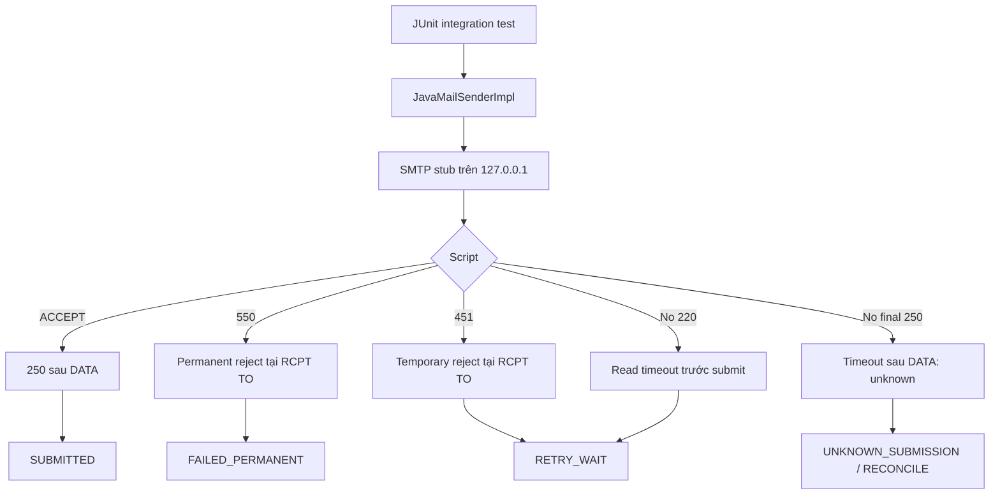
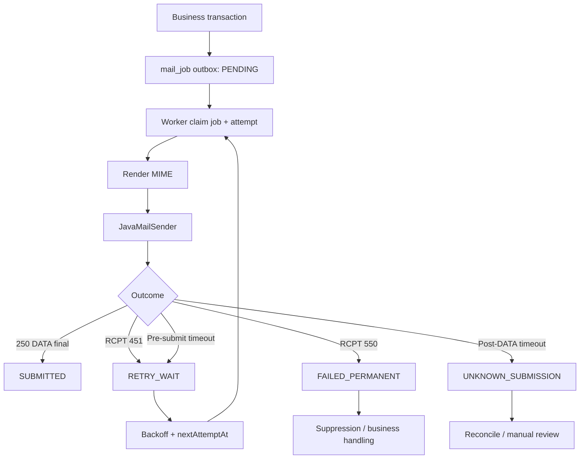
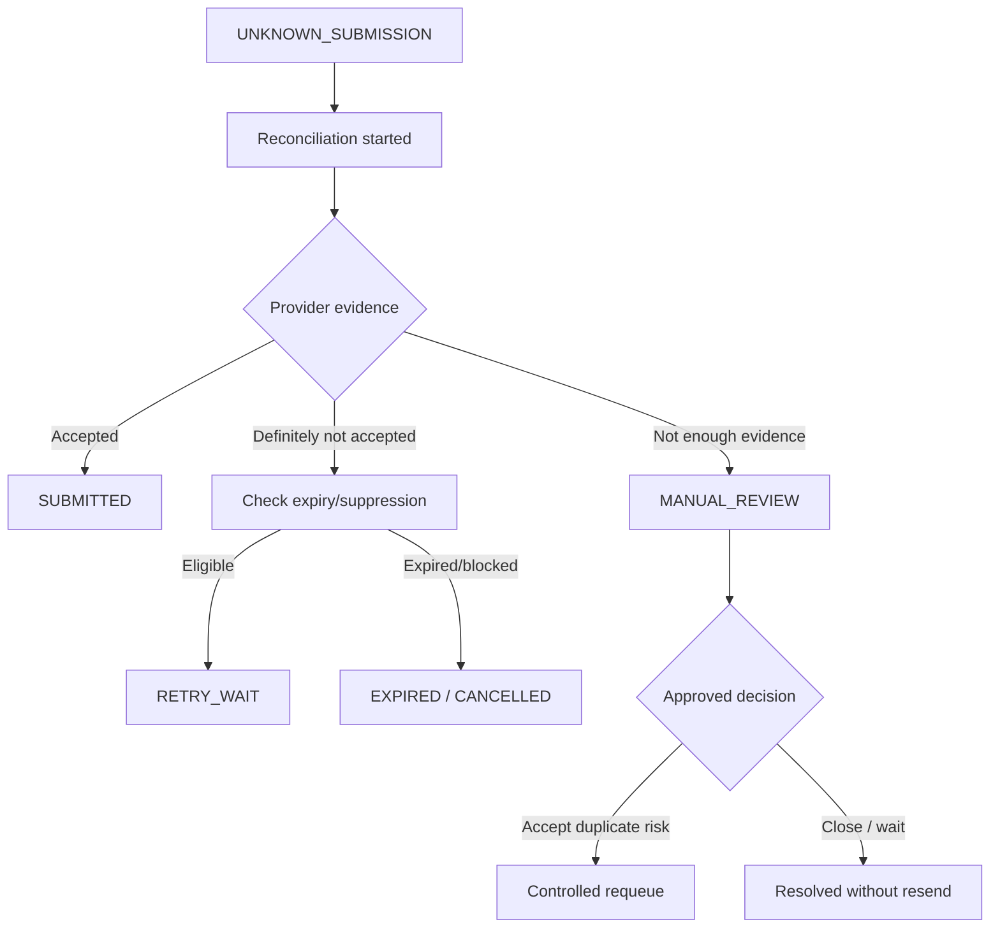

# Mô phỏng provider timeout và recipient bị từ chối với Spring Framework Mail

Một email đã được ứng dụng tạo thành công chưa chắc được SMTP provider chấp nhận. Ngay cả khi cùng một lời gọi `JavaMailSender.send(...)` ném `MailSendException`, bản chất sự cố có thể rất khác nhau:

- **Recipient bị từ chối tại `RCPT TO`:** server trả `550 5.1.1` vì hộp thư không tồn tại; đây thường là lỗi vĩnh viễn, không nên retry nguyên xi.
- **Recipient bị từ chối tạm thời:** server trả `451 4.x.x`; việc thử lại sau backoff có thể hợp lý.
- **Provider timeout trước khi gửi bất kỳ lệnh SMTP nào:** email chắc chắn chưa được submit trong kết nối đó, có thể retry có kiểm soát.
- **Provider không trả kết quả cuối sau `DATA`:** client không biết server đã nhận và lưu thư hay chưa. Gửi lại ngay có thể tạo hai email.

Đó là lý do bài thực hành này không chỉ dùng mock để tạo ra một exception bất kỳ. Chúng ta sẽ tự chạy một **SMTP server giả lập trên loopback**, điều khiển chính xác phản hồi tại từng bước giao thức, gửi email bằng Spring Framework Mail rồi quan sát cách exception, trạng thái job và chính sách retry thay đổi.

> **Kết quả cần đạt:** học viên phân biệt được lỗi mạng, lỗi người nhận, SMTP acceptance và trạng thái không xác định; viết test lặp lại được mà không gửi thư ra Internet; xây một failure policy không retry nhầm các địa chỉ bị từ chối vĩnh viễn hoặc một attempt đã có khả năng được provider nhận.

Lab áp dụng cho ứng dụng Java 17+, Spring Boot 3.x/Jakarta Mail (ví dụ cấu hình Spring Boot 3.5.x). Các lệnh và mã nguồn đều dành cho **môi trường thử nghiệm**. Không dùng credentials hoặc mailbox production và không mở fake server ra mạng công cộng.

## 1. Mục tiêu học tập

Sau bài này, bạn có thể:

1. Giải thích đường đi của một message từ `MimeMessageHelper` tới SMTP server.
2. Phân biệt `connect timeout`, `read timeout` và `write timeout`.
3. Dựng SMTP stub với phản hồi `250`, `451`, `550` và kịch bản không trả ACK.
4. Phân biệt lỗi xảy ra **trước** `DATA` và **sau** khi client đã gửi terminator `<CRLF>.<CRLF>`.
5. Đọc `MailException`, `MessagingException.getNextException()` và chi tiết provider-specific một cách an toàn.
6. Xây bộ phân loại **transient / permanent / uncertain**.
7. Viết integration tests với JUnit 5 chạy hoàn toàn trên loopback.
8. Thiết kế cơ chế lưu job, attempt, retry với backoff, expiry, DLQ và reconciliation.
9. Kiểm thử thêm trường hợp SMTP trả ACK nhưng delivery vẫn có thể bounce sau đó.
10. Lập runbook xử lý sự cố và đo metrics mà không log PII/secret.

## 2. Các khái niệm tối thiểu trước khi thực hành

### 2.1. JavaMailSender và MimeMessageHelper

Trong Spring Framework Mail:

- `JavaMailSender` là abstraction gửi email.
- `JavaMailSenderImpl` thường sử dụng Jakarta Mail để nói chuyện với SMTP provider.
- `MimeMessageHelper` giúp tạo `MimeMessage`, thêm From, To, Subject, text, HTML, attachment và inline resources.
- `MailException` là nhóm exception Spring Mail chuyển đổi từ lỗi tầng thấp.

**Spring Mail không tự có durable queue, retry ledger, DLQ hay cơ chế đối soát delivery.** Các phần đó thuộc application architecture hoặc broker/provider API.

### 2.2. Một phiên SMTP điển hình

```text
Client                                      Fake SMTP server
  |                                              |
  | <------------------- 220 Greeting -----------|
  | -------------------- EHLO ------------------> |
  | <------------------- 250 Capabilities ------- |
  | -------------------- MAIL FROM -------------> |
  | <------------------- 250 -------------------- |
  | -------------------- RCPT TO ---------------> |
  | <------------------- 250 hoặc 451/550 ------- |
  | -------------------- DATA ------------------> |
  | <------------------- 354 -------------------- |
  | -------- body + <CRLF>.<CRLF> --------------> |
  | <------------------- 250 hoặc timeout ------- |
  | -------------------- QUIT ------------------> |
  | <------------------- 221 -------------------- |
```

Chỉ sau phản hồi thành công cuối cùng cho `DATA`, client mới có cơ sở cho rằng **SMTP server đã chấp nhận trách nhiệm xử lý thư trong phiên đó**. Điều này **không đồng nghĩa** thư đã được giao đến Inbox, không bị Spam hoặc không bị bounce sau đó.

### 2.3. Tại sao vị trí timeout quan trọng?

| Vị trí xảy ra lỗi | Client biết được gì? | Mức độ an toàn khi retry |
|---|---|---|
| Chưa kết nối được TCP | Chưa submit qua phiên đó | Có thể retry sau backoff |
| Chờ greeting `220` | Chưa gửi `MAIL FROM`/`DATA` | Có thể retry sau backoff |
| Chờ phản hồi `RCPT TO` | Chưa vào `DATA` trong phiên đó | Xem rõ phase và outcome, retry có kiểm soát |
| Server trả `550` tại `RCPT TO` | Người nhận bị từ chối | Không retry cùng recipient một cách mù quáng |
| Server trả `451` tại `RCPT TO` | Từ chối tạm thời | Có thể retry với deadline/backoff |
| Client đã gửi kết thúc `DATA`, chưa nhận `250` | **Không rõ server đã chấp nhận chưa** | Không auto-retry mặc định |
| Đã nhận `250` sau `DATA` | SMTP accepted | Không gọi lại chỉ vì chưa có delivery event |

Lưu ý: timeout tại bước `DATA` **không chứng minh server đã chấp nhận**; nó chỉ chứng minh client mất khả năng quan sát kết quả. Trong lab, fake server sẽ ghi nhận dữ liệu đã đến nó, nhưng trên mạng thật phía client không thể suy luận như vậy nếu không có bằng chứng từ provider.

## 3. Định nghĩa năm kịch bản lab

Chúng ta sẽ sử dụng một SMTP stub có thể chọn một trong các kịch bản:

| Kịch bản | Phản hồi giả lập | Kết quả mong đợi |
|---|---|---|
| `ACCEPT` | `250` tại recipient và sau DATA | Sender trả về bình thường |
| `REJECT_550` | `550 5.1.1` tại RCPT TO | Permanent recipient rejection |
| `REJECT_451` | `451 4.3.0` tại RCPT TO | Temporary recipient rejection |
| `STALL_GREETING` | TCP connect được nhưng không có `220` | Timeout trước submission |
| `STALL_AFTER_DATA` | Nhận terminator DATA nhưng không trả `250` | Submission outcome uncertain |

Chúng ta sẽ kiểm tra **điều mà fake server đã thực hiện** để xác nhận fixture, rồi tách riêng nhận định **điều mà client có thể chắc chắn biết**. Phân biệt hai góc nhìn là nội dung cốt lõi của bài.

### 3.1. Sơ đồ luồng



## 4. Công cụ, tiền đề và nguyên tắc an toàn

Môi trường:

- JDK 17 trở lên.
- Gradle theo Spring Boot được dự án quản lý.
- Spring Boot 3.x với `spring-boot-starter-mail`.
- JUnit Jupiter/`spring-boot-starter-test`.
- Cổng TCP **được cấp tự động** trên loopback, không hard-code cổng trên máy developer.
- Không có nhu cầu SMTP account thật, Gmail hay mạng Internet.

### 4.1. Vì sao không dùng provider thật để tạo lỗi?

Thử password sai, gửi tới email không tồn tại hoặc cố tình làm connection timeout trên SMTP production có thể:

- Kích hoạt anti-abuse, rate limit và account lockout.
- Gửi thư tới người thật ngoài ý muốn.
- Làm tăng bounce/reputation penalties.
- Tạo lỗi khó lặp vì provider thay đổi chính sách.
- Làm lộ credentials/recipient trong debug logs.

SMTP stub kiểm soát phản hồi **quyết định**, nhanh và không phụ thuộc provider. Nó không mô phỏng đầy đủ TLS/auth, deliverability hoặc provider-specific policies; những phần đó cần integration tests riêng trong môi trường được phép.

### 4.2. Quy ước dữ liệu

Trong ví dụ:

```text
From:     no-reply@example.test
To:       demo-recipient@example.test
Subject:  SMTP failure lab
Body:     This is a synthetic test message.
```

Domain `example.test` dùng cho nội dung thử nghiệm; fake server nhận trực tiếp trên localhost nên không có DNS delivery bên ngoài. Không dùng danh sách email khách hàng để thực hiện lab.

## 5. Cấu trúc dự án tham khảo

```text
mail-failure-lab/
├── build.gradle
├── settings.gradle
└── src/
    ├── main/
    │   └── java/com/example/maillab/
    │       ├── MailFailureLabApplication.java
    │       ├── MailProbeService.java
    │       └── MailFailureInspector.java
    └── test/
        └── java/com/example/maillab/
            ├── ScriptedSmtpServer.java
            └── MailFailureIntegrationTest.java
```

Đây là cấu trúc **bài thực hành**, không phải yêu cầu sửa các file đó trong repository hiện tại. Mã sẽ được trình bày ngay trong tài liệu. Các phần mở rộng như outbox/database, RabbitMQ hoặc webhook simulator được mô tả ở những mục sau.

### 5.1. Gradle setup

Ví dụ `settings.gradle`:

```groovy
rootProject.name = 'mail-failure-lab'
```

Ví dụ `build.gradle` (phiên bản plugin chỉ minh họa, điều chỉnh theo dependency management đang dùng):

```groovy
plugins {
    id 'java'
    id 'org.springframework.boot' version '3.5.6'
    id 'io.spring.dependency-management' version '1.1.7'
}

group = 'com.example'
version = '1.0.0'

java {
    toolchain {
        languageVersion = JavaLanguageVersion.of(17)
    }
}

repositories {
    mavenCentral()
}

dependencies {
    implementation 'org.springframework.boot:spring-boot-starter-mail'
    testImplementation 'org.springframework.boot:spring-boot-starter-test'
}

tasks.named('test') {
    useJUnitPlatform()
}
```

Ví dụ dựa trên API Jakarta Mail dùng bởi Spring Boot 3.x, **không trộn `javax.mail.*` từ thế hệ cũ** với `jakarta.mail.*`. Nếu dự án dùng Spring Boot 4.x hoặc version khác, cần đối chiếu plugin/đường dẫn package trong stack thực tế và để BOM quản lý dependency thích hợp.

### 5.2. Main class tối thiểu

```java
package com.example.maillab;

import org.springframework.boot.SpringApplication;
import org.springframework.boot.autoconfigure.SpringBootApplication;

@SpringBootApplication
public class MailFailureLabApplication {
    public static void main(String[] args) {
        SpringApplication.run(
                MailFailureLabApplication.class, args);
    }
}
```

Các integration tests của bài sẽ tự khởi tạo `JavaMailSenderImpl` để inject **cổng ngẫu nhiên của SMTP stub**. Không cần khởi động Spring Boot application context và không cần đi qua một provider thực.

## 6. Tạo JavaMailSenderImpl cho môi trường thử nghiệm

Một factory tạo sender chỉ dùng loopback, không AUTH/TLS vì stub không triển khai hai giao thức đó:

```java
package com.example.maillab;

import java.util.Properties;
import org.springframework.mail.javamail.JavaMailSenderImpl;

public final class TestMailSenders {

    private TestMailSenders() {
    }

    public static JavaMailSenderImpl forLoopbackPort(int port) {
        JavaMailSenderImpl sender = new JavaMailSenderImpl();
        sender.setHost("127.0.0.1");
        sender.setPort(port);
        sender.setProtocol("smtp");
        sender.setDefaultEncoding("UTF-8");

        Properties properties = sender.getJavaMailProperties();
        properties.put("mail.smtp.auth", "false");
        properties.put("mail.smtp.starttls.enable", "false");
        properties.put("mail.smtp.ssl.enable", "false");
        properties.put("mail.smtp.connectiontimeout", "500");
        properties.put("mail.smtp.timeout", "500");
        properties.put("mail.smtp.writetimeout", "500");
        properties.put("mail.smtp.quitwait", "false");
        properties.put("mail.debug", "false");
        properties.put("mail.debug.auth", "false");

        return sender;
    }
}
```

Các timeout tính bằng **mili-giây**. Giá trị 500 ms giúp lab kết thúc tương đối nhanh; đây không phải cấu hình production. Không tắt TLS/AUTH như trên khi kết nối nhà cung cấp thật; test fake server là môi trường hoàn toàn khác.

### 6.1. Phân biệt các timeout

| Property | Được áp dụng ở đâu? | Tình huống |
|---|---|---|
| `mail.smtp.connectiontimeout` | Chờ thiết lập kết nối TCP | Provider không thể connect |
| `mail.smtp.timeout` | Chờ đọc phản hồi trên socket | Không nhận greeting/SMTP reply |
| `mail.smtp.writetimeout` | Giới hạn ghi trên socket | Server chậm/không đọc request |

Khi muốn mô phỏng read timeout chính xác, fake server **chấp nhận TCP connection rồi không gửi reply**. Kết nối tới một port hoàn toàn không có server thường cho lỗi `Connection refused`, **không phải read timeout**. Đó là hai phép thử khác nhau.

### 6.2. Vì sao không dùng @MockBean cho mọi kịch bản?

Mockito có thể dễ dàng tạo:

```java
doThrow(new MailSendException("synthetic failure"))
        .when(sender).send(any(MimeMessage.class));
```

Nhưng cách này **không mô phỏng giao thức SMTP**: không chứng minh một lệnh `RCPT TO` đã nhận `550`, không tạo `SMTPAddressFailedException` với reply code thực, không kiểm tra session behavior hay ambiguous final DATA response. Mockito phù hợp cho unit test business policy; còn bài này dùng **socket-level fake** để học semantics.

## 7. Dựng SMTP stub có thể điều khiển phản hồi

Đây là phần chính của bài thực hành. Server giả lập chỉ chấp nhận **một kết nối SMTP cho mỗi test** và chạy ở `127.0.0.1` với cổng ngẫu nhiên.

Nó không triển khai TLS, AUTH, MIME parser hay gửi thư đến người nhận. Nó chỉ đọc các lệnh SMTP cần thiết, phản hồi đúng thứ tự và ghi lại một vài dấu mốc để phục vụ test.

### 7.1. File ScriptedSmtpServer.java

Đặt trong `src/test/java/com/example/maillab/ScriptedSmtpServer.java`:

```java
package com.example.maillab;

import java.io.BufferedReader;
import java.io.BufferedWriter;
import java.io.IOException;
import java.io.InputStreamReader;
import java.io.OutputStreamWriter;
import java.net.InetAddress;
import java.net.ServerSocket;
import java.net.Socket;
import java.net.SocketException;
import java.nio.charset.StandardCharsets;
import java.util.Locale;
import java.util.concurrent.ExecutorService;
import java.util.concurrent.Executors;
import java.util.concurrent.TimeUnit;
import java.util.concurrent.atomic.AtomicBoolean;
import java.util.concurrent.atomic.AtomicInteger;

public final class ScriptedSmtpServer implements AutoCloseable {

    public enum Scenario {
        ACCEPT,
        REJECT_550,
        REJECT_451,
        STALL_GREETING,
        STALL_AFTER_DATA
    }

    private final Scenario scenario;
    private final ServerSocket serverSocket;
    private final ExecutorService executor;

    private final AtomicBoolean mailFromSeen = new AtomicBoolean();
    private final AtomicBoolean dataCommandSeen = new AtomicBoolean();
    private final AtomicBoolean dataTerminatorSeen =
            new AtomicBoolean();
    private final AtomicInteger recipientCount = new AtomicInteger();

    private ScriptedSmtpServer(Scenario scenario)
            throws IOException {
        this.scenario = scenario;

        // Bind CHỈ lên IPv4 loopback.
        this.serverSocket = new ServerSocket(
                0,
                1,
                InetAddress.getByName("127.0.0.1"));
        this.serverSocket.setSoTimeout(3_000);

        this.executor = Executors.newSingleThreadExecutor(r -> {
            Thread thread = new Thread(r, "smtp-lab-server");
            thread.setDaemon(true);
            return thread;
        });
        this.executor.submit(this::serveOneConnection);
    }

    public static ScriptedSmtpServer start(Scenario scenario)
            throws IOException {
        return new ScriptedSmtpServer(scenario);
    }

    public int port() {
        return serverSocket.getLocalPort();
    }

    public boolean sawMailFrom() {
        return mailFromSeen.get();
    }

    public boolean sawDataCommand() {
        return dataCommandSeen.get();
    }

    public boolean sawDataTerminator() {
        return dataTerminatorSeen.get();
    }

    public int recipientCommands() {
        return recipientCount.get();
    }

    private void serveOneConnection() {
        try (Socket socket = serverSocket.accept()) {
            socket.setSoTimeout(2_500);

            if (scenario == Scenario.STALL_GREETING) {
                // TCP accepted nhưng KHÔNG gửi SMTP 220.
                // Thời gian chờ dài hơn read timeout của sender.
                Thread.sleep(1_500);
                return;
            }

            BufferedReader input = new BufferedReader(
                    new InputStreamReader(
                            socket.getInputStream(),
                            StandardCharsets.US_ASCII));

            BufferedWriter output = new BufferedWriter(
                    new OutputStreamWriter(
                            socket.getOutputStream(),
                            StandardCharsets.US_ASCII));

            reply(output, "220 localhost SMTP lab ready");

            String line;
            while ((line = input.readLine()) != null) {
                String command = line.toUpperCase(Locale.ROOT);

                if (command.startsWith("EHLO ")
                        || command.startsWith("HELO ")) {
                    reply(output, "250 localhost");

                } else if (command.startsWith("MAIL FROM:")) {
                    mailFromSeen.set(true);
                    reply(output, "250 2.1.0 Sender accepted");

                } else if (command.startsWith("RCPT TO:")) {
                    recipientCount.incrementAndGet();

                    if (scenario == Scenario.REJECT_550) {
                        reply(output,
                                "550 5.1.1 Recipient mailbox unavailable");
                    } else if (scenario == Scenario.REJECT_451) {
                        reply(output,
                                "451 4.3.0 Temporary recipient failure");
                    } else {
                        reply(output, "250 2.1.5 Recipient accepted");
                    }

                } else if (command.equals("DATA")) {
                    dataCommandSeen.set(true);
                    reply(output, "354 End data with <CRLF>.<CRLF>");

                    String contentLine;
                    while ((contentLine = input.readLine()) != null) {
                        if (contentLine.equals(".")) {
                            dataTerminatorSeen.set(true);

                            if (scenario == Scenario.STALL_AFTER_DATA) {
                                // Đã nhận toàn bộ DATA nhưng cố ý
                                // KHÔNG trả final 250 acknowledgment.
                                Thread.sleep(1_500);
                                return;
                            }

                            reply(output,
                                    "250 2.0.0 Message accepted by lab");
                            break;
                        }
                    }

                } else if (command.equals("RSET")
                        || command.equals("NOOP")) {
                    reply(output, "250 2.0.0 OK");

                } else if (command.equals("QUIT")) {
                    reply(output, "221 2.0.0 Closing connection");
                    return;

                } else {
                    reply(output, "502 5.5.2 Unsupported command");
                }
            }

        } catch (SocketException ignoredDuringShutdown) {
            // Có thể xảy ra khi test đóng server/socket.
        } catch (InterruptedException interrupted) {
            Thread.currentThread().interrupt();
        } catch (IOException ignoredInSocketLab) {
            // Stub này chỉ dùng trong bài test.
            // Với sản phẩm thật cần báo lỗi server riêng.
        }
    }

    private static void reply(
            BufferedWriter output, String response)
            throws IOException {
        output.write(response);
        output.write("\r\n");
        output.flush();
    }

    @Override
    public void close() throws Exception {
        serverSocket.close();
        executor.shutdownNow();
        executor.awaitTermination(3, TimeUnit.SECONDS);
    }
}
```

### 7.2. Vì sao dùng ServerSocket(0)?

Port `0` yêu cầu hệ điều hành cấp một cổng TCP còn trống. Bài test truy cập bằng `server.port()`, tránh các xung đột phổ biến khi nhiều tests chạy trên CI hoặc developer laptop.

Ràng buộc `127.0.0.1` bảo đảm server không mở ra network interface công cộng. Không bind `0.0.0.0` cho một SMTP stub không có AUTH/TLS.

### 7.3. Vì sao dùng CRLF và đọc dấu chấm?

SMTP command và reply kết thúc bằng `\r\n`. Sau khi server trả `354`, email content được truyền theo các dòng; một dòng chỉ chứa dấu `.` kết thúc DATA. Vì vậy stub đợi:

```text
DATA
354 End data with <CRLF>.<CRLF>
...message headers and body...
.
250 2.0.0 Accepted
```

Trong trường hợp `STALL_AFTER_DATA`, server thấy terminator nhưng **không trả `250`**. Đây là fixture quan trọng cho trạng thái `UNKNOWN_SUBMISSION`.

### 7.4. Các giới hạn có chủ đích của SMTP stub

- Chỉ hỗ trợ một SMTP session mỗi lần khởi tạo.
- Không hỗ trợ `STARTTLS` hoặc `AUTH`.
- Không thực sự parse MIME payload.
- Không mô phỏng DSN, spam filtering, greylisting hoặc delivery webhook.
- Chỉ ghi dấu mốc cho kiểm thử, không lưu email.
- Đọc các dòng theo US-ASCII để tìm SMTP commands và terminator; email test dùng nội dung ASCII đơn giản.
- Không có database hay tính bền vững.

Do đó, stub phù hợp để mô phỏng **giao thức phản hồi và timeout**, không phải làm SMTP server production.

### 7.5. Có thể mở rộng các kịch bản nào?

Sau bài cơ bản, có thể thêm:

- `REJECT_MAIL_FROM_550` để mô phỏng sender identity không được phép.
- `REJECT_DATA_552` khi message quá lớn.
- `STALL_RCPT` sau khi server đọc một recipient.
- `CLOSE_CONNECTION_DURING_DATA` để kiểm tra write/read errors.
- `DELAY_250_AFTER_DATA` để test response tới muộn.
- `PARTIAL_RECIPIENT_ACCEPT` với nhiều recipients.
- `AUTH_535` cho kịch bản account credentials (cần triển khai AUTH protocol).

Mỗi kịch bản thêm nên có assertion rõ về server đã phản hồi ở giai đoạn nào và client thực sự biết điều gì.

## 8. Tạo MailProbeService dùng Spring Framework Mail thật

Để test có ý nghĩa, **không mock JavaMailSender**. Chúng ta chỉ mock endpoint SMTP bằng server socket, còn gửi được thực hiện bởi `JavaMailSenderImpl` và Jakarta Mail.

File `src/main/java/com/example/maillab/MailProbeService.java`:

```java
package com.example.maillab;

import jakarta.mail.MessagingException;
import jakarta.mail.internet.MimeMessage;
import org.springframework.mail.javamail.JavaMailSender;
import org.springframework.mail.javamail.MimeMessageHelper;

public final class MailProbeService {

    private final JavaMailSender sender;

    public MailProbeService(JavaMailSender sender) {
        this.sender = sender;
    }

    public void submitOneMessage(String recipient) {
        MimeMessage mime = sender.createMimeMessage();

        try {
            MimeMessageHelper helper =
                    new MimeMessageHelper(mime, false, "UTF-8");

            helper.setFrom("no-reply@example.test");
            helper.setTo(recipient);
            helper.setSubject("SMTP failure lab");
            helper.setText(
                    "This is a synthetic test message.", false);
        } catch (MessagingException preparationFailure) {
            throw new IllegalArgumentException(
                    "Cannot prepare synthetic MIME message",
                    preparationFailure);
        }

        // Đây là lời gọi thực qua JavaMailSenderImpl.
        sender.send(mime);
    }
}
```

### 8.1. Tách lỗi chuẩn bị MIME khỏi lỗi transport

`MessagingException` ở quá trình dựng `MimeMessageHelper` không phải lỗi SMTP provider. Nếu địa chỉ người nhận sai cú pháp (ví dụ thiếu `@`), helper có thể từ chối trước khi mở socket; đó không phải “recipient bị provider trả 550”.

Để test từ chối tại `RCPT TO`, phải dùng **địa chỉ có cú pháp hợp lệ** như `demo-recipient@example.test`. Server sẽ nhận nó và trả `550`.

### 8.2. Vì sao chỉ dùng một recipient?

Một email có nhiều recipients có thể nhận các phản hồi khác nhau:

```text
RCPT TO:<a@example.test> -> 250
RCPT TO:<b@example.test> -> 550
RCPT TO:<c@example.test> -> 451
```

Jakarta Mail có behavior phụ thuộc `mail.smtp.sendpartial` và implementation. Bài chính cố tình dùng một recipient để tập trung vào failure classification; phần mở rộng sẽ xử lý partial sends.

## 9. Đọc exception và mã SMTP một cách có cấu trúc

Một lỗi recipient tại `RCPT TO` có thể đi qua nhiều lớp:

```text
org.springframework.mail.MailSendException
   |
   +-- failedMessages / messageExceptions
         |
         +-- jakarta.mail.SendFailedException
               |
               +-- org.eclipse.angus.mail.smtp.SMTPAddressFailedException
                     command=RCPT TO
                     returnCode=550
```

Với Eclipse Angus Mail (implementation Jakarta Mail thường dùng trong Spring Boot 3.x), `SMTPAddressFailedException.getReturnCode()` giúp lấy reply code mà **không cần parse một chuỗi provider response tùy ý**. Tên lớp nằm trong package implementation-specific; nếu chuyển Jakarta Mail provider/version khác, phải thay adapter đọc chi tiết, không phụ thuộc mặc định vào class đó ở domain layer.

### 9.1. Phân loại hai cấp độ

Nên phân biệt:

**Diagnostic evidence:** đã nhìn thấy reply code bao nhiêu? Có `SocketTimeoutException`, `AuthenticationFailedException` hay không?

**Business decision:** retry, reject, dead-letter, hay reconciliation? Quyết định sau còn phụ thuộc SMTP phase, số attempts, thời hạn job và chính sách gửi.

Ví dụ:

```text
Diagnostic: SMTP reply 550 from RCPT TO
Decision:  FAILED_PERMANENT / do not retry unchanged

Diagnostic: SocketTimeoutException
Known phase: before SMTP greeting
Decision:  RETRY_WAIT after backoff

Diagnostic: SocketTimeoutException
Known phase: after DATA terminator
Decision:  UNKNOWN_SUBMISSION / reconcile

Diagnostic: SocketTimeoutException
Phase unknown
Decision:  UNKNOWN_SUBMISSION (conservative default)
```

**Không thể lấy một `SocketTimeoutException` tổng quát rồi khẳng định nó xảy ra sau `DATA`** nếu ứng dụng không có thông tin về phase. Trong test ta biết kịch bản từ fake server; trong production phải có evidence phù hợp hoặc đánh dấu unknown theo hướng bảo thủ.

### 9.2. File MailFailureInspector.java

Đặt trong `src/main/java/com/example/maillab/MailFailureInspector.java`:

```java
package com.example.maillab;

import jakarta.mail.AuthenticationFailedException;
import jakarta.mail.MessagingException;
import java.net.ConnectException;
import java.net.SocketTimeoutException;
import java.util.ArrayDeque;
import java.util.ArrayList;
import java.util.Collections;
import java.util.Deque;
import java.util.IdentityHashMap;
import java.util.List;
import java.util.Set;
import org.eclipse.angus.mail.smtp.SMTPAddressFailedException;
import org.springframework.mail.MailAuthenticationException;
import org.springframework.mail.MailSendException;

public final class MailFailureInspector {

    private static final int MAX_NODES = 64;

    public enum Kind {
        RECIPIENT_REJECTED_PERMANENT,
        RECIPIENT_REJECTED_TEMPORARY,
        SMTP_AUTHENTICATION,
        SOCKET_READ_TIMEOUT,
        CONNECTION_FAILURE,
        UNKNOWN
    }

    public record Diagnostic(
            Kind kind,
            Integer smtpReplyCode,
            List<String> exceptionTypes) {
    }

    public Diagnostic inspect(Throwable failure) {
        if (failure == null) {
            return new Diagnostic(Kind.UNKNOWN, null, List.of());
        }

        Set<Throwable> visited = Collections.newSetFromMap(
                new IdentityHashMap<>());
        Deque<Throwable> pending = new ArrayDeque<>();
        List<String> types = new ArrayList<>();

        pending.push(failure);

        Integer recipientCode = null;
        boolean authFailure = false;
        boolean socketTimeout = false;
        boolean connectionFailure = false;

        while (!pending.isEmpty() && visited.size() < MAX_NODES) {
            Throwable current = pending.pop();
            if (!visited.add(current)) {
                continue;
            }

            types.add(current.getClass().getSimpleName());

            if (current instanceof SMTPAddressFailedException address) {
                // Reply code của một RCPT failure trong Angus SMTP.
                recipientCode = address.getReturnCode();
            }

            if (current instanceof MailAuthenticationException
                    || current instanceof AuthenticationFailedException) {
                authFailure = true;
            }

            if (current instanceof SocketTimeoutException) {
                socketTimeout = true;
            }

            if (current instanceof ConnectException) {
                connectionFailure = true;
            }

            Throwable cause = current.getCause();
            if (cause != null && !visited.contains(cause)) {
                pending.push(cause);
            }

            if (current instanceof MessagingException mailError) {
                Exception next = mailError.getNextException();
                if (next != null && !visited.contains(next)) {
                    pending.push(next);
                }
            }

            if (current instanceof MailSendException sendError) {
                for (Exception item :
                        sendError.getFailedMessages().values()) {
                    if (item != null && !visited.contains(item)) {
                        pending.push(item);
                    }
                }
                for (Exception item : sendError.getMessageExceptions()) {
                    if (item != null && !visited.contains(item)) {
                        pending.push(item);
                    }
                }
            }

            for (Throwable suppressed : current.getSuppressed()) {
                if (!visited.contains(suppressed)) {
                    pending.push(suppressed);
                }
            }
        }

        Kind kind;
        if (recipientCode != null
                && recipientCode >= 500 && recipientCode < 600) {
            kind = Kind.RECIPIENT_REJECTED_PERMANENT;
        } else if (recipientCode != null
                && recipientCode >= 400 && recipientCode < 500) {
            kind = Kind.RECIPIENT_REJECTED_TEMPORARY;
        } else if (authFailure) {
            kind = Kind.SMTP_AUTHENTICATION;
        } else if (socketTimeout) {
            kind = Kind.SOCKET_READ_TIMEOUT;
        } else if (connectionFailure) {
            kind = Kind.CONNECTION_FAILURE;
        } else {
            kind = Kind.UNKNOWN;
        }

        return new Diagnostic(
                kind,
                recipientCode,
                List.copyOf(types));
    }
}
```

### 9.3. Phạm vi của inspector

Đoạn code chỉ dùng để học cách quan sát exception:

1. Duyệt `getCause()`, `MessagingException.getNextException()` và các nhánh riêng của `MailSendException`.
2. Dùng identity-based visited set chống vòng tham chiếu/duyệt lại.
3. Giới hạn tối đa 64 exception objects.
4. Chỉ lưu loại exception và mã reply, **không log `getMessage()` thô**.
5. Với một recipient, map `4xx/5xx` của `SMTPAddressFailedException` thành nhóm nguyên nhân.

Không dùng phiên bản này nguyên xi để quyết định một **batch nhiều messages hoặc nhiều recipients**, vì một `MailSendException` có thể chứa **nhiều reply codes khác nhau**. Inspector trên giữ một recipientCode cuối cùng tìm được; với batch production cần tạo một diagnostic **cho từng mailJob/recipient và SMTP phase**.

Ngoài ra, `SOCKET_READ_TIMEOUT` ở đây thực ra là nhóm bằng chứng `SocketTimeoutException`; nó có thể xảy ra khi chờ greeting, RCPT response hoặc final DATA response. **Kind này không chứa stage**, vì vậy không tự động quyết định retry an toàn.

### 9.4. Phân loại failure khác business outcome

Một SMTP reply `550` tại `RCPT TO` không có nghĩa message đã được gửi rồi bounce; thường đó là **sự từ chối ngay trong SMTP transaction**. Ngược lại, một provider có thể nhận email bằng `250` rồi phát bounce sau; sự kiện này phải được xử lý ở **delivery feedback stage**, không gắn là failed SMTP submission trong attempt cũ.

### 9.5. Không dựa vào exception.getMessage() để làm nguồn sự thật

Sai:

```java
if (exception.getMessage().contains("550")) {
    // Dễ sai nếu message null, nhiều lỗi hoặc reply từ phase khác.
    return "PERMANENT_RECIPIENT";
}
```

Đúng hơn: thu thập structured code từ thư viện/protocol adapter khi có và giữ phase. Nếu provider không expose code có cấu trúc, một parser protocol reply phải được giới hạn, được kiểm thử và chỉ dùng làm diagnostic evidence; không gửi nguyên văn response vào metrics hay HTTP API.

## 10. JUnit: kịch bản ACCEPT

Tất cả test dưới đây dùng `MailProbeService` và sender tạo bằng `TestMailSenders.forLoopbackPort(server.port())`. Hãy đặt class `TestMailSenders` của mục 6 trong `src/test/java/com/example/maillab/TestMailSenders.java` hoặc di chuyển nó vào production code nếu cần tái sử dụng trong một môi trường sandbox riêng.

File `src/test/java/com/example/maillab/MailFailureIntegrationTest.java`:

```java
package com.example.maillab;

import static org.junit.jupiter.api.Assertions.*;

import java.io.IOException;
import org.junit.jupiter.api.Test;
import org.springframework.mail.MailException;

class MailFailureIntegrationTest {

    private static final String TEST_RECIPIENT =
            "demo-recipient@example.test";

    private final MailFailureInspector inspector =
            new MailFailureInspector();

    @Test
    void acceptedRecipientAndDataReturnsNormally() throws Exception {
        try (ScriptedSmtpServer server =
                ScriptedSmtpServer.start(
                        ScriptedSmtpServer.Scenario.ACCEPT)) {

            MailProbeService service = new MailProbeService(
                    TestMailSenders.forLoopbackPort(server.port()));

            assertDoesNotThrow(() ->
                    service.submitOneMessage(TEST_RECIPIENT));

            assertEquals(1, server.recipientCommands());
            assertTrue(server.sawMailFrom());
            assertTrue(server.sawDataCommand());
            assertTrue(server.sawDataTerminator());
        }
    }
}
```

Đây là **mốc đối chứng**: server nhận MAIL FROM, RCPT TO, DATA terminator và trả `250` cuối. `JavaMailSender.send(...)` hoàn thành bình thường.

Điều cần nói chính xác:

- **SMTP submission accepted trong lab**: có.
- **Đã phát tới Internet**: không.
- **Recipient thật đã nhận email**: không có.
- **Đã vào Inbox**: không thể suy ra.

### 10.1. Vì sao cần một happy-path trước các lỗi?

Nếu fake server không đáp ứng đúng `EHLO` hoặc `DATA`, mọi tests sau đó có thể thất bại vì **fixture lỗi** chứ không phải behavior cần học. Trường hợp ACCEPT giúp chứng minh tối thiểu sender và stub nói chuyện đúng giao thức trong scope bài học.

## 11. JUnit: recipient bị từ chối vĩnh viễn — 550

Thêm method vào `MailFailureIntegrationTest`:

```java
@Test
void rcpt550MeansPermanentRecipientRejection()
        throws Exception {

    try (ScriptedSmtpServer server =
            ScriptedSmtpServer.start(
                    ScriptedSmtpServer.Scenario.REJECT_550)) {

        MailProbeService service = new MailProbeService(
                TestMailSenders.forLoopbackPort(server.port()));

        MailException failure = assertThrows(
                MailException.class,
                () -> service.submitOneMessage(TEST_RECIPIENT));

        var diagnostic = inspector.inspect(failure);

        assertEquals(
                MailFailureInspector.Kind.RECIPIENT_REJECTED_PERMANENT,
                diagnostic.kind());
        assertEquals(550, diagnostic.smtpReplyCode());

        assertEquals(1, server.recipientCommands());
        assertFalse(server.sawDataCommand());
        assertFalse(server.sawDataTerminator());
    }
```

Đặt method này **bên trong** class `MailFailureIntegrationTest` từ mục 10, trước dấu `}` đóng class cuối cùng.

**Ý nghĩa:**

1. Địa chỉ `demo-recipient@example.test` có cú pháp hợp lệ.
2. SMTP stub nhận lệnh `RCPT TO`.
3. Stub trả `550 5.1.1`.
4. Thông điệp chưa vào bước `DATA`.
5. Jakarta Mail/Spring Mail tạo failure; inspector đọc mã.
6. Retry **cùng recipient, cùng dữ liệu** không có cơ sở nếu server trả permanent rejection.

### 11.1. 550 có phải luôn “mailbox không tồn tại”?

Không tuyệt đối. Ý nghĩa chi tiết còn phụ thuộc enhanced status code, command và provider policy. Ví dụ `550` có thể là từ chối vì sender/domain policy. Trong stub này ta **cố ý trả 550 ở `RCPT TO` với enhanced status `5.1.1`** để tạo scenario recipient mailbox unavailable. Trong production cần phân loại theo provider reply/phase và suppression rules.

### 11.2. Hành động nghiệp vụ

Một state machine có thể:

```text
mailJob J100
  attempt A1 -> RCPT_550
  state      -> FAILED_PERMANENT
  reason     -> RECIPIENT_REJECTED
  nextRetry  -> none
```

Nếu sản phẩm có suppression list, có thể đưa recipient vào review/suppression theo rule và bằng chứng phù hợp. Không tự chuyển email qua provider khác để né một hard rejection mang tính anti-abuse.

## 12. JUnit: recipient bị từ chối tạm thời — 451

Thêm method:

```java
@Test
void rcpt451IsATemporaryRecipientFailure()
        throws Exception {

    try (ScriptedSmtpServer server =
            ScriptedSmtpServer.start(
                    ScriptedSmtpServer.Scenario.REJECT_451)) {

        MailProbeService service = new MailProbeService(
                TestMailSenders.forLoopbackPort(server.port()));

        MailException failure = assertThrows(
                MailException.class,
                () -> service.submitOneMessage(TEST_RECIPIENT));

        var diagnostic = inspector.inspect(failure);

        assertEquals(
                MailFailureInspector.Kind.RECIPIENT_REJECTED_TEMPORARY,
                diagnostic.kind());
        assertEquals(451, diagnostic.smtpReplyCode());

        assertEquals(1, server.recipientCommands());
        assertFalse(server.sawDataTerminator());
    }
```

Ở đây `451 4.3.0` biểu thị server từ chối tạm thời trước DATA. Có thể lên lịch retry **sau một khoảng chờ**, nếu job còn hiệu lực, không vượt retry budget và provider policy cho phép.

### 12.1. Không thử lại ngay hàng trăm lần

Tránh:

```java
for (int i = 0; i < 100; i++) {
    try {
        sender.send(mime);
    } catch (MailException ignored) {
        // Gửi lại ngay mà không chờ.
    }
}
```

Cách này có thể gây retry storm, phá quota và làm server tiếp tục từ chối. Với email quan trọng, chuyển job sang `RETRY_WAIT` với `nextAttemptAt` được tính từ backoff và jitter.

### 12.2. 451 không phải lời hứa chắc chắn sẽ thành công

Lỗi tạm thời có thể kéo dài. Nếu job đã dùng hết attempts hoặc vượt `expiresAt`, chính sách có thể chuyển `DEAD_LETTER`, `EXPIRED` hoặc một state tương ứng. “Temporary” là **phân loại giao thức**, không phải lệnh bắt buộc retry vô hạn.

## 13. JUnit: timeout khi chưa nhận SMTP greeting

`STALL_GREETING` mô phỏng một máy chủ đã chấp nhận TCP connection nhưng không gửi SMTP `220`:

```text
Client  -- TCP connect -->  Server
Client  <-- no greeting -- Server
Client  -- read timeout -> SocketTimeoutException
```

Test:

```java
@Test
void missingGreetingTimesOutBeforeSubmission() throws Exception {
    try (ScriptedSmtpServer server = ScriptedSmtpServer.start(
            ScriptedSmtpServer.Scenario.STALL_GREETING)) {

        MailProbeService service = new MailProbeService(
                TestMailSenders.forLoopbackPort(server.port()));

        MailException failure = assertThrows(
                MailException.class,
                () -> service.submitOneMessage(TEST_RECIPIENT));

        var diagnostic = inspector.inspect(failure);
        assertEquals(
                MailFailureInspector.Kind.SOCKET_READ_TIMEOUT,
                diagnostic.kind());

        assertFalse(server.sawMailFrom());
        assertFalse(server.sawDataCommand());
        assertFalse(server.sawDataTerminator());
    }
```

**Đây là read timeout, không phải connect timeout.** TCP connect được chấp nhận, nhưng client chờ greeting và không có dữ liệu đọc. `mail.smtp.timeout=500` chặn việc chờ vô hạn.

Trong kịch bản này stub chứng minh chưa có `MAIL FROM`, `RCPT TO` hoặc `DATA` nên chưa có SMTP submission trong phiên. Job có thể retry với backoff, nếu vẫn hợp lệ và provider policy cho phép.

### 13.1. Timeout trước greeting khác Connection refused

Nếu một client kết nối tới port không có server lắng nghe, hệ điều hành có thể trả `ConnectException: Connection refused`. Nó xảy ra ở **TCP connect**, không phải khi đang chờ `220`. Hai lỗi có cách điều tra hạ tầng khác nhau.

Không mô phỏng provider timeout bằng `Thread.sleep(...)` trong application service trước khi gọi sender: như vậy chỉ làm chậm code, không kiểm tra SMTP protocol handling.

### 13.2. Giới hạn suy luận trong production

Trên production, nếu log chỉ có `MailSendException` hoặc `SocketTimeoutException` mà không có evidence về protocol phase, **không được mặc định timeout diễn ra trước greeting**. Nhận định trên chỉ được phép vì bài test có server stub làm chứng.

## 14. JUnit: timeout sau khi gửi DATA terminator

`STALL_AFTER_DATA` mô phỏng trường hợp nguy hiểm hơn:

```text
Client                         Fake SMTP server
  |  MAIL FROM / RCPT TO           |
  |------------------------------> |
  | <----------------------- 250   |
  | DATA                            |
  |------------------------------> |
  | <----------------------- 354   |
  | body + <CRLF>.<CRLF>             |
  |------------------------------> |
  |     server không trả final 250  |
  | ------------ timeout --------> X
```

Test:

```java
@Test
void missingFinalAckAfterDataIsUncertain() throws Exception {
    try (ScriptedSmtpServer server = ScriptedSmtpServer.start(
            ScriptedSmtpServer.Scenario.STALL_AFTER_DATA)) {

        MailProbeService service = new MailProbeService(
                TestMailSenders.forLoopbackPort(server.port()));

        MailException failure = assertThrows(
                MailException.class,
                () -> service.submitOneMessage(TEST_RECIPIENT));

        var diagnostic = inspector.inspect(failure);
        assertEquals(
                MailFailureInspector.Kind.SOCKET_READ_TIMEOUT,
                diagnostic.kind());

        assertEquals(1, server.recipientCommands());
        assertTrue(server.sawMailFrom());
        assertTrue(server.sawDataCommand());
        assertTrue(server.sawDataTerminator());
    }
```

### 14.1. Cùng exception, kết luận khác nhau

| Dấu hiệu | STALL_GREETING | STALL_AFTER_DATA |
|---|---|---|
| TCP accepted | Có | Có |
| MAIL FROM đã gửi | Không | Có |
| DATA đã bắt đầu | Không | Có |
| Fake server thấy DATA terminator | Không | Có |
| Client thấy timeout | Có | Có |
| SMTP acceptance chắc chắn chưa xảy ra? | Có trong test này | **Không thể kết luận** |
| Quyết định gợi ý | Retry với backoff | Reconciliation trước resend |

**Giá trị `server.sawDataTerminator()` là bằng chứng của fake server dành riêng cho JUnit**, không phải dữ liệu mà client production sẽ có. Nhà cung cấp có thể đã nhận/lưu mail hoặc chưa; client không nhận được final `250` nên outcome là **UNKNOWN_SUBMISSION**.

### 14.2. Không lấy Message-ID làm chống trùng tuyệt đối

Giữ một MIME `Message-ID` hoặc provider idempotency key có thể hỗ trợ đối soát nếu provider hỗ trợ, nhưng SMTP không bảo đảm rằng hai submissions có cùng `Message-ID` sẽ được giao đúng một lần. Resend sau timeout cuối DATA vẫn có thể làm người nhận thấy hai thư.

### 14.3. SMTP 250 khác delivery receipt

`250` sau `RCPT TO` chỉ chấp nhận người nhận cho transaction hiện tại. `250` sau `DATA` là mốc SMTP acceptance. Ngay cả khi `JavaMailSender.send(...)` trả bình thường, provider vẫn có thể defer, bounce hoặc đưa mail vào Spam sau đó.

## 15. Tổng hợp năm kịch bản và trạng thái gợi ý

| Kịch bản | Diagnostic | Business state minh họa | Auto-retry ngay? |
|---|---|---|---|
| ACCEPT | Final SMTP 250 | `SUBMITTED` | Không |
| REJECT_550 | Recipient 5xx | `FAILED_PERMANENT` / `DEAD_LETTER` | Không |
| REJECT_451 | Recipient 4xx | `RETRY_WAIT` | Không ngay; đợi backoff |
| STALL_GREETING | Pre-submission timeout được chứng minh | `RETRY_WAIT` | Không ngay; backoff |
| STALL_AFTER_DATA | Final ACK missing | `UNKNOWN_SUBMISSION` | **Không** trước khi đối soát |

Tên trạng thái được ứng dụng tự định nghĩa; Spring Framework Mail không cung cấp outbox/job state machine.

## 16. Tách lỗi kỹ thuật khỏi retry policy

`MailFailureInspector` cho biết loại exception/reply. Một `MailRetryPolicy` còn phải xét phase evidence, deadline, attempts và business rules.

### 16.1. Phân biệt bằng chứng submission

```java
package com.example.maillab;

public enum SubmissionEvidence {
    DEFINITELY_NOT_SUBMITTED,
    UNKNOWN,
    CONFIRMED_ACCEPTED
}
```

Chỉ gán `DEFINITELY_NOT_SUBMITTED` nếu adapter/provider evidence chứng minh chưa có SMTP acceptance. Với generic timeout không biết phase, chọn `UNKNOWN`; đây là chính sách bảo thủ nhằm tránh duplicate.

### 16.2. Các hành động tiếp theo

```java
package com.example.maillab;

public enum NextAction {
    KEEP_SUBMITTED,
    SCHEDULE_RETRY,
    FAIL_PERMANENTLY,
    EXPIRE,
    RECONCILE,
    STOP_BY_POLICY
}
```

### 16.3. MailRetryPolicy mẫu

```java
package com.example.maillab;

import java.time.Instant;

public final class MailRetryPolicy {

    public NextAction decide(
            MailFailureInspector.Kind kind,
            SubmissionEvidence evidence,
            int attemptsUsed,
            int maxAttempts,
            Instant now,
            Instant expiresAt,
            boolean deliveryAllowed) {

        if (evidence == SubmissionEvidence.CONFIRMED_ACCEPTED) {
            return NextAction.KEEP_SUBMITTED;
        }
        if (!deliveryAllowed) {
            return NextAction.STOP_BY_POLICY;
        }
        if (expiresAt != null && !now.isBefore(expiresAt)) {
            return NextAction.EXPIRE;
        }
        if (evidence == SubmissionEvidence.UNKNOWN) {
            return NextAction.RECONCILE;
        }
        if (kind == MailFailureInspector.Kind
                .RECIPIENT_REJECTED_PERMANENT) {
            return NextAction.FAIL_PERMANENTLY;
        }
        if (kind == MailFailureInspector.Kind
                .SMTP_AUTHENTICATION) {
            // Không retry dồn dập khi account bị từ chối AUTH.
            return NextAction.STOP_BY_POLICY;
        }
        if (attemptsUsed >= maxAttempts) {
            return NextAction.FAIL_PERMANENTLY;
        }

        return switch (kind) {
            case RECIPIENT_REJECTED_TEMPORARY,
                 SOCKET_READ_TIMEOUT,
                 CONNECTION_FAILURE -> NextAction.SCHEDULE_RETRY;
            default -> NextAction.RECONCILE;
        };
    }
}
```

Đây là policy tối giản dành cho **một recipient**. Trong sản phẩm thật, một lỗi hết budget có thể chuyển `DEAD_LETTER`/manual review thay vì dùng cùng `FAILED_PERMANENT` của `550`. Với email quan trọng còn cần tenant/sender/recipient policy, provider rate limits, suppression, token expiration và manual retry allowances.

### 16.4. Timeout mà outcome unknown: phải reconcile

```java
NextAction action = new MailRetryPolicy().decide(
        MailFailureInspector.Kind.SOCKET_READ_TIMEOUT,
        SubmissionEvidence.UNKNOWN,
        1, 5,
        Instant.parse("2026-11-12T10:00:00Z"),
        Instant.parse("2026-11-12T11:00:00Z"),
        true);

// action == NextAction.RECONCILE
```

Ngay cả khi còn bốn attempts, không tự gửi lại vì thiếu final DATA ACK.

### 16.5. Recipient 550: không gửi lại không đổi

```java
NextAction action = new MailRetryPolicy().decide(
        MailFailureInspector.Kind.RECIPIENT_REJECTED_PERMANENT,
        SubmissionEvidence.DEFINITELY_NOT_SUBMITTED,
        1, 5,
        Instant.parse("2026-11-12T10:00:00Z"),
        null, true);

// action == NextAction.FAIL_PERMANENTLY
```

Chuyển sang SMTP provider B để vượt `550` không phải mặc định hợp lệ. Phải xét lý do từ chối, chính sách chống lạm dụng và recipient suppression.

### 16.6. Recipient 451 nhưng deadline đã qua

```java
NextAction action = new MailRetryPolicy().decide(
        MailFailureInspector.Kind.RECIPIENT_REJECTED_TEMPORARY,
        SubmissionEvidence.DEFINITELY_NOT_SUBMITTED,
        2, 5,
        Instant.parse("2026-11-12T11:05:00Z"),
        Instant.parse("2026-11-12T11:00:00Z"),
        true);

// action == NextAction.EXPIRE
```

Mã OTP/reset link đã hết hạn không nên được gửi lại, cho dù SMTP reply là lỗi tạm thời.

## 17. Biến lab thành một mail worker có trạng thái bền vững

Với unit/integration tests, chúng ta mới biết **một lần gửi** sẽ ném lỗi gì. Hệ thống production còn phải biết job nào cần gửi tiếp, job nào hết hạn và job nào không thể tự retry.

Một kiến trúc:



Trong PostgreSQL hoặc database khác, trạng thái này phải được lưu riêng khỏi Java object trong memory. Một `@Async` hoặc `ExecutorChannel` không tạo durable queue chỉ vì chúng sử dụng worker thread.

### 17.1. Schema PostgreSQL mẫu

```sql
CREATE TABLE mail_job (
    id                UUID PRIMARY KEY,
    business_key      VARCHAR(180) NOT NULL UNIQUE,
    recipient_ref     VARCHAR(220) NOT NULL,
    mail_type         VARCHAR(64) NOT NULL,
    state             VARCHAR(40) NOT NULL,
    attempt_count     INTEGER NOT NULL DEFAULT 0,
    max_attempts      INTEGER NOT NULL DEFAULT 5,
    next_attempt_at   TIMESTAMPTZ,
    expires_at        TIMESTAMPTZ,
    claim_token       UUID,
    lease_until       TIMESTAMPTZ,
    version           BIGINT NOT NULL DEFAULT 0,
    last_failure      VARCHAR(80),
    created_at        TIMESTAMPTZ NOT NULL DEFAULT NOW(),
    updated_at        TIMESTAMPTZ NOT NULL DEFAULT NOW(),
    CHECK (attempt_count >= 0),
    CHECK (max_attempts >= 1)
);

CREATE TABLE mail_attempt (
    id                 UUID PRIMARY KEY,
    mail_job_id        UUID NOT NULL REFERENCES mail_job(id),
    attempt_no         INTEGER NOT NULL,
    provider_alias     VARCHAR(80) NOT NULL,
    state              VARCHAR(32) NOT NULL,
    failure_kind       VARCHAR(80),
    smtp_reply_code    INTEGER,
    phase_evidence     VARCHAR(80),
    started_at         TIMESTAMPTZ NOT NULL,
    completed_at       TIMESTAMPTZ,
    UNIQUE (mail_job_id, attempt_no)
);

CREATE INDEX idx_mail_ready
    ON mail_job (next_attempt_at, created_at)
    WHERE state IN ('PENDING', 'RETRY_WAIT');
```

`recipient_ref` là tham chiếu nội bộ đến recipient đã xác thực, không bắt buộc là email address thô. Khi có multi-tenant, thêm `tenant_id` vào khóa business/idempotency và query scope; không để một tenant nhìn job của tenant khác.

**Không lưu password SMTP, raw MIME/OTP/reset token trong bảng attempt.** Nếu business cần snapshot, đặt trong private storage có quyền và retention riêng, rồi lưu reference được kiểm soát.

### 17.2. Claim job bằng ownership

Với nhiều workers:

```sql
WITH picked AS (
    SELECT id
    FROM mail_job
    WHERE state IN ('PENDING', 'RETRY_WAIT')
      AND next_attempt_at <= NOW()
      AND (expires_at IS NULL OR expires_at > NOW())
    ORDER BY next_attempt_at, created_at, id
    FOR UPDATE SKIP LOCKED
    LIMIT :batch_size
)
UPDATE mail_job AS j
SET state = 'PROCESSING',
    claim_token = :token,
    lease_until = NOW() + INTERVAL '90 seconds',
    attempt_count = attempt_count + 1,
    version = version + 1,
    updated_at = NOW()
FROM picked
WHERE j.id = picked.id
RETURNING j.*;
```

Thực hiện trong **transaction ngắn**. Sau commit, worker gọi SMTP ngoài database transaction. Khi lưu outcome, UPDATE phải có điều kiện `id + claim_token + state` để worker cũ không ghi đè job đã được worker khác claim.

### 17.3. Lease không tạo exactly-once SMTP

Một worker có thể gửi xong `DATA` rồi crash trước khi commit `SUBMITTED`. Worker mới nhìn lease hết hạn và có thể muốn gửi lại. Fencing token bảo vệ database state nhưng **không thể hủy email provider đã nhận**.

Nếu attempt có khả năng đã vượt DATA, recovery nên đưa vào `UNKNOWN_SUBMISSION` và đối soát thay vì tự động gửi lại.

### 17.4. Lưu attempt outcome trước khi đưa vào DLQ

Thứ tự xử lý phù hợp:

1. Claim job và tạo attempt record.
2. Gọi renderer và sender.
3. Phân tích outcome + evidence.
4. Ghi attempt outcome trong transaction.
5. Chuyển job sang `SUBMITTED`, `RETRY_WAIT`, `FAILED_PERMANENT` hoặc `UNKNOWN_SUBMISSION`.
6. Nếu cần manual review, tạo case hoặc outbox event trong cùng transaction.

Không xóa attempt cũ khi retry. Mỗi SMTP submission phải có ID và timestamps riêng để tra lại sự cố.

## 18. Exponential backoff và jitter

Với lỗi `451` và lỗi connect/greeting timeout **được xác nhận chưa submit**, một retry policy nên dùng backoff:

```text
Attempt 1 -> khoảng 2 giây
Attempt 2 -> khoảng 4 giây
Attempt 3 -> khoảng 8 giây
Attempt 4 -> khoảng 16 giây
...
Max delay -> 2 phút
Jitter -> ngẫu nhiên trong giới hạn
```

Jitter giúp nhiều jobs không đồng loạt retry sau khi provider phục hồi.

### 18.1. Code tính delay

```java
import java.time.Duration;
import java.util.concurrent.ThreadLocalRandom;

public final class RetryBackoff {

    public Duration delayAfterFailure(int attemptsUsed) {
        int exponent = Math.max(
                0, Math.min(attemptsUsed - 1, 20));

        long maxMillis = Duration.ofMinutes(2).toMillis();
        long exponential = Math.min(
                maxMillis,
                2_000L * (1L << exponent));

        long lower = Math.max(1, exponential / 2);
        long jittered = ThreadLocalRandom.current()
                .nextLong(lower, exponential + 1);

        return Duration.ofMillis(jittered);
    }
}
```

Giá trị chỉ minh họa, không phải mặc định cho mọi SMTP provider. Với provider trả Retry-After hoặc giới hạn cụ thể qua API, cần xem contract. `ThreadLocalRandom` phù hợp để phân tán retry timing, không dùng nó để tạo token bảo mật.

### 18.2. Deadline chặn retry

Một job nên có `expiresAt` độc lập với retry delay:

```java
Instant retryAt = now.plus(backoff.delayAfterFailure(attempts));

if (expiresAt != null && !retryAt.isBefore(expiresAt)) {
    // Job sẽ hết hạn trước lúc retry.
    // Chuyển EXPIRED/DEAD_LETTER theo business policy.
}
```

Khi worker thực sự claim lại, kiểm tra deadline **một lần nữa trước SMTP submission**, không chỉ lúc lên lịch.

### 18.3. Không auto-retry permanent 550

Việc tăng delay không làm địa chỉ người nhận không tồn tại trở nên hợp lệ. Với `550 5.1.1`, nên báo business/suppression hoặc chuyển manual review nếu có cơ chế sửa email được xác thực. Không đưa vào cùng retry queue như `451`.

### 18.4. AUTH failure khác timeout

Nếu SMTP AUTH credentials sai, retry không kiểm soát có thể gây account lockout. Phải sửa cấu hình/secret rồi mới canary/resume. Không xếp `SMTP_AUTHENTICATION` vào nhóm `CONNECTION_FAILURE` chỉ vì cả hai là `MailException`.

## 19. Người nhận bị từ chối và một phần recipients được chấp nhận

Một message có thể có nhiều địa chỉ:

```text
RCPT TO:<alice@example.test> -> 250
RCPT TO:<bob@example.test>   -> 550
RCPT TO:<carol@example.test> -> 451
```

Hệ thống nên hiểu:

- `alice` được chấp nhận ở giai đoạn RCPT, nhưng chưa chắc message đã qua DATA.
- `bob` bị từ chối vĩnh viễn tại RCPT.
- `carol` bị từ chối tạm thời tại RCPT.
- Nếu client tiếp tục gửi DATA cho recipients còn được chấp nhận, có thể có **partial submission**.

### 19.1. mail.smtp.sendpartial

Jakarta Mail SMTP provider có option `mail.smtp.sendpartial` ảnh hưởng việc tiếp tục gửi cho valid recipients khi một số recipients không được chấp nhận. Không thay option này chỉ để “đỡ lỗi” mà chưa hiểu contract nghiệp vụ.

Một lỗi batch không nhất thiết có nghĩa **mọi người nhận đều chưa được gửi**. `SendFailedException` có thể có:

- `getValidSentAddresses()`.
- `getValidUnsentAddresses()`.
- `getInvalidAddresses()`.

Những danh sách trên là dữ liệu kỹ thuật từ một lần send; không thay thế provider delivery events.

### 19.2. Không trả hết recipient list qua API lỗi

Một `SendFailedException` có thể mang địa chỉ người nhận; log thô hoặc trả nguyên message qua REST sẽ làm lộ PII. Ghi recipient identity nội bộ và failure code đã chuẩn hóa. Nếu cần support tra cứu, cung cấp UI được phân quyền.

### 19.3. Bài mở rộng

Mở rộng fake server để trả `250` cho một recipient, `550` cho một recipient và `451` cho recipient thứ ba. Viết hai tests với `mail.smtp.sendpartial=false` và `true`. Sau đó:

1. Ghi riêng outcome theo từng recipient/job.
2. Xác nhận những người nhận được submit không bị gửi lại.
3. Chỉ retry những người bị từ chối tạm thời nếu còn hợp lệ.
4. Kiểm tra có `DATA` được gửi và có final `250` không.

Trong email có thông tin cá nhân khác nhau, **không gộp nhiều recipients vào cùng MIME** chỉ để tiết kiệm kết nối. Tách logical jobs theo recipient giúp đơn giản hóa bảo mật và idempotency.

## 20. Đối soát UNKNOWN_SUBMISSION sau timeout cuối DATA

Đây là bài toán quan trọng nhất về reliability trong lab. Hãy tưởng tượng worker gặp timeout:

```text
10:00:00  Tạo attempt A1 cho mailJob J100
10:00:01  SMTP server chấp nhận MAIL FROM và RCPT TO
10:00:02  Client gửi DATA và dấu kết thúc
10:00:03  Mất kết nối trước final 250
10:00:04  Worker chỉ thấy MailSendException/timeout
```

Có hai khả năng thực tế:

**A. Server đã chấp nhận thư:** provider ghi message vào queue nhưng ACK bị mất. Gửi lại có thể tạo hai thư.

**B. Server chưa chấp nhận thư:** provider rơi vào lỗi trước khi commit message; không gửi lại khiến thông báo không bao giờ đến.

Không có thuật toán chỉ đọc `MailSendException` là có thể phân biệt hai thế giới này một cách hoàn hảo. Cần evidence bổ sung hoặc một business policy có chấp nhận rủi ro.

### 20.1. Quy trình reconciliation

1. Ghi `UNKNOWN_SUBMISSION` cho attempt, giữ `mailJobId` và `attemptId`.
2. Dừng auto-retry job đó.
3. Lấy khoảng thời gian submit, provider/account alias và MIME `Message-ID` nếu có.
4. Tra provider activity log hoặc API theo khả năng được hỗ trợ.
5. Xem provider-generated message ID/response nếu đã được capture.
6. Đối chiếu delivery/bounce webhook events đã được xác thực.
7. Nếu xác nhận provider accepted, chuyển thành `SUBMITTED` (không resend).
8. Nếu xác nhận provider chưa nhận, có thể cho phép retry theo deadline/policy.
9. Nếu vẫn không rõ, chuyển manual review hoặc chờ thêm theo SLA.

Không phải provider nào cũng có query API theo MIME Message-ID. Khi nguồn evidence không tồn tại, **ghi rõ giới hạn đối soát**, không tự suy luận từ “người dùng nói chưa thấy email” rằng server chắc chắn chưa nhận.

### 20.2. Reconciliation state machine



### 20.3. Có thể dùng SMTP Message-ID làm idempotency key?

MIME `Message-ID` là header giúp tham chiếu một email. Nó **không phải một khóa exactly-once có hiệu lực trên mọi SMTP relay**. Một nhà cung cấp có thể hỗ trợ idempotency key qua API riêng, nhưng đó là provider contract cần xác minh, không phải chức năng của `JavaMailSender`.

Trong application, nên dùng:

```text
mailJobId        = logical send intent
idempotencyKey   = business event + mail type + recipient scope
attemptId        = one SMTP attempt
mimeMessageId    = MIME-level identifier
providerMessageId= provider tracking identifier, if available
```

Không tạo logical job mới mỗi khi retry. Khi đổi provider sau một attempt unknown, vẫn phải ghi đầy đủ attempts cũ và cảnh báo rủi ro trùng.

### 20.4. Không giữ DB transaction mở khi chờ SMTP

Nếu giữ transaction đến khi `JavaMailSender.send(...)` trả về:

- SMTP timeout có thể giữ DB connection/lock lâu.
- Khi DB rollback, email đã được provider chấp nhận vẫn không thể thu hồi.
- Worker scale làm cạn connection pool.

Vì vậy, claim/start attempt và finalize outcome cần transaction ngắn, còn network SMTP nằm ngoài transaction đó.

### 20.5. Khi nào manual override có thể được phép?

Trong một số quy trình, chấp nhận duplicate có thể tốt hơn không gửi một thông báo bắt buộc. Nhưng thao tác override cần:

- Operator/approver có quyền.
- Evidence đã tra cứu.
- Reason code và thời điểm.
- Job còn deadline và đúng consent/suppression.
- Rate limit/canary.
- Audit quyết định chấp nhận rủi ro duplicate.

Không cho trang admin một nút “Retry All Unknown” không có xác nhận và policy.

## 21. Bounce, deferred và recipient rejection: khác thời điểm

Kịch bản `REJECT_550` của lab diễn ra **ngay trong SMTP transaction tại `RCPT TO`**. Một email cũng có thể được relay nhận rồi **bị từ chối ở hệ thống phía sau**.

```text
JavaMailSender.send(mime)
  -> SMTP relay trả 250 sau DATA
  -> application state SUBMITTED
  -> relay tiếp tục chuyển mail
     +--> delivered
     +--> deferred / retry
     +--> bounced
     +--> filtered / quarantined
```

### 21.1. Khi provider trả 550 tại RCPT TO

Application đã có synchronous error. Không cần chờ bounce để biết lần gửi này bị từ chối. Có thể đưa recipient vào suppression/manual correction theo policy.

### 21.2. Khi provider nhận xong rồi phát bounce

Application có thể đã lưu `SUBMITTED`. Sau đó provider gửi webhook/DSN báo `BOUNCED`. Đây là **delivery outcome**, không phải sửa attempt cũ thành “SMTP send failed”.

Một state model có thể tách:

```text
submissionStatus = SUBMITTED
deliveryStatus   = BOUNCED
```

Điều này giữ metrics đúng: số submission accepted khác số messages cuối cùng được giao thành công.

### 21.3. Kiểm tra webhook trước khi cập nhật trạng thái

Nếu provider hỗ trợ delivery webhooks:

- Xác thực chữ ký/token của webhook.
- Chống replay/deduplicate theo event ID trong provider namespace.
- Map event về đúng `providerMessageId` và `attemptId`.
- Xử lý event đến muộn và out of order.
- Đảm bảo tenant/account scope.
- Không log raw recipient/body không cần thiết.

Fake SMTP server của lab **không phát webhook**. Để test luồng delivery, cần một provider-webhook simulator riêng hoặc fixture HTTP, không trộn nó vào phần SMTP `RCPT TO`.

### 21.4. Tại sao không gửi lại khi chưa có delivered webhook?

Provider có thể mất thời gian xử lý, recipient mail gateway có thể trì hoãn, và webhook có thể trễ hoặc bị retry. Không có delivered event ngay **không chứng minh thư chưa được nhận**.

## 22. Logging an toàn trong bài thực hành

Thông thường developer muốn log toàn bộ exception:

```java
log.error("SMTP error", failure);
```

Ở local test với dữ liệu hoàn toàn giả, stack trace có thể giúp học cách đọc cause. Nhưng ở production, exception và failed-message map có thể chứa recipient, SMTP reply, credentials/metadata hoặc content references.

### 22.1. Structured log mẫu

```json
{
  "event": "mail_attempt_failed",
  "mailJobId": "fd329137-8a1f-453e-8a74-c57c5c671621",
  "attemptId": "5a8df459-8878-42d9-a44c-8f058db64b17",
  "providerAlias": "transactional-primary",
  "failureKind": "RECIPIENT_REJECTED_PERMANENT",
  "smtpReplyCode": 550,
  "phase": "RCPT_TO",
  "decision": "FAIL_PERMANENTLY"
}
```

Các IDs là dữ liệu minh họa. Không ghi raw SMTP username, password, reset token, HTML body hoặc danh sách recipients vào log theo mặc định.

### 22.2. Đọc exception types thay vì dump object

`MailFailureInspector.Diagnostic.exceptionTypes()` trả danh sách class names. Phục vụ điều tra:

```text
MailSendException
SendFailedException
SMTPAddressFailedException
```

Không gọi:

```java
log.error("Failed messages={}", exception.getFailedMessages());
```

vì map keys có thể là `MimeMessage` chứa body/recipient. Nếu cần response code, lấy thông qua implementation-specific exception adapter rồi lưu mã đã chuẩn hóa.

### 22.3. Metrics và cardinality

| Metric | Điều cần đo |
|---|---|
| `mail.smtp.attempts` | Số lần gửi theo provider/mail type |
| `mail.smtp.failures` | Failure theo nhóm lỗi |
| `mail.smtp.reply.codes` | Phân bố các mã phổ biến |
| `mail.jobs.retry_wait` | Jobs chờ retry |
| `mail.jobs.failed_permanent` | Recipient/policy rejections |
| `mail.jobs.unknown_submission` | Attempts cần reconcile |
| `mail.jobs.oldest_pending_age` | Độ tuổi job lâu nhất |
| `mail.smtp.submission.duration` | Thời gian gọi transport |
| `mail.delivery.events` | Bounce/delivery feedback từ provider |

Dùng nhãn hữu hạn như `providerAlias`, `mailType`, `failureKind`; không dùng `mailJobId`, `attemptId`, email address hoặc exception message làm metric tag.

### 22.4. Cảnh báo

Một chiến lược alert:

**Critical:** `UNKNOWN_SUBMISSION` tăng đột ngột hoặc transactional email queue age vượt SLA.

**Warning:** `451`/temporary rejects liên tục theo provider, hoặc tỷ lệ `550` tăng bất thường.

**Critical:** SMTP AUTH failure hàng loạt — pause gửi đến khi sửa credential, không retry storm.

**Info:**Một recipient 550 đơn lẻ có thể được xử lý bởi business/suppression workflow, không cần page toàn bộ on-call.

Nhóm alerts theo nguyên nhân/provider và tỷ lệ, không tạo một alert cho từng failed message.

## 23. Unit test cho retry policy bằng Clock/Instant cố định

SMTP stub kiểm tra behavior giao thức. Retry policy nên được kiểm thử **riêng**, không phải mở socket cho từng trường hợp business deadline.

### 23.1. Recipient 550 không được tự retry

```java
package com.example.maillab;

import static org.junit.jupiter.api.Assertions.assertEquals;

import java.time.Instant;
import org.junit.jupiter.api.Test;

class MailRetryPolicyTest {

    private final MailRetryPolicy policy = new MailRetryPolicy();

    @Test
    void permanentRejectionIsNotRetryable() {
        NextAction action = policy.decide(
                MailFailureInspector.Kind.RECIPIENT_REJECTED_PERMANENT,
                SubmissionEvidence.DEFINITELY_NOT_SUBMITTED,
                1, 5,
                Instant.parse("2026-11-12T10:00:00Z"),
                null,
                true);

        assertEquals(NextAction.FAIL_PERMANENTLY, action);
    }

    @Test
    void temporaryRejectionWithinBudgetSchedulesRetry() {
        NextAction action = policy.decide(
                MailFailureInspector.Kind.RECIPIENT_REJECTED_TEMPORARY,
                SubmissionEvidence.DEFINITELY_NOT_SUBMITTED,
                2, 5,
                Instant.parse("2026-11-12T10:00:00Z"),
                Instant.parse("2026-11-12T11:00:00Z"),
                true);

        assertEquals(NextAction.SCHEDULE_RETRY, action);
    }

    @Test
    void timeoutWithUnknownOutcomeRequiresReconciliation() {
        NextAction action = policy.decide(
                MailFailureInspector.Kind.SOCKET_READ_TIMEOUT,
                SubmissionEvidence.UNKNOWN,
                2, 5,
                Instant.parse("2026-11-12T10:00:00Z"),
                null,
                true);

        assertEquals(NextAction.RECONCILE, action);
    }

    @Test
    void expiredTemporaryFailureMustNotSend() {
        NextAction action = policy.decide(
                MailFailureInspector.Kind.RECIPIENT_REJECTED_TEMPORARY,
                SubmissionEvidence.DEFINITELY_NOT_SUBMITTED,
                2, 5,
                Instant.parse("2026-11-12T11:01:00Z"),
                Instant.parse("2026-11-12T11:00:00Z"),
                true);

        assertEquals(NextAction.EXPIRE, action);
    }

    @Test
    void consentBlockedStopsEvenBeforeRetry() {
        NextAction action = policy.decide(
                MailFailureInspector.Kind.RECIPIENT_REJECTED_TEMPORARY,
                SubmissionEvidence.DEFINITELY_NOT_SUBMITTED,
                1, 5,
                Instant.parse("2026-11-12T10:00:00Z"),
                null,
                false);

        assertEquals(NextAction.STOP_BY_POLICY, action);
    }
}
```

Đoạn test dùng `Instant.parse(...)` cố định, không phụ thuộc vào đồng hồ thực tế. Khi chuyển thành production worker, inject `java.time.Clock` vào service/job scheduler để kiểm thử thời hạn, không gọi `Instant.now()` rải rác trong nhiều lớp.

### 23.2. Thêm kiểm thử hết attempt budget

```java
@Test
void temporaryFailureAtRetryLimitStopsAutomaticRetry() {
    NextAction action = policy.decide(
            MailFailureInspector.Kind.RECIPIENT_REJECTED_TEMPORARY,
            SubmissionEvidence.DEFINITELY_NOT_SUBMITTED,
            5, 5,
            Instant.parse("2026-11-12T10:00:00Z"),
            null,
            true);

    assertEquals(NextAction.FAIL_PERMANENTLY, action);
}
```

Trong ứng dụng thực tế, trạng thái terminal vì **hết retry budget** nên có failure reason khác với terminal do `550`, ví dụ `RETRY_EXHAUSTED`, và có thể tạo DLQ/manual-review case.

### 23.3. Thêm kiểm thử accepted submission

```java
@Test
void acceptedSubmissionMustNeverBeAutoRetried() {
    NextAction action = policy.decide(
            MailFailureInspector.Kind.UNKNOWN,
            SubmissionEvidence.CONFIRMED_ACCEPTED,
            1, 5,
            Instant.parse("2026-11-12T10:00:00Z"),
            null,
            true);

    assertEquals(NextAction.KEEP_SUBMITTED, action);
}
```

Việc provider chưa phát delivered webhook sau một phút không làm kết quả accepted submission mất hiệu lực.

## 24. Chạy bài thực hành

### 24.1. Hoàn thiện các file

Từ snippets:

1. Tạo `settings.gradle` và `build.gradle`.
2. Tạo `MailFailureLabApplication.java` (không cần start app khi chạy JUnit).
3. Tạo `MailProbeService.java`.
4. Tạo `MailFailureInspector.java`.
5. Đặt `TestMailSenders.java` trong `src/test/java/com/example/maillab`.
6. Đặt `ScriptedSmtpServer.java` trong thư mục test tương ứng.
7. Gộp các `@Test` methods từ mục 10–14 vào **một class `MailFailureIntegrationTest`**, không chép lại dấu đóng class từ mỗi snippet.
8. Tạo `MailRetryPolicy.java`, `SubmissionEvidence.java`, `NextAction.java`.
9. Tạo `MailRetryPolicyTest.java` và thêm hai test ở mục 23.

**Ghi nhớ:** mỗi file `public class` hoặc `public enum` trong Java phải có tên file tương ứng. Những Java snippets ở nhiều mục là các phần xây dựng dự án, không phải một file Java duy nhất.

### 24.2. Lệnh chạy JUnit

Trên Linux/macOS:

```bash
./gradlew test --tests 'com.example.maillab.MailFailureIntegrationTest'
./gradlew test --tests 'com.example.maillab.MailRetryPolicyTest'
```

Trên Windows PowerShell:

```powershell
.\gradlew.bat test --tests "com.example.maillab.MailFailureIntegrationTest"
.\gradlew.bat test --tests "com.example.maillab.MailRetryPolicyTest"
```

Nếu dự án chưa có Gradle wrapper, cần tạo/sử dụng wrapper theo cách quản lý build của môi trường. Không khởi chạy Spring Boot application rồi truy cập SMTP production để “test” failure behavior; tests tự start fake server trên loopback.

### 24.3. Kết quả mong đợi khi tests được chạy đúng

| Test | Sender | Stub state |
|---|---|---|
| `acceptedRecipientAndDataReturnsNormally` | Không throw | DATA terminator seen |
| `rcpt550MeansPermanentRecipientRejection` | Throws `MailException` | RCPT seen, no DATA |
| `rcpt451IsATemporaryRecipientFailure` | Throws `MailException` | RCPT seen, no final DATA |
| `missingGreetingTimesOutBeforeSubmission` | Throws `MailException` | MAIL FROM not seen |
| `missingFinalAckAfterDataIsUncertain` | Throws `MailException` | DATA terminator seen |

**Đây là kết quả dự kiến theo fixture**, không phải báo cáo đã chạy test. Khi học viên chạy, version JavaMail/Angus có thể thay đổi hierarchy exception hoặc response handling; phân tích logs/thư viện đang dùng và điều chỉnh adapter code theo phiên bản đó.

### 24.4. Bật diagnostics có kiểm soát trong test

Trong lab local với dữ liệu giả, có thể in:

```java
var details = inspector.inspect(failure);
System.out.println(details.kind());
System.out.println(details.smtpReplyCode());
System.out.println(details.exceptionTypes());
```

Không cần in toàn bộ MIME hay raw SMTP transcript để phân loại lỗi. Với SMTP credentials thật ở production, debug phải được kiểm soát và redacted.

### 24.5. Không nhầm “server có đọc DATA” với “mail đã delivered”

Test `STALL_AFTER_DATA` kiểm tra `sawDataTerminator` từ stub. Cờ này chỉ cho biết fake server **đọc tới cuối SMTP DATA**, không có mailbox thực nào, không có DNS relay, cũng chưa có final `250`.

Ở production, provider không nhất thiết đưa ra API cho biết giai đoạn này. Vì vậy test này dạy **tư duy ambiguity**, chứ không dạy một kỹ thuật quyết đoán rằng server luôn nhận/thất bại từ client exception.

## 25. Lệnh và thao tác nào nên tránh khi làm lab?

**Không dùng một SMTP account thật với mật khẩu cố tình sai** để tạo `MailAuthenticationException`. Hành vi này có thể gây lockout. Nếu muốn thử AUTH, mở rộng fake server hỗ trợ EHLO AUTH và response `535` trong môi trường cô lập.

**Không gửi tới một địa chỉ người thật không tồn tại** để tạo hard bounce. Nó có thể bị anti-abuse policy xử lý không đoán trước. Ở đây `example.test` không rời khỏi loopback.

**Không đặt port 25/587 của máy local nếu không có lý do.** Cổng ngẫu nhiên, địa chỉ loopback và timeout ngắn giảm xung đột.

**Không bật proxy/TLS trust-all để qua một lỗi giao thức.** Fake server cố ý không hỗ trợ TLS; production SMTP cần dùng TLS/AUTH theo đúng provider.

**Không dùng `Thread.stop()` để “cắt timeout” trong Java.** Dùng socket timeouts, worker ownership/lease và hủy tác vụ theo contract.

**Không nối trực tiếp database transaction với `sender.send(...)`.** Mục tiêu lab là xác định submission outcome; database/outbox nên có transaction riêng, có khả năng phục hồi.

## 26. Các lỗi thường gặp khi chạy SMTP stub

### 26.1. `ConnectException: Connection refused` thay vì `SocketTimeoutException`

Nguyên nhân có thể:

- Server chưa khởi động.
- Sender dùng sai port.
- ServerSocket đã đóng.
- Sender dùng `localhost` resolve sang IPv6 `::1`, nhưng stub bind `127.0.0.1`.

**Sửa:** lấy đúng `server.port()` và đặt `sender.setHost("127.0.0.1")`. Đừng dùng một port cố định rồi đoán.

### 26.2. Lỗi “Could not convert socket to TLS”

Stub không hỗ trợ STARTTLS. Nếu copied production properties còn `mail.smtp.starttls.enable=true` hoặc `mail.smtp.ssl.enable=true`, client sẽ gửi yêu cầu không được stub hỗ trợ và có thể thất bại trước scenario mục tiêu.

**Sửa:** chỉ tắt TLS/AUTH **trong bài test loopback**. Với production, giữ đúng cấu hình bảo mật của nhà cung cấp.

### 26.3. Test 550 bị exception class khác mong đợi

Nguyên nhân:

- Version Jakarta Mail/Angus khác.
- SMTP implementation bọc lỗi theo đường khác.
- Inspector chỉ duyệt `getCause()` mà bỏ `MessagingException.getNextException()`.
- Chuyển đổi Spring Mail `MailSendException` chứa lỗi theo message.

**Sửa:** xem class hierarchy trong test có dữ liệu giả, kiểm tra package implementation, dùng adapter trích reply code tương ứng. **Không ép exception bằng cách sửa fake server thành throw thủ công** nếu mục tiêu là mô phỏng giao thức.

### 26.4. Test timeout không xảy ra

Nguyên nhân:

- `mail.smtp.timeout` chưa đặt.
- Stub gửi `250` sớm hơn dự kiến.
- `Thread.sleep` ở stub ngắn hơn timeout.
- Không gọi đúng scenario.

**Sửa:** xác minh `STALL_GREETING` không gửi `220` hoặc `STALL_AFTER_DATA` không gửi final `250`. Với timeouts 500 ms và sleep 1.500 ms, cần chạy trên máy/CI có scheduler phù hợp; tránh khẳng định một test thời gian sẽ ổn định trong mọi môi trường cực tải.

### 26.5. Test 550 lại đi tới DATA

Có thể mail có nhiều recipients, `mail.smtp.sendpartial` khác mặc định, hoặc fake server logic đã thay đổi. Trong lab cơ bản, chỉ có một recipient và trả `550` tại RCPT, nên không có recipient được chấp nhận.

**Sửa:** khôi phục fixture một recipient để học trước, sau đó mở rộng partial sends thành bài riêng.

### 26.6. Test có kết quả không ổn định khi chạy song song

Nguyên nhân:

- Dùng static port và một shared server.
- Hai tests cùng dùng một SMTP stub chỉ hỗ trợ một connection.
- Test cleanup không đóng socket/executor.
- Assertions chạy trước khi worker server ghi cờ trong concurrency khác.

**Sửa:** mỗi test tạo server riêng trong `try-with-resources`, dùng port ngẫu nhiên, không share mutable global state. Với tests event-driven phức tạp, dùng synchronization/latch thay vì `Thread.sleep` trong assertion.

### 26.7. Sender trả bình thường nhưng email không tới inbox thật

Trong lab, `ACCEPT` chỉ là fake server nhận và trả `250`, không relay. Trong production, ngay cả `250` thật cũng chưa bảo đảm inbox placement. Phải dùng delivery feedback nếu có và phân biệt submission/delivery.

### 26.8. Có `MailParseException` thay vì provider rejection

Nếu `MimeMessageHelper.setTo(...)` nhận địa chỉ sai syntax hoặc MIME construction lỗi, sender có thể không mở SMTP connection. Đảm bảo test recipient có cú pháp hợp lệ và fake server thật sự ghi nhận `RCPT TO`.

### 26.9. Server stub không trả `221` sau QUIT

Với `mail.smtp.quitwait=false` trong test sender, client không bắt buộc chờ `221` quá lâu. Stub vẫn có branch xử lý `QUIT` đúng để happy path rõ ràng. Nếu bỏ `quitwait=false`, cần bảo đảm fake server phản hồi và đóng session theo contract.

### 26.10. Bị nhầm 451 thành lỗi vĩnh viễn

Một exception Java có thể vẫn là `MailSendException` cho cả `451` và `550`. Không phân loại theo outer class đơn thuần; xem reply code và phase. `4xx` thường thuộc nhóm temporary, nhưng vẫn cần retry policy và deadline.

## 27. Bài thực hành mở rộng theo mức độ

Các bài dưới đây nâng dần từ lập trình socket/test đơn giản sang production mail processing. Không cần thực hiện tất cả ngay; nên hoàn thành năm kịch bản cơ bản trước.

### 27.1. Bài A — Thêm kịch bản 552 khi DATA bị từ chối

**Mục tiêu:** phân biệt server trả lỗi trước DATA, trong DATA và sau khi kết thúc DATA.

Thêm scenario `REJECT_DATA_552`:

```text
MAIL FROM -> 250
RCPT TO   -> 250
DATA      -> 354
body + .  -> 552 5.3.4 Message size exceeds limit
```

Những câu hỏi cần trả lời:

- Email đã được chấp nhận hoàn tất bởi server chưa?
- Đây là lỗi của recipient hay message size/content?
- Retry cùng MIME không đổi có giúp không?
- Có nên tạo bản attachment nhỏ hơn và coi đó là cùng mail intent không?

**Kỳ vọng về chính sách:** server trả `5xx` rõ tại final DATA thì không retry nguyên content mù quáng. Phải sửa size/content hoặc dùng cách giao tài liệu khác (link/download có authorization) theo business policy.

### 27.2. Bài B — Timeout khi chờ reply RCPT TO

Thêm `STALL_RCPT`:

```text
MAIL FROM -> 250
RCPT TO   -> no response
           -> read timeout
```

Nếu có evidence đáng tin cậy rằng client chưa chuyển sang `DATA`, job chưa được submit nội dung. Nhưng code library chỉ cung cấp một timeout exception chưa chắc chứa phase; hãy ghi nhận điều này trong thiết kế failure adapter.

### 27.3. Bài C — Provider trả 421

Mô phỏng `421 4.3.2 Service not available` ở EHLO hoặc MAIL FROM. Phân biệt:

- Network connection hoàn toàn thất bại.
- Server trả lỗi có cấu trúc.
- Provider có khả năng overload/throttling.

Thực hiện retry backoff/jitter theo provider alias, không để nhiều threads tạo storm ngay khi server quay lại.

### 27.4. Bài D — SMTP AUTH 535

Mở rộng fake server quảng bá và xử lý AUTH theo fixture:

```text
EHLO
250-AUTH PLAIN LOGIN
...
AUTH ...
535 5.7.8 Authentication credentials invalid
```

**Không nhập credentials thật**. Dùng giá trị dummy và không log auth transcript. Kiểm tra cách Spring Mail bọc `AuthenticationFailedException` trong `MailAuthenticationException` và thiết kế `STOP_BY_POLICY`/pause provider route.

Nếu chưa hiểu cách implement SMTP AUTH một cách an toàn, thực hiện unit test exception classification với exception giả thay vì cố xây một authentication server hoàn chỉnh.

### 27.5. Bài E — Nhận recipient bị từ chối khi gửi nhiều địa chỉ

Mở rộng stub để trả:

```text
RCPT TO a@example.test -> 250
RCPT TO b@example.test -> 550
RCPT TO c@example.test -> 451
```

Kiểm tra `mail.smtp.sendpartial` và `SendFailedException`. Thiết kế per-recipient state thay vì retry cả batch. Nếu nội dung cá nhân hóa, cân nhắc mỗi recipient là một mail job riêng.

### 27.6. Bài F — Crash sau khi provider trả 250

Thực hiện mô phỏng:

```text
SMTP 250 accepted
  -> worker crash trước DB markSubmitted
  -> job lease expires
  -> recovery thấy PROCESSING không có final outcome
```

Đây là biến thể của submission ambiguity **dù không có timeout ở JavaMailSender**: lỗi nằm ở ranh giới SMTP và transaction database. Thiết kế để recovery không tự xem `PROCESSING` là chắc chắn chưa gửi.

### 27.7. Bài G — Manual requeue có idempotency

Tạo một endpoint quản trị mô phỏng:

```text
POST /admin/mail-jobs/{id}/requeue
Idempotency-Key: <UUID>
If-Match: <job-version>
```

Yêu cầu backend:

- Actor có role và tenant scope.
- Job đang ở trạng thái cho phép requeue.
- Không requeue `SUBMITTED` hoặc `UNKNOWN_SUBMISSION` chưa đối soát.
- Không requeue OTP đã hết hạn.
- Double-click không tạo hai attempts.
- Có audit reason và approval nếu loại thư nhạy cảm.

Admin API chỉ lên lịch lại công việc; **không trực tiếp gọi SMTP trong HTTP request**.

### 27.8. Bài H — Kiểm tra latency và queue pressure

Tạo 100 fake mail jobs với SMTP scenario `REJECT_451`, nhưng không phát 100 sockets đồng thời vào stub một kết nối. Thay vào đó:

1. Unit-test scheduler với fake transport outcomes.
2. Giới hạn worker concurrency và retry budget.
3. Ghi nextAttemptAt cho từng job với jitter.
4. Kiểm tra các retry không rơi đúng một timestamp.
5. Kiểm tra oldest queued job age.

Không dùng test này để benchmark SMTP provider thật hoặc gây tải ngoài hệ thống cho phép.

## 28. Phân biệt kết quả từ SMTP stub và kết quả ở production

| Khía cạnh | Lab socket-level stub | Production SMTP provider |
|---|---|---|
| Mã reply | Do ta lập trình | Do server/provider policy quyết định |
| Kết nối | Loopback, không TLS/AUTH | TLS/auth, mạng, firewall, proxy |
| Data acceptance | Fake trả/không trả 250 | Provider có internal queue/storage |
| Delivery | Không có | Có relay, deferral, bounce |
| Failure detail | Có toàn bộ state của stub | Có thể chỉ thấy exception và provider log |
| Determinism | Cao | Phụ thuộc tải/network/provider |
| Retry risk | Có thể chứng minh trong lab | Cần evidence, deadline và reconciliation |
| Recipient | Synthetic | Có PII/consent/suppression |
| Logging | Dữ liệu giả | Bắt buộc redaction/access control |

### 28.1. Điều gì nên unit test?

- Phân loại `550`/`451`.
- Retry budget và expiry.
- Suppression/consent decision.
- Backoff/jitter bounds.
- Duplicate business idempotency keys.
- State transitions với `UNKNOWN_SUBMISSION`.

### 28.2. Điều gì nên integration test?

- `JavaMailSenderImpl` thực hiện SMTP session đúng.
- Nested exceptions chứa mã reply cần thiết.
- Timeout properties có tác dụng.
- Message MIME hợp lệ.
- Worker cập nhật database outcome và claim ownership (với database test).
- Broker redelivery không tạo duplicate job.

### 28.3. Điều gì cần kiểm chứng với provider được phép?

- SMTP TLS/auth/sender identity.
- Provider-specific 4xx/5xx/reply codes.
- Rate limits và retry-after policy.
- Các trường hợp partial recipient acceptance nếu ứng dụng dùng.
- Provider message IDs và khả năng reconciliation.
- Webhook signatures, event ordering, bounce handling.
- SLO và delivery outcomes thực tế.

Không nên dùng kết quả của fake server để tuyên bố đã kiểm tra deliverability hoặc behavior thật của provider trong mọi tình huống.

## 29. Runbook xử lý sự cố tương ứng với từng lab scenario

### 29.1. Provider timeout hàng loạt

**Tín hiệu:** `SocketTimeoutException` tăng theo provider, queue age tăng, throughput giảm.

**Điều tra:**

1. Xác định lỗi trước hay sau DATA (nếu có evidence).
2. Kiểm tra DNS, TCP, TLS, SMTP greeting và health provider.
3. Đo connect/read/write timeouts và provider latency.
4. Phân nhóm attempts theo `DEFINITELY_NOT_SUBMITTED` và `UNKNOWN_SUBMISSION`.
5. Với nhóm chưa submit, schedule backoff có jitter/quota.
6. Với nhóm unknown, dùng provider logs/events/manual review.
7. Khi provider ổn định, canary vài jobs eligible trước khi tăng traffic.

**Không làm:** tăng concurrency liên tục hoặc requeue mọi timeout, đặc biệt những attempt đã vượt DATA.

### 29.2. Recipient 550 tăng đột ngột

**Tín hiệu:** số lượng `RECIPIENT_REJECTED_PERMANENT` tăng theo mail type hoặc provider.

**Điều tra:**

1. Xem command/response phase; 550 tại RCPT khác lỗi sender/content.
2. Kiểm tra recipient source và validation.
3. Đối chiếu suppression/hard-bounce policy.
4. Xác định có lỗi import danh sách địa chỉ hoặc thay đổi domain không.
5. Nếu email address sai, yêu cầu chỉnh qua luồng nghiệp vụ có xác minh.
6. Không resend unchanged message vô hạn.

**Không làm:** dùng SMTP provider khác để cố vượt một permanent rejection mang tính policy/abuse.

### 29.3. Recipient 451 tăng đột ngột

**Tín hiệu:** temporary rejects và retry queue cùng tăng.

**Điều tra:** provider quota, anti-abuse rate, tải hệ thống, thời gian chờ, số connections, sự khác biệt giữa transactional và bulk. Giảm throughput nếu cần, dùng backoff/jitter và xem job deadline.

**Không làm:** gửi lại ngay từng message bằng một vòng lặp không sleep/attempt cap.

### 29.4. Timeout sau DATA

**Tín hiệu:** final acknowledgment không có, attempt có `UNKNOWN_SUBMISSION`.

**Điều tra:** provider queue IDs, Message-ID, thời điểm, account alias, event callbacks, logs được phép. Không kết luận đã gửi hoặc chưa gửi nếu thiếu bằng chứng.

**Hành động:** reconcile, cho phép operator quyết định theo SLA/risk, không tự retry.

### 29.5. AUTH failure xen lẫn timeout

**Tín hiệu:** một số attempts thấy `MailAuthenticationException`, một số chỉ có transport timeout.

**Điều tra:** phân nhóm theo pod, provider alias, secret version, host/port/TLS. Không gộp mọi failure thành “provider timeout” hoặc “password sai”. Tạm dừng route bị lỗi AUTH nếu cần để tránh account lockout.

### 29.6. SMTP accepted nhưng không có delivered event

**Tín hiệu:** `SUBMITTED` bình thường, delivery feedback chưa đến.

**Điều tra:** webhook health, provider processing state, event delay, recipient gateway. **Không** chuyển ngay job sang `RETRY_WAIT` chỉ vì chưa có delivered event.

### 29.7. Nhân viên support yêu cầu gửi lại một OTP

**Tín hiệu:** người dùng báo chưa nhận mã và job đã expired hoặc unknown.

**Hành động:** không gửi lại mã cũ. Nếu policy cho phép, hướng người dùng tạo challenge mới, có rate limit và suppression checks. Một challenge mới là **business intent mới** với token/deadline mới, không sửa attempt cũ.

## 30. Checklist hoàn thành dự án thực hành

### Môi trường và SMTP stub

- [ ] Có JDK 17+ và Spring Boot/Jakarta Mail dependencies phù hợp.
- [ ] SMTP stub chỉ bind `127.0.0.1` với port ngẫu nhiên.
- [ ] Không dùng username/password hoặc mailbox thật.
- [ ] Có scenario `ACCEPT` trả final `250` sau DATA.
- [ ] Có scenario `REJECT_550` tại RCPT TO.
- [ ] Có scenario `REJECT_451` tại RCPT TO.
- [ ] Có scenario `STALL_GREETING` không trả `220`.
- [ ] Có scenario `STALL_AFTER_DATA` không trả final `250`.
- [ ] Socket/executor được đóng sau từng test.
- [ ] Đã hiểu server stub không mô phỏng delivery.

### JavaMailSender và MIME

- [ ] `JavaMailSenderImpl` đang trỏ đúng port của stub.
- [ ] Các timeout connect/read/write được cấu hình.
- [ ] AUTH/STARTTLS bị tắt **chỉ trong test stub**.
- [ ] Message có From/To/Subject và body có cú pháp hợp lệ.
- [ ] Test recipient là địa chỉ synthetic, không người thật.
- [ ] Lỗi chuẩn bị MIME được tách khỏi lỗi SMTP.
- [ ] Không trộn `javax.mail` và `jakarta.mail`.

### Failure classification

- [ ] Inspector duyệt cause và `MessagingException.getNextException()`.
- [ ] Đọc `MailSendException` theo từng failed message nếu có.
- [ ] `550` được nhận diện là nhóm permanent recipient rejection trong lab.
- [ ] `451` được nhận diện là nhóm temporary recipient rejection trong lab.
- [ ] Phân biệt `SocketTimeoutException` với `ConnectException`.
- [ ] Không suy ra SMTP phase chỉ từ outer `MailException`.
- [ ] Khi phase không chắc, outcome là unknown theo policy bảo thủ.
- [ ] Không dump raw `MimeMessage`/failed map vào production logs.

### Reliability và nghiệp vụ

- [ ] Có `mailJobId` và `attemptId` tách biệt.
- [ ] Có attempt status, evidence và reply code được lưu bền vững.
- [ ] Retry `451` có backoff/jitter/attempt budget.
- [ ] `550` không auto-retry cùng người nhận.
- [ ] Timeout trước submission được xử lý khác timeout sau DATA.
- [ ] `UNKNOWN_SUBMISSION` có reconciliation/manual workflow.
- [ ] Không resend job đã `SUBMITTED` chỉ vì thiếu delivery event.
- [ ] Deadline/consent/suppression được kiểm tra trước mỗi lần gửi.
- [ ] Có fencing/lease nếu dùng nhiều workers.
- [ ] Không giữ DB transaction mở trong lúc chờ SMTP.
- [ ] Có DLQ/review cho jobs không còn retry tự động.

### Kiểm thử

- [ ] Có happy-path test trước failure tests.
- [ ] Có JUnit test cho cả năm scenarios.
- [ ] Có unit tests riêng cho retry policy.
- [ ] Assertions dựa vào phase markers trên fake server.
- [ ] Các tests chạy độc lập với port ngẫu nhiên.
- [ ] Không dùng `Thread.sleep(...)` trong application để giả lập timeout.
- [ ] Không gửi thật ra Internet khi chạy test.
- [ ] Biết những giới hạn không thể kiểm chứng với SMTP stub.

### Vận hành

- [ ] Metrics tách permanent/temporary/timeout/unknown.
- [ ] Logs có job/attempt/provider alias nhưng không có secrets.
- [ ] Có runbook phân biệt SMTP acceptance và delivery.
- [ ] Có cảnh báo khi unknown submissions tăng.
- [ ] Có cách canary/resume khi provider phục hồi.
- [ ] Có quy tắc sửa recipient qua business workflow.
- [ ] Có quy trình bảo vệ/quản lý dữ liệu email theo retention.

## 31. Câu hỏi thường gặp

**Provider timeout là gì?** Trong lab, đó là trường hợp SMTP server không trả phản hồi trong thời gian mà client đã cấu hình chờ. Timeout có thể xảy ra khi kết nối, đọc greeting, chờ reply từng lệnh hoặc sau DATA.

**Tại sao cần phân biệt connect timeout và read timeout?** Connect timeout xảy ra khi không thiết lập được TCP connection; read timeout xảy ra khi đã có kết nối nhưng không nhận được dữ liệu mong đợi. Vị trí lỗi giúp xác định bước gửi đã thực hiện đến đâu.

**Connection refused có phải provider timeout không?** Không nhất thiết. Connection refused thường là TCP endpoint từ chối kết nối ngay, khác với kết nối bị treo hoặc chờ phản hồi quá hạn.

**Vì sao không dùng Mockito chỉ throw MailSendException?** Mockito đủ để test policy nhưng không kiểm tra SMTP protocol. Socket-level stub cho biết lỗi phát sinh tại RCPT TO, greeting hay sau DATA.

**Có cần provider SMTP thật để thực hành không?** Không. Các kịch bản cơ bản chạy với fake server trên loopback, không cần credentials hoặc Internet.

**Fake SMTP stub có gửi mail tới inbox không?** Không. Nó chỉ giả lập phản hồi SMTP và ghi các dấu mốc cần cho JUnit.

**Tại sao dùng port 0?** Hệ điều hành tự cấp cổng còn trống, giảm xung đột khi chạy test song song hoặc trên CI.

**Tại sao phải bind 127.0.0.1?** Vì fake server không có AUTH/TLS và chỉ dành cho test. Bind loopback ngăn nó vô tình phục vụ kết nối từ mạng bên ngoài.

**Vì sao tắt SMTP AUTH/STARTTLS trong test?** Vì fake server cơ bản không triển khai chúng. Với provider thật, phải bật bảo mật theo contract; không sao chép cấu hình không TLS/AUTH từ test sang production.

**SMTP 550 có nghĩa gì?** Mã 5xx thường biểu thị lỗi vĩnh viễn. Trong lab, `550 5.1.1` ở RCPT TO mô phỏng mailbox unavailable. Trong production, phải xét command, enhanced status và provider policy.

**SMTP 451 có nghĩa gì?** Mã 4xx thường biểu thị lỗi tạm thời. Lab dùng `451 4.3.0` để mô phỏng temporary recipient failure có thể retry sau backoff.

**451 có bảo đảm retry sẽ thành công không?** Không. Có thể provider tiếp tục từ chối hoặc job hết hạn. Retry phải có số attempts và deadline giới hạn.

**550 có nên thử lại qua provider khác?** Không mặc định. Nếu recipient/domain bị từ chối vĩnh viễn hoặc do policy, chuyển provider để né có thể không hợp lệ và gây hại reputation.

**Thế nào là bị từ chối tại RCPT TO?** Server trả lỗi sau lệnh `RCPT TO`, trước khi bắt đầu DATA trong phiên. Trong lab này message content chưa được gửi.

**Một địa chỉ viết sai syntax có giống recipient bị server trả 550 không?** Không. `MimeMessageHelper`/Jakarta Mail có thể từ chối địa chỉ sai cú pháp trước khi mở socket. Test 550 dùng địa chỉ syntactically valid và server chủ động từ chối.

**Có cần xem exception ngoài cùng không?** Có, nhưng không đủ. Nó cho biết failure ở boundary nào. Hãy duyệt cause, `MessagingException.getNextException()` và per-message exceptions để tìm chi tiết SMTP.

**`SMTPAddressFailedException` là API chuẩn Jakarta Mail không?** Đó là lớp implementation-specific của SMTP provider (ví dụ Eclipse Angus). Không nên đặt package cụ thể này ở domain layer; dùng adapter nếu cần thay implementation.

**Vì sao exception có thể cùng loại ở 451 và 550?** Vì cả hai đều là thất bại khi submit. Phân loại transient/permanent cần reply code và phase chứ không chỉ tên `MailSendException`.

**Khi nào `JavaMailSender.send(...)` trả bình thường?** Khi transport thực hiện submission theo contract mà không ném exception. Điều đó không chứng minh message đã vào Inbox.

**250 sau RCPT TO có phải gửi thành công?** Chưa. Server mới chấp nhận recipient. Mốc SMTP acceptance của message thường là final `250` sau khi DATA kết thúc.

**Nếu thiếu 250 cuối DATA thì sao?** Outcome không xác định: có thể server đã lưu mail hoặc chưa. Không tự gửi lại chỉ vì thiếu ACK.

**Trong test server.sawDataTerminator() là bằng chứng gì?** Nó chứng minh fake server đã đọc hết DATA trong quá trình test. Client SMTP thật không có quyền truy cập cờ này ở provider, nên không thể dựa vào nó ngoài lab.

**Timeout sau DATA có phải chắc chắn email đã tới provider?** Không thể kết luận từ phía client. Dữ liệu có thể đã được server đọc nhưng không commit, hoặc provider đã nhận rồi ACK mất. Cần reconciliation.

**Đặt MIME Message-ID cố định có ngăn duplicate không?** Không theo SMTP chuẩn chung. Nó giúp đối chiếu, nhưng không bảo đảm exactly-once delivery.

**Nếu provider có idempotency key riêng thì sao?** Có thể sử dụng theo contract và giới hạn thời gian của provider API; đó không phải tính năng mặc định của `JavaMailSender`/SMTP.

**Có nên retry mọi SocketTimeoutException không?** Không. Timeout trước greeting khác timeout sau DATA. Khi không có phase evidence, nên xem là unknown theo policy bảo thủ.

**Tại sao phải dùng backoff và jitter?** Để tránh các workers đồng loạt thử lại trong outage, làm provider quá tải hoặc gây retry storm.

**Có dùng @Async để bảo đảm retry qua restart không?** Không. `@Async` thường chỉ chuyển tác vụ sang worker thread trong JVM; cần outbox/durable queue nếu không được phép mất ý định gửi.

**Outbox có bảo đảm email chỉ gửi một lần không?** Không tuyệt đối. Outbox giúp không mất ý định gửi, nhưng crash sau SMTP acceptance trước DB update vẫn có thể tạo ambiguous outcome và duplicate nếu retry mù quáng.

**Lease/fencing có giải quyết duplicate SMTP hoàn toàn không?** Không. Nó bảo vệ database ownership/finalization, nhưng không thu hồi được một SMTP side effect đã xảy ra.

**SMTP accepted có khác delivered không?** Có. Accepted là provider nhận nhiệm vụ; delivered/bounced/deferred là kết quả phía sau, thường qua webhook/DSN hoặc provider status.

**Nếu không có delivered webhook thì có được gửi lại không?** Không chỉ vì thiếu webhook. Delivery event có thể đến muộn hoặc bị mất; cần biết provider state và business policy.

**Bounce sau `SUBMITTED` có nên sửa attempt thành FAILED không?** Không nên đánh tráo hai giai đoạn. Giữ submission accepted và cập nhật delivery outcome riêng.

**Có nên log raw SMTP response?** Không mặc định, vì có thể có recipient/PII hoặc thông tin nhạy cảm. Ghi failure class, reply code và IDs; nếu cần logs chi tiết, áp quyền truy cập/redaction/retention.

**Có cần tách job theo từng recipient không?** Với mail cá nhân hóa, thường nên tách. Batch/multi-recipient SMTP có thể tạo partial outcomes và làm rối privacy/idempotency.

**Nếu lab test hoạt động nhưng provider production trả exception khác thì sao?** Điều đó có thể do thư viện/provider, TLS/AUTH hoặc chính sách khác. Inspector phải tương thích implementation thực tế và có provider-specific integration tests được phép.

**Nếu CI không cho mở port localhost thì sao?** Một số sandbox/network policies có thể hạn chế socket. Khi đó có thể chạy trên test runner có quyền hoặc unit-test policy bằng mock, nhưng cần công khai rằng chưa thực hiện socket-level integration test.

**Dùng Thread.sleep trong fake server có ổn không?** Trong stub cô lập, nó dùng để cố ý trì hoãn phản hồi, giúp kích hoạt timeout client. Không dùng sleep trong production worker như một cách mô phỏng lỗi provider hoặc thay thế cơ chế scheduling.

**Có thể tắt TLS ở production để mô phỏng dễ hơn không?** Không. Giữ TLS và auth được provider yêu cầu; failure injection cần diễn ra trong môi trường test, không làm yếu bảo mật thật.

**Khi nào cần DLQ/manual review?** Khi retry budget hết, lỗi dữ liệu/permanent cần sửa, hoặc submission unknown không thể đối soát tự động. Không nên đưa mọi 451 vào DLQ ngay lượt đầu nếu vẫn còn khả năng retry hợp lệ.

**OTP bị 451 và hết hạn nên làm gì?** Không gửi lại mã cũ. Đánh dấu expired và để người dùng bắt đầu một challenge mới theo policy.

**Bài học quan trọng nhất của lab là gì?** Không suy luận “có exception thì email chưa gửi”. Phải xác định **SMTP phase, response code, deadline và evidence**, rồi mới quyết định retry hoặc reconciliation.

## 32. Tài liệu và chủ đề nên tìm hiểu tiếp

- **Spring Framework Mail:** `JavaMailSender`, `JavaMailSenderImpl`, `MimeMessageHelper`, `MailException`, `MailSendException` và `MailAuthenticationException`.
- **Jakarta Mail:** `MimeMessage`, `MessagingException`, `SendFailedException`, `getNextException()` và SMTP transport.
- **Eclipse Angus Mail:** SMTP-specific exceptions như `SMTPAddressFailedException` và SMTP transport properties.
- **RFC 5321 — Simple Mail Transfer Protocol:** SMTP commands, reply codes, `MAIL FROM`, `RCPT TO`, `DATA` và final acceptance.
- **RFC 3463 — Enhanced Mail System Status Codes:** phân biệt các nhóm `4.x.x`, `5.x.x`.
- **RFC 5322 — Internet Message Format:** Header `Message-ID` và cấu trúc email.
- **RFC 2045–2049 — MIME:** Content-Type, charset, multipart và transfer encoding.
- **Spring Boot Mail Auto-configuration:** `spring.mail.*`, SMTP timeout properties và dependency management.
- **JUnit 5:** `assertThrows`, `assertDoesNotThrow`, time control và test lifecycle.
- **Java Networking:** `ServerSocket`, `Socket.setSoTimeout`, buffered streams, thread cleanup và loopback binding.
- **PostgreSQL:** transactional outbox, `FOR UPDATE SKIP LOCKED`, unique keys, optimistic locking và leases.
- **Spring Retry / Spring Integration:** backoff, error channels, queue/workers, và sự khác nhau giữa async acceptance và SMTP submission.
- **Micrometer / OpenTelemetry:** submission failures, retry metrics, queue age và tracing.
- **Tài liệu SMTP provider:** timeout/reply semantics, quota, idempotency facilities, delivery webhooks và reconciliation APIs.
- **OWASP Logging và Secrets Management:** tránh log mật khẩu, email payload, token, và bảo vệ dữ liệu trong sự cố.

---

**Tổng kết dự án:** Mô phỏng SMTP bằng server socket nội bộ cho phép tạo ra hai loại thất bại thường bị gộp sai thành một: **recipient bị server từ chối** (`550` vĩnh viễn hoặc `451` tạm thời) và **provider timeout** ở các giai đoạn khác nhau. Khi biết server từ chối tại `RCPT TO`, chưa có DATA submission và có thể chọn permanent failure hoặc retry có backoff tùy reply. Khi timeout trước greeting, việc retry có thể hợp lý vì chưa submit trong phiên test. Nhưng khi client đã gửi kết thúc `DATA` mà không nhận final `250`, kết quả trở nên **không xác định**, và **gửi lại ngay có nguy cơ tạo email trùng**. Hãy giữ job/attempt IDs, lưu outcome bền vững, đọc nested exceptions/reply codes, tách submission khỏi delivery, tuân thủ expiry/suppression và dùng reconciliation khi thiếu bằng chứng. Đó là nền tảng để một hệ thống Spring Framework Mail xử lý sự cố provider an toàn thay vì chỉ bắt `MailException` rồi retry vô hạn.
