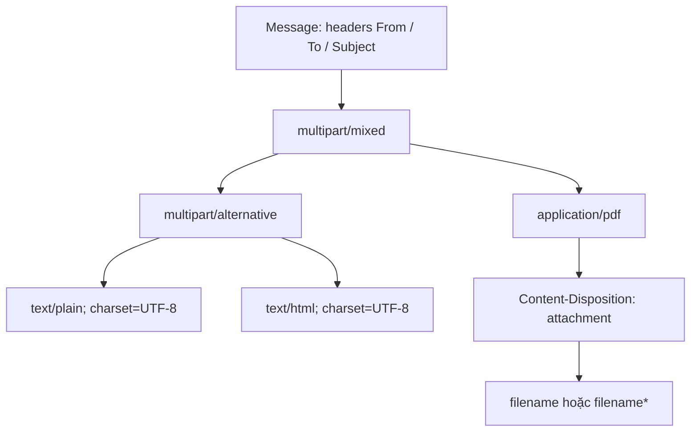
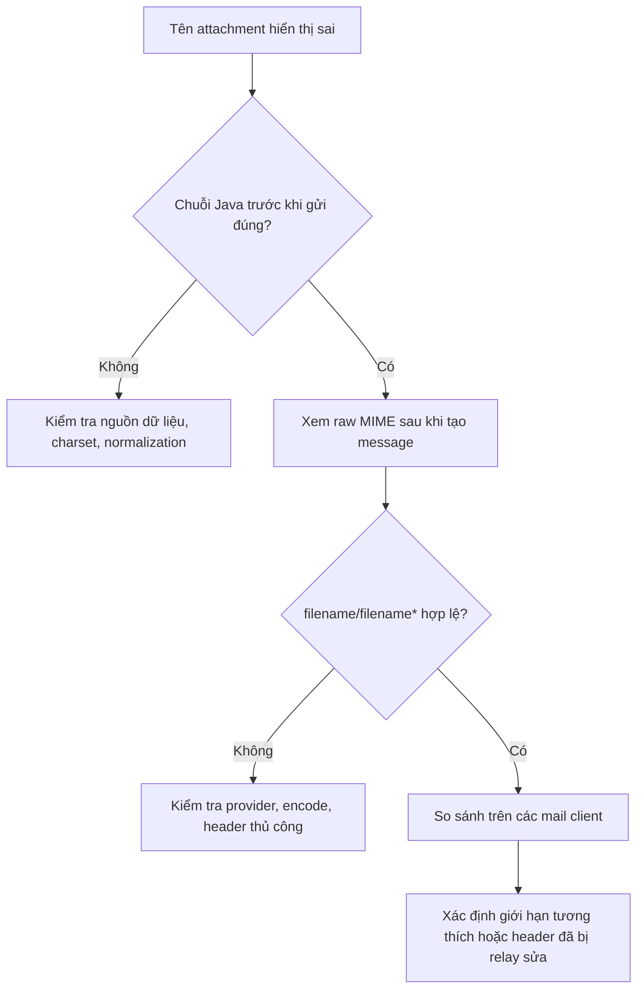

# Filename, tên hiển thị và mã hóa tham số MIME

Khi gửi email từ Spring Framework Mail, một chuỗi Unicode nhìn rất bình thường trong Java có thể phải được biểu diễn bằng một cách hoàn toàn khác trong thông điệp MIME thực tế. Tên người gửi **“Nhóm hỗ trợ”**, tệp đính kèm **“báo cáo tháng 11.pdf”**, tiêu đề thư, tên miền của địa chỉ email và nội dung HTML tuy đều có thể chứa ký tự tiếng Việt, nhưng lại chịu **những quy tắc mã hóa khác nhau**.

Nếu nhầm các quy tắc đó, người nhận có thể nhìn thấy tên tệp dạng `=?UTF-8?...?=`, tên bị biến thành ký tự lỗi, tệp đính kèm mất dấu tiếng Việt, hoặc mail client hiển thị một tên khác với tên mà ứng dụng định gửi. Bài này giải thích các thành phần tên quan trọng trong MIME, cơ chế RFC 2047 và RFC 2231, cách Spring `JavaMailSender` và `MimeMessageHelper` xử lý chúng, cùng các nguyên tắc tương thích và an toàn khi gửi/nhận email.

## 1. “Tên” trong email có thể là ba thứ rất khác nhau

Giả sử ứng dụng gửi một báo cáo PDF cho khách hàng:

- Địa chỉ gửi: `notifications@example.com`.
- Tên người gửi mà người nhận nhìn thấy: **Phòng Chăm sóc Khách hàng**.
- Tiêu đề: **Báo cáo tháng 11 đã sẵn sàng**.
- Tên tệp đính kèm: **báo cáo tháng 11.pdf**.

Đây là bốn giá trị với các vai trò khác nhau:

| Thành phần | Nằm ở đâu | Mục đích | Cơ chế cần quan tâm |
|---|---|---|---|
| **Mailbox / addr-spec** | Địa chỉ trong `From:`, `To:`, `Reply-To:` | Xác định hộp thư gửi/nhận | Cú pháp địa chỉ email; địa chỉ quốc tế hóa cần hạ tầng SMTPUTF8 |
| **Display name / personal name** | Phần tên trước địa chỉ trong `From:`, `To:` | Hiển thị tên con người hoặc tổ chức | Encoded-word theo RFC 2047, hoặc UTF-8 trực tiếp khi hạ tầng hỗ trợ chuẩn liên quan |
| **Subject** | Header `Subject:` | Tên/tiêu đề của thư | Cơ chế encoded-word RFC 2047 hoặc UTF-8 header trong điều kiện phù hợp |
| **Attachment filename** | Tham số `filename` của `Content-Disposition` | Tên gợi ý khi lưu tệp đính kèm | Tham số MIME theo RFC 2183 / RFC 2231; khả năng tương thích giữa client |
| **Content-Type name** | Tham số `name` của `Content-Type` | Tên gợi ý theo cách cũ | Không thay thế vai trò chuẩn của `Content-Disposition: filename` |

Vì thế, **display name không phải filename**, và cả hai đều **không phải địa chỉ email**. Không thể lấy kết quả mã hóa của trường này rồi gắn nguyên sang trường kia.

Một email có thể được hiển thị như sau:

```text
Phòng Chăm sóc Khách hàng <notifications@example.com>
Đến: minh@example.net
Tiêu đề: Báo cáo tháng 11 đã sẵn sàng

Tệp đính kèm: báo cáo tháng 11.pdf
```

Đó là **cách mail client trình bày**. Trên đường truyền, các giá trị trong header có thể đã được chuyển thành biểu diễn ASCII hoặc một dạng UTF-8 được chuẩn MIME cho phép. Mail client giải mã trước khi hiển thị.

## 2. Hai header quyết định tên tệp đính kèm

### 2.1. Content-Disposition và tham số filename

Header `Content-Disposition` mô tả cách một phần MIME nên được trình bày. Với tệp đính kèm, mẫu phổ biến là:

```text
Content-Type: application/pdf
Content-Disposition: attachment; filename="report.pdf"
Content-Transfer-Encoding: base64
```

Ý nghĩa:

- `Content-Type: application/pdf` cho biết kiểu nội dung được khai báo.
- `Content-Disposition: attachment` cho biết đây là phần đính kèm.
- `filename="report.pdf"` là **tên tệp gợi ý** cho ứng dụng đọc thư.
- `Content-Transfer-Encoding: base64` chỉ định cách biểu diễn **dữ liệu tệp** để truyền qua MIME; nó không mã hóa tên tệp.

Tham số `filename` được định nghĩa trong ngữ cảnh MIME attachment bởi RFC 2183. Mail client có thể dùng nó làm tên khi người dùng bấm “Download” hoặc “Save attachment”, nhưng đây chỉ là giá trị gợi ý. Hệ điều hành, phần mềm đọc thư và chính sách an toàn có thể sửa tên hoặc thay thế ký tự không hợp lệ.

### 2.2. Content-Type và tham số name

Trong các thư cũ, tên tệp đôi khi được đặt tại `Content-Type`:

```text
Content-Type: application/pdf; name="report.pdf"
Content-Disposition: attachment; filename="report.pdf"
```

Tham số `name` là cơ chế lâu đời mà một số mail client vẫn đọc vì lý do tương thích. Khi phát sinh thư mới, nên coi **`Content-Disposition: filename` là nơi mô tả tên tệp chính**, còn `Content-Type: name` chỉ là thông tin bổ trợ nếu thư viện hoặc yêu cầu tương thích cần nó.

Nếu hai header mâu thuẫn:

```text
Content-Type: application/pdf; name="report-old.pdf"
Content-Disposition: attachment; filename="report-new.pdf"
```

mail client khác nhau có thể chọn tên khác nhau. Ứng dụng không nên cố tình tạo hai tên không khớp. Khi nhận email từ nguồn không tin cậy, càng không nên giả định có một quy tắc ưu tiên được mọi client thực thi giống nhau.

### 2.3. Filename không nói lên loại nội dung thực

Tên `invoice.pdf` **không chứng minh** payload là PDF. Người gửi có thể khai báo sai `Content-Type` hoặc gắn đuôi tệp giả. Nếu ứng dụng nhận thư và lưu tệp, phải phân biệt:

1. **Tên hiển thị gốc**: dữ liệu dùng để trình bày cho người dùng.
2. **Tên hoặc khóa lưu trữ nội bộ**: thường là UUID/object key do hệ thống tự sinh.
3. **Loại nội dung đã kiểm tra**: suy ra từ kiểm tra thực tế nếu chức năng đòi hỏi an toàn, không tin tuyệt đối vào phần mở rộng.

Không dùng `filename` do người gửi cung cấp làm đường dẫn ghi tệp trực tiếp.

## 3. RFC 2047: mã hóa tên hiển thị của người gửi

Header `From` có thể có dạng:

```text
From: Support Team <notifications@example.com>
```

Với tên tiếng Việt, các môi trường dùng header ASCII truyền thống cần biểu diễn tên bằng **encoded-word** theo RFC 2047. Một encoded-word trông như sau:

```text
=?charset?encoding?encoded-text?=
```

Trong đó:

- `charset` thường là `UTF-8`.
- `encoding` thường là `B` (Base64) hoặc `Q` (một dạng mã hóa tương tự quoted-printable cho header).
- `encoded-text` chứa phần nội dung đã mã hóa.

Ví dụ một header dùng mã hóa Q:

```text
From: =?UTF-8?Q?Nh=C3=B3m_h=E1=BB=97_tr=E1=BB=A3?= <notifications@example.com>
```

Client tương thích giải mã để người đọc thấy **Nhóm hỗ trợ**. Trong encoded-word loại Q, dấu gạch dưới `_` biểu thị **dấu cách**; dãy `=HH` biểu thị byte được mã hóa. Đây là cách mã hóa đặc thù cho *encoded-word*, không phải một quy tắc thay thế khoảng trắng trong mọi header MIME.

Tương tự, `Subject:` có thể được mã hóa bằng RFC 2047. Nếu dùng `MimeMessageHelper.setSubject("Báo cáo tháng 11")`, thư viện sẽ xây dựng header phù hợp theo charset đã cung cấp; ứng dụng thường **không cần tự tạo chuỗi `=?UTF-8?...?=`**.

### 3.1. Tên hiển thị không thay thế địa chỉ email

So sánh:

```text
From: =?UTF-8?Q?Nh=C3=B3m_h=E1=BB=97_tr=E1=BB=A3?= <notifications@example.com>
```

Hai phần mang thông tin khác nhau:

| Phần | Giá trị đã giải mã | Vai trò |
|---|---|---|
| Display name | Nhóm hỗ trợ | Gợi ý nhãn hiển thị, có thể do người gửi tự khai báo |
| Mailbox | notifications@example.com | Địa chỉ sử dụng trong thông điệp để nhận diện hộp thư |

Tên hiển thị có thể bị người gửi giả mạo nên **không được coi là bằng chứng xác thực danh tính**. Việc tin cậy nguồn gửi còn liên quan đến SPF, DKIM, DMARC, nhà cung cấp và chính sách của người nhận. Đặc biệt, tên tổ chức giống một thương hiệu không đồng nghĩa email thực sự thuộc thương hiệu đó.

### 3.2. UTF-8 trực tiếp trong header không luôn có thể dùng

RFC 6532 mở rộng khuôn dạng thông điệp để cho phép UTF-8 trong các header email quốc tế hóa; vận chuyển qua SMTP còn cần hỗ trợ tương ứng, thường liên quan đến phần mở rộng **SMTPUTF8** được định nghĩa trong RFC 6531. Hệ thống gửi, các relay và các hệ thống liên quan phải có khả năng xử lý phù hợp.

Trong trường hợp cần khả năng tương thích rộng với hệ thống email truyền thống:

- Giữ địa chỉ hộp thư ở dạng ASCII nếu đáp ứng nghiệp vụ.
- Cung cấp tên hiển thị Unicode và charset UTF-8 cho Jakarta Mail/Spring.
- Để thư viện mã hóa header theo cơ chế được giao thức hỗ trợ.
- Không bật gửi UTF-8 raw header hoặc địa chỉ có Unicode một cách tùy tiện khi provider chưa hỗ trợ SMTPUTF8.

**IDN và Unicode local part là hai bài toán khác nhau.** Domain có ký tự quốc tế có thể được biểu diễn dạng ASCII tương thích qua IDNA/Punycode, trong khi phần trước ký tự `@` chứa Unicode có thể cần SMTPUTF8 ở mức giao thức. Đừng nghĩ chỉ thêm `charset=UTF-8` trong MIME body là đủ để gửi đến mọi địa chỉ quốc tế hóa.

## 4. RFC 2231: mã hóa tham số MIME như filename

### 4.1. Vì sao không dùng RFC 2047 cho filename?

Tham số `filename` có cú pháp của **MIME parameter**, không phải một trường header dạng văn bản tự do. Chèn encoded-word kiểu:

```text
Content-Disposition: attachment;
  filename="=?UTF-8?B?...?="
```

không phải cách mã hóa tham số chuẩn theo RFC 2231. Một số mail client vẫn cố giải mã để tương thích với thư do phần mềm cũ tạo ra, nhưng client khác có thể hiển thị nguyên văn `=?UTF-8?...?=`.

Đối với giá trị tham số Unicode, chuẩn MIME mở rộng bằng **RFC 2231**:

```text
Content-Disposition: attachment;
  filename*=UTF-8''b%C3%A1o%20c%C3%A1o%20th%C3%A1ng%2011.pdf
```

Mail client hỗ trợ chuẩn này sẽ hiển thị:

```text
báo cáo tháng 11.pdf
```

Cần phân biệt:

- `filename`: tham số tên thông thường, ví dụ `filename="report.pdf"`.
- `filename*`: tham số mở rộng chứa charset, thông tin ngôn ngữ tùy chọn và nội dung mã hóa.
- `UTF-8''`: charset là UTF-8, phần ngôn ngữ rỗng; hai dấu nháy đơn là dấu phân cách cấu trúc, không phải ký tự thuộc tên tệp.
- `%C3%A1`: byte UTF-8 được biểu diễn dưới dạng phần trăm, tạo thành chữ “á” sau giải mã.
- `%20`: dấu cách. Không thay bằng `+` như cách một số bộ mã hóa form URL thường làm.

### 4.2. Cú pháp phần mở rộng và ngôn ngữ

Mẫu khái niệm là:

```text
parameter*=charset'language'percent-encoded-value
```

Ví dụ:

```text
filename*=UTF-8'vi'b%C3%A1o%20c%C3%A1o.pdf
```

Phần `vi` biểu thị gợi ý ngôn ngữ tiếng Việt. Nó **không thay đổi cách giải mã byte UTF-8**; trường charset mới quyết định cách biến byte về ký tự. Nhiều thông điệp thực tế để trống trường ngôn ngữ.

Không nên tự dùng `URLEncoder.encode(filename, UTF_8)` rồi ghép vào RFC 2231 mà không điều chỉnh: `URLEncoder` được thiết kế cho dữ liệu biểu mẫu URL và có quy ước `+` cho dấu cách. Cách mã hóa tham số MIME cần tuân thủ đúng cú pháp RFC 2231 và không được phá vỡ dấu phần trăm hay các ký tự có ý nghĩa.

### 4.3. Tên dài và parameter continuation

RFC 2231 cũng định nghĩa cách chia một giá trị tham số dài thành nhiều phần đánh số:

```text
Content-Disposition: attachment;
  filename*0*=UTF-8''b%C3%A1o%20c%C3%A1o%20;
  filename*1*=th%C3%A1ng%2011.pdf
```

Các phần `*0*`, `*1*` ghép theo thứ tự để tạo tên hoàn chỉnh. Việc chia cần tôn trọng cú pháp và các đoạn mã phần trăm; không được tùy ý cắt giữa một escape `%HH` hoặc byte sequence rồi tạo header sai.

MIME header cũng có thể **gấp dòng** (folding): CRLF theo sau bởi khoảng trắng hoặc tab tạo một dòng logic. Gấp dòng header và chia tham số theo RFC 2231 là hai cơ chế khác nhau, dù có thể xuất hiện đồng thời.

Không nên tự viết thuật toán chia header chỉ để gửi một attachment. `MimeMessageHelper` và Jakarta Mail/Angus Mail có cơ chế tạo cấu trúc MIME; ứng dụng nên sử dụng API cấp cao và kiểm tra hiệu quả thực tế trên mail client mục tiêu khi có yêu cầu tương thích đặc biệt.

### 4.4. ASCII fallback có tác dụng gì?

Một số hệ thống cũ không hiểu `filename*`. Nếu cần hỗ trợ chúng, thông điệp có thể cung cấp tên ASCII đơn giản làm fallback, đồng thời có tên chuẩn mở rộng:

```text
Content-Disposition: attachment;
  filename="bao-cao-thang-11.pdf";
  filename*=UTF-8''b%C3%A1o%20c%C3%A1o%20th%C3%A1ng%2011.pdf
```

Các tham số thể hiện tên cùng ý nghĩa với hai mức biểu diễn. Đây là **ví dụ wire format dùng để giải thích khả năng tương thích**, không phải lời hứa Jakarta Mail sẽ luôn tạo chính xác cả hai tham số khi gọi `addAttachment()`. Hành vi thực tế phụ thuộc phiên bản provider, thuộc tính MIME được bật và mail client phía nhận.

Đối với ứng dụng có ràng buộc tương thích nghiêm ngặt, thử nghiệm email thực tế trên các client được hỗ trợ quan trọng hơn việc giả định một kiểu header sẽ hoạt động ở mọi nơi.

## 5. So sánh nhanh các chuẩn mã hóa

| Cần mã hóa | Giá trị mẫu | Cách phù hợp | Điều không nên làm |
|---|---|---|---|
| Tên người gửi | `Nhóm hỗ trợ` | RFC 2047 encoded-word cho header ASCII truyền thống; thư viện tự xử lý | Đưa vào `filename*` |
| Tiêu đề | `Báo cáo tháng 11` | API `setSubject` với UTF-8, thư viện tạo header | Tự chèn encoded-word rồi để thư viện mã hóa thêm lần nữa |
| Tên tệp đính kèm | `báo cáo tháng 11.pdf` | Tham số MIME RFC 2231 qua `setFileName`/`addAttachment` | Giả định RFC 2047 trong `filename` được mọi client hiểu |
| Nội dung text/HTML | `Xin chào, Nguyễn!` | `charset=UTF-8` và Content-Transfer-Encoding thích hợp | Lấy tên charset của body làm lời giải cho header filename |
| Địa chỉ có Unicode | `tên@example.com` | Cần xem hỗ trợ SMTPUTF8 và chuẩn quốc tế hóa địa chỉ | Coi địa chỉ như một display name để encode-word |
| Tên tệp trong HTTP download | `báo cáo.pdf` | Content-Disposition theo các chuẩn HTTP tương ứng, ví dụ RFC 6266 | Sao chép nguyên toàn bộ cơ chế HTTP sang MIME email |

RFC 2231 xuất hiện trong MIME email; cú pháp có điểm giống cách mở rộng tham số trong HTTP nhưng hai môi trường có tiêu chuẩn liên quan và quy tắc tương thích riêng. Khi lập trình endpoint tải tệp qua HTTP, đừng dùng thẳng cách thiết lập header của MIME attachment mà không xét chuẩn HTTP.

## 6. Tên tệp đi qua cấu trúc multipart như thế nào?

Một email có body text, body HTML và một tệp PDF thường được tổ chức thành nhiều phần MIME:



Thông điệp wire-format rút gọn:

```text
From: =?UTF-8?Q?Nh=C3=B3m_h=E1=BB=97_tr=E1=BB=A3?= <notifications@example.com>
To: minh@example.net
Subject: =?UTF-8?Q?B=C3=A1o_c=C3=A1o_th=C3=A1ng_11?=
MIME-Version: 1.0
Content-Type: multipart/mixed; boundary="mix-1"

--mix-1
Content-Type: multipart/alternative; boundary="alt-1"

--alt-1
Content-Type: text/plain; charset=UTF-8
Content-Transfer-Encoding: quoted-printable

...
--alt-1
Content-Type: text/html; charset=UTF-8
Content-Transfer-Encoding: quoted-printable

...
--alt-1--
--mix-1
Content-Type: application/pdf
Content-Disposition: attachment;
 filename*=UTF-8''b%C3%A1o%20c%C3%A1o%20th%C3%A1ng%2011.pdf
Content-Transfer-Encoding: base64

JVBERi0xLjQK...
--mix-1--
```

Phần `JVBERi0xLjQK...` chỉ minh họa dữ liệu Base64, không phải một tệp PDF hoàn chỉnh. Giá trị boundary, mức lồng nhau, folding và cách mã hóa header do thư viện sinh có thể khác. Ví dụ giúp thấy ba sự thật:

1. **Display name và Subject** nằm trên header cấp message.
2. **Filename** nằm trên header của riêng phần attachment.
3. **Content-Transfer-Encoding** áp dụng lên body của phần MIME, không quyết định cách mã hóa tham số tên tệp.

Nếu nhúng ảnh trong HTML bằng `cid:...`, ảnh thường là một phần có `Content-ID` và cấu trúc `multipart/related`. Nó khác với tệp mà người dùng chủ động tải về, dù một số client có thể hiển thị ảnh inline trong danh sách đính kèm.

## 7. Gửi email có display name và attachment Unicode bằng Spring

### 7.1. Dependency và cấu hình

Với Spring Boot 3.x và Spring Framework Mail, có thể sử dụng starter:

```groovy
dependencies {
    implementation 'org.springframework.boot:spring-boot-starter-mail'
}
```

Ví dụ cấu hình cho SMTP test server nội bộ:

```yaml
spring:
  mail:
    host: localhost
    port: 1025
    default-encoding: UTF-8
    properties:
      mail:
        smtp:
          auth: false
          starttls:
            enable: false

app:
  mail:
    from: notifications@example.test
```

Cấu hình này chỉ phù hợp với SMTP giả lập hoặc môi trường thử nghiệm được kiểm soát. Khi dùng SMTP production, thiết lập TLS, xác thực và secret theo yêu cầu provider. `default-encoding` giúp thông điệp sử dụng UTF-8 cho phần nội dung được tạo thông qua auto-config, nhưng **không có nghĩa mọi header và mọi địa chỉ email đều được gửi nguyên UTF-8 không qua mã hóa**.

### 7.2. Dịch vụ gửi có tên người gửi tiếng Việt

Ví dụ dùng `MimeMessageHelper`:

```java
package com.example.mail;

import java.io.UnsupportedEncodingException;

import jakarta.mail.MessagingException;
import jakarta.mail.internet.MimeMessage;
import org.springframework.beans.factory.annotation.Value;
import org.springframework.core.io.ByteArrayResource;
import org.springframework.mail.javamail.JavaMailSender;
import org.springframework.mail.javamail.MimeMessageHelper;
import org.springframework.stereotype.Service;
import org.springframework.web.util.HtmlUtils;

@Service
public class MonthlyReportMailService {

    private final JavaMailSender mailSender;
    private final String fromAddress;

    public MonthlyReportMailService(
            JavaMailSender mailSender,
            @Value("${app.mail.from}") String fromAddress) {
        this.mailSender = mailSender;
        this.fromAddress = fromAddress;
    }

    public void sendMonthlyReport(
            String toAddress,
            String recipientName,
            byte[] pdfBytes
    ) throws MessagingException, UnsupportedEncodingException {
        MimeMessage message = mailSender.createMimeMessage();
        MimeMessageHelper helper =
                new MimeMessageHelper(message, true, "UTF-8");

        // Mailbox là địa chỉ; personal name là nhãn hiển thị.
        helper.setFrom(fromAddress, "Nhóm hỗ trợ");
        helper.setTo(toAddress);
        helper.setSubject("Báo cáo tháng 11 đã sẵn sàng");

        String plain = "Xin chào " + recipientName
                + ", báo cáo tháng 11 được đính kèm.";
        String html = "<p>Xin chào <strong>"
                + HtmlUtils.htmlEscape(recipientName)
                + "</strong>, báo cáo tháng 11 được đính kèm.</p>";
        helper.setText(plain, html);

        // Tên file Unicode do ứng dụng cung cấp, không tự encode-word.
        helper.addAttachment(
                "báo cáo tháng 11.pdf",
                new ByteArrayResource(pdfBytes),
                "application/pdf"
        );

        mailSender.send(message);
    }
}
```

Điểm cần lưu ý:

- `setFrom(address, personal)` phân biệt địa chỉ thật với tên hiển thị. Jakarta Mail sẽ áp dụng cách biểu diễn tên phù hợp với cấu hình và charset.
- `new MimeMessageHelper(message, true, "UTF-8")` bật cấu trúc multipart và khai báo encoding mong muốn cho các trường/part do helper xây dựng.
- `setSubject(...)` nhận Unicode trong Java; không yêu cầu ứng dụng tự chèn chuỗi mã hóa RFC 2047.
- `setText(plain, html)` cung cấp bản text dự phòng và bản HTML. Nội dung do người dùng cung cấp cần escape trước khi chèn vào HTML.
- `addAttachment(filename, resource, contentType)` tiếp nhận **tên hiển thị của attachment**; phần tạo MIME header nên để Jakarta Mail xử lý.
- `ByteArrayResource` trả về luồng đọc mới trên mỗi lần yêu cầu, phù hợp với API đính kèm. Tránh sử dụng tài nguyên luồng chỉ đọc một lần nếu thư viện cần đọc lại dữ liệu.

Với báo cáo lớn, cân nhắc streaming hoặc nguồn dữ liệu có thể mở lại nhiều lần thay vì giữ toàn bộ `byte[]` trong heap. Đặt giới hạn kích thước và loại tệp trước khi gọi SMTP.

### 7.3. Vì sao SimpleMailMessage không phù hợp?

`SimpleMailMessage` là abstraction cho thư **text thuần** với các trường cơ bản như From, To, Subject và Text. Nó không đại diện cho cấu trúc nhiều phần MIME, attachment và tên personal theo cùng cách `MimeMessageHelper` cung cấp.

Nếu cần:

- tệp đính kèm;
- ảnh inline;
- text và HTML song song;
- display name của người gửi có charset rõ ràng;
- cấu trúc multipart tùy chỉnh;

thì nên sử dụng `MimeMessage`/`MimeMessageHelper`. Không cố ghép header MIME bằng cách thêm chuỗi văn bản thô vào nội dung của `SimpleMailMessage`.

## 8. Giữ tên tệp chính xác nhưng an toàn

### 8.1. Không chuyển thẳng tên upload vào attachment

Giả sử tên tệp đến từ trình duyệt hoặc đối tác:

```text
../../private/report.pdf
C:\users\alice\Desktop\invoice.pdf
báo cáo tháng 11.pdf
report.pdf
report.pdf<CR><LF>Content-Type: text/html
```

Ứng dụng không nên coi tất cả là tên tệp đã được xác minh. Tên upload có thể chứa đường dẫn, ký tự điều khiển, dấu xuống dòng, ký tự Unicode khiến phần mở rộng bị hiển thị lộn chiều hoặc một tên dài bất thường.

Quy trình hợp lý:

1. Chỉ nhận các tệp mà người dùng/nghiệp vụ được phép gửi.
2. Lưu file bằng khóa nội bộ riêng, không sử dụng tên nguyên bản làm đường dẫn lưu.
3. Tạo **tên đính kèm dùng để hiển thị** bằng chính sách xác định: bỏ prefix đường dẫn nếu có chủ đích, chuẩn hóa Unicode và loại tên nguy hiểm.
4. Kiểm tra kích thước, loại file, chính sách antivirus/quét nội dung khi phù hợp.
5. Dùng `addAttachment(safeDisplayName, ...)`; không ghép header thủ công.

### 8.2. Ví dụ chuẩn hóa tên cho môi trường có chính sách chặt

Đây là **một chính sách minh họa**, không phải bộ lọc đầy đủ cho mọi hệ điều hành:

```java
package com.example.mail;

import java.text.Normalizer;

public final class AttachmentNamePolicy {

    private AttachmentNamePolicy() {}

    public static String prepareDisplayName(String supplied) {
        if (supplied == null) {
            throw new IllegalArgumentException("Missing filename");
        }

        // Chấp nhận input có dấu phân cách Windows hoặc Unix,
        // nhưng không cho giữ path của máy người gửi.
        String normalizedSeparators = supplied.replace('\\', '/');
        String basename = normalizedSeparators.substring(
                normalizedSeparators.lastIndexOf('/') + 1
        );
        basename = Normalizer.normalize(
                basename, Normalizer.Form.NFC).strip();

        if (basename.isEmpty()
                || basename.equals(".")
                || basename.equals("..")
                || basename.length() > 160) {
            throw new IllegalArgumentException("Invalid filename");
        }

        for (int i = 0; i < basename.length(); i++) {
            char ch = basename.charAt(i);
            if (Character.isISOControl(ch)
                    || Character.getType(ch) == Character.FORMAT
                    || "<>:\"|?*".indexOf(ch) >= 0) {
                throw new IllegalArgumentException(
                        "Unsupported filename character");
            }
        }

        return basename;
    }
}
```

Ví dụ:

```java
String safe = AttachmentNamePolicy.prepareDisplayName(
        "C:\\reports\\báo cáo tháng 11.pdf");
// safe = "báo cáo tháng 11.pdf"

helper.addAttachment(
        safe,
        new ByteArrayResource(pdfBytes),
        "application/pdf");
```

**NFC** giúp thống nhất các cách biểu diễn Unicode tương đương, chẳng hạn ký tự có dấu dựng sẵn và chuỗi ký tự gốc cộng dấu kết hợp. Chính sách cũng từ chối một số ký tự điều khiển và định dạng Unicode có thể gây nhầm lẫn khi hiển thị.

Với môi trường tải tệp về Windows, macOS hay Linux, có thể cần thêm giới hạn byte, tên thiết bị dành riêng (như `CON` trên Windows), dấu chấm/khoảng trắng cuối, quy tắc tên trùng và khả năng tạo một ASCII fallback rõ ràng. Nếu filename là dữ liệu do người dùng cung cấp, giao diện phải cho biết khi tên được điều chỉnh; không âm thầm tạo ra sự khác biệt nghiệp vụ quan trọng.

### 8.3. Tên hiển thị của người gửi cũng là đầu vào cần kiểm soát

Khi dùng tên hiển thị nhận từ người dùng, chẳng hạn tên công ty của từng tenant, kiểm tra:

- Giới hạn độ dài và ký tự điều khiển, đặc biệt CR/LF.
- Không cho phép tenant tự ý giả mạo tên thương hiệu hoặc mailbox ngoài phạm vi được cấp quyền.
- Tách rõ display name khỏi địa chỉ From, không chấp nhận một chuỗi chứa header tự do như `From: ...\r\nBcc: ...`.
- Tách chính sách trình bày tên người gửi khỏi việc xác minh quyền gửi cho domain.

Ngay cả khi thư viện xử lý escaping và encoding, ứng dụng vẫn cần kiểm tra **quyền sử dụng địa chỉ** và dữ liệu nghiệp vụ.

## 9. Đọc tên tệp khi nhận email

Ứng dụng có thể nhận hoặc phân tích MIME để nhập tài liệu từ email. Khi đó, việc giải mã là chiều ngược lại:

```text
MIME bytes / headers từ người gửi
    ↓
Jakarta Mail parser
    ↓
BodyPart.getFileName()
    ↓
Giá trị tên đã diễn giải (phụ thuộc header/provider)
    ↓
Chuẩn hóa, xác thực, lưu bằng khóa an toàn
```

Ví dụ minh họa cách đi qua các phần MIME:

```java
package com.example.mail;

import java.io.IOException;
import jakarta.mail.MessagingException;
import jakarta.mail.Multipart;
import jakarta.mail.Part;

public final class MimeAttachmentInspector {

    private MimeAttachmentInspector() {}

    public static void inspect(Part part)
            throws MessagingException, IOException {
        if (part.isMimeType("multipart/*")) {
            Object content = part.getContent();
            if (content instanceof Multipart multipart) {
                for (int i = 0; i < multipart.getCount(); i++) {
                    inspect(multipart.getBodyPart(i));
                }
            }
            return;
        }

        String originalName = part.getFileName();
        String disposition = part.getDisposition();

        if (originalName != null
                || Part.ATTACHMENT.equalsIgnoreCase(disposition)) {
            // Đừng ghi originalName trực tiếp thành đường dẫn file.
            // Ở đây có thể kiểm tra filename, kích thước, loại tệp
            // và đọc part.getInputStream() qua giới hạn byte.
            System.out.println("Attachment part found");
        }
    }
}
```

Đoạn này là ví dụ nhận diện phần đính kèm, **không phải implementation lưu file an toàn**. Email ngoài đời còn có cấu trúc message lồng nhau, phần inline và MIME bất thường. Xử lý đầu vào không tin cậy cần giới hạn độ sâu multipart, kích thước body, tổng số phần, dung lượng đã giải nén và thời gian xử lý.

### 9.1. getFileName có luôn trả đúng Unicode?

Không thể bảo đảm với mọi email ngoài thực tế, vì:

- Người gửi có thể dùng `filename*=UTF-8''...` chuẩn RFC 2231.
- Người gửi có thể dùng `filename="=?UTF-8?B?...?="` kiểu cũ không chuẩn cho parameter.
- Người gửi có thể gửi byte không hợp lệ hoặc khai báo sai charset.
- Provider/parser của ứng dụng có thể bật hoặc tắt các chế độ tương thích riêng.

Ở phần mềm Jakarta Mail thông dụng, `BodyPart.getFileName()` và parser liên quan có thể giải mã tham số theo cấu hình của provider. Không nên gọi `MimeUtility.decodeText()` một cách vô điều kiện lên mọi tên đã được thư viện giải mã: đôi khi gây diễn giải sai hoặc **giải mã hai lần**.

Nếu bắt buộc hỗ trợ thư legacy dùng encoded-word trong tham số, hãy triển khai một nhánh tương thích **có điều kiện**, có bộ email mẫu và kiểm tra đúng phiên bản thư viện. Không bật một lựa chọn non-standard toàn cục mà không hiểu tác động tới các thư chuẩn.

### 9.2. Phân biệt filename, disposition và Content-ID

Một MIME part có thể có:

```text
Content-Disposition: inline
Content-ID: <company-logo>
Content-Type: image/png
```

Đó có thể là ảnh được HTML tham chiếu bằng ``. Ngược lại, tệp với `Content-Disposition: attachment` thường được trình bày như một đính kèm để người dùng lưu.

Tuy nhiên, mail client có thể trình bày khác nhau; các part `inline` vẫn có thể có tên hoặc xuất hiện trong danh sách attachment. Khi ứng dụng nhập email tự động, hãy dùng mục đích nghiệp vụ và các thuộc tính của part, không chỉ `getFileName() != null`, để quyết định file có được xử lý hay không.

## 10. Những thuộc tính Jakarta Mail dễ gây nhầm lẫn

Trong một số triển khai Jakarta Mail/Angus Mail, bạn có thể gặp các tùy chọn tương thích với tên như:

| Tên thuộc tính thường gặp | Liên quan đến điều gì? | Điều cần thận trọng |
|---|---|---|
| `mail.mime.encodeparameters` | Mã hóa MIME parameters theo cơ chế mở rộng, trong đó có RFC 2231 | Cần biết phiên bản thư viện và phạm vi property |
| `mail.mime.decodeparameters` | Diễn giải MIME parameters đã mã hóa khi parse | Không tự decode thêm lần nữa khi parser đã xử lý |
| `mail.mime.encodefilename` | Tương thích cách mã hóa filename bằng encoded-word theo RFC 2047 | Đây là hành vi tương thích lịch sử, không phải chuẩn RFC 2231 |
| `mail.mime.decodefilename` | Thử giải mã encoded-word trong filename legacy | Có thể thay đổi kết quả nhận từ email ngoài đời |
| `mail.mime.allowutf8` | Liên quan đến khả năng xử lý UTF-8 raw trong header ở implementation nhất định | Không thay thế yêu cầu hỗ trợ SMTPUTF8 trên đường truyền |

**Không nên coi đây là cấu hình Spring Boot phổ quát có thể đổi tùy ý trong mọi môi trường.** Một số thuộc tính được implementation đọc rất sớm, có thể là system property hoặc được nạp khi khởi tạo lớp; mặc định và phạm vi hỗ trợ phụ thuộc phiên bản Jakarta Mail/Angus Mail và cách Spring Boot cấu hình Session. Nếu cần đổi, hãy đối chiếu tài liệu đúng version, thiết lập trước khi khởi tạo mail provider và kiểm tra MIME thực tế sinh ra.

Hướng ưu tiên trong ứng dụng thông thường:

1. Đưa **chuỗi Unicode nguyên bản** vào API Spring/Jakarta Mail.
2. Chỉ định charset `UTF-8` ở helper.
3. Không tự biến tên tệp thành encoded-word.
4. Xem nguyên văn MIME được sinh ra khi gặp trường hợp không tương thích.
5. Chỉ bật tùy chọn legacy cho trường hợp cần thiết và có kiểm thử hồi quy.

## 11. Gỡ lỗi tên tệp sai: xem cả raw MIME và giá trị đã decode

Nếu người dùng báo tên tệp thành `báo cáo.pdf` hoặc `=?UTF-8?B?...?=`, trước tiên cần xác định lỗi nằm ở đâu:



### 11.1. Xuất MIME để quan sát

Có thể ghi message đã tạo vào một luồng kiểm tra **trong môi trường test**:

```java
import java.io.ByteArrayOutputStream;
import java.nio.charset.StandardCharsets;
import jakarta.mail.internet.MimeMessage;

MimeMessage message = mailSender.createMimeMessage();
// Tạo MimeMessageHelper, setFrom, setSubject, addAttachment...

message.saveChanges();
ByteArrayOutputStream buffer = new ByteArrayOutputStream();
message.writeTo(buffer);

String wireSample = buffer.toString(StandardCharsets.US_ASCII);
// Chỉ dùng wireSample để phân tích kỹ thuật trong test,
// không ghi toàn bộ email thật vào log production.
```

**Lưu ý:** mẫu trên chỉ minh họa cách quan sát, không thực hiện gửi SMTP. Header và body khi xuất thực tế có thể chứa dữ liệu bí mật, địa chỉ khách hàng, file đính kèm hoặc token. Chỉ dùng dữ liệu test và xử lý file debug theo chính sách dữ liệu.

Không nên so sánh toàn bộ raw MIME như một chuỗi bất biến: boundary ngẫu nhiên, cách xuống dòng, folding, encoded-word Base64/Q và các lựa chọn tương đương của thư viện có thể thay đổi mà vẫn đúng chuẩn. Kiểm tra ý nghĩa giải mã và những thuộc tính bắt buộc quan trọng hơn.

### 11.2. Các dạng lỗi phổ biến

| Hiện tượng | Nguyên nhân có thể | Cách điều tra |
|---|---|---|
| `báo cáo.pdf` | Byte UTF-8 bị giải mã bằng charset khác | Kiểm tra encoding từ nguồn và nơi nhận, xem raw header |
| `=?UTF-8?B?...?=` hiện nguyên | Dùng RFC 2047 ở vị trí filename parameter, hoặc client không decode kiểu legacy | Kiểm tra `Content-Disposition` và cú pháp RFC 2231 |
| Tên tệp biến thành `report.pdf` | Có ASCII fallback hoặc client tự chuẩn hóa | So sánh `filename`/`filename*` và cách client ưu tiên |
| Tên bị cắt giữa chừng | Header quá dài, continuation sai hoặc client có giới hạn | Kiểm tra folding, phần `*0*`/`*1*` và độ dài |
| Hai client hiển thị hai tên khác nhau | Khác mức hỗ trợ RFC 2231 hoặc hai tham số mâu thuẫn | Thu raw MIME và kiểm tra từng mail client |
| Tiêu đề đúng nhưng attachment sai | Header Subject và MIME parameter dùng chuẩn khác nhau | Không suy từ `setSubject()` để xử lý filename |
| Tên thư hiển thị sai nhưng địa chỉ đúng | Lỗi mã hóa trường personal name hoặc khách hàng dùng Contact alias | Kiểm tra `From` raw và cấu hình danh bạ của mail client |
| Chỉ email gửi qua một relay bị lỗi | Relay có thể sửa MIME header hoặc line folding | So sánh bản trước và sau relay nếu hệ thống cho phép |

Đặc biệt, danh bạ của người nhận có thể **ghi đè tên người gửi hiển thị** trên giao diện. Thấy tên khác trên client không đủ bằng chứng để kết luận header `From` đã bị mã hóa sai.

## 12. Kiểm tra khả năng tương thích giữa các mail client

Một thông điệp có thể đúng theo RFC nhưng được hiển thị khác nhau bởi các ứng dụng email. Một kế hoạch kiểm thử cần có cả **kiểm tra giao thức** và **kiểm tra trình bày thực tế**.

| Kịch bản | Dữ liệu thử | Điều muốn quan sát |
|---|---|---|
| Tên ASCII đơn giản | `report.pdf` | Không bị sửa bất ngờ |
| Tên tiếng Việt có dấu | `báo cáo tháng 11.pdf` | Decode đúng toàn bộ ký tự |
| Ký tự và ngôn ngữ hỗn hợp | `Báo cáo 東京 2026.pdf` | Các code point được bảo toàn |
| Dấu cách, dấu ngoặc | `báo cáo (bản cuối).pdf` | Không mất ký tự hoặc sai quoting |
| Tên rất dài | Nhiều chục ký tự Unicode | Header được folding/continuation hợp lệ, không cắt sai |
| Tên giống nhau | Hai attachment đều `report.pdf` | Mail client và quy trình lưu không ghi đè âm thầm |
| Tên người gửi Unicode | `Nhóm hỗ trợ` | Hiển thị và giải mã personal name |
| Subject Unicode | `Báo cáo quý IV` | Không bị double-encode |
| Tên có ký tự điều khiển | CR/LF, tab, bidi format | Bị chính sách xác thực đầu vào xử lý |
| Email legacy | Filename mã hóa RFC 2047 trong parameter | Nhánh tương thích không làm hỏng thư chuẩn |

Khi cần kiểm tra ở mức code, có thể xây dựng một `MimeMessage` với `MimeMessageHelper` mà không cần SMTP thật. Sau khi `saveChanges()`, duyệt các `BodyPart`, gọi `getFileName()`, kiểm tra disposition, content type và so sánh với giá trị mong muốn. Một test tích hợp qua SMTP giả lập giúp kiểm tra thêm việc serialization và nội dung người nhận nhìn thấy.

Đối với kiểm thử bằng thư thật, chọn mailbox thử nghiệm ở đúng client mục tiêu và ghi nhận phiên bản ứng dụng, nền tảng, môi trường và raw header khi có thể. Tránh gửi tệp chứa dữ liệu khách hàng thật chỉ để kiểm tra tên file.

## 13. Thực hành từng bước với Spring Framework Mail

### Bài thực hành A — Hiểu ba nhóm header

Tạo `MimeMessage` gửi từ `"Nhóm hỗ trợ" <notifications@example.test>`, tiêu đề `"Báo cáo tháng 11"`, tệp `"báo cáo tháng 11.pdf"` và nội dung tiếng Việt. Hãy chỉ ra:

1. Header nào đại diện cho display name.
2. Header nào chứa Subject.
3. Part nào chứa tên attachment.
4. Phần nào cần mã hóa tham số theo RFC 2231.
5. Phần nào chứa dữ liệu binary Base64.

### Bài thực hành B — So sánh với tên ASCII

Gửi hai bản email tương đương:

```text
1) filename: bao-cao-thang-11.pdf
2) filename: báo cáo tháng 11.pdf
```

Xem raw MIME, ghi lại giá trị `filename`, `filename*` hoặc continuation thực tế được mail provider sinh ra. Sau đó mở trên một vài email client để so sánh tên hiển thị. Không bắt buộc hai thông điệp phải có cùng cấu trúc header; tiêu chí quan trọng là tên được giải mã đúng và không tạo ra header sai.

### Bài thực hành C — Phân biệt mã hóa tên với Content-Transfer-Encoding

Sử dụng cùng một tên Unicode nhưng đính kèm:

- Tệp PDF hoặc ZIP mang nội dung binary.
- Một tệp text UTF-8.

Quan sát `Content-Type`, `Content-Disposition` và `Content-Transfer-Encoding` của mỗi phần. Giải thích vì sao tên tệp vẫn cần xử lý theo quy tắc tham số MIME dù body có thể sử dụng Base64, quoted-printable hoặc một encoding hợp lệ khác.

### Bài thực hành D — Tiếp nhận MIME không đáng tin cậy

Giả lập nhận email từ đối tác, trong đó:

```text
Content-Disposition: attachment;
 filename="../../reports/báo cáo.pdf"
```

Giải thích vì sao không thể lưu file bằng đường dẫn đó. Viết bước chuẩn hóa tên hiển thị, tạo khóa lưu trữ nội bộ độc lập, đặt giới hạn kích thước và kiểm tra loại nội dung.

### Bài thực hành E — Tương thích thư legacy

Chuẩn bị một thư có filename tham số theo RFC 2231 và một thư legacy dùng encoded-word trong tham số. Với thư viện Jakarta Mail/Angus Mail đang dùng, đọc kết quả của `getFileName()` và phân biệt trường hợp nào tự decode được, trường hợp nào cần hỗ trợ có điều kiện. Không dùng decode kép cho mọi tên.

## 14. Những lỗi lập trình thường gặp

**Tự mã hóa attachment name bằng `MimeUtility.encodeText()` rồi gọi `addAttachment()`.** `encodeText()` phục vụ encoded-word ở header text, không phải giải pháp chung cho tham số `filename`. Khi kết hợp với provider tự mã hóa, có thể gây lỗi hoặc mã hóa hai lần.

**Sử dụng `URLEncoder` làm bộ mã hóa MIME parameter mà không xử lý khác biệt.** Form encoding dùng `+` cho dấu cách, trong khi phần mở rộng RFC 2231 biểu diễn byte bằng quy tắc percent-encoding phù hợp với cú pháp tham số.

**Tưởng chỉ cần `charset=UTF-8` trong HTML là tên file được mã hóa đúng.** Charset của body và encoding của filename là hai lớp khác nhau.

**Đặt tên tệp vào `Content-Type: name` và bỏ qua `Content-Disposition`.** Một số client legacy có thể hiểu, nhưng tên attachment nên được mô tả qua disposition.

**Tin rằng mọi client đều chọn `filename*` giống nhau.** Kiểm tra mail client mục tiêu và cân nhắc ASCII fallback khi cần tương thích.

**Dùng tên gốc làm đường dẫn lưu trên server.** Đây là dữ liệu người gửi có thể kiểm soát; cần khóa lưu trữ riêng và chính sách kiểm tra đầu vào.

**Tin display name là danh tính người gửi.** Tên trong `From` có thể giả mạo; phải đánh giá địa chỉ, domain và kết quả xác thực độc lập.

**Lấy tên đã decode và decode thêm một lần vô điều kiện.** Một số provider đã xử lý RFC 2231; decode kép dễ làm sai tên, nhất là thư bị tạo không chuẩn.

**Cố ép mọi tên Unicode qua địa chỉ mailbox.** Display name cho phép thể hiện tên Unicode qua cơ chế header, còn địa chỉ mailbox quốc tế hóa có yêu cầu SMTPUTF8 và tương thích hạ tầng riêng.

## 15. Ghi nhớ khi làm việc với MIME filename

Hãy bắt đầu từ **ý nghĩa của dữ liệu trước khi chọn mã hóa**: địa chỉ email để định tuyến, display name để hiển thị người gửi, Subject để đặt tiêu đề, `filename` để đặt tên phần đính kèm, và body/attachment payload để chứa dữ liệu. Tên người gửi trong header truyền thống thường đi qua RFC 2047; tên tệp trong tham số MIME nên đi qua RFC 2231; các byte của nội dung có thể được truyền bằng Base64 hoặc quoted-printable. Đó là những lớp mã hóa khác nhau.

Trong ứng dụng Spring, nên truyền **chuỗi Unicode nguyên bản** cho `MimeMessageHelper.setFrom(address, personal)`, `setSubject(...)` và `addAttachment(filename, ...)`, với charset UTF-8 và provider được cấu hình đúng. Chỉ can thiệp vào header hoặc tùy chọn tương thích khi có trường hợp thực tế được xác nhận bằng raw MIME và mail client mục tiêu. Cuối cùng, hãy nhớ filename và display name đều là dữ liệu hiển thị có thể đến từ nguồn không tin cậy: chúng cần được xác thực, chuẩn hóa và tách khỏi danh tính, quyền truy cập cũng như đường dẫn lưu trữ nội bộ.
