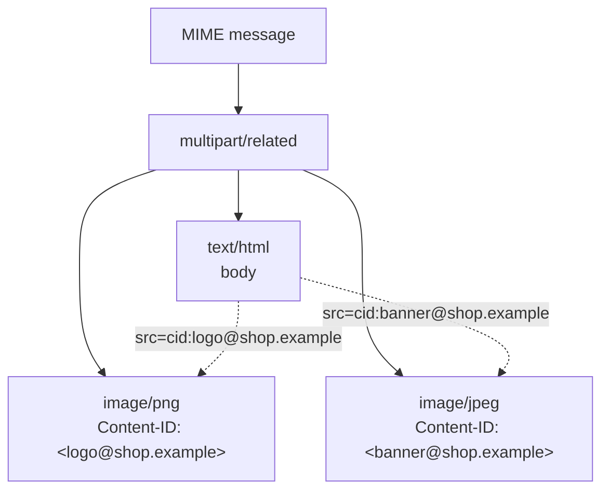

# Content-ID và tham chiếu `cid:` trong HTML email

Khi gửi một email HTML bằng Spring Framework Mail, ứng dụng có thể muốn đặt logo, biểu tượng, mã QR hoặc hình minh họa ngay trong phần nội dung thư. Một cách phổ biến là **nhúng tài nguyên thành một MIME part** và tham chiếu đến part đó bằng URL `cid:` trong HTML. Cơ chế này dựa trên hai thành phần phối hợp:

- **`Content-ID`** là header của một phần nội dung MIME, dùng để định danh phần nội dung đó trong thông điệp.
- **`cid:`** là lược đồ URI để HTML trong email chỉ đến MIME part mang `Content-ID` tương ứng.

Ví dụ, một MIME part hình ảnh có header `Content-ID: <brand-logo.123@shop.example>` có thể được tham chiếu trong HTML bằng:

```html

```

Hình ảnh không cần nằm ở một URL công khai. Nó được vận chuyển cùng email như một phần MIME, sau đó email client tìm part có ID khớp với `cid:` để dựng nội dung. Tuy nhiên, **không phải email client nào cũng hiển thị ảnh inline giống nhau**, và Content-ID tự nó không ép ứng dụng đọc thư phải hiển thị hình ảnh.

## 1. Tại sao HTML email cần `cid:`?

Một email HTML là **nội dung thông điệp**, không phải một trang web có toàn bộ tài nguyên được trình duyệt tải qua HTTP. Khi HTML chứa:

```html

```

email client có thể phải truy cập mạng để lấy ảnh. Một số client chặn ảnh từ xa mặc định, đưa ảnh qua proxy hoặc áp dụng chính sách riêng. Nếu tài nguyên yêu cầu xác thực hoặc hết hạn, ảnh có thể không hiển thị.

Với `cid:`, ứng dụng đưa file hình vào chính cấu trúc MIME:

```text
Email message
├── HTML body
│   └── 
└── Image MIME part
    ├── Content-Type: image/png
    ├── Content-ID: <brand-logo.123@shop.example>
    └── [binary image data, thường mã hóa Base64]
```

Khi mở thư, client giải mã MIME part và liên kết ảnh với phần HTML. Cơ chế này hữu ích cho logo hoặc hình bắt buộc đi cùng thông điệp, đặc biệt khi không muốn phụ thuộc vào URL từ xa để hiển thị.

### So sánh ba cách đưa ảnh vào email HTML

| Cách | Ví dụ HTML | Ảnh nằm ở đâu? | Điểm cần cân nhắc |
| --- | --- | --- | --- |
| URL từ xa | `src="https://.../logo.png"` | Web server/CDN | Có thể bị chặn tải ảnh từ xa; cần truy cập mạng |
| Content-ID | `src="cid:logo@shop.example"` | MIME part trong chính email | Tăng kích thước email, phụ thuộc MIME structure và hỗ trợ client |
| Data URI | `src="data:image/png;base64,..."` | Base64 trực tiếp trong thuộc tính HTML | Hỗ trợ không đồng đều và nhiều client lọc hoặc từ chối |

Đối với email cần tương thích nhiều client, `cid:` thường phù hợp hơn việc nhúng Data URI lớn trong HTML. Dù vậy, thiết kế vẫn cần **fallback khi ảnh không tải hoặc bị ẩn**.

## 2. `Content-ID` thực sự định danh điều gì?

MIME chia một thông điệp thành các **body part**. Mỗi part có thể mang header riêng như `Content-Type`, `Content-Transfer-Encoding`, `Content-Disposition` và `Content-ID`.

Ví dụ phần ảnh:

```text
Content-Type: image/png
Content-Transfer-Encoding: base64
Content-Disposition: inline; filename="logo.png"
Content-ID: <logo.2026@shop.example>

iVBORw0KGgoAAAANSUhEUg... [dữ liệu minh họa]
```

`Content-ID` có dạng cú pháp gần với `Message-ID`: một định danh nằm **trong dấu ngoặc nhọn** `<...>`, thường có dạng giống địa chỉ email, chẳng hạn `logo.2026@shop.example`. Nó **không phải** địa chỉ email dùng để nhận thư và cũng không cần là một mailbox thật. Phần sau dấu `@` thường giúp tạo định danh đủ duy nhất; đây không phải nơi MTA tra MX để gửi ảnh.

Một `Content-ID` nên:

1. **Khớp chính xác** với tham chiếu trong HTML, sau khi xét cú pháp URI tương ứng.
2. **Duy nhất giữa các phần tài nguyên khác nhau** của một thông điệp để tránh client chọn nhầm MIME part.
3. **Ổn định trong phạm vi cùng một thông điệp**: HTML và MIME part cùng dùng một giá trị.
4. Được tạo không chứa thông tin bí mật hoặc dữ liệu nhạy cảm không cần thiết.

Theo quy ước URI `cid:`, ID trong URL lấy từ giá trị `Content-ID` **không kèm dấu `<` và `>`**. Nếu ID chứa ký tự phải mã hóa trong URI, giá trị trong `cid:` cần dùng percent-encoding phù hợp. Dùng ID đơn giản với chữ cái, chữ số, dấu gạch nối, dấu chấm và `@` giúp tránh nhầm lẫn.

Đối với email tạo bằng Spring, bạn thường chỉ cần cung cấp tên ID (ví dụ `logo@shop.example`) cho `MimeMessageHelper.addInline(...)`; helper sẽ thiết lập header `Content-ID` cho part. Không nên tự thêm dấu `<...>` vào tham số nếu API đã thực hiện việc đó.

### `Content-ID` khác các header và URL khác ra sao?

| Thuộc tính | Chức năng | Có quyết định liên kết `cid:` không? |
| --- | --- | --- |
| `Content-ID` | Định danh một MIME body part | **Có, là khóa cần khớp với `cid:`** |
| `Content-Type` | Cho biết dữ liệu là `image/png`, `image/jpeg`, `text/html`, ... | Không định danh; giúp client diễn giải dữ liệu |
| `Content-Disposition` | Gợi ý hiển thị `inline` hay `attachment` | Không thay thế Content-ID; có thể ảnh hưởng cách client trình bày |
| `Content-Transfer-Encoding` | Cách dữ liệu được mã hóa trên đường truyền (ví dụ Base64) | Không phải ID, chỉ phục vụ giải mã |
| `Content-Location` | Có thể gắn một vị trí/URI với part theo cơ chế MIME liên quan | Cơ chế tham chiếu khác, không đồng nhất với Content-ID |
| `Message-ID` | Định danh **toàn bộ email** | Không phải ID của ảnh/part |
| `src="https://..."` | Chỉ URL tài nguyên từ xa | Không tham chiếu MIME part bằng CID |

Một ảnh có filename `logo.png` không có nghĩa HTML dùng được `src="cid:logo.png"`. **Tên file, tên part và Content-ID là những giá trị khác nhau.**

## 3. `cid:` hoạt động trong HTML như thế nào?

Trong HTML email, URI `cid:` có thể xuất hiện trong thuộc tính `src` của ảnh:

```html
<table role="presentation" cellpadding="0" cellspacing="0">
  <tr>
    <td>
      
    </td>
    <td>
      <strong>Đơn hàng của bạn đã được xác nhận</strong>
    </td>
  </tr>
</table>
```

Khi dựng email, client sẽ cố tìm một MIME part có header:

```text
Content-ID: <logo.2026@shop.example>
```

Nếu tìm được part và hỗ trợ loại media, client có thể dùng nội dung của part để hiển thị ảnh. Nếu không tìm được, ảnh thường bị vỡ, bị ẩn hoặc được thay bởi `alt`, tùy ứng dụng và chính sách.

### Không viết `cid:` như URL HTTP

Các cách sau đều có vấn đề:

```html
<!-- Sai: thêm hai dấu ngoặc nhọn vào cid URI -->
" alt="Logo">

<!-- Sai: cid không phải đường dẫn web -->


<!-- Sai nếu MIME part thực tế mang Content-ID khác -->

```

Cách dùng thông thường:

```html

```

Mã `cid:` không làm trình duyệt web tải được ảnh nếu bạn mở riêng HTML ngoài email. Trình duyệt không có MIME part kèm theo để phân giải. Vì vậy, kiểm tra file HTML trên web server chỉ xác minh bố cục HTML, **không xác minh khả năng liên kết Content-ID trong thông điệp email**.

## 4. MIME structure cần có để nhúng ảnh

Hai MIME part đứng cạnh nhau chưa đủ để mọi email client hiểu chúng liên quan. Cấu trúc thường dùng để ghép HTML với các hình ảnh nhúng là **`multipart/related`**.



`multipart/related` nói rằng nhiều phần nội dung **kết hợp để tạo thành một tài liệu logic**. HTML là phần nội dung gốc, còn các hình ảnh là tài nguyên hỗ trợ được HTML tham chiếu.

### Một thông điệp MIME minh họa

```mime
MIME-Version: 1.0
From: notifications@shop.example
To: customer@example.net
Subject: Welcome to Shop
Content-Type: multipart/related; boundary="related-123"; type="text/html"

--related-123
Content-Type: text/html; charset=UTF-8
Content-Transfer-Encoding: quoted-printable

<html>
  <body>
    <p>Welcome!</p>
    
  </body>
</html>

--related-123
Content-Type: image/png
Content-Transfer-Encoding: base64
Content-Disposition: inline; filename="logo.png"
Content-ID: <welcome-logo@shop.example>

[dữ liệu PNG mã hóa Base64, rút gọn để minh họa]
--related-123--
```

Đây là **sơ đồ cú pháp MIME để học**, không phải file `.eml` sẵn dùng: payload Base64 đã bị lược bỏ, cách mã hóa chuyển dòng/header cũng được đơn giản hóa. Một thông điệp thật có ranh giới MIME, CRLF và các giá trị `Content-Transfer-Encoding` tương ứng với dữ liệu thực tế.

Trong ví dụ này:

- Header `Content-Type: multipart/related` tạo một nhóm các part liên quan.
- Part thứ nhất chứa HTML tham chiếu `cid:welcome-logo@shop.example`.
- Part thứ hai là ảnh PNG, với `Content-ID: <welcome-logo@shop.example>`.
- `Content-Disposition: inline` gợi ý đây là nội dung hiển thị trong thư; giá trị `Content-ID` vẫn là thứ mà `cid:` dùng để tìm ảnh.
- `Content-Transfer-Encoding: base64` cho phép mang dữ liệu ảnh nhị phân qua hạ tầng SMTP/MIME.

### Khi có cả text thuần, HTML và attachment

Trong email thực tế, nên có bản **text thuần dự phòng** cho client hoặc người dùng không hiển thị HTML. Đồng thời, file PDF đính kèm là attachment độc lập, không phải ảnh phục vụ HTML. MIME tree thường có các lớp lồng nhau:

```text
multipart/mixed
├── multipart/related
│   ├── multipart/alternative
│   │   ├── text/plain
│   │   └── text/html     <-- 
│   ├── image/png         <-- Content-ID: <logo@shop.example>
│   └── image/jpeg        <-- Content-ID: <banner@shop.example>
└── application/pdf       <-- attachment, không cần cid
```

Đây là một **cấu trúc logic thường gặp**; JavaMail/Spring và email client có thể tạo hoặc xử lý các biến thể MIME tree phù hợp khác. Ba ý nghĩa riêng biệt:

1. **`multipart/alternative`:** một nội dung có nhiều biểu diễn để client chọn, thường là `text/plain` và `text/html`.
2. **`multipart/related`:** nhóm HTML với tài nguyên inline mà HTML tham chiếu.
3. **`multipart/mixed`:** ghép phần thư chính với các attachment độc lập.

Nếu đặt file ảnh chỉ như `attachment` trong `multipart/mixed`, rồi thêm `src="cid:..."` vào HTML, một số client vẫn có thể hiển thị nhưng mức tương thích kém hơn cấu trúc `multipart/related` đúng mục đích.

## 5. Gửi HTML email có ảnh inline bằng Spring Framework Mail

Spring Framework Mail cung cấp `JavaMailSender` để gửi thư qua Jakarta Mail. Đối với HTML, inline image và attachment, API thường dùng là **`MimeMessageHelper`**.

Nếu dùng Spring Boot, bạn có thể cấu hình SMTP bằng dependency:

```groovy
dependencies {
    implementation 'org.springframework.boot:spring-boot-starter-mail'
}
```

Ví dụ cấu hình submission:

```yaml
# application.yml
spring:
  mail:
    host: smtp.provider.example
    port: 587
    username: ${SMTP_USERNAME}
    password: ${SMTP_PASSWORD}
    properties:
      mail:
        smtp:
          auth: true
          starttls:
            enable: true
            required: true
          connectiontimeout: 5000
          timeout: 10000
          writetimeout: 10000
```

Máy chủ ở đây là **SMTP submission relay**, không phải URL đặt hình hoặc miền của `Content-ID`. Credentials cần lấy từ cấu hình bí mật của môi trường triển khai.

### Ví dụ hoàn chỉnh: ảnh logo từ classpath

Giả sử tài nguyên dự án ở:

```text
src/main/resources/
└── mail/
    └── images/
        └── brand-logo.png
```

Service gửi email:

```java
package com.example.mail;

import java.nio.charset.StandardCharsets;
import java.util.UUID;

import jakarta.mail.MessagingException;
import jakarta.mail.internet.MimeMessage;

import org.springframework.core.io.ClassPathResource;
import org.springframework.core.io.Resource;
import org.springframework.mail.javamail.JavaMailSender;
import org.springframework.mail.javamail.MimeMessageHelper;
import org.springframework.stereotype.Service;

@Service
public class WelcomeMailService {

    private final JavaMailSender mailSender;

    public WelcomeMailService(JavaMailSender mailSender) {
        this.mailSender = mailSender;
    }

    public void sendWelcome(String recipientAddress) throws MessagingException {
        MimeMessage message = mailSender.createMimeMessage();

        MimeMessageHelper helper = new MimeMessageHelper(
                message,
                MimeMessageHelper.MULTIPART_MODE_MIXED_RELATED,
                StandardCharsets.UTF_8.name());

        helper.setFrom("notifications@shop.example");
        helper.setTo(recipientAddress);
        helper.setSubject("Chào mừng đến với Shop");

        // Cùng một giá trị ID phải xuất hiện ở HTML và MIME part.
        String logoCid = "logo-" + UUID.randomUUID() + "@shop.example";

        String plainText = "Chào mừng bạn đến với Shop!";
        String htmlText = """
                <html>
                  <body>
                    <p>Chào mừng bạn đến với Shop!</p>
                    
                  </body>
                </html>
                """.formatted(logoCid);

        // Đặt HTML body trước khi thêm các inline resource.
        helper.setText(plainText, htmlText);

        Resource image = new ClassPathResource("mail/images/brand-logo.png");
        helper.addInline(logoCid, image, "image/png");

        mailSender.send(message);
    }
}
```

Đoạn code này dựa trên Java hỗ trợ text block và `String.formatted(...)` (đều có trong Java 21), Jakarta Mail và Spring Framework Mail. Lời gọi `send(...)` yêu cầu SMTP server sẵn sàng; việc tạo service không tự tạo máy chủ gửi.

Các bước quan trọng:

1. **`createMimeMessage()`** tạo thông điệp MIME thay vì email text đơn giản.
2. **`MULTIPART_MODE_MIXED_RELATED`** cho phép tạo cấu trúc kết hợp HTML, tài nguyên liên quan và attachment nếu cần.
3. **`setText(plainText, htmlText)`** cung cấp cả biểu diễn text thuần và HTML.
4. **`addInline(logoCid, image, "image/png")`** đính kèm ảnh dưới dạng MIME part inline, đặt `Content-ID` và type phù hợp.
5. **`send(message)`** submit email qua SMTP. MTA chuyển toàn bộ MIME message; việc dựng hình được thực hiện tại email client.

**Thứ tự gọi quan trọng:** với `MimeMessageHelper`, nên gọi **`setText(...)` trước `addInline(...)`**. Tài liệu của helper khuyến nghị thứ tự này vì một số mail reader có thể không phân giải inline resource đúng nếu đảo thứ tự.

### Vì sao ví dụ tạo một Content-ID cho mỗi email?

`logoCid` được sinh một lần khi tạo email, rồi dùng đồng thời ở HTML và `addInline`. Nhờ đó hai tham chiếu luôn khớp trong cùng thông điệp và giảm nguy cơ lặp ID giữa các email. Dùng domain do hệ thống kiểm soát trong định danh là một quy ước hữu ích, nhưng **phần domain này không phải địa chỉ mạng để truy tải ảnh**.

Đối với ví dụ đơn giản, một ID cố định như `logo` cũng có thể được dùng trong mỗi message nếu MIME part có ID tương ứng. Khi hệ thống có nhiều ảnh và nhiều mẫu email, tạo ID duy nhất và lưu biến dùng chung giúp dễ bảo trì hơn.

## 6. Nhúng nhiều ảnh trong cùng email

Giả sử HTML cần logo và mã QR. Mỗi ảnh cần **một Content-ID riêng** và một MIME part tương ứng:

```java
MimeMessage message = mailSender.createMimeMessage();
MimeMessageHelper helper = new MimeMessageHelper(
        message, MimeMessageHelper.MULTIPART_MODE_MIXED_RELATED, "UTF-8");

helper.setFrom("tickets@shop.example");
helper.setTo("customer@example.net");
helper.setSubject("Vé điện tử");

String logoCid = "logo-" + UUID.randomUUID() + "@shop.example";
String qrCid = "qr-" + UUID.randomUUID() + "@shop.example";

String html = """
        <html><body>
          
          <p>Đây là mã QR của vé:</p>
          
        </body></html>
        """.formatted(logoCid, qrCid);

helper.setText("Vé của bạn đã sẵn sàng. Mở bản HTML để xem mã QR.", html);

helper.addInline(
        logoCid, new ClassPathResource("mail/images/brand-logo.png"), "image/png");
helper.addInline(
        qrCid, new ByteArrayResource(qrPngBytes), "image/png");

mailSender.send(message);
```

Đoạn trích minh họa giả định `qrPngBytes` đã được tạo trong phạm vi xử lý nghiệp vụ; cần import `org.springframework.core.io.ByteArrayResource`, `ClassPathResource` và các class Jakarta/Spring giống ví dụ trước. `ByteArrayResource` là một lựa chọn phù hợp khi dữ liệu ảnh được tạo trong bộ nhớ: tài nguyên có thể cung cấp lại stream từ byte array nếu thư viện mail cần đọc nhiều lần.

Với QR mang dữ liệu nhạy cảm như vé hoặc liên kết đăng nhập, nên kiểm soát thời hạn sử dụng và khả năng bị chuyển tiếp của email. Không đặt token bí mật vào **Content-ID**; token nếu có thuộc về nội dung được bảo vệ theo thiết kế nghiệp vụ, vì một email vẫn có thể bị sao chép hoặc forward.

### Tạo `Content-ID` từ template

Trong hệ thống dùng template engine, có thể truyền giá trị `logoCid` vào model rồi render thuộc tính ảnh từ biến:

```html
<!-- Ví dụ cú pháp Thymeleaf -->

```

Sau khi template được render, giá trị thực sẽ có dạng `cid:logo-...@shop.example`. Ứng dụng phải dùng **đúng giá trị đã render** trong `helper.addInline(logoCid, ...)`. Nếu HTML được render từ dữ liệu người dùng, cần escape nội dung phù hợp; không cho phép người dùng đưa thẳng HTML tùy ý vào email mà không xử lý.

## 7. Inline image và attachment: giống dữ liệu, khác mục đích

Trong Spring, hai API sau khác nhau về ý nghĩa:

```java
// Tài nguyên được HTML tham chiếu thông qua cid:
helper.addInline("brand-logo@shop.example",
        new ClassPathResource("mail/images/brand-logo.png"), "image/png");

// File được người nhận tải/đính kèm độc lập
helper.addAttachment("invoice.pdf",
        new ClassPathResource("mail/docs/invoice.pdf"));
```

| Điểm so sánh | `addInline(...)` | `addAttachment(...)` |
| --- | --- | --- |
| Mục đích | Tài nguyên phục vụ nội dung HTML | File gửi kèm để người đọc xem/tải |
| Tham chiếu trong HTML | Dùng `cid:<id>` | Không tự có liên kết `cid:` |
| MIME header thường thấy | `Content-ID`, `Content-Disposition: inline` | `Content-Disposition: attachment`, filename |
| Vị trí trong cấu trúc | Nhóm `multipart/related` | Nhóm `multipart/mixed` |
| Hiển thị | Có thể được dựng trong HTML | Thường xuất hiện như file đính kèm |

Một số email client vẫn hiện biểu tượng chiếc kẹp giấy khi thư chứa inline image, hoặc cho phép lưu ảnh inline như file. Đó là **cách client hiển thị**, không chứng minh ứng dụng đã gọi nhầm `addAttachment`.

Ngược lại, một attachment thông thường có thể có Content-ID trong một số thông điệp do hệ thống khác tạo; chỉ nhìn filename hoặc header `Content-Disposition` riêng lẻ là chưa đủ để kết luận cách HTML tham chiếu.

## 8. Hiểu các chế độ multipart của `MimeMessageHelper`

`MimeMessageHelper` có một số chế độ multipart để tạo MIME tree. Cách chọn có ảnh hưởng đến khả năng client nhìn thấy inline resource:

| Chế độ | Ý tưởng cấu trúc | Khi nào cân nhắc |
| --- | --- | --- |
| `MULTIPART_MODE_NO` | Không tạo multipart | Email text đơn giản; **không dùng cho `addInline`** |
| `MULTIPART_MODE_RELATED` | Nội dung + inline resource trong `multipart/related` | Khi muốn nhóm HTML và hình liên quan trực tiếp |
| `MULTIPART_MODE_MIXED` | Các phần trong `multipart/mixed` | Có thể phù hợp một số client, nhưng inline/attachment có thể bị trình bày lẫn |
| `MULTIPART_MODE_MIXED_RELATED` | `multipart/mixed` bọc nhóm `multipart/related` | Tổ hợp HTML, inline image và attachment; thường là lựa chọn phù hợp |

Ví dụ:

```java
MimeMessageHelper helper = new MimeMessageHelper(
        message, MimeMessageHelper.MULTIPART_MODE_MIXED_RELATED, "UTF-8");
```

Constructor dùng `multipart=true` cũng là cách viết phổ biến; nếu cần **nói rõ cấu trúc MIME mong muốn**, truyền hằng số chế độ multipart sẽ dễ đọc hơn. Khả năng hiển thị cuối cùng vẫn tùy email client, vì cấu trúc MIME có thể được các client diễn giải khác nhau.

Trong một số thư có text thuần, HTML, hình ảnh và attachment, helper có thể tạo các tầng `multipart/alternative`, `multipart/related`, `multipart/mixed`. Người phát triển nên kiểm tra file email thực tế được tạo nếu gặp vấn đề client cụ thể, thay vì chỉ suy ra tree từ số lần gọi `addInline`.

## 9. Nội dung nào được đưa vào `Content-ID`?

Một chiến lược sinh ID là kết hợp **tên tài nguyên + giá trị duy nhất + domain quy ước**:

```java
String cid = "banner-" + UUID.randomUUID() + "@shop.example";
```

Ví dụ kết quả:

```text
banner-2f41c677-4166-4f6a-8594-6d1973c90e07@shop.example
```

Định danh này dùng để liên kết nội bộ trong thông điệp. Không dùng nó làm đường dẫn public hoặc cố truy cập DNS theo domain `shop.example` để tải ảnh.

### Quy tắc nhất quán

- Trong header MIME: `Content-ID: <banner-...@shop.example>`.
- Trong HTML: ``.
- Khi gọi `addInline`: truyền chuỗi **không có `<`, `>` và không có tiền tố `cid:`**.
- Mỗi ảnh khác nhau trong thư nên có ID riêng; có thể tham chiếu nhiều lần trong HTML đến **cùng một** MIME part nếu muốn lặp lại cùng một ảnh.
- Nếu tự tạo MIME ngoài helper, phải bảo đảm dấu ngoặc, cách mã hóa URI và MIME headers đúng chuẩn.

**Chú ý về tính duy nhất:** tiêu chuẩn MIME có trường hợp đặc biệt cho phép ID lặp trong một số cấu trúc alternative với cùng nội dung logic. Tuy nhiên, khi tự nhúng nhiều ảnh HTML, chọn ID riêng cho từng ảnh là quy tắc thực hành đơn giản, giảm mơ hồ và tránh phụ thuộc vào cách client giải quyết ID trùng.

## 10. Những lỗi thường làm ảnh `cid:` không hiển thị

### 10.1. Không khớp giữa URL và header

```html
<!-- Trong HTML -->

```

```text
# Trong MIME part
Content-ID: <brand-logo@shop.example>
```

Hai giá trị khác nhau, nên client không tìm được part theo `cid:header-logo@shop.example`. Giải pháp là tạo ID một lần và tái sử dụng ở cả HTML lẫn `addInline`.

### 10.2. Đưa nhầm dấu `<...>` vào `src` hoặc `addInline`

Giá trị header thường có ngoặc; URI `cid:` và tham số `addInline` chỉ cần ID bên trong. Truyền `addInline("<logo@shop.example>", ...)` có thể khiến helper thêm một cặp ngoặc nữa, tạo header sai/không khớp. Cần phân biệt cú pháp của từng nơi.

### 10.3. Quên tạo thư multipart

Sử dụng `SimpleMailMessage` hoặc tạo helper không bật multipart rồi gọi `addInline` sẽ không tạo được MIME tree cần thiết. Hãy dùng `MimeMessage` với chế độ multipart phù hợp:

```java
MimeMessage message = mailSender.createMimeMessage();
MimeMessageHelper helper = new MimeMessageHelper(
        message, MimeMessageHelper.MULTIPART_MODE_MIXED_RELATED, "UTF-8");
```

### 10.4. Thêm inline resource trước `setText(...)`

```java
// Thứ tự nên dùng:
helper.setText(plainText, htmlText);
helper.addInline(cid, resource, "image/png");
```

Một số mail reader có thể không phân giải đúng ảnh khi thứ tự MIME part hoặc cấu trúc bị tạo theo cách không tương thích. Thực hiện `setText` trước `addInline` là cách dùng Spring khuyến nghị.

### 10.5. Resource không tồn tại hoặc không thể đọc lại

Ví dụ `new ClassPathResource("mail/images/logo.png")` chỉ đọc được nếu file thực sự nằm ở classpath runtime và đã được đóng gói vào ứng dụng. Kiểm tra path relative dưới `src/main/resources`, chữ hoa/thường trên môi trường triển khai và tài nguyên trong JAR.

Nếu ảnh là dữ liệu phát sinh động, có thể dùng `ByteArrayResource` thay vì một stream chỉ đọc được một lần. Jakarta Mail có thể cần mở lại stream khi đóng gói/gửi MIME message; kiểu resource không hỗ trợ đọc lại dễ dẫn đến lỗi hoặc nội dung rỗng.

### 10.6. Sai Content-Type hoặc file bị hỏng

Part PNG nên có `Content-Type: image/png`, JPEG dùng `image/jpeg`, GIF dùng `image/gif` khi client hỗ trợ. Nếu file gốc không đúng định dạng, đổi nhãn MIME không sửa được nội dung. Nên kiểm soát định dạng và dung lượng của file được nhúng.

### 10.7. HTML bị email client lọc

Một số client lọc `style`, SVG, script, background image hoặc các thuộc tính HTML không an toàn. `cid:` dùng trong `` có thể hoạt động nhưng `background-image: url(cid:...)` trong CSS không hiển thị trên client khác. Nên ưu tiên thẻ `` cơ bản, có `alt`, kích thước rõ và bố cục không phụ thuộc tuyệt đối vào ảnh.

### 10.8. Hiểu nhầm ảnh không thấy là SMTP thất bại

SMTP relay có thể đã trả `250` và phát email thành công, nhưng email client vẫn không dựng ảnh vì MIME structure hoặc chính sách hiển thị. Đây là vấn đề **rendering MIME/HTML tại client**, không nhất thiết là lỗi chuyển mail. Cần kiểm tra raw MIME source hoặc file `.eml` của thư đã nhận.

### Bảng khoanh vùng nhanh

| Hiện tượng | Nguyên nhân có thể | Cách kiểm tra |
| --- | --- | --- |
| Hiện chữ `alt`, không có ảnh | `cid:` không khớp hoặc part không tồn tại | So sánh `src` với `Content-ID` trong MIME |
| Ảnh hiện thành file kẹp giấy | Client trình bày inline part như attachment | Kiểm tra MIME tree, `related`, `Content-Disposition` |
| Chỉ một ảnh bị lỗi | ID sai, Content-Type sai hoặc resource hỏng | Kiểm tra MIME part tương ứng |
| Mọi ảnh inline đều lỗi | Sai MIME structure hoặc client không hỗ trợ | Kiểm tra `multipart/related` và thử client khác |
| Ảnh hoạt động ở web preview, lỗi trong email | Web preview không có MIME parts | Mở thư thật, xem source `.eml` |
| Local chạy tốt, deploy không thấy ảnh | Classpath resource không có trong JAR hoặc path sai | Kiểm tra tài nguyên đã đóng gói |
| Email bị từ chối vì quá lớn | Nhiều ảnh inline tạo overhead Base64 | Đo kích thước MIME sau khi đóng gói |
| Gmail/Outlook/mobile khác nhau | Quy tắc render và bảo mật khác nhau | Thử trên client mục tiêu bằng thư MIME thật |

## 11. Cách quan sát nội dung MIME để chẩn đoán

Khi ảnh `cid:` không hiển thị, việc xem lại source email hữu ích hơn việc nhìn HTML đơn lẻ. Nhiều email client có chức năng xem **Original / Show source / View message source** hoặc lưu thư thành `.eml`.

Trong một thư đã gửi/nhận, hãy xác định:

1. Header `MIME-Version: 1.0` và `Content-Type` của thông điệp.
2. MIME tree có nhóm `multipart/related` chứa phần HTML và hình ảnh hay không.
3. HTML part thực sự chứa `src="cid:<id>"` nào sau khi template render.
4. MIME part tương ứng có `Content-ID: <id>` khớp không.
5. Part ảnh có `Content-Type` hợp lý và có dữ liệu thực tế không.
6. Nếu có `multipart/alternative`, HTML đã nằm trong phương án nội dung mà client chọn hay chưa.
7. Client có đang chặn hình ảnh, loại phần tử HTML hoặc điều chỉnh message khi forward không.

Ví dụ một cặp tối thiểu cần thấy:

```text
HTML body:
  

Image MIME part:
  Content-ID: <logo-123@shop.example>
  Content-Type: image/png
  Content-Disposition: inline
```

Nếu HTML đúng nhưng không có MIME part, hãy kiểm tra `addInline`, tài nguyên và cách message được tạo. Nếu cả HTML và MIME part đã khớp, sự cố có thể nằm ở **cấu trúc multipart** hoặc **email client**. Nếu không nhận được email nào, đó là bài toán submission/delivery qua SMTP trước khi chẩn đoán rendering.

Việc bật debug log của Jakarta Mail (`mail.debug`) có thể giúp thấy các bước SMTP, nhưng log SMTP **không nhất thiết chứa nội dung MIME đã gửi** và có thể chứa metadata nhạy cảm. Nếu cần quan sát `.eml`, thực hiện trong môi trường an toàn với địa chỉ/thông tin thử nghiệm và tránh ghi mật khẩu, token, dữ liệu cá nhân vào log công khai.

### Lưu raw `.eml` trong môi trường phát triển

Trong một môi trường kiểm thử nội bộ, bạn có thể tạo một `MimeMessage`, điền nội dung qua `MimeMessageHelper` và ghi nó ra một stream/file trước khi gửi:

```java
import java.io.OutputStream;
import java.nio.file.Files;
import java.nio.file.Path;

import jakarta.mail.internet.MimeMessage;

// message đã được thiết lập bằng MimeMessageHelper.
message.saveChanges();

try (OutputStream out = Files.newOutputStream(Path.of("sample-mail.eml"))) {
    message.writeTo(out);
}
```

Đoạn này minh họa cách **quan sát cấu trúc đã đóng gói**, không phải bước bắt buộc trong luồng gửi production. Dữ liệu thư mẫu phải được phép lưu trên máy phát triển; không lưu email thực có thông tin nhạy cảm theo cách này. Bản source có thể chứa Base64 của ảnh, nội dung HTML và địa chỉ nhận.

## 12. Lựa chọn ảnh inline theo nhu cầu thực tế

Không phải hình nào cũng nên nhúng thành MIME part. Ảnh inline thường phù hợp với **logo nhỏ, icon quan trọng, hoặc hình do ứng dụng tạo riêng cho thông điệp**. Hình nền trang trí cỡ lớn làm email nặng, khó hiển thị trên một số client và có thể vướng giới hạn kích thước mail.

Một vài quy tắc thực hành:

- **Giảm kích thước ảnh trước khi nhúng.** Với dữ liệu mã hóa Base64, dung lượng tăng khoảng một phần ba so với byte gốc, chưa tính line wrapping, MIME headers và các phần còn lại.
- **Có text fallback.** Các thông tin bắt buộc như số đơn hàng, thời gian hẹn, mã hỗ trợ nên hiện dưới dạng văn bản, không chỉ nằm trong ảnh.
- **Có `alt` và kích thước ảnh.** Điều này giúp nội dung còn hiểu được khi hình bị ẩn và hạn chế bố cục thay đổi.
- **Tôn trọng môi trường đọc email.** HTML email không được hỗ trợ đầy đủ như HTML trong trình duyệt; CSS, responsive layout và hỗ trợ inline image khác nhau giữa các client.
- **Chỉ dùng ảnh tin cậy.** Nếu chấp nhận ảnh upload từ người dùng, phải kiểm soát loại media, kích thước và xử lý dữ liệu theo chính sách an toàn của hệ thống.
- **Tránh dữ liệu nhạy cảm trong ID và HTML.** CID là định danh liên kết nội bộ, không phải cơ chế bảo vệ thông tin. Email có thể bị lưu, chuyển tiếp hoặc tải xuống dưới dạng `.eml`.
- **Cẩn trọng khi forward/reply.** Client có thể thay đổi hoặc loại MIME part khi chuyển tiếp, khiến `cid:` ở HTML cũ không còn part đi kèm.

### Khi nào nên dùng URL từ xa thay vì `cid:`?

URL từ xa có thể phù hợp với hình marketing lớn, ảnh thường xuyên thay đổi hoặc nội dung không cần đóng gói cùng email. Nó giúp giảm kích thước mail nhưng phụ thuộc kết nối mạng và chính sách tải ảnh của client. Với logo nhỏ hoặc ảnh muốn gắn chặt vào nội dung thư, `cid:` là lựa chọn đáng cân nhắc. Không có cách nào bảo đảm 100% ảnh hiển thị ở mọi ứng dụng đọc thư.

## 13. Các câu hỏi dễ nhầm lẫn

**1. `Content-ID` có phải `Message-ID` của email không?**

Không. `Message-ID` đại diện cho thông điệp email, còn `Content-ID` định danh một MIME body part (ví dụ logo) trong thông điệp. Một email có thể có một Message-ID và nhiều Content-ID.

**2. Có cần một domain thật trong Content-ID không?**

Nên tạo ID theo dạng thích hợp như `logo.<unique>@shop.example` để có tính duy nhất. Domain trong ID là thành phần định danh; nó không kích hoạt tra DNS MX hoặc yêu cầu server ảnh phải tồn tại tại domain đó.

**3. HTML có phải viết `cid:<logo@shop.example>` cho giống header không?**

Không. Trong HTML thường viết `cid:logo@shop.example`; dấu `<...>` thuộc cú pháp header `Content-ID`.

**4. `MimeMessageHelper.addInline(...)` có tải ảnh từ `cid:` về không?**

Không. `addInline` nhận tài nguyên mà ứng dụng đã có (ví dụ `ClassPathResource` hoặc `ByteArrayResource`) và đưa nó vào MIME part. `cid:` là tham chiếu khi đọc/render email.

**5. Vì sao ảnh inline vẫn xuất hiện như attachment?**

Email client có quyền trình bày MIME part theo cách riêng. Hãy kiểm tra cấu trúc `multipart/related`, `Content-Disposition` và cách client hỗ trợ; biểu tượng kẹp giấy không tự chứng minh Content-ID sai.

**6. Có được tái sử dụng một CID cho hai chỗ trong HTML không?**

Có thể. Hai thẻ `` có thể tham chiếu cùng một MIME part. Nhưng nếu đó là hai ảnh **khác nhau**, hãy dùng hai ID và hai inline parts khác nhau.

**7. Nếu Spring `send()` thành công thì ảnh chắc chắn hiển thị chứ?**

Không. Thành công của `send()` cho biết kết quả submission ở thời điểm đó; nó không bảo đảm delivery cuối cùng hoặc cách email client dựng HTML/MIME.

**8. Khi dùng `setText(plainText, htmlText)`, bản text thuần có ảnh không?**

Không. Text thuần không render thẻ HTML ``. Nên viết thông tin cốt lõi bằng văn bản và coi hình là phần bổ sung khi client chọn HTML.

## Kết luận

**`Content-ID` là định danh của MIME part; `cid:` trong HTML là cách tham chiếu đến part đó.** Để ảnh xuất hiện trong nội dung email Spring, ứng dụng phải tạo `MimeMessage` dạng multipart phù hợp, viết HTML chứa `src="cid:<id>"`, rồi dùng `MimeMessageHelper.addInline(id, resource, contentType)` với **cùng một ID**. `multipart/related` thể hiện quan hệ giữa HTML và tài nguyên; `multipart/alternative` cung cấp bản text dự phòng; `multipart/mixed` phục vụ attachment độc lập. Nếu ảnh không hiển thị, hãy kiểm tra raw MIME message, giá trị `Content-ID`, MIME tree, dữ liệu ảnh và chính sách của email client trước khi cho rằng SMTP đã gửi lỗi.
