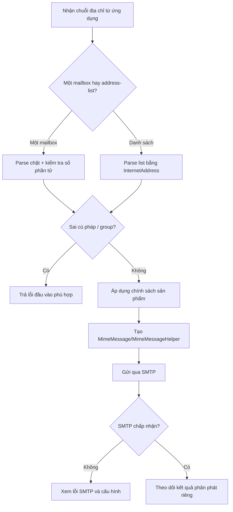

# InternetAddress và cú pháp địa chỉ email

Trong **Spring Framework Mail**, mỗi khi ứng dụng đặt người gửi, người nhận hoặc địa chỉ trả lời, nó đang làm việc với **địa chỉ hộp thư** (*mailbox address*). Một địa chỉ email trông đơn giản như `alice@example.org`, nhưng các header như `From` và `To` còn có thể chứa **tên hiển thị**, nhiều địa chỉ hoặc những cấu trúc hợp lệ theo chuẩn thư điện tử.

Jakarta Mail cung cấp lớp `jakarta.mail.internet.InternetAddress` để biểu diễn và xử lý các địa chỉ đó. Spring Mail dùng `InternetAddress` cùng với `MimeMessage` và `MimeMessageHelper` khi tạo thông điệp. Hiểu cú pháp địa chỉ giúp tránh lỗi parsing, nhận biết khác biệt giữa tên hiển thị với địa chỉ thật, và không nhầm kiểm tra cú pháp với việc xác nhận email tồn tại.

## 1. Một địa chỉ email gồm những phần nào?

Ở dạng phổ biến nhất:

```text
alice@example.org
│     │
│     └── domain (miền nhận thư)
└──────── local-part (tên hộp thư trong miền)

Cấu trúc: local-part@domain
```

- **Local-part:** phần đứng trước dấu `@`, do hệ thống mail của miền nhận định nghĩa. Ví dụ `alice`, `support`, `first.last` hoặc `first+news`.
- **Domain:** phần đứng sau `@`, dùng để xác định miền chịu trách nhiệm nhận thư. Ví dụ `example.org` hoặc `mail.example.net`.
- **Mailbox:** một địa chỉ đại diện cho một hộp thư hoặc đích nhận thư tại một miền. Trong cách dùng thông thường, nó gồm `local-part@domain` và có thể kèm tên hiển thị.

Ví dụ dễ gặp:

| Chuỗi | Ý nghĩa |
|---|---|
| `alice@example.org` | Địa chỉ email đơn giản. |
| `first.last@example.org` | Local-part có dấu chấm. |
| `first+promo@example.org` | Local-part có dấu cộng; ý nghĩa dấu cộng tùy nhà cung cấp. |
| `team@sub.example.org` | Hộp thư ở miền con. |
| `"Linh Nguyen" <linh@example.org>` | **Mailbox có tên hiển thị** và địa chỉ trong dấu ngoặc nhọn. |
| `"Nguyen, Linh" <linh@example.org>` | Tên hiển thị chứa dấu phẩy nên được đặt trong dấu nháy kép. |

**Dấu ngoặc nhọn** `<...>` trong header chứa địa chỉ thực; phần đứng trước nó là tên hiển thị (*display name*), không phải local-part. Ví dụ `"Customer Care" <support@example.org>` có địa chỉ là `support@example.org`, còn `Customer Care` là tên người nhận nhìn thấy.

### Địa chỉ trong ô nhập và địa chỉ trong header không hoàn toàn giống nhau

Người dùng thường nhập **một addr-spec** đơn giản, ví dụ `alice@example.org`. Nhưng email header có thể chứa **mailbox** hoàn chỉnh:

```text
From: "Example Service" <no-reply@example.org>
To: Alice <alice@example.org>, Bob <bob@example.net>
Reply-To: helpdesk@example.org
```

Header `To` ở ví dụ trên là một **danh sách mailbox**, chứ không phải một địa chỉ duy nhất. Spring/Jakarta Mail cần parse đúng cấu trúc để biết đâu là tên hiển thị và đâu là địa chỉ thư.

## 2. Các quy tắc cú pháp quan trọng

Cú pháp địa chỉ Internet mail được mô tả trong các chuẩn như **RFC 5322** (định dạng thông điệp/header) và các chuẩn SMTP liên quan. Hệ thống thực tế còn có chính sách riêng, nên cần phân biệt **cú pháp được chuẩn cho phép** với **địa chỉ thông dụng và được nhà cung cấp chấp nhận**.

### 2.1. Local-part không phải chuỗi tùy ý

Với local-part **không được đặt trong dấu nháy kép**, các ký tự ASCII thông dụng gồm chữ cái, chữ số và một số ký tự đặc biệt cho phép. Dấu chấm có các giới hạn:

- Không đứng đầu local-part: `.alice@example.org` không phải dạng dot-atom hợp lệ.
- Không đứng cuối local-part: `alice.@example.org` không phải dạng dot-atom hợp lệ.
- Không có hai dấu chấm liên tiếp ở dạng dot-atom: `alice..smith@example.org` không hợp lệ trong dạng này.

Ví dụ:

```text
alice@example.org              # thông dụng
alice.smith@example.org        # thông dụng
alice+orders@example.org       # thông dụng
"sales team"@example.org       # local-part có dấu cách, được quote theo cú pháp mail
alice..smith@example.org       # dot-atom sai cú pháp
```

**Quoted local-part** như `"sales team"@example.org` là một khả năng của cú pháp chuẩn, nhưng nhiều ứng dụng đăng ký tài khoản hoặc nhà cung cấp mail không hỗ trợ tốt. Đừng đồng nhất “hợp lệ theo một dạng RFC” với “dùng được trên mọi hệ thống”.

Đặc biệt, không tự bỏ dấu chấm hoặc phần sau dấu cộng để “chuẩn hóa” địa chỉ. Quy tắc alias như vậy phụ thuộc từng dịch vụ mail; áp dụng chung có thể gộp nhầm hai mailbox khác nhau.

### 2.2. Domain có quy tắc riêng

Trong địa chỉ thông dụng, domain gồm các nhãn phân tách bằng dấu chấm:

```text
user@notify.example.org
      └──┬──┘ └─┬─┘
        sub     domain
```

Domain **không phân biệt chữ hoa chữ thường** khi tra cứu DNS; tuy nhiên, **local-part theo chuẩn có thể phân biệt chữ hoa chữ thường**, dù nhiều nhà cung cấp thực tế không làm vậy. Vì thế, không nên mặc định chuyển toàn bộ địa chỉ thành chữ thường để so sánh định danh người dùng.

Một số cú pháp email còn cho phép **domain-literal**, chẳng hạn `user@[192.0.2.1]`, nhưng đây không phải hình thức thông dụng cho hộp thư công cộng. Trong sản phẩm hướng tới người dùng phổ thông, có thể đặt thêm chính sách chỉ nhận tên miền DNS phù hợp với nhu cầu.

### 2.3. Kích thước và ký tự quốc tế

Các giao thức mail có giới hạn độ dài tính theo **octet (byte)**, ví dụ local-part truyền thống tối đa 64 octet. Giới hạn giao thức không nhất thiết giống giới hạn sản phẩm hoặc giới hạn do nhà cung cấp đặt ra.

Tên hiển thị có thể chứa tiếng Việt, ví dụ **“Nguyễn Thảo”**, và thư viện mail sẽ mã hóa header cho phù hợp. **Địa chỉ có ký tự Unicode trong local-part** là một trường hợp khác, liên quan đến các mở rộng email quốc tế hóa như **SMTPUTF8**. Không nên giả định chỉ cần UTF-8 trong `MimeMessageHelper` là mọi SMTP relay đều chấp nhận `người@example.org`.

Miền quốc tế hóa (IDN) cũng cần được xử lý theo quy tắc IDNA/Punycode ở nơi phù hợp. Ví dụ mã Java chuẩn:

```java
import java.net.IDN;

String asciiDomain = IDN.toASCII("münich.example");
String address = "user@" + asciiDomain;
```

Đây là minh họa chuyển **phần domain** sang dạng ASCII. Không thể xử lý toàn bộ mọi email bằng cách tách chuỗi tại dấu `@` đầu tiên, bởi quoted local-part trong cú pháp đầy đủ có những trường hợp đặc biệt. Với ứng dụng chỉ chấp nhận địa chỉ thông dụng, nên xác định rõ tập cú pháp được hỗ trợ rồi xử lý nhất quán.

## 3. `InternetAddress` biểu diễn những gì?

Lớp `jakarta.mail.internet.InternetAddress` là một triển khai của `jakarta.mail.Address` cho địa chỉ theo định dạng Internet mail. Nó có thể lưu:

- **Address:** địa chỉ hộp thư, ví dụ `alice@example.org`.
- **Personal:** tên hiển thị, ví dụ `Nguyễn Thảo`.
- Thông tin cần thiết để **parse**, **validate** và **định dạng lại** mailbox hoặc danh sách địa chỉ.

Ví dụ:

```java
import jakarta.mail.internet.InternetAddress;
import java.io.UnsupportedEncodingException;

public class AddressDemo {
    public static void main(String[] args)
            throws UnsupportedEncodingException {

        InternetAddress recipient = new InternetAddress(
                "thao@example.org",
                "Nguyễn Thảo",
                "UTF-8"
        );

        System.out.println(recipient.getAddress());
        System.out.println(recipient.getPersonal());
        System.out.println(recipient.toString());
        System.out.println(recipient.toUnicodeString());
    }
}
```

Ý nghĩa các phương thức:

| API | Ý nghĩa |
|---|---|
| `getAddress()` | Lấy phần địa chỉ, chẳng hạn `thao@example.org`. |
| `getPersonal()` | Lấy tên hiển thị ở dạng chuỗi Java, chẳng hạn `Nguyễn Thảo`. |
| `toString()` | Định dạng địa chỉ dùng cho header; tên có ký tự ngoài ASCII có thể được biểu diễn bằng cú pháp mã hóa header MIME thích hợp. |
| `toUnicodeString()` | Tạo cách thể hiện dễ đọc hơn với tên Unicode để quan sát hoặc hiển thị trong ứng dụng. |
| `validate()` | Kiểm tra cấu trúc cú pháp của đối tượng địa chỉ; có thể ném `AddressException`. |
| `isGroup()` | Cho biết đối tượng biểu diễn một nhóm địa chỉ theo cú pháp group. |
| `InternetAddress.parse(...)` | Parse danh sách địa chỉ thành mảng `InternetAddress[]`. |

Không phải lúc nào `getPersonal()` cũng có giá trị: một địa chỉ như `alice@example.org` không kèm tên hiển thị thường có personal là `null`.

### Vì sao cần xử lý mã hóa tên hiển thị?

Một header nguyên bản gửi qua hệ thống thư truyền thống có các quy tắc mã hóa nhất định. Khi dùng:

```java
new InternetAddress("thao@example.org", "Nguyễn Thảo", "UTF-8");
```

Jakarta Mail có thể mã hóa tên hiển thị thành một **encoded-word** theo quy tắc MIME khi tạo header, trong khi `getPersonal()` trả về chuỗi Unicode tiện cho mã Java. Điều này khác với việc bật SMTPUTF8 cho **chính địa chỉ email**. Tên hiển thị Unicode và local-part Unicode là hai nhu cầu kỹ thuật riêng.

Trong Spring Mail, nên dùng API hỗ trợ personal name và charset thay vì ghép chuỗi header thủ công.

## 4. Khởi tạo một mailbox từ chuỗi

### 4.1. Tạo từ địa chỉ đơn giản

```java
import jakarta.mail.internet.AddressException;
import jakarta.mail.internet.InternetAddress;

InternetAddress recipient = new InternetAddress("alice@example.org");
recipient.validate();
```

Constructor phân tích chuỗi thành đối tượng. Việc gọi `validate()` thể hiện rõ nhu cầu kiểm tra cú pháp trước khi dùng địa chỉ trong luồng nghiệp vụ.

### 4.2. Tạo từ địa chỉ và tên hiển thị

```java
InternetAddress from = new InternetAddress(
        "notifications@example.org",
        "Example Service",
        "UTF-8"
);
```

Cách này hữu ích để đặt người gửi có tên thương hiệu rõ ràng mà không phải tự đặt dấu ngoặc nhọn hoặc escape tên.

### 4.3. Parse một địa chỉ kèm display name

```java
InternetAddress mailbox = new InternetAddress(
        "\"Nguyen, Linh\" <linh@example.org>",
        true
);

mailbox.validate();

String actualAddress = mailbox.getAddress();  // linh@example.org
String displayName = mailbox.getPersonal();    // Nguyen, Linh
```

Dấu phẩy ở **bên trong tên được quote** không phân tách hai người nhận. Việc đưa cả chuỗi vào một parser hiểu ngữ pháp địa chỉ giúp xử lý trường hợp này chính xác hơn so với thao tác tìm dấu phẩy bằng `String.split(",")`.

## 5. Parse danh sách người nhận

Header `To` hoặc `Cc` có thể chứa nhiều mailbox:

```text
"Alice Smith" <alice@example.org>, "Doe, Bob" <bob@example.net>
```

Dấu phẩy đầu tiên phân tách địa chỉ; dấu phẩy trong `"Doe, Bob"` là một phần của tên hiển thị. Cách dùng `InternetAddress.parse(...)`:

```java
import jakarta.mail.internet.AddressException;
import jakarta.mail.internet.InternetAddress;

String recipients =
        "\"Alice Smith\" <alice@example.org>, " +
        "\"Doe, Bob\" <bob@example.net>";

InternetAddress[] addresses =
        InternetAddress.parse(recipients, true);

for (InternetAddress address : addresses) {
    address.validate();
    System.out.println(address.getAddress());
}
```

Ở đây, đối số `true` yêu cầu kiểu phân tích chặt hơn theo khả năng của parser. Tuy nhiên, parser email tồn tại để tương thích với nhiều biến thể header trong lịch sử; **chế độ strict không phải chính sách xác thực toàn diện cho dữ liệu người dùng**.

Có ba tình huống ứng dụng cần xử lý rõ ràng:

| Đầu vào | Kỳ vọng ứng dụng |
|---|---|
| Một email người dùng nhập vào trường “Email” | Cho phép đúng **một mailbox**, không cho list hay group nếu sản phẩm không hỗ trợ. |
| Trường quản trị cho phép nhiều người nhận | Parse danh sách, kiểm tra từng mailbox và giới hạn số lượng theo nghiệp vụ. |
| Đang đọc header của một email nhận được | Dùng API parse thích hợp cho header, chấp nhận rằng thông điệp ngoài đời có thể chứa cú pháp cũ hoặc dữ liệu chưa chuẩn. |

### Group address là gì?

Định dạng header còn có **nhóm địa chỉ**:

```text
Team: Alice <alice@example.org>, Bob <bob@example.org>;
```

Đây là một **group** gồm nhiều mailbox, không phải một mailbox duy nhất tên `Team`. `InternetAddress` có `isGroup()` và `getGroup(...)` để làm việc với dạng này.

Với API người dùng chỉ được nhập một địa chỉ, nên **từ chối group** ngay cả khi parser chấp nhận group là thành phần hợp lệ của một address-list. Nếu hệ thống thực sự cần hỗ trợ nhóm, hãy thiết kế cách mở rộng danh sách thành mailbox riêng rẽ và xử lý trường hợp group rỗng.

## 6. Kiểm tra cú pháp với `validate()`: làm được gì và không làm được gì?

`InternetAddress.validate()` giúp phát hiện nhiều lỗi cú pháp như địa chỉ thiếu cấu trúc phù hợp hoặc sai quy tắc phân tách. Khi thất bại, phương thức ném `jakarta.mail.internet.AddressException`.

Ví dụ:

```java
try {
    InternetAddress address = new InternetAddress(
            "alice@example.org",
            true
    );
    address.validate();
    // Có thể dùng tiếp theo chính sách của ứng dụng.
} catch (AddressException ex) {
    // Trả phản hồi lỗi địa chỉ phù hợp cho người dùng.
}
```

Tuy nhiên, **kiểm tra cú pháp không chứng minh hộp thư tồn tại hoặc nhận được thư**.

| Câu hỏi | `InternetAddress` có tự trả lời đầy đủ không? |
|---|---|
| Chuỗi có cấu trúc địa chỉ Internet mail mà parser hiểu được không? | Có thể kiểm tra cú pháp ở mức parser/`validate()`. |
| Đây có chính xác là **một mailbox** hợp lệ theo biểu mẫu ứng dụng không? | Cần kiểm tra thêm số lượng và loại (không phải group), cùng quy tắc của sản phẩm. |
| Domain có phân giải DNS hoặc MX phù hợp không? | Không; đây là công việc riêng của DNS/hệ thống thư. |
| Mailbox `alice@example.org` có tồn tại không? | Không. |
| Người nhập biểu mẫu có sở hữu mailbox không? | Không; thường cần quy trình xác nhận email bằng mã/link. |
| Máy chủ SMTP sẽ chấp nhận gửi tới địa chỉ không? | Không thể suy ra chỉ từ kiểm tra cú pháp. |
| Email có tới Inbox người nhận không? | Không; phụ thuộc vận chuyển, chính sách chống spam và phân phát. |

Ngay cả khi DNS cho thấy miền có thể nhận thư, vẫn không thể kết luận mailbox cụ thể tồn tại. Nhiều nhà cung cấp không tiết lộ điều này trong lúc kiểm tra; địa chỉ cũng có thể bị vô hiệu hóa sau thời điểm xác minh.

### Ví dụ hàm yêu cầu đúng một mailbox

Nếu một form đăng ký chỉ cho phép **một** email người nhận, có thể tách bước parse khỏi bước áp dụng chính sách:

```java
import jakarta.mail.internet.AddressException;
import jakarta.mail.internet.InternetAddress;

public final class EmailAddressParser {
    private EmailAddressParser() {}

    public static InternetAddress requireSingleMailbox(String raw)
            throws AddressException {

        if (raw == null || raw.isBlank()) {
            throw new AddressException("Email không được để trống");
        }

        if (raw.indexOf('\r') >= 0 || raw.indexOf('\n') >= 0) {
            throw new AddressException("Email chứa ký tự xuống dòng");
        }

        InternetAddress[] parsed = InternetAddress.parse(raw, true);

        if (parsed.length != 1 || parsed[0].isGroup()) {
            throw new AddressException("Cần đúng một địa chỉ email");
        }

        InternetAddress mailbox = parsed[0];
        mailbox.validate();
        return mailbox;
    }
}
```

Hàm trên kiểm soát cấu trúc danh sách, loại địa chỉ và ký tự xuống dòng để tránh chấp nhận một chuỗi header nhiều người nhận trong trường dành cho một email. Nó là **lớp kiểm tra cú pháp cơ bản**, không thay thế cho chính sách sản phẩm: nếu form chỉ muốn nhận `local@domain` và không cho nhập tên hiển thị, phải xác định thêm tiêu chí chấp nhận phù hợp.

Một ứng dụng có thể chọn cho phép `"Nguyễn Thảo" <thao@example.org>` ở trang quản trị, nhưng từ chối kiểu nhập đó ở form đăng ký công khai. Quyết định này thuộc yêu cầu nghiệp vụ; đừng giả định parser sẽ tự đưa ra quy tắc đúng cho mọi trường hợp.

## 7. Dùng `InternetAddress` với Spring `JavaMailSender`

Với email MIME, Spring cung cấp `MimeMessageHelper` để điền các header. Helper có những overload nhận `InternetAddress`, cho phép truyền đối tượng đã parse sẵn.

Giả sử ứng dụng Spring Boot có dependency `spring-boot-starter-mail` và đã cấu hình SMTP. Ví dụ gửi email văn bản có người gửi kèm tên hiển thị:

```java
import jakarta.mail.MessagingException;
import jakarta.mail.internet.InternetAddress;
import jakarta.mail.internet.MimeMessage;
import java.io.UnsupportedEncodingException;
import org.springframework.mail.javamail.JavaMailSender;
import org.springframework.mail.javamail.MimeMessageHelper;
import org.springframework.stereotype.Service;

@Service
public class AccountMailService {
    private final JavaMailSender mailSender;

    public AccountMailService(JavaMailSender mailSender) {
        this.mailSender = mailSender;
    }

    public void sendWelcome(String recipientInput)
            throws MessagingException, UnsupportedEncodingException {

        InternetAddress recipient =
                EmailAddressParser.requireSingleMailbox(recipientInput);

        InternetAddress from = new InternetAddress(
                "no-reply@example.org",
                "Ứng dụng Demo",
                "UTF-8"
        );

        MimeMessage mime = mailSender.createMimeMessage();
        MimeMessageHelper helper =
                new MimeMessageHelper(mime, false, "UTF-8");

        helper.setFrom(from);
        helper.setTo(recipient);
        helper.setReplyTo("support@example.org");
        helper.setSubject("Chào mừng bạn");
        helper.setText("Tài khoản của bạn đã được tạo.");

        mailSender.send(mime);
    }
}
```

Luồng xử lý:

1. `EmailAddressParser.requireSingleMailbox(...)` đọc và kiểm tra đầu vào của người nhận.
2. `new InternetAddress(address, personal, "UTF-8")` tạo người gửi với **địa chỉ thật** và **tên hiển thị**.
3. `helper.setFrom(from)` ghi header **From**; `helper.setTo(recipient)` ghi header **To**.
4. `helper.setReplyTo(...)` đặt nơi nhận thư trả lời. Header `Reply-To` không nhất thiết trùng với `From`.
5. `JavaMailSender.send(mime)` giao thông điệp cho hạ tầng gửi thư SMTP đã cấu hình.

Ví dụ minh họa cú pháp địa chỉ và cách tích hợp Spring, không giải quyết riêng chiến lược queue, retry, theo dõi bounce hoặc xác minh quyền sở hữu mailbox.

### API trực tiếp của Jakarta Mail

Nếu không sử dụng helper, có thể thao tác với `MimeMessage`:

```java
import jakarta.mail.Message;
import jakarta.mail.internet.InternetAddress;
import jakarta.mail.internet.MimeMessage;

MimeMessage message = mailSender.createMimeMessage();

message.setFrom(
        new InternetAddress("no-reply@example.org")
);

message.setRecipients(
        Message.RecipientType.TO,
        InternetAddress.parse(
                "alice@example.org, bob@example.net",
                true
        )
);

message.setSubject("Thông báo", "UTF-8");
message.setText("Nội dung email", "UTF-8");

mailSender.send(message);
```

`Message.RecipientType.TO` là **loại người nhận của header**, còn các loại khác gồm `CC` và `BCC`. Khi gửi, mail transport sử dụng danh sách người nhận để xây dựng envelope SMTP. Người nhận `Bcc` phải được truyền tới transport nhưng không được tiết lộ cho các người nhận khác qua header hiển thị.

Với mã nghiệp vụ thông thường, helper giúp tránh việc tự lắp ghép các header và charset phức tạp.

## 8. Phân biệt `From`, `To`, `Reply-To` và phong bì SMTP

Một địa chỉ có thể xuất hiện ở nhiều vị trí với các ý nghĩa khác nhau:

| Vị trí | Ví dụ | Vai trò |
|---|---|---|
| Header `From` | `"Example Service" <no-reply@example.org>` | Danh tính hiển thị của tác giả/người gửi. |
| Header `To` | `"Nguyễn Thảo" <thao@example.org>` | Người nhận được liệt kê trong nội dung thông điệp. |
| Header `Cc` | `manager@example.org` | Người nhận được liệt kê ở bản sao. |
| Header `Bcc` | `audit@example.org` | Người nhận kín; không nên làm lộ danh sách này trong header chuyển tới các người nhận khác. |
| Header `Reply-To` | `support@example.org` | Địa chỉ mail client thường điền khi người nhận bấm Reply. |
| SMTP `MAIL FROM` | `bounces@example.org` | **Envelope sender**, thường dùng để định tuyến thông báo lỗi phân phát. |
| SMTP `RCPT TO` | `thao@example.org` | **Envelope recipient**, dùng để định tuyến thư ở tầng SMTP. |

`InternetAddress` biểu diễn **địa chỉ** trong các ngữ cảnh trên, nhưng **vị trí sử dụng** mới quyết định chức năng của địa chỉ. Chẳng hạn, `helper.setFrom(...)` đặt header `From`, chứ không bảo đảm nó chính là envelope sender. Với Jakarta Mail SMTP provider, cấu hình như `mail.smtp.from` có thể chỉ định envelope sender riêng, và máy chủ SMTP có thể áp dụng chính sách/ghi lại thông tin khác.

Hơn nữa, **danh tính hiển thị không phải bằng chứng xác thực người gửi**. Bất kỳ ai xây dựng một thông điệp về mặt cú pháp đều có thể điền tên hiển thị giống thương hiệu. Việc hệ thống nhận tin tưởng nguồn gửi còn liên quan đến quyền gửi, SPF/DKIM/DMARC, chính sách server và các cơ chế bảo vệ khác.

## 9. Vì sao không tự tách địa chỉ bằng regex hoặc dấu phẩy?

Một regex ngắn như `^[^@]+@[^@]+$` có thể giúp nhận ra hình dáng cơ bản của địa chỉ, nhưng không xử lý đầy đủ:

- Tên hiển thị được quote, ví dụ `"Nguyen, Linh" <linh@example.org>`.
- Các ký tự đặc biệt hợp lệ trong local-part.
- Quoted local-part, ví dụ `"sales team"@example.org`.
- Danh sách nhiều mailbox và cú pháp group.
- Tên hiển thị Unicode, comment hoặc cách biểu diễn header có mã hóa.
- Các ngoại lệ cú pháp, ngữ cảnh lịch sử và chính sách riêng của nhà cung cấp.

Tương tự, việc gọi `split(",")` lên một chuỗi header sẽ tách sai nếu dấu phẩy nằm bên trong tên được quote. Khi dữ liệu thực sự là **address-list**, hãy sử dụng `InternetAddress.parse(...)`; khi dữ liệu là **một địa chỉ đăng ký thông thường**, hãy áp dụng chính sách một-mailbox lên kết quả parse và giới hạn tập cú pháp theo nhu cầu sản phẩm.

Regex vẫn có ích ở mức chính sách đơn giản, ví dụ sản phẩm chỉ hỗ trợ ASCII local-part thông dụng, nhưng không nên coi một regex tự viết là trình phân tích hoàn chỉnh của mọi header email.

## 10. Ký tự xuống dòng và an toàn khi đưa đầu vào vào header

Header email được phân tách bằng các dòng; dữ liệu không tin cậy chứa `\r` hoặc `\n` không nên được ghép trực tiếp vào header. Nếu ứng dụng tự tạo chuỗi header như:

```text
To: <giá trị người dùng nhập>
```

rồi nối nó với `Subject` và các header khác, ký tự xuống dòng bị chèn có thể làm cấu trúc header thay đổi (*header injection*). Thay vì tự ghép header:

- Nhận dữ liệu người dùng qua API nhận địa chỉ, chẳng hạn `InternetAddress` và `MimeMessageHelper`.
- Kiểm tra input riêng cho trường một-mailbox; từ chối ký tự điều khiển và chuỗi nhiều địa chỉ nếu không được phép.
- Khi ứng dụng cho phép tên hiển thị do người dùng đặt, dùng API hỗ trợ personal name và encoding, không tự nối `"Tên <mail>"` bằng các thao tác thiếu escape.
- Không dùng `InternetAddress.validate()` như bộ lọc duy nhất cho nội dung hiển thị, chính sách ứng dụng hoặc chống giả mạo.

Với những thông tin nhạy cảm, log nên ghi mã yêu cầu gửi và kết quả xử lý phù hợp, hạn chế ghi đầy đủ địa chỉ email hoặc toàn bộ header nếu không cần cho vận hành.

## 11. Dữ liệu Unicode và các tình huống dễ nhầm

### Tên hiển thị tiếng Việt

```java
InternetAddress address = new InternetAddress(
        "thao@example.org",
        "Nguyễn Thảo",
        "UTF-8"
);
```

Đây là cách dùng thông thường. Local-part và domain vẫn ở dạng ASCII, còn tên hiển thị được mã hóa theo quy tắc header.

### Domain có Unicode

```text
user@münich.example
```

Ứng dụng có thể cần chuyển domain sang biểu diễn IDNA ASCII phù hợp với hạ tầng đang dùng. Cần kiểm tra tính hợp lệ từng nhãn, quy tắc tên miền và các chính sách chống giả mạo tên miền nhìn giống nhau. Đây là trách nhiệm vượt ra ngoài parsing đơn giản của `InternetAddress`.

### Local-part có Unicode

```text
người@example.org
```

Trường hợp này cần các mở rộng email quốc tế hóa, đặc biệt là hỗ trợ **SMTPUTF8** của hệ thống gửi và các hop chuyển tiếp liên quan. Không tự suy luận rằng kết nối SMTP hỗ trợ TLS, hoặc header có charset UTF-8, đồng nghĩa toàn bộ đường gửi đã hỗ trợ mailbox Unicode.

### Chuyển chữ hoa thành chữ thường

```text
User.Name@example.org
user.name@example.org
```

Nhiều dịch vụ phổ biến coi hai địa chỉ trên là cùng một mailbox, nhưng chuẩn không cho phép ứng dụng tổng quát tự kết luận như vậy ở local-part. Khi xây dựng quy tắc unique account, hãy cân nhắc chính sách của sản phẩm và đặc điểm nhà cung cấp, tránh thay đổi dữ liệu người dùng mà không có cơ sở.

## 12. Lỗi thường gặp và cách định vị

| Hiện tượng | Nguyên nhân có thể | Cách xử lý |
|---|---|---|
| `AddressException` khi parse | Địa chỉ sai cú pháp, thiếu thành phần hoặc danh sách không đúng định dạng | Hiển thị phản hồi rõ ràng, kiểm tra input gốc được phép, gọi parse/`validate()` theo từng trường hợp. |
| Chỉ nhập một email nhưng parser trả nhiều phần tử | Người dùng đưa cả danh sách vào ô một-mailbox | Kiểm tra `parsed.length == 1`, từ chối khi sản phẩm chỉ cho phép một địa chỉ. |
| Tên hiển thị chứa dấu phẩy bị tách làm hai người nhận | Tự dùng `split(",")` | Chuyển sang parser địa chỉ hoặc nhập từng mailbox bằng các trường riêng. |
| Tên tiếng Việt trong `From` bị lỗi ký tự | Không dùng API/charset phù hợp khi tạo personal name | Dùng constructor của `InternetAddress` có tham số `charset` hoặc `MimeMessageHelper` hỗ trợ encoding. |
| `getPersonal()` trả `null` | Input chỉ có addr-spec, không có display name | Đây có thể là dữ liệu hợp lệ; không yêu cầu tên nếu nghiệp vụ không cần. |
| `validate()` thành công nhưng không nhận email | Cú pháp đúng không bảo đảm DNS, SMTP và mailbox tồn tại | Kiểm tra log SMTP, bounce, sự kiện phân phát và quy trình xác minh mailbox. |
| `From` hiển thị khác với tài khoản SMTP login | Header sender, tài khoản xác thực và envelope sender là các khái niệm khác nhau | Kiểm tra quyền gửi/địa chỉ đã xác minh và cấu hình provider. |
| Địa chỉ Unicode bị SMTP từ chối | Hạ tầng chưa hỗ trợ SMTPUTF8 hoặc quy tắc domain chưa phù hợp | Kiểm tra hỗ trợ EAI/SMTPUTF8 ở các thành phần liên quan. |
| Mailbox có vẻ đúng nhưng hệ thống từ chối | Chính sách sản phẩm hoặc nhà cung cấp giới hạn tập địa chỉ | Phân biệt lỗi cú pháp theo chuẩn với lỗi chính sách vận hành. |

### Quy trình đơn giản để tiếp cận lỗi



Điểm mấu chốt là xử lý theo đúng lớp: **parsing** phát hiện lỗi cấu trúc, **quy tắc ứng dụng** quyết định loại địa chỉ được chấp nhận, còn **hệ thống SMTP/nhận thư** quyết định khả năng chuyển và phân phát.

## 13. Ghi nhớ khi dùng `InternetAddress`

- `InternetAddress` biểu diễn mailbox và danh sách địa chỉ theo cú pháp Internet mail; nó phân biệt **địa chỉ thực** (`getAddress()`) với **tên hiển thị** (`getPersonal()`).
- `InternetAddress.parse(...)` xử lý danh sách có tên hiển thị và dấu phẩy đúng hơn các thao tác tách chuỗi thủ công.
- `validate()` là kiểm tra **cú pháp**, không phải xác thực mailbox tồn tại, thuộc quyền người dùng, hay sẽ nhận được email.
- Với trường chỉ nhận một email, hãy kiểm tra **một phần tử, không phải group**, rồi áp dụng chính sách địa chỉ của sản phẩm.
- Dùng `MimeMessageHelper` và overload nhận `InternetAddress` để đặt `From`, `To`, `Cc`, `Bcc`, `Reply-To`; không ghép raw header từ input người dùng.
- Tên hiển thị Unicode, domain IDN và local-part Unicode là **những vấn đề khác nhau**; SMTPUTF8 liên quan đến khả năng hỗ trợ địa chỉ quốc tế hóa ở tầng vận chuyển.
- Đừng nhầm header `From` với tài khoản SMTP đăng nhập, envelope sender hoặc bằng chứng xác thực nguồn gửi.

Khi tiếp nhận một địa chỉ trong ứng dụng Spring Mail, câu hỏi đầu tiên cần trả lời là: **đây là một mailbox duy nhất, một danh sách địa chỉ, hay chuỗi header đã có tên hiển thị?** Chọn đúng kiểu dữ liệu, dùng `InternetAddress` để parse/định dạng và kiểm tra riêng các điều kiện nghiệp vụ sẽ giúp luồng gửi mail rõ ràng, an toàn và dễ xử lý lỗi hơn.
