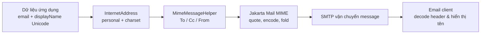
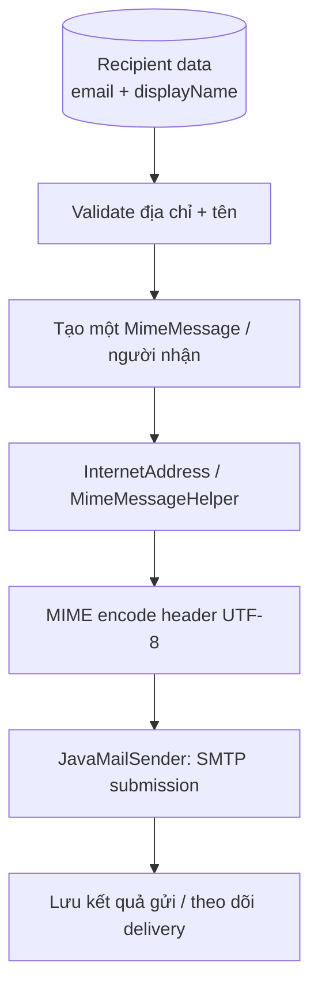

# Địa chỉ hiển thị tên và mã hóa tên người nhận

Trong hộp thư, người dùng thường thấy **“Nguyễn Văn An”** thay vì chỉ thấy `an@example.net`. Tên này giúp nhận diện người gửi và người nhận, nhưng trên thực tế email phải lưu cả **tên hiển thị** (*display name/personal name*) và **địa chỉ email** (*addr-spec*). Nếu tên có dấu tiếng Việt, dấu phẩy, dấu ngoặc kép hoặc ký tự Unicode, ứng dụng phải biểu diễn chúng theo quy tắc của **header email**.

Đối với **Spring Framework Mail**, đây là phần việc rất thường gặp: hệ thống gửi thông báo đơn hàng, thư chào mừng, mã xác thực hoặc email hỗ trợ với người nhận có tên tiếng Việt. Nếu tự ghép chuỗi `"Nguyễn Văn An <an@example.net>"` vào header một cách tùy tiện, ứng dụng có thể tạo header sai cú pháp, sai mã hóa, khiến ứng dụng email hiện chuỗi khó đọc hoặc xử lý nhầm người nhận. Spring hỗ trợ tạo email chuẩn qua `JavaMailSender`, `MimeMessageHelper` và các kiểu dữ liệu của Jakarta Mail.

Mục tiêu của bài học là hiểu rõ **cấu trúc địa chỉ có tên hiển thị, quy tắc mã hóa tên người nhận, cách sử dụng API Spring Mail và những ranh giới bảo mật/định tuyến liên quan**.

## 1. Tên hiển thị và địa chỉ email là hai thành phần khác nhau

Xem hai cách hiển thị cùng một người nhận:

```text
an@example.net

Nguyễn Văn An <an@example.net>
```

Ở dạng thứ hai:

- **`Nguyễn Văn An`** là *display name* (còn gọi là *personal name* hoặc *phrase*).
- **`an@example.net`** là địa chỉ email thực tế, gồm phần trước `@` (*local-part*) và tên miền sau `@` (*domain*).
- **`<` và `>`** bao quanh `addr-spec` khi địa chỉ được viết theo dạng có tên hiển thị.

Trong thuật ngữ Internet Message Format (RFC 5322), một địa chỉ dạng tên kèm địa chỉ là một **`name-addr`**. Một địa chỉ người nhận có thể được viết trực tiếp là `addr-spec` hoặc dưới dạng `name-addr`:

```text
mailbox = name-addr / addr-spec

Ví dụ addr-spec:
    an@example.net

Ví dụ name-addr:
    "Nguyen Van An" <an@example.net>
```

Đoạn trên là cách biểu diễn khái niệm, không phải toàn bộ văn phạm RFC. Tên hiển thị **không quyết định hộp thư đích**; địa chỉ trong ngoặc nhọn mới là phần được dùng làm người nhận ở tầng header, còn **SMTP envelope** có một danh sách người nhận riêng.

### Tên hiển thị xuất hiện ở đâu?

| Header | Ví dụ dễ đọc | Ý nghĩa |
|---|---|---|
| `From:` | `Trung tâm hỗ trợ <support@example.com>` | Tên người/đơn vị được trình bày là người gửi. |
| `To:` | `Nguyễn Văn An <an@example.net>` | Người nhận hiển thị ở mục To. |
| `Cc:` | `Phòng kế toán <finance@example.net>` | Người nhận bản sao hiển thị. |
| `Reply-To:` | `Đội hỗ trợ <help@example.com>` | Địa chỉ mà ứng dụng email có thể đề xuất khi người dùng bấm Trả lời. |
| `Bcc:` | Thường không xuất hiện trong bản thư người nhận nhận được | Người nhận kín được đưa vào phong bì gửi mà không công khai cho người nhận khác. |

**Tên hiển thị không phải bằng chứng xác thực danh tính.** Một người gửi độc hại có thể tự đặt tên giống một công ty nổi tiếng. Việc xác minh nguồn gửi còn liên quan tới địa chỉ, tên miền, SPF, DKIM, DMARC và chính sách của hệ thống nhận; không dựa riêng vào phần tên đẹp mắt.

## 2. Cú pháp địa chỉ có tên hiển thị

### 2.1. Tên thuần ASCII

Với các tên chỉ gồm chữ ASCII đơn giản, địa chỉ có thể trông như sau:

```text
To: Alice Smith <alice@example.net>
Cc: Support Team <support@example.com>
From: Order Service <orders@example.com>
```

Các dấu ngoặc nhọn phân định địa chỉ. Ứng dụng email thường hiện tên hiển thị khi đọc thư, và có thể hiện thêm địa chỉ khi người dùng mở chi tiết.

### 2.2. Tên có dấu phẩy, dấu ngoặc kép hoặc ký tự đặc biệt

Dấu phẩy trong danh sách địa chỉ thường dùng để phân cách **nhiều người nhận**. Nếu tên một người có dấu phẩy, tên đó cần được biểu diễn đúng quy tắc trích dẫn/encoding:

```text
To: "Doe, Jane" <jane@example.net>, John <john@example.org>
```

Nếu tự ghép chuỗi:

```text
To: Doe, Jane <jane@example.net>
```

trình phân tích header có thể hiểu nhầm `Doe` thành một phần tử địa chỉ độc lập hoặc báo sai cú pháp. Tương tự, tên có dấu `"` hoặc `\` cần được thoát ký tự đúng quy định nếu biểu diễn dưới dạng chuỗi được trích dẫn.

Các trường hợp thường gặp trong dữ liệu thực tế:

- `Công ty ABC, Bộ phận hỗ trợ`: tên chứa dấu phẩy.
- `An "Minh"`: tên chứa dấu ngoặc kép.
- `Lê Thị Mỹ Duyên`: tên có dấu tiếng Việt.
- `International Sales – APAC`: tên có dấu gạch ngang Unicode.
- `Nhóm chăm sóc khách hàng 🌷`: tên có emoji, cần cân nhắc khả năng tương thích client.

**Cách làm an toàn là dùng API tạo địa chỉ** như `InternetAddress` hoặc `MimeMessageHelper`, để thư viện xử lý trích dẫn và mã hóa. Không dùng phép cộng chuỗi để tạo header `To:`/`From:` từ thông tin người dùng nhập.

### 2.3. Một trường To có thể chứa nhiều mailbox

```text
To: Alice Smith <alice@example.net>,
    "Doe, Jane" <jane@example.org>,
    Support <support@example.com>
```

Danh sách này có ba mailbox. Dấu phẩy giữa các mailbox là **ký hiệu phân cách**, còn dấu phẩy bên trong tên `"Doe, Jane"` thuộc tên hiển thị.

Ứng dụng cũng có thể gửi một email cho nhiều địa chỉ mà không ghi tất cả vào `To:`, ví dụ gửi với `Bcc`. Vì vậy **không nên lấy header `To:` để suy ra đầy đủ danh sách người nhận đã chuyển phát qua SMTP**.

## 3. Vì sao tên người nhận tiếng Việt cần được mã hóa?

Trong thực tế, một tên hiển thị có thể bao gồm những ký tự Unicode như `ễ`, `ă`, `Đ`, `ộ`. Header truyền thống theo RFC 5322 được định nghĩa quanh cú pháp ASCII, nên tên không ASCII thường được biểu diễn bằng cơ chế **encoded-word** của **RFC 2047**.

Ví dụ:

```text
Tên hiển thị logic:
    Nguyễn Văn An

Địa chỉ logic:
    an@example.net

Header dễ đọc ở lớp ứng dụng:
    To: Nguyễn Văn An <an@example.net>

Một cách biểu diễn header hợp lệ theo RFC 2047:
    To: =?UTF-8?Q?Nguy=E1=BB=85n_V=C4=83n_An?= <an@example.net>
```

Người đọc email thường vẫn thấy **“Nguyễn Văn An”**: ứng dụng email nhận phần encoded-word, giải mã và hiển thị tên bình thường. Chuỗi `=?UTF-8?Q?...?=` là **dạng truyền trên header**, không phải nội dung mà người dùng phải đọc.

Đừng nhầm **mã hóa ký tự/định dạng** với **mã hóa bảo mật**. Encoded-word chỉ biểu diễn tên Unicode trong header theo quy tắc tương thích, hoàn toàn không làm tên bí mật hay được bảo vệ khỏi đọc trộm.

### 3.1. Cấu trúc encoded-word của RFC 2047

Một encoded-word có dạng:

```text
=?charset?encoding?encoded-text?=
```

| Phần | Ý nghĩa | Ví dụ |
|---|---|---|
| `=?` và `?=` | Đánh dấu bắt đầu và kết thúc encoded-word | `=?...?...?...?=` |
| `charset` | Bộ mã ký tự được dùng trước khi chuyển đổi thành văn bản ASCII | `UTF-8` |
| `encoding` | Cách biểu diễn các byte theo định dạng encoded-word | `B` hoặc `Q` |
| `encoded-text` | Nội dung đã mã hóa | Chuỗi Base64 hoặc dạng Q |

**`B`** sử dụng Base64 để biểu diễn dữ liệu; **`Q`** tương tự quoted-printable nhưng có quy tắc riêng cho encoded-word, trong đó dấu gạch dưới `_` biểu diễn dấu cách. Chẳng hạn trong ví dụ:

- `=E1=BB=85` là ba byte UTF-8 của ký tự `ễ`.
- `=C4=83` là hai byte UTF-8 của ký tự `ă`.
- `_` biểu diễn dấu cách giữa các từ trong tên hiển thị.

Thư viện có thể chọn `B` hoặc `Q` tùy nội dung và cách triển khai. Không nên so sánh nguyên chuỗi encoded-word để xác định hai tên có giống nhau hay không; **cùng một tên có thể được biểu diễn bằng nhiều chuỗi header tương đương**.

### 3.2. Giới hạn và folding khi mã hóa

Encoded-word theo RFC 2047 có giới hạn **tối đa 75 ký tự ASCII cho mỗi encoded-word**, tính cả các dấu phân cách. Nếu tên dài, thư viện có thể chia thành nhiều encoded-word và **fold** header trên nhiều dòng:

```text
To: =?UTF-8?B?...phan-ten-1...?=
 =?UTF-8?B?...phan-ten-2...?= <an@example.net>
```

Đây là ví dụ sơ đồ; dấu `...` không phải dữ liệu Base64 thực tế. Khi làm việc với header thật, phải dùng đầu ra từ thư viện MIME.

Theo RFC 5322, dòng header có giới hạn cứng 998 ký tự, không tính CRLF, và nên giới hạn khoảng 78 ký tự để dễ hiển thị/tương thích. RFC 2047 còn đặt các quy tắc cụ thể cho encoded-word và độ dài dòng có chứa nó.

**Không tự cắt encoded-word theo số ký tự Java tùy ý.** Cắt giữa một ký tự UTF-8 đa byte, giữa chuỗi escape hoặc giữa các phần Base64 sẽ khiến header không giải mã được. Công việc này thuộc về MIME library.

### 3.3. Header encoding khác với body encoding

Một email có thể gồm:

```text
To: =?UTF-8?Q?Nguy=E1=BB=85n_V=C4=83n_An?= <an@example.net>
Subject: =?UTF-8?B?...?=
MIME-Version: 1.0
Content-Type: text/plain; charset=UTF-8
Content-Transfer-Encoding: quoted-printable

[Nội dung phần thân sau transfer encoding]
```

Có **hai lớp quy tắc khác nhau**:

1. **Header `To:`, `From:`, `Subject:`:** tên người, tiêu đề và các trường khác cần encoding theo quy tắc header.
2. **Nội dung MIME:** body có charset và `Content-Transfer-Encoding` riêng, có thể là `quoted-printable`, `base64` hoặc một cơ chế phù hợp khác.

Cấu hình `charset=UTF-8` cho body **không có nghĩa có thể tự chèn bất kỳ byte Unicode nào vào mọi phần header theo kiểu SMTP truyền thống**. Ngược lại, việc mã hóa đúng tên ở header không tự làm body có charset đúng.

## 4. Tên người nhận khác với địa chỉ người nhận quốc tế hóa

Đây là điểm rất dễ nhầm:

```text
Nguyễn Văn An <an@example.net>
|------------| |------------|
   tên hiển thị      địa chỉ ASCII

Nguyễn Văn An <nguyễn@example.net>
|------------| |----------------|
   tên hiển thị       local-part Unicode
```

Trường hợp thứ nhất: **tên hiển thị Unicode**, còn địa chỉ `an@example.net` là địa chỉ ASCII thông thường. Tên có thể được mã hóa bằng **RFC 2047** mà không cần biến `addr-spec` thành Unicode.

Trường hợp thứ hai: **chính địa chỉ email có ký tự Unicode** trong local-part. Đây là vấn đề **Email Address Internationalization (EAI)**, liên quan tới **SMTPUTF8** (RFC 6531) và header UTF-8 (RFC 6532), cần được hạ tầng gửi/nhận hỗ trợ đúng cách. **Không được dùng encoded-word RFC 2047 để mã hóa riêng local-part hoặc địa chỉ email rồi coi đó là địa chỉ hợp lệ.**

| Tình huống | Cách xử lý khái quát |
|---|---|
| Tên `Nguyễn Văn An`, địa chỉ `an@example.net` | Dùng `InternetAddress` với `personal` và charset UTF-8; MIME library mã hóa tên. |
| Local-part Unicode, ví dụ `nguyễn@example.net` | Cần hỗ trợ SMTPUTF8 và quy tắc địa chỉ quốc tế hóa trên toàn đường gửi. |
| Tên miền quốc tế hóa | Có thể cần IDNA/biểu diễn ASCII tương thích (A-label/punycode) hoặc hạ tầng hỗ trợ quốc tế hóa phù hợp. |
| Hiển thị tên đã mã hóa nhưng địa chỉ sai | Mã hóa display name không giải quyết lỗi cú pháp/định tuyến của địa chỉ. |

Các hệ thống doanh nghiệp có yêu cầu tương thích rộng thường chọn **địa chỉ email ASCII** nhưng cho phép **tên hiển thị Unicode**. Nếu sản phẩm cần hỗ trợ EAI, phải thiết kế/kiểm tra hỗ trợ với provider và máy chủ nhận; **chỉ đặt charset UTF-8 trong Spring không bảo đảm gửi được một địa chỉ SMTPUTF8**.

## 5. Spring Framework Mail tạo địa chỉ có tên hiển thị như thế nào?

### 5.1. Những thành phần chính

| Thành phần | Vai trò |
|---|---|
| `JavaMailSender` | Abstraction của Spring để tạo và gửi email; triển khai phổ biến dùng Jakarta Mail transport. |
| `MimeMessage` | Đối tượng biểu diễn email MIME với header, body và các recipient. |
| `MimeMessageHelper` | Tiện ích Spring để điền `From`, `To`, `Cc`, `Bcc`, `Subject`, nội dung và attachment. |
| `InternetAddress` | Kiểu của Jakarta Mail biểu diễn mailbox, gồm địa chỉ và tên cá nhân (*personal*). |
| `MimeUtility` | API Jakarta Mail hỗ trợ nhiều thao tác encoded-word và header MIME. |
| `SimpleMailMessage` | Tiện ích tạo email văn bản đơn giản; bài toán hiển thị tên Unicode nên ưu tiên các API địa chỉ/MIME rõ ràng. |

Với Spring Boot có mail starter:

```groovy
dependencies {
    implementation 'org.springframework.boot:spring-boot-starter-mail'
}
```

Ví dụ cấu hình SMTP submission với STARTTLS:

```yaml
spring:
  mail:
    host: ${MAIL_HOST}
    port: 587
    username: ${MAIL_USERNAME}
    password: ${MAIL_PASSWORD}
    default-encoding: UTF-8
    properties:
      mail:
        smtp:
          auth: true
          starttls:
            enable: true
            required: true
          connectiontimeout: 5000
          timeout: 5000
          writetimeout: 5000
```

`spring.mail.default-encoding: UTF-8` là cấu hình charset mặc định có ích khi tạo MIME message bằng Spring Boot. Tuy nhiên, **nên truyền charset rõ ràng khi tạo personal name bằng `InternetAddress` hoặc `MimeMessageHelper`** để không phụ thuộc vào mặc định của những vị trí code khác nhau. Các biến môi trường phải được cung cấp trong cấu hình triển khai hoặc hệ thống quản lý bí mật; không ghi mật khẩu SMTP trực tiếp vào Git.

### 5.2. Cách thứ nhất: `MimeMessageHelper.addTo(address, personal)`

Khi cần thêm một người nhận có tên hiển thị:

```java
import jakarta.mail.MessagingException;
import jakarta.mail.internet.MimeMessage;
import org.springframework.mail.javamail.JavaMailSender;
import org.springframework.mail.javamail.MimeMessageHelper;
import org.springframework.stereotype.Service;

import java.io.UnsupportedEncodingException;
import java.nio.charset.StandardCharsets;

@Service
public class WelcomeMailService {

    private final JavaMailSender mailSender;

    public WelcomeMailService(JavaMailSender mailSender) {
        this.mailSender = mailSender;
    }

    public void sendWelcome(String emailAddress, String displayName)
            throws MessagingException, UnsupportedEncodingException {

        MimeMessage mimeMessage = mailSender.createMimeMessage();
        MimeMessageHelper helper = new MimeMessageHelper(
                mimeMessage, false, StandardCharsets.UTF_8.name());

        helper.setFrom("hello@example.com", "Nhóm hỗ trợ");
        helper.addTo(emailAddress, displayName);
        helper.setSubject("Chào mừng đến với hệ thống");
        helper.setText("Cảm ơn bạn đã đăng ký tài khoản.", false);

        mailSender.send(mimeMessage);
    }
}
```

Lưu ý:

- `addTo(String, String)` nhận **địa chỉ** và **personal name** riêng biệt; không yêu cầu code tự tạo chuỗi `Tên <email>`.
- Constructor `MimeMessageHelper(..., false, "UTF-8")` dùng chế độ không multipart vì ví dụ chỉ gửi text, đồng thời khai báo charset.
- `setFrom(String, String)` cũng đặt **tên hiển thị người gửi** và địa chỉ gửi.
- Dù `addTo(...)` thuận tiện, ứng dụng cần **kiểm tra đầu vào** trước khi gọi, nhất là địa chỉ lấy từ người dùng và personal name có ký tự điều khiển.
- `mailSender.send(...)` gửi thư qua hạ tầng SMTP, nhưng thành công không bảo đảm người nhận đã mở email.

Ở đây, `MimeMessageHelper` và Jakarta Mail chịu trách nhiệm trích dẫn, mã hóa và biểu diễn header; ứng dụng chịu trách nhiệm dữ liệu đầu vào và chính sách gửi.

### 5.3. Cách thứ hai: tạo `InternetAddress` rõ ràng

Khi muốn thể hiện ranh giới địa chỉ/tên hiển thị trong kiểu dữ liệu, sử dụng constructor có ba tham số:

```java
import jakarta.mail.internet.InternetAddress;
import java.io.UnsupportedEncodingException;
import java.nio.charset.StandardCharsets;

InternetAddress recipient = new InternetAddress(
        "an@example.net",
        "Nguyễn Văn An",
        StandardCharsets.UTF_8.name());

recipient.validate();
helper.setTo(recipient);
```

**Giải thích:**

1. Tham số đầu là **địa chỉ thực tế**.
2. Tham số thứ hai là **tên hiển thị**.
3. Tham số thứ ba khai báo charset để mã hóa personal name theo MIME.
4. `validate()` kiểm tra một số quy tắc cú pháp địa chỉ; nó **không** kiểm tra hộp thư có tồn tại hoặc người dùng có sở hữu địa chỉ.
5. `helper.setTo(recipient)` đặt người nhận To; khác với `addTo(...)` ở chỗ ý nghĩa của `setTo` là **thiết lập/thay thế danh sách To** của message hiện tại.

`InternetAddress` cũng có phương thức `setPersonal(String personal, String charset)`. Chẳng hạn khi địa chỉ đã được tạo, có thể gọi `recipient.setPersonal("Nguyễn Văn An", "UTF-8")` để cập nhật tên hiển thị.

Ví dụ với tên có dấu phẩy:

```java
InternetAddress finance = new InternetAddress(
        "finance@example.net", "Công ty ABC, Phòng kế toán", "UTF-8");
helper.setTo(finance);
```

API biểu diễn tên và địa chỉ như hai giá trị riêng, giúp tránh các lỗi phân tích danh sách recipient do dấu phẩy trong tên.

### 5.4. Khi nào sử dụng `setTo` và `addTo`?

| Phương thức | Ý nghĩa | Tình huống phù hợp |
|---|---|---|
| `helper.setTo(InternetAddress)` | Thiết lập một recipient trong To, thay danh sách To hiện có | Một người nhận chính. |
| `helper.setTo(InternetAddress[])` | Thiết lập danh sách To | Nhiều người nhận với personal name tương ứng. |
| `helper.addTo(String, String)` | Bổ sung một recipient trong To | Gửi lần lượt thêm các recipient có tên hiển thị. |
| `helper.addCc(String, String)` | Bổ sung recipient Cc có tên hiển thị | Bản sao công khai. |
| `helper.addBcc(String, String)` | Bổ sung recipient Bcc có tên hiển thị | Bản sao kín; danh tính Bcc không nên bị công khai. |

Khi gửi thư cá nhân hóa hàng loạt, **mỗi người nhận nên có message riêng** nếu subject/body hoặc dữ liệu cá nhân khác nhau. Chỉ thêm nhiều `To` vào cùng message sẽ làm mọi người nhìn thấy danh sách người nhận; còn `Bcc` không phải là cách thay thế toàn bộ thiết kế phân phối, riêng tư và theo dõi từng người nhận.

## 6. Header thật được tạo và giải mã thế nào?

### 6.1. Từ đối tượng Java sang MIME rồi tới email client



Ví dụ ứng dụng đặt hai giá trị:

```text
emailAddress = "an@example.net"
displayName  = "Nguyễn Văn An"
```

Từ đó đối tượng MIME có thể được serialize thành phần header như:

```text
To: =?UTF-8?Q?Nguy=E1=BB=85n_V=C4=83n_An?= <an@example.net>
```

Client giải mã `=?UTF-8?Q?...?=` thành tên gốc. Đây chỉ là **một trong nhiều cách biểu diễn hợp lệ**; Jakarta Mail có thể chọn cách mã hóa hoặc folding khác.

### 6.2. Đọc địa chỉ từ message

Khi cần xử lý các địa chỉ đã parse, nên làm việc với các đối tượng `Address`/`InternetAddress` thay vì tự tìm chuỗi giữa dấu `<` và `>`.

Ví dụ đoạn Java sử dụng trên một `MimeMessage` hợp lệ:

```java
import jakarta.mail.Address;
import jakarta.mail.Message;
import jakarta.mail.internet.InternetAddress;
import jakarta.mail.internet.MimeMessage;

Address[] recipients = mimeMessage.getRecipients(
        Message.RecipientType.TO);

if (recipients != null) {
    for (Address address : recipients) {
        if (address instanceof InternetAddress mailbox) {
            String actualAddress = mailbox.getAddress();
            String personalName = mailbox.getPersonal();

            // actualAddress: "an@example.net"
            // personalName:   "Nguyễn Văn An" (nếu có)
        }
    }
}
```

`getAddress()` và `getPersonal()` biểu diễn hai phần của mailbox trong API. Tên personal có thể bằng `null` nếu header chỉ chứa địa chỉ, hoặc nếu không có tên được cung cấp. Khi phân tích email **nhận từ bên ngoài**, vẫn phải coi cả địa chỉ và tên là dữ liệu không tin cậy dù thư viện đã parse thành công.

### 6.3. Có nên tự gọi `MimeUtility.encodeText`?

Jakarta Mail có các API hỗ trợ mã hóa header, ví dụ `MimeUtility.encodeText(...)`. Nhưng nếu đã sử dụng `InternetAddress(..., personal, charset)` hoặc `MimeMessageHelper.addTo(..., personal)`, thư viện đã có cơ chế xử lý tên.

**Không nên tiền mã hóa personal name rồi đưa chuỗi encoded-word vào API vốn chờ tên Unicode thông thường.** Việc mã hóa hai lần có thể khiến header hiện nguyên dạng `=?UTF-8?...?=` hoặc trở nên khó giải mã.

Ví dụ không nên làm:

```java
// Sai ý tưởng: tên đã bị biến thành chuỗi encoded-word trước khi
// truyền vào API có trách nhiệm mã hóa personal name.
String encoded = MimeUtility.encodeText("Nguyễn Văn An", "UTF-8", null);
helper.addTo("an@example.net", encoded);
```

Hãy truyền **giá trị logic**:

```java
helper.addTo("an@example.net", "Nguyễn Văn An");
```

Các API mã hóa trực tiếp phù hợp khi bạn thật sự đang xây dựng hoặc thao tác một trường header đặc biệt ở tầng thấp và hiểu rõ hợp đồng của API đó. Với các header recipient thông dụng, ưu tiên abstraction có kiểu dữ liệu.

## 7. To, Cc, Bcc và phong bì SMTP

Tên hiển thị giúp đọc header, nhưng **địa chỉ mà SMTP thực sự chuyển phát nằm ở phong bì**.

Ví dụ message hiển thị:

```text
From: Đội hỗ trợ <support@example.com>
To: Nguyễn Văn An <an@example.net>
Cc: Phòng chăm sóc <care@example.org>
Subject: Thông tin yêu cầu hỗ trợ
```

Ở tầng SMTP, một phiên gửi có thể có:

```text
MAIL FROM:<bounce@example.com>
RCPT TO:<an@example.net>
RCPT TO:<care@example.org>
DATA
...
```

Các điểm khác nhau:

| Thông tin | Dùng để làm gì? |
|---|---|
| `From:` | Danh tính người gửi hiển thị trong header; có thể có display name. |
| `To:` / `Cc:` | Danh sách người nhận công khai trong header; có thể có display name. |
| `Bcc:` | Người nhận bản sao kín; thông thường không công khai trong bản thư đến các người nhận khác. |
| `MAIL FROM` | Reverse-path của phong bì SMTP, thường liên quan nhận bounce/DSN. |
| `RCPT TO` | Các địa chỉ đích mà SMTP chuyển phát ở chặng hiện tại. |
| `Reply-To:` | Địa chỉ ứng dụng email có thể dùng khi người nhận chọn trả lời. |

**Tên hiển thị không có mặt trong cú pháp `RCPT TO:<...>` của SMTP**. Máy chủ SMTP không định tuyến dựa trên chuỗi `Nguyễn Văn An`. Cũng không nên giả định mọi email có header `To:` đều đã được chuyển phát tới đúng địa chỉ đó: cần kiểm tra hệ thống gửi, chính sách provider và kết quả chuyển phát.

### Bcc và quyền riêng tư

Giả sử ứng dụng cần gửi thông báo chung tới 100 khách hàng. Nếu đặt tất cả vào `To:`, danh sách địa chỉ và tên có thể lộ cho toàn bộ người nhận. Dùng `Bcc:` có thể che danh sách khỏi header công khai, nhưng việc gửi 100 người trong một message vẫn có các vấn đề về cá nhân hóa, theo dõi lỗi theo người nhận và chính sách gửi của provider.

Với email giao dịch có thông tin riêng, thiết kế phù hợp thường là **một email riêng cho mỗi người nhận**. Với thông báo tập thể, cần dùng kênh/phương thức gửi hỗ trợ danh sách nhận một cách riêng tư. Không tự thêm trường `Bcc` bằng nối chuỗi thô; dùng API email để thư viện tách header và envelope đúng cách.

## 8. Kiểm tra và chuẩn hóa dữ liệu tên hiển thị

Thư viện MIME giúp mã hóa và trích dẫn, nhưng **ứng dụng vẫn phải kiểm tra dữ liệu lấy từ form, database hoặc hệ thống bên ngoài**.

### 8.1. Phân tách dữ liệu từ đầu

Nên lưu tách biệt:

```json
{
  "emailAddress": "an@example.net",
  "displayName": "Nguyễn Văn An"
}
```

Không nên chỉ lưu một trường dạng:

```text
Nguyễn Văn An <an@example.net>
```

và sau đó phải dùng các phép cắt chuỗi dựa vào dấu cách, dấu phẩy, dấu `<`, dấu `>` để lấy lại địa chỉ. Tên có thể chứa các ký tự đặc biệt; phân tích dạng raw RFC 5322 phức tạp hơn những quy tắc cắt chuỗi đơn giản.

### 8.2. Ký tự điều khiển và header injection

Một dữ liệu đầu vào độc hại có thể chứa ký tự xuống dòng:

```text
Tên nhập:
    Alice\r\nBcc: outsider@example.org
```

Nếu ứng dụng tự tạo header bằng nối chuỗi, nó có nguy cơ bị **email header injection**: dữ liệu tên có thể bị diễn giải thành trường header mới. Một số thư viện kiểm tra/sanitize những trường hợp đó, nhưng không nên dựa vào việc “thư viện chắc chắn sẽ sửa mọi đầu vào độc hại”.

Nguyên tắc:

1. Giữ email address và display name là hai giá trị riêng trong DTO và database.
2. Dùng API typed như `InternetAddress`, `MimeMessageHelper` thay vì string concatenation.
3. Từ chối CR/LF và các ký tự điều khiển trong personal name do người dùng cung cấp.
4. Đặt giới hạn độ dài hợp lý cho tên theo chính sách sản phẩm; chuỗi quá dài sẽ làm header phình to dù MIME có thể fold.
5. Kiểm tra cú pháp địa chỉ bằng thư viện phù hợp, nhưng không tuyên bố địa chỉ tồn tại chỉ vì parse thành công.
6. Kiểm soát nơi người dùng được phép chỉ định `From`, `Reply-To`, `Cc` và `Bcc`; đây là chính sách ứng dụng, không phải chỉ là vấn đề encoding.

### 8.3. Ví dụ hàm chuẩn hóa tên

```java
import java.text.Normalizer;

public final class DisplayNames {
    private DisplayNames() {}

    public static String clean(String raw) {
        if (raw == null) {
            throw new IllegalArgumentException("Display name is required");
        }

        String name = Normalizer.normalize(
                raw.trim(), Normalizer.Form.NFC);

        if (name.isBlank()) {
            throw new IllegalArgumentException("Display name is blank");
        }
        if (name.codePoints().anyMatch(Character::isISOControl)) {
            throw new IllegalArgumentException(
                    "Display name contains control characters");
        }
        if (name.codePointCount(0, name.length()) > 120) {
            throw new IllegalArgumentException("Display name is too long");
        }
        return name;
    }
}
```

**NFC** chuẩn hóa các biểu diễn Unicode tương đương về dạng tổ hợp phổ biến. Ví dụ một ký tự có dấu có thể được nhập dưới dạng ký tự dựng sẵn hoặc chuỗi các code point; normalization giúp xử lý dữ liệu nhất quán hơn. **NFC không kiểm tra danh tính, không chống mọi Unicode spoofing và không thay thế việc xác minh địa chỉ email**.

Giới hạn 120 code point là **ví dụ quy tắc sản phẩm**, không phải giới hạn do RFC 2047 hay Spring Mail áp đặt cho mọi tên. Những ứng dụng có nhu cầu quốc tế hóa đặc biệt có thể đặt giới hạn khác, nhưng vẫn cần đảm bảo đầu ra MIME hợp lệ.

Khi dùng:

```java
String displayName = DisplayNames.clean(input.displayName());
helper.addTo(input.emailAddress(), displayName);
```

Ứng dụng vẫn cần một chính sách xác thực/ủy quyền riêng để quyết định **người yêu cầu được gửi tới địa chỉ nào**.

### 8.4. Không coi display name là định danh đáng tin

Ví dụ hai mailbox:

```text
Ngân hàng Ví Dụ <notice@bank-example.com>
Ngân hàng Ví Dụ <attacker@untrusted.example>
```

Tên hiển thị giống nhau không chứng minh người gửi giống nhau. Một số email client rút gọn địa chỉ và nhấn mạnh tên hiển thị; vì thế người dùng có thể bị đánh lừa. Ở ứng dụng nhận thư hoặc hệ thống tự động phân loại, hãy dựa trên địa chỉ/miền, kết quả xác thực thư và chính sách tin cậy của nguồn, thay vì so sánh tên hiển thị.

Trong ứng dụng gửi, tên `From` thường nên cố định theo thương hiệu hoặc đơn vị gửi đã được phép, trong khi tên `To` có thể lấy từ hồ sơ người nhận đã được xác nhận. Không cho phép người dùng tùy ý biến tên gửi thành “Hệ thống bảo mật” để mạo danh đơn vị khác.

## 9. Những lỗi thường gặp khi gửi email có tên Unicode

### 9.1. Người nhận nhìn thấy ký tự lỗi như `Nguy?n V?n An`

Các nguyên nhân có thể:

- Tên đã hỏng ngay từ database hoặc luồng đọc dữ liệu.
- Dùng sai charset trước khi tạo `InternetAddress`.
- Chuyển đổi byte sang chuỗi theo charset không đúng.
- Tự tạo header thô hoặc mã hóa hai lần.
- Email client hoặc cổng mail trung gian xử lý MIME không đúng.

**Cách tìm điểm hỏng:** kiểm tra dữ liệu Unicode gốc ở tầng ứng dụng, cách tạo `InternetAddress`/`MimeMessageHelper` và phần header MIME đã serialize khi cần chẩn đoán. Không log tràn lan toàn bộ email người dùng trong môi trường production.

### 9.2. Header xuất hiện nguyên `=?UTF-8?B?...?=`

Nếu người dùng thấy literal encoded-word thay vì tên đã giải mã, có thể header không được tạo theo đúng cấu trúc, bị mã hóa lặp hoặc email client không giải mã chuẩn. Kiểm tra xem ứng dụng đã truyền **tên logic** vào API tạo địa chỉ chưa; không tự encode tên rồi lại giao cho library encode thêm.

### 9.3. Tên có dấu phẩy bị tách thành nhiều recipient

Ví dụ `"Công ty ABC, Phòng kế toán"` bị parse như hai người nhận khi ứng dụng tự ghép `To:`. Thay bằng `new InternetAddress(address, personal, "UTF-8")` hoặc `helper.addTo(address, personal)`.

### 9.4. Tên đúng nhưng thư không đến người nhận

Display name và header encoding có thể hoàn toàn đúng, nhưng email vẫn thất bại vì:

- Địa chỉ sai hoặc hộp thư đích không tồn tại.
- Chính sách SMTP/provider từ chối người nhận, tên miền hoặc tài khoản gửi.
- Vấn đề xác thực tên miền, danh tiếng gửi, quota hoặc bộ lọc spam.
- Lỗi vận chuyển xảy ra sau khi SMTP submission đã trả thành công.

Không nên kết luận “Unicode tên người nhận gây lỗi” nếu chưa có bằng chứng cụ thể từ SMTP response, DSN/bounce hoặc nhật ký provider. Phân biệt lỗi **header formatting**, **SMTP submission** và **delivery**.

### 9.5. Chỉ gọi `setText(..., "UTF-8")` là đủ để tên đúng?

Không. `setText` xử lý **phần thân**; tên hiển thị nằm ở **header địa chỉ**. Cần điền personal name qua API địa chỉ, dùng charset phù hợp và để thư viện tạo MIME header.

### 9.6. Có nên sửa tên người nhận trực tiếp trong raw header sau khi tạo message?

Không nên. Việc gọi `setHeader("To", ...)` với chuỗi ghép tay có thể phá vỡ encoding/folding hoặc tạo sự không nhất quán với recipients được sử dụng trong lúc gửi. Với các trường địa chỉ chuẩn, hãy sửa **thông qua `MimeMessageHelper` hoặc `MimeMessage.setRecipients(...)` bằng `InternetAddress`**.

## 10. Tình huống ứng dụng thực tế

Một hệ thống Spring Boot cần gửi xác nhận thanh toán tới ba khách hàng:

| ID | Tên hiển thị | Email |
|---|---|---|
| 1 | Nguyễn Văn An | `an@example.net` |
| 2 | Công ty Sao Mai, Phòng mua hàng | `purchasing@example.org` |
| 3 | Emma "Em" Davis | `emma@example.com` |

Mỗi khách hàng nhận nội dung hóa đơn riêng. Thiết kế phù hợp:



Ví dụ lặp theo từng đơn hàng trong một worker:

```java
for (InvoiceNotification item : pendingInvoices) {
    MimeMessage mime = mailSender.createMimeMessage();
    MimeMessageHelper helper = new MimeMessageHelper(
            mime, false, "UTF-8");

    helper.setFrom("billing@example.com", "Bộ phận thanh toán");
    helper.addTo(
            item.recipientEmail(),
            DisplayNames.clean(item.recipientDisplayName()));
    helper.setSubject("Hóa đơn " + item.invoiceCode());
    helper.setText(item.plainTextBody(), false);

    mailSender.send(mime);
    // Lưu kết quả submission cho riêng item/recipient;
    // theo dõi bounce/DSN qua hệ thống sự kiện nếu cần.
}
```

`InvoiceNotification` ở ví dụ là DTO nghiệp vụ do ứng dụng định nghĩa, với các accessor `recipientEmail()`, `recipientDisplayName()`, `invoiceCode()`, `plainTextBody()`; không phải class có sẵn trong Spring. Với nhu cầu gửi lượng lớn, nên kết hợp outbox/queue, giới hạn tốc độ, idempotency và xử lý lỗi theo từng người nhận; vòng lặp minh họa cách tạo message có tên hiển thị độc lập.

### Vì sao không nên dùng một message cho cả ba khách hàng?

Nếu đặt cả ba vào cùng `To:`, mọi người có thể thấy tên/địa chỉ của nhau và nhận cùng nội dung. Khi hóa đơn là dữ liệu cá nhân hoặc kinh doanh riêng biệt, đây là lỗi riêng tư nghiêm trọng. Với mỗi `MimeMessage` mới, tên hiển thị và nội dung được gắn với đúng người nhận, đồng thời dễ đối chiếu kết quả gửi và bounce.

## 11. Câu hỏi tự kiểm tra

1. Trong `Nguyễn Văn An <an@example.net>`, phần nào là display name, phần nào quyết định địa chỉ người nhận? Server SMTP dùng phần nào để chuyển phát?
2. Tại sao `"Doe, Jane" <jane@example.net>` cần biểu diễn đúng quy tắc trích dẫn khi đặt trong danh sách `To:`?
3. Chuỗi `=?UTF-8?Q?Nguy=E1=BB=85n_V=C4=83n_An?=` có phải tên đã được “mã hóa bảo mật” không? `Q` khác `B` ở điểm nào?
4. Vì sao đặt `spring.mail.default-encoding: UTF-8` hoặc charset body chưa đủ để khẳng định mọi địa chỉ Unicode đều gửi được?
5. Hãy viết lời gọi `InternetAddress` tạo recipient cho `Lan <lan@example.org>`, với tên `Trần Thị Lan`, dùng UTF-8.
6. Một tên được lấy từ form chứa `\r\nBcc: attacker@example.org`. Ứng dụng nên kiểm soát dữ liệu ở đâu và dùng API nào để không phải tự ghép header?
7. Nếu gửi thư riêng cho 100 khách hàng, hãy giải thích vì sao một `MimeMessage`/người nhận có thể phù hợp hơn đặt tất cả vào `To:`.
8. Vì sao hai email có cùng display name `“Đội hỗ trợ”` không nhất thiết đến từ cùng một đơn vị đáng tin?

## 12. Kết luận và tài liệu tham khảo

**Tên hiển thị là một phần của header email, khác với địa chỉ chuyển phát.** Với tên tiếng Việt và Unicode, Jakarta Mail thường biểu diễn personal name qua encoded-word của RFC 2047 để bảo đảm tương thích với header truyền thống. Trong Spring Framework Mail, hãy dùng `MimeMessageHelper.addTo(address, personal)`, `setFrom(address, personal)` hoặc `InternetAddress(address, personal, "UTF-8")`. Cung cấp tên ở dạng Unicode gốc để thư viện mã hóa và folding đúng cách.

Luôn phân biệt **display name**, **addr-spec**, **header To/Cc/Bcc**, **SMTP envelope**, và **SMTPUTF8 cho địa chỉ email quốc tế hóa**. Xác minh đầu vào, tránh tự ghép header, kiểm soát quyền riêng tư và không coi tên hiển thị là bằng chứng xác thực người gửi.

Các đặc tả nền tảng:

- **RFC 5322 — Internet Message Format:** cấu trúc địa chỉ `mailbox`, `name-addr`, header và folding.
- **RFC 2047 — MIME Header Extensions for Non-ASCII Text:** encoded-word, `B`/`Q` và cách biểu diễn tên Unicode trong header truyền thống.
- **RFC 6531 — SMTP Extension for Internationalized Email:** SMTPUTF8.
- **RFC 6532 — Internationalized Email Headers:** header email quốc tế hóa theo UTF-8.
- **RFC 5321 — Simple Mail Transfer Protocol:** phong bì SMTP, `MAIL FROM` và `RCPT TO`.
- **Jakarta Mail API và Spring Framework Mail:** `InternetAddress`, `MimeMessage`, `MimeMessageHelper`, `JavaMailSender`.
