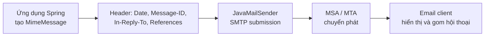
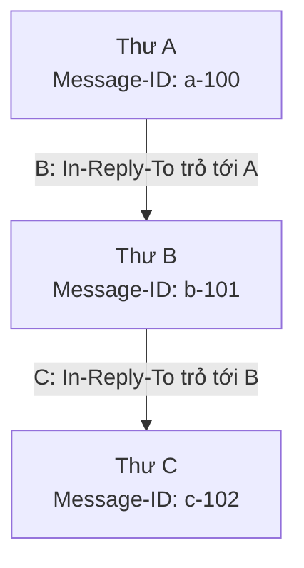
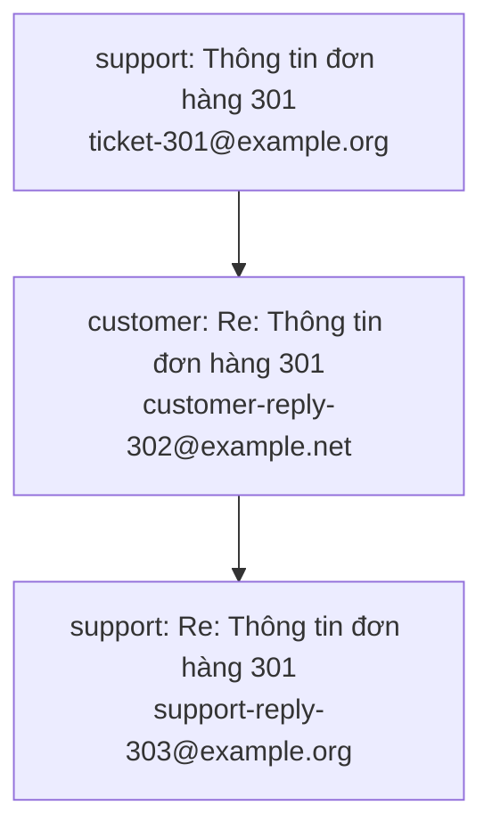

# Header `Date`, `In-Reply-To` và `References` trong Spring Framework Mail

Khi gửi email bằng **Spring Framework Mail**, ứng dụng thường quan tâm đến người gửi, người nhận, tiêu đề và nội dung. Tuy nhiên, một email còn có những header giúp người nhận hiểu **thư được tạo vào thời điểm nào** và **thư thuộc cuộc hội thoại nào**. Ba header rất quan trọng cho mục đích này là:

- **`Date`:** thời điểm người gửi tạo hoặc phát hành thông điệp theo góc nhìn của bên gửi.
- **`In-Reply-To`:** thông điệp (hoặc các thông điệp) trước đó mà email hiện tại trực tiếp trả lời.
- **`References`:** chuỗi định danh thông điệp có liên quan, thường biểu diễn lịch sử tổ tiên của cuộc hội thoại.

Chúng là các header của **định dạng Internet Message Format**, không phải tham số SMTP để chỉ định nơi phát thư. Trong Java, Spring Mail sử dụng `JavaMailSender` và Jakarta Mail (`MimeMessage`) để tạo, gắn và truyền những header này đến máy chủ SMTP.

Mục tiêu của bài là hiểu cách ba header phối hợp với `Message-ID`, nhận biết chúng trong email thực tế và sử dụng đúng khi một ứng dụng Spring gửi email mới hoặc trả lời email đã có.

## 1. Header nằm ở đâu trong một email?

Một thông điệp email dạng RFC 5322 có phần **header** và phần **body**, ngăn cách nhau bởi một dòng trống. Mỗi dòng header có tên trường, dấu hai chấm và giá trị.

Ví dụ một email được gửi lúc 15:30 tại Việt Nam:

```text
From: notifications@example.org
To: customer@example.net
Date: Thu, 12 Nov 2026 15:30:00 +0700
Message-ID: <welcome-481@example.org>
Subject: Welcome to Example
MIME-Version: 1.0
Content-Type: text/plain; charset=UTF-8

Your account has been created.
```

Các thông tin trên phục vụ những mục đích khác nhau:

| Header | Ý nghĩa | Ảnh hưởng chính |
|---|---|---|
| `From` | Địa chỉ hoặc danh tính tác giả thư | Người gửi hiển thị |
| `To` | Người nhận hiển thị | Thông tin trong nội dung thông điệp |
| `Date` | Thời điểm phát hành thông điệp do bên gửi khai báo | Hiển thị thời gian, sắp xếp và một số logic ứng dụng |
| `Message-ID` | Định danh thông điệp cụ thể | Tham chiếu và tạo chuỗi hội thoại |
| `In-Reply-To` | ID của thông điệp được trả lời trực tiếp | Liên kết thư mới với thư cha |
| `References` | Chuỗi ID liên quan đến hội thoại | Hỗ trợ dựng cây/chuỗi hội thoại |
| `Subject` | Chủ đề hiển thị | Tìm kiếm và gợi ý gom nhóm, nhưng không thay thế ID |

Header `Date` thường xuất hiện cả ở email đầu tiên và các email trả lời. Ngược lại, một email bắt đầu cuộc hội thoại mới thường **không cần** `In-Reply-To` hoặc `References`; những trường này có ý nghĩa khi tồn tại thông điệp trước đó.

### Tách biệt message headers và SMTP envelope

Các header trên thuộc nội dung thông điệp được chuyển trong bước `DATA` của SMTP. Để vận chuyển thư, SMTP còn dùng thông tin **envelope** như `MAIL FROM` và `RCPT TO`. Đừng nhầm `From:` trong header với `MAIL FROM` trong SMTP, hoặc cho rằng `References` ảnh hưởng đến việc MTA tìm tên miền nhận.



**SMTP chuyển thông điệp**; còn cách email client hiển thị ngày và nhóm thư dựa trên những header này cùng thuật toán riêng của client.

## 2. Header `Date`: thời điểm bên gửi khai báo

`Date` biểu diễn thời điểm thông điệp được tạo và phát hành bởi bên gửi (origination date), theo định dạng ngày giờ của RFC 5322.

Ví dụ:

```text
Date: Thu, 12 Nov 2026 15:30:00 +0700
```

Các thành phần:

| Thành phần | Giá trị ví dụ | Giải thích |
|---|---|---|
| Thứ trong tuần | `Thu,` | Thứ Năm, viết tắt tiếng Anh; thành phần tùy chọn trong cú pháp |
| Ngày | `12` | Ngày của tháng |
| Tháng | `Nov` | Tên tháng dạng viết tắt tiếng Anh |
| Năm | `2026` | Năm bốn chữ số |
| Giờ | `15:30:00` | Giờ, phút, giây; giây có thể được lược bỏ theo cú pháp |
| Múi giờ | `+0700` | Lệch UTC +07:00 |

Trong `Date`, `+0700` là **độ lệch múi giờ dạng số**, không phải tên vùng thời gian như `Asia/Ho_Chi_Minh`. Email client có thể hiển thị thời gian theo múi giờ người đọc. Vì vậy:

```text
Date: Thu, 12 Nov 2026 15:30:00 +0700
Date: Thu, 12 Nov 2026 08:30:00 +0000
```

Hai giá trị trên chỉ **cùng một thời điểm**. Chúng có giờ địa phương khác nhau do múi giờ khác nhau.

### Date khác Received và thời gian email đến

Trong suốt quá trình chuyển phát, các máy chủ SMTP có thể thêm header `Received` để ghi dấu từng chặng nhận/chuyển tiếp. `Date` và `Received` mô tả **hai loại thời gian khác nhau**:

- `Date` phản ánh thời điểm do bên tạo thông điệp khai báo.
- `Received` ghi lại dấu vết xử lý của máy chủ nhận tại từng chặng, gồm thời điểm và một số thông tin của chặng đó.
- Thời gian email xuất hiện trong inbox có thể còn phụ thuộc xử lý của MTA, hàng đợi, dịch vụ nhận thư và thao tác đồng bộ của client.

Ví dụ rút gọn:

```text
Date: Thu, 12 Nov 2026 15:30:00 +0700
Received: from smtp.example.org by mx.example.net
        with ESMTP; Thu, 12 Nov 2026 15:32:11 +0700
```

Điều này có thể cho thấy thông điệp khai báo được tạo lúc 15:30 và máy chủ đích tiếp nhận lúc 15:32. Nhưng **không nên dùng `Date` làm bằng chứng tin cậy tuyệt đối**: đồng hồ hệ thống của người gửi có thể sai, hoặc header có thể bị cố ý khai báo không đúng. Khi cần kiểm tra chính xác thời điểm chuyển phát, hãy đối chiếu dấu vết máy chủ, log và dữ liệu từ nhà cung cấp.

### Ngày gửi khi ứng dụng lưu bản nháp hoặc dùng hàng đợi

Giả sử ứng dụng tạo thông điệp lúc 10:00 nhưng một worker thực tế gửi lúc 10:20. Nếu gọi `setSentDate` ngay khi tạo, `Date` có thể phản ánh **10:00**; nếu đặt lại khi worker nộp thư, nó phản ánh **10:20**.

Hai thời điểm đều có thể có ý nghĩa với nghiệp vụ, nhưng cần xác định rõ quy ước:

- `createdAt`: thời điểm ghi nhận yêu cầu gửi hoặc tạo bản nháp.
- `submittedAt`: thời điểm worker bắt đầu hoặc hoàn tất việc nộp thư lên SMTP.
- `deliveredAt`: thời điểm mà hệ thống có bằng chứng chuyển phát tương ứng.
- `Date` trong MIME: thời điểm origination do hệ thống lựa chọn và khai báo trong thông điệp.

Không nên cố đồng nhất chúng thành một giá trị. Với tác vụ bất đồng bộ, hãy lưu các mốc thời gian nghiệp vụ trong database/log và dùng `Date` theo chính sách rõ ràng của ứng dụng.

## 3. Header `Message-ID`: nền tảng của chuỗi trả lời

Trước khi tìm hiểu hai header liên kết hội thoại, cần hiểu **`Message-ID`**. Nó là mã định danh được gán cho **một thông điệp email cụ thể**.

```text
Message-ID: <notice-482@example.org>
```

Một số đặc điểm:

1. Định danh thường có dạng `<id-left@id-right>`, bao quanh bởi dấu `<` và `>`.
2. ID phải được tạo với mức độ duy nhất phù hợp giữa các thông điệp; việc dùng domain trong phần bên phải giúp hạn chế va chạm.
3. **Mỗi email mới trong cuộc hội thoại cần một `Message-ID` riêng**, kể cả email trả lời.
4. `In-Reply-To` và `References` chứa **Message-ID của các thư trước đó**, chứ không chứa địa chỉ email, mã database hay `Subject`.
5. Một ID được chèn trong phần nội dung HTML/text **không trở thành** `Message-ID` của email.

Ví dụ về một cuộc hội thoại:

```text
Thư A: Message-ID: <a-100@example.org>
Thư B: Message-ID: <b-101@example.net>   (trả lời A)
Thư C: Message-ID: <c-102@example.org>   (trả lời B)
```

`Message-ID` khác với mã job/outbox mà ứng dụng tự tạo. Ví dụ `notification_102` là ID của bản ghi trong database; nếu muốn gắn nó với một email, ứng dụng cần **lưu ánh xạ** giữa mã nội bộ và `Message-ID` thực tế.

Với Jakarta Mail, `MimeMessage.getMessageID()` đọc định danh của thông điệp nếu đã có. Khi thư mới được chuẩn bị và gửi, thư viện có thể tạo một `Message-ID` trong quá trình hoàn thiện MIME. Không nên tự đoán hoặc hard-code một ID chung cho mọi lần gửi, cũng không nên giả định rằng việc gọi `setHeader("Message-ID", ...)` trước khi `saveChanges()` luôn bảo toàn ID qua mọi đường gửi.

## 4. Header `In-Reply-To`: thư hiện tại đang trả lời thư nào?

`In-Reply-To` chứa một hoặc nhiều `msg-id` của thông điệp mà người gửi đang trả lời.

Với cuộc trò chuyện thông thường, giá trị phổ biến nhất là **Message-ID của đúng một thư cha**:

```text
Message-ID: <b-101@example.net>
In-Reply-To: <a-100@example.org>
```

Nghĩa là thư B là phản hồi đối với thư A. Khi thư C trả lời B:

```text
Message-ID: <c-102@example.org>
In-Reply-To: <b-101@example.net>
```

Như vậy, `In-Reply-To` biểu diễn **liên kết trực tiếp**:



Một số tình huống đặc biệt có thể trả lời nhiều thông điệp cùng lúc, khi đó `In-Reply-To` có thể chứa nhiều Message-ID. Tuy nhiên, phần lớn luồng hội thoại ứng dụng chỉ cần **một ID cha**. Đừng dùng các địa chỉ email như `<support@example.org>` làm giá trị chỉ vì nhìn giống cặp dấu ngoặc nhọn; cần có **Message-ID thật của thông điệp cha**.

### In-Reply-To không phải Reply-To

Đây là hai trường có tên gần giống nhưng chức năng khác hẳn:

| Header | Chức năng | Ví dụ |
|---|---|---|
| `Reply-To` | Chỉ địa chỉ email nên gửi phản hồi đến | `Reply-To: helpdesk@example.org` |
| `In-Reply-To` | Xác định thông điệp đang được trả lời | `In-Reply-To: <ticket-01@example.org>` |

Trong Spring, `MimeMessageHelper.setReplyTo(...)` thiết lập địa chỉ trả lời **`Reply-To`**, **không thiết lập `In-Reply-To`**. Muốn điều khiển threading, bạn phải bổ sung `In-Reply-To` và `References` cho `MimeMessage`.

## 5. Header `References`: lịch sử định danh của cuộc hội thoại

`References` thường chứa **danh sách Message-ID của các thư trước đó** theo thứ tự từ cũ đến gần nhất. Nó giúp email client tái dựng quan hệ giữa các thư mà không phải chỉ suy luận từ dòng tiêu đề.

Ví dụ tiếp tục với ba thư A, B và C:

```text
Thư A:
  Message-ID: <a-100@example.org>

Thư B trả lời A:
  Message-ID: <b-101@example.net>
  In-Reply-To: <a-100@example.org>
  References: <a-100@example.org>

Thư C trả lời B:
  Message-ID: <c-102@example.org>
  In-Reply-To: <b-101@example.net>
  References: <a-100@example.org> <b-101@example.net>
```

Điểm cần chú ý:

- `In-Reply-To` của C chỉ định **B** là thư cha trực tiếp.
- `References` của C chứa **A và B**, theo trật tự hội thoại.
- `Message-ID` của C **không được thêm vào `References` của chính C**. ID của C sẽ xuất hiện khi thư D trả lời C.

### Quy tắc xây dựng References khi reply

Theo hướng dẫn xây dựng trường References của RFC 5322, có thể áp dụng:

1. Nếu **thư cha có `References`**, lấy danh sách đó rồi **nối thêm `Message-ID` của thư cha**.
2. Nếu thư cha không có `References` nhưng **`In-Reply-To` của thư cha chứa đúng một Message-ID**, có thể bắt đầu từ ID đó rồi nối thêm `Message-ID` của thư cha.
3. Nếu không có các thông tin tổ tiên phù hợp, bắt đầu bằng **`Message-ID` của thư cha**.

Ví dụ nhánh trả lời:

```text
                    A <a@example.org>
                   / \
                  /   \
    B <b@example.org>   X <x@example.net>
               |
    C <c@example.org>

B: In-Reply-To: <a@example.org>
   References: <a@example.org>

C: In-Reply-To: <b@example.org>
   References: <a@example.org> <b@example.org>

X: In-Reply-To: <a@example.org>
   References: <a@example.org>
```

`References` của C và X cùng chứa A vì hai thư thuộc những nhánh của cùng cuộc trao đổi. Tuy nhiên, C không cần đưa ID của X vào chuỗi tổ tiên; X không phải thư mà C trực tiếp trả lời.

### Có phải cứ giống References là mọi mail client gom nhóm giống nhau?

Không. RFC mô tả cú pháp và ý nghĩa của các trường, nhưng **giao diện “conversation view” là do từng ứng dụng email quyết định**. Một số client xét `Message-ID`, `In-Reply-To` và `References`; số khác còn xét chủ đề, người tham gia, thời gian, hoặc thuật toán riêng. Vì vậy:

- Có các header chuẩn sẽ **tăng khả năng** được gom vào cùng cuộc hội thoại.
- Không thể bảo đảm Gmail, Outlook, Thunderbird hay mọi hệ thống webmail tạo cùng một luồng hiển thị.
- Dòng tiêu đề `Re: ...` **không đủ** để xác định quan hệ cha–con khi thiếu Message-ID chuẩn.
- Nếu thay đổi người nhận, chủ đề hoặc đối tượng tham gia quá khác biệt, cách gom nhóm có thể khác dù các ID tham chiếu hợp lệ.

## 6. Ví dụ nguyên vẹn: tạo email, trả lời và trả lời tiếp

### Email đầu tiên

```text
From: support@example.org
To: customer@example.net
Date: Thu, 12 Nov 2026 09:00:00 +0700
Message-ID: <ticket-301@example.org>
Subject: Thông tin đơn hàng 301

Đơn hàng của bạn đã được tiếp nhận.
```

Thư đầu không có `In-Reply-To` hay `References`, vì đang mở một cuộc hội thoại mới.

### Người dùng trả lời thư đầu

```text
From: customer@example.net
To: support@example.org
Date: Thu, 12 Nov 2026 09:15:00 +0700
Message-ID: <customer-reply-302@example.net>
In-Reply-To: <ticket-301@example.org>
References: <ticket-301@example.org>
Subject: Re: Thông tin đơn hàng 301

Tôi có thể thay đổi địa chỉ giao hàng không?
```

Thư này được nối vào cuộc hội thoại vì nó tham chiếu chính xác `<ticket-301@example.org>`.

### Ứng dụng Spring trả lời khách hàng

```text
From: support@example.org
To: customer@example.net
Date: Thu, 12 Nov 2026 09:20:00 +0700
Message-ID: <support-reply-303@example.org>
In-Reply-To: <customer-reply-302@example.net>
References: <ticket-301@example.org> <customer-reply-302@example.net>
Subject: Re: Thông tin đơn hàng 301

Bạn có thể cập nhật địa chỉ trước khi đơn hàng được bàn giao.
```

Thư thứ ba tạo `Message-ID` mới, đặt `In-Reply-To` bằng ID của thư thứ hai và duy trì chuỗi `References` theo các thư tổ tiên. Nếu người dùng lại trả lời thư thứ ba, họ có thể tiếp tục nối ID thứ ba vào `References` của thư tiếp theo.

### Hiển thị theo cây hội thoại



Thời gian trong mỗi `Date` cho biết thời điểm bên gửi khai báo. Các **cạnh quan hệ** trong cây được hỗ trợ bởi `In-Reply-To`, còn danh sách tổ tiên nằm trong `References`.

## 7. Spring Mail thiết lập Date như thế nào?

Trong Spring Framework Mail, bạn thường làm việc với `JavaMailSender` và `MimeMessageHelper`. Đối với header `Date`, API thích hợp là:

```java
MimeMessage mimeMessage = javaMailSender.createMimeMessage();
MimeMessageHelper helper = new MimeMessageHelper(mimeMessage, "UTF-8");
helper.setSentDate(new java.util.Date());
```

Hoặc thao tác trực tiếp trên Jakarta Mail:

```java
MimeMessage mimeMessage = javaMailSender.createMimeMessage();
mimeMessage.setSentDate(new java.util.Date());
```

Hai cách đều hướng đến việc thiết lập **ngày gửi của thông điệp**. Nên ưu tiên API có kiểu dữ liệu `Date` thay vì tự viết chuỗi:

```java
// Không nên xây dựng một Date header thủ công từ chuỗi tùy ý.
mimeMessage.setHeader("Date", userSuppliedDate);
```

Cách dùng setter cho phép Jakarta Mail mã hóa ngày theo dạng phù hợp với email và tránh lỗi thiếu múi giờ hoặc sai cú pháp.

### Truy xuất Date từ thư có sẵn

Với một `MimeMessage` được tạo từ thư đã nhận hoặc đã lưu:

```java
java.util.Date sentDate = mimeMessage.getSentDate();
String[] rawDateHeaders = mimeMessage.getHeader("Date");
```

`getSentDate()` trả về `Date` đã được thư viện phân tích nếu có thể; kết quả có thể là `null` nếu header không có hoặc không đọc được. `getHeader("Date")` cho phép kiểm tra văn bản gốc khi cần điều tra dữ liệu không đúng định dạng.

Khi lưu mốc thời gian vào hệ thống, nên dùng `Instant` hoặc kiểu dữ liệu thời gian có timezone thích hợp, thay vì lưu nguyên chuỗi ngày hiển thị. Khi cần đồng bộ với miền nghiệp vụ:

```java
Instant sentAt = sentDate == null ? null : sentDate.toInstant();
```

`Instant` biểu diễn một thời điểm tuyệt đối; lựa chọn timezone để hiển thị là trách nhiệm của lớp giao diện/ứng dụng.

## 8. Thiết lập In-Reply-To và References trong Spring Mail

`MimeMessageHelper` hỗ trợ nhiều header phổ biến, nhưng không có các setter chuyên dụng cho mọi trường threading. Để đặt `In-Reply-To` và `References`, hãy thao tác trên `MimeMessage` bằng `setHeader(...)`.

Ví dụ đơn giản:

```java
MimeMessage message = mailSender.createMimeMessage();
MimeMessageHelper helper = new MimeMessageHelper(message, "UTF-8");

helper.setFrom("support@example.org");
helper.setTo("customer@example.net");
helper.setSubject("Re: Thông tin đơn hàng");
helper.setText("Chúng tôi đã nhận được phản hồi của bạn.", false);
helper.setSentDate(new java.util.Date());

message.setHeader("In-Reply-To", "<customer-reply-302@example.net>");
message.setHeader(
        "References",
        "<ticket-301@example.org> <customer-reply-302@example.net>");

mailSender.send(message);
```

Hai giá trị được đưa vào header **phải đến từ Message-ID có thật của các email trước đó**. Chúng không nên là những chuỗi được đoán ra từ mã đơn hàng hoặc địa chỉ khách hàng.

### Dịch vụ gửi thư trả lời với chuỗi References đã lưu

Trong ứng dụng có chức năng email hội thoại, bạn có thể lưu `parentMessageId` và danh sách `ancestorMessageIds` (các ID từ `References` của thư cha) để tạo reply.

```java
package com.example.notification;

import jakarta.mail.MessagingException;
import jakarta.mail.internet.MimeMessage;
import java.nio.charset.StandardCharsets;
import java.util.ArrayList;
import java.util.Date;
import java.util.List;
import org.springframework.beans.factory.annotation.Value;
import org.springframework.mail.javamail.JavaMailSender;
import org.springframework.mail.javamail.MimeMessageHelper;
import org.springframework.stereotype.Service;

@Service
public class ConversationMailService {
    private final JavaMailSender mailSender;
    private final String fromAddress;

    public ConversationMailService(
            JavaMailSender mailSender,
            @Value("${app.mail.from}") String fromAddress) {
        this.mailSender = mailSender;
        this.fromAddress = fromAddress;
    }

    public void reply(
            String recipient,
            String originalSubject,
            String replyBody,
            String parentMessageId,
            List<String> parentReferences) throws MessagingException {

        String safeParentId = requireSafeMessageId(parentMessageId);
        List<String> references = new ArrayList<>();

        // parentReferences là chuỗi tổ tiên đã trích từ thư cha.
        if (parentReferences != null) {
            for (String ancestorId : parentReferences) {
                references.add(requireSafeMessageId(ancestorId));
            }
        }
        // References của thư trả lời gồm tổ tiên + ID thư cha.
        if (references.isEmpty()
                || !references.get(references.size() - 1).equals(safeParentId)) {
            references.add(safeParentId);
        }

        MimeMessage message = mailSender.createMimeMessage();
        MimeMessageHelper helper = new MimeMessageHelper(
                message, false, StandardCharsets.UTF_8.name());

        helper.setFrom(fromAddress);
        helper.setTo(recipient);
        helper.setSubject("Re: " + originalSubject);
        helper.setText(replyBody, false);
        helper.setSentDate(new Date());

        message.setHeader("In-Reply-To", safeParentId);
        message.setHeader("References", String.join(" ", references));

        mailSender.send(message);
    }

    private static String requireSafeMessageId(String value) {
        if (value == null
                || value.length() > 500
                || !value.matches("<[^<>\\s@]+@[^<>\\s@]+>")) {
            throw new IllegalArgumentException("Invalid Message-ID");
        }
        return value;
    }
}
```

Ở ví dụ này:

1. `parentMessageId` là `Message-ID` của **thư được trả lời trực tiếp**.
2. `parentReferences` là **các ID đã được phân tách và lưu đúng thứ tự** từ `References` của thư cha. Ví dụ `["<ticket-301@example.org>"]`.
3. `references.add(safeParentId)` hoàn thiện danh sách tổ tiên cho thư mới.
4. `setHeader("In-Reply-To", ...)` ghi quan hệ trực tiếp tới cha.
5. `setHeader("References", ...)` ghi chuỗi tổ tiên.
6. `helper.setSentDate(...)` thiết lập thời điểm phát hành thư.
7. `mailSender.send(...)` chuyển thông điệp đến máy chủ SMTP đã cấu hình; nó không đồng nghĩa thư được hiển thị vào đúng hội thoại trên mọi mail client.

Hàm `requireSafeMessageId` trong ví dụ là **kiểm tra định dạng rút gọn** nhằm chỉ chấp nhận các ID đơn giản và loại bỏ khả năng chèn ký tự xuống dòng qua chuỗi ID. Nó không triển khai đầy đủ mọi biến thể cú pháp `msg-id` được RFC cho phép. Với email nhận từ nhiều nguồn, ứng dụng nên dùng bộ phân tích và quy tắc kiểm soát header phù hợp, đồng thời bảo đảm giới hạn độ dài.

Khi triển khai thực tế, cũng cần chuẩn hóa cách viết `Re:` để tránh thành `Re: Re: Re: ...`, kiểm soát người nhận được phép, xử lý subject null và giới hạn số ID/lượng dữ liệu trong `References`. Đây là các chính sách ứng dụng, tách biệt với ý nghĩa của ba header.

### Cấu hình SMTP trong Spring Boot

Để gửi được thông điệp, ứng dụng cần Mail starter và endpoint SMTP:

```groovy
dependencies {
    implementation 'org.springframework.boot:spring-boot-starter-mail'
}
```

```yaml
spring:
  mail:
    host: ${SMTP_HOST}
    port: 587
    username: ${SMTP_USERNAME}
    password: ${SMTP_PASSWORD}
    properties:
      "[mail.smtp.auth]": true
      "[mail.smtp.starttls.enable]": true
      "[mail.smtp.starttls.required]": true
      "[mail.smtp.ssl.checkserveridentity]": true
      "[mail.smtp.connectiontimeout]": 5000
      "[mail.smtp.timeout]": 10000
      "[mail.smtp.writetimeout]": 10000

app:
  mail:
    from: ${SMTP_FROM}
```

Những thuộc tính SMTP này xác định **đường gửi email**; còn `Date`, `In-Reply-To` và `References` xác định **thông tin ngữ nghĩa bên trong email**. Hai nhóm cấu hình phục vụ các tầng chức năng khác nhau.

**Lưu ý phiên bản:** ví dụ dùng `jakarta.mail` tương ứng Spring Framework 6+ / Spring Boot 3+. Dự án Spring Framework 5 / Boot 2 có thể dùng `javax.mail` và cần điều chỉnh import theo dependency thực tế.

## 9. Lấy Message-ID và References của thư cha từ đâu?

Trong ứng dụng hỗ trợ trả lời email, **thông tin đầu vào phải có nguồn gốc rõ ràng**:

- Nếu hệ thống **nhận email** qua IMAP, POP3, webhook của nhà cung cấp hoặc gateway nội bộ, lấy `Message-ID`, `References` và `In-Reply-To` từ thông điệp đã nhận.
- Nếu hệ thống **chỉ gửi email**, có thể lưu `Message-ID` của email đi ra cùng bản ghi nghiệp vụ. Cần lưu ý thư viện và máy chủ SMTP có thể quản lý hoặc điều chỉnh ID trong quá trình gửi.
- Nếu người dùng trả lời một email ngoài hệ thống và ứng dụng không có dữ liệu thư cha, **không thể dựng chuỗi tham chiếu đáng tin cậy chỉ từ `Subject`**.

Đối với một đối tượng `MimeMessage` đã có, Jakarta Mail cung cấp:

```java
String parentId = parentMessage.getMessageID();
String[] referencesHeaders = parentMessage.getHeader("References");
String[] inReplyToHeaders = parentMessage.getHeader("In-Reply-To");
```

`getHeader(...)` trả về **các giá trị header dạng chuỗi**. Một giá trị `References` có thể chứa **nhiều Message-ID** trên cùng trường, và header có thể được gấp dòng (folding). Do đó, không thể coi mỗi phần tử của `referencesHeaders` là đúng một Message-ID. Cần **phân tích danh sách `msg-id`**, không đơn thuần `split(" ")` trên dữ liệu tùy ý: khoảng trắng và header folding có thể xuất hiện giữa các ID; cú pháp RFC cũng có những trường hợp đặc biệt.

Ví dụ giá trị logic:

```text
References: <ticket-301@example.org>
            <customer-reply-302@example.net>
```

Hai ID phải được lưu theo đúng thứ tự:

```text
[
  "<ticket-301@example.org>",
  "<customer-reply-302@example.net>"
]
```

Sau đó khi trả lời thư đang có `Message-ID: <support-reply-303@example.org>`, chuỗi References mới có thể là:

```text
References: <ticket-301@example.org>
            <customer-reply-302@example.net>
            <support-reply-303@example.org>
```

Trong ví dụ này `support-reply-303` là **ID của thư cha**, không phải ID mới của thư được tạo.

### Lưu dữ liệu threading trong database

Một mô hình nghiệp vụ có thể gồm:

| Trường | Vai trò | Ví dụ |
|---|---|---|
| `conversationId` | ID nội bộ của một luồng hỗ trợ/đơn hàng | `case-301` |
| `messageId` | `Message-ID` của chính email | `<ticket-301@example.org>` |
| `parentMessageId` | Message-ID của thư cha trực tiếp | `<customer-reply-302@example.net>` |
| `references` | Danh sách các ID tổ tiên theo thứ tự | `[<ticket-301@...>, <customer-reply-302@...>]` |
| `createdAt` | Thời điểm tạo bản ghi trong hệ thống | `Instant` |
| `submittedAt` | Thời điểm SMTP đã nhận yêu cầu submission | `Instant` |
| `dateHeader` hoặc `originationAt` | Thời điểm khai báo trong `Date` của email | `Instant`/thông tin đã phân tích |

Không nên dùng `conversationId` để **thay thế** `Message-ID`. ID nội bộ rất hữu ích cho việc truy vấn và phân quyền, nhưng email client bên ngoài chỉ nhìn thấy chuẩn header email thực tế.

### Nếu email được gửi bằng JavaMailSender và cần lưu ID thực tế

Một `MimeMessage` có thể chưa có `Message-ID` ngay sau `createMimeMessage()`. ID thường được đặt trong quá trình chuẩn bị gửi (`saveChanges()`). Khi cần truy vết:

1. Tạo thông điệp, gửi bằng một đường gửi đã được kiểm soát.
2. Đọc `getMessageID()` sau khi thư viện đã hoàn thiện thông điệp, nếu đối tượng đó còn giữ ID.
3. Lưu ID cùng bản ghi nghiệp vụ, rồi đối chiếu với log hoặc ID của nhà cung cấp khi có.
4. Nếu yêu cầu tự cấp phát và duy trì ID cố định xuyên suốt retry, cần thiết kế và xác minh cơ chế tương thích với Jakarta Mail, cách `JavaMailSender` gọi `saveChanges()` và chính sách SMTP provider. Không coi một giá trị set thủ công trước khi gửi là chắc chắn không đổi.

Đặc biệt, **Message-ID khác mã queue của MSA**: một server có thể trả mã nội bộ như `queued as ABC123`; mã này phục vụ tra log của máy chủ và không nhất thiết là `Message-ID` hiển thị trong email.

## 10. Sự khác nhau giữa các header dễ nhầm

| Header / dữ liệu | Thuộc tầng nào? | Ý nghĩa |
|---|---|---|
| `Date` | Message header | Thời điểm origination do bên gửi khai báo |
| `Received` | Trace header | Dấu vết xử lý của các chặng máy chủ nhận/chuyển tiếp |
| `Message-ID` | Message header | Định danh duy nhất cho một thông điệp |
| `In-Reply-To` | Message header | Trỏ tới thư cha được trả lời |
| `References` | Message header | Các ID liên quan theo lịch sử cuộc hội thoại |
| `Reply-To` | Message header | Địa chỉ email được đề nghị nhận câu trả lời |
| `Subject` | Message header | Tiêu đề hiển thị; không phải định danh đáng tin cậy |
| `MAIL FROM` | SMTP envelope | Envelope sender cho vận chuyển/bounce |
| `RCPT TO` | SMTP envelope | Địa chỉ người nhận để hệ thống SMTP chuyển phát |
| `conversationId` | Dữ liệu nội bộ | Nhóm thư trong ứng dụng nghiệp vụ của bạn |

Một sai lầm hay gặp là dùng `helper.setReplyTo(...)` với mong muốn email sẽ được ghép vào thread cũ. Thao tác đó chỉ đổi địa chỉ trả lời, không cung cấp quan hệ Message-ID. Ngược lại, chỉ đặt `In-Reply-To` không đảm bảo phản hồi sẽ gửi về đúng inbox; việc chọn `To` và `Reply-To` vẫn phải xử lý riêng.

## 11. Xử lý các trường hợp đặc biệt

### Thư cha không có Message-ID

Email theo chuẩn thường có `Message-ID`, nhưng trong thực tế vẫn có thông điệp thiếu hoặc chứa ID không hợp lệ. Nếu không có ID cha đáng tin cậy, ứng dụng khó tạo được `In-Reply-To` đúng chuẩn cho thư trả lời.

Trong tình huống này, ứng dụng có thể vẫn gửi email với tiêu đề và nội dung thích hợp, nhưng nên chấp nhận rằng client đích **có thể xem đó là cuộc hội thoại mới**. Không tạo một ID cha “giả” từ subject hoặc địa chỉ email.

### Thư cha có In-Reply-To nhưng không có References

Nếu thư cha có đúng một `In-Reply-To` hợp lệ, có thể dùng ID đó làm chuỗi tổ tiên ban đầu rồi nối `Message-ID` của thư cha. Nếu `In-Reply-To` của cha chứa nhiều ID hoặc không rõ ràng, cần áp dụng quy tắc dựng References cẩn thận theo dữ liệu thực tế.

### References quá dài

Chuỗi trao đổi nhiều thư có thể làm `References` dài dần. RFC có quy tắc về độ dài dòng và cách gấp dòng header; một số hệ thống còn có hạn mức kích thước header hoặc toàn bộ email. Đừng ghép hàng nghìn ID vào một dòng header không kiểm soát. Nếu có chính sách rút gọn ID, cần cân nhắc tác động đến khả năng dựng lại chuỗi hội thoại.

### Trả lời nhiều thư cùng lúc

`In-Reply-To` có thể chứa nhiều `msg-id` nhưng thuật toán hiển thị hội thoại của client có thể không biểu diễn tốt nhiều cha. Khi thiết kế ứng dụng gửi email thông báo hoặc hỗ trợ khách hàng, thường đơn giản hơn khi xác định **một thư cha trực tiếp** và giữ `References` cho tổ tiên của cha.

### Chuyển tiếp thư (forward) có nên có In-Reply-To?

Forward là hành động chuyển nội dung thư sang người nhận khác, không nhất thiết là **reply trực tiếp** trong cùng cuộc hội thoại. Vì vậy không mặc định sao chép `In-Reply-To` và `References` của thư cũ vào mọi email forward. Chọn hành vi theo nghiệp vụ và cách mong muốn email client hiển thị.

### Threading xuyên suốt nhiều kênh

Nếu người dùng trả lời email qua webmail, còn tổng đài xử lý qua ticket system, hệ thống có thể cần một ánh xạ giữa mã ticket và các `Message-ID`. Không nhất thiết mọi email nằm trong cùng một thread bên ngoài sẽ tương ứng với một ticket nội bộ, hoặc ngược lại. Phân quyền và trạng thái nghiệp vụ vẫn cần xử lý độc lập.

## 12. Bảo mật và độ tin cậy của dữ liệu header

Header là dữ liệu đầu vào khi ứng dụng nhận thư từ bên ngoài. Không nên coi `Date`, `Message-ID`, `In-Reply-To` hay `References` là bằng chứng xác thực danh tính hoặc quyền truy cập.

Các điểm thực hành quan trọng:

1. **Chống header injection:** không chép trực tiếp chuỗi chưa được kiểm soát chứa CR/LF vào `setHeader(...)`. Phân tích `msg-id`, loại bỏ dữ liệu sai và giới hạn độ dài trước khi tái sử dụng.
2. **Không dùng Date làm thời gian tin cậy:** đồng hồ người gửi có thể sai hoặc giá trị có thể bị giả mạo. Với log/audit, dùng timestamp của hạ tầng do bạn kiểm soát và đối chiếu khi cần.
3. **Không dùng threading làm xác thực:** ai đó có thể tự đặt `In-Reply-To` trỏ đến ID một cuộc hội thoại biết trước. Chỉ liên kết dữ liệu nội bộ sau khi kiểm tra quyền và thông tin xác thực cần thiết.
4. **Bảo vệ metadata:** `References` có thể tiết lộ ID của các email cũ. Không đưa ID và nội dung của cuộc trao đổi riêng tư vào email gửi sai người nhận.
5. **Giới hạn số lượng và kích thước header:** tránh thông điệp lỗi, tiêu tốn bộ nhớ hoặc bị nhà cung cấp từ chối khi chuỗi tham chiếu quá dài.
6. **Ghi log có chọn lọc:** log mã tác vụ, các mốc gửi và lỗi liên quan; hạn chế ghi toàn bộ source email có dữ liệu khách hàng hoặc token.

Sự tồn tại của `Date` và `References` **không chứng minh email đáng tin cậy**, tương tự như `Subject` không chứng minh người gửi là người sở hữu miền. Các cơ chế xác thực email và kiểm soát nghiệp vụ cần được triển khai ở những lớp phù hợp.

## 13. Kiểm tra email có được tạo header đúng không?

Với ứng dụng đang phát triển, có thể gửi thư thử nghiệm vào một SMTP sink như **Mailpit** hoặc hệ thống mailbox test rồi xem **raw message source**. Một số webmail có chức năng “Show original”, “View source” hoặc “View message headers”.

Khi xem một chuỗi ba thư, hãy so sánh:

| Thư | `Message-ID` | `In-Reply-To` | `References` |
|---|---|---|---|
| A (mở đầu) | `<a@example.org>` | Không có | Không có |
| B (trả lời A) | `<b@example.net>` | `<a@example.org>` | `<a@example.org>` |
| C (trả lời B) | `<c@example.org>` | `<b@example.net>` | `<a@example.org> <b@example.net>` |

Nếu các header như bảng mà client vẫn không nhóm thư như kỳ vọng, hãy kiểm tra khả năng tương thích và chính sách grouping của **client cụ thể**. Đừng sửa `Date` thành ngày giả hoặc dùng chung một `Message-ID` cho nhiều thư để cố ép tạo thread.

Với chức năng gửi từ Spring, có thể kiểm tra trực tiếp trên đối tượng `MimeMessage` trước khi giao cho SMTP:

```java
String[] replyLinks = message.getHeader("In-Reply-To");
String[] referenceHeaders = message.getHeader("References");
Date createdDate = message.getSentDate();
```

Đây là cách truy xuất dữ liệu đang nằm trong thông điệp; giá trị có thể khác bản cuối cùng được thư viện hoặc nhà cung cấp xử lý. Nếu muốn xác nhận trạng thái phát thư, phải dùng log và phản hồi SMTP/provider riêng. Đọc header trong object **không tương đương** kiểm chứng người nhận đã nhận email.

### Nếu mail client không nhóm các thư?

Những khả năng có thể gặp:

- `Message-ID` cha bị thiếu, sai hoặc không trùng ID thực tế của email trước đó.
- `In-Reply-To` trỏ nhầm thư; `References` thiếu chuỗi tổ tiên hoặc xếp thứ tự sai.
- Hệ thống tự cấp `Message-ID` nhưng thư viện/provider đã tạo một ID khác.
- Thư bị gửi thành các bản sao, mỗi bản có ID khác nhau hoặc ngược lại nhiều thư dùng chung ID.
- Một ứng dụng email dùng quy tắc nhóm hội thoại riêng kết hợp subject/người tham gia/thời gian.
- Chế độ conversation view bị tắt hoặc những thư nằm trong mailbox/vị trí hiển thị khác nhau.

Khi điều tra, nên kiểm tra raw headers ở cả **thư cha** và **thư con**, rồi đối chiếu với ID đang được database lưu. Chỉ nhìn hai dòng subject giống nhau thường không đủ.

## 14. Câu hỏi thường gặp

**Date có phải ngày email đến inbox không?** Không. Nó là thời điểm origination do bên gửi khai báo. Giờ nhận hoặc giờ hệ thống chuyển phát có thể khác, và được phản ánh qua những dấu vết khác như `Received` hoặc sự kiện nhà cung cấp.

**Đặt Date ở UTC được không?** Được. Ví dụ `+0000` là UTC, còn `+0700` là UTC+07. Cần sử dụng giá trị ngày, giờ, offset phù hợp với một thời điểm thực tế và biểu diễn đúng cú pháp RFC.

**Có nên tự set Date bằng chuỗi không?** Với Spring/Jakarta Mail nên dùng `MimeMessageHelper.setSentDate(Date)` hoặc `MimeMessage.setSentDate(Date)` để tránh lỗi định dạng.

**In-Reply-To có dùng địa chỉ email của người đang trả lời không?** Không. Nó chứa `Message-ID` của thông điệp cha, không phải địa chỉ `From`, `To` hay `Reply-To`.

**References chứa ID của thư hiện tại không?** Thông thường không. Nó chứa ID các thư tổ tiên. ID hiện tại nằm trong `Message-ID` của chính thông điệp.

**Có phải mọi thư đều cần In-Reply-To và References?** Không. Một thư mở đầu không có thư cha nên không cần hai header này. Chúng có ý nghĩa đối với câu trả lời và các thông điệp có quan hệ tham chiếu.

**Chỉ đổi Subject thành Re: là đủ gom thread?** Không. `Re:` là dấu hiệu dễ đọc cho người dùng, còn quan hệ thư trực tiếp và lịch sử được mô tả qua `In-Reply-To` và `References`. Một số client vẫn có thuật toán grouping riêng.

**Dùng helper.setReplyTo(...) có tạo được In-Reply-To không?** Không. `setReplyTo` đặt địa chỉ nhận câu trả lời. Để tạo thread, gọi `message.setHeader("In-Reply-To", ...)` và `message.setHeader("References", ...)` với ID chuẩn.

**Có thể tạo Message-ID từ ID ticket nội bộ không?** Có thể thiết kế hệ thống cấp phát ID email dựa trên dữ liệu nội bộ theo đúng cú pháp và tính duy nhất, nhưng phải kiểm soát cách Jakarta Mail hoàn thiện/gửi message và đảm bảo ID thực sự xuất hiện tại phía nhận. ID ticket thuần túy không tự động trở thành `Message-ID` chuẩn.

**Đổi thời gian Date có làm thư mới được xếp ngay sau thư cũ không?** Không đảm bảo. Client có thể dựa vào nhiều yếu tố để sắp xếp và nhóm thư. Thay đổi Date một cách giả tạo còn làm sai dữ liệu thời gian.

## 15. Chuẩn tham khảo

- **RFC 5322 — Internet Message Format:** mô tả `Date` (`orig-date`), `Message-ID`, `In-Reply-To` và `References`, cùng quy tắc tạo danh sách tham chiếu khi trả lời.
- **RFC 5321 — Simple Mail Transfer Protocol:** giúp phân biệt thông tin message header với các lệnh SMTP dùng để chuyển thư.
- **Jakarta Mail API — `jakarta.mail.internet.MimeMessage`:** các API `setSentDate`, `getSentDate`, `setHeader`, `getHeader` và `getMessageID`.
- **Spring Framework Mail — `JavaMailSender`, `MimeMessageHelper`:** lớp tích hợp giúp ứng dụng Spring tạo/gửi MIME message và đặt header phổ biến.

---

**Ghi nhớ:** `Date` trả lời **khi nào thư được phát hành theo bên gửi**; `In-Reply-To` trả lời **thư này trực tiếp phản hồi thư nào**; `References` mô tả **chuỗi Message-ID đã dẫn tới thư này**. Muốn Spring Mail tạo email thuộc một cuộc hội thoại, hãy lấy **Message-ID thực tế của thư cha**, xây dựng `In-Reply-To` và `References` chính xác, và cấp `Message-ID` mới cho email đang gửi. Các header chuẩn giúp client nhận biết quan hệ giữa thư, nhưng không thay thế việc theo dõi thời gian gửi/nhận hay đảm bảo mọi email client hiển thị cùng một kiểu hội thoại.
