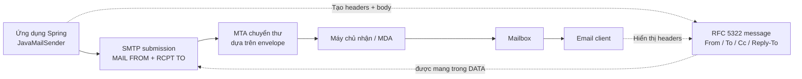

# Phân biệt địa chỉ phong bì với địa chỉ trong header email

Trong kiến trúc email, một thư thường có **hai lớp địa chỉ**: **địa chỉ phong bì SMTP (envelope addresses)** dùng khi máy chủ chuyển thư và **địa chỉ trong header của thông điệp (message header addresses)** dùng để mô tả người gửi, người nhận và nơi trả lời. Hai lớp này có thể giống nhau, nhưng **không bắt buộc phải giống**.

Với Spring Framework Mail, phân biệt này rất quan trọng khi ứng dụng gửi email thông báo, gửi cho nhiều người nhận, sử dụng Bcc, đặt hộp thư hỗ trợ làm `Reply-To`, hoặc cần xử lý thư bị trả về (bounce). Nếu nhầm `From:` với `MAIL FROM`, hay `To:` với `RCPT TO`, người phát triển có thể cấu hình sai địa chỉ nhận lỗi, hiểu nhầm luồng định tuyến, hoặc làm lộ địa chỉ của người nhận bí mật.

Ví dụ một hóa đơn:

```text
SMTP envelope:
  MAIL FROM:<bounces+invoice-184@shop.example>
  RCPT TO:<alice@company.example>

Headers của email:
  From: "Shop Billing" <invoices@shop.example>
  To: "Alice" <alice@company.example>
  Reply-To: support@shop.example
  Subject: Hoa don 184
```

Trong trường hợp này, hóa đơn được gửi **đến Alice**, người dùng nhìn thấy người gửi là **Shop Billing**, khi bấm **Reply** sẽ trả lời đến **support@shop.example**, còn thông báo thất bại khi phát thư thường được gửi về **bounces+invoice-184@shop.example**. Bốn vai trò đó thuộc cùng một email nhưng phục vụ những mục đích khác nhau.

## 1. Hai lớp địa chỉ được hình thành ở đâu?

Email có hai tầng giao thức cần phân biệt:

| Tầng | Tiêu chuẩn nền tảng | Nội dung | Ai sử dụng chủ yếu? |
| --- | --- | --- | --- |
| **SMTP envelope** | RFC 5321 (SMTP) và các phần mở rộng liên quan | Reverse-path từ `MAIL FROM`, forward-path từ từng `RCPT TO` | SMTP client, Mail Submission Agent (MSA), Mail Transfer Agent (MTA), hệ thống xử lý DSN |
| **Message headers** | RFC 5322 (Internet Message Format), MIME và các phần mở rộng | `From:`, `To:`, `Cc:`, `Reply-To:`, `Sender:`, `Subject:`, ... | Mail client, người dùng, bộ lọc, các cơ chế xác thực danh tính |

Ở SMTP, envelope là **thông tin của giao dịch chuyển thư**. Sau khi máy chủ chấp nhận `DATA`, nội dung thư chứa các header rồi đến body. Envelope được khai báo bằng lệnh SMTP **ở ngoài** nội dung `DATA`; bởi vậy nếu chỉ mở một file `.eml`, ta có thể thấy các header nhưng không nhất thiết biết chính xác mọi `RCPT TO` của giao dịch trước đó.



**Mấu chốt:** SMTP envelope quyết định **gửi tới đâu** và **gửi báo cáo thất bại về đâu**; message headers mô tả **thư đang thể hiện ai là người gửi, ai là người nhận và phải trả lời ai**. Header có ý nghĩa đối với xác thực và chính sách, nhưng không thay thế envelope của phiên SMTP.

## 2. Envelope sender: `MAIL FROM`

SMTP client bắt đầu một giao dịch chuyển email bằng lệnh:

```smtp
C: MAIL FROM:<bounces@shop.example>
S: 250 2.1.0 Sender OK
```

Địa chỉ nằm trong `MAIL FROM` được gọi là **reverse-path** hoặc **envelope sender**. Nó là đích để hệ thống mail gửi thông báo về lỗi phát thư, đặc biệt là Delivery Status Notification (DSN) sau khi thư đã được một relay nhận rồi thất bại ở hop tiếp theo.

Địa chỉ này có thể là:

- `bounces@shop.example` — một mailbox thu thập thư bị trả.
- `bounce+order-184@shop.example` — địa chỉ gắn mã để liên kết bounce với thông điệp cụ thể.
- Một địa chỉ thuộc domain do dịch vụ gửi email quản lý, khi nhà cung cấp xử lý bounce thay ứng dụng.
- **Giá trị rỗng `<>`** trong trường hợp đặc biệt, ví dụ thông báo lỗi phát thư được gửi với null reverse-path để giảm nguy cơ vòng lặp.

Ví dụ null reverse-path:

```smtp
C: MAIL FROM:<>
S: 250 2.1.0 OK
C: RCPT TO:<bounces@shop.example>
S: 250 2.1.5 OK
```

**`MAIL FROM:<>` không phải cú pháp địa chỉ sai.** Nó là envelope sender rỗng có ý nghĩa trong SMTP. Nếu thông báo lỗi lại không phát được, máy chủ không nên tạo thêm một bounce gửi tới envelope sender của chính DSN đó, vì reverse-path đã rỗng.

### `MAIL FROM` khác gì với `From:`?

```text
MAIL FROM:<bounces@shop.example>          # SMTP command, phục vụ delivery/bounce
From: "Shop Billing" <invoices@shop.example>  # Message header, người gửi hiển thị
```

Hai giá trị trên hợp lệ khi khác nhau. Một địa chỉ nhận bounce riêng giúp nhóm vận hành theo dõi lỗi mà không đổ thư tự động vào hộp thư người dùng tương tác.

Nếu thư gửi qua dịch vụ SMTP trung gian, nhà cung cấp có thể đặt hoặc viết lại envelope sender theo chính sách của họ. Do đó, để khẳng định giá trị `MAIL FROM` **thực sự đi ra mạng**, nên xem SMTP transcript hoặc thông tin gửi của nhà cung cấp, thay vì chỉ dựa vào trường `From:` của email đã gửi.

## 3. Envelope recipient: `RCPT TO`

Người nhận thực tế của một giao dịch SMTP được khai báo bằng **một hoặc nhiều** lệnh `RCPT TO`:

```smtp
C: MAIL FROM:<bounces@shop.example>
S: 250 2.1.0 Sender OK
C: RCPT TO:<alice@company.example>
S: 250 2.1.5 Recipient OK
C: RCPT TO:<audit@shop.example>
S: 250 2.1.5 Recipient OK
```

Máy chủ nhận biết rằng nó cần xử lý hai recipient từ **hai lệnh SMTP**, dù thông điệp sau đó có thể chỉ chứa:

```text
From: invoices@shop.example
To: alice@company.example
Subject: Hoa don 184
```

Địa chỉ `audit@shop.example` có thể được dùng để nhận bản sao kín, và **không bắt buộc xuất hiện trong `To:` hay `Cc:`**. Nếu một địa chỉ xuất hiện trong `To:` nhưng không có trong tập recipient được chuyển đi, header đó tự nó không khiến SMTP giao thư đến địa chỉ ấy.

MTA sử dụng miền của từng envelope recipient để chọn tuyến tiếp theo: tra DNS MX, giao cho server quản lý miền nội bộ hoặc chuyển qua relay theo chính sách. Với nhiều miền, hệ thống có thể tách giao dịch/chia queue theo miền và kết quả phát thư cho mỗi người nhận có thể khác nhau.

### Một `RCPT TO` có thể bị từ chối mà recipient khác được nhận

```smtp
C: RCPT TO:<alice@company.example>
S: 250 2.1.5 OK
C: RCPT TO:<missing@company.example>
S: 550 5.1.1 User unknown
```

Ví dụ này cho thấy kết quả SMTP có thể là **theo từng envelope recipient**. `To:` trong message header không đủ để biết ai được chấp nhận, ai bị từ chối và ai còn ở trạng thái retry. Hệ thống gửi mail hàng loạt cần lưu kết quả theo recipient hoặc theo delivery event của nhà cung cấp.

## 4. Message headers: `From:`, `To:`, `Cc:`, `Bcc:`, `Reply-To:`

Headers xuất hiện ở đầu nội dung email, trước dòng trống ngăn cách với body. Chúng được viết theo cấu trúc của Internet Message Format; một số header chứa **mailbox address**, một số chứa tên hiển thị, ngày, tiêu đề hoặc metadata.

| Header | Ý nghĩa chính | Có trực tiếp thay `MAIL FROM`/`RCPT TO` không? |
| --- | --- | --- |
| **`From:`** | Tác giả/người gửi được thể hiện trong thông điệp | Không. Không đồng nghĩa với `MAIL FROM` |
| **`Sender:`** | Thực thể gửi thông điệp thay mặt tác giả khi cần phân biệt | Không. Không phải một lệnh SMTP |
| **`To:`** | Người nhận hiển thị chính | Không. Chỉ ghi tên trong header không bảo đảm có `RCPT TO` |
| **`Cc:`** | Người nhận được hiển thị là nhận bản sao | Không. Họ chỉ nhận thư khi có envelope recipient tương ứng |
| **`Bcc:`** | Danh sách người nhận bản sao kín trong quá trình soạn/gửi | Không. Bcc recipient được giao qua envelope; header Bcc cần được xử lý để tránh lộ danh sách |
| **`Reply-To:`** | Nơi người dùng/client được đề nghị gửi thư trả lời | Không. Không phải địa chỉ nhận DSN/bounce |
| **`Return-Path:`** | Header thường được thêm ở bước giao thư cuối để ghi lại reverse-path | Nó phản ánh envelope sender tại điểm giao cuối, nhưng tự đặt header không đổi envelope |
| **`Message-ID:`** | Định danh thông điệp để tham chiếu và tổ chức hội thoại | Không. Không phải ID của SMTP envelope |

Ví dụ header:

```text
From: "Shop Billing" <invoices@shop.example>
Sender: mailer@shop.example
To: "Alice Nguyen" <alice@company.example>
Cc: accounting@shop.example
Reply-To: support@shop.example
Date: Thu, 12 Nov 2026 08:30:00 +0700
Subject: Hoa don thang 11
Message-ID: <invoice-184.20261112@shop.example>
```

Các dấu ngoặc kép và tên hiển thị giúp email client trình bày người gửi/người nhận thân thiện hơn. **Tên hiển thị không phải địa chỉ nhận thư**: ở `"Shop Billing" <invoices@shop.example>`, mailbox là `invoices@shop.example`, còn `Shop Billing` chỉ là tên.

### `From:` và `Sender:`

`From:` mô tả tác giả của thông điệp; `Sender:` mô tả thực thể thực hiện việc gửi khi khác với tác giả. Trong hệ thống tự động, cả hai có thể tồn tại tùy quy trình tạo thư. Tuy nhiên, **`Sender:` vẫn là message header**. Nó không thay cho SMTP envelope sender và cũng không tự động chọn mailbox nhận bounce.

### `Reply-To:` là thao tác trả lời của người dùng

Ví dụ:

```text
From: invoices@shop.example
Reply-To: support@shop.example
```

Khi người nhận bấm Reply, mail client thường điền `support@shop.example` làm địa chỉ nhận trong **thư trả lời mới**. Header này không khiến SMTP tự động chuyển DSN về support. Địa chỉ nhận bounce của email ban đầu vẫn xuất phát từ reverse-path trong envelope của giao dịch SMTP ban đầu.

### `To:` và `Cc:` không phải danh sách phát thư tuyệt đối

Trong phần mềm gửi email thông thường, thư viện thường lấy `To`, `Cc`, `Bcc` để xây dựng danh sách envelope recipient. **Đó là hành vi của phần mềm gửi**, không phải quy tắc bắt buộc MTA phải tự đọc `To:` rồi định tuyến. Một SMTP client có thể chủ động đặt `RCPT TO` khác các địa chỉ hiển thị.

Điều này xuất hiện trong gửi bản sao kín, mailing list, alias, forwarding, email gateway và các hệ thống có nhiều người nhận nội bộ.

## 5. `Bcc`: vì sao người nhận kín vẫn nhận được thư?

`Bcc` (*Blind Carbon Copy*) là trường hợp thể hiện rõ nhất sự khác biệt giữa hai lớp địa chỉ. Giả sử email được gửi cho:

- Alice ở `To:`;
- Bob ở `Cc:`;
- Bộ phận kiểm toán ở `Bcc:`.

SMTP có thể mang envelope sau:

```smtp
MAIL FROM:<bounces@shop.example>
RCPT TO:<alice@company.example>
RCPT TO:<bob@partner.example>
RCPT TO:<audit@shop.example>
DATA
From: notifications@shop.example
To: alice@company.example
Cc: bob@partner.example
Subject: Thong bao

Noi dung thong bao.
.
```

`audit@shop.example` nhận bản sao vì có `RCPT TO`, **dù địa chỉ đó không hiển thị trong phần header của bản thư gửi đi**. MTA không cần `Bcc:` nằm trong nội dung `DATA` để định tuyến cho audit.

### Header `Bcc:` được xử lý ra sao?

Khi thực hiện Bcc, phần mềm gửi có một số cách tạo bản thư phù hợp với giao thức, ví dụ:

1. **Loại header `Bcc:`** khỏi các bản thư được phát, còn các địa chỉ Bcc vẫn có trong envelope.
2. Để lại **`Bcc:` rỗng** nhằm cho biết có người nhận kín mà không tiết lộ họ.
3. Tạo bản sao riêng cho người nhận Bcc, với thông tin Bcc phù hợp theo chính sách.

Các email client và hệ thống gửi có cách làm khác nhau. Một số thư viện xây dựng message ban đầu có trường `Bcc:`; trước khi phát cho người nhận, cần bảo đảm xử lý header này theo yêu cầu riêng tư. **Không được mặc định rằng việc đặt `Bcc:` trong một `MimeMessage` tự bảo đảm mọi gateway sẽ xóa header khỏi tất cả bản thư.** Khi quyền riêng tư quan trọng, phải kiểm tra bản MIME thực sự được phát qua hạ tầng đang dùng hoặc gửi các bản thư riêng biệt.

### Địa chỉ ẩn trong `To:` có nhận được thư không?

Không chỉ `Bcc` mới có tình huống này. Một thư có thể không khai báo `To:` mà vẫn có `RCPT TO` hợp lệ. Ví dụ mailing list hoặc email thông báo gửi hàng loạt có thể dùng:

```text
To: undisclosed-recipients:;
```

Đây là cú pháp nhóm không liệt kê mailbox trong header; danh sách người nhận thực tế vẫn đến từ SMTP envelope. Cách hiển thị tùy client và không nên coi dòng này là bằng chứng địa chỉ bị thiếu.

## 6. `Return-Path:` và bounce: nơi dễ nhầm nhất

Header `Return-Path:` thường được tạo **khi hệ thống phát cuối đưa thư vào mailbox**, để lưu lại reverse-path nhận được từ SMTP. Ví dụ một thư đã phát có thể chứa:

```text
Return-Path: <bounces+invoice-184@shop.example>
Received: from smtp.provider.example by mx.company.example ...
From: invoices@shop.example
To: alice@company.example
Reply-To: support@shop.example
Subject: Hoa don 184
```

Trong quá trình gửi ban đầu, ứng dụng không nên tự thêm `Return-Path:` để “chọn địa chỉ nhận bounce”. Hạ tầng mail có thể xóa, ghi lại hoặc thay thế header này; **địa chỉ envelope sender được khai báo ở `MAIL FROM` mới là thông tin phục vụ đường trả lỗi SMTP**.

Với Spring/Jakarta Mail, cấu hình envelope sender được thực hiện theo cơ chế của SMTP transport, chẳng hạn thuộc tính **`mail.smtp.from`** khi dùng provider SMTP hỗ trợ thuộc tính này. Đặt `helper.setFrom(...)` chủ yếu điều khiển header `From:`; provider có thể dùng giá trị đó làm reverse-path mặc định nếu không có cấu hình envelope riêng.

### Các trường hợp bounce phổ biến

| Tình huống | Envelope sender | Điều xảy ra khi phát thất bại |
| --- | --- | --- |
| Thông báo đơn hàng | `bounces@shop.example` | Máy chủ có thể gửi DSN về mailbox thu thập bounce |
| Email có tracking từng thông điệp | `bounce+order-184@shop.example` | Hệ thống liên kết bounce với đơn hàng từ địa chỉ đã gắn mã |
| Dịch vụ SMTP bên thứ ba | Domain bounce do provider quản lý | Provider xử lý bounce, cung cấp webhook/event/API |
| DSN báo thất bại | `MAIL FROM:<>` | Reverse-path rỗng giúp giảm vòng lặp thông báo lỗi |

Một số hệ thống dùng kỹ thuật gắn thông tin vào địa chỉ envelope sender để định danh người nhận hay thông điệp, thường gọi là **Variable Envelope Return Path (VERP)**. Điều này không làm thay đổi `From:` hiển thị của email.

**Không phải mọi email bị từ chối đều có một bounce riêng.** Nếu server từ chối ngay trong phiên SMTP, client gửi đã biết lỗi trực tiếp và có thể thông báo cho ứng dụng. DSN thường dùng cho lỗi xảy ra **sau khi** một server đã nhận trách nhiệm giao thư. Gateway chống spam có thể áp dụng chính sách khác; không nên suy ra đầy đủ trạng thái phát chỉ từ header của một email.

## 7. Ví dụ SMTP đầy đủ: envelope khác header

Giả sử ứng dụng gửi email xác nhận cho Alice, đồng thời gửi bản sao kín cho hệ thống theo dõi nội bộ. Transcript rút gọn:

```smtp
S: 220 smtp.provider.example ESMTP ready
C: EHLO app.shop.example
S: 250-smtp.provider.example
S: 250 SIZE 20971520
C: MAIL FROM:<bounces+order-184@shop.example>
S: 250 2.1.0 Sender OK
C: RCPT TO:<alice@company.example>
S: 250 2.1.5 Recipient OK
C: RCPT TO:<audit@shop.example>
S: 250 2.1.5 Recipient OK
C: DATA
S: 354 End data with <CRLF>.<CRLF>
C: From: "Shop" <orders@shop.example>
C: To: "Alice" <alice@company.example>
C: Reply-To: care@shop.example
C: Subject: Order 184 confirmed
C: MIME-Version: 1.0
C: Content-Type: text/plain; charset=UTF-8
C:
C: Your order is confirmed.
C: .
S: 250 2.0.0 Message accepted as Q184
C: QUIT
S: 221 Bye
```

Trong phiên thực tế, server submission thường yêu cầu TLS và xác thực trước khi chấp nhận `MAIL FROM`; phần `EHLO` và `AUTH` ở ví dụ được lược bớt để tập trung vào địa chỉ. Dòng kết thúc `DATA` là một dòng chỉ chứa dấu chấm theo quy tắc SMTP.

Các ý cần đọc từ transcript:

1. **`MAIL FROM` là `bounces+order-184@shop.example`**, nên báo cáo thất bại khi phát có thể đi về hệ thống nhận bounce này.
2. **Hai `RCPT TO` được chấp nhận**, nên giao dịch có hai recipient SMTP.
3. **`From:` là `orders@shop.example`**, giúp Alice nhận biết nguồn thông điệp khi đọc mail.
4. **`To:` chỉ hiện Alice**; audit là người nhận do envelope xác định dù không có mặt trong header.
5. **`Reply-To:` là `care@shop.example`**; thao tác Reply của Alice thường hướng đến địa chỉ này.
6. Phản hồi `250` cuối `DATA` chỉ nói **relay đã nhận trách nhiệm xử lý tiếp**. Nó không xác nhận cả hai recipient đã đọc hoặc thậm chí đã nhận trong inbox.

### Nếu sửa `To:` mà không sửa `RCPT TO`?

Giả sử SMTP envelope vẫn có `RCPT TO:<alice@company.example>`, nhưng HTML/MIME header bị ghi:

```text
To: bob@partner.example
```

Máy chủ SMTP vẫn đang chuyển thư cho **Alice** vì recipient của giao dịch là Alice. Nếu thư đến mailbox của Alice, giao diện có thể lại hiển thị "To: Bob", gây khó hiểu. Đây là một lý do để ứng dụng dùng API tạo recipient đúng thay vì chỉ sửa chuỗi header.

Ngược lại, thêm `To: alice@company.example` vào phần `DATA` không khiến server tự tạo thêm một `RCPT TO` mới. Trong hệ thống bình thường, thư viện gửi mail thường lấy recipient từ `To/Cc/Bcc` trước khi bắt đầu SMTP; nhưng nếu lập trình viên điều khiển giao dịch SMTP thủ công, hai danh sách có thể khác nhau.

## 8. Spring Framework Mail tạo header và envelope như thế nào?

Spring cung cấp `JavaMailSender` và `JavaMailSenderImpl` để gửi qua Jakarta Mail. Hai cách tạo thông điệp thường gặp:

- **`SimpleMailMessage`**: email text đơn giản với `setFrom`, `setTo`, `setCc`, `setBcc`, `setReplyTo`, `setSubject`, `setText`.
- **`MimeMessage` + `MimeMessageHelper`**: có thể tạo HTML, text thay thế, attachment, inline resource và các header email thông dụng.

Khi ứng dụng dùng `JavaMailSender.send(...)` với SMTP transport, thư viện thông thường thu thập người nhận từ thông điệp để chuyển thành địa chỉ `RCPT TO`, và chọn reverse-path dựa vào cấu hình transport hoặc giá trị người gửi mặc định. Nhưng **`MAIL FROM` vẫn là một trường của SMTP transport, không đồng nhất với MIME header `From:`**.

### Cấu hình Spring Boot với envelope sender riêng

Ví dụ với SMTP server có hỗ trợ submission trên cổng 587:

```groovy
dependencies {
    implementation 'org.springframework.boot:spring-boot-starter-mail'
}
```

```yaml
# application.yml
spring:
  mail:
    host: smtp.provider.example
    port: 587
    username: ${SMTP_USERNAME}
    password: ${SMTP_PASSWORD}
    properties:
      mail.smtp.auth: true
      mail.smtp.starttls.enable: true
      mail.smtp.starttls.required: true
      mail.smtp.from: bounces@shop.example
      mail.smtp.connectiontimeout: 5000
      mail.smtp.timeout: 10000
      mail.smtp.writetimeout: 10000
```

Trong ngữ cảnh Jakarta Mail SMTP transport hỗ trợ `mail.smtp.from`, thuộc tính này cấu hình **envelope sender `MAIL FROM`** của các phiên gửi. Ngược lại, `setFrom("orders@shop.example")` trong thông điệp đặt **header `From:`**.

Lưu ý:

- **`mail.smtp.from` thường áp dụng ở cấp sender/session**, không phải tự động là một địa chỉ khác nhau cho từng người nhận. Không nên sửa các JavaMail properties trên một `JavaMailSenderImpl` dùng chung giữa các luồng gửi để thay bounce address cho từng request.
- SMTP provider có thể yêu cầu xác minh miền gửi, giới hạn sender được phép hoặc viết lại reverse-path; cấu hình tại ứng dụng không bảo đảm header/bounce cuối cùng giống tuyệt đối.
- Credentials cần nằm trong secret/configuration của môi trường; không ghi tài khoản SMTP thật vào repository.
- Trong **Spring Framework thuần**, khai báo `spring.mail.*` trong YAML không tự tạo `JavaMailSenderImpl` nếu không dùng cơ chế auto-configuration tương ứng của Spring Boot.

### Ví dụ `JavaMailSender` và `MimeMessageHelper`

```java
import jakarta.mail.MessagingException;
import jakarta.mail.internet.MimeMessage;

import org.springframework.mail.javamail.JavaMailSender;
import org.springframework.mail.javamail.MimeMessageHelper;
import org.springframework.stereotype.Service;

@Service
public class InvoiceMailService {

    private final JavaMailSender mailSender;

    public InvoiceMailService(JavaMailSender mailSender) {
        this.mailSender = mailSender;
    }

    public void sendInvoiceNotice(String customerAddress)
            throws MessagingException {
        MimeMessage message = mailSender.createMimeMessage();
        MimeMessageHelper helper = new MimeMessageHelper(message, "UTF-8");

        helper.setFrom("invoices@shop.example");       // Header From:
        helper.setTo(customerAddress);                  // Header To:
        helper.setReplyTo("support@shop.example");      // Header Reply-To:
        helper.setSubject("Your invoice is ready");
        helper.setText("Your invoice is ready to view.");

        // MAIL FROM của SMTP transport được cấu hình riêng
        // bằng spring.mail.properties.mail.smtp.from.
        mailSender.send(message);
    }
}
```

Với cấu hình ở trên, ứng dụng yêu cầu:

```text
SMTP envelope (dự kiến):
    MAIL FROM:<bounces@shop.example>
    RCPT TO:<giá-trị-customerAddress>

Message headers:
    From: invoices@shop.example
    To: <giá-trị-customerAddress>
    Reply-To: support@shop.example
    Subject: Your invoice is ready
```

Khi gửi thành công ở tầng API, `JavaMailSender` xác nhận phiên submission tới relay theo điều kiện đã được server chấp nhận. Lỗi chuyển tiếp ở hop sau có thể phát sinh thành bounce/event bất đồng bộ, nằm ngoài lời gọi `sendInvoiceNotice(...)`.

**Điều quan trọng:** đoạn mã Spring mô tả ý định gửi và các header được tạo. Muốn biết envelope sender và recipient đã đi ra mạng sau khi provider áp dụng chính sách hay chưa, phải xem dữ liệu ở SMTP transport/relay và thông điệp thực tế khi cần điều tra.

### Mapping thường gặp giữa API và giao thức

| API hoặc cấu hình | Kết quả chính | Lưu ý |
| --- | --- | --- |
| `SimpleMailMessage.setFrom(...)` | Đặt From của thư được tạo | Transport có thể lấy làm MAIL FROM mặc định nếu không có override |
| `MimeMessageHelper.setFrom(...)` | Đặt header `From:` | Không phải API đặt envelope sender chuyên biệt |
| `setTo(...)`, `setCc(...)`, `setBcc(...)` | Đặt các trường người nhận trong message | JavaMailSender thường suy ra envelope recipients từ các trường này; Bcc cần kiểm chứng riêng tư |
| `setReplyTo(...)` | Đặt header `Reply-To:` | Không chuyển bounce về Reply-To |
| `spring.mail.properties.mail.smtp.from` | Cấu hình `MAIL FROM` cho SMTP transport tương ứng | Thường áp dụng cho sender/session và chịu chính sách provider |
| Tự chèn header `Return-Path:` | Tạo một trường header trong message | **Không phải** cách đáng tin để đổi `MAIL FROM` |
| `mailSender.send(message)` | Submit message qua mail transport | Không đồng nghĩa phát thành công vào hộp thư |

## 9. Khi cần nhiều người nhận và bản sao kín

Ứng dụng Spring có thể gửi thư tới nhiều địa chỉ:

```java
MimeMessage message = mailSender.createMimeMessage();
MimeMessageHelper helper = new MimeMessageHelper(message, "UTF-8");

helper.setFrom("news@shop.example");
helper.setTo("alice@company.example");
helper.setCc("manager@shop.example");
helper.setBcc("audit@shop.example");
helper.setSubject("Thông báo");
helper.setText("Nội dung thông báo.");

mailSender.send(message);
```

Ở lớp API, thư có ba nhóm recipient. SMTP transport thường sử dụng cả `To`, `Cc`, `Bcc` làm recipient cho các lệnh `RCPT TO`. Nhưng **cách header `Bcc:` được xử lý trong nội dung gửi đi** phụ thuộc thư viện, SMTP server và cách tạo bản sao. Nếu mục tiêu là bí mật tuyệt đối địa chỉ nhận bản sao với những người nhận khác, hãy kiểm tra raw MIME của các bản thư được phát qua hạ tầng cụ thể.

Với thông báo gửi hàng loạt cho nhiều khách hàng, một cách vận hành dễ kiểm soát riêng tư là **tạo thông điệp riêng cho từng người nhận**, đồng thời dùng queue/rate limit của provider. Làm vậy còn giúp tùy biến nội dung và theo dõi lỗi phát theo từng khách, thay vì lộ tập email lớn qua `To` hoặc `Cc`.

### Khi phải chọn recipient envelope hoàn toàn độc lập với header

`JavaMailSender.send(MimeMessage)` là API tiện lợi, không phơi bày một tham số `RCPT TO` riêng biệt trong lời gọi. Nếu thiết kế đặc biệt yêu cầu **gửi đến một tập địa chỉ SMTP khác hẳn tất cả header recipients**, có thể cần dùng API Jakarta Mail transport cấp thấp (`sendMessage(message, Address[] recipients)`) hoặc khả năng riêng của nhà cung cấp. Khi đó ứng dụng tự chịu trách nhiệm quyền truy cập, chính sách Bcc và đồng bộ trạng thái gửi.

Không nên trông chờ vào việc chỉ chỉnh chuỗi `To:` hoặc `Bcc:` sau khi đã gửi để điều chỉnh envelope của một phiên SMTP đã diễn ra.

## 10. Liên hệ với SPF, DKIM và DMARC

Phân biệt envelope và header là nền tảng để hiểu xác thực email. Mỗi cơ chế nhìn vào các danh tính khác nhau:

| Cơ chế | Danh tính quan trọng | Cần nhớ |
| --- | --- | --- |
| **SPF** | Domain dùng trong SMTP `MAIL FROM` (hoặc HELO/EHLO theo trường hợp, nhất là null reverse-path) | Xem IP gửi có được domain envelope phù hợp cho phép không |
| **DKIM** | Domain ký thư trong chữ ký `DKIM-Signature: d=...` | Xác minh chữ ký số trên các phần header/body được ký; không xác minh chỉ bằng `From:` |
| **DMARC** | Domain ở header **`From:`** và kết quả SPF/DKIM có alignment | Yêu cầu ít nhất một đường SPF hoặc DKIM đạt và aligned với header From theo chính sách |

Ví dụ:

```text
MAIL FROM: bounce@mailer.provider.example
From: billing@shop.example
DKIM-Signature: ... d=shop.example; ...
```

Trong ví dụ trên, SPF có thể pass cho `mailer.provider.example`, nhưng **không aligned** với header `From: shop.example` nếu hai miền không cùng organizational domain theo quy tắc DMARC. Nếu DKIM pass với `d=shop.example`, DMARC vẫn có thể pass theo nhánh DKIM. Nếu không có SPF aligned hoặc DKIM aligned pass, DMARC có thể thất bại tùy kết quả và chính sách áp dụng.

Vì thế:

- Đổi `Reply-To:` không làm SPF hoặc DMARC tự pass.
- Đổi `From:` sang domain mới mà chưa cấu hình xác thực domain ở provider có thể làm thư bị từ chối hoặc đưa vào spam.
- Chọn bounce address ở miền khác ảnh hưởng đến danh tính SPF được đánh giá, nhưng một luồng gửi vẫn có thể đạt DMARC thông qua DKIM aligned.
- Đừng hiểu `Return-Path:` thấy trong mailbox là tín hiệu duy nhất để kết luận xác thực: muốn chẩn đoán cần thêm `Authentication-Results` từ máy chủ tin cậy, log SMTP và cấu hình DNS.

### Lưu ý khi chống giả mạo

Header `From:` là dữ liệu thuộc thông điệp có thể được phần mềm tạo ra. Nếu chỉ nhìn tên hiển thị `"CEO" <ceo@company.example>`, không đủ căn cứ xác định người gửi đã được xác thực. Email client và gateway cần dựa vào các kết quả xác thực và chính sách phù hợp.

Header `Reply-To:` có thể khác `From:` một cách hợp pháp (ví dụ thư tự động từ `no-reply` nhưng muốn trả lời bộ phận hỗ trợ); tuy nhiên đây cũng là chi tiết cần xem xét khi đánh giá email đáng ngờ.

## 11. Mailing list, alias và forwarding làm hai lớp địa chỉ khác nhau

Đường đi email có thể thay đổi sau khi thông điệp được gửi, trong khi headers vẫn giữ phần lớn nội dung ban đầu.

### Mailing list

Người gửi gửi đến:

```text
MAIL FROM:<anna@company.example>
RCPT TO:<team@lists.example>
To: team@lists.example
```

Máy chủ list nhận thư rồi tạo lượt phát riêng đến các thành viên. Tại lượt phát đó:

```text
MAIL FROM:<list-bounces@lists.example>
RCPT TO:<member1@partner.example>
RCPT TO:<member2@partner.example>
To: team@lists.example
```

Địa chỉ `team@lists.example` trong header vẫn thể hiện ngữ cảnh của mailing list, nhưng **envelope recipients của lượt phát sau là thành viên thực tế**. Hệ thống mailing list có thể thay đổi thêm header `List-Id`, `Reply-To`, `Sender` hoặc `From` tùy chính sách.

### Alias và chuyển tiếp

Với `sales@company.example` là alias của `anna@company.example`, người gửi có thể khai báo `RCPT TO:<sales@company.example>`. Sau khi nhận thư, hệ thống nội bộ phát tới mailbox Anna, dù header `To:` vẫn là `sales@company.example`.

Nếu một mailbox chuyển tiếp email sang miền khác, hệ thống forwarding có thể thay đổi envelope recipient sang đích mới. Một số forwarder cũng thay đổi envelope sender bằng **Sender Rewriting Scheme (SRS)** để hỗ trợ SPF trong luồng chuyển tiếp. Người dùng vẫn có thể nhìn thấy `From:` của tác giả ban đầu, vì header không nhất thiết phải viết lại mỗi lần envelope chuyển tuyến.

Đây là lý do khi điều tra thư bị chậm, mất hoặc bounce, chỉ xem `To:` không đủ để lần ra mọi hop thực tế.

## 12. Xem và chẩn đoán thông điệp đã gửi

Để điều tra đúng, cần phân biệt chứng cứ từ hai tầng:

| Nguồn | Quan sát được | Không nên suy ra |
| --- | --- | --- |
| **Raw message/`.eml`** | `From:`, `To:`, `Cc:`, `Reply-To:`, `Message-ID:`, có thể `Return-Path:` và `Received:` | Không nhất thiết cho biết toàn bộ `RCPT TO` của mọi phiên SMTP |
| **SMTP transcript** | Lệnh `MAIL FROM`, từng `RCPT TO`, phản hồi `250/4xx/5xx` theo giao dịch | Không cho biết người dùng đã mở thư |
| **MTA/relay logs** | Queue ID, tuyến phát, recipient được chấp nhận/từ chối, retry, bounce | Không luôn có đầy đủ body hoặc kết quả phát nội bộ |
| **DSN/provider event** | Bounced, deferred, delivered theo định nghĩa provider, recipient bị ảnh hưởng | Không đồng nghĩa đã đọc; sự kiện có thể đến muộn hoặc trùng |
| **Mailbox/email client** | Header đã nhận, body và cách hiển thị | Không thể hiện chính xác mọi địa chỉ Bcc ban đầu |

Khi debug Spring:

1. Ghi nhận id nghiệp vụ, địa chỉ người nhận, miền nhận và thời điểm submit. Hạn chế đưa toàn bộ địa chỉ vào log chia sẻ rộng.
2. Kiểm tra `JavaMailSender` đang dùng host/port nào, đã cấu hình `mail.smtp.from` hay chưa và provider có viết lại sender không.
3. Xem thư đã gửi bằng công cụ mail capture hoặc mail client thử nghiệm để kiểm tra các header dự kiến.
4. Nếu cần khẳng định envelope thật, xem SMTP transcript hoặc log của relay. Lưu ý debug SMTP có thể chứa metadata nhạy cảm, không bật công khai.
5. Nếu email không đến nơi, kiểm tra log/DSN theo **recipient envelope thực tế**; đừng chỉ nhìn `To:`.
6. Nếu dùng Bcc, xác minh **mỗi bản thư được phát** không chứa địa chỉ cần giữ kín ở headers/body; cân nhắc gửi riêng cho từng recipient.

### Vì sao `Return-Path:` có thể không có trong thư vừa tạo?

`Return-Path:` thường được thêm ở bước **giao thư cuối**. Vì vậy một `MimeMessage` vừa tạo trong ứng dụng có thể chưa chứa header này, dù SMTP transport vẫn sử dụng `MAIL FROM` khi gửi. Ngược lại, xem một `.eml` đã nhận có `Return-Path` chỉ phản ánh giá trị mà hệ thống đã đưa vào tại thời điểm giao thư, có thể sau một chuỗi relay hoặc forwarding.

Không nên ép thêm `Return-Path:` thủ công để thay thế cấu hình envelope. Khi muốn đổi đường nhận bounce, hãy dùng tính năng được hỗ trợ của SMTP provider hoặc thuộc tính SMTP transport phù hợp.

### Một số dấu hiệu chẩn đoán

| Hiện tượng | Điểm cần phân biệt | Cách khắc phục/điều tra |
| --- | --- | --- |
| Người nhận bấm Reply nhưng thư về sai inbox | `Reply-To:` hay `From:` đang điều hướng reply? | Kiểm tra headers và cấu hình `setReplyTo` |
| Bounce gửi về mailbox cá nhân | `MAIL FROM` có đang rơi về `From:` mặc định? | Kiểm tra cấu hình `mail.smtp.from` và chính sách relay |
| Header `To:` ghi Alice nhưng Bob nhận mail | `RCPT TO` thật là ai? | Xem SMTP transcript, alias/forwarding, hệ thống phát |
| Người nhận Bcc bị lộ | Header hoặc body có chứa Bcc recipient không? | Kiểm tra raw MIME tại từng đích, thay cách gửi nếu cần |
| SPF pass nhưng DMARC fail | SPF có aligned với `From:` không; DKIM thế nào? | Kiểm tra `MAIL FROM`, chữ ký DKIM và DNS |
| `send()` trả về thành công nhưng nhận hard bounce | Relay nhận mail nhưng MX đích từ chối sau đó? | Đối chiếu queue ID, DSN/provider event theo recipient |
| Một người nhận thành công, một người bị từ chối | Kết quả `RCPT TO` có riêng theo người nhận không? | Lưu delivery status từng recipient, tránh resend cho người đã nhận |

## 13. Các tình huống thực tế với Spring Framework Mail

### Tình huống A: Email giao dịch có địa chỉ hỗ trợ riêng

Cửa hàng gửi thông báo tự động từ `orders@shop.example`, nhưng mong khách trả lời đến `help@shop.example`. Hệ thống dùng `bounces@shop.example` để nhận DSN.

```text
MAIL FROM:<bounces@shop.example>
RCPT TO:<customer@company.example>
From: orders@shop.example
To: customer@company.example
Reply-To: help@shop.example
```

**Kết quả mong muốn:** khách nhìn thấy người gửi là bộ phận đơn hàng, Reply đến helpdesk, còn bộ xử lý bounce cập nhật trạng thái phát thư. Nếu chỉ cấu hình `setReplyTo("help@shop.example")`, không thể trông chờ hệ thống bounce tự chuyển về helpdesk.

### Tình huống B: Gửi cho khách hàng và một người nhận Bcc

Ứng dụng gửi hóa đơn cho khách và muốn nhân viên vận hành có bản sao kín. Về mặt SMTP, cả khách và nhân viên đều phải có envelope recipient phù hợp. Về mặt header, nhân viên không nên bị lộ trong bản thư của khách. **Cách tạo Bcc trong MIME và cách server phát các bản sao cần được kiểm chứng**, vì quyền riêng tư là yêu cầu quan trọng.

Nếu quy mô tăng, một thông điệp riêng cho từng người nhận thường thuận lợi cho cá nhân hóa, bảo vệ dữ liệu và theo dõi trạng thái gửi riêng.

### Tình huống C: Thư tới danh sách nhóm

Ứng dụng gửi `To: engineers@lists.example` và dùng cùng địa chỉ list làm envelope recipient. Mailing list sau đó phát thành viên thực tế. Khi một thành viên báo không nhận được thư, kiểm tra log SMTP của ứng dụng chỉ thấy nó đã gửi **đến list**, không nhất thiết thấy recipient cuối. Cần kiểm tra log/DSN của hệ thống quản lý danh sách.

### Tình huống D: Gửi qua dịch vụ SMTP bên thứ ba

Ứng dụng đặt `From: billing@brand.example`, nhưng provider dùng `MAIL FROM:<bounce-id@provider.example>`. Điều này có thể hợp lệ; provider quản lý bounce và cung cấp webhook. Tuy nhiên, vì domain ở envelope và header khác nhau, cần chú ý SPF alignment và DKIM alignment trong DMARC, cũng như xác minh domain `brand.example` theo hướng dẫn của provider.

## 14. Câu hỏi tự kiểm tra kiến thức

**1. Nếu `From:` là `support@shop.example`, bounce có luôn gửi về đó không?**

Không. Bounce được định tuyến dựa trên reverse-path của SMTP envelope (`MAIL FROM`) hoặc cơ chế tương ứng của provider. Nó có thể khác `From:`.

**2. Nếu `To:` có hai địa chỉ, MTA có tự động gửi tới cả hai không?**

MTA dựa vào các envelope recipients đã được SMTP client cung cấp qua `RCPT TO`. Thư viện gửi mail thường chuyển các trường `To/Cc/Bcc` thành recipients, nhưng MTA không đơn thuần lấy `To:` trong `DATA` làm danh sách phát.

**3. Vì sao email nhận qua Bcc vẫn đến mailbox khi không thấy địa chỉ mình trong `To:`?**

Vì địa chỉ Bcc được khai báo thành envelope recipient; header hiển thị có thể được loại bỏ hoặc thay đổi để giữ kín danh sách.

**4. `Reply-To:` có đổi `MAIL FROM` không?**

Không. Nó hướng dẫn mail client khi người dùng trả lời. `MAIL FROM` thuộc SMTP transport.

**5. Vì sao có thể thấy `Return-Path:` trong mailbox nhưng không thấy khi vừa tạo `MimeMessage`?**

Vì header này thường được hệ thống phát thư cuối thêm khi đưa thư vào mailbox để ghi lại reverse-path.

**6. Spring `MimeMessageHelper.setFrom(...)` có đủ để tùy chỉnh bounce address không?**

Không nếu ứng dụng cần bảo đảm một envelope sender riêng. Hãy cấu hình SMTP transport, ví dụ `mail.smtp.from` khi provider hỗ trợ, hoặc dùng tính năng riêng của nhà cung cấp.

**7. `MAIL FROM` khác header `From:` có khiến DMARC thất bại ngay không?**

Không nhất thiết. DMARC yêu cầu alignment ở ít nhất một nhánh SPF hoặc DKIM pass; DKIM có thể aligned với header From dù envelope sender thuộc domain khác.

**8. `MAIL FROM:<>` có sai chuẩn SMTP không?**

Không. Null reverse-path là trường hợp đặc biệt có chủ đích, điển hình cho các thông báo trạng thái phát thư.

## Kết luận

**Địa chỉ phong bì SMTP** nằm ở các lệnh `MAIL FROM` và `RCPT TO`, quyết định đích chuyển thư và đường báo lỗi của một giao dịch SMTP. **Địa chỉ trong header** như `From:`, `To:`, `Cc:`, `Reply-To:` mô tả cách thông điệp được trình bày và cách người dùng tương tác với nó; `Return-Path:` thường phản ánh reverse-path khi thư đã được phát vào mailbox. Trong Spring Framework Mail, hãy dùng `JavaMailSender`/`MimeMessageHelper` để tạo thông điệp, cấu hình envelope sender qua SMTP transport khi cần, và quan sát SMTP transcript hoặc sự kiện của provider khi xác minh delivery. Phân biệt rõ hai lớp giúp xử lý đúng **Bcc, bounce, forwarding, mailing list, SPF và DMARC**, đồng thời tránh kết luận sai chỉ từ header của một email.
