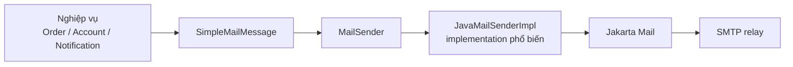
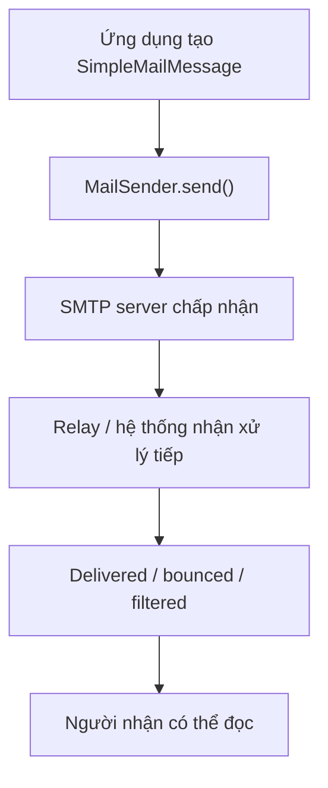
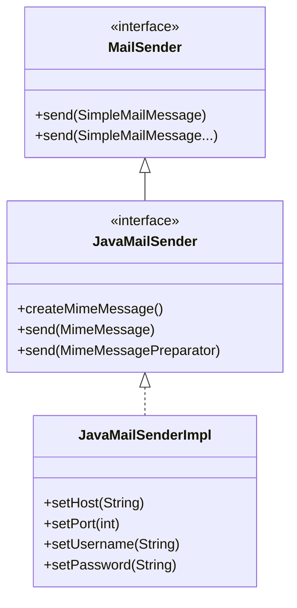
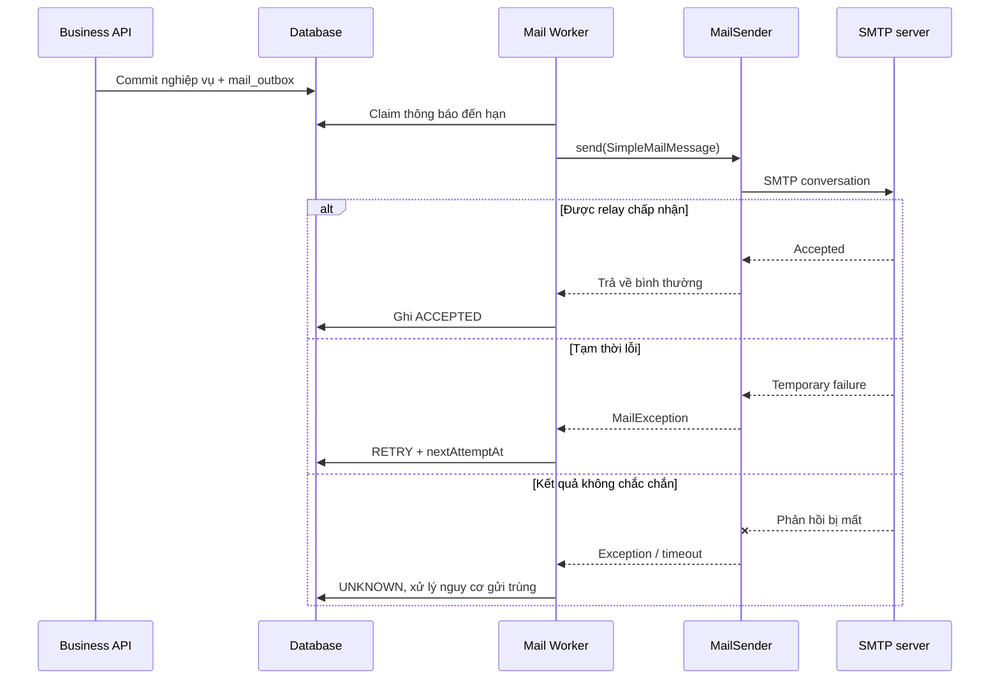

# MailSender và hợp đồng gửi thư đơn giản

Trong Spring Framework Mail, bước đầu tiên để gửi email không nhất thiết phải làm việc trực tiếp với giao thức SMTP, `MimeMessage` hay các đối tượng của Jakarta Mail. Spring cung cấp một abstraction nhỏ tên là **`MailSender`**, nhận dữ liệu thư ở dạng **`SimpleMailMessage`** và thực hiện thao tác gửi. Với một thông báo chỉ gồm người gửi, người nhận, tiêu đề và văn bản thuần, hai kiểu này đủ để xây dựng một luồng gửi thư rõ ràng, dễ thay thế và dễ kiểm thử.

Điều quan trọng là hiểu **hợp đồng của lời gọi gửi thư**. `mailSender.send(message)` trả về bình thường có nghĩa gì? Lỗi nào được báo cho chương trình gọi? Spring có tự xếp hàng, thử lại, xác nhận người nhận đã đọc hoặc bảo đảm không có thư trùng lặp không? Một thiết kế tốt cần trả lời các câu hỏi đó trước khi đặt thao tác gửi email vào luồng xử lý nghiệp vụ.

Bài học tập trung vào API Java Mail của Spring Framework: `org.springframework.mail.MailSender`, `org.springframework.mail.SimpleMailMessage` và cách triển khai phổ biến thông qua `org.springframework.mail.javamail.JavaMailSender`. Ví dụ sử dụng Spring Boot 3.x, Java 21 và Jakarta Mail; các nguyên tắc về hợp đồng API cũng áp dụng khi cấu hình Spring Framework thuần.

## 1. MailSender là gì?

`MailSender` là **interface cấp cao của Spring** để gửi những email văn bản đơn giản. Nó đặt trọng tâm vào *việc gửi một thông điệp*, thay vì yêu cầu code nghiệp vụ tự tạo kết nối SMTP hay xây dựng MIME.

Về cơ bản, interface có hai phương thức:

```java
package org.springframework.mail;

public interface MailSender {

    void send(SimpleMailMessage simpleMessage) throws MailException;

    void send(SimpleMailMessage... simpleMessages) throws MailException;
}
```

Các điểm cần nhận ra ngay:

- **Đầu vào** là một `SimpleMailMessage` hoặc một nhóm các `SimpleMailMessage`.
- **Giá trị trả về** là `void`. Hợp đồng không trả về một `messageId`, một receipt hoặc một đối tượng trạng thái phát thư.
- **Lỗi** được biểu diễn bằng `MailException` và các lớp con. Trong Spring, `MailException` là ngoại lệ runtime; người gọi không bắt buộc phải khai báo `throws` hoặc `catch` trong chữ ký phương thức.
- **Transport thực tế** do implementation quyết định. Interface không yêu cầu service biết SMTP host, port, username, password hay cách Jakarta Mail tạo phiên kết nối.
- **Phạm vi nội dung** tương ứng thư đơn giản; nếu cần HTML, file đính kèm, hình inline hay cấu trúc MIME phức tạp, dùng `JavaMailSender` và `MimeMessage`.

Sơ đồ trách nhiệm:



Code nghiệp vụ chỉ cần phụ thuộc vào `MailSender` nếu yêu cầu hiện tại thực sự là thư văn bản đơn giản. Cách làm này tạo một ranh giới dễ thay thế bằng fake/stub trong kiểm thử, không gắn mọi service vào một implementation SMTP cụ thể.

## 2. SimpleMailMessage đại diện cho những dữ liệu nào?

`SimpleMailMessage` là một đối tượng Java **có thể thay đổi** (mutable) chứa các trường cơ bản của thư văn bản. Những thuộc tính thường dùng gồm:

| Trường | API thường dùng | Ý nghĩa |
|---|---|---|
| Người gửi | `setFrom(String)` | Địa chỉ hiển thị trong trường From; cần được nhà cung cấp cho phép |
| Người nhận chính | `setTo(String...)` | Một hoặc nhiều địa chỉ người nhận |
| Người nhận bản sao | `setCc(String...)` | Người nhận được công khai trong header Cc |
| Người nhận bản sao kín | `setBcc(String...)` | Người nhận Bcc; thường không xuất hiện trong header thư được phát |
| Địa chỉ trả lời | `setReplyTo(String)` | Địa chỉ người nhận nên phản hồi, có thể khác From |
| Chủ đề | `setSubject(String)` | Tiêu đề email |
| Nội dung | `setText(String)` | Phần văn bản thuần của thư |
| Thời gian gửi | `setSentDate(Date)` | Giá trị thời điểm gửi được khai báo trong thông điệp |

Ví dụ tạo một thông điệp:

```java
import org.springframework.mail.SimpleMailMessage;

SimpleMailMessage message = new SimpleMailMessage();
message.setFrom("notifications@example.test");
message.setTo("learner@example.test");
message.setReplyTo("support@example.test");
message.setSubject("Chào mừng bạn");
message.setText("""
        Xin chào!

        Tài khoản học tập của bạn đã được tạo.
        Đây là một email thử nghiệm.
        """);
```

Với nội dung tiếng Việt, cần cấu hình bộ mã hóa ký tự phù hợp cho implementation gửi, thông thường là UTF-8. `SimpleMailMessage` giữ dữ liệu ở dạng `String` trong bộ nhớ; quá trình chuyển nó sang thông điệp email thực tế do mail implementation thực hiện.

### 2.1. Những gì SimpleMailMessage không làm

Không nên coi `SimpleMailMessage` là một `MimeMessage` đơn giản hóa mà vẫn có thể làm mọi thứ. Nó **không cung cấp API** để:

- tạo nội dung HTML với phần văn bản dự phòng;
- gửi file đính kèm;
- đặt `Content-ID` cho ảnh inline;
- điều khiển các MIME part và header riêng của từng part;
- chỉ định `Content-Disposition` hoặc charset cho từng MIME part;
- thao tác với chuỗi `MimeMultipart`, `MimeBodyPart` hay `DataSource`.

Nếu làm `message.setText("<h1>Xin chào</h1>")`, người nhận thông thường sẽ thấy **chuỗi ký tự HTML dưới dạng text**, chứ không nhận được một thư HTML đúng chuẩn. Khi yêu cầu nội dung phong phú xuất hiện, cần chuyển sang `MimeMessage`/`MimeMessageHelper`, không ghép header MIME bằng tay vào `setText()`.

### 2.2. SimpleMailMessage mutable: tạo thông điệp cho từng lượt gửi

Đối tượng này cho phép gọi các setter sau khi tạo. Nếu dùng cùng một instance làm biến dùng chung rồi thay người nhận giữa nhiều request, các thread có thể nhìn thấy dữ liệu không mong muốn. Điều đó đặc biệt nguy hiểm khi gửi email cho người dùng khác nhau.

Nên **tạo một instance mới cho mỗi ý định gửi**:

```java
public void sendGreeting(MailSender sender, String recipient) {
    SimpleMailMessage message = new SimpleMailMessage();
    message.setFrom("notifications@example.test");
    message.setTo(recipient);
    message.setSubject("Xin chào");
    message.setText("Chào mừng bạn đến với hệ thống.");
    sender.send(message);
}
```

Nếu nhiều thư cùng dùng một cấu hình tĩnh, `SimpleMailMessage` có constructor sao chép từ một thông điệp mẫu. Mỗi lượt gửi sửa trên bản sao:

```java
SimpleMailMessage template = new SimpleMailMessage();
template.setFrom("notifications@example.test");
template.setReplyTo("support@example.test");

SimpleMailMessage message = new SimpleMailMessage(template);
message.setTo("learner@example.test");
message.setSubject("Thông báo");
message.setText("Nội dung thông báo");

mailSender.send(message);
```

Khi dùng template chung, đừng tiếp tục thay đổi bản gốc đồng thời từ nhiều thread. Một lớp tạo thư chuyên trách hoặc factory tạo instance mới thường dễ quản lý hơn việc chia sẻ đối tượng mutable.

## 3. Hợp đồng send(SimpleMailMessage) thực sự hứa điều gì?

Giả sử service gọi:

```java
mailSender.send(message);
```

Sau lời gọi, có hai nhóm kết quả mà code quan sát được:

1. **Phương thức kết thúc bình thường:** implementation báo không có lỗi tại thời điểm xử lý thao tác gửi.
2. **Phương thức ném `MailException`:** implementation phát hiện lỗi chuẩn bị, xác thực hoặc gửi; người gọi cần xử lý/lan truyền theo nghiệp vụ.

Với implementation gửi qua SMTP phổ biến, lời gọi thường thực hiện công việc mạng theo cách **đồng bộ** trên thread gọi cho tới khi transport hoàn tất hoặc gặp lỗi/timeout. Interface `MailSender` tự nó không định nghĩa SLA, thời gian chạy tối đa hay cơ chế hàng đợi bền vững.

### 3.1. Gửi thành công không đồng nghĩa đã phát đến hộp thư

Một email trải qua nhiều mốc:



Khi SMTP server trả phản hồi chấp nhận sau phần dữ liệu, có thể hiểu relay đã nhận trách nhiệm xử lý thông điệp ở chặng đó. Việc thư có vào inbox hay bị hệ thống nhận từ chối sau đó lại là chuyện khác. `send()` không chờ người nhận mở thư, không bắt buộc nhận các sự kiện giao thư cuối cùng, và cũng không trả về receipt cho việc mở/đọc.

Vì vậy:

| Bằng chứng ứng dụng đang có | Có thể kết luận | Không thể kết luận |
|---|---|---|
| Đã tạo `SimpleMailMessage` | Đã dựng dữ liệu gửi trong bộ nhớ | Thư đã đi ra mạng |
| `MailSender.send()` trả về bình thường trên SMTP transport thông dụng | Thao tác gửi tới SMTP relay được implementation xem là hoàn tất | Thư chắc chắn đã tới inbox hoặc được đọc |
| `send()` ném `MailException` | Một lỗi đã được implementation phát hiện | Mọi recipient đều chắc chắn chưa được chấp nhận |
| Có provider event `delivered` | Provider ghi nhận một mốc giao thư theo định nghĩa của họ | Người dùng đã đọc hoặc tương tác |
| Có event `bounce` | Có phản hồi từ chối/trả lại từ hạ tầng gửi/nhận | Nguyên nhân nhất thiết do nội dung thư hay do ứng dụng |

Đặc biệt, khi kết nối đứt sau lúc client gửi hết dữ liệu nhưng trước khi nhận được phản hồi chấp nhận, ứng dụng có thể **không biết chắc SMTP server đã nhận thư hay chưa**. Nếu retry mù quáng, người nhận có thể nhận hai email. Vì thế, không nên quảng bá hành vi `send()` là exactly-once.

### 3.2. Không có transaction xuyên database và SMTP

Lệnh `send()` không tự tham gia transaction của database. Ví dụ:

```java
@Transactional
public void createOrderAndSendEmail(CreateOrderCommand command) {
    // Lưu dữ liệu đơn hàng vào cơ sở dữ liệu
    orderRepository.save(...);

    // Gửi qua SMTP; thao tác bên ngoài database
    mailSender.send(...);
}
```

Đây là mã phác thảo để **nhận diện ranh giới**, không phải một phương thức có thể biên dịch nguyên vẹn.

Nếu SMTP chấp nhận thư rồi transaction database rollback, không có thao tác rollback SMTP tương ứng. Ngược lại, nếu database commit trước rồi JVM dừng trước khi gọi `send()`, email dự kiến có thể bị mất. Với thông báo quan trọng cần khôi phục, hãy ghi **ý định gửi** vào outbox cùng transaction dữ liệu nghiệp vụ, sau đó worker gửi bên ngoài transaction đó.

`MailSender` giải quyết **cách yêu cầu gửi thư**, còn Transactional Outbox, queue, retry và theo dõi trạng thái giải quyết **độ bền của quy trình gửi**.

## 4. Hai overload của MailSender

### 4.1. Gửi một SimpleMailMessage

Overload phổ biến nhất:

```java
void send(SimpleMailMessage simpleMessage) throws MailException;
```

Ví dụ:

```java
SimpleMailMessage message = new SimpleMailMessage();
message.setTo("alice@example.test");
message.setFrom("noreply@example.test");
message.setSubject("Thông báo bài học");
message.setText("Bạn có một bài học mới.");

mailSender.send(message);
```

Mỗi lần gọi là một yêu cầu gửi ở mức ứng dụng. Khi thao tác này nằm trong request HTTP, thời gian đợi SMTP có thể làm chậm response.

### 4.2. Gửi một nhóm SimpleMailMessage

Overload thứ hai:

```java
void send(SimpleMailMessage... simpleMessages) throws MailException;
```

Ví dụ:

```java
SimpleMailMessage first = new SimpleMailMessage();
first.setFrom("noreply@example.test");
first.setTo("alice@example.test");
first.setSubject("Thông báo A");
first.setText("Nội dung A");

SimpleMailMessage second = new SimpleMailMessage();
second.setFrom("noreply@example.test");
second.setTo("bob@example.test");
second.setSubject("Thông báo B");
second.setText("Nội dung B");

mailSender.send(first, second);
```

Varargs giúp truyền nhiều thư trong một lệnh gọi API; implementation có thể tối ưu hóa sử dụng kết nối. **Đây không phải giao dịch nguyên tử**. Không có cam kết rằng hoặc mọi email đều được chấp nhận hoặc không email nào được chấp nhận. Nếu một thông điệp hoặc recipient lỗi, những phần đã gửi thành công trước đó không thể thu hồi.

Với các thông báo nghiệp vụ cần độc lập retry, nên quản lý **từng yêu cầu gửi riêng**. Khi gửi hàng loạt, phải xem khả năng thành công một phần, lỗi theo message và cách xác định thư nào có thể thử lại.

### 4.3. Một SimpleMailMessage có nhiều người nhận

Một thông điệp có thể đặt nhiều người nhận:

```java
SimpleMailMessage message = new SimpleMailMessage();
message.setFrom("team@example.test");
message.setTo("alice@example.test", "bob@example.test");
message.setCc("supervisor@example.test");
message.setBcc("audit@example.test");
message.setSubject("Lịch họp");
message.setText("Lịch họp được cập nhật.");

mailSender.send(message);
```

Trên SMTP, một thông điệp có thể trải qua nhiều lệnh `RCPT TO`. Một số địa chỉ có thể được chấp nhận trong khi địa chỉ khác bị từ chối. Các trạng thái cần xử lý theo recipient nếu hệ thống yêu cầu retry chính xác và báo cáo độ tin cậy.

**To, Cc, Bcc không giống nhau về quyền riêng tư.** Người nhận ở To/Cc nhìn thấy các địa chỉ công khai; Bcc thông thường không được đưa vào header mà các recipient khác nhìn thấy. Khi gửi thông báo cá nhân hoặc danh sách nhiều khách hàng, nên tạo từng email theo recipient để tránh lộ địa chỉ giữa khách hàng và dễ theo dõi kết quả từng người.

## 5. JavaMailSender là triển khai thực tế thường gặp

Một interface trừu tượng tự nó chưa tạo kết nối SMTP. Trong hệ sinh thái Spring, `JavaMailSender` mở rộng `MailSender` để hỗ trợ gửi MIME, còn `JavaMailSenderImpl` là implementation phổ biến dựa trên Jakarta Mail.



Một `JavaMailSenderImpl` có thể được inject qua **`MailSender`** vì nó thực hiện interface đó. Lợi ích thiết kế là service chỉ thấy những khả năng nó cần:

```java
import org.springframework.mail.MailSender;

public class RegistrationNotificationService {

    private final MailSender mailSender;

    public RegistrationNotificationService(MailSender mailSender) {
        this.mailSender = mailSender;
    }

    // Chỉ gửi SimpleMailMessage nên không cần phụ thuộc JavaMailSender.
}
```

Khi yêu cầu mới đòi hỏi HTML hoặc attachment, mới chuyển abstraction của service cần tính năng đó sang `JavaMailSender`. Không bắt buộc tất cả service gửi email cùng phụ thuộc API MIME ngay từ đầu.

### 5.1. Spring Boot cấu hình JavaMailSender như thế nào?

Với Spring Boot, thông thường thêm starter:

```groovy
dependencies {
    implementation 'org.springframework.boot:spring-boot-starter-mail'
}
```

Sau đó cung cấp cấu hình mail, ví dụ trong `application-local.yml` cho môi trường SMTP giả lập:

```yaml
spring:
  mail:
    host: localhost
    port: 1025
    default-encoding: UTF-8
    properties:
      mail:
        smtp:
          auth: false
          starttls:
            enable: false

app:
  mail:
    from: noreply@example.test
```

Spring Boot có auto-configuration có điều kiện để tạo bean `JavaMailSenderImpl` khi thư viện và cấu hình cần thiết hiện diện, đồng thời không ghi đè một bean phù hợp do ứng dụng đã tự cung cấp. Để inject thành công, ứng dụng phải có bean thỏa mãn kiểu `MailSender`. **Chỉ khai báo dependency mà chưa có cấu hình host hoặc bean phù hợp không bảo đảm mail sender sẵn sàng hoạt động.**

Máy chủ SMTP giả lập như Mailpit có thể chạy bằng:

```bash
docker run --rm --name mailpit -p 1025:1025 -p 8025:8025 axllent/mailpit
```

- SMTP: `localhost:1025`.
- Giao diện xem thư: `http://localhost:8025`.
- Trong Docker Compose, nếu app chạy ở container khác, dùng tên service SMTP thay cho `localhost`.

Cấu hình trên chỉ dùng để thực hành. SMTP thật thường yêu cầu xác thực và TLS, cùng tài khoản gửi/địa chỉ From đã được nhà cung cấp chấp thuận. Tránh lưu mật khẩu trực tiếp trong file cấu hình đã commit.

### 5.2. Cấu hình SMTP thật với timeout hữu hạn

Ví dụ chung cho SMTP submission hỗ trợ STARTTLS trên cổng 587:

```yaml
spring:
  mail:
    host: ${SMTP_HOST}
    port: ${SMTP_PORT:587}
    username: ${SMTP_USERNAME}
    password: ${SMTP_PASSWORD}
    default-encoding: UTF-8
    properties:
      mail:
        smtp:
          auth: true
          starttls:
            enable: true
            required: true
          connectiontimeout: 5000
          timeout: 10000
          writetimeout: 10000

app:
  mail:
    from: ${MAIL_FROM}
```

Ba timeout của Jakarta Mail ở đây tính bằng **mili giây**:

- `connectiontimeout`: giới hạn chờ mở kết nối.
- `timeout`: giới hạn chờ đọc phản hồi.
- `writetimeout`: giới hạn thời gian ghi dữ liệu.

Đây chỉ là giá trị minh họa, cần điều chỉnh theo nhà cung cấp và thời gian chờ của hệ thống. Nếu provider dùng implicit TLS ở cổng 465, cấu hình SSL phải phù hợp chế độ đó; không mặc nhiên dùng nguyên cấu hình STARTTLS của cổng 587. Bật bảo mật và xác minh chứng chỉ máy chủ đúng chính sách.

### 5.3. Cấu hình thủ công trong Spring Framework thuần

Nếu không dùng Spring Boot auto-configuration, có thể tạo bean `JavaMailSenderImpl` thủ công:

```java
package com.example.mail;

import org.springframework.context.annotation.Bean;
import org.springframework.context.annotation.Configuration;
import org.springframework.mail.MailSender;
import org.springframework.mail.javamail.JavaMailSenderImpl;

@Configuration
public class LocalMailConfiguration {

    @Bean
    MailSender mailSender() {
        JavaMailSenderImpl sender = new JavaMailSenderImpl();
        sender.setHost("localhost");
        sender.setPort(1025);
        sender.setDefaultEncoding("UTF-8");
        sender.getJavaMailProperties()
                .put("mail.smtp.auth", "false");
        return sender;
    }
}
```

Đây là cấu hình **cục bộ không xác thực**, dùng để hiểu cơ chế tạo bean. Trong production, thông tin host, cổng, TLS và credentials phải lấy từ nguồn cấu hình thích hợp, không hardcode.

Nếu một ứng dụng cần cả API đơn giản và MIME, có thể khai báo bean trả về `JavaMailSender` rồi inject ở service qua `MailSender` hoặc `JavaMailSender` tùy nhu cầu. Việc chọn interface phụ thuộc yêu cầu của người gọi, không phụ thuộc vào việc máy chủ SMTP đơn giản hay phức tạp.

## 6. Viết một dịch vụ nghiệp vụ chỉ phụ thuộc MailSender

Ví dụ: sau khi người dùng đã đăng ký khóa học, hệ thống cần gửi thông báo văn bản tới địa chỉ đã xác thực. Service nhận một email recipient và một tên khóa học từ tầng nghiệp vụ.

```java
package com.example.mail;

import org.springframework.beans.factory.annotation.Value;
import org.springframework.mail.MailSender;
import org.springframework.mail.SimpleMailMessage;
import org.springframework.stereotype.Service;

@Service
public class EnrollmentNotificationService {

    private final MailSender mailSender;
    private final String fromAddress;

    public EnrollmentNotificationService(
            MailSender mailSender,
            @Value("${app.mail.from}") String fromAddress) {
        this.mailSender = mailSender;
        this.fromAddress = fromAddress;
    }

    public void sendEnrollmentNotice(
            String recipientAddress, String courseTitle) {

        SimpleMailMessage mail = new SimpleMailMessage();
        mail.setFrom(fromAddress);
        mail.setTo(recipientAddress);
        mail.setSubject("Đăng ký khóa học thành công");
        mail.setText("""
                Xin chào!

                Bạn đã đăng ký thành công khóa học: %s

                Đây là email thông báo tự động.
                """.formatted(courseTitle));

        mailSender.send(mail);
    }
}
```

Đoạn code bộc lộ rõ hợp đồng:

1. **Input nghiệp vụ**: địa chỉ nhận đã xác minh và tên khóa học.
2. **Tạo message**: chỉ tạo những trường mà email text đơn giản hỗ trợ.
3. **Gửi qua abstraction**: gọi `MailSender.send(mail)`, không tự mở SMTP socket.
4. **Kết quả**: nếu không có exception, thao tác gửi ở tầng mail sender hoàn thành theo implementation; nếu có exception, nó được lan truyền cho caller.

Về mặt nghiệp vụ, nên tách việc **đã đăng ký khóa học** khỏi việc **đã gửi email thông báo**. Nếu email thất bại, không nhất thiết phải hủy đăng ký. Hành vi phụ thuộc yêu cầu sản phẩm: có thể ghi nhận ý định gửi vào outbox để worker khôi phục.

### 6.1. Xác thực đầu vào ở lớp phù hợp

Không để service nhận một tập dữ liệu tùy ý rồi chuyển thẳng thành địa chỉ/tên người gửi và nội dung thư:

- Địa chỉ người nhận nên được kiểm tra cú pháp, xác nhận quyền gửi và tuân thủ chính sách bảo mật.
- Địa chỉ `From` phải thuộc phạm vi được ứng dụng và provider cho phép, không để caller tự chọn tùy ý.
- Nội dung text do người dùng cung cấp phải được kiểm soát độ dài và tránh đưa dữ liệu nhạy cảm vào thư không cần thiết.
- Nếu thư chứa liên kết thao tác, tạo URL dựa trên domain đáng tin cậy; không dùng nguyên header `Host` hoặc URL do đối tượng không tin cậy cung cấp.
- Không ghi nội dung email, OTP, token khôi phục mật khẩu hay password SMTP vào log thông thường.

Việc có API `setTo()` không thay thế kiểm tra quyền gửi ở tầng nghiệp vụ. Một người dùng không nên có thể yêu cầu gửi vô hạn email đến địa chỉ của người khác chỉ vì backend có sẵn MailSender.

## 7. Hợp đồng ngoại lệ MailException

`MailException` là lớp ngoại lệ chung của phần mail trong Spring. Tùy lỗi phát hiện trong quá trình thực hiện, implementation có thể ném những lớp con khác nhau.

| Kiểu ngoại lệ | Thường liên quan đến | Hướng xử lý |
|---|---|---|
| `MailAuthenticationException` | Xác thực SMTP thất bại | Kiểm tra credential, cấu hình, quyền gửi; thường cảnh báo vận hành |
| `MailSendException` | Thao tác gửi gặp lỗi | Phân loại nguyên nhân bên dưới; có thể có kết quả từng message |
| `MailParseException` | Dữ liệu message không thể phân tích/tạo hợp lệ | Sửa dữ liệu đầu vào hoặc cách tạo thư |
| `MailPreparationException` | Không chuẩn bị được message, nhất là khi dùng MimeMessagePreparator | Sửa template hoặc bước chuẩn bị MIME |
| `MailException` nói chung | Một lỗi mail được Spring trừu tượng hóa | Chuyển thành trạng thái lỗi của workflow; không tự mặc định retry |

Lưu ý: một ứng dụng chỉ dùng `SimpleMailMessage` thường quan tâm nhiều đến lỗi gửi và xác thực. Các ngoại lệ chuẩn bị MIME có ý nghĩa rõ hơn khi dùng API `JavaMailSender` mở rộng. Bảng này mô tả hệ sinh thái Spring Mail chung, **không khẳng định mọi lỗi đều phát sinh từ cùng một overload**.

Ví dụ xử lý tại ranh giới worker:

```java
import org.springframework.mail.MailAuthenticationException;
import org.springframework.mail.MailException;
import org.springframework.mail.MailSendException;

public void deliver(SimpleMailMessage message) {
    try {
        mailSender.send(message);
        deliveryState.recordAcceptedByTransport();
    } catch (MailAuthenticationException ex) {
        deliveryState.recordConfigurationFailure("SMTP_AUTH");
        throw ex;
    } catch (MailSendException ex) {
        deliveryState.recordSendFailure("SMTP_SEND");
        throw ex;
    } catch (MailException ex) {
        deliveryState.recordMailFailure("SPRING_MAIL");
        throw ex;
    }
}
```

Đây là **phác thảo luồng xử lý**: `deliveryState` là thành phần ứng dụng tự xây dựng, không phải API của Spring. Trạng thái `recordAcceptedByTransport()` cũng chỉ là mốc ở adapter, không phải lời xác nhận email đã tới hộp thư người nhận.

### 7.1. MailSendException và kết quả một phần

Khi thực hiện gửi nhiều thông điệp, `MailSendException` có thể chứa danh sách/map lỗi tương ứng với các message không gửi được thông qua `getFailedMessages()`. Ngoài ra, exception có thể giữ nguyên nhân Jakarta Mail bên dưới.

Điều đó **không biến mọi phần còn lại thành bằng chứng giao thành công đến inbox**. Bản đồ failed messages do implementation xây dựng theo những thất bại mà nó quan sát; có thể có trường hợp trạng thái chưa chắc chắn khi kết nối đứt ở ranh giới SMTP.

Nếu nghiệp vụ cần biết riêng từng người nhận, có thể thiết kế mỗi recipient thành một yêu cầu gửi độc lập, mang `notificationId` và trạng thái riêng trong database. Như vậy việc retry/giám sát dễ kiểm soát hơn một lệnh gửi đa recipient hoặc một varargs lớn.

### 7.2. Retry không nên được quyết định chỉ bằng tên exception

Một số lỗi có thể phục hồi sau khi chờ, ví dụ SMTP `421`, `450` hoặc `451`; một số lỗi khác đòi hỏi sửa dữ liệu hoặc cấu hình, ví dụ địa chỉ không tồn tại, xác thực sai hay template lỗi.

Đối với hệ thống production:

1. Giữ lại nhóm lỗi, SMTP reply code và enhanced status code nếu provider có cung cấp.
2. Phân biệt lỗi tạm thời, lỗi vĩnh viễn, lỗi cấu hình và kết quả **không chắc chắn**.
3. Với lỗi tạm thời, chọn retry theo backoff có jitter, số lần thử và thời hạn hữu hạn.
4. Với lỗi cấu hình, ghi cảnh báo và ưu tiên sửa nguồn lỗi thay vì retry vô hạn.
5. Khi SMTP có thể đã chấp nhận thư nhưng phản hồi bị mất, cân nhắc nguy cơ gửi trùng và khả năng đối chiếu provider.

Không nên viết `catch (MailException ex) { mailSender.send(message); }` rồi xem là đã có chiến lược retry. Hành động gửi lại ngay trên thread lỗi có thể tăng tải lên SMTP server đang quá tải và gây mất kiểm soát khi request bị gửi lặp.

## 8. MailSender không tự quản lý retry và hàng đợi bền vững

Một hiểu nhầm phổ biến là Spring đã có mail abstraction thì cũng sẽ tự xử lý mọi sự cố gửi. Thực tế, `MailSender` chỉ đặt ra **hợp đồng lời gọi gửi thư**. Những khả năng sau thuộc trách nhiệm của hệ thống rộng hơn:

| Nhu cầu | MailSender tự bảo đảm? | Thành phần thường chịu trách nhiệm |
|---|---|---|
| Tạo thư văn bản đơn giản | Có, qua `SimpleMailMessage` và implementation | Service tạo mail + MailSender |
| Gửi qua transport cấu hình | Do implementation thực hiện | JavaMailSenderImpl / provider |
| Lưu ý định gửi khi JVM dừng | Không | Database outbox hoặc queue bền vững |
| Thử lại có kiểm soát sau lỗi tạm thời | Không có trong hợp đồng MailSender | Retry policy + worker |
| Chống tạo hai ý định gửi từ cùng sự kiện | Không | Business key + unique constraint |
| Bảo đảm SMTP exactly-once | Không | Không thể giả định chỉ từ SMTP; cần xử lý trùng ở tầng nghiệp vụ |
| Theo dõi bounce/delivered | Không | Webhook/event/API nhà cung cấp |
| Tự xác minh SPF/DKIM/DMARC | Không | Hạ tầng domain và nhà cung cấp gửi |
| Đo backlog, SLA, cảnh báo | Không | Metrics, tracing, alerting của ứng dụng |

### 8.1. Kiến trúc khi email có độ quan trọng cao

Nếu gửi thư xác nhận đơn hàng, mã xác thực hoặc thông báo có yêu cầu khôi phục, một luồng có thể được thiết kế:



Ở đây:

- **Nghiệp vụ** xác định khi nào cần thông báo.
- **Outbox** lưu ý định gửi gắn với transaction nghiệp vụ.
- **Worker** quyết định thời điểm gửi và retry.
- **MailSender** thực hiện lần gửi hiện tại.
- **Provider feedback** (nếu có) cập nhật kết quả sau mốc SMTP accepted.

Cách phân lớp giữ `MailSender` ở đúng phạm vi và không đặt toàn bộ độ tin cậy của hệ thống lên một phương thức `void send(...)`.

### 8.2. Đồng bộ hay bất đồng bộ?

Với `JavaMailSenderImpl` thông dụng, lời gọi `send()` sẽ đợi I/O trên thread đang chạy. Có thể gọi nó từ HTTP controller, service `@Async` hoặc worker; nhưng nơi gọi ảnh hưởng trực tiếp tới độ trễ và độ bền:

- **Trong HTTP request**: dễ học, dễ triển khai; SMTP chậm sẽ kéo dài response, và lỗi mail có thể làm lỗi request.
- **Trong phương thức `@Async`**: không giữ HTTP request chờ, nhưng tác vụ nằm trong bộ nhớ vẫn có thể mất khi JVM dừng.
- **Trong worker đọc outbox**: cần thêm cơ sở dữ liệu và cơ chế claim/retry, đổi lại ý định gửi có thể tồn tại sau restart.

Với thông báo không quan trọng hoặc công cụ nội bộ, lời gọi trực tiếp có thể đủ. Với email có giá trị nghiệp vụ, lựa chọn hàng đợi bền vững nên dựa trên khả năng chịu lỗi và yêu cầu vận hành.

## 9. Kiểm thử service sử dụng MailSender mà không cần SMTP thật

Vì `MailSender` là interface nhỏ, rất dễ thay nó bằng một đối tượng ghi nhận thông điệp. Điều này cho phép kiểm tra **service đã yêu cầu gửi email gì**, tách khỏi câu hỏi SMTP server có chấp nhận thư hay không.

### 9.1. Fake MailSender để bắt thông điệp

Ví dụ một fake đơn giản:

```java
package com.example.mail;

import java.util.ArrayList;
import java.util.List;
import org.springframework.mail.MailSender;
import org.springframework.mail.SimpleMailMessage;

public final class CapturingMailSender implements MailSender {

    private final List<SimpleMailMessage> captured = new ArrayList<>();

    @Override
    public void send(SimpleMailMessage message) {
        // Sao chép ngay để việc sửa message sau đó không làm sai kết quả test.
        captured.add(new SimpleMailMessage(message));
    }

    @Override
    public void send(SimpleMailMessage... messages) {
        for (SimpleMailMessage message : messages) {
            send(message);
        }
    }

    public List<SimpleMailMessage> captured() {
        return List.copyOf(captured);
    }
}
```

Fake chỉ dành cho test đơn luồng trong ví dụ này. Không dùng nó thay SMTP thật ở production, và nếu test có nhiều thread thì phải thiết kế đồng bộ truy cập danh sách.

### 9.2. Test hành vi của service

Ta có thể tạo trực tiếp `EnrollmentNotificationService` mà không khởi động Spring ApplicationContext:

```java
package com.example.mail;

import static org.junit.jupiter.api.Assertions.assertEquals;

import org.junit.jupiter.api.Test;
import org.springframework.mail.SimpleMailMessage;

class EnrollmentNotificationServiceTest {

    @Test
    void sendsPlainTextEnrollmentNotice() {
        CapturingMailSender sender = new CapturingMailSender();
        EnrollmentNotificationService service =
                new EnrollmentNotificationService(
                        sender, "noreply@example.test");

        service.sendEnrollmentNotice(
                "learner@example.test", "Spring Framework Mail");

        assertEquals(1, sender.captured().size());
        SimpleMailMessage actual = sender.captured().get(0);
        assertEquals("noreply@example.test", actual.getFrom());
        assertEquals("learner@example.test", actual.getTo()[0]);
        assertEquals(
                "Đăng ký khóa học thành công",
                actual.getSubject());
        assertEquals(
                true,
                actual.getText().contains("Spring Framework Mail"));
    }
}
```

Test này chứng minh **hợp đồng giữa service và MailSender**: service tạo đúng địa chỉ, chủ đề và body rồi gửi một thông điệp. Nó **không** kiểm tra cấu hình SMTP, TLS hoặc cách Jakarta Mail chuyển dữ liệu sang MIME.

### 9.3. Kiểm thử lỗi từ MailSender

Muốn kiểm tra hành vi khi gửi thất bại, có thể dùng mock/fake ném `MailSendException` và quan sát service/worker phản ứng. Ví dụ:

```java
import org.springframework.mail.MailSendException;
import org.springframework.mail.MailSender;

MailSender failingSender = new MailSender() {
    @Override
    public void send(SimpleMailMessage message) {
        throw new MailSendException("Simulated SMTP failure");
    }

    @Override
    public void send(SimpleMailMessage... messages) {
        throw new MailSendException("Simulated SMTP failure");
    }
};
```

Để dùng đoạn này, thêm import `org.springframework.mail.SimpleMailMessage`. Fake cho thấy cách tạo lỗi có chủ đích để thử logic caller. Thời gian chờ, mã SMTP và kết quả chấp nhận thực tế vẫn nên được kiểm thử riêng với SMTP test server.

### 9.4. Integration test với SMTP giả lập

Một vòng tích hợp có thể chạy:

1. Khởi động SMTP giả lập Mailpit hoặc một server test tương đương.
2. Cấu hình `spring.mail.host` và `spring.mail.port` tới server đó.
3. Gọi service gửi thư qua bean `JavaMailSenderImpl` thật.
4. Truy xuất inbox của server thử nghiệm để đối chiếu From/To/Subject/body.
5. Thử trường hợp server dừng hoặc trả lỗi để quan sát exception/timeout.

Sự khác biệt giữa hai lớp test rất rõ:

| Kiểm thử | Điều được chứng minh | Điều không được chứng minh |
|---|---|---|
| Unit test với fake `MailSender` | Service tạo và gửi đúng dữ liệu tới abstraction | SMTP hoạt động |
| Integration test với SMTP giả lập | Cấu hình, serialization và đường đi đến test server hoạt động | Domain thực được xác minh và thư đến Internet |
| Test với provider thật có kiểm soát | Kết nối, credential, TLS và hành vi provider thực tế | Inbox delivery cho mọi recipient ở mọi thời điểm |

## 10. Dùng MailSender khi nào, chuyển sang JavaMailSender khi nào?

Quy tắc lựa chọn dựa trên nhu cầu nội dung và khả năng:

| Tình huống | Đề xuất |
|---|---|
| Email text thuần, một hoặc vài người nhận | Inject `MailSender`, tạo `SimpleMailMessage` |
| Nhắc việc nội bộ, báo trạng thái đơn giản | `MailSender` đủ nếu không cần MIME |
| Nội dung HTML có bản text thay thế | `JavaMailSender` + `MimeMessageHelper` |
| Đính kèm PDF, CSV, ảnh | `JavaMailSender` + `MimeMessageHelper` |
| Tên hiển thị Unicode của người gửi và các header nâng cao | `MimeMessageHelper` thích hợp |
| Thư có inline image hoặc multipart phức tạp | `JavaMailSender`/`MimeMessage` |
| Cần gửi bền vững, retry, deduplication | Chọn MailSender hay JavaMailSender theo nội dung **và** bổ sung outbox/worker |

Ví dụ khi yêu cầu thay đổi từ text sang HTML, có thể dùng:

```java
import jakarta.mail.internet.MimeMessage;
import org.springframework.mail.javamail.JavaMailSender;
import org.springframework.mail.javamail.MimeMessageHelper;

MimeMessage mimeMessage = javaMailSender.createMimeMessage();
MimeMessageHelper helper =
        new MimeMessageHelper(mimeMessage, true, "UTF-8");
helper.setFrom("noreply@example.test", "Nhóm hỗ trợ");
helper.setTo("learner@example.test");
helper.setSubject("Thông báo");
helper.setText(
        "Nội dung text thuần",
        "<p>Nội dung <strong>HTML</strong></p>");

javaMailSender.send(mimeMessage);
```

Đoạn mã minh họa cần xử lý/khai báo `MessagingException` và `UnsupportedEncodingException` trong phương thức bao quanh theo chữ ký API. Khi sử dụng HTML thực tế, dữ liệu người dùng cần được escape đúng ngữ cảnh; không ghép HTML thô từ input không tin cậy.

Điều cốt lõi: **`JavaMailSender` mở rộng `MailSender`**. Nâng cấp cách tạo nội dung không nhất thiết thay đổi các quyết định nghiệp vụ về khi nào gửi, retry, quyền gửi hay trạng thái lưu trữ.

## 11. Các sai lầm thường gặp khi học MailSender

### “send() không ném lỗi nghĩa là người nhận đã đọc”

Sai. Lời gọi chỉ đưa ra thông tin ở tầng gửi mà implementation quan sát được. Delivered, bounced, opened là những khái niệm khác. Nên đặt tên trạng thái theo bằng chứng, ví dụ `ACCEPTED_BY_SMTP` thay vì `READ_BY_RECIPIENT`.

### “Đã dùng Spring Boot thì MailSender hoạt động dù không cấu hình”

Không nên giả định. Cần dependency, bean phù hợp và cấu hình transport; auto-configuration có điều kiện. Nếu không có bean thỏa mãn `MailSender`, constructor injection sẽ thất bại khi khởi động context.

### “SimpleMailMessage.setText() gửi được HTML”

`setText()` là văn bản thuần. Đưa tag HTML vào đó không tương đương MIME HTML. Dùng `MimeMessageHelper` cho nội dung HTML.

### “Varargs send() là tất cả hoặc không có gì”

Không có cam kết atomicity xuyên các email. Nếu gửi theo nhóm và có lỗi ở giữa, phải xem khả năng kết quả một phần, thay vì tự động gửi lại cả lô.

### “Có thể chia sẻ một SimpleMailMessage rồi sửa recipient theo request”

`SimpleMailMessage` mutable. Hãy dùng bản mới hoặc bản sao riêng cho mỗi lượt gửi; không để dữ liệu của khách hàng A lọt vào yêu cầu của khách hàng B.

### “MailException nào cũng retry ngay”

Lỗi xác thực, cú pháp và template có thể không tự hết. Cần phân loại lỗi và có backoff/giới hạn. Timeout còn có trường hợp chưa biết server đã nhận email hay chưa.

### “Đặt send() trong @Transactional thì SMTP cũng rollback”

SMTP nằm ngoài transaction database. Nếu cần tránh mất ý định gửi giữa commit và gửi, dùng outbox và worker.

### “Thêm @Async đồng nghĩa không bao giờ mất email”

`@Async` chuyển công việc sang executor trong JVM nhưng không tự cung cấp cơ chế lưu bền vững. JVM dừng có thể làm tác vụ trong bộ nhớ bị mất.

### “Thông báo gửi mail có thể chứa bất kỳ địa chỉ và nội dung nào”

Ngay cả hệ thống chỉ gửi text vẫn cần kiểm soát quyền gửi, xác minh địa chỉ, hạn mức, chính sách bảo vệ dữ liệu và không cho lạm dụng SMTP relay.

## 12. Bài thực hành: từ interface tới hợp đồng thực tế

### Phần A — MailSender tối thiểu

Tạo ứng dụng Spring Boot với `spring-boot-starter-mail` và SMTP giả lập. Viết một service `TextNotificationService` chỉ inject `MailSender`, có phương thức:

```java
void sendNotice(String recipient, String subject, String text);
```

Ở trong phương thức, tạo `SimpleMailMessage` mới, đặt `From`, `To`, `Subject`, `Text` và gọi `send(message)`. Gửi nội dung tiếng Việt và xem kết quả trong giao diện của SMTP giả lập.

### Phần B — Thử hợp đồng lỗi

Thay mail sender bằng fake ném `MailSendException`. Xác định lỗi được lan truyền hay chuyển thành trạng thái nào trong caller. Nêu rõ vì sao **không đủ dữ liệu** để khẳng định thư chưa đến SMTP server trong mọi kiểu timeout.

### Phần C — Gửi nhóm và nhiều recipient

Tạo hai `SimpleMailMessage`, dùng `send(first, second)`. Sau đó tạo một message có hai địa chỉ `To`. Phân biệt **hai thông điệp gửi** với **một thông điệp có hai người nhận** và giải thích tác động tới quyền riêng tư, lỗi một phần và retry.

### Phần D — Tạo unit test không cần SMTP

Viết `CapturingMailSender`, kiểm tra service tạo đúng địa chỉ, Subject và text. Sau đó mở rộng test lỗi bằng fake sender ném `MailException`. Giải thích test fake đang kiểm tra hợp đồng nào và điều gì cần integration test riêng.

### Phần E — Đánh giá ranh giới nghiệp vụ

Giả sử một API vừa lưu đơn hàng vừa gọi `send()`. Phân tích hai trường hợp:

1. SMTP chấp nhận thư rồi database transaction rollback.
2. Database commit thành công rồi ứng dụng dừng trước khi gửi.

Từ hai tình huống đó, thiết kế một outbox để giữ ý định gửi và một worker gọi `MailSender` sau khi dữ liệu đã commit. Không thay đổi hợp đồng `MailSender`; chỉ bổ sung thành phần điều phối.

## 13. Hợp đồng cần nhớ

`MailSender` có chủ đích nhỏ: **nhận `SimpleMailMessage` và thực hiện thao tác gửi, hoặc thông báo lỗi qua `MailException`**. `SimpleMailMessage` là cấu trúc **text thuần** gồm các trường gửi/nhận cơ bản, có thể thay đổi và nên được tạo mới cho từng lần gửi. `JavaMailSenderImpl` thường thực hiện transport bằng Jakarta Mail và SMTP, còn `JavaMailSender` mở rộng khả năng sang MIME.

Khi phương thức `send()` kết thúc bình thường, hãy hiểu đó là một kết quả ở ranh giới sender/SMTP, **không phải bằng chứng email đã vào inbox hay được đọc**. Khi lời gọi thất bại, cần phân loại lỗi, nhận biết khả năng chấp nhận một phần hoặc trạng thái không chắc chắn, và quyết định retry ở tầng điều phối phù hợp. Cách phân tách này giúp service Spring giữ được API rõ ràng, trong khi hệ thống vận hành vẫn có thể phát triển từ thư thử nghiệm sang xử lý thông báo bền vững.
