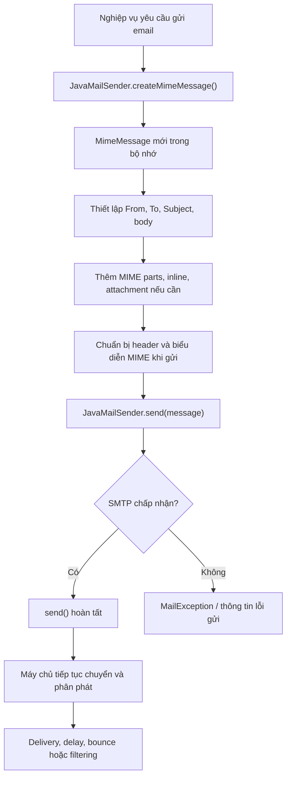

# MimeMessage và vòng đời tạo message

Trong **Spring Framework Mail**, một email có thể bắt đầu từ một đối tượng Java chưa có người nhận, tiêu đề hay nội dung; sau đó được bổ sung header, phần thân MIME, tệp đính kèm và cuối cùng được chuyển tới máy chủ SMTP. Đối tượng đại diện cho thông điệp đó là **`jakarta.mail.internet.MimeMessage`**.

Hiểu **vòng đời tạo `MimeMessage`** giúp phân biệt ba việc thường bị gộp làm một: *xây dựng nội dung email trong bộ nhớ*, *chuẩn bị dữ liệu MIME để truyền* và *gửi email đến máy chủ thư*. Đây cũng là cơ sở để xử lý encoding, attachment, lỗi gửi, retry và khả năng tái sử dụng mã gửi mail.

## 1. `MimeMessage` là gì?

`MimeMessage` là lớp của **Jakarta Mail** biểu diễn một thông điệp email theo định dạng Internet mail, bao gồm header và nội dung có thể được mã hóa theo chuẩn MIME (*Multipurpose Internet Mail Extensions*).

Một email văn bản đơn giản có thể chứa:

```text
From: no-reply@example.org
To: user@example.net
Subject: Welcome
MIME-Version: 1.0
Content-Type: text/plain; charset=UTF-8

Your account is ready.
```

Khi cần HTML, ảnh hiển thị trong nội dung hoặc tệp đính kèm, một `MimeMessage` có thể chứa **cây các MIME part** thay vì chỉ một chuỗi văn bản. Ví dụ, phần thân có thể là `multipart/alternative`, `multipart/related` hoặc `multipart/mixed` với nhiều part lồng nhau.

Điểm quan trọng: **`MimeMessage` là đối tượng mô tả email, chưa phải một kết nối SMTP và cũng chưa có nghĩa email đã được gửi.**

Trong Spring Framework Mail, các thành phần thường phối hợp như sau:

| Thành phần | Vai trò trong vòng đời |
|---|---|
| `JavaMailSender` | Giao diện của Spring để tạo `MimeMessage` và gửi email. |
| `JavaMailSenderImpl` | Triển khai thông dụng, kết nối với hạ tầng Jakarta Mail/SMTP. |
| `MimeMessage` | Chứa header và nội dung của một email; có thể thay đổi trước lúc gửi. |
| `MimeMessageHelper` | Lớp tiện ích của Spring để đặt người gửi, người nhận, subject, text/HTML, inline resource và attachment. |
| `Session` của Jakarta Mail | Cung cấp ngữ cảnh và thuộc tính cho hạ tầng mail; không phải HTTP session hay phiên đăng nhập của người dùng. |
| SMTP transport | Gửi thông điệp đã chuẩn bị tới máy chủ SMTP, nhận phản hồi từ máy chủ. |

Một ứng dụng Spring Boot có cấu hình `spring.mail.*` thường nhận bean `JavaMailSender` được tự động cấu hình từ `spring-boot-starter-mail`. Với Spring Framework thuần, ứng dụng có thể tự đăng ký và cấu hình `JavaMailSenderImpl`.

## 2. Sơ đồ vòng đời của một `MimeMessage`

Vòng đời dưới đây là **mô hình xử lý trong ứng dụng**, không phải một state machine chính thức với các enum cố định trong API:



Có thể chia thành sáu giai đoạn:

1. **Tạo mới:** lấy một `MimeMessage` rỗng từ `JavaMailSender`.
2. **Xây dựng:** điền header, người nhận, nội dung văn bản hoặc MIME multipart.
3. **Hoàn thiện:** thư viện mail cập nhật các header liên quan và chuẩn bị biểu diễn để truyền.
4. **Gửi:** `JavaMailSender` sử dụng mail transport để truyền tới SMTP server.
5. **Nhận kết quả SMTP:** server chấp nhận hoặc từ chối thao tác gửi.
6. **Phân phát sau SMTP:** hệ thống mail chuyển thư tới máy chủ nhận và mailbox; đây là giai đoạn nằm ngoài vòng đời trực tiếp của lời gọi Java.

Cần đặc biệt nhớ rằng bước **gửi thành công từ phía `JavaMailSender`** thường chỉ xác nhận mail server đã chấp nhận thông điệp theo phiên SMTP, không bảo đảm email đã xuất hiện trong Inbox.

## 3. Giai đoạn 1: tạo thông điệp bằng `JavaMailSender`

Cách tạo chuẩn trong Spring:

```java
import jakarta.mail.internet.MimeMessage;
import org.springframework.mail.javamail.JavaMailSender;

// mailSender được Spring inject vào class dịch vụ.
MimeMessage message = mailSender.createMimeMessage();
```

Phương thức `createMimeMessage()` tạo đối tượng phù hợp với cấu hình của sender. Ở thời điểm này thông điệp chưa có đủ header và body nghiệp vụ. Bạn phải cung cấp người nhận, nội dung và những thông tin khác cần thiết trước khi gửi.

Tại sao nên tạo bằng `mailSender.createMimeMessage()` thay vì tự tạo `new MimeMessage(session)`?

- Sender đã biết ngữ cảnh mail mà ứng dụng cấu hình, giúp tránh việc tự xây dựng thêm một `Session` không cần thiết.
- Cách dùng phù hợp với giao diện `JavaMailSender`, thuận lợi cho việc thay thế sender trong môi trường ứng dụng.
- Có thể sử dụng cùng một luồng tạo thông điệp cho cả email đơn giản và email có multipart.

Trong Spring, bean `JavaMailSender` thường được dùng chung ở nhiều service. **Mỗi lần gửi nên tạo một `MimeMessage` riêng**; việc dùng chung sender không có nghĩa nên dùng chung một message đang chỉnh sửa giữa nhiều luồng.

### So sánh với `SimpleMailMessage`

| `SimpleMailMessage` | `MimeMessage` |
|---|---|
| Đối tượng tiện ích của Spring cho email văn bản thuần. | Đối tượng Jakarta Mail biểu diễn thông điệp có header và MIME body. |
| Dùng API setter đơn giản như `setText(String)`. | Hỗ trợ charset, nhiều phần MIME, HTML, inline image và attachment. |
| Gửi qua `mailSender.send(simpleMessage)`. | Gửi qua `mailSender.send(mimeMessage)`. |
| Phù hợp với các thông báo plain text. | Phù hợp cả thông báo đơn giản và email phức tạp. |

Không phải mọi email đều cần MIME multipart. `MimeMessage` cũng có thể chứa một body `text/plain` duy nhất.

## 4. Giai đoạn 2: đặt header và phần thân email

Có hai cách tạo nội dung thường gặp: dùng trực tiếp API Jakarta Mail hoặc dùng `MimeMessageHelper` của Spring.

### 4.1. Dùng API của `MimeMessage`

```java
import jakarta.mail.Message;
import jakarta.mail.MessagingException;
import jakarta.mail.internet.InternetAddress;
import jakarta.mail.internet.MimeMessage;
import java.io.UnsupportedEncodingException;
import java.util.Date;
import org.springframework.mail.javamail.JavaMailSender;

public void sendPlainText(JavaMailSender mailSender)
        throws MessagingException, UnsupportedEncodingException {

    MimeMessage message = mailSender.createMimeMessage();

    message.setFrom(new InternetAddress(
            "no-reply@example.org",
            "Ứng dụng Demo",
            "UTF-8"
    ));

    message.setRecipients(
            Message.RecipientType.TO,
            InternetAddress.parse("user@example.net", true)
    );

    message.setSubject("Chào mừng bạn", "UTF-8");
    message.setText("Tài khoản của bạn đã sẵn sàng.", "UTF-8");
    message.setSentDate(new Date());

    mailSender.send(message);
}
```

Những thao tác trong ví dụ:

- `setFrom(...)` đặt header **From**, thể hiện danh tính người gửi cho người đọc.
- `setRecipients(RecipientType.TO, ...)` đặt danh sách người nhận `To`. Có thể dùng `RecipientType.CC` hoặc `BCC` khi cần.
- `setSubject(..., "UTF-8")` đặt tiêu đề và yêu cầu encoding thích hợp.
- `setText(..., "UTF-8")` tạo một body dạng văn bản với charset phù hợp.
- `setSentDate(...)` đặt ngày gửi cho thông điệp; sender có thể bổ sung ngày nếu ứng dụng chưa đặt.
- `mailSender.send(message)` là lúc ứng dụng giao thông điệp cho quá trình gửi thực sự.

Phần thiết lập thông điệp diễn ra **trong bộ nhớ**. Việc gọi `setSubject(...)` hoặc `setText(...)` không tự mở kết nối đến máy chủ SMTP.

Lưu ý rằng header **From** trong `MimeMessage` không nhất thiết trùng với **envelope sender** truyền bằng lệnh SMTP `MAIL FROM`. Với SMTP transport, envelope có thể được xác định bởi cấu hình riêng hoặc chính sách nhà cung cấp.

### 4.2. Dùng `MimeMessageHelper` để giảm thao tác MIME thủ công

Trong Spring Framework Mail, đây là cách tiện lợi cho mã nghiệp vụ:

```java
import jakarta.mail.MessagingException;
import jakarta.mail.internet.MimeMessage;
import org.springframework.mail.javamail.JavaMailSender;
import org.springframework.mail.javamail.MimeMessageHelper;
import org.springframework.stereotype.Service;

@Service
public class WelcomeMailService {
    private final JavaMailSender mailSender;

    public WelcomeMailService(JavaMailSender mailSender) {
        this.mailSender = mailSender;
    }

    public void sendWelcome(String recipient) throws MessagingException {
        MimeMessage message = mailSender.createMimeMessage();
        MimeMessageHelper helper =
                new MimeMessageHelper(message, false, "UTF-8");

        helper.setFrom("no-reply@example.org");
        helper.setTo(recipient);
        helper.setSubject("Chào mừng bạn");
        helper.setText("Tài khoản của bạn đã sẵn sàng.");

        mailSender.send(message);
    }
}
```

Tham số `false` nói rằng helper **không khởi tạo multipart ngay lúc tạo**. Đây là lựa chọn đơn giản khi chỉ gửi một nội dung plain text.

`MimeMessageHelper` **không thay thế `MimeMessage`**; nó thao tác trên chính đối tượng `message` mà bạn truyền vào constructor. Nếu code khác tham chiếu tới cùng message, các thay đổi do helper thực hiện vẫn xuất hiện trên message đó.

### 4.3. Header không phải toàn bộ nội dung

Một `MimeMessage` gồm nhiều lớp thông tin:

| Nhóm | Ví dụ | API |
|---|---|---|
| Người gửi | `From` | `setFrom(...)` hoặc `helper.setFrom(...)` |
| Người nhận | `To`, `Cc`, `Bcc` | `setRecipients(...)`, `helper.setTo(...)`, `helper.setCc(...)` |
| Trả lời | `Reply-To` | `setReplyTo(...)` hoặc `helper.setReplyTo(...)` |
| Tiêu đề | `Subject` | `setSubject(...)` hoặc `helper.setSubject(...)` |
| Thời gian gửi | `Date` | `setSentDate(...)` |
| Nội dung | `text/plain`, `text/html`, multipart | `setText(...)`, `setContent(...)`, `helper.setText(...)` |
| Tài nguyên liên quan | Ảnh dùng `cid:...` | `helper.addInline(...)` |
| Đính kèm | PDF, ảnh, tài liệu tải về | `helper.addAttachment(...)` |

Một số header kỹ thuật như `MIME-Version`, `Content-Type`, `Content-Transfer-Encoding` và `Message-ID` có thể được thư viện mail tính toán, cập nhật hoặc chuẩn hóa khi thông điệp được hoàn thiện. Không nên tự điền tất cả các header đó bằng chuỗi nếu API đã có khả năng xử lý.

## 5. Giai đoạn 3: xây dựng MIME multipart

Một message có nội dung phức tạp không còn là chuỗi đơn nhất; nó có thể là một cây các part:

```text
MimeMessage
└── multipart/mixed
    ├── multipart/related
    │   ├── multipart/alternative
    │   │   ├── text/plain
    │   │   └── text/html
    │   └── image/png (inline, Content-ID: <logo>)
    └── application/pdf (attachment: guide.pdf)
```

Ba loại multipart phổ biến:

| Loại | Ngữ nghĩa chính |
|---|---|
| `multipart/alternative` | Các bản biểu diễn thay thế nhau của cùng nội dung, thường là plain text **trước** và HTML **sau**. |
| `multipart/related` | Các tài nguyên gắn với phần nội dung chính, như ảnh được HTML tham chiếu bằng `cid:logo`. |
| `multipart/mixed` | Các phần cùng thuộc một email nhưng tương đối độc lập, thường là body và các attachment. |

### Ví dụ: một email có plain text, HTML, ảnh inline và PDF

Giả sử dự án chứa:

```text
src/main/resources/
└── mail/
    ├── logo.png
    └── guide.pdf
```

Một service có thể tạo email:

```java
import jakarta.mail.MessagingException;
import jakarta.mail.internet.MimeMessage;
import org.springframework.core.io.ClassPathResource;
import org.springframework.mail.javamail.JavaMailSender;
import org.springframework.mail.javamail.MimeMessageHelper;
import org.springframework.stereotype.Service;

@Service
public class GuideMailService {
    private final JavaMailSender mailSender;

    public GuideMailService(JavaMailSender mailSender) {
        this.mailSender = mailSender;
    }

    public void sendGuide(String recipient) throws MessagingException {
        // 1. Mỗi lần gửi tạo một MimeMessage mới.
        MimeMessage message = mailSender.createMimeMessage();

        // 2. Chọn cấu trúc có mixed bên ngoài, related bên trong.
        MimeMessageHelper helper = new MimeMessageHelper(
                message,
                MimeMessageHelper.MULTIPART_MODE_MIXED_RELATED,
                "UTF-8"
        );

        helper.setFrom("no-reply@example.org");
        helper.setTo(recipient);
        helper.setSubject("Hướng dẫn sử dụng");

        // 3. Hai bản nội dung tương đương; HTML có tham chiếu CID.
        String plain = """
                Chào bạn!
                Hãy đọc tệp guide.pdf đính kèm.
                """;

        String html = """
                <html>
                  <body>
                    
                    <h1>Chào bạn!</h1>
                    <p>Hãy đọc tệp guide.pdf đính kèm.</p>
                  </body>
                </html>
                """;

        helper.setText(plain, html);

        // 4. Thêm ảnh inline SAU khi đã đặt body.
        helper.addInline(
                "logo",
                new ClassPathResource("mail/logo.png"),
                "image/png"
        );

        // 5. Attachment độc lập với ảnh inline.
        helper.addAttachment(
                "guide.pdf",
                new ClassPathResource("mail/guide.pdf"),
                "application/pdf"
        );

        // 6. Gửi đối tượng MimeMessage đã hoàn thiện.
        mailSender.send(message);
    }
}
```

Trong ví dụ, `helper.setText(plain, html)` thiết lập hai phiên bản nội dung theo dạng `multipart/alternative`. Lời gọi `addInline("logo", ...)` thêm phần ảnh có Content-ID tương ứng với `cid:logo` trong HTML, và `addAttachment(...)` tạo phần PDF đính kèm.

**Thứ tự gọi `setText(...)` rồi mới `addInline(...)` rất quan trọng về khả năng tương thích.** Một số mail client xử lý ảnh inline sai nếu các phần MIME được tạo theo thứ tự không phù hợp. Helper của Spring hỗ trợ xây dựng cấu trúc nhưng không thể bảo đảm mọi mail client hiển thị giống nhau.

### Một lần tạo message có thể có nhiều lần bổ sung dữ liệu

Bạn có thể đặt subject trước, sau đó xây body và attachment. Tuy nhiên, sau khi code đã đi vào pha gửi, **không nên tiếp tục chỉnh sửa cùng đối tượng từ luồng khác**. Xem mỗi message là một bản nháp riêng của một thao tác gửi, rồi kết thúc việc xây dựng trước khi gọi `send(...)`.

## 6. `MimeMessageHelper` và chế độ multipart

Việc helper có khởi tạo multipart hay không ảnh hưởng tới cách các part được lồng vào nhau.

```java
new MimeMessageHelper(message, false, "UTF-8");
```

Phù hợp cho một body đơn giản.

```java
new MimeMessageHelper(
        message,
        MimeMessageHelper.MULTIPART_MODE_MIXED_RELATED,
        "UTF-8"
);
```

Phù hợp khi cần body, tài nguyên inline và attachment độc lập.

Bảng sau tóm tắt các constant:

| Chế độ | Cấu trúc tổng quát | Lưu ý |
|---|---|---|
| `MULTIPART_MODE_NO` | Không chủ động tạo multipart | Cho email đơn phần. |
| `MULTIPART_MODE_MIXED` | Gốc `multipart/mixed` | Có thể kém thuận lợi cho phân biệt ảnh inline với attachment ở một số client. |
| `MULTIPART_MODE_RELATED` | Gốc `multipart/related` | Tập hợp body và các tài nguyên có quan hệ hiển thị. |
| `MULTIPART_MODE_MIXED_RELATED` | `mixed` bên ngoài, `related` bên trong | Lựa chọn phổ biến khi có cả inline resource lẫn attachment. |

Constructor `new MimeMessageHelper(message, true, "UTF-8")` cũng bật multipart và thường sử dụng chế độ mặc định hỗ trợ `mixed/related`; chỉ định constant rõ ràng giúp người đọc code hiểu ngay cách tổ chức thông điệp mong muốn.

Không có yêu cầu phải luôn bật multipart cho mọi email. Nếu chỉ có text, một message không multipart đơn giản hơn và tránh các part không cần thiết.

## 7. Giai đoạn hoàn thiện: `saveChanges()` diễn ra khi nào?

`MimeMessage` là đối tượng **có thể thay đổi**. Việc đặt recipient, subject, body và các MIME part làm thay đổi trạng thái trong bộ nhớ. Trước khi dữ liệu được đưa lên đường truyền, thư viện mail cần có biểu diễn header và nội dung phù hợp.

Jakarta Mail cung cấp:

```java
message.saveChanges();
```

Phương thức này cập nhật các header liên quan dựa trên nội dung hiện tại, ví dụ các thông tin MIME và `Message-ID` khi thích hợp. Đây là một phần của cơ chế hoàn thiện thông điệp để chuẩn bị cho việc ghi/gửi.

**Trong luồng gửi bằng `JavaMailSender`, ứng dụng thông thường không cần gọi `saveChanges()` thủ công.** Triển khai sender xử lý việc chuẩn bị/cập nhật message khi gửi theo hợp đồng của nó. Gọi thủ công không làm thư tự được gửi, và việc gọi rồi tiếp tục chỉnh sửa message có thể dẫn đến nhu cầu cập nhật lại các header trước lần gửi.

### Vòng đời của `Message-ID`

`Message-ID` là header định danh một thông điệp, thường được mail library hoặc hệ thống mail tạo khi message được hoàn thiện. Nó **không phải**:

- Mã giao dịch nghiệp vụ của đơn hàng.
- ID hàng đợi do SMTP server trả về sau `DATA`.
- Biên nhận bảo đảm người nhận đã đọc email.

Nếu ứng dụng cần liên kết một lần gửi với nghiệp vụ, nên có **mã yêu cầu gửi riêng** trong hệ thống và ghi nhận những thông tin message/provider ID có thể tra cứu được. Không nên dựa vào việc đoán rằng `Message-ID` sẽ luôn xuất hiện hoặc giữ nguyên ngay sau `createMimeMessage()`, khi message vẫn chưa hoàn thiện.

### Có thể xuất MIME ra để quan sát

`MimeMessage` có phương thức:

```java
message.writeTo(outputStream);
```

Phương thức này ghi thông điệp theo định dạng Internet mail vào `OutputStream`; nó hữu ích khi cần quan sát MIME source hoặc tích hợp với một hệ thống xử lý mail khác. Tuy nhiên, **ghi message ra stream không phải gửi SMTP**. Nó cũng không bảo đảm mọi metadata do mail server cuối cùng tạo (như các `Received` header) đã có sẵn.

Đừng log hoặc xuất toàn bộ nội dung email thật ra nguồn quan sát không được kiểm soát: header và body có thể chứa địa chỉ cá nhân, mã xác nhận, đường dẫn đăng nhập hoặc attachment nhạy cảm.

## 8. Giai đoạn gửi: `JavaMailSender.send(...)`

Sau khi đã tạo và điền đầy đủ thông tin:

```java
mailSender.send(message);
```

Tại điểm này, Spring chuyển công việc cho implementation gửi mail. Một luồng SMTP điển hình gồm:

1. Kết nối tới máy chủ SMTP theo hostname, port và timeout đã cấu hình.
2. Thiết lập TLS và xác thực nếu server/chính sách yêu cầu.
3. Khai báo phong bì gửi bằng `MAIL FROM` và người nhận bằng `RCPT TO`.
4. Gửi header/body đã được chuẩn bị ở bước `DATA`.
5. Nhận kết quả SMTP và đóng hoặc hoàn trả tài nguyên kết nối theo implementation.

`send(...)` trên sender thông dụng là **lời gọi đồng bộ**: luồng gọi chờ thao tác gửi đến SMTP hoàn tất hoặc xảy ra lỗi. Nếu controller HTTP gọi trực tiếp `send(...)`, độ trễ của máy chủ thư và mạng có thể ảnh hưởng tới thời gian phản hồi HTTP.

Một phần luồng:

```text
Ứng dụng                    SMTP server
    |                             |
    |  MAIL FROM:<...>            |
    |---------------------------->|
    |  RCPT TO:<...>              |
    |---------------------------->|
    |  DATA                       |
    |---------------------------->|
    |  Các header và MIME body    |
    |---------------------------->|
    |  250 Accepted / queued      |
    |<----------------------------|
    |                             |
  send() hoàn tất          Tiếp tục xử lý, relay
```

Khi server chấp nhận thư, `send(...)` có thể hoàn tất bình thường. Nhưng thư vẫn có thể bị trì hoãn, bị trả lại, bị lọc thư rác hoặc gặp lỗi sau đó. **Trạng thái ứng dụng đã gửi đến SMTP** và **trạng thái người nhận đã nhận thư** là hai mức kết quả khác nhau.

## 9. Gửi bằng `MimeMessagePreparator`

Spring Mail còn hỗ trợ cung cấp hàm chuẩn bị `MimeMessage` cho sender. Đây là cách gói **việc tạo và điền nội dung** trong một callback:

```java
import org.springframework.mail.javamail.MimeMessageHelper;
import org.springframework.mail.javamail.MimeMessagePreparator;
import org.springframework.mail.javamail.JavaMailSender;

public void sendNotice(JavaMailSender mailSender, String recipient) {
    MimeMessagePreparator preparator = mimeMessage -> {
        MimeMessageHelper helper =
                new MimeMessageHelper(mimeMessage, false, "UTF-8");

        helper.setFrom("no-reply@example.org");
        helper.setTo(recipient);
        helper.setSubject("Thông báo");
        helper.setText("Hệ thống đã ghi nhận yêu cầu của bạn.");
    };

    mailSender.send(preparator);
}
```

Ở dạng này:

- Ứng dụng mô tả **cách chuẩn bị** message bằng lambda.
- Sender tạo một `MimeMessage` rồi gọi preparator để điền dữ liệu.
- Sau khi chuẩn bị, sender thực hiện thao tác gửi.

Cách làm hữu ích khi muốn đóng gói quy tắc soạn thư trong một hàm riêng. Nó vẫn là cơ chế **gửi email**, không tự động biến lời gọi thành hàng đợi bất đồng bộ hoặc thêm cơ chế retry bền vững.

Về ngoại lệ, các lỗi lúc chuẩn bị message có thể được Spring biểu diễn bằng ngoại lệ thuộc họ `MailException`, còn các lỗi từ SMTP cũng được ánh xạ sang họ ngoại lệ này; xem cause gốc để chẩn đoán đúng giai đoạn.

## 10. Ngoại lệ xảy ra ở giai đoạn nào?

Cùng một tác vụ gửi email có thể thất bại khi **xây dựng nội dung** hoặc khi **vận chuyển**:

| Giai đoạn | Ví dụ lỗi | Biểu hiện thường gặp |
|---|---|---|
| Đặt địa chỉ người nhận | Chuỗi địa chỉ không đúng cú pháp | `AddressException` hoặc `MessagingException` khi dùng API Jakarta Mail. |
| Tạo MIME/header | Lỗi dữ liệu, mã hóa hoặc thao tác MIME | `MessagingException`; có thể được bọc bởi `MailException` khi dùng callback của Spring. |
| Đọc attachment | Tài nguyên không tồn tại, stream không đọc được | Có thể xuất hiện khi tạo part hoặc lúc thư viện thực sự đọc dữ liệu để gửi. |
| Mở kết nối SMTP | Sai host, mạng không thông, timeout | Thường dẫn tới `MailSendException` hoặc ngoại lệ liên quan đến transport. |
| Xác thực | Sai tài khoản/mật khẩu hoặc server từ chối | Có thể là `MailAuthenticationException`. |
| Gửi envelope/body | Server từ chối người nhận hoặc nội dung | Các lỗi SMTP được phản ánh qua `MailException`, có thể chứa cause của Jakarta Mail/provider. |
| Phân phát sau khi chấp nhận | Bounce, lọc spam, mailbox không tồn tại | Có thể **không** xuất hiện dưới dạng ngoại lệ tại `send(...)`; cần dữ liệu từ hạ tầng mail. |

Một ví dụ xử lý lỗi vận chuyển:

```java
import org.springframework.mail.MailException;

try {
    mailSender.send(message);
    // Ghi nhận: thao tác gửi đến SMTP hoàn tất.
} catch (MailException ex) {
    // Ghi trạng thái thất bại, nguyên nhân và lịch retry phù hợp.
    // Không log mật khẩu hoặc toàn bộ email có thông tin nhạy cảm.
}
```

Trước đó, nếu code dùng trực tiếp `MimeMessage` hoặc `MimeMessageHelper`, các setter có thể ném `MessagingException` và cần xử lý/khai báo riêng.

Không nên retry vô hạn tất cả lỗi. Ví dụ sai thông tin đăng nhập cần sửa cấu hình; lỗi tạm thời như timeout có thể thử lại theo chính sách có giới hạn. Nếu mạng mất kết nối **ngay sau lúc server có thể đã chấp nhận thư**, ứng dụng đôi khi không xác định được chắc chắn thư đã được nhận chưa; retry có thể gửi trùng.

## 11. Khi nào một `MimeMessage` được coi là đã hoàn tất?

Có thể dùng các mốc sau để mô tả trạng thái thực tế:

| Mốc | Có gì trong ứng dụng? | Có thể kết luận gì? |
|---|---|---|
| Sau `createMimeMessage()` | Đối tượng mới trong JVM. | Chưa có đủ nội dung nghiệp vụ. |
| Sau các setter / helper | Có người gửi, người nhận, body và attachment mong muốn. | Bản nháp đã được xây dựng; chưa gửi. |
| Sau khi chuẩn bị MIME/header | Có thể có `Message-ID`, `MIME-Version`, `Content-Type` và cách mã hóa hoàn chỉnh. | Thông điệp đã sẵn sàng để ghi ra stream/transport; chưa đồng nghĩa SMTP đã nhận. |
| Sau `send(...)` trả về không lỗi | Sender hoàn tất thao tác gửi tới SMTP. | SMTP đã xử lý theo giao dịch gửi; chưa xác nhận Inbox. |
| Sau khi hệ thống mail báo delivered | Có thông tin phân phát từ nhà cung cấp hoặc hệ thống nhận. | Có bằng chứng thư đã được tiếp nhận tại điểm phân phát được báo cáo; không có nghĩa đã được đọc. |

Đây là các mốc **quan sát được ở các lớp khác nhau**, không phải thuộc tính `status` có sẵn trong `MimeMessage`.

Đặc biệt, `MimeMessage` không tự lưu trạng thái gửi vào cơ sở dữ liệu. Sau khi JVM tắt, đối tượng trong bộ nhớ biến mất trừ khi ứng dụng đã lưu yêu cầu gửi hoặc dữ liệu cần thiết vào nơi bền vững.

## 12. Tái sử dụng message, nhiều người nhận và gửi lại

### 12.1. Mỗi lần gửi nên tạo message mới

`MimeMessage` là đối tượng có thể thay đổi; gửi từ nhiều luồng đồng thời trên **cùng một instance** có nguy cơ làm trộn người nhận, nội dung, header và attachment. Mẫu an toàn:

```java
for (String recipient : recipients) {
    MimeMessage message = mailSender.createMimeMessage();
    MimeMessageHelper helper =
            new MimeMessageHelper(message, false, "UTF-8");

    helper.setFrom("no-reply@example.org");
    helper.setTo(recipient);
    helper.setSubject("Thông báo riêng");
    helper.setText("Nội dung dành cho " + recipient);

    mailSender.send(message);
}
```

Đây là minh họa tạo instance riêng; với số lượng lớn, cần thêm hạn mức gửi, cơ chế queue, retry và bảo vệ dữ liệu người dùng. Nếu cùng một email được gửi đến nhiều người trong một lần, có thể đặt danh sách recipient phù hợp trên **một message**; quyết định đó liên quan đến khả năng hiển thị `To`/`Cc`/`Bcc` và chính sách bảo mật danh sách nhận.

### 12.2. Tránh chỉnh sửa message sau khi gửi

Về mặt API, một đối tượng `MimeMessage` vẫn có thể tồn tại sau `send(...)`. Tuy nhiên, sử dụng lại đúng instance cho một nghiệp vụ mới tạo ra sự phụ thuộc khó thấy:

- Header `Date` và `Message-ID` có thể không phản ánh ý định cho lần gửi mới.
- Nội dung/attachment có thể mang dữ liệu của người nhận trước.
- Dữ liệu nguồn của attachment có thể chỉ hỗ trợ đọc một lần.
- Khi nhiều tác vụ cùng sửa message, kết quả không còn rõ ràng.

Vì vậy, hãy lưu **dữ liệu nghiệp vụ cần gửi** (mẫu thư, người nhận, tham số) rồi tạo `MimeMessage` mới cho từng lần gửi. Không nên coi `MimeMessage` là một mẫu thư mutable dùng chung toàn ứng dụng.

### 12.3. Attachment thường được đọc khi thư được ghi ra luồng

`MimeMessageHelper.addAttachment(...)` nhận các nguồn dữ liệu như `Resource` hoặc `InputStreamSource`. Khi dùng nguồn stream tùy chỉnh, cần bảo đảm mỗi lần thư viện mail yêu cầu dữ liệu đều có thể lấy một stream đọc được từ đầu; một stream đã tiêu thụ có thể khiến thao tác gửi thất bại hoặc sinh dữ liệu lỗi.

Ví dụ dùng byte array đã tạo sẵn để có nguồn lặp lại được:

```java
import org.springframework.core.io.ByteArrayResource;

byte[] pdfBytes = reportGenerator.generatePdf();
helper.addAttachment(
        "report.pdf",
        new ByteArrayResource(pdfBytes),
        "application/pdf"
);
```

Ví dụ giả định `reportGenerator.generatePdf()` là hàm nghiệp vụ trả về các byte PDF. Cần chú ý kích thước byte array nếu attachment lớn, cũng như giới hạn kích thước email của nhà cung cấp.

## 13. Tạo `MimeMessage` từ nội dung email đã có

Không phải lúc nào message cũng bắt đầu hoàn toàn từ đầu. `JavaMailSender` có thể hỗ trợ tạo message từ một `InputStream` chứa nội dung mail đã được định dạng:

```java
import jakarta.mail.internet.MimeMessage;
import java.io.InputStream;

// rawEmailStream chứa email theo định dạng Internet Message/MIME.
MimeMessage parsed = mailSender.createMimeMessage(rawEmailStream);
```

Đây là trường hợp cần đọc hoặc chuyển tiếp một thông điệp có sẵn. Tuy nhiên, một email đã có `Date`, `Message-ID`, `Received`, danh sách recipient hoặc các header khác có thể không phù hợp để gửi như một thông báo mới. Khi nghiệp vụ muốn **tạo một email mới**, nên tạo message mới và chọn các nội dung cần dùng thay vì giữ nguyên mọi header từ bản cũ.

Ngoài ra, parser có thể đọc dữ liệu được tạo bởi hệ thống khác, kể cả dữ liệu không hoàn toàn chuẩn. Trước khi dùng thông điệp bên ngoài để gửi tiếp, ứng dụng cần có quy tắc xử lý header, attachment, kích thước và nguồn nội dung đáng tin cậy.

## 14. Vòng đời của message và transaction nghiệp vụ

Giả sử người dùng đặt hàng, ứng dụng cần gửi xác nhận:

```text
HTTP request
   ↓
Lưu đơn hàng vào cơ sở dữ liệu
   ↓
Tạo MimeMessage
   ↓
JavaMailSender.send(...)
   ↓
Trả HTTP response
```

Mô hình đồng bộ này dễ hiểu nhưng có điểm cần cân nhắc:

- Nếu SMTP chậm, HTTP response cũng có thể chậm.
- Nếu gửi email xảy ra trước khi transaction cơ sở dữ liệu commit, email có thể được gửi nhưng giao dịch nghiệp vụ lại rollback.
- Nếu nghiệp vụ commit rồi việc gửi email thất bại, dữ liệu đơn hàng đã tồn tại nhưng chưa có thông báo.
- Nếu ứng dụng chết ở khoảng thời gian giữa hai thao tác, cần một cách xác định yêu cầu gửi nào còn dang dở.

Ở các hệ thống cần độ tin cậy cao, có thể lưu **yêu cầu gửi mail** vào hàng đợi bền vững hoặc **transactional outbox** trong cùng transaction với nghiệp vụ, rồi một worker đọc yêu cầu:

```text
Luồng nghiệp vụ
  ├── Lưu đơn hàng
  ├── Lưu bản ghi "cần gửi email" trong cùng transaction
  └── Commit

Worker gửi mail
  ├── Đọc bản ghi cần gửi
  ├── Tạo MimeMessage mới từ dữ liệu đã lưu
  ├── JavaMailSender.send(...)
  └── Ghi trạng thái / retry có kiểm soát
```

Trong thiết kế này, `MimeMessage` thường được tạo **lúc worker xử lý yêu cầu gửi**, dựa trên dữ liệu đã lưu, thay vì lưu nguyên một đối tượng Java mutable vào hàng đợi. Dù vậy, xử lý bất đồng bộ không bảo đảm email chỉ gửi đúng một lần; phải thiết kế cách xử lý trùng lặp và trường hợp không rõ SMTP đã nhận thư hay chưa.

## 15. Quan sát vòng đời khi xử lý sự cố

Khi email không đúng ý, hãy xác định sự cố thuộc giai đoạn nào:

| Triệu chứng | Giai đoạn cần xem | Gợi ý |
|---|---|---|
| Không có `To` hoặc subject rỗng | Xây dựng message | Kiểm tra dữ liệu đầu vào và setter/helper tương ứng. |
| Header tiếng Việt hiển thị sai | Tạo header, charset | Dùng UTF-8 khi đặt subject/personal name; tránh tự ghép MIME header raw. |
| Email HTML chỉ thấy text hoặc nội dung lặp | Xây dựng MIME part | Kiểm tra `setText(plain, html)`, cấu trúc `multipart/alternative`. |
| Ảnh `cid:logo` không xuất hiện | Xây dựng related part | Kiểm tra Content-ID, vị trí part và thứ tự `setText(...)` trước `addInline(...)`. |
| File đính kèm thiếu hoặc không đọc được | Nguồn dữ liệu attachment / MIME | Kiểm tra `Resource`, nội dung stream, loại tệp và kích thước. |
| SMTP báo lỗi đăng nhập | Vận chuyển | Kiểm tra host, cổng, TLS, tài khoản và chính sách xác thực. |
| `send(...)` không lỗi nhưng người nhận không thấy thư | Sau khi SMTP chấp nhận | Kiểm tra queue, bounce, spam, policy và log/telemetry nhà cung cấp. |
| Hai email giống nhau đến cùng người nhận | Retry hoặc xử lý trùng yêu cầu | Kiểm tra ID sự kiện, trạng thái gửi và chính sách retry. |

Để quan sát cấu trúc message mà không gửi mail thật, ứng dụng phát triển có thể dùng máy chủ bắt thư như Mailpit hoặc GreenMail, rồi xem raw MIME source. Khi kiểm tra, cần phân biệt những header do ứng dụng tạo với những header được máy chủ thư thêm vào sau đó.

## 16. Những nhầm lẫn thường gặp

**“`createMimeMessage()` là đã gửi email.”**  
Sai. Nó chỉ tạo một đối tượng Java. Gửi thực sự bắt đầu ở `send(...)` hoặc một cơ chế transport tương đương.

**“Mỗi lần gọi `setText(...)` sẽ thêm một phần nội dung mới.”**  
Không nên mặc định như vậy. Setter có thể thay đổi nội dung hiện tại. Nếu cần cả plain và HTML, dùng overload `setText(plainText, htmlText)` hoặc tự xây cấu trúc `multipart/alternative` phù hợp.

**“Đã gọi `saveChanges()` thì thư đã sẵn sàng và được lưu bền vững.”**  
`saveChanges()` cập nhật thông tin của message; nó không gửi SMTP và không lưu dữ liệu nghiệp vụ vào database.

**“`MimeMessageHelper` là một email khác với `MimeMessage`.”**  
Helper chỉ thao tác trên instance `MimeMessage` đã nhận. Đối tượng được chuyển cho `mailSender.send(...)` vẫn là message đó.

**“Một `MimeMessage` có thể dùng chung cho nhiều người nhận và sửa song song.”**  
Vì message là mutable, cách làm này dễ gây lẫn dữ liệu. Hãy tạo một instance cho mỗi thao tác gửi độc lập.

**“`MailSender.send(...)` hoàn tất là người nhận đã đọc email.”**  
Lời gọi gửi chỉ quan sát giai đoạn gửi đến SMTP. Việc thư tới Inbox hoặc được mở đọc là những bước phía sau với nguồn dữ liệu khác.

## 17. Ghi nhớ luồng tạo message trong Spring Mail

Khi viết một chức năng gửi email, có thể lần theo chuỗi thao tác:

```java
MimeMessage message = mailSender.createMimeMessage();
// Điền From, To, Subject, body và các part MIME.
mailSender.send(message);
```

- **`createMimeMessage()`**: tạo đối tượng email mới trong bộ nhớ.
- **Setter / `MimeMessageHelper`**: xây dựng header, text/HTML, inline resource và attachment.
- **Hoàn thiện MIME**: thư viện mail cập nhật thông tin kỹ thuật cần thiết trước hoặc trong quá trình gửi.
- **`send(...)`**: thực hiện giao tiếp với SMTP server và báo lỗi nếu thao tác gửi không thành công.
- **Hạ tầng email phía sau**: xử lý chuyển tiếp, bounce, lọc và phân phát; không thể suy ra chỉ từ trạng thái của đối tượng `MimeMessage`.

Nguyên tắc vận hành rõ ràng nhất là **mỗi yêu cầu gửi tạo một `MimeMessage` mới, xây dựng hoàn chỉnh rồi mới gửi**, lưu trạng thái nghiệp vụ riêng nếu cần retry hoặc theo dõi phân phát. Khi giữ ranh giới giữa đối tượng message, giao dịch SMTP và kết quả nhận thư, mã Spring Mail sẽ dễ hiểu và dễ chẩn đoán hơn.
