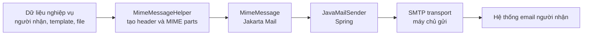
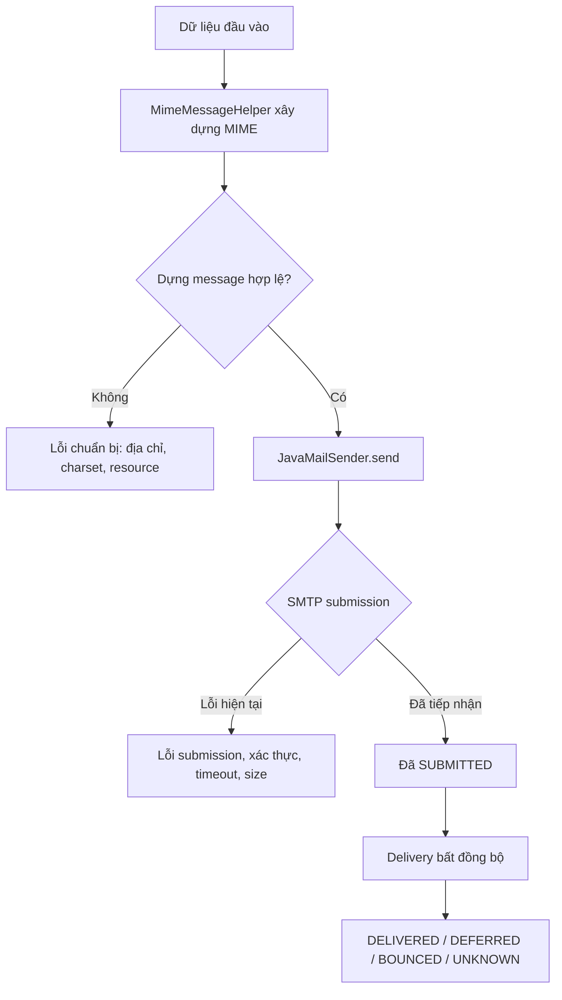

# MimeMessageHelper như lớp hỗ trợ tạo MIME

Một email thông báo đơn giản chỉ có người nhận, tiêu đề và một đoạn văn bản. Nhưng email thực tế thường cần thêm tên người gửi tiếng Việt, nội dung HTML, phiên bản văn bản thuần, logo hiển thị trong phần thân, hóa đơn PDF hoặc nhiều người nhận. Khi đó, việc thiết lập thủ công từng header và từng phần MIME của `MimeMessage` trở nên khó đọc, dễ nhầm cấu trúc và dễ sai mã hóa.

Trong **Spring Framework Mail**, `MimeMessageHelper` là lớp tiện ích giúp xây dựng thông điệp MIME qua API mức cao. Lớp này phối hợp với **`MimeMessage` của Jakarta Mail** và **`JavaMailSender` của Spring**: một thành phần đại diện cho email, một thành phần hỗ trợ điền nội dung đúng cấu trúc, và một thành phần thực hiện gửi.

Ví dụ:

```java
MimeMessage message = mailSender.createMimeMessage();
MimeMessageHelper helper = new MimeMessageHelper(message, true, "UTF-8");

helper.setFrom("notifications@example.com", "Hệ thống thông báo");
helper.addTo("an@example.net", "Nguyễn Văn An");
helper.setSubject("Xác nhận đăng ký");
helper.setText("<h1>Đăng ký thành công</h1>", true);

mailSender.send(message);
```

Điểm quan trọng: **`MimeMessageHelper` không phải một giao thức và không trực tiếp gửi email**. Nó là công cụ hỗ trợ **tạo nội dung thông điệp**; `JavaMailSender` mới là API gửi qua transport mail đã cấu hình. Bài học này đi từ cơ chế MIME, constructor và các phương thức của helper đến ví dụ HTML, attachment, inline image, charset, xử lý lỗi và cách tổ chức code trong ứng dụng Spring.

## 1. Vị trí của MimeMessageHelper trong Spring Mail

### 1.1. Ba đối tượng với ba trách nhiệm

| Thành phần | Thuộc thư viện | Vai trò |
|---|---|---|
| `JavaMailSender` | Spring Framework Mail | Abstraction tạo và gửi MIME email; có các overload nhận `MimeMessage` hoặc `MimeMessagePreparator`. |
| `MimeMessage` | Jakarta Mail (`jakarta.mail.internet`) | Đối tượng biểu diễn thông điệp Internet: header, recipient, MIME body và các phần nội dung. |
| `MimeMessageHelper` | Spring Framework (`org.springframework.mail.javamail`) | API hỗ trợ thiết lập địa chỉ, tiêu đề, văn bản, HTML, multipart, inline resource và tệp đính kèm cho `MimeMessage`. |

Sơ đồ luồng:



`MimeMessageHelper` giữ tham chiếu đến `MimeMessage` được truyền vào constructor. Các phương thức như `setSubject`, `setText` hoặc `addAttachment` **thay đổi thông điệp đó**, không tự tạo một bản email khác mỗi lần gọi. Sau khi hoàn tất các phần nội dung, ứng dụng truyền **đúng đối tượng `MimeMessage` ấy** vào `mailSender.send(message)`.

### 1.2. Khi nào nên dùng `SimpleMailMessage`, khi nào dùng `MimeMessageHelper`?

| Nhu cầu | `SimpleMailMessage` | `MimeMessageHelper` + `MimeMessage` |
|---|---|---|
| Email văn bản thuần, không đính kèm | Phù hợp | Phù hợp |
| Nội dung HTML | Không phải mục tiêu của API | Hỗ trợ trực tiếp |
| `text/plain` + `text/html` trong cùng email | Không | Hỗ trợ |
| Tệp đính kèm PDF, CSV, hình ảnh | Không | Hỗ trợ |
| Hình nhúng nội dung với `cid:` | Không | Hỗ trợ |
| Tên người gửi/người nhận Unicode và MIME encoding | Hạn chế hơn | Có API personal name và charset |
| Tự kiểm soát cấu trúc MIME nhiều phần | Không | Có các chế độ multipart |

Không cần sử dụng `MimeMessageHelper` cho mọi email; nếu chỉ gửi thông báo text đơn giản, `SimpleMailMessage` là lựa chọn gọn. Khi cần **MIME**, `MimeMessageHelper` giúp tránh phải thao tác với `MimeMultipart`, `MimeBodyPart`, `DataHandler` và header bằng tay.

## 2. MIME là gì và vì sao cần helper?

**MIME (Multipurpose Internet Mail Extensions)** mở rộng cấu trúc email để chứa nhiều loại nội dung. Một thông điệp MIME có thể mang:

- Văn bản thuần (`text/plain`).
- Nội dung HTML (`text/html`).
- Hai biểu diễn thay thế cho cùng nội dung (`multipart/alternative`).
- Hình ảnh cần tham chiếu trong HTML (`Content-ID` và `cid:...`).
- Tệp đính kèm (`Content-Disposition: attachment`).
- Nhiều phần kết hợp thông qua ranh giới (`boundary`) trong `multipart/*`.

Ví dụ cấu trúc khái niệm của thư xác nhận đơn hàng kèm hóa đơn:

```text
MimeMessage
├── From: "Hệ thống" <orders@example.com>
├── To: "Nguyễn Văn An" <an@example.net>
├── Subject: Xác nhận đơn hàng
└── multipart/mixed
    ├── multipart/related
    │   ├── multipart/alternative
    │   │   ├── text/plain; charset=UTF-8
    │   │   └── text/html; charset=UTF-8
    │   └── image/png; Content-ID: <brand-logo>
    └── application/pdf; Content-Disposition: attachment
```

Đây là một **cấu trúc MIME điển hình**. Cấu trúc cụ thể do chế độ multipart, thư viện và nội dung được thêm vào quyết định; không nên giả định mọi message có cùng số tầng MIME.

Các nhóm multipart dễ gặp:

| Kiểu | Ý nghĩa |
|---|---|
| `multipart/alternative` | Nhiều cách biểu diễn **cùng một nội dung**, thường text/plain và text/html; ứng dụng email chọn phần có thể hiển thị. |
| `multipart/related` | Các phần có quan hệ phụ thuộc nhau, chẳng hạn HTML và hình ảnh được tham chiếu bằng `cid:`. |
| `multipart/mixed` | Các phần độc lập được gửi cùng thông điệp, thường có attachment. |

Nếu tự lắp `MimeBodyPart` và `MimeMultipart` cho mọi trường hợp, ứng dụng cần đặt đúng `Content-Type`, `Content-Transfer-Encoding`, `Content-Disposition`, `Content-ID` và thứ tự lồng ghép. **`MimeMessageHelper` gom các tác vụ thông dụng thành các phương thức có ý nghĩa rõ ràng**, đồng thời để Jakarta Mail đảm nhận nhiều chi tiết đóng gói MIME.

## 3. Khởi tạo MimeMessageHelper và lựa chọn chế độ multipart

### 3.1. Không multipart: chỉ có nội dung đơn

```java
MimeMessage mimeMessage = mailSender.createMimeMessage();
MimeMessageHelper helper =
        new MimeMessageHelper(mimeMessage, false, "UTF-8");

helper.setTo("user@example.net");
helper.setSubject("Xin chào");
helper.setText("Nội dung văn bản thuần.", false);
mailSender.send(mimeMessage);
```

Tham số `false` nghĩa là helper **không khởi tạo cấu trúc multipart**. Trường hợp này phù hợp khi message chỉ cần một phần nội dung text hoặc HTML, không cần attachment và không cần đồng thời hai phiên bản văn bản.

Nếu sau đó gọi `addAttachment` hoặc `addInline` trên helper không multipart, ứng dụng sẽ gặp lỗi do helper không được cấu hình chứa nhiều phần nội dung. Không thể sửa bằng cách chỉ đặt `Content-Type` thủ công trong phần text.

### 3.2. Multipart: có attachment, inline resource hoặc hai body thay thế

```java
MimeMessage mimeMessage = mailSender.createMimeMessage();
MimeMessageHelper helper =
        new MimeMessageHelper(mimeMessage, true, "UTF-8");
```

Với constructor nhận `multipart=true`, Spring khởi tạo một cấu trúc MIME multipart. Trong các phiên bản Spring Framework hiện đại, chế độ mặc định khi bật multipart là **`MULTIPART_MODE_MIXED_RELATED`**, thích hợp cho nhiều trường hợp có inline resources và attachment.

Có thể chọn chế độ rõ ràng bằng các hằng của `MimeMessageHelper`:

```java
MimeMessageHelper helper = new MimeMessageHelper(
        mimeMessage,
        MimeMessageHelper.MULTIPART_MODE_MIXED_RELATED,
        "UTF-8");
```

Các chế độ chính:

| Hằng | Ý nghĩa | Khi nào cân nhắc |
|---|---|---|
| `MULTIPART_MODE_NO` | Không dùng multipart | Chỉ một phần text/HTML, không attachment, không inline. |
| `MULTIPART_MODE_MIXED` | Các phần đặt trong root `multipart/mixed` | Trường hợp cần cấu trúc mixed đơn giản; có thể khác về cách client mail hiển thị inline. |
| `MULTIPART_MODE_RELATED` | Sử dụng `multipart/related` | Nội dung có các phần liên quan, đặc biệt hình nhúng; cần kiểm tra nếu còn attachment. |
| `MULTIPART_MODE_MIXED_RELATED` | Root `multipart/mixed`, có vùng `multipart/related` cho nội dung và inline resources | Lựa chọn thực dụng cho HTML + hình nhúng + file đính kèm. |

**Chế độ multipart là quyết định về cấu trúc thông điệp**, không phải tùy chọn giao diện. Một số ứng dụng email xử lý cấu trúc MIME lồng nhau khác nhau. Nếu sản phẩm gửi thư tới nhóm client cụ thể, hãy kiểm tra hiển thị trên các client đó ở giai đoạn kiểm thử nội dung.

### 3.3. Charset trong constructor

Tham số thứ ba `"UTF-8"` được dùng cho các phần MIME phù hợp mà helper xây dựng, giúp nội dung tiếng Việt và tên cá nhân được biểu diễn nhất quán. Không nên dùng encoding mặc định của hệ điều hành để đoán cách chuyển chuỗi Unicode thành email.

Ví dụ tên tiếng Việt:

```java
helper.setFrom("support@example.com", "Trung tâm hỗ trợ");
helper.addTo("an@example.net", "Nguyễn Văn An");
helper.setSubject("Đơn hàng đã được xác nhận");
helper.setText("Xin chào An, đơn hàng của bạn đã thành công.", false);
```

Jakarta Mail có thể biểu diễn tên trong header bằng cơ chế **encoded-word** theo RFC 2047. Đây là cách mã hóa biểu diễn, không phải mã hóa bảo mật. **Tên hiển thị Unicode** không đồng nghĩa địa chỉ email có Unicode trong local-part cũng được hỗ trợ; trường hợp địa chỉ quốc tế hóa có thể cần **SMTPUTF8** trên đường gửi.

## 4. Các phương thức thường dùng

### 4.1. Header và thông tin nhận thư

| Phương thức | Công dụng |
|---|---|
| `setFrom(...)` | Thiết lập địa chỉ người gửi hiển thị trong `From:`; overload có `personal` hỗ trợ tên hiển thị. |
| `setTo(...)` | Thiết lập người nhận To; các overload hỗ trợ một địa chỉ, mảng địa chỉ hoặc `InternetAddress`. |
| `addTo(...)` | Thêm một người nhận To; có overload `addTo(address, personal)`. |
| `setCc(...)` / `addCc(...)` | Thiết lập hoặc bổ sung người nhận bản sao công khai. |
| `setBcc(...)` / `addBcc(...)` | Thiết lập hoặc bổ sung người nhận bản sao kín. |
| `setReplyTo(...)` | Đặt địa chỉ nhận phản hồi, có thể khác `From`. |
| `setSubject(...)` | Thiết lập tiêu đề email. |
| `setSentDate(...)` | Đặt thời điểm gửi trên header email, khi nghiệp vụ cần kiểm soát. |
| `setPriority(...)` | Gắn chỉ dấu ưu tiên (thường qua header); không buộc hệ thống nhận phải ưu tiên phát thư. |

**`set...` và `add...` không có cùng nghĩa:** các phương thức `setTo`/`setCc` thường thiết lập danh sách ở trường đó, trong khi `addTo`/`addCc` bổ sung người nhận. Khi có tên hiển thị chứa dấu phẩy hoặc tiếng Việt, hãy tách địa chỉ và tên qua overload hỗ trợ `personal`, không ghép chuỗi raw.

Ví dụ:

```java
helper.setFrom("billing@example.com", "Bộ phận thanh toán");
helper.addTo("an@example.net", "Nguyễn Văn An");
helper.addCc("accountant@example.org", "Phòng kế toán");
helper.setReplyTo("support@example.com");
helper.setSubject("Hóa đơn điện tử tháng 11");
```

Trường `Reply-To` giúp email client đề xuất địa chỉ nhận trả lời. Nó không thay đổi địa chỉ nhận **bounce** trong SMTP envelope; envelope sender `MAIL FROM` là một khái niệm khác.

### 4.2. Nội dung text và HTML

Helper có ba cách thường gặp:

```java
// Văn bản thuần
helper.setText("Xin chào!", false);

// Nội dung HTML
helper.setText("<p>Xin <strong>chào</strong>!</p>", true);

// Đồng thời hai biểu diễn thay thế của một nội dung
helper.setText(
        "Xin chào! Đây là nội dung văn bản thuần.",
        "<p>Xin <strong>chào</strong>! Đây là nội dung HTML.</p>");
```

Ví dụ trên trình bày **ba lựa chọn thay thế**, không phải ba lời gọi nên thực hiện liên tiếp trên cùng một message. Overload hai tham số chuỗi `setText(String plainText, String htmlText)` tạo nội dung dạng **`multipart/alternative`** và **cần helper ở chế độ multipart**.

Lựa chọn:

- **Text thuần:** phù hợp thông báo đơn giản, dễ truy cập và ít lỗi hiển thị.
- **Chỉ HTML:** dùng khi cần định dạng, nhưng một số client có thể hạn chế hoặc chuyển sang hiển thị khác.
- **Text + HTML:** thường là lựa chọn tốt cho email giao dịch có giao diện, giúp ứng dụng email chọn dạng phù hợp mà vẫn có nội dung dự phòng.

`setText(..., true)` **không phải công cụ lọc HTML độc hại**. Nếu nội dung HTML được tạo từ dữ liệu người dùng, phải escape hoặc xử lý an toàn tại bước render template. Không đưa trực tiếp chuỗi HTML tùy ý của người dùng vào email chỉ vì helper chấp nhận tham số `html=true`.

### 4.3. Thêm tệp đính kèm

```java
FileSystemResource pdf =
        new FileSystemResource(Path.of("reports", "invoice.pdf"));

helper.addAttachment("invoice.pdf", pdf);
```

Về mặt cấu trúc, attachment là một MIME part độc lập, thường có:

```text
Content-Type: application/pdf; name="invoice.pdf"
Content-Disposition: attachment; filename="invoice.pdf"
Content-Transfer-Encoding: base64
```

Đây là ví dụ header điển hình: encoding và tham số filename thực tế có thể khác tùy file, charset và thư viện. **Tên tệp hiển thị** có thể khác với tên file trên ổ đĩa; ví dụ ứng dụng đọc một file có tên nội bộ nhưng đính kèm với tên `hoa-don-2026-11.pdf`.

Các overload của `addAttachment` chấp nhận nhiều nguồn dữ liệu như `File`, `InputStreamSource` hoặc `DataSource`, tùy nhu cầu. Khi có `InputStreamSource`, nguồn nên cung cấp được **InputStream mới cho mỗi lần đọc**. Một stream chỉ đọc được một lần có thể thất bại khi Jakarta Mail tuần tự hóa MIME nhiều lần.

### 4.4. Hình ảnh hiển thị trong HTML: `addInline`

Khi HTML chứa:

```html

```

ứng dụng cần thêm một MIME part có `Content-ID` tương ứng:

```java
helper.setText(
        "Bạn có một thông báo mới từ công ty.",
        "<html><body>" +
        "<p>Bạn có một thông báo mới.</p>" +
        "" +
        "</body></html>");

helper.addInline(
        "company-logo",
        new ClassPathResource("mail/company-logo.png"),
        "image/png");
```

Trong HTML, `cid:company-logo` tham chiếu tới part có Content-ID `<company-logo>`. Helper xử lý phần header liên quan; ứng dụng chỉ truyền **ID logic không có dấu ngoặc nhọn**. **Nên gọi `addInline` sau `setText`**, vì thứ tự này giúp các email client nhận diện đúng phần HTML và tài nguyên liên quan.

Hình inline vẫn là dữ liệu được gửi cùng email; nó **không phải liên kết đến file nằm trên máy chủ web**. Một số client chặn hiển thị ảnh, xử lý CID khác nhau hoặc cho phép người dùng tắt ảnh; vì thế nên cung cấp `alt` và tránh đặt thông tin quan trọng chỉ trong hình.

## 5. Ví dụ hoàn chỉnh: email xác nhận đơn hàng có HTML, logo và PDF

Giả sử hệ thống Spring Boot cần gửi email có:

1. Người gửi là `Đội đơn hàng <orders@example.com>`.
2. Người nhận `Nguyễn Văn An <an@example.net>`.
3. Bản text dự phòng, bản HTML, logo inline và tệp hóa đơn PDF.
4. Header UTF-8 để tên người nhận và nội dung tiếng Việt hiển thị đúng.

Thêm dependency mail vào dự án Spring Boot dùng Gradle:

```groovy
dependencies {
    implementation 'org.springframework.boot:spring-boot-starter-mail'
}
```

Cấu hình SMTP submission bằng `application.yml`:

```yaml
spring:
  mail:
    host: ${MAIL_HOST}
    port: 587
    username: ${MAIL_USERNAME}
    password: ${MAIL_PASSWORD}
    default-encoding: UTF-8
    properties:
      mail:
        smtp:
          auth: true
          starttls:
            enable: true
            required: true
          connectiontimeout: 5000
          timeout: 10000
          writetimeout: 10000

app:
  mail:
    from: ${MAIL_FROM:orders@example.com}
```

Đây là cấu hình minh họa cho cổng **587 + STARTTLS**. Máy chủ dùng implicit TLS trên cổng 465 cần cấu hình tương ứng (chẳng hạn `mail.smtp.ssl.enable`). Thông tin đăng nhập phải được cấp qua biến môi trường hoặc secret manager và chỉ dùng phương thức xác thực được provider hỗ trợ.

Đặt hình mẫu ở `src/main/resources/mail/company-logo.png`, để `ClassPathResource("mail/company-logo.png")` tìm thấy trong classpath lúc chạy.

Ví dụ dịch vụ:

```java
import jakarta.mail.MessagingException;
import jakarta.mail.internet.MimeMessage;
import org.springframework.beans.factory.annotation.Value;
import org.springframework.core.io.ClassPathResource;
import org.springframework.core.io.FileSystemResource;
import org.springframework.mail.javamail.JavaMailSender;
import org.springframework.mail.javamail.MimeMessageHelper;
import org.springframework.stereotype.Service;

import java.io.IOException;
import java.io.UnsupportedEncodingException;
import java.nio.file.Files;
import java.nio.file.Path;
import java.nio.charset.StandardCharsets;

@Service
public class OrderConfirmationMailer {

    private final JavaMailSender mailSender;
    private final String fromAddress;

    public OrderConfirmationMailer(
            JavaMailSender mailSender,
            @Value("${app.mail.from}") String fromAddress) {
        this.mailSender = mailSender;
        this.fromAddress = fromAddress;
    }

    public void sendOrderConfirmation(
            String recipientAddress,
            String recipientName,
            String orderCode,
            Path invoicePdf)
            throws MessagingException, IOException {

        if (!Files.isRegularFile(invoicePdf) ||
                !Files.isReadable(invoicePdf)) {
            throw new IllegalArgumentException(
                    "Invoice PDF must be a readable file");
        }

        MimeMessage message = mailSender.createMimeMessage();
        MimeMessageHelper helper = new MimeMessageHelper(
                message,
                MimeMessageHelper.MULTIPART_MODE_MIXED_RELATED,
                StandardCharsets.UTF_8.name());

        helper.setFrom(fromAddress, "Đội đơn hàng");
        helper.addTo(recipientAddress, recipientName);
        helper.setReplyTo("support@example.com");
        helper.setSubject("Xác nhận đơn hàng " + orderCode);

        String plainText = "Đơn hàng " + orderCode
                + " đã được ghi nhận. Vui lòng xem hóa đơn đính kèm.";

        // Ví dụ dùng dữ liệu đã được kiểm soát bởi nghiệp vụ.
        // Khi dùng dữ liệu tự do, phải escape đúng ngữ cảnh HTML.
        String htmlText = """
                <html>
                  <body>
                    
                    <h1>Xác nhận đơn hàng</h1>
                    <p>Đơn hàng đã được ghi nhận.
                       Vui lòng xem hóa đơn PDF đính kèm.</p>
                  </body>
                </html>
                """;

        helper.setText(plainText, htmlText);

        // Thêm inline sau khi thiết lập nội dung HTML.
        helper.addInline(
                "company-logo",
                new ClassPathResource("mail/company-logo.png"),
                "image/png");

        helper.addAttachment(
                "invoice-" + orderCode + ".pdf",
                new FileSystemResource(invoicePdf));

        mailSender.send(message);
    }
}
```

Trong dự án thực tế, `orderCode` và `recipientName` phải được kiểm soát trước khi đưa vào tiêu đề, tên file hoặc HTML. Nếu tạo HTML có nội dung biến đổi theo khách hàng, dùng template engine có escaping sẽ an toàn và dễ bảo trì hơn nối chuỗi.

**Luồng chạy của ví dụ:**

1. `JavaMailSender.createMimeMessage()` tạo đối tượng message.
2. `MimeMessageHelper` được tạo với chế độ multipart hỗ trợ kết hợp related/mixed và charset UTF-8.
3. Helper đặt địa chỉ, header, plain text và HTML.
4. Helper bổ sung logo inline và hóa đơn PDF.
5. `JavaMailSender.send(message)` bàn giao message cho transport SMTP.

Tệp được đọc khi thư viện dựng/tuần tự hóa MIME để gửi. Việc helper chấp nhận đường dẫn không có nghĩa file chắc chắn đã tồn tại, đọc được hoặc được phép gửi; ứng dụng cần kiểm tra nguồn file, quyền truy cập và giới hạn kích thước theo chính sách.

### 5.1. Điều gì xảy ra nếu bỏ tham số multipart?

Nếu đổi constructor thành:

```java
new MimeMessageHelper(message, false, "UTF-8");
```

thì helper không có cấu trúc chứa attachment và inline resources. Các lời gọi tương ứng sẽ thất bại; phiên bản `setText(plainText, htmlText)` cũng đòi hỏi multipart. Vì vậy chế độ phải được chọn ngay khi dựng message, dựa trên **cấu trúc cần tạo**, thay vì cố sửa cấu trúc sau khi đã điền hết nội dung.

### 5.2. Vì sao tệp 10 MiB lại có thể làm email lớn hơn 10 MiB?

Tệp nhị phân thường được mã hóa `base64` trong MIME. Cứ 3 byte gốc thành 4 ký tự, rồi thêm ký tự xuống dòng và phần header/boundary. Với tệp lớn, phần base64 có ngắt dòng có thể khoảng **1,37 lần kích thước gốc**. Vì vậy phải tính giới hạn **toàn bộ thông điệp MIME** mà provider chấp nhận, không chỉ đo `Files.size(invoicePdf)`.

Không cần tự base64-encode file trước khi gọi `addAttachment`. Làm vậy có thể khiến ứng dụng vô tình đính kèm chuỗi đã được mã hóa như một file văn bản hoặc gây mã hóa hai lần.

## 6. Dùng MimeMessagePreparator để đóng gói bước tạo thư

Ngoài cách tự tạo `MimeMessage` rồi gọi `send(message)`, Spring hỗ trợ một callback **`MimeMessagePreparator`**. Callback này nhận `MimeMessage` mà sender cung cấp và điền nội dung vào đó.

```java
import org.springframework.mail.javamail.JavaMailSender;
import org.springframework.mail.javamail.MimeMessageHelper;
import org.springframework.stereotype.Service;

@Service
public class SecurityAlertMailer {

    private final JavaMailSender mailSender;

    public SecurityAlertMailer(JavaMailSender mailSender) {
        this.mailSender = mailSender;
    }

    public void sendLoginAlert(String recipient) {
        mailSender.send(mimeMessage -> {
            MimeMessageHelper helper =
                    new MimeMessageHelper(mimeMessage, false, "UTF-8");

            helper.setFrom("security@example.com", "Cảnh báo bảo mật");
            helper.setTo(recipient);
            helper.setSubject("Thông báo đăng nhập mới");
            helper.setText(
                    "Tài khoản của bạn vừa có một lần đăng nhập.",
                    false);
        });
    }
}
```

Ở đây Java lambda tương ứng với `MimeMessagePreparator`. Spring gọi callback để chuẩn bị nội dung trước khi gửi.

Ưu điểm:

- Gói logic xây dựng message vào một khối rõ ràng.
- Giúp tách code tạo nội dung khỏi cơ chế gửi ở một số thiết kế.
- Không cần tự gọi `createMimeMessage()` trước lời gọi `send(preparator)`.

Nhưng **callback vẫn chạy trong quá trình thực hiện lời gọi gửi**, không tự biến gửi email thành bất đồng bộ. Muốn gửi qua hàng đợi hoặc worker, ứng dụng phải thiết kế cơ chế đó riêng.

## 7. Chi tiết về attachment và inline resource

### 7.1. Attachment và inline khác nhau

Giả sử một email HTML có logo và một hóa đơn PDF:

```text
HTML:


MIME:
image/png
Content-ID: <brand-logo>
Content-Disposition: inline

application/pdf
Content-Disposition: attachment; filename="invoice.pdf"
```

Với `addInline("brand-logo", resource, "image/png")`, nội dung thường được tham chiếu bên trong HTML. Với `addAttachment("invoice.pdf", resource)`, email client thường trình bày file như tệp đính kèm có thể tải về.

**Không có bảo đảm tuyệt đối về giao diện của client:** một số ứng dụng có thể hiển thị hình inline như attachment hoặc chặn hình. Cấu trúc MIME hợp lệ là điều kiện cần, nhưng trải nghiệm nhận thư còn phụ thuộc email client.

### 7.2. Nguồn dữ liệu lặp lại được

Khi Jakarta Mail ghi thông điệp ra stream, thư viện có thể đọc nội dung file để tính toán/mã hóa hoặc ghi ra nhiều lần. Với những nguồn `InputStreamSource`, hãy ưu tiên đối tượng cung cấp **stream mới mỗi lần**:

```java
// File có thể mở lại khi cần.
helper.addAttachment(
        "report.pdf",
        new FileSystemResource(reportPath));

// Dữ liệu nhỏ đã nằm trong bộ nhớ; có thể mở lại stream.
helper.addAttachment(
        "export.csv",
        new ByteArrayResource(csvBytes),
        "text/csv");
```

Trong snippet này cần import:

```java
import org.springframework.core.io.ByteArrayResource;
import org.springframework.core.io.FileSystemResource;
```

**`InputStreamResource` bọc một stream sẵn có thường không phù hợp cho attachment phải đọc nhiều lần**, vì stream đã tiêu thụ không tự quay lại đầu. Với dữ liệu lớn, `ByteArrayResource` cũng có nhược điểm giữ toàn bộ nội dung trong RAM; `FileSystemResource` hoặc nguồn có khả năng mở lại theo nhu cầu thường phù hợp hơn.

### 7.3. Content type và tên tệp

Với tệp có extension dễ nhận biết, helper có thể dựa vào cơ chế xác định content type mặc định. Nhưng không nên dựa vào tên tệp để xác định dữ liệu an toàn. Khi biết chính xác loại tệp, có thể truyền content type:

```java
helper.addAttachment(
        "monthly-report.csv",
        new ByteArrayResource(csvBytes),
        "text/csv");
```

Tên tệp có dấu tiếng Việt hoặc ký tự đặc biệt cần encoding parameter/header phù hợp; ứng dụng email và provider có thể xử lý khác nhau. Tên tệp an toàn, ổn định, không chứa ký tự điều khiển và có đuôi phù hợp thường tương thích hơn. Đừng cho phép người dùng ép ứng dụng gửi một loại file nguy hiểm chỉ bằng cách đổi phần mở rộng.

### 7.4. Không dùng inline image cho dữ liệu quan trọng duy nhất

Nếu email chứa mã OTP hoặc liên kết khôi phục tài khoản, hãy đặt **nội dung có thể đọc bằng text**. Không chỉ vẽ mã/URL vào một ảnh inline, vì ảnh có thể bị chặn, không hiển thị hoặc không được công cụ hỗ trợ tiếp cận đọc ra.

## 8. Charset, địa chỉ có tên hiển thị và header

### 8.1. Vì sao UTF-8 nên được cấu hình rõ?

Ứng dụng Java xử lý chuỗi Unicode. Email truyền qua các hệ thống khác nhau và cần biểu diễn header/body theo quy tắc MIME. Với tiếng Việt, một số ký tự chiếm nhiều byte UTF-8; nếu phần header hoặc body được tạo với charset không phù hợp, người nhận có thể thấy ký tự lỗi.

```java
MimeMessageHelper helper =
        new MimeMessageHelper(message, true, "UTF-8");

helper.setFrom("no-reply@example.com", "Thông báo hệ thống");
helper.addTo("an@example.net", "Nguyễn Văn An");
helper.setSubject("Xác nhận địa chỉ email");
helper.setText(
        "Chào An, địa chỉ của bạn đã được xác nhận.",
        false);
```

Helper sẽ phối hợp với Jakarta Mail để tạo phần header và MIME body. **Không tự viết một header `To: Nguyễn Văn An <...>` bằng cách nối chuỗi và gọi `setHeader`**, vì bạn phải xử lý quoting, encoded-word và folding đúng tiêu chuẩn.

### 8.2. Địa chỉ recipient cần được kiểm soát riêng

Tên hiển thị và địa chỉ là hai dữ liệu khác nhau:

```json
{
  "emailAddress": "an@example.net",
  "displayName": "Nguyễn Văn An"
}
```

Tên có dấu phẩy như `Công ty ABC, Bộ phận mua hàng` sẽ khó xử lý nếu bạn ghép chuỗi `"Tên <địa chỉ>"` rồi tự tách bằng dấu phẩy. Thay vào đó:

```java
helper.addTo(
        "purchase@example.net",
        "Công ty ABC, Bộ phận mua hàng");
```

Đối với địa chỉ cần kiểm tra cú pháp, Jakarta Mail có `InternetAddress`:

```java
import jakarta.mail.internet.InternetAddress;

InternetAddress recipient = new InternetAddress("an@example.net");
recipient.validate();
helper.setTo(recipient);
```

`validate()` kiểm tra cú pháp ở mức thư viện; **không chứng minh mailbox tồn tại, không chứng minh quyền sở hữu địa chỉ và không bảo đảm nhận được thư**. Với dữ liệu đầu vào không tin cậy, ứng dụng còn cần quy tắc kiểm soát ký tự CR/LF, độ dài, định dạng và quyền được gửi tới địa chỉ đó.

### 8.3. Tránh header injection và HTML injection

Nếu một tên người nhận chứa:

```text
Alice\r\nBcc: outsider@example.net
```

thì việc nối chuỗi để tạo raw header có thể khiến dữ liệu người dùng bị diễn giải thành trường `Bcc` mới. Dùng typed API của helper và **từ chối ký tự điều khiển/CR/LF** trong các trường dùng làm header.

Nếu dữ liệu người dùng được chèn vào HTML, ví dụ `customerName`, phải escape theo ngữ cảnh HTML:

```html
<!-- Trong template engine có hỗ trợ escaping -->
<p th:text="|Xin chào, ${customerName}!|">Xin chào</p>
```

Ví dụ trên thuộc cú pháp Thymeleaf, chỉ áp dụng nếu dự án có dùng Thymeleaf và thiết lập biến tương ứng; `MimeMessageHelper` **không tự render template**. Template engine tạo ra một chuỗi HTML an toàn, sau đó helper đưa chuỗi ấy vào MIME message. Trong Thymeleaf, `th:text` escape HTML; `th:utext` là nội dung không escape, nên chỉ dùng `th:utext` với nội dung đã được tin cậy và kiểm soát.

## 9. Kết hợp template engine với MimeMessageHelper

Trong ứng dụng có nhiều loại email, không nên đặt toàn bộ HTML thành chuỗi dài trong service Java. Một hướng tổ chức:

```text
src/main/resources/
  templates/
    mail/
      order-confirmation.html
  mail/
    company-logo.png

com.example.mail/
  MailTemplateRenderer.java
  OrderConfirmationMailer.java
  MailNotificationService.java
```

Các trách nhiệm:

1. **Template renderer:** nhận dữ liệu nghiệp vụ và tạo chuỗi HTML/text, áp dụng escaping đúng ngữ cảnh.
2. **Mail composer:** sử dụng `MimeMessageHelper` để đặt người gửi/nhận, subject, text/plain, HTML, inline và attachment.
3. **Mail sender:** chuyển `MimeMessage` đến `JavaMailSender`.
4. **Notification workflow:** quản lý ý định gửi, retry, trạng thái và theo dõi phản hồi nếu ứng dụng cần độ tin cậy cao.

Ví dụ API khái niệm:

```java
String html = templateRenderer.render(
        "mail/order-confirmation", templateModel);
String plain = plainTextRenderer.renderOrderConfirmation(order);

MimeMessage message = mailSender.createMimeMessage();
MimeMessageHelper helper = new MimeMessageHelper(
        message, true, "UTF-8");
helper.setTo(customerEmail);
helper.setSubject("Xác nhận đơn hàng");
helper.setText(plain, html);
mailSender.send(message);
```

`templateRenderer`, `plainTextRenderer` và `templateModel` là **thành phần do ứng dụng tự định nghĩa**, không phải API mặc định của Spring Mail. Nếu dùng Thymeleaf, FreeMarker hoặc engine khác, các dependency và cách render template nằm trong lớp riêng, còn helper chỉ nhận kết quả là chuỗi.

**Không phải email nào cũng cần HTML.** Nếu nghiệp vụ chỉ cần văn bản dễ đọc, thiết kế text thuần thường đơn giản và đáng tin cậy hơn.

## 10. Bẫy thường gặp khi sử dụng MimeMessageHelper

### 10.1. Bật multipart dù không cần?

Một message chỉ có text có thể dùng `multipart=false`. Bật multipart không tự làm email sai, nhưng khiến cấu trúc MIME phức tạp hơn. Hãy chọn dựa vào nhu cầu: plain/simple HTML thì không bắt buộc multipart; plain+HTML, inline hoặc attachment cần chế độ phù hợp.

### 10.2. Quên bật multipart khi thêm attachment

```java
MimeMessageHelper helper =
        new MimeMessageHelper(message, false, "UTF-8");
helper.addAttachment("report.pdf", resource); // Không phù hợp chế độ NO.
```

Giải pháp là chọn constructor multipart ngay từ đầu, ví dụ `true` hoặc `MULTIPART_MODE_MIXED_RELATED`, rồi mới thêm các phần.

### 10.3. Gọi `addInline` trước `setText`

Nhiều mail client phân tích MIME theo thứ tự các part. Khi cần HTML chứa ảnh `cid:`, nên gọi **`setText` trước, `addInline` sau**, đúng khuyến nghị sử dụng `MimeMessageHelper`. Nếu ảnh không hiển thị, hãy xem Content-ID, `cid:`, thứ tự tạo part và sự khác biệt giữa các email client.

### 10.4. Chỉ gửi HTML và bỏ qua text/plain

Email chỉ có HTML có thể hiển thị không tốt ở một số client hoặc trong môi trường hạn chế. Với thư giao dịch cần nội dung dễ truy cập, dùng `setText(plainText, htmlText)` để tạo cả hai phiên bản cùng nội dung. Tránh đưa thông tin quan trọng chỉ vào HTML hoặc hình ảnh.

### 10.5. Dùng `InputStreamResource` chỉ đọc được một lần

Khi MIME được tuần tự hóa, nguồn attachment có thể được yêu cầu mở stream nhiều lần. Nếu chỉ có một `InputStream` đã bị tiêu thụ, có thể xảy ra lỗi đọc dữ liệu hoặc attachment trống. Dùng nguồn có thể mở lại như `FileSystemResource`, hoặc `ByteArrayResource` với nội dung nhỏ.

### 10.6. Tự base64-encode file trước `addAttachment`

`addAttachment` và Jakarta Mail xử lý MIME transfer encoding. Nếu ứng dụng tự base64-encode file và truyền chuỗi encoded như file gốc, người nhận có thể tải được **văn bản base64 thay vì PDF**, hoặc nội dung bị mã hóa lại. Truyền file/dữ liệu gốc cùng content type đúng.

### 10.7. Tin rằng cấu hình UTF-8 giải quyết mọi địa chỉ email

UTF-8 giúp biểu diễn **tên hiển thị** và body. Nhưng địa chỉ email chứa Unicode trong phần trước `@` thuộc phạm vi Email Address Internationalization, có yêu cầu riêng về SMTPUTF8 và hỗ trợ của hạ tầng. Không suy ra cứ `new MimeMessageHelper(..., "UTF-8")` là gửi được mọi local-part Unicode.

### 10.8. Gửi thành công đồng nghĩa đã vào Inbox?

Không. `mailSender.send(...)` hoàn thành có thể chỉ cho biết transport đã bàn giao thư cho SMTP submission server. Máy chủ nhận sau đó vẫn có thể từ chối, lọc thư hoặc đưa vào spam. Nếu nghiệp vụ cần theo dõi phát thư, phải có **delivery event/webhook, DSN hoặc bounce processing** riêng. `MimeMessageHelper` chỉ giúp tạo MIME message.

### 10.9. Tự tạo HTML với chuỗi không được escape

HTML content không được helper tự lọc. Dữ liệu người dùng đưa trực tiếp vào email HTML có thể gây hiển thị sai, chèn liên kết hoặc nội dung không mong muốn. Render qua template engine có escaping, lọc dữ liệu đầu vào và dùng link có nguồn gốc đáng tin cậy.

### 10.10. Coi MIME part là dữ liệu đã nằm sẵn trong memory

Khi thêm `FileSystemResource`, bạn thường lưu **tham chiếu đến nguồn file**, không phải chắc chắn đã sao chép toàn bộ byte vào message tại thời điểm `addAttachment`. Nếu file bị xóa/thay đổi trước khi send hoặc thư viện cần đọc lại, có thể phát sinh lỗi. Trong hệ thống gửi bất đồng bộ, phải bảo đảm nguồn attachment tồn tại và có thể truy cập xuyên suốt thời gian gửi; lưu file bền vững hoặc snapshot khi cần.

## 11. Lỗi, thời gian chờ và vận hành

`MimeMessageHelper` có thể phát sinh `MessagingException` khi tạo/sửa cấu trúc MIME và `UnsupportedEncodingException` ở các thao tác personal name tùy overload. `JavaMailSender` có thể phát sinh các ngoại lệ thuộc họ `MailException` khi thực hiện gửi, ví dụ vấn đề cấu hình, xác thực, kết nối hoặc SMTP.

Nên phân biệt hai giai đoạn:



Một số tình huống:

| Dấu hiệu | Nhóm nguyên nhân cần xem | Hướng xử lý |
|---|---|---|
| `IllegalStateException` khi thêm attachment | Helper không ở chế độ multipart | Khởi tạo đúng chế độ trước khi dựng nội dung. |
| `MessagingException` khi tạo MIME | Lỗi header, cấu trúc message hoặc nguồn dữ liệu | Xem nguyên nhân gốc và API đang gọi; không retry vô hạn. |
| File/logo không tìm thấy | Sai đường dẫn hoặc resource chưa được đóng gói vào ứng dụng | Kiểm tra nguồn `FileSystemResource`/`ClassPathResource`. |
| Nội dung tiếng Việt hiển thị sai | Sai charset hoặc encode/double encode header | Dùng UTF-8 nhất quán, typed API cho tên cá nhân và MIME. |
| HTML hiện nhưng logo `cid:` không hiển thị | Content-ID sai, chế độ multipart hoặc client chặn ảnh | Đối chiếu `cid:`, `addInline` và HTML/part arrangement. |
| SMTP từ chối email lớn | MIME base64 + attachment vượt giới hạn server | Giảm dung lượng, kiểm tra SIZE/quota hoặc gửi link tải. |
| Gửi lỗi auth/timeout | Cấu hình transport, credential hoặc hạ tầng mạng | Phân loại lỗi và cấu hình retry hợp lý. |
| Sender trả thành công, người nhận không thấy | Bị lọc, chậm phát hoặc bounce ở chặng sau | Theo dõi delivery event/DSN của provider. |

### Quản lý dung lượng

Không có một ngưỡng `spring.mail.max-size` chuẩn của Spring Boot có thể bảo đảm email đến được mọi provider. Ứng dụng nên có chính sách file riêng lẻ, tổng tệp đính kèm và toàn bộ MIME message. Một PDF 10 MiB có thể trở thành khoảng 13,7 MiB chỉ riêng phần base64, chưa gồm header và các phần MIME khác.

### Quản lý kết nối và timeout

Ví dụ các thuộc tính transport trong cấu hình Spring Boot:

```yaml
spring:
  mail:
    properties:
      mail:
        smtp:
          connectiontimeout: 5000
          timeout: 10000
          writetimeout: 10000
```

Các giá trị trên theo millisecond và chỉ là ví dụ tùy theo SLA. Chúng kiểm soát thời gian chờ thao tác mạng, **không tự làm email gửi bất đồng bộ**. Với thông báo nghiệp vụ quan trọng, cân nhắc dùng queue/outbox và worker để ghi bền vững ý định gửi và kiểm soát retry.

### Tách luồng gửi khỏi HTTP request

Khi người dùng thực hiện một thao tác web, không nhất thiết phải chờ SMTP gửi thư trước khi trả phản hồi. Một hướng triển khai:

1. Giao dịch nghiệp vụ lưu dữ liệu và sự kiện **cần gửi email** vào outbox.
2. Worker lấy sự kiện và tạo message bằng `MimeMessageHelper`.
3. `JavaMailSender` thực hiện submission, worker ghi kết quả và thông tin lần thử.
4. Nếu nhận bounce hoặc delivery event, ứng dụng cập nhật trạng thái cho người nhận theo cơ chế riêng.

Điều này giúp giảm thời gian chặn request và hỗ trợ retry có kiểm soát. Tuy nhiên, **một mail API không cung cấp chính xác một lần gửi (exactly-once) chỉ nhờ việc dùng helper**; timeout hoặc network failure có thể khiến kết quả submission không chắc chắn. Cần thiết kế deduplication/đối chiếu theo provider và nghiệp vụ.

## 12. Bài tập thực hành

### Bài 1: Text hay MIME?

Hệ thống gửi hai loại email:

- A: thông báo “Tài khoản của bạn đã được tạo”, chỉ có text thuần.
- B: email hóa đơn gồm HTML, phiên bản text, logo và file PDF.

Hãy chọn giữa `SimpleMailMessage` và `MimeMessageHelper` cho từng loại. Với B, nên dùng chế độ multipart nào để có vùng related và attachment mixed?

### Bài 2: Tạo tên người nhận tiếng Việt

Hãy viết đoạn code gửi email text tới `an@example.net` với display name `Nguyễn Văn An`, người gửi `Hệ thống hỗ trợ`, tiêu đề `Xác nhận yêu cầu`. Sử dụng UTF-8 và API tách biệt email address với personal name.

### Bài 3: HTML và CID

Cho HTML:

```html
<p>Cảm ơn bạn đã mua hàng.</p>

```

Hãy chỉ ra:

1. Helper phải được khởi tạo ở chế độ nào?
2. Khi thêm ảnh, truyền `contentId` nào vào `addInline`?
3. Nên gọi `setText` hay `addInline` trước?
4. Vì sao nên có bản `text/plain` nếu ảnh không hiển thị?

### Bài 4: Tệp đính kèm một lần đọc

Một lập trình viên dùng `InputStreamResource` bọc stream HTTP upload và đưa thẳng vào `addAttachment`. Khi gửi, attachment đôi lúc rỗng hoặc bị lỗi đọc. Giải thích vì sao một số nguồn `InputStreamSource` cần mở được nhiều lần và cách sử dụng file tạm bền vững hoặc `ByteArrayResource` đúng ngữ cảnh.

### Bài 5: Kết quả gửi

`mailSender.send(mimeMessage)` không ném ngoại lệ, nhưng vài phút sau hệ thống nhận báo `550 5.1.1`. Hãy xác định trách nhiệm của `MimeMessageHelper`, `JavaMailSender` và hệ thống xử lý bounce trong tình huống này.

## 13. Ghi nhớ và tài liệu tham khảo

**`MimeMessageHelper` là lớp hỗ trợ xây dựng MIME message, không phải lớp vận chuyển email.** Trong Spring Framework Mail, nó giúp:

- Thiết lập người gửi, người nhận, subject và reply-to bằng API rõ ràng.
- Tạo text/plain, text/html hoặc cả hai dưới dạng multipart/alternative.
- Thêm attachment và tài nguyên inline qua `addAttachment`, `addInline`.
- Sử dụng charset UTF-8 và các cơ chế MIME phù hợp cho nội dung tiếng Việt.
- Chọn cấu trúc multipart phù hợp với từng loại thông điệp.

Hãy tạo `MimeMessage` bằng `JavaMailSender`, tạo helper với **chế độ multipart đúng nhu cầu**, xây dựng nội dung, rồi gửi **chính message đó**. Đối với ảnh inline, đặt text/HTML trước khi gọi `addInline`. Đối với tệp đính kèm, bảo đảm nguồn dữ liệu đọc lại được và có kích thước/chính sách phù hợp. Đối với dữ liệu người dùng, kiểm soát địa chỉ, ký tự điều khiển và escaping HTML.

Tài liệu kỹ thuật hữu ích:

- **Spring Framework Reference — Email:** mô hình `MailSender`, `JavaMailSender`, `MimeMessageHelper`, gửi attachment và inline resource.
- **Spring Framework API — `MimeMessageHelper`:** constructor, `MULTIPART_MODE_*`, `setText`, `addAttachment`, `addInline` và các phương thức địa chỉ.
- **Jakarta Mail API — `MimeMessage` và `InternetAddress`:** biểu diễn email, header và mailbox.
- **RFC 2045–2049 — MIME:** định dạng phần nội dung, transfer encoding và encoded-word.
- **RFC 5322 — Internet Message Format:** header, địa chỉ, dòng và folding.
- **RFC 5321 — Simple Mail Transfer Protocol:** chuyển phát message ở tầng SMTP.

Một thông điệp MIME tốt vừa **đúng cấu trúc**, vừa **dễ đọc trên nhiều email client**, vừa **an toàn khi đưa dữ liệu nghiệp vụ vào header/HTML**. `MimeMessageHelper` làm cho phần cấu trúc dễ viết hơn; độ tin cậy chuyển phát, bảo mật và chính sách nội dung vẫn cần được ứng dụng thiết kế riêng.
